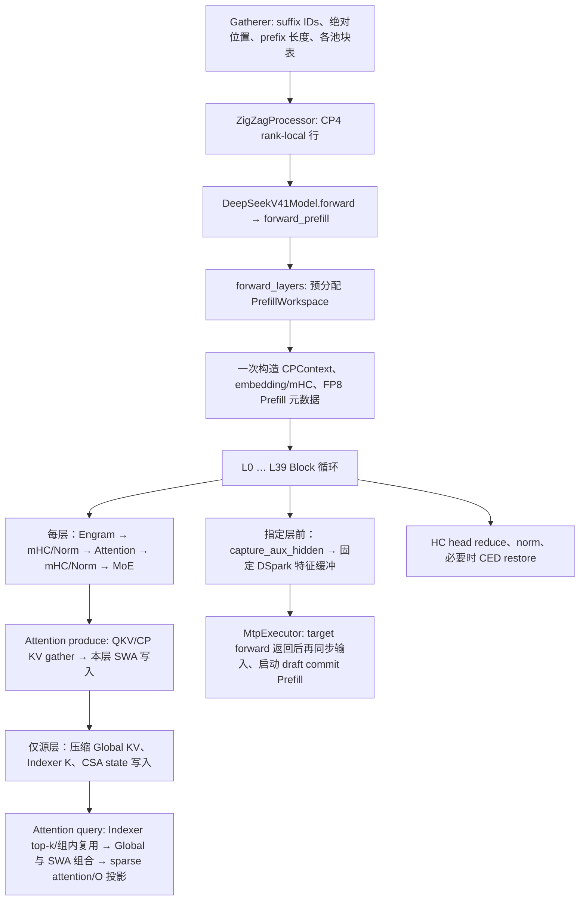

# DSV4.1 CP4 DSpark Prefill：执行图与迭代记录

## 范围、版本和验收口径

- **工作对象**：`ruixuan.zrx_GPU` 中 `feature/dsv41-dev-main-202161013` 的 target 40 层 Prefill，包含 DSpark 辅助 hidden 捕获；随后单列 draft commit Prefill。首次源码基线 HEAD：`fad3ed5f1e5c65783aef4f5f927140114c9379e5`。
- **参照源码**：DeepSeek 官方 [DeepInfer](https://github.com/deepseek-ai/DeepInfer/tree/553741557a57df44a46fb3ab72b6aafeaf945337)，固定提交 `553741557a57df44a46fb3ab72b6aafeaf945337`。这是源码对照，未取得相同 CP4 DSpark 负载的 DeepInfer 运行结果。
- **主指标**：同一完整 batch 中所有请求完成时的 Prefill engine RT；按每轮完整 batch 的 `max(aux_info.cost_time)` 记录原始轮次，再比较无 profiler 的配对正式轮次。算子时间、层时间、target model forward、TTFT 和全请求 E2E 分开记录。不能把局部 launch 减少直接报成 engine RT 收益。
- **控制项**：同一 checkpoint、token IDs、每请求 prefix 命中与 fresh 长度、CP4/TP/EP/DP、batch、KV 页预算、DSpark 策略、后端及环境开关。记录实际加载的 Python/native 包、rank、缓存状态、内存峰值和错误。另收一轮匹配的全 rank trace 验证工作是否真的消失。
- **当前状态**：本页按时间记录候选、对照和撤回；末节是最新决策。HEAD `fad3ed5f1e5c` 的同形状 CP4 B64 无 profiler 结果已在 2026-10-29 补齐。历史服务、PID 和结果只代表对应运行，不能替代当前服务核验。
- **2026-10-30 证据更正**：本页各次单独 Prefill role 的一 token 冻结语料，原始响应 `output_ids` 均为 `[0]`、`aux.pd_sep=false`；旧文中的“输出 ID 一致”只表示该占位字段一致，**不构成模型数值、生成质量或真实 P→D 精度证明**。这些结果仍可用于请求成功、实际复用/长度及 Prefill engine RT 核对；数值须另用有独立 oracle 的算子/模型测试，生成质量须用真实 P→D 和既定数据集门禁。

## 名词、数据归属与时间轴

| 名词 | 含义与所有者 | 本轮用途 |
| --- | --- | --- |
| SWA KV | 每层私有的滑动窗口 K/V，池 tag 为 `swa_kv`（深层 bounded replay 可用 `decoder_swa_kv`）；FP8、每条 528 B。 | 查最近 128 个 token；每层写自己的池。当前 forward 的新 K 优先用 BF16 工作张量计算，池供后续 forward/复用读取。 |
| Global KV | 源层生成的压缩全局 K/V，`csa_kv` 的 ratio 2 将两 token 合成一条，`hca_kv` 的 ratio 1 每 token 一条；FP4、每条 288 B。 | 组内跨层共享，供被检索命中的远处条目参与注意力。 |
| Indexer K | `indexer_kv`；只有检索用 K，没有注意力 V；每条 68 B。 | 对 query 打分并产生 top-k 下标；不直接充当 sparse attention 的 K/V。 |
| CSA state | ratio 2 压缩器的递归 FP32 状态。 | prefix/suffix 跨 chunk 的续压；源层持有。 |
| prefix / suffix | prefix 长度 `P` 是本次 forward 前已在缓存的 token 数；suffix 长度 `n` 是本次新计算行数。 | 两者是时间轴位置，不是 KV 池类型；query 绝对位置位于完整请求坐标。 |
| CP4 | Context Parallel 四 rank；RTP-LLM 的 C++ ZigZagProcessor 将新 query 行分给 rank。 | rank-local Q/hidden 和请求全局坐标并存；KV gather/写入及物理页归属要逐池核对。 |
| DSpark | target 指定层的注意力输入均值作为 draft 特征，另提交到 draft 特征 KV。 | target Prefill 捕获在层执行前，draft commit 在当前 RTP executor 的第二次 forward。 |
| mHC | 四条残差流，形状 `[T_local, 4, 5120]`。 | 捕获时沿四流求均值为 `[T_local, 5120]`。 |
| CED | 深层查询行剪裁。 | 代码条件为 `allow_ced` 且 `DSV41_CED=1`；`_env_flag` 默认 `0`，不能假定当前生产启用。 |

层域应由实际 checkpoint 的 `compress_ratios`、`kv_source_layer_ids`、`index_source_layer_ids` 决定。2026-10-29 已核对本次 GPU0–3 服务所加载的 checkpoint `config.json::text_config`：`num_hidden_layers=40`，target L0–1 为 ratio 0、L2–19 为 ratio 2、L20–39 为 ratio 1；KV 源为 `[2,8,14,20]`，索引源为 `[2,8,14,20,24,28,32,36]`，`dspark_target_layer_ids=[37,38,39]`。这些值来自本次服务 checkpoint，不自动代表另一个生产 checkpoint。`decoder_swa_kv`、CED 和 bounded replay 的激活分别核对，不把它们当作所有部署的默认路径。

### 层域、池实例和条件开关

| 本次服务 checkpoint 的层域 | 当前层写入 | 当前层注意力读取 | 跨层关系 |
| --- | --- | --- | --- |
| L0–L1，ratio 0 | 各层自己的 `swa_kv`；bounded replay 不适用。 | 仅自己的近邻 SWA 工作区或 fresh `kv_full`。 | 没有 Global KV/Indexer K。 |
| L2、L8、L14，ratio 2 源 | 自己的 `swa_kv`、`csa_kv`、`indexer_kv`、`csa_state`。 | 组内 Global KV 命中与本层 SWA。 | 各源生成一次 ratio 2 数据，后续消费层复用源物理池。 |
| L3–L7、L9–L13、L15–L19，ratio 2 消费 | 仅自己的 `swa_kv`。 | 最近源层的 `csa_kv`，以及自己的 SWA。 | index source 的 top-k 在可复用组内共享。 |
| L20，ratio 1 源 | 自己的 `swa_kv`、`hca_kv`、`indexer_kv`。 | `hca_kv` 与自己的 SWA。 | L20 的 Global KV 可供深层共享。 |
| L21–L39，ratio 1 消费 | 自己的 SWA；仅启用 bounded replay 时 tag 改为 `decoder_swa_kv`。L24/28/32/36 可更新 index query 源。 | L20 的 `hca_kv` 与本层 SWA。 | index source 每四层一换，不能笼统地说全域复用 L20 的 top-k。 |
| DSpark draft | draft 层自己的 SWA 特征池。 | draft 路径，与 target 的三类 KV 不混用。 | target 指定层特征在 target forward 后提交。 |

池描述由 `rtp_llm/models/dsv41_kv_cache.py::build_v41_kv_cache_spec_descs`（28–88 行）创建：`swa_kv` 与条件启用的 `decoder_swa_kv` 均为 528 B/entry，`csa_kv`/`hca_kv` 为 288 B/entry，`indexer_kv` 为 68 B/entry，`csa_state` 为 FP32 且每槽 `2*head_dim` 个元素。只有源层声明 Global/Indexer/State 池；消费层通过 `attention_v41.py::AttentionV41FP8.__init__`（806–818 行）的最近源层 ID 查对应物理池。`decoder_swa_kv` 明确关闭跨请求 prefix 复用（`dsv41_kv_cache.py` 60–67 行），它与同请求 chunk 续算是两个不同问题。实际每块条目数和物理 CP 切片由配置/描述符决定，不能把某次 136-entry 布局当成所有部署的常量。

### 模块地图与重要数据边界

| 层级 | 入口与职责 | 当前分析须追踪的对象 |
| --- | --- | --- |
| C++ engine | Gatherer 收集请求、prefix 长度与块表；ZigZagProcessor 分 CP4 suffix 行；`MtpExecutor.cc` 顺序调用 target 与 draft commit。 | host pinned 长度、rank-local 行、target 辅助缓冲、第二次 `forwardModel`。 |
| 模型装配 | `rtp_llm/models/deepseek_v41.py` 读配置；`dsv41_kv_cache.py` 宣告池；`models_py/model_desc/deepseek_v41_model.py` 装配 target。 | checkpoint 层域、索引源、pool tag、DSpark 捕获层。 |
| Prefill 编排 | `prefill/forward.py` 建 CPContext/工作区/元数据、执行 40 层、处理 CED/捕获/退出归还。 | `[T_local,4,5120]`、每次 forward 共享状态、跨层缓冲最后消费者。 |
| Block 与注意力 | `block.py` 编排 mHC、Norm、Engram、MoE；`fp8/attention.py` 投影与 CP SWA K gather；`fp8/attention_v41.py` 负责 SWA/Global/Indexer produce 和 sparse query。 | rank-local Q、全请求顺序新 K、FP8/FP4 池、top-k 下标。 |
| Kernel | `_v41_swa_triton.py`、`_v41_fp4_triton.py`、`_v41_deepselect.py` 与 Mega/FlashMLA 后端。 | 量化舍入、masked slot、写后读事件、launch/Graph。 |

Engram 是 token 级 n-gram 旁路，注入在 Block 的注意力 mHC pre 前，**不是第四种 KV 池**；MoE 位于注意力后的 FFN 半层。它们会影响第一层前或层间 CPU/GPU 工作，但本轮没有改动。MegaAttention/FlashMLA、CED、bounded replay、batch producer 等为有资格条件的分支；须记录实际 dispatch 和开关，不能仅凭默认值判断执行路线。

## 当前 RTP-LLM target Prefill 执行图

锚点：`rtp_llm/models_py/modules/dsv41/prefill/forward.py::forward_prefill`（约 937 行）进入 `forward_layers`（约 321 行）；工作区 360–393 行、CPContext 395–433 行、embedding/mHC 452–475 行、FP8 元数据 540–627 行、层循环 656 行起、捕获 721–722 行。`block.py::_forward_prefill_fast_fp8`（约 554 行）调用 `attention_v41.py::_prefill_produce`（约 2671 行）和 `_prefill_query`（约 2902 行）。`transformer.py::capture_aux_hidden`（约 336 行）执行 mHC 均值及固定缓冲复制。`MtpExecutor.cc` 的 target forward 约 1615 行，draft commit 约 1721 行。

### L0 前：一次性准备及仍需量化的成本

1. C++ Gatherer/CP 切分给出 rank-local `input_ids`、请求边界、绝对位置、prefix 长度、各池块表。`forward_prefill` 优先使用已有设备边界；CP 路径在 `forward_layers` 建立 `CPContext`，把 rank-local ZigZag 行映射到请求全局位置。
2. 先分配 `PrefillWorkspace`，再嵌入并扩展 mHC。工作区位于本 forward；其地址复用、峰值与随后的 draft commit 均需在实际运行中核对。
3. `build_and_propagate_prefill_meta_fp8` 每 forward 生成并广播元数据；当前 `attention_v41.py::_v41_prefill_meta_cache_key` 还复用相同输入的 SWA 规划结果。`_prefill_fast_path_layer_calls` 缓存层调用入口。这些已有去重不能再次记为拟新增收益。
4. 当前 CP 的 host 长度优先从 `CPContext.input_lengths_global_host` / `prefix_lengths_host` 取，避免在正常 CP 路径上从 GPU `.tolist()` 同步；fallback 仍需按实际触发条件统计。
5. 成本待测：`prepare_cp_context`、`propagate_cp_context`、embedding/mHC、metadata build/传播、路由 metadata、aux hidden buffer 写入的 CPU 提交、GPU launch、同步和峰值。不能只数 Python 分支数判断热点。

### L0/L1：SWA-only 的两种时间轴分支

`attention.py::_prefill_compute_qkv`（约 4343 行）在本 rank 投影 Q 与 SWA K，CP 时把新 K all-gather 为全请求顺序的 `kv_full`。`attention_v41.py::_prefill_produce` 在 SWA 写入前决定是否需要 prefix 尾部快照：

- **fresh，`P=0`**：query 直接用 BF16 `kv_full`，无需把新 K 再读出 SWA 池；SWA FP8 池仍为后续 forward 写入。`_prefill_query` 约 2917–2930 行。
- **continuation，`P>0`**：`_swa_prefill_concat` 先读旧 SWA 环的 prefix 尾部，构造 `[B, M, 512]` BF16 工作区，再把本次 suffix 的 `kv_full` 放入其请求内位置；随后写本层 SWA 池。读必须先于环回写，以免旧尾被覆盖。`_prefill_query` 约 2905–2915 行使用组合索引读工作区。
- **当前可检验冗余**：ratio 0 的 continuation 被 `_can_fuse_swa_fresh` 排除，故 `_swa_prefill_concat` 的 suffix 填充走 `index_copy_`，缓存写入另有一次 kernel。ratio 1/2 的 CP 字节切分已可用同一缓存写 kernel 顺带把原 BF16 位写到工作区；代码在 `attention_v41.py` 约 2448、2519、2780–2797 行及 `_v41_swa_triton.py` 约 62–99 行。要扩至 L0/L1，须证明所有 suffix 槽位有效且互不别名、缓存槽位为 -1 时仍写工作区、prefix 先读后写、CP rank 字节切分及 Graph replay 的行为一致。

### L2 以后：本轮只记录依赖，后续逐组下钻

ratio 2 源层写 `csa_kv`、`indexer_kv` 和 `csa_state`；ratio 1 源层写 `hca_kv`、`indexer_kv`。消费层只写自己的 SWA 池，复用源层 Global KV，索引源层的 top-k 在组内复用。`_prefill_query` 构造 `[Global 命中 ≤512 | SWA 窗口 128]` 的行索引，注意力读的是 Global KV 与本层 SWA 工作区，不读 Indexer K 作注意力 V。现有跨层索引计划缓存位于 `attention_v41.py` 约 2958–2995 行。每个组仍需分别核对 prefix、suffix、CP 池物理归属和 async 生产/消费事件。

### sparse query 的索引与读写次序

对 query 的绝对位置 `p`，近邻窗口最多 128 条；Indexer K 只产生至多 512 个 Global 条目下标。`attention_v41.py::_select_indices`（约 2087 行）在 index-source 层对已有及本次写入的 Indexer K 评分，消费层从 per-forward shared state 取选中下标；短序列、长序列和内存预算超限的具体打分后端有不同资格条件。`_prefill_query` 约 2966–3005 行把两段下标映射至 `[Global 行 | 当前层 SWA 行]` 工作区，压紧无效 `-1` 并给 sparse attention。最终注意力的 K/V 是两段工作区内容，Indexer K 从未作为注意力 V。ratio 2 以压缩 entry 的因果边界约束当前 query，不能让尚未完成的 pair 泄漏给自己。

继续处理时，旧 prefix SWA 环尾必须在当前 suffix 回卷写池之前完成读取；Global/Indexer 源层也必须在 query 取其结果前完成写入或等待对应事件。CP 下新 K 的 all-gather 与各池的物理页切片是两种不同数据流；“每 rank 能在 Decode 读取完整逻辑历史”不等于“每 rank 的每个物理页字节相同”。比较 DeepInfer 时也必须分别标注逻辑行序、物理页归属及 writer/reader 的 rank 布局。

### CED 边界与 Decode：供 Prefill 改动检查副作用

CED 的静态模型门禁位于 `prefill/ced.py::_supported_model`（90–120 行），要求 40 层、窗口 128、宽度 5120、mHC 四流，并检查深层 L20 的 KV 源和每四层 index 源；实际进入还需 `allow_ced` 与 `DSV41_CED=1`。若进入，L20 仍需生产完整的 `hca_kv`/`indexer_kv`，然后可剪裁查询行；L21 起重建元数据、按保留行执行深层，最后恢复输出行。L0/L1 的本次改动不更改 CED 资格，但其 SWA 缓存正确性仍关系后续读者。

Decode 入口 `decode/forward.py::forward_decode`（397 行）区分 CUDA Graph 的持久元数据与 eager 元数据。`attention_v41.py::_forward_decode_body`（3662 行）先准备位置，若 MegaAttention 的形状/池门禁成立可走融合路径；否则计算 QKV 并写本层 SWA，源层更新 Global/Indexer，index-source 层选下标，再以 SWA/Global 双池注意力和输出投影得到结果。Decode 本轮不改；需要它作为 Prefill 写池的跨阶段消费者来核对尾块、前缀复用、CP 页归属和 Graph 重放。DSpark draft commit 只提交 target 捕获的 suffix 特征行，不在 Prefill 阶段生成投机 proposal。

## DeepInfer 源码对照：可以借鉴什么

| 机制 | DeepInfer 证据 | RTP-LLM 现状与迁移条件 |
| --- | --- | --- |
| target 指定层的 DSpark 特征捕获 | [`decoder_layer.py` 92–95、143–145](https://github.com/deepseek-ai/DeepInfer/blob/553741557a57df44a46fb3ab72b6aafeaf945337/deepinfer/model_executor/models/decoder_layer.py#L92-L95) 调用 [`dflash_input_store`](https://github.com/deepseek-ai/DeepInfer/blob/553741557a57df44a46fb3ab72b6aafeaf945337/deepinfer/model_executor/layers/tilelang_ops/dflash.py#L130-L155)，一个 kernel 完成四流均值与目标缓冲写入。 | RTP 在层前捕获正确语义，但 `hidden.mean` 和 `copy_` 分开。可考虑融合；先核对捕获层、BF16 舍入、行顺序、固定地址与 Graph。 |
| draft main-K 提交边界 | [`deepseek.py` 154–223](https://github.com/deepseek-ai/DeepInfer/blob/553741557a57df44a46fb3ab72b6aafeaf945337/deepinfer/model_executor/models/deepseek.py#L154-L223) 在 target forward 末调用 [`dflash.py::update_main_cache`](https://github.com/deepseek-ai/DeepInfer/blob/553741557a57df44a46fb3ab72b6aafeaf945337/deepinfer/model_executor/models/mtp/dflash.py#L198-L228)，合并多个 draft main-K 投影。 | RTP 的 `MtpExecutor.cc` 返回 target 后单独 `forwardModel(DRAFT_PREFILL)`，并同步输入。合并边界可能减 CPU 提交，但改变 executor/缓存所有权、CP 同步与 graph 约束；留到 target 40 层局部优化之后。 |
| CP 通信与跨层复用 | [`attn.py` 752–875](https://github.com/deepseek-ai/DeepInfer/blob/553741557a57df44a46fb3ab72b6aafeaf945337/deepinfer/model_executor/models/v4_modules/attn.py#L752-L875) 提前开始压缩 KV all-gather；[`cross_layer.py` 277–323](https://github.com/deepseek-ai/DeepInfer/blob/553741557a57df44a46fb3ab72b6aafeaf945337/deepinfer/model_executor/models/v4_modules/cross_layer.py#L277-L323) 在每次 forward 内持有组共享数据。 | RTP 已有 QKV gather、异步源层生产、top-k/索引计划共享。比较实际依赖、暴露等待和 launch，而非仅比较函数数量。 |
| CP 行布局 | [`input_metadata.py` 169–208](https://github.com/deepseek-ai/DeepInfer/blob/553741557a57df44a46fb3ab72b6aafeaf945337/deepinfer/model_executor/input_metadata/input_metadata.py#L169-L208) 构造 mirror CP 索引和 reverse index。 | RTP 用 ZigZag rank-local 行及自己的 slot mapping。不能直接复制 DeepInfer 的重排索引或页写入顺序。 |

DeepInfer 链路是 **CP>1 的源码路径**；尚未取得其 CP4 DSpark 启动配置、checkpoint 与同负载 engine RT。其吞吐 benchmark 边界与这里的完整 batch engine RT 不等价。

## 迭代台账

| 序号 | 位置 / 触发 | 假设与拟消除的工作 | 正确性和性能验收 | 状态 |
| --- | --- | --- | --- | --- |
| 0 | L0 前，每次 target Prefill | 枚举 TP 同步、CP metadata、mHC 扩展、缓存写计划、路由 metadata 的 CPU/GPU 成本；找暴露在 engine RT 上的重复项。 | 同形状 profiler-off baseline + 全 rank trace、首次/重复 shape、prefix 命中矩阵。 | TP 接收端 pinned 分配候选已通过双 rank 单测和 B64 A–B–A；CP/CED/metadata 的更细归因待测。 |
| 1 | L0/L1，CP4 continuation | 缓存写 kernel 同时把新 BF16 K 放进 SWA 工作区，消去独立 `index_copy_`。 | 与旧路径逐位对比工作区及 FP8 池；覆盖多请求、prefix=0/非 0、masked slot、ragged/tail、四 rank、Graph changed-input；比较完整 batch engine RT。 | 局部 42 项聚焦测试通过，但独立完整 batch A–B–A 无稳定收益，候选已撤回；原路径保留。 |
| 2 | 指定 target 捕获层 | 借鉴 DeepInfer 将 mHC 均值和固定缓冲写入融合。 | 捕获位精度/顺序、CUDA Graph、draft commit 输出、完整 batch RT。 | 待 L0/L1 后评估。 |
| 3 | target→draft 边界 | 评估消除独立 draft commit forward 的 CPU 调度/同步成本。 | 所有 rank 的特征 KV、prefix/suffix 续算、DSpark verify/rollback、Graph 与 E2E。 | 后续架构候选；当前不改。 |

每次迭代在此表后追加：源码 HEAD、实际生效开关/形状、基线与变体唯一差异、验证命令、原始结果路径、结论和未验证项。失败或回退也保留记录。

### 2026-10-28：L0 前准备及 L0/L1 首个候选

- **What / Where / When**：在 `attention_v41.py::_can_fuse_swa_fresh` 允许 ratio 0 进入既有 CP 字节切分的 fresh store 资格检查；`_prefill_produce` 的 SWA-only continuation 将该决定传给 `_swa_prefill_concat`。仅 `common.any_cont`、CP、非 bounded replay、有效 SWA 元数据及 `is_supported_fresh_store` 全部满足时生效；其它形状保留旧工作区填充和独立写池分支。L0/L1 使用相同的 per-layer 方法，但分别写自己的 SWA 池。
- **Why / How**：旧路径在读取 prefix 尾部后对 suffix 执行 BF16 `index_copy_`，然后另起 FP8 写池。已有 Triton writer 的 `STORE_FRESH` 能在按槽量化写池时把原始 BF16 位写入工作区；缓存槽为 -1 时仍写有效的 fresh 工作区行。这样可消去一次 suffix scatter kernel，且保持 prefix 先读后写。是否减少完整 batch engine RT 尚无运行证据。
- **L0 前准备的决定**：CPContext、层调用入口与 FP8 Prefill 元数据已有每 forward 级构造/复用；当前没有证明另一处前置操作暴露在 engine RT 临界路径，因此本次未删前置分支。后续以全 rank trace 判断第一层前的 CPU 提交、H2D 与 GPU 空窗，而不是凭代码行数删分支。
- **验证**：在选定容器内以 `CUDA_VISIBLE_DEVICES=0 /opt/conda310/bin/python3 -m unittest` 运行 `test_v41_swa_fresh`、`test_v41_swa_codec`、`test_v41_host_swa_metadata`，42 项通过。扩展后的 produce 级测试覆盖 ratio 0/1/2、三请求 ragged prefix、全 -1 缓存槽、旧/新工作区 BF16 位一致、FP8 缓存字节一致、prefix 读先于写、CUDA Graph 变输入重放。该测试用单 GPU 模拟 CP4 字节切分，未执行四 rank NCCL 或完整 target 模型。
- **局部计时，仅用于筛选候选**：单 GPU0、合成 BF16 suffix 1024 行、CP4 字节切分 writer 的 rank 0、136 个非负缓存槽。CUDA Event 热态 50 次中位数：旧式 `zero_ + index_copy_ + FP8 writer` 为 39.552 µs，融合 writer 为 32.384 µs。两臂共用输入/池/目标工作区，计时未含实际 prefix 读取、分配、CP 通信、完整层或 engine；GPU 上有其他驻留进程，不能据此声明 18% 的模型收益。
- **待测**：实际 CP4 DSpark checkpoint 与服务、真实四 rank 调用、同一 batch 的 profiler-off engine RT、全 rank trace、峰值/保留内存及后续 draft commit。容器已有其他驻留模型，本次没有替换服务或制造一个不可归因的 DSV4.1 数字。

### 2026-10-28：L0 前 CPU 耗时定位

**测量边界。** 历史 [service56 manifest](/data0/ruixuan.zrx/rtp_llm_eval/runs/deepseek_v41/service56_baseline_profile_20261026/manifest.json) 与 [四 rank 原始 trace](/data0/ruixuan.zrx/rtp_llm_eval/runs/deepseek_v41/service56_baseline_profile_20261026/profile/timelines) 对应旧 HEAD `9a0a4e8add15b9b37969e868ca830cd0bc3b1af7`、CP4/TP4/EP4、64 个独立请求、每请求 32768 输入/31744 实际 prefix 复用/1024 新行、输出 1。下表是 **一次 profiler-on target forward** 中 CPU scope 从入口到 `dsv4.fp8.attn.L00.prefill` 的时长；其余列是嵌套 scope，**不能求和**。单位 ms。

| rank | target→L0 | CPContext | CP 传播 | embedding | CED query layout | FP8 metadata 全部 | ratio 0 metadata | SWA varlen |
| --- | ---: | ---: | ---: | ---: | ---: | ---: | ---: | ---: |
| 0 | 13.453 | 0.392 | 0.219 | 0.227 | 4.359 | 3.627 | 2.803 | 2.218 |
| 1 | 14.590 | 0.660 | 0.493 | 0.356 | 2.234 | 3.169 | 2.427 | 1.870 |
| 2 | 18.501 | 1.212 | 0.610 | 0.625 | 2.564 | 4.288 | 3.654 | 2.693 |
| 3 | 13.197 | 0.411 | 0.221 | 0.194 | 3.279 | 3.611 | 2.861 | 2.160 |

**Where / When / How。** `deepseek_v41_model.py::forward`（225–281 行）先准备 Engram 窗口、hash 和 CPU 预取；随后 `prefill/forward.py::forward_prefill`（937 行）进入 `forward_layers`。`forward_layers` 先领工作区（360–393 行），建/传播 CPContext（395–433 行），做 embedding 与 mHC 扩展（452–475 行），按 CED 门禁执行 `CEDPlan.create`（`prefill/ced.py` 740–868 行），再调用 `build_and_propagate_prefill_meta_fp8`（`prefill/forward.py` 540–627 行），最后才进入 L0。CED 的 `query_layout` 在 `ced.py::_query_layout`（595–605 行）；默认 `DSV41_CED_VECTOR_LAYOUT=1` 时先尝试 `_host_query_layout`（406–592 行），否则进入 GPU fallback。ratio 0 元数据中的 SWA host slot/read 计划位于 `fp8/attention.py::_build_swa_prefill_meta_varlen`（4030–4340 行），host 页表压紧位于 `fp8/_v41_swa_metadata.py::_host_compact_table`（128–158 行）。这些都是 prefix 已驻池、suffix 即将进入 L0 时的一次性准备，L0/L1 读的是每层自己的 SWA 池；没有 Global KV 或 Indexer K。

**Why：可归因程度。** rank 2 到达 L0 比 rank 0 晚约 5.05 ms；其 CP 准备入口已晚约 3.17 ms，随后 CP/metadata 也更慢。第一轮 SWA AllGather 因此出现早到 rank 等待晚到 rank 的现象，但只有一次 profiler-on B64，不能把全部 5.05 ms 当成可消除的 CPU 成本。rank 0 的 CED `query_layout` 内仅 36 个 `aten` CPU 事件，组成与 host vector 路径相符，未看到大量 GPU fallback 算子；此为 trace 推断，缺少直接的分支标记。旧 HEAD 的无 profiler 12 轮完整 batch `max(aux_info.cost_time)` 中位数为 242.980 ms（范围 238.820–245.489 ms；[历史分析](/data0/ruixuan.zrx/rtp_llm_eval/runs/deepseek_v41/service56_baseline_profile_20261026/analysis.md)）；它不衡量当前 HEAD，也不能为某个前置函数分配收益。另一个历史 profile 中，不同 forward 的 CP 准备至 L0 约 4–13 ms，因未逐个核对输入形状，此数字只用于提示轮次差异，不能作同形状性能对照。

**当前源码的隔离 CPU 测量。** 在同一容器当前 HEAD 上，以合成 CP4、B64、每请求 `P=31744,n=1024`、bounded replay 的输入重复热态计时：`ced.py::_host_query_layout` 单 GPU CPU 提交 rank 0 中位 0.782 ms、p95 0.895 ms；rank 2 中位 0.629 ms、p95 0.706 ms（各 30 次）。该 fixture 只验证函数本身，不含 CED gate、真实 NCCL、Engram、服务或 engine RT。`_v41_swa_metadata.py::_host_compact_table` 同形状合成页表 200 次热态中位：write 36.24 µs、read 30.74 µs，故该 NumPy 页表压紧本身不足以解释 trace 中约 2–3 ms 的整个 `swa_varlen` scope。历史同类热态 `PrefillWorkspace` 构造中位约 17 µs；不应把工作区分配先当成多毫秒主因。

**下一步优化顺序（提案，尚未实现）。**

1. 给当前真实服务做低开销四 rank 时间戳：target 入口、CPContext 开始/结束、CED 布局开始/结束、FP8 元数据开始/结束、L0/首个 NCCL issue。先证明无 profiler、同一请求中稳定的最后到达 rank 和暴露等待；只在服务可用且不影响驻留模型时执行。
2. 若稳定耗时落在 CED host 布局，先保留现有 fast path，针对 `_host_query_layout` 的 CPU 数组构建与单次 pinned upload 做最小候选，并覆盖 prefix/suffix、ragged、四 rank 交换、restore 及 DSpark 捕获行。0.6–0.8 ms 隔离计时是上限线索，非 engine 收益预报。
3. 若稳定耗时落在 `swa_varlen`，以 kernel/CPU 事件拆开 host slot write、prefix read、CP byte compaction、combined indices、GPU 等待；只移除确认重复的环节。`_host_compact_table` 的 30–36 µs 不值得单独大改。
4. `host_block_tables` 在 CED 与 FP8 metadata 各调用一次，源码上可复用一次 host 表，但现有 trace 的 `aten::pad` 仅约 0.1 ms 量级；排在前两项之后。Engram 的异步 H2D 可能与前置范围重叠，必须先按线程与 CUDA correlation 归属，再考虑改它。

上段仅记录在当前服务启动前完成的历史 trace 与隔离测量。下面补记同日当前 HEAD 的真实 CP4 服务；两组数字不得直接做前后收益比较。

### 2026-10-28：当前服务的 L0 前 CPU 定位与候选

**服务与测量边界。** 选定工作树 HEAD 为 `fad3ed5f1e5c65783aef4f5f927140114c9379e5`，容器 `ruixuan.zrx_GPU` 的 GPU0–3 上运行 CP4/TP4/EP4、DSpark target 的 PREFILL 服务，端口 29820。当前服务以 `RESERVER_RUNTIME_MEM_MB=50000` 启动，后续同服务的比较必须保持这个内存预算。64 个请求各输入 32768 token，其中 31744 token 实际前缀复用、1024 token 新算、输出 1 token；12 轮无 profiler 的完整 batch Prefill engine RT（每轮 `max(aux_info.cost_time)`）中位数 247.3565 ms，范围 242.875–254.767 ms。原始请求、响应、逐轮结果和四 rank trace 在 [本次运行目录](/data0/ruixuan.zrx/rtp_llm_eval/runs/deepseek_v41/dsv41_l0_cpu_replayed_20261028_215134)。此服务在以下 C++ 改动之前启动，**没有加载改动**；目前尚无候选 engine RT。

**Where / When / How。** profiler-on 的一次 target forward 从 Python 入口到 L0 CPU scope 分别为 rank0 12.346 ms、rank1 15.189 ms、rank2 15.540 ms、rank3 15.209 ms。包含 CED `query_layout` 约 2.1–3.9 ms、FP8 `build_all_ratios` 约 2.3–3.6 ms；这些是嵌套 scope，不可相加。更早的 TP 输入同步阶段，rank2/3 对 int32 `[65536]` 的 `aten::pin_memory` 分别耗时 10.646/12.789 ms，对 int32 `[65536,4]` 分别为 1.544/0.766 ms；rank1 对应两次只有 0.242/0.056 ms。rank1 第一层 SWA AllGather kernel 比 rank2 早约 13.09 ms 开始，持续 13.193 ms，而 rank2 的同一 kernel 只有 0.105 ms。这说明早到 rank 在跨 rank 同步处等待，不能把 NCCL 持续时间直接归因于 L0 算力。

`rtp_llm/cpp/models/ModelTypes.cc::tpSyncModelInputs` 的非 root `allocBuf` 为接收广播而建张量，旧写法先 `torch::empty` 后 `.pin_memory()`；此时没有需要保留的内容。调用序列包含 `combo_tokens` 与 `engram_token_windows`，形状与 trace 一致；打包 CPU buffer 也用相同写法。候选把这两处改为 `torch::empty(..., TensorOptions(...).pinned_memory(true))`，保持张量形状、dtype 与 pinned 属性，并省去新建 pageable 张量及其 pin 拷贝。该通用 TP 同步代码也服务于其他模型，故需原有 TP sync 单测和完整 CP4 服务验证。隔离热态 100 次交替测量中，int32 `[65536]` 的旧/新中位数为 37.53/7.45 µs，`[65536,4]` 为 38.33/8.20 µs，uint8 `[1529696]` 为 40.60/7.47 µs；它只证明常态单次分配路径差异，**不能证明**服务中 10–13 ms 偶发 pin 耗时会消失。

**验证与当前状态。** 候选 `ModelTypes.cc` 已以 GCC13 构建 `model_data_test` 与 `libth_transformer.so`；后者 SHA256 为 `dc49f140f451543f7194c3cf2aada8faa4f48058c0cf96b032a6749310a8638f`。构建时给老版 Abseil 增加外部目标专属 `-include cstdint`，给 jsoncpp/BoringSSL 增加外部目标专属 GCC13 警告降级；这些仅是本次 Bazel 命令参数，未修改仓库 BUILD 或依赖源码。`ModelInputTpSyncTest.PreservesIdentityAcrossRankOrderings` 用编译出的相同二进制直接运行，双 rank 测试通过（2.18 秒）；Bazel test 包装器因 GPU 资源锁等待而中止，不能把包装器结果记为通过。

尝试在旧服务运行时，以同一 CP4 模型和 45000 MB 预留于端口 30120 并行启动候选服务，`MemoryEvaluationHelper.cc:131` 报各 rank 可预留内存仅 4–13 GiB，未通过启动；旧服务端口 29820 仍报告 PREFILL/alive。并行服务失败说明当前 GPU0–3 显存不足以保持两套完整服务，不能用失败的影子实例测性能。旧服务仍映射启动时的旧 native，候选库只在磁盘上。

**当时的证据缺口。** 截至 2026-10-28 该段记录时，trace 仅一轮 profiler-on，候选尚未加载进健康服务。后续运行证据见下节；前面的 247.3565 ms 基线受当时 GPU 驻留进程影响，不与下节数字直接相减。旧服务在 22:46 左右收到 `SIGTERM` 并退出；日志未指明信号来源。

### 2026-10-29：L0 前 pinned 分配的同形状 A–B–A

**What / Where / When。** A1 与 A2 是 `ModelTypes.cc::tpSyncModelInputs` 直接 `torch::empty(..., pinned_memory(true))` 的候选；B 将且仅将该文件还原为 HEAD 的先 `torch::empty()` 再 `.pin_memory()`。三臂均为同一源码 HEAD `fad3ed5f1e5c65783aef4f5f927140114c9379e5`、同一未提交 Python 状态（包含 L0/L1 SWA 融合）、同一 checkpoint、GPU0–3、CP4/TP4/EP4、DSpark target、PREFILL role、端口 29820、`RESERVER_RUNTIME_MEM_MB=50000`。三次都用相同 GCC13 Bazel 命令参数构建，三次服务均通过 1M 启动真实 warmup。A 候选 native SHA256 `dc49f140f451543f7194c3cf2aada8faa4f48058c0cf96b032a6749310a8638f`；B 对照 native SHA256 `c9d0c78d061c588346b7c30ae2a5ca6917305ecd872aca5149ff3230b63cefa4`。实际加载库的 inode 逐次核对；A2 进程为 PID 818790，测量后仍保持运行，端口健康检查为 `PREFILL/alive`。

**指标和负载。** 每臂同一份原始 HTTP 请求文件，2 轮预热、12 轮无 profiler 测量、1 轮 profiler trace；每正式轮有 64 个请求，每请求输入 32768 token，其中 prefix 复用 31744、新算 suffix 1024、输出 1。每臂 768/768 请求完成，累计复用 24,379,392 token，`wait_time` 最大为 0。主指标是每轮完整 batch Prefill engine RT 的 `max(aux_info.cost_time)`，不是 HTTP wall、单 kernel 或 profiler-on 耗时。

| 顺序 | native | 12 轮中位数 | 范围 | 相对 B 中位数 |
| --- | --- | ---: | ---: | ---: |
| A1 候选 | 直接 pinned 分配 | 241.3775 ms | 237.262–251.510 ms | −3.3475 ms（−1.37%） |
| B 对照 | 先普通分配再 pin | 244.7250 ms | 242.145–252.612 ms | 0 |
| A2 候选复测 | 直接 pinned 分配 | 242.5745 ms | 239.374–247.112 ms | −2.1505 ms（−0.88%） |

逐轮按相同请求文件配对：A1 比 B 低 10/12 轮，候选减对照的差值中位数 −5.1505 ms；A2 低 8/12 轮，差值中位数 −2.596 ms。两次候选中位数均低于 B，方向一致，但逐轮范围重叠；这些数据支持本负载约 1% 的方向性收益，不能证明所有形状均加速或 10–13 ms 的极端 pin 抖动已被稳定消除。A1 的 profiler-on 完整 batch 值 2124.905 ms 是异常大值，未用于主指标；B/A2 profiler-on 为 292.123/290.957 ms，也未与无 profiler 结果混算。

**Why / How。** B trace 的非 root rank 对 int32 `[65536]`、`[65536,4]` 及 packed uint8 `[1529696]` 仍有 `aten::pin_memory`；相关事件在本轮 profiler-on 约 45–437 µs。A trace 的非 root rank 没有这三种形状的 `aten::pin_memory`，说明改动确实删除了接收端普通内存到 pinned 内存的重复分配/拷贝；rank0 的其它 pin 仍可能出现，因为根 rank 的源张量路径未改。因三臂都已启用 ratio 0 的 SWA fresh store 融合，本次 A–B–A **只归因于 C++ pinned 分配**，不得把差值归给 L0/L1 Python 改动。三臂测后 GPU 显存仍有约 2.8–8.9 GiB 空余；KV 池的实际容量与内存峰值未逐页审计，仍是对比限制。

**原始证据与验证。** [A1](/data0/ruixuan.zrx/rtp_llm_eval/runs/deepseek_v41/dsv41_l0_cpu_candidate_20261029_0030)、[B](/data0/ruixuan.zrx/rtp_llm_eval/runs/deepseek_v41/dsv41_l0_cpu_matched_baseline_20261029_0040)、[A2](/data0/ruixuan.zrx/rtp_llm_eval/runs/deepseek_v41/dsv41_l0_cpu_candidate_repeat_20261029_0055) 各含 `manifest.json`、`measure/results.json`、四 rank trace 与服务日志。双 rank TP 同步测试通过，L0/L1 的 42 项聚焦测试见前节，但本轮未找到其原始测试日志供复核。`git diff --check` 通过；仅在本任务三个代码文件做了一次 code-simplifier 检查，没有高置信可删的新增复杂度，因此未改代码。一次独立只读代码审查未发现三个代码文件的确认阻塞项；审查也明确指出本轮没有 Python 融合的独立服务 A/B、四 rank 续算/后续 Decode 消费、质量与峰值/保留 HBM 验证。CED/FP8 metadata CPU 小算子的下一轮工作尚未开始。

**下一处 L0 前 CPU 线索（只读定位，尚未改动）。** A2 profiler-on 的第一次 B64 `py_model.forward(normal)` 入口到 L0 CPU scope，rank0/1/2/3 分别为 5.714/18.911/12.087/17.944 ms；B 对照为 5.060/14.035/20.436/13.115 ms。A2 的 `dsv41.ced.query_layout` 分别为 0.483/3.351/2.575/3.339 ms，`dsv4.fp8.prefill_meta.ratio_0` 为 0.921/6.043/2.128/4.254 ms，其中 `swa_varlen` 为 0.550/5.117/1.509/3.247 ms；它们是嵌套 CPU scope，不可相加。rank1 ratio-0 范围内有一次 `aten::empty([64,66], pin_memory=True)` 1.982 ms，rank0 同形状一次 0.644 ms，rank2/3 仅 0.012/0.029 ms；B 同形状事件均 ≤0.040 ms。该形状对应 `_v41_swa_metadata.py::_host_compact_table`（128–158 行）生成 pinned compact 页表的路径，说明偶发 pinned 分配抖动仍在，但尚不能说它稳定落在无 profiler 的临界路径。下一轮先以低开销、多轮四 rank 时间戳拆开 CED query layout、ratio-0 SWA metadata 与 pinned compact 页表，再决定是否复用已有 host 页表或其 pinned 存储；任何复用都须证明异步 H2D 的生命周期和跨请求/Graph 重放安全。

A2 profiler-on 的第一次 B64 target forward 中，rank0 的 L0/L1 CPU attention scope 均未出现 `aten::index_copy_` 或 `aten::zeros`，符合 ratio-0 continuation 进入 fresh+cache writer 融合分支；trace 未提供该 Python 分支的显式布尔标记，因此这里只记作运行时旁证。三臂均包含该 Python 改动，仍缺少单独的 L0/L1 服务 A/B。

**驻留服务。** A2 服务在 GPU0–3、端口 29820 保持运行；进程 PID 818790、native SHA256 `dc49f140f451543f7194c3cf2aada8faa4f48058c0cf96b032a6749310a8638f` 是本次核验时的状态，后续须实时复核。为满足持续占用要求，实验目录中的 [keep_service.py](/data0/ruixuan.zrx/rtp_llm_eval/runs/deepseek_v41/dsv41_l0_cpu_candidate_repeat_20261029_0055/keep_service.py) 由 Docker detached exec 托管：仅在没有同时匹配 checkpoint、PREFILL role、端口 29820、GPU0–3 与选定工作树的主进程且端口空闲时，按相同启动脚本与配置重启；存在 `keep_service.pause` 文件时跳过重启，存在 `keep_service.stop` 文件时退出守护但不停止现有服务，两个标记在普通轮询及启动后等待期间最多约 15 秒生效。守护的 exec ID 存于同目录 `keep_service_exec_id`，动作记录在 `keep_service.log`。后续 A/B 切换前先置 pause 标记，避免误判为服务缺失。

### 2026-10-29：L0/L1 融合写入的独立 A–B–A 与阶段决策

**What / Where / When。** 对照的是 `attention_v41.py::_can_fuse_swa_fresh`（约 2448 行）和 `_prefill_produce`（约 2780 行）仅在 L0/L1、ratio 0、CP4 continuation 时是否把 BF16 fresh 工作区写入合到 SWA FP8 写池 kernel。A1/A2 启用两行候选，B 使用原始 `index_copy_` 加独立写池；三臂都保留 `ModelTypes.cc::tpSyncModelInputs` 的直接 pinned 接收缓冲改动，且同一 HEAD、checkpoint、TP4/CP4/EP4、PREFILL role、GPU0–3、端口 29820、运行内存预留 50000 MB、DSpark、CED、输入请求文件和 native 库。每次切换均在服务空闲后停止任务进程组，等真实启动 warmup 结束才计时。GPU4–7 的 MiniMax 进程未操作。上述差异只用于隔离 ratio 0 融合；前节 C++ A–B–A 的两臂均启用融合，因此两个实验不能混加为一个收益。

| 无 profiler 的完整 batch Prefill engine RT | A1 融合 | B 原写法 | A2 融合复测 |
| --- | ---: | ---: | ---: |
| 12 轮中位数，ms | 244.9405 | 241.9075 | 241.7585 |
| 范围，ms | 241.492–248.467 | 240.356–246.031 | 239.499–245.168 |
| 与 B 逐轮同请求配对差值中位数，ms | +2.0940 | 0 | −0.7385 |
| 比 B 快的轮数 | 4/12 | — | 7/12 |

每轮均为 64 请求，每请求输入 32768 token、其中 31744 token 复用、1024 fresh、输出 1；每臂 768/768 请求完成、累计实际复用 24,379,392 token。指标是同一完整 batch 的 `max(aux_info.cost_time)`，不含 profiler 时间，也不是 HTTP wall。原始逐轮数据、请求和响应分别在 [A1](/data0/ruixuan.zrx/rtp_llm_eval/runs/deepseek_v41/l01_fusion_ab_candidate_20261029)、[B](/data0/ruixuan.zrx/rtp_llm_eval/runs/deepseek_v41/l01_fusion_ab_baseline_20261029)、[A2](/data0/ruixuan.zrx/rtp_llm_eval/runs/deepseek_v41/l01_fusion_ab_candidate_repeat_20261029)。A1 比 B 慢，A2 与 B 近似；方向不稳定，不能把删除 `index_copy_` 当成整批收益。A2 与 A1 的差异还说明服务重启/系统状态的漂移足以盖过本地小算子收益。A2 的旧 profiler-on trace 能证明融合路径没有 `index_copy_`，但不能代替无 profiler 的 RT 结论。

**Why / How / 决策。** 融合确实把 L0/L1 的 BF16 fresh 工作区写入交给既有 SWA FP8 writer，并删除独立 `index_copy_` 提交；writer 现在同时负责全部 fresh BF16 行与选择性的 FP8 页写入，核函数工作量/占用可能增加。后一机制是源码推断，尚无独立 kernel 计时证明它解释 A1 偏慢。按照本项目“全 batch engine RT 可重复改善”保留条件，撤回这两行及对应新增测试，恢复 ratio 0 的原分支；不把一个未稳定加速的局部融合留在目标代码。L0/L1 的 `swa_kv` 仍是每层独立的 FP8 池；本次查询新段使用 `kv_full` 或 prefix 尾窗加 fresh 工作区，下一 forward 才消费本次写入的池。L0/L1 不生产或读取 `csa_kv`、`hca_kv` 或 `indexer_kv`。

**L0 前 CPU 结论。** `forward_layers` 的 CPContext、embedding/四流展开、CED query layout 和三 ratio 的 FP8 metadata 是本次 target Prefill 的实际前置工作，不能按行数删除：CPContext 提供绝对位置与 rank 请求映射，CED 计划供 L20/L21 的行收缩，ratio 0 的 SWA 写/读计划区分本次 suffix 写池与已有 prefix 尾窗读池。此前四 rank trace 在首个 B64 的 CED query layout 见约 0.48–3.35 ms、ratio 0 metadata 见约 0.92–6.04 ms，但同一 trace 后续同类调用多数回到约 0.5–0.9 ms；这些是 profiler-on CPU scope，存在 pinned 分配和调度抖动，不能作为无 profiler 临界路径收益上界。已保留的 `ModelTypes.cc::tpSyncModelInputs` 直接 pinned 接收缓冲消掉了非 root TP 广播前的 `aten::pin_memory` 复制；前节独立 C++ A–B–A 在此负载两次候选方向性快约 0.9%–1.4%，逐轮范围仍重叠。

**阶段边界。** 已完成 L0 前及 L0/L1 的源码分支审计、一个保留的前置 CPU 改动、一个被 A–B–A 否决的 L0/L1 候选，以及真实四 rank B64 prefix 复用/续算验证。生产 Decode 消费、质量集、峰值/保留 HBM、混合及长上下文形状仍未由本实验覆盖；这些缺口不应被写成已验收。下一阶段若继续处理 pinned 页表偶发抖动，先做低开销多轮四 rank 前置分段计时，并验证异步 H2D 生命周期；没有稳定暴露的成本前，不增加跨请求缓存或新的分支。

### 2026-10-29：最终 Python 分支下的 C++ 接收缓冲归因与驻留状态

**What / Where / When。** 上节撤回 ratio 0 融合后，重新比较 `rtp_llm/cpp/models/ModelTypes.cc::tpSyncModelInputs` 约 417–424、687–694 行的两种 CPU 接收/打包缓冲分配：A 为直接 `torch::empty(... pinned_memory(true))`（native SHA256 `dc49f140f451543f7194c3cf2aada8faa4f48058c0cf96b032a6749310a8638f`），B 为原始 `torch::empty(...).pin_memory()`（native SHA256 `c9d0c78d061c588346b7c30ae2a5ca6917305ecd872aca5149ff3230b63cefa4`）。A1、B1、A2、B2 的 Python L0/L1 都是 HEAD 原始分支；同一 checkpoint、GPU0–3、CP4/TP4/EP4、PREFILL role、DSpark、CED、50000 MB 运行内存预留、端口 29820、B64 输入文件和无 profiler 计时。每臂 2 轮预热、12 轮正式测量，768/768 请求完成、累计实际复用 24,379,392 token；每请求输入 32768，prefix 复用 31744，fresh 1024，输出 1。每次服务启动均通过真实 warmup，实际加载的库 SHA 由 rank 进程映射核对。A1 来自 [Python 融合对照中的 B 臂](/data0/ruixuan.zrx/rtp_llm_eval/runs/deepseek_v41/l01_fusion_ab_baseline_20261029)；B1、A2、B2 在 [最终栈对照目录](/data0/ruixuan.zrx/rtp_llm_eval/runs/deepseek_v41/l0_final_cpp_ab_20261029)。

| 完整 batch Prefill engine RT（每轮 max(aux_info.cost_time)） | A1 直接 pinned | B1 旧分配 | A2 直接 pinned | B2 旧分配 |
| --- | ---: | ---: | ---: | ---: |
| 12 轮中位数，ms | 241.9075 | 242.0595 | 245.0935 | 245.4250 |
| 范围，ms | 240.356–246.031 | 239.358–245.583 | 239.908–248.063 | 242.192–248.260 |
| 相邻臂中位数差（A−B），ms | −0.1520 | — | −0.3315 | — |
| 按相同请求文件逐轮配对的差值中位数（A−B），ms | +0.1845 | — | −1.1785 | — |
| 逐轮 A 快于相邻 B | 5/12 | — | 8/12 | — |

**Why / How / 决策。** 两组相邻臂的整体中位数都向 A 方向移动约 0.15–0.33 ms，但逐轮差值混合、范围大幅重叠；A2/B2 同时比 A1/B1 慢约 3 ms，说明运行时间段的外部漂移远大于此候选的可归因整批收益。因此最终 Python 栈下**不能宣称有稳定的 Prefill engine RT 百分比提升**，也没有重复的整批回退证据。前节启用 Python 融合时观测的约 0.9%–1.4% 方向性收益只适用于当时的融合栈，不能迁移到本节最终栈。保留 C++ 修改的理由限于已核对的机制：非 root 对尚未填入内容的接收张量直接分配 pinned，避免先建 pageable 再 pin 的重复分配/复制；对应形状的 `aten::pin_memory` 在候选 trace 中消失。已编译的双 rank `ModelInputTpSyncTest.PreservesIdentityAcrossRankOrderings` 通过，最终代码只改这两处空缓冲分配，未增加运行时分支。它是明确的 CPU 工作量简化和局部稳定性候选，**不是已证实的整批加速**。独立只读审查未发现该 C++ 差异的确认正确性阻塞项，指出跨节点 NCCL、其他 TP 模型、质量、峰值/保留 HBM 与 Decode 消费仍未核验。

**Prefix/suffix 续算探针的边界。** [最终服务两次请求原始记录](/data0/ruixuan.zrx/rtp_llm_eval/runs/deepseek_v41/l01_final_continuation_20261029) 先送一条 32768-token prompt（reuse 0），再送其文本追加 6 token 的 prompt（input 32774，reuse 31744）；两次都完成并输出 1 token。预期“复用至少 32640”未满足，因此该探针只证实跨请求有 31744-token prefix 命中，**不能证明最后 1024-token suffix 写入后被完整读取**。31744 也与本轮 B64 负载的实际复用长度相同；缓存发布/块对齐的唯一原因尚未通过源码与独立形状测量闭环，不把它判成写池缺陷。

**阶段状态。** L0 前 TP host 接收路径已有保留的简化，L0/L1 ratio 0 融合经真实 CP4 A–B–A 否决并撤回；L0 前 CED/SWA metadata 的偶发 pinned 分配抖动尚无无 profiler 稳定临界路径证据。当前不把 L0 前/L0/L1 阶段宣称“性能优化完成”或推进 L2–L7；下一项需要低开销、多轮、四 rank 的前置分段时间戳，区分 CPU 执行、H2D 提交和首个 GPU/NCCL 等待，再选择确有整批收益上界的改动。2026-10-29 02:35 启动了 GPU0–3 的最终候选 PREFILL 服务，PID 1134309、端口 29820，自动驻留监督器恢复运行；这些是启动时记录，健康与加载库须以随后核验为准。

### 2026-10-29：L0 前四 rank 低开销分段计时

**What / Where / When。** 在同一选定 HEAD、最终 Python L0/L1 原分支、保留的 C++ pinned 接收缓冲和真实 GPU0–3 CP4/TP4/EP4 DSpark PREFILL 服务上，临时用 `time.perf_counter_ns()` 在 `prefill/forward.py::forward_layers` 的工作区申请、CPContext/position、embedding/routing、`CEDPlan.create`、`build_and_propagate_prefill_meta_fp8` 及 L0 循环入口打点。只在专门的诊断服务中启用 `DSV41_PRE_L0_CPU_DIAG=1`，每 forward 于 L0 入口写一条 rank 日志；没有 GPU 同步。测完已撤销临时代码并以原代码重启服务。固定负载是 64 请求 × 输入 32768、实际 prefix 31744、fresh suffix 1024、输出 1，CP4 每 rank 16384 行；先热身 2 轮，再取 12 轮。原始四 rank 日志及 [分段 JSON](/data0/ruixuan.zrx/rtp_llm_eval/runs/deepseek_v41/l0_pre_l0_lowoverhead_20261029/pre_l0_analysis.json)、[请求和整批结果](/data0/ruixuan.zrx/rtp_llm_eval/runs/deepseek_v41/l0_pre_l0_lowoverhead_20261029/manifest.json) 均保存。下表是每 rank 12 次 host 墙钟间隔的中位数，单位 ms；这些分段同一线程顺序执行，可相加但不等于 GPU 耗时。

| rank | 工作区 | CP+position | embed+routing | CED plan | FP8 metadata | 到 L0 循环 | 入口→L0 |
| --- | ---: | ---: | ---: | ---: | ---: | ---: | ---: |
| 0 | 0.142 | 0.786 | 0.425 | 5.157 | 2.801 | 0.262 | 9.166 |
| 1 | 0.143 | 0.791 | 0.502 | 3.556 | 2.936 | 0.261 | 8.272 |
| 2 | 0.133 | 0.805 | 0.520 | 3.623 | 2.880 | 0.269 | 7.953 |
| 3 | 0.172 | 0.903 | 0.762 | 4.619 | 3.253 | 0.424 | 10.574 |

四 rank 同轮 L0 入口最早与最晚到达差的中位数为 **3.644 ms**，范围 2.065–9.256 ms；12 轮最晚 rank 分布为 rank0 三轮、rank1 零轮、rank2 四轮、rank3 五轮。该诊断运行的 12 轮完整 batch engine RT 中位数 244.5735 ms，但诊断日志与打点仍开着，不能拿它与无诊断的 A–B 数据推算优化收益。

**Why / How。** CED plan 和 FP8 metadata 是 L0 前最显著的主机段，而工作区申请约 0.1–0.2 ms，不足以解释多毫秒空窗。`CEDPlan.create`（`prefill/ced.py` 740–868 行）先校验 bounded replay/CP/池布局，构造 kept 行，再经 `_query_layout` 的 NumPy host 计划、一次 pinned H2D 和 `cu_seqlens` H2D 生成 L20/L21 将消费的裁剪计划。FP8 metadata（`fp8/prefill_meta.py::build_and_propagate_prefill_meta_fp8` 126–320 行）在 L0 前构造 ratio 0/2/1 桶并传播给各层；ratio 0 的 SWA prefix 读槽和 suffix 写槽是 L0/L1 所需。四 rank 的最晚者逐轮变化，不能把固定某 rank 的全部主机时间都当成整批可节省时间。旧 profiler-on trace 的首个 B64 中，rank1 的 `dsv41.ced.query_layout` 3.351 ms，`dsv4.fp8.prefill_meta.build_all_ratios` 6.882 ms，其中 ratio 0 为 6.043 ms；这与当前低开销计时的量级相符，但旧 trace 含 profiler 干扰、冷 pinned 分配和先前已撤回的 Python 融合，因此不当作当前精确分项。新的 py-spy 100Hz GIL 采样每 rank 仅 4–6 个 L0 前样本，不能用其样本占比证明具体热点。

**阶段决策与缺口。** 重复可见的主机成本集中在 CED host layout 与 ratio 0 SWA metadata 的计划/上传，而不是工作区分配；它们对完整 batch engine RT 的可消除份额尚未证明。下一候选先在这两段内拆出纯 CPU 数组构建、pinned 分配、H2D 提交和 event 等待，核对是否存在重复表构造或可移出 L0 临界路径的工作；每次只改一处、维持相同 prefix/suffix 与 CP4 B64 对照，并覆盖 ragged、无 prefix、跨请求复用、同请求续算、CED restore、draft 捕获。当前没有证据支持删掉 CED 或 SWA 元数据门禁，亦没有稳定的最终栈整批 RT 提升；L0 前/L0L1 阶段仍在进行，不推进 L2–L7。

**恢复状态。** 临时代码撤销后，2026-10-29 02:56 重启的任务服务主 PID 1185536 在 GPU0–3 驻留；03:01 后 `/health` 返回 200。rank0 实际映射的 `libth_transformer.so` inode 为 34017267、SHA256 为 `dc49f140f451543f7194c3cf2aada8faa4f48058c0cf96b032a6749310a8638f`，即本节保留的 C++ 候选；常驻监督器 PID 937337 已恢复，pause/stop 标记均不存在。以上是该时刻的运行核对，不保证未来状态。

### 2026-10-29：CED 前置 CPU 子段与 L2–L7 路径审计

**CED 诊断。** 同一 CP4 DSpark B64 负载（每请求 P=31744、fresh=1024、输出 1，2 热身+12 正式轮）在 `CEDPlan.create` 与 `_host_query_layout` 加临时主机打点，未同步 GPU；四 rank 的 [原始分段汇总](/data0/ruixuan.zrx/rtp_llm_eval/runs/deepseek_v41/l0_ced_cpu_granular_20261029/ced_cpu_analysis.json) 和 [整批请求结果](/data0/ruixuan.zrx/rtp_llm_eval/runs/deepseek_v41/l0_ced_cpu_granular_20261029/manifest.json) 已保存。每 rank 的目标 batch 选中 8192 个 L21+ 保留行。以下为 12 次 host 墙钟中位数，单位 ms；打点和日志在测量服务上启用，整批 RT 不作为无诊断 A–B 收益。

| rank | CEDPlan.create 全段 | `_host_query_layout` | host 校验 | NumPy 行/peer 计划 | pinned 上传 | 交换对象/上下文 |
| --- | ---: | ---: | ---: | ---: | ---: | ---: |
| 0 | 5.139 | 3.779 | 0.480 | 1.530 | 0.258 | 1.423 |
| 1 | 5.604 | 3.599 | 0.563 | 2.407 | 0.343 | 0.173 |
| 2 | 4.936 | 3.039 | 0.551 | 2.045 | 0.285 | 0.160 |
| 3 | 4.821 | 2.620 | 0.547 | 1.667 | 0.349 | 0.155 |

`_host_query_layout` 的后段包括构造 `_RowExchange`、`candidate_rows_host`、typed device 视图和 `replace(CPContext)`，故表中 rank0 的 1.423 ms 不能直接归给单独的 `sorted`。独立 B64/CP4 CPU fixture 在当前容器中对同一选行数测得 `_host_query_layout`：rank0 host 墙钟/线程 CPU 中位 0.710/0.699 ms，rank3 0.548/0.544 ms（各30次，CPU device、无 H2D 与服务模型）。服务内墙钟明显更长；CPU 调度、pinned allocator 与实际 GPU 上传均可能贡献差额，**尚未在真实服务记录线程 CPU 时间，不能断言唯一原因**。直接把 `sorted(ndarray.tolist())` 换为 `np.sort(ndarray).tolist()` 的独立 8192 元素逆序微测从约 100.7 µs 增至 121.6 µs，因此不保留这个看似向量化的候选。下一步先核实真实服务的线程 CPU 与 off-CPU 时间及 CED/metadata 是否覆盖 GPU 忙时，再决定是否缩减 NumPy 计划；纯 CPU fixture 的 0.5–0.7 ms 不能支撑多毫秒整批收益预报。

**L2–L7 当前代码边界。** `fp8/attention_v41.py::_prefill_produce`（2671 行）在 L2 以 ratio=2 源层身份计算 QKV、写本层 `swa_kv`，并经 `_produce_global` 写组共享的 `csa_kv`、`indexer_kv` 与压缩状态；L3–L7 进入同一函数但在写各自的 `swa_kv` 后于 `not self.is_kv_source` 返回，不重复压缩与全局池写。`_prefill_query`（2902 行）中，L2 计算 top-k，L3–L7 复用 L2 的 `shared["topk"]`，仍各用本层 SWA 行与 L2 的全局行组合做注意力。当前服务设置 `DSV41_CED=1`，未设置 `RTP_V41_BATCHED_PRODUCER`；后者的实验分支没有当前运行证据。既有 profiler-on 首个 rank0 注意力 CPU scope 为 L2 约 4.982 ms、L3–L7 各约 1.2–1.4 ms，L2 内含源层状态快照、hidden gather 与 pool readback；这不是无 profiler 的逐层净成本，也尚未证明哪一分支拖慢整批 RT。现阶段没有删掉 L2–L7 的已执行分支或改变池语义。

同一历史 profiler-on trace 的 L2 记录包含 `state.async_start`、`x_gather.async_start`、`pool.async_start`、owned-pool gather 和 `pool.wait`；`pool.async_start` 的源码位于 `attention_v41.py::_produce_global` 约 1992 行，`_v41_cp_async.launch` 的侧流执行 `try_gather_prefill_pools`。但四 rank trace 起止处记录的 forward 数量/顺序不齐：按“各 rank 首个 L2 事件”配对会把不同请求形状混在一起，不能用其 4.982/7.754/8.104/7.816 ms 做跨 rank 差值或认定 B64。且嵌套 CPU scope 含线程调度、Python 启动与 event 操作，不可相加。下一次 L2 候选先以请求 ID/形状对齐实际 B64 的 `small_cp`/projected-x 与 owned-pool 分支，再核对 L2 producer→L3 消费的 GPU 事件依赖，才判断可删的 CPU 计划或小 kernel；仅凭未对齐的主机 scope 不能删除异步池读回。

**恢复与验收边界。** CED 临时打点已从选定工作树撤销。2026-10-29 03:29 启动的无诊断服务 PID 1289150 在 GPU0–3 运行，`/worker_status` 为 `alive=true`、运行/排队均 0；一条独立 `hello`、输出 1 token 的请求返回 HTTP 200 且 `response_batch` 长度为 1。rank0 实际映射 `libth_transformer.so` inode 34017267、SHA256 `dc49f140f451543f7194c3cf2aada8faa4f48058c0cf96b032a6749310a8638f`。常驻监督器未暂停；这些是该时刻的局部服务核验。L0 前/L0–L1 及 L2–L7 的完整简化和稳定整批 RT 增益尚未完成，不据此标记整个阶段验收。

### 2026-10-29：L2 CSA 状态快照探索候选，已撤回

**What / Where / When。** `fp8/attention_v41.py::_prefill_produce` 在 L2/L8/L14 ratio=2 KV 源层、CP 分片的 Prefill 中，于 QKV 投影前异步读取上一段的 `csa_state`。原路径执行 prefix 转 long、减一、截断、槽位映射、索引读、clone 与无效槽清零。探索候选曾在 `_v41_prefill_metadata.py` 用一个 Triton kernel 合并这段本 rank 读取，并在 `_v41_attention_jit_warmup.py` 预编译；不改变跨 rank 的 all-reduce。该候选已从四个 Python 文件撤回，当前源码回到原路径。

**How / Why。** CP2/CP4 各 rank、无效块、前缀长短变化及 CUDA Graph 重放的聚焦测试通过；metadata 文件的 13 个 CUDA 单测通过。B64 合成输入的单进程 host 调度微测，旧读取中位 0.071 ms、融合读取 0.021 ms（每臂 5 组 × 200 次）；这个差只量 CPU 调用排队，不含完整层、NCCL 或 engine。相同 checkpoint、GPU0–3、CP4/TP4/EP4、DSpark PREFILL、CED 开、50000 MB 运行内存预留、64 请求 × 输入 32768/实际 prefix 31744/fresh 1024/输出 1 的无 profiler 服务对照，均先热身 2 轮、正式 12 轮；基线完整 batch engine RT 中位 **242.2355 ms**，候选 **243.377 ms**，分布重叠且候选更慢。逐轮数据与服务标识在 [基线 manifest](/data0/ruixuan.zrx/rtp_llm_eval/runs/deepseek_v41/l2_state_snapshot_ab_20261029/baseline/manifest.json) 和 [候选 manifest](/data0/ruixuan.zrx/rtp_llm_eval/runs/deepseek_v41/l2_state_snapshot_ab_20261029/candidate/manifest.json)。因此局部减少小算子未带来可验证的整批收益，不保留这条更复杂的实现。此探索不构成 L2–L7 阶段验收；按当前计划继续 L0 前与 L0/L1。

### 2026-10-29：L0 前线程 CPU 与墙钟归因

**What / Where / When。** 在 `prefill/ced.py::CEDPlan.create`、`_host_query_layout` 和 `fp8/prefill_meta.py::build_and_propagate_prefill_meta_fp8` 临时增加 `perf_counter_ns` 与 `thread_time_ns` 同点打点。服务仍是选定 HEAD、原始 Python L0/L1 路径与保留的 C++ pinned 接收缓冲，GPU0–3、CP4/TP4/EP4、DSpark target PREFILL、CED 开；只输出 B64、每请求实际 prefix 31744/fresh 1024 的目标 forward。12 轮测量的 [逐段汇总](/data0/ruixuan.zrx/rtp_llm_eval/runs/deepseek_v41/l0_pre_thread_cpu_20261029/after_startup/thread_analysis.json) 与 [请求结果](/data0/ruixuan.zrx/rtp_llm_eval/runs/deepseek_v41/l0_pre_thread_cpu_20261029/after_startup/manifest.json) 已存。下面是各 rank 12 次中位数，单位 ms；wall 与 CPU 分别独立取中位，故差值不等于逐轮 off-CPU 中位。

| rank | CEDPlan wall / CPU | CED host layout wall / CPU | FP8 metadata wall / CPU |
| --- | ---: | ---: | ---: |
| 0 | 4.455 / 4.410 | 3.472 / 3.450 | 2.794 / 2.577 |
| 1 | 3.508 / 3.423 | 2.447 / 2.396 | 2.572 / 2.473 |
| 2 | 2.060 / 1.998 | 1.318 / 1.300 | 2.040 / 2.017 |
| 3 | 3.574 / 3.469 | 2.327 / 2.306 | 2.482 / 2.313 |

**Why / How。** `thread_time_ns` 只累计当前线程实际占用 CPU 的时间；CED host layout 的两种计时几乎相同，因此本次真实服务形状下其多毫秒成本主要是 CPU 执行，先前依据独立 fixture 推测的“大部分是 off-CPU 等待”不成立。FP8 metadata 有少量墙钟超过线程 CPU 的部分，可能含异步操作提交与调度，尚未细分。隔离 fixture 的 CED host layout 0.5–0.7 ms 不能代表真实服务；下一诊断拆分校验、NumPy 行计划、peer 分组、pinned 上传和尾部对象构建。首次诊断请求与服务启动的 23 个真实 gRPC warmup 重叠，产生一个卡住的 prime HTTP 请求；该运行已中止，调度器恢复。随后首批 prime 命中其缓存，不满足 prime 复用 0 的测试契约，故有效线程计时只使用尚未请求过的 12 轮正式语料，跳过该次测试 warmup。带临时日志的整批 RT 不能作为无诊断加速对照。

**CED host 五段细分。** 在再次启动的相同配置服务明确出现 `startup warmup health gate marked ready`、`/worker_status` 空闲后，使用 12 轮未污染的 B64 语料，仅作诊断。`_host_query_layout` 在输入/掩码校验、NumPy 行映射、peer 分组、`_upload_layout_arrays`、`_RowExchange` 与 `CPContext` 尾部构造之间打线程 CPU 与墙钟点；[五段原始汇总](/data0/ruixuan.zrx/rtp_llm_eval/runs/deepseek_v41/l0_pre_thread_cpu_20261029/subphase/subphase_analysis.json) 和 [请求 manifest](/data0/ruixuan.zrx/rtp_llm_eval/runs/deepseek_v41/l0_pre_thread_cpu_20261029/subphase/manifest.json) 已保存。下表为每 rank 12 次各段墙钟独立中位数，单位 ms；独立中位数不可相加当作总中位。

| rank | 总段 | 校验 | 行映射 | peer 分组 | pinned 上传 | 尾部构造 |
| --- | ---: | ---: | ---: | ---: | ---: | ---: |
| 0 | 2.907 | 0.307 | 0.603 | 0.451 | 0.411 | 0.986 |
| 1 | 2.083 | 0.294 | 0.460 | 0.769 | 0.359 | 0.122 |
| 2 | 2.177 | 0.418 | 0.736 | 0.770 | 0.353 | 0.122 |
| 3 | 2.074 | 0.325 | 0.610 | 0.441 | 0.371 | 0.114 |

rank0 尾部构造较长，主要包括 `candidate_rows_host` 的排序与 Python tuple、`projection_groups_host` 的 NumPy→Python tuple、`_RowExchange` 和上下文 `replace`；现有打点未将这些尾部操作逐一归因。`candidate_rows_host` 供 L20 候选行的 `bisect_left` 使用，不能仅因 CPU 显著就删除；peer 分组也用于原布局 router 权重投影。下一候选应先证明某项数据结构转换可省且不改变 CED 行/组顺序，再用无诊断完整 batch A/B 验收。此次没有保留 CED 可执行代码改动。

### 2026-10-29：把 CED 计划从 L0 前移到 L19 前的候选

**What / Where / When。** `prefill/forward.py::forward_layers` 原先在 FP8 metadata 与 L0 前执行 `CEDPlan.create`，而 CED 行计划首次由 L20 消费；当前候选在相同 `allow_ced`、`DSV41_CED`、非调试/无录制条件下，把计划建立移到层循环的 L19 入口。初始 FP8 元数据仍只建到 L20；若 L19 的 CED 准入返回 `None`，就在 L19 补建 L21+ `decoder_swa_kv` 元数据。被 `PendingDecodePost` 延迟 mHC 包裹的 hidden 仅向元数据构造提供已有 `output` 张量的行数与设备，不提前执行 mHC post。L20 全量生产 `hca_kv/indexer_kv`、L21 compact、CED 选行算法与 KV 池写入均沿用原路径。

**Why / How。** 前述真实服务线程计时表明 CED 规划在 L0 前实际占用 CPU 数毫秒，移动到 L19 后可与已提交的 L0–L18 GPU 工作重叠；这一 overlap 是代码时序推导，尚无直接 CPU/GPU timeline 证据。首版候选在启动短请求的拒绝分支因把 `PendingDecodePost` 传给元数据构造而报 `.shape` 不存在，已修为传其 `output`；随后真实启动 warmup、独立 `hello` 输出 1 token 请求和 64 请求 B64 目标路径均成功。`CedHostLayoutTest` 与 `CedCandidatePublicationTest` 合计 10 项通过；旧 AST 夹具补上新的 `ced_requested=False` 局部变量。审查确认没有已知正确性阻断，同时指出此夹具未独立覆盖 L19 拒绝/异常清理，短请求服务只覆盖已运行形状。

**同配置无 profiler A–B–A。** A1 是原 CED 时序，B 是延迟 CED，A2 撤回补丁重启原路径；三臂都在 GPU0–3、CP4/TP4/EP4、DSpark PREFILL、CED 开、同 checkpoint、50000 MB 运行内存预留、同 64 请求文件、每请求输入 32768/实际 prefix 31744/fresh 1024/输出 1 下，等服务真实启动 warmup 完成，另做 2 轮测试预热与 12 轮正式测量。指标是每轮完整 batch 的 `max(aux_info.cost_time)`，取 12 轮中位。A1 **242.3825 ms**、B **240.7415 ms**、A2 **242.6585 ms**；B 对两次原路径中位快约 1.64–1.92 ms（约 0.7%–0.8%），各轮范围重叠，A2 有 370.763 ms 的异常轮。A1/B 的 768/768 条目标输出 ID 完全一致，且每条实际 prefix 复用均为 31744。原始轮次和请求在 [A1](/data0/ruixuan.zrx/rtp_llm_eval/runs/deepseek_v41/ced_late_ab_20261029/baseline/manifest.json)、[B](/data0/ruixuan.zrx/rtp_llm_eval/runs/deepseek_v41/ced_late_ab_20261029/candidate/manifest.json)、[A2](/data0/ruixuan.zrx/rtp_llm_eval/runs/deepseek_v41/ced_late_ab_20261029/baseline_return/manifest.json)。此结果支持方向性收益，随后以独立 B2 服务实例复测；跨形状质量、Decode、峰值/保留内存和真实 overlap 均未验收。

**B2 与当前驻留。** 独立候选 B2 服务在同一配置、同一 2+12 轮 B64 语料下的完整 batch Prefill engine RT 中位 **238.5735 ms**，逐轮范围 235.568–242.792 ms；两次候选 B1/B2 都快于两次原路径 A1/A2 的中位。B2 的 768/768 条输出 ID 与 A1 相同，768/768 条实际 prefix 复用均为 31744；[B2 manifest](/data0/ruixuan.zrx/rtp_llm_eval/runs/deepseek_v41/ced_late_ab_20261029/candidate_repeat/manifest.json) 和响应文件保留。性能收益的保守说法是此 B64 形状下四个独立服务臂呈稳定方向，量级约 1.6–4.1 ms；不把一次异常轮或不同启动实例的均值当成精确加速比。一次 `code-simplifier` 限定范围检查未找到可无风险删除的新增回退逻辑；独立只读 RTP-LLM 审查没有确认阻断，指出 L19 拒绝/异常清理没有独立单测、CPU/GPU overlap 未直接追踪，这些保留为验证缺口。

B2 正式测量后，另发一批两个不同长度的短请求（实际输入 7/4 token，输出各 1），均返回成功且实际 prefix 复用为 0；[短批响应](/data0/ruixuan.zrx/rtp_llm_eval/runs/deepseek_v41/ced_late_ab_20261029/candidate_repeat/short_batch_probe.json) 保留。这覆盖 CED 拒绝时的另一种实际请求形状，但不替代多长度质量集或异常注入单测。

截至 2026-10-29 05:18，本次候选已重新加载到 GPU0–3 的 PREFILL 服务（端口 29820、服务 PID 1535435、rank0–3 GPU PID 1535645–1535648），`/worker_status` 为 `alive=true`、运行/排队 0、前端空槽 64/64；启动真实 warmup 在 05:13:50 完成。rank0 映射的 native `libth_transformer.so` inode 34017267、SHA256 `dc49f140f451543f7194c3cf2aada8faa4f48058c0cf96b032a6749310a8638f`，启动日志标明源码为选定 opensource 工作树；驻留监督器 PID 937337 处于运行且未暂停。PIDs 与健康仅是此时快照，后续应现场复核。L0/L1 ratio 0 的独立融合候选此前已因完整 batch 无稳定收益撤回；本阶段保留 C++ TP pinned 接收简化与本次 CED 时序改动。L0 前/L0–L1 的其它形状与质量/Decode 未全量验收，不以此宣称整个模型或 L2–L7 已完成。

### 2026-10-29：CP4 L0/L1 未使用的 gather-length 小算子实验（撤回）

**What / Where / When。** `fp8/attention.py::AttentionFP8._build_swa_prefill_meta_varlen`（约 4183–4335 行）在 CP 写域、host prefix/suffix 长度齐全时，仍执行 `_swa_ops.compute_prefill_gather_lens`。该分支的 `M` 直接由 host 长度求出，continuation 索引调用 `combine_topk_swa_indices_cp`，不读取 `combined_gather_lens`；源码搜索也未发现此字段在返回后有运行时消费者。实验仅在此条件下把该字段置 `None` 并跳过 kernel，非 CP 或 host 长度缺失时保持原构造。L0/L1 的 ratio 0 在本次 CP4、prefix 31744 的负载上满足此条件；L2 等其它层共用此元数据构造，但本实验未把它们的收益单独归因。

**Why / How。** 少一次 GPU kernel 提交和一张长度张量能简化 L0 前准备；该 kernel 的时长未单独测得，因而只有代码路径层面的工作消失证据，没有毫秒级临界路径预估。新增 CUDA 测试在 batch 1/4 时 mock 该 kernel 为抛错，完整 metadata 构造仍通过；所在 `V41SwaHostPlanCudaTest` 4 项测试通过。该测试只证明被测 CP host 长度分支不依赖 kernel，不能证明完整 batch RT 会改善。

**同配置无 profiler A–B。** A 为原路径，B 为跳过该 kernel 的候选；两臂均为同一 HEAD、同一其余脏文件与 native、checkpoint、GPU0–3、CP4/TP4/EP4、DSpark PREFILL、CED 开、同一 64 请求文件，每请求输入 32768、实际复用 prefix 31744、新算 suffix 1024、输出 1。各自独立重启、等启动真实 warmup gate 完成后执行 2 轮测试预热及 12 轮正式测量。主指标是每正式轮完整 batch 的 `max(aux_info.cost_time)`。A 12 轮中位 **241.449 ms**，范围 235.245–244.183 ms；B 中位 **239.652 ms**，范围 235.816–245.822 ms。B 比 A 中位低 1.797 ms，但同序轮次仅赢 7/12、配对差值中位仅 −0.2475 ms，分布高度重叠。两臂各 768/768 请求完成、实际 prefix 复用均为 31744、输出 1，且 768/768 目标输出 token ID 相同，最大 wait_time 为 0。原始请求/逐轮结果分别在 [A](/data0/ruixuan.zrx/rtp_llm_eval/runs/deepseek_v41/l01_unused_gather_len_ab_20261029/baseline/manifest.json) 和 [B](/data0/ruixuan.zrx/rtp_llm_eval/runs/deepseek_v41/l01_unused_gather_len_ab_20261029/candidate/manifest.json)，实验补丁保存在同目录 `candidate.patch`。

**决策。** 在完整 batch RT 上没有稳定可归因收益，故已从工作树撤回 kernel 跳过及其专用测试。这个负结果不等于 kernel 无成本，只说明当前 B64 负载的暴露收益小于测量波动；后续优先查 GPU 空闲间隙、CPU 到 L0 的跨 rank 到达差和多毫秒真实 CPU 工作，而不是逐个删除已隐藏的小算子。截至 05:52，撤回后服务 PID 1601400 已完成启动真实 warmup，端口 29820 的 `/worker_status` 为 `alive=true`、运行/排队 0、前端空槽 64/64，GPU0–3 仍由该任务服务占用，监督器 PID 937337 运行且没有 pause/stop 标记。PIDs 为此时快照。L0 前/L0/L1 阶段仍未满足跨形状与质量验收，L2–L7 尚未开始修改。

### 2026-10-29：当前 CED 延后路径的 L0 到达差与 SWA host 规划拆分

**What / Where / When。** 在撤回上一实验、保留 C++ pinned 与 CED 延后补丁的服务 PID 1601400 上，采一轮 CP4/TP4/EP4 DSpark target 的 B64 profiler trace：64/64 请求输出 1，实际 prefix 31744、fresh 1024；每 rank 的 JSON 在 [四 rank trace](/data0/ruixuan.zrx/rtp_llm_eval/runs/deepseek_v41/l01_current_trace_20261029/profile/timelines)。目标 batch 在 rank0 的 `prefill_stream_size=64,total_prefix_length=2031616,total_execute_length=65536`，避免与启动 warmup、draft commit 混淆。四 trace 的 `baseTimeNanoseconds` 相同；按记录的同主机时间戳，target forward 入口相差不到 0.5 ms，L0 入口却相差 **5.933 ms**。rank0/1/2/3 的 ratio-0 元数据 CPU scope 分别为 4.072/2.644/9.045/3.334 ms；L0 CPU scope 分别为 5.453/13.383/8.199/4.456 ms。rank1 较早进入 L0 却有最长的 L0 scope，符合它等待晚到的 CP peer；不能把 13.383 ms 当作 L0 算力耗时。rank2 的 `dsv4.fp8.meta.swa_varlen` 为 8.553 ms，其中一个约 5.9 ms 的 host 事件空档没有同时执行的该 rank GPU kernel 或拷贝。这是 profiler-on 单次异常，不能直接换算为 profiler-off 整批 RT。

**How / Why。** `fp8/attention.py::_build_swa_prefill_meta_varlen` 在当前 CP host 长度分支调用 `fp8/_v41_swa_metadata.py::try_host_slot_metadata` 做 SWA 页表去重和写/读槽位；该函数先由 `_host_compact_table` 生成 NumPy alias 表，再分配槽位与上传，最后启动 `_planned_slots`。为辨别上述空档是否来自这里，临时在此函数加入 `perf_counter_ns`/`thread_time_ns` 四段打点，服务 PID 1616841 完成真实启动 warmup 后用同形状 2 预热 + 12 正式轮次诊断，768/768 请求完成、复用均为 31744。每 rank 有 14 次 prefix 读计划和 42 次写计划；三次写分别属于初始、后续重建或 draft，不能算成 L0 前重复规划。实际 host 表为每请求 66 列。读计划各 rank 墙钟中位 0.359–0.540 ms，写计划 0.311–0.405 ms；单次最大读 0.895 ms、写 1.141 ms。rank2 读/写最大仅 0.649/1.009 ms，墙钟与线程 CPU 接近。因此该函数有真实 CPU 成本，却未在这 12 轮中复现单次 5.9 ms 停顿，也不能解释 trace 异常的全部时间。[逐项原始记录与汇总](/data0/ruixuan.zrx/rtp_llm_eval/runs/deepseek_v41/l01_swasta_diag_20261029/subphase_summary.json) 和 [请求 manifest](/data0/ruixuan.zrx/rtp_llm_eval/runs/deepseek_v41/l01_swasta_diag_20261029/manifest.json) 已保存；诊断日志影响 RT，不与无诊断结果做 A/B。

曾对 rank2 用 `py-spy` 高频采样四轮 B64，采样器报告长期落后于实时进度；[原始采样](/data0/ruixuan.zrx/rtp_llm_eval/runs/deepseek_v41/l01_rank2_pyspy_20261029/rank2.speedscope.json) 仅供定位线索，不能据其样本比例或时间轴归因。临时打点和采样器均已停止，`_v41_swa_metadata.py` 已恢复原代码。下一步应在 L0 前元数据整体范围采低开销、同轮 CPU/墙钟及跨 rank 时间戳，区分 NumPy、PyTorch 提交和 OS/GIL 停顿；随后只对可暴露的多毫秒工作设计改动。当前证据不足以通过新增跨请求页表缓存或删掉更多小算子的复杂性换取稳定 RT。

### 2026-10-29：L0/L1 CP4 prefix/suffix 边界与 ragged 功能门禁

**What / Where / When。** 当前服务的基础配置日志显示物理 `seq_size_per_block=256`，但 CP4 分片时 `CPSlotMapper`（`cpp/cache/CPSlotMapper.cc` 15–28、83–99 行）构造 4 rank 的虚拟复用块，大小为 `256*4=1024` token。`CoordinatorCacheManager::initMallocForCommonLen`（约 538–558 行）按此单位裁剪可复用 prefix；`CacheConfig::maxPrefixReuseTokens`（`CacheConfig.h` 42–44 行）还保留 `cache_min_replay_tokens` 个 fresh token。当前 bounded replay 配置在 `models/dsv41_kv_cache.py` 第 146 行将该值设为 128。因此本服务只有满足 1024 对齐且 target 本次至少留下 128 fresh token 的 prefix 长度才可能被复用；128 是 SWA 窗口/最少 replay，不是 CP4 的 prefix 复用块大小。

**How / Why。** 真实请求先 prime 相同 token 前缀，再发 target ragged batch。首版误把 128 当复用单位，P=128 实测复用 0；次版 P=512 仍为 0；第三版 P=1024、总长1026（fresh 2）也为 0，P=2048、总长2049（fresh 1）只复用1024。这些结果与 1024 单位、至少128 fresh 的源码规则一致，失败源于测试预期，非模型异常；各失败响应已留在对应 `l01_ragged_gate_{,v2_,v3_}20261029` 目录，脚本均恢复 batch scheduler 为 1。重新生成独立标签的 [v4 请求与结果](/data0/ruixuan.zrx/rtp_llm_eval/runs/deepseek_v41/l01_ragged_gate_v4_20261029/manifest.json) 后，同一 CP4 DSpark PREFILL 服务、CED 开的八请求 batch 全部完成并返回一个 token：`(input,reuse)` 依次为 `(129,0),(256,0),(257,0),(1152,1024),(1153,1024),(1280,1024),(2176,2048),(4096,3072)`。其中 fresh 长度为 128、129、256、1024，覆盖 L0/L1 SWA-only 的无 prefix 与 continuation、窗口边界附近以及 ragged CP 行。每个正复用请求的 prime 与 target 前 P 个 token ID 已由生成器逐个比较相等。该批是功能门禁，没有参考输出质量分数，也不作为 B64 性能样本。

**阶段判断。** 当前 CP4 B64 主负载保留了经 A–B–A 验证的 C++ pinned 接收简化与 CED 延后；L0/L1 的融合写入和未使用 gather-length kernel 两个候选因整批 RT 未稳定改善而撤回。L0/L1 的实际 ratio-0 fresh/continuation 分支及 CP4 ragged prefix 规则已有源码、CUDA 聚焦测试与服务请求证据；没有再发现可无条件删掉的 L0/L1 池读写分支。后续对 L0 前偶发 rank 到达差仍需同轮、低开销定位，质量与 P→D Decode 消费仍是整个变更的验收缺口。下一层域可开始 L2–L7 的独立成本和分支审计；不得把 L0 阶段的未验证轴或失败候选带成 L2 的已获收益。

### 2026-10-29：L2–L7 第一轮源码与同轮 trace 审计（只读）

**What / Where / When。** 同一份 [CP4 B64 四 rank trace](/data0/ruixuan.zrx/rtp_llm_eval/runs/deepseek_v41/l01_current_trace_20261029/profile/timelines) 中，L2 是 ratio=2 的 `csa_kv` / `indexer_kv` / `csa_state` 源层，L3–L7 是该源的消费层；生产与查询分别由 `fp8/attention_v41.py::_prefill_produce`（2671 行）和 `_prefill_query`（2902 行）调度。rank0/1/2/3 的 L2 inclusive CPU scope 分别为 11.56/9.50/9.28/9.31 ms，L3–L7 多数为每层约 2.4–2.9 ms，少数 rank/层达到 4.25–5.56 ms。上述数字来自开启 profiler 的单次 B64，不是无 profiler 的完整 batch engine RT 份额，也不证明 L2 独占了所见时间。

**How。** L2 的 `_produce_global` 在 `attention_v41.py` 约 1992 行通过 `_v41_cp_async.launch` 把 `try_gather_prefill_pools` 提交到通信 stream；`_select_indices` 2209–2212 行在投影后、索引打分前用 `Pending.wait` 接上该结果，短 prompt 等未消费该 pending 的路径再由 `_prefill_query` 2948–2954 行接上。`_v41_cp_async.py:85–112` 中 `launch` 仍在调用线程同步执行 Python callback、记录输入 storage、提交 kernel 和 NCCL，然后记录 CUDA event；这里的“async”指 GPU stream 依赖，不表示 host callback 在后台线程运行，也没有主动 CPU CUDA synchronize。`_v41_prefill_pools.py::try_gather_prefill_pools` 先算 ratio=2 行数和组，再经 `_v41_joint_pool.py::try_gather` 选择 `_v41_owned_pool.py::try_gather`；当前 B64 target L2 trace 中 `dsv41.prefill.pool.owned.pack/all_gather/restore` 各出现一次，证实走 owned 单组路径。`_v41_owned_pool.py:816–822` 做自适应组计划，859–943 行分配传输 scratch、提交 pack/NCCL/restore，最后为每请求创建 Global BF16 与 Indexer key 视图。`_v41_joint_pool.py:523–540` 的小 batch 分段回退、通用组回退和不支持布局回退仍覆盖其它形状，不属于此次 B64 已执行工作。

**Why / 归因边界。** 用同一 target B64 的时间戳配对后，L2 `dsv41.prefill.pool.async_start` 在 rank0/1/2/3 分别持续 3.385/2.059/2.129/2.110 ms；同期各 rank 所有 GPU kernel/拷贝的区间并集覆盖约 3.381/2.052/2.106/2.103 ms。因此这四个多毫秒 inclusive scope 在各自 rank 上几乎全与 GPU 工作重叠，不能直接列作暴露 CPU 空档或预期加速。rank0 在更早的短请求还有一条 0.763 ms 的同名事件，仅 0.024 ms GPU 覆盖；那是不同请求，不能与 B64 三张卡比较。B64 scope 内 owned `pack`/`all_gather`/`restore` 的 host 标注在 rank0 为 0.140/0.212/0.045 ms，在 rank2 为 0.117/0.176/0.036 ms；rank0/2 在首次被 profiler 记录的 `aten::empty` 前分别有约 1.96/0.90 ms，来源可能是 Python 调度、GIL 或未标注的本地规划，现有 trace 不能判定。rank2 对 64 个请求构造结果视图时，两次 `aten::split_with_sizes` 各约 0.124 ms；这些视图仍被后续每请求索引/注意力消费，不能只按小算子数量删除。GPU 区间并集只是覆盖检查，不能证明 host 工作在整批临界路径外，也不能证明 CPU 可与 GPU 无代价重叠。

**决策与下一验证。** 不因 L2 inclusive scope 直接删掉 owned/segmented/fallback 或 `Pending.wait`：前者维持不同 CP/长度/显存几何，后者保证 L2 全局 KV、Indexer K 在查询前就绪。下一步对 `pool.async_start` 的 Python 规划/分配/结果视图及跨 rank 到达做低开销同轮打点，结合 B64 profiler-off engine RT 选候选；另用 B8、阈值邻近和长单请求验证将来任何分支简化。此前 CSA 状态快照融合的局部 CPU 降幅未转化为 B64 RT 收益，已撤回，不在此轮重复。

**L3–L7 消费层同轮明细。** 在 target B64 的 rank2 trace，`dsv4.fp8.attn.L03` 至 `L07.prefill` 的 inclusive host scope 分别为 1.659/1.796/1.806/1.631/1.572 ms。每层仍有本层 QKV 投影、一次 CP 的本层 KV all-gather、本层 `swa_kv` 写入、`[L2 global | 本层 SWA]` 注意力与输出投影；`attention_v41.py::_select_indices` 2087–2090 行使这些非 index source 层直接取 `shared["topk"][L2]`，`kv_source_layer_id` 由 813–818 行选 L2，所以不重复 L2 的 CSA/Indexer 生产和检索打分。rank2 每层 `dsv4.fp8.attn.qkv.cp_gather_varlen` host 标注约 0.275–0.335 ms、`dsv4.fp8.attn.swa_kv_full.cp_gather_varlen` 约 0.267–0.326 ms；源码 `fp8/attention.py::_prefill_compute_qkv` 4411–4423 行证明后者完全嵌套在前者中，内部只调用**一次** `cp_all_gather_full_varlen`。`dsv4.cp.all_gather.Lxx...launch` 又是其中的嵌套标注，三者不能重复相加或当作三次通信。此 gather 的结果 `kv_full` 同时供本层 SWA 写池和注意力查询使用，不存在可删除的重复 KV gather。

### 2026-10-29：L2 池回调线程 CPU 诊断（临时打点已撤回）

**What / Where / When。** 在 `_v41_cp_async.py::launch` 临时以 `perf_counter_ns` 和 `thread_time_ns` 分隔通信 stream 设置、`_record_stream(inputs)`、Python callback 加 completion event；仅对五项输入且第四项是原生块表 dict 的池生产调用记录日志。四 rank 的 CP4/TP4/EP4 DSpark PREFILL 服务真实启动 warmup 完成后，使用同一 B64 语料做 2 轮测试预热、6 轮正式 target；384/384 正式请求完成，均为输入 32768、实际 prefix 31744、fresh 1024、输出 1。[逐轮/逐 rank 原始归组与汇总](/data0/ruixuan.zrx/rtp_llm_eval/runs/deepseek_v41/l2_pool_launch_diag_20261029/phase_summary.json)、[请求 manifest](/data0/ruixuan.zrx/rtp_llm_eval/runs/deepseek_v41/l2_pool_launch_diag_20261029/manifest.json)、[诊断补丁](/data0/ruixuan.zrx/rtp_llm_eval/runs/deepseek_v41/l01_swasta_diag_20261029/cp_async_diagnostic.patch) 已留存；补丁随后用反向应用撤回，`_v41_cp_async.py` 与 HEAD 无差异。带打点的完整 batch RT 中位 243.757 ms，仅作请求完整性记录，不与无打点基线比较。

**How / Why。** 以每轮 target 响应时间前最近的四条连续源层记录配对 L2/L8/L14/L20；每个 rank、每轮都恰有四条，记录距响应结束约 0.3–0.4 s。L2 在 rank0/1/2/3 的各阶段 wall 独立中位分别为 stream 设置 0.029/0.028/0.031/0.030 ms、输入 storage 记录 0.038/0.040/0.039/0.051 ms、callback 加事件 1.085/1.127/1.173/1.231 ms；相应 callback 线程 CPU 中位为 1.072/1.117/1.162/1.213 ms。wall 与线程 CPU 接近，说明这一轮真实 B64 中池回调的大部分时间是调用线程在执行 CPU 工作或提交操作，而非线程停顿。另以 CPU 单进程、相同 B64 ratio=2 计数做局部微测，`adaptive_plan_groups` 命中计划缓存约 0.006 ms、`_request_groups` 约 0.011 ms；它们的计时口径不同于服务，不能直接相加或当作 engine 收益，但量级排除“组计划计算本身占了 1 ms”。

**下一步。** 诊断将热点定位到 `try_gather_prefill_pools`/`_v41_joint_pool`/`_v41_owned_pool` 的 callback：池布局校验、scratch 分配、pack/NCCL/restore 提交、按请求结果视图。下一轮在 callback 内仅量这些边界，再决定是否能删除重复 host 转换或减少小算子；不能把未运行的 fallback 删掉来解释本轮 B64。当前没有保留 L2–L7 可执行优化，也没有证明整批 RT 收益。

### 2026-10-29：L2 owned 回调内部拆分（临时打点已撤回）

**What / Where / When。** 在 `_v41_owned_pool.py::try_gather` 的 B64、每请求绝对结束位置 32768 分支临时记录五段 wall 与线程 CPU。按同一服务配置完成真实 warmup，再用相同请求文件跑 2 预热 + 6 正式轮；六轮 target 共 384/384 请求完成，实际 prefix 复用均为 31744，输出均为 1。每轮响应结束前约 0.3–0.4 秒的四条连续日志按 checkpoint 源层 `[2,8,14,20]` 配对；其 ratio 依次 `[2,2,2,1]`，每次 owned 计划只有一组。[原始逐轮/逐 rank 数据](/data0/ruixuan.zrx/rtp_llm_eval/runs/deepseek_v41/l2_pool_owned_diag_20261029/phase_summary.json)、[请求 manifest](/data0/ruixuan.zrx/rtp_llm_eval/runs/deepseek_v41/l2_pool_owned_diag_20261029/manifest.json)、[诊断补丁](/data0/ruixuan.zrx/rtp_llm_eval/runs/deepseek_v41/l2_pool_owned_diag_20261029/diagnostic.patch) 保留。该补丁随后撤回，带日志服务的 RT 不用于 A/B。

**How / Why。** L2 的五段 wall 中位（rank0/1/2/3，单位 ms）分别是：`counts+adaptive_plan_groups` 0.030/0.030/0.029/0.028；本地校验、`prepare_global_workspace` 与 Global 请求视图 0.471/0.326/0.299/0.322；四个 scratch tensor 分配 0.015/0.014/0.016/0.014；pack、NCCL 与 restore 的 host 提交 0.280/0.263/0.277/0.268；结果按请求的 Indexer key 视图 0.373/0.381/0.412/0.362。前述第一轮诊断测得整个 callback 约 1.08–1.23 ms；此次分段中位独立求取，不能逐项相加等同该值。各段线程 CPU 与 wall 接近。`_v41_prefill_kv_workspace.py::PreparedGlobalWorkspace` 124–164 行为 direct output 建交错布局、分配输出和上传 pinned 小表；`_v41_owned_pool.py` 930–945 行再按 64 请求拆出 Indexer quant/scale 视图。它们比组计划和 scratch 分配重，且每个 KV 源层重做。L3–L7 消费层沿用 L2 发布的结果，不重复这些生产步骤。

**决策。** 不为省约 0.03 ms 删除 owned 分组准入，也不为省 scratch 分配改写生命周期。优先审查 Global/Indexer 每请求视图是否可在现有 batched scorer 与 `combine_kv` 消费契约下延后或复用，以及 pinned 布局是否能在 L2/L8/L14 相同几何下共享；任何跨层共享都必须保持 pool/stream 归属和 ragged、CED 形状正确。下一候选需先证明整体工作量减少，再以无打点的完整 batch Prefill engine RT 和阈值邻近形状验收。当前仍没有保留 L2–L7 优化代码。

**DeepInfer 参考与适用边界。** 2026-10-29 读取 `deepseek-ai/DeepInfer` main 的提交 `553741557a57df44a46fb3ab72b6aafeaf945337`：其 [CrossLayerRuntime](https://github.com/deepseek-ai/DeepInfer/blob/553741557a57df44a46fb3ab72b6aafeaf945337/deepinfer/model_executor/models/v4_modules/cross_layer.py#L277) 用明确槽位保存最近源层的 loaded Prefill KV、Indexer KV 和 topk；[index_attn.py::_topk_prefill](https://github.com/deepseek-ai/DeepInfer/blob/553741557a57df44a46fb3ab72b6aafeaf945337/deepinfer/model_executor/models/v4_modules/index_attn.py#L327) 对扁平 Q 行按预算分 chunk，通过 device `ks/klen/ke` 计算 logits/topk。其设计提示 RTP-LLM 当前 `_v41_owned_pool.py` 930–945 行的 64 个 Indexer 请求视图和 `_v41_grouped_prefill_score.py::_group_layout` 224–320 行的再拼组检查可能被“扁平 slab + device bounds”消费契约替代；这是**待验证的重构方向**，尚非本工作树实现或性能结论。DeepInfer 的 [部署说明](https://github.com/deepseek-ai/DeepInfer/blob/553741557a57df44a46fb3ab72b6aafeaf945337/doc/inference_deployment_qa.md#L53) 称当时线上未用 TP/CP，而其 [benchmark.py](https://github.com/deepseek-ai/DeepInfer/blob/553741557a57df44a46fb3ab72b6aafeaf945337/examples/benchmark.py#L26) 支持 `--cp`；所以不能直接搬用线上指标或把其 CP benchmark 当作 RTP-LLM CP4 DSpark 的对照。重构前必须确认 RTP-LLM 的 grouped scorer、CED、prefix continuation、sparse attention 与 Decode 读取仍保持同一索引语义。

### 2026-10-29：L2/L8/L14 grouped score 重复 slab 校验实验（撤回）

**What / Where / When。** `_v41_grouped_prefill_score.py::_group_layout` 224–329 行已逐个校验 Indexer key 的 dtype/shape/连续性/对齐，并在合组循环逐对验证 quant 与 scale 的 storage 指针及 256 行 padding 后的 offset。实验候选仅将合组末尾的两个 `_slab_view` 全组二次扫描改成用首末视图的 offset 构造相同 `as_strided` 别名，不改分组预算、回退条件、GPU kernel、池写入或 L3–L7 对 L2 topk 的复用。[候选补丁](/data0/ruixuan.zrx/rtp_llm_eval/runs/deepseek_v41/l2_group_layout_ab_20261029/candidate.patch) 留存，当前工作树已反向撤回。

**Why / How。** 相同 B64 几何（64 个请求，每个 ratio=2 Indexer key 长 16384、每请求本 rank Q 行 256）的单进程 CPU 微测，原 `_group_layout` 中位约 0.419–0.422 ms，候选 0.213 ms；这只量 Python 分组函数。现有 `GroupedScoreLayoutTest` 与 `GroupedScoreEnvironmentTest` 合计 19/19 通过，包含 ragged、非零 offset、两个平面不同存储边界、4096 行及 logits 字节预算。候选通过这组契约，但小函数变快不代表完整 batch 变快。

**无 profiler 完整 batch A–B。** A 为撤回诊断后的原代码，B 为上述候选；同一 checkpoint、GPU0–3、CP4/TP4/EP4、DSpark PREFILL、CED 开、50000 MB 运行内存预留、同一 64 请求文件，每请求输入 32768/实际复用 prefix 31744/fresh 1024/输出 1；两臂各独立重启并等真实 startup warmup gate 完成，再做 2 轮测试预热 + 12 轮正式测量。指标为每正式轮的完整 batch `max(aux_info.cost_time)`。A 中位 **238.0455 ms**（234.546–251.139），B **238.820 ms**（235.911–243.877）；同序轮次 B 只赢 4/12，B−A 配对差中位 **+0.7145 ms**，分布重叠。两臂各 768/768 请求完成、长度及 prefix 复用一致，768/768 响应文本一致。[A 逐轮结果](/data0/ruixuan.zrx/rtp_llm_eval/runs/deepseek_v41/l2_group_layout_ab_20261029/baseline/manifest.json)、[B 逐轮结果](/data0/ruixuan.zrx/rtp_llm_eval/runs/deepseek_v41/l2_group_layout_ab_20261029/candidate/manifest.json) 保留。故不保留这项局部 CPU 优化；它没有证明完整 batch RT 或稳定性改善。下一步应处理生产端 64 份请求视图与消费端再拼组的**接口级**重复，而不是只优化其中一次扫描；方案需要先证明跨源层生命周期与 ragged/阈值正确性。

### 2026-10-29：L0 前与 L0/L1 阶段收口、服务恢复

**What / Where / When。** 用户指定先完成 target 40 层的 L0 前准备与 L0/L1，再进入 L2–L7；本阶段保留 `ModelTypes.cc::tpSyncModelInputs` 的两处直接 pinned 空缓冲分配，以及 `prefill/forward.py::forward_layers` 在 L19 前创建 CED 计划。L0/L1 的 ratio-0 SWA 融合写入已按独立 A–B–A 撤回。上述结论适用于当前 CP4/TP4/EP4、DSpark target、CED 开的 Prefill 路径，不外推到 Decode、其它模型或其它请求分布。

**Why / How。** 直接 pinned 分配删除接收端先建 pageable 再复制到 pinned 的 CPU 工作；L19 建 CED 计划使其不再阻塞 L0 启动，实际 B64 完整 batch A–B–A–B 中两次候选中位均低于两次原路径。SWA 融合只减少局部 `index_copy_`，完整 batch A–B–A 方向不稳，因此不保留。阶段证据包含源分支审计、相关聚焦测试、B64 prefix=31744/fresh=1024 的多轮整批 RT 和一次 ragged 功能探针；生产 Decode 消费、质量集、长上下文、峰值内存及 CED 拒绝/异常独立测试仍是验收缺口。前置 CPU 抖动来源还有 profiler-on 的 pinned 页表分配，但没有证明它在 profiler-off 整批 RT 中稳定暴露，故当前不增加跨请求缓存或新分支。

**驻留核验。** 回滚 L2 grouped-score 小扫描候选后，监督进程 PID 937337 于 07:20:41 拉起干净服务 PID 1747824，GPU0–3 rank PID 1747896–1747899；07:24:41 真实 startup warmup gate 标记 ready。端口 29820 的 `/worker_status` 返回 `RoleType.PREFILL`、`alive=true`、`running_query_len=0`、`waiting_query_len=0`、可用并发 64。`_v41_cp_async.py`、`_v41_owned_pool.py`、`_v41_grouped_prefill_score.py` 与选定 HEAD 无 diff，`git diff --check` 通过。PID/状态是本时刻快照，后续须实时复核。下一阶段只在上述 L0 边界及验收缺口明确后，处理 L2 源层与 L3–L7 消费层。

### 2026-10-29：L2–L7 共用索引计划的 131072 行回退门禁

**What / Where / When。** 当前候选只从 `fp8/_v41_prefill_index_plan.py::is_supported` 删除 `_MAX_ROWS=131072` 及其行数准入判断，并在 `fp8/test/test_v41_prefill_index_plan.py` 增加 131073 行的完整输出分块 oracle。L2 是 ratio=2 的索引源，L3–L7 从 `shared["topk"][L2]` 与同一 `prefill_index_plan` 缓存消费索引；实际 600001-token 无复用单请求在 CP4 下每 rank 有 150002 个 target 查询行。原门禁令 L2/L8/L14 每组首次构建退回 `attention_v41.py::_prefill_query` 的全行 `sort/argsort/gather`，其余消费层复用该计划。当前服务的 `max_batch_tokens_size=524288` 约束多请求 batch，但 `FIFOScheduler::fitsPrefillTokenLimits` 的单请求 fast path 可绕过这一 batch cap；模型上限 1048576，因此 600001 单请求是可执行形状，不能据 B64 不触发而称该分支不可达。

**How / 正确性。** 独立 `test_v41_prefill_index_plan.py` CPU/CUDA 15/15 通过，新增测试逐块与原 eager 参考比较了全部 131073 行，保留既有 Graph、metadata stride/dtype、int32 wrap 和 invalid/padding 断言。真实服务基线 PID 1747824 在源码修改前启动；同语料长请求 profiler trace 四 rank 每 rank均见 3 次 `[150002,640]` 的 `aten::argsort`。候选 PID 1765893 在改后启动并完成真实 startup warmup；四 rank 的这 3 次 `argsort` 全部消失，融合 plan kernel 数由 24 增至 27。两臂 1 热身 + 3 无 profiler 正式请求 + 1 独立 profiler 请求的 5 组输出 ID、文本、input/reuse 长度逐组一致，均为输入 600001、reuse 0、输出 1。[基线请求和 trace](/data0/ruixuan.zrx/rtp_llm_eval/runs/deepseek_v41/l2_index_plan_threshold_20261029/baseline)、[候选请求和 trace](/data0/ruixuan.zrx/rtp_llm_eval/runs/deepseek_v41/l2_index_plan_threshold_20261029/candidate)、[聚焦测试日志](/data0/ruixuan.zrx/rtp_llm_eval/runs/deepseek_v41/l2_index_plan_threshold_20261029/focused_test.log)。基线 profile runner 的 trace 收集因漏传 `trace_dir` 抛 KeyError，但实际模型请求成功且四 rank 完整原始 trace 已复制到本实验的 baseline/profile/timelines；该异常不计为模型失败或性能样本。

**Why / 性能边界。** GPU1 独立算子、同形状相同输入、双方热身后交替八轮：旧 eager `sort/argsort/gather` 中位 5.4005 ms，新融合计划 0.8395 ms；本算子进程的 `torch.cuda.max_memory_allocated` 峰值旧 2305.0 MiB、新 577.5 MiB。[逐轮测量](/data0/ruixuan.zrx/rtp_llm_eval/runs/deepseek_v41/l2_index_plan_threshold_20261029/paired_probe.log)。这证明超阈值回退在算子级别多出约 4.56 ms 和约 1.69 GiB 的分配峰值，但并不等于模型峰值或整批收益。同配置长单请求无 profiler 完整 Prefill engine RT 的三轮基线为 2175.707/2121.024/2129.699 ms（中位 2129.699），候选为 2152.511/2121.163/2132.956 ms（中位 2132.956）；方向不稳定，不能声称 model-level RT 加速。当前保留为删除实际已执行性能/内存退化分支的**待验收候选**；B64 主负载低于门禁，语义不变但尚无本补丁下的独立 B64 对照。真实模型峰值/保留 HBM、更多长形状和自然 Decode 消费未验。独立只读审查进行中，未将它写为已完成优化。

**补充门禁与审查。** 131073 行、预分配 `out/lengths_out` 的独立 CUDA Graph 在同一地址捕获后，先把所有 selected 改为 -1、position 改为 10，再把 selected 改为 17、position 改为 5000；两次 replay 都逐块对照 eager 参考，全部 131073 行逐位一致。[Graph 原始日志](/data0/ruixuan.zrx/rtp_llm_eval/runs/deepseek_v41/l2_index_plan_threshold_20261029/large_graph_probe.log)。一次新鲜的独立只读 RTP-LLM 代码审查仅检查这两个文件的 scoped diff，未发现确认正确性问题；指出模型整批 RT 仍无已证实收益，且新单测不覆盖混合 CP 请求的超阈值行布局。当前模型的多请求 batch cap 使这种超阈值布局不可达；若配置变化，应重新验证。此 Graph 探针没有改源码，审查仍适用于同一 diff。`git diff --check` 通过。

### 2026-10-29：L2–L7 CPU 视图候选的临界路径复核

**What / Where / When。** 对已有 [CP4 B64 四 rank profiler-on trace](/data0/ruixuan.zrx/rtp_llm_eval/runs/deepseek_v41/l01_current_trace_20261029/profile/timelines) 重新选中同一 target batch：从每 rank `dsv4.fp8.attn.L02.prefill` 的开始，到 `L07.prefill` 的结束。rank0 的首个 L2 属于早先短请求，故明确选取时间戳约 2367537086030 µs 的 B64 L2，不能按“文件中第一条 L2”取窗口。这个 trace 在索引计划行数门禁修改前采集，但 B64 rank-local 查询行低于旧门禁，执行路径对该修改不敏感。

| rank | L2→L7 墙钟窗 ms | 同 rank 所有 GPU kernel/copy 区间并集 ms | GPU 全空合计 ms | 最大单次空隙 ms |
| --- | ---: | ---: | ---: | ---: |
| 0 | 25.545 | 25.420 | 0.124 | 0.004 |
| 1 | 24.308 | 24.156 | 0.152 | 0.005 |
| 2 | 28.128 | 27.978 | 0.150 | 0.004 |
| 3 | 22.501 | 22.371 | 0.130 | 0.005 |

**How / Why。** 这些区间是各 rank 的同一目标 forward 时间窗口中所有 GPU kernel、memcpy、memset 的时间并集，包含其它 stream 上前后层工作；不能把它们全部归给 L2–L7，也不能把 profiler-on 数字直接换算为整批 RT。然而四 rank 在此窗口均无稳定的多毫秒 GPU 空窗，这与 `_v41_owned_pool.py::try_gather` 回调 CPU 约 1.1–1.2 ms、分拆 Indexer 视图约 0.36–0.41 ms 却未在 grouped-score 单点微优化的整批 A/B 中形成收益相符。它支持把“立刻重写每请求视图接口”降为待证候选：只有进一步证实 callback 推迟关键 GPU 提交、增加峰值/Graph 内存，或在 ragged/混合形状落入劣化回退时，才值得扩大 `_v41_owned_pool.py`、`PreparedGlobalRows` 和 grouped scorer 的接口范围。rank2 此窗内单类 GPU 累计较大的条目包括 MegaMoE-SE 3 次约 10.94 ms、融合注意力 3 次约 3.07 ms、NCCL AllGather 8 次约 1.40 ms；这些按 kernel 名汇总含并发重叠，不可相加为层 RT。下一步应以实际执行分支、全链工作量和完整 batch engine RT 筛选 L2–L7 的 GPU/通信或真正暴露的 CPU 候选。

### 2026-10-29：L2/L8/L14/L20 CP 全序位置元数据复用（保留候选）

**What / Where / When。** 在当前 CP4 DSpark target Prefill 的多请求源层，`fp8/attention_v41.py::_prefill_produce` 原先为 L2/L8/L14/L20 每层分别调用 `_cp_metadata_triton.try_build_cp_full_prefill_positions`，从同一 `CPContext` 的全局输入长度和 prefix 起点重新生成相同的全序位置 `pos_full` 与请求编号 `ids_full`。候选在原有 `cp_on && batch_size>1 && CUDA && starts/lengths contiguous` 准入下，改用 `cp.py::build_cp_full_prefill_positions(common.cp_ctx,x.device)[:2]`。这个现成 helper 把四个元数据张量缓存在 `CPContext._full_prefill_positions_cache`，没有增加新开关或跨请求状态；CED 在 L21 新建 CPContext，其缓存独立。L0/L1 不走此源层分支，L3–L7 消费 L2 的全局池和 topk，不重复构造源层位置。

**Why / How。** 同一次 target forward 的这四个源层读取相同的全序 token 几何，但先前每层启动一次 `_cp_positions_varlen_kernel`。当前候选首次调用生成缓存，以后返回同一 tensor 对象。GPU1 独立构造探针在 B64（每请求 fresh 1024、prefix 31744）、B1 长 600001 token，以及两组多请求 ragged/mixed-prefix 几何（长度 [17,3,67,1] / prefix [0,1024,31744,2048]；长度 [1,1,1,131073] / prefix [9,0,17,256]）下，与直接 builder 的 `pos/req` 逐位一致，第二次返回同一对象。相同 B64 的四 rank profiler-on target trace 中该 kernel 每 rank 从 4 次降为 1 次；[旧 trace](/data0/ruixuan.zrx/rtp_llm_eval/runs/deepseek_v41/l01_current_trace_20261029/profile/timelines) 与 [候选 trace](/data0/ruixuan.zrx/rtp_llm_eval/runs/deepseek_v41/l2_cp_positions_reuse_20261029/profile/profile/timelines) 可复查。profile-on 次数证明重复 GPU 小算子被移除，不等于无 profiler 的 engine RT 节省三倍该 kernel 时间。

**同配置无 profiler B64 A/B。** A 是旧调用点服务 PID 1765893，B 是新调用点服务 PID 1796644；同一选定工作树 HEAD、其它代码及 native、checkpoint、GPU0–3、CP4/TP4/EP4、DSpark PREFILL、CED 开、同一原始 64 请求语料，每请求输入 32768、实际复用 prefix 31744、新算 suffix 1024、输出 1。各臂完成真实 startup warmup，然后按同一 2 轮测试预热 + 12 轮正式测量，正式指标为每轮完整 batch 的 `max(aux_info.cost_time)`。A 中位 **240.472 ms**（238.947–243.518），B 中位 **239.3135 ms**（235.473–242.490）；B−A 同序配对差中位 −1.1855 ms，仅赢 7/12 轮，分布重叠，因此**未证明稳定的完整 batch RT 提升**。两臂各 768/768 条 target 请求成功、实际复用长度均为 31744、响应文本逐条相同。[A manifest](/data0/ruixuan.zrx/rtp_llm_eval/runs/deepseek_v41/l2_cp_positions_reuse_20261029/baseline/manifest.json)、[B manifest](/data0/ruixuan.zrx/rtp_llm_eval/runs/deepseek_v41/l2_cp_positions_reuse_20261029/candidate/manifest.json) 及响应文件保留。

**决策与边界。** 当前保留为已验证消除三次重复位置 kernel 的源码简化候选；不把约 1.16 ms 的单组中位差报告为稳定提速。正式语料只覆盖均匀 B64 prefix continuation，长 B1 仅独立 metadata 对照且该层路径走 B1 fallback；ragged CP、跨 chunk 的完整模型/质量、Decode 和峰值 HBM 未经本补丁独立验收。GPU0–3 的当前服务由监督器维持驻留；PID/健康需使用时现场复核。

**简化与独立审查。** 对本次单文件 diff 执行一次 `code-simplifier` 限定范围检查，没有发现可高置信删除的新增包装或回退；`py_compile` 与 `git diff --check` 通过。新鲜的独立只读 RTP-LLM 审查核对了 `common.prefix_lengths` 与 `CPContext.prefix_lengths` 的来源、helper 的 int64/device/fallback、每 forward 缓存生命周期和 CED 新上下文，未发现确认正确性阻断；这不代替模型级 mixed-prefix/ragged/chunk/CED/Graph 验收。08:03 后现场检查端口 29820 的 `alive=true`、前端空槽 64/64，服务 PID 1796644 与监督器 PID 937337 均在运行；此状态是检查时快照。

**补充真实 ragged 门禁。** 当前候选服务上执行一轮 CP4 四请求 target Prefill，四条输入长度分别为 1025/2051/3077/4099，实际 prefix 复用分别为 0/1024/2048/3072，fresh 为 1025/1027/1029/1027；三条可复用请求先用同 token 前缀独立 priming。四条请求均完成、输出各 1，报告的总 fresh 4108 与预期一致，调度 batch 已恢复为 1。[原始响应与校验结果](/data0/ruixuan.zrx/rtp_llm_eval/runs/deepseek_v41/l2_cp_positions_reuse_20261029/ragged_model/result.json)。这验证当前服务的 ragged/mixed-prefix 功能路径；没有旧调用点的同语料输出对照，不能称为跨版本质量一致性证明。

### 2026-10-29：L2–L7 实际回退准入与 owned-pool scratch 级别复核

**What / Where / When。** 当前 B64（64 请求，每请求输入 32768、实际 prefix 31744、fresh 1024，CP4）候选四 rank trace 的 L2 源层出现 `dsv41.prefill.pool.owned.pack/all_gather/restore`，说明执行的是 `attention_v41.py::_produce_global` → `_v41_prefill_pools.try_gather_prefill_pools` → `_v41_joint_pool.try_gather` → `_v41_owned_pool.try_gather` 的 owned 路径，而非回退到逐请求 FP4 池读取。L3–L7 复用 L2 的 Global/Indexer 池及 topk，因此不再次执行源层 pool gather 或 score。trace 的 L2 `pool.async_start` CPU scope 约 0.88 ms 包含 callback 内实际 GPU/NCCL 提交与 stream ownership，不可全算为纯 CPU 空转；此前同目标 batch 的 L2→L7 各 rank GPU 全空并集仅约 0.12–0.15 ms。因此不能根据该 scope 单独删除 stream 依赖或按 0.88 ms 预估整批加速。

**Why / How：阈值风险。** `_v41_prefill_pools.py::_request_groups` 的单组 scratch 基准为 256 MiB，`_v41_owned_pool.py::adaptive_plan_groups` 先要求 256 MiB 方案可行，再按 512/1024 MiB 减少 transport group。对当前 B64 的 L2 ratio=2（每请求 16384 个压缩条目，owner_rows=128）做同源码纯 CPU planner 探针：256 MiB 档是 2 组、最大临时 254.30 MiB；512 MiB 档变 1 组、465.0 MiB；1024 MiB 档仍是同一个 1 组、465.0 MiB。L2 在模型 max_seq_len=1048576 下，单请求最多 524288 个 ratio=2 条目；planner 探针在 CP4 该最大输入上 256 MiB 档仍可形成 1 组（临时 232.5 MiB）。这说明 L2–L7 当前所担心的单请求 `groups=None` 超预算回退不能仅由模型允许的最长 B1 触发；其它布局、设备和池准入仍需实测，不能宣称全部回退不可达。

**跨域边界。** L20 ratio=1 与 L2 不同，同一 B64 的纯 planner 结果为 256 MiB 档 4 组、512 MiB 档 2 组、1024 MiB 档 1 组，最大临时分别约 247.03/508.59/930.0 MiB。因此不能为了简化 L2–L7 直接删除共享 `_v41_owned_pool` 的分段/大 scratch 策略；它仍服务 L20 后的另一域。上述是准入与 scratch 计划，不是实际峰值 HBM 或整批 RT 的 A/B；没有改动默认档位。

**下一项设计约束。** 当前 L2–L7 B64 主路径已在 owned pool、batched grouped score 和 fused index plan 上，局部 Python 检查/小算子的单点改写先前未带来稳定整批收益。后续应先找在实际支持形状中确实切到旧路径的边界，并证明该回退的全链 GPU/CPU/内存代价；保持 L20 的共享行为独立。长 B1 的 131072 行 index-plan cap 删除仍是已执行回退的候选，未在完整模型 RT 上证明稳定提速。

### 2026-10-29：L2 混合 batch 的零 Indexer K 退化回退（候选通过主形状 A/B）

**What / Where / When。** 在 CP4 DSpark target Prefill 的 L2 ratio=2 源层，若一个请求只有 1 个 token、因 ratio=2 尚没有可检索的 Indexer K，而同 batch 另有长请求，`_v41_grouped_prefill_score.py::_group_layout` 原先对零 key 宽度直接拒绝整个 grouped scorer。`attention_v41.py::_select_indices` 随后按请求走 `indexer.fused_logits`。最终补丁让零 key 请求跳过 score、相邻有 key 请求仍由同一 grouped scorer 处理；`_GroupedScores.split_rows` 按原始绝对查询行 slice 取视图，保持输出行归属。fused Indexer-Q kernel 已在 `_v41_indexer_q_triton.py` 初始化所有 selection/candidate 列为 `-1`，非融合路径的 `attention_v41.py` 也已有 `out.fill_(-1)`，所以最终补丁不增加清空小算子。L3–L7 继续消费 L2 的 topk，不重复评分。该准入只覆盖查询行数为正、Indexer K 条目数为零的请求；零查询行仍按原有门禁处理。

**源码与功能门禁。** 最终零 key 补丁仅修改 `fp8/_v41_grouped_prefill_score.py`、`fp8/attention_v41.py` 与 `fp8/test/test_v41_grouped_prefill_score.py`；同一 `attention_v41.py` 还含前述 CP 位置缓存候选。布局/环境/CED CPU 24/24、显式分配 GPU1 的 GroupedScoreCudaTest 10/10、fused Indexer-Q 初始化门禁 2/2 通过；`py_compile`、`git diff --check` 通过。独立只读审查提示 `[非空,零 K,非空]` 可能形成两个不能合组的 singleton；最终源码对这类全 singleton 布局沿用逐请求路径，同时保留无零 K 的大请求预算拆组，这两种边界均由 24 项 CPU 测试覆盖。整文件的 4 个 Candidate publication native 调用次数断言仍失败，位于未改的 `_try_publish_with_tokens`/topk 路径；单独运行亦失败，不能把整文件测试写作通过，也没有这些失败在改动前的独立运行对照。此前新增的 GPU mock 输出测试会扰动相邻测试的 strict allocator memory 断言，已连同冗余输出填充一起撤回；最终 GPU 类 10/10 通过。

**同语料无 profiler A/B。** A 为旧 grouped 准入、服务 PID 1796644；B 为首次零 key 候选（含额外 `-1` 填充）、服务 PID 1863732；C 为删除额外填充、尚未收紧 singleton 门禁的载入候选，服务 PID 1903580；D 为最终源码（删除额外填充并收紧 singleton 门禁）、服务 PID 1949569。各臂使用同一选定 Git HEAD、已有其它脏文件/native、checkpoint、GPU0–3、CP4/TP4/EP4、DSpark PREFILL、CED 开。每正式轮目标 batch 64 条：1 条 input=1/reuse=0，63 条 input=32768/reuse=31744/fresh=1024，各输出 1；63 条长请求先分四批 prime（16/16/16/15）建可复用 prefix。各臂等真实 startup warmup 门禁，执行 2 轮测试预热及 12 轮正式请求。主指标每轮完整 batch `max(aux_info.cost_time)` 中位：**A 251.0075、B 246.6615、C 249.457、D 246.211 ms**；D−A 同序差中位 **−5.329 ms**、D 赢 **10/12** 轮。A/D 各 768/768 条完成，输出文本、完成状态、输入/输出长度和 prefix 复用逐条一致。[A manifest](/data0/ruixuan.zrx/rtp_llm_eval/runs/deepseek_v41/l2_zero_row_group_20261029/baseline/manifest.json)、[B manifest](/data0/ruixuan.zrx/rtp_llm_eval/runs/deepseek_v41/l2_zero_row_group_20261029/candidate/manifest.json)、[C manifest](/data0/ruixuan.zrx/rtp_llm_eval/runs/deepseek_v41/l2_zero_row_group_20261029/final_no_extra_fill/manifest.json)、[D manifest](/data0/ruixuan.zrx/rtp_llm_eval/runs/deepseek_v41/l2_zero_row_group_20261029/final_singletons_guard/manifest.json) 与响应保留。B/C/D 的差别包含代码变化和不同时间段的服务运行噪声，不可把候选间 RT 变化直接归因于某一行代码。A→D 是当前混合形状的实测收益，不能外推所有形状。

**机制 trace。** 使用相同四请求（1 条 input1 + 3 条 input32768/reuse31744）的独立 profiler-on 请求，四 rank 的目标 L2 CPU scope 内 `dsv41.prefill.indexer.fused_logits` 从每 rank **7 次降为 0 次**；该 scope 约 64–65 ms 降为约 17–19 ms，但 profiler-on scope 不可换算成无 profiler 的整批 RT。四条请求的输出 ID、完成状态和实际复用长度在两臂一致。[旧四 rank trace](/data0/ruixuan.zrx/rtp_llm_eval/runs/deepseek_v41/l2_zero_row_group_20261029/profile/timelines)、[候选四 rank trace](/data0/ruixuan.zrx/rtp_llm_eval/runs/deepseek_v41/l2_zero_row_group_20261029/candidate_profile/profile/timelines)。旧 trace 收集器因同服务标签已有一次旧 profile 的 `_1` 文件，同时匹配到本轮 `_2` 文件而超时；模型目标请求成功，runner 的 `finally` 恢复 batch=1，随后按新文件四 rank 复制并检查每份 JSON 非空。因此不能把 trace 收集异常计为模型失败，也不能忽略这个采集缺口。

**正常形状回归检查。** 旧服务（已含前一轮 CP 位置缓存）与两个零 K 候选服务另跑同语料均匀 B64：每请求 input32768/reuse31744/fresh1024/output1，2 预热 +12 正式。完整 batch RT 中位 **239.3135→240.385→240.3815 ms**，最后一次仅赢旧服务 **5/12** 轮，分布重叠；旧服务与最后一次候选的 768/768 输出文本、完成状态及复用逐条一致。[旧 manifest](/data0/ruixuan.zrx/rtp_llm_eval/runs/deepseek_v41/l2_cp_positions_reuse_20261029/candidate/manifest.json)、[首次候选 manifest](/data0/ruixuan.zrx/rtp_llm_eval/runs/deepseek_v41/l2_cp_positions_reuse_20261029/zero_key_uniform/manifest.json)、[删除额外填充后 manifest](/data0/ruixuan.zrx/rtp_llm_eval/runs/deepseek_v41/l2_cp_positions_reuse_20261029/zero_key_final_uniform/manifest.json)。此形状尚无稳定加速或稳定回退证据；需关注正常负载的长时统计。混合形状的 peak HBM/KV 容量、完整质量集与自然 Decode 未验。最后收紧的 singleton 条件不改变上述均匀 B64 的实际准入。

**最终源码单例门禁与驻留。** 24 项相关 CPU 测试在 singleton 收紧后全部通过；只读 RTP-LLM delta review 逐项核对全零 K、零 K 夹层、跨零 K 仍有多请求 group、无零 K 大请求预算拆组，未发现新增正确性阻断。最终源码服务 PID 1949569 由监督器 PID 937337 于 09:12:04 启动，源码文件修改时间早于进程启动；09:15:59 真实 startup warmup health gate ready。一次真实 CP4 三请求 `[长,短,长]` Prefill 各输出 1、均完成，实际复用 `[31744,0,31744]`、实际执行 token 2049，调度 batch 恢复到 1；[结果](/data0/ruixuan.zrx/rtp_llm_eval/runs/deepseek_v41/l2_zero_row_group_20261029/final_singletons_smoke/result.json)。随后完整混合 B64 的 D 臂也 768/768 通过，调度 batch 再恢复到 1。监督器和 GPU0–3 四 rank 仍驻留；健康是测量时快照，不证明长期健康。peak HBM/KV 容量、完整质量集和自然 Decode 尚未验证。

**均匀 B64 同服务复测。** 最终源码服务在混合 B64 之后首次运行均匀 B64（2 预热 + 12 正式）的完整 batch RT 中位为 **242.9505 ms**，相对旧服务的 239.3135 ms 偏慢、同序仅赢 3/12；同一服务、同一文件再运行一次 2+12，中位为 **239.0795 ms**，与旧服务分布重叠，768/768 输出和复用逐条一致。[首次最终源码](/data0/ruixuan.zrx/rtp_llm_eval/runs/deepseek_v41/l2_cp_positions_reuse_20261029/zero_key_singletons_final_uniform/manifest.json)、[同服务复测](/data0/ruixuan.zrx/rtp_llm_eval/runs/deepseek_v41/l2_cp_positions_reuse_20261029/zero_key_singletons_final_uniform_repeat/manifest.json)。这说明单次偏慢没有复现，尚无稳定退化证据；也不能据第二次中位数小于旧服务就称正常形状加速。请求全为非零 Indexer K，新增零 K 准入不触发，但 CPU 调度、服务状态或其它未控因素仍可能造成轮次波动。

### 2026-10-29：L0 前 host 块表重复 stack 的成本筛选（未保留代码）

`kv_cache_utils.py::host_block_tables` 对各 tag 的 host `kv_cache_block_id` 做 pad/stack；`prefill/forward.py::forward_layers` 在 FP8 metadata 初建、CED 拒绝重建或 L21 compact 重建时可能对同一批输入再次调用。曾用一个 `host_tables` 局部变量尝试同 forward 复用，但这需要把状态跨过 L0–L21 并额外兼容 BF16/实验 batch producer，代码复杂度增加。选定容器内用 64 请求、每表约 66 列的合成 CPU 张量做 5 组 × 1000 次线程 CPU 微测，4/6/8 个 tag 的单次中位分别约 **20.45/28.71/39.61 µs**。这是合成局部成本，不是当前服务实测或完整 batch RT；它不能支撑为几十微秒增加跨层状态。试验代码已撤回，未重启服务或声称性能收益。`test_ced.py` 整文件在当前环境有 6 项 fixture/依赖错误，其中含早先 CED 测试片段缺失 `ced_requested` 和其它未修改路径；本试验没有以整文件通过作验收。后续优先找同轮 trace 中暴露的毫秒级 host 工作和实际劣化分支。

## 当前阶段验收账本与下一步

| 范围 | 保留的改动及因果 | 已证实边界 | 未完成验收 |
| --- | --- | --- | --- |
| L0 前 C++ 输入同步 | `ModelTypes.cc::tpSyncModelInputs` 直接分配 pinned 接收缓冲，删掉先普通内存分配再拷到 pinned 的步骤。 | 双 rank 单测及配对完整 B64 A–B–A 已在上文记录。 | 其它 batch/长度、长期服务波动。 |
| L0 前 CED 准备 | `prefill/forward.py::forward_layers` 延迟到 L19 创建 CED 计划，把 CPU 准备排在此前已提交的 GPU 工作之后。 | 同配置 B64 A–B–A–B2 均显示方向性收益，短 batch 的 CED 拒绝成功；完整输出一致。 | 异常清理、ragged/Decode/质量、峰值 HBM 与真实重叠比例。 |
| L0/L1 SWA-only | fresh 直接消费本次 BF16 `kv_full`；prefix continuation 必须先读旧 SWA 池尾再写当前 suffix。尝试融合 suffix 工作区写入与 SWA 池写入，42 项局部测试通过，但完整 B64 无稳定收益，已撤回。 | 当前没有保留会改变 L0/L1 算法的 Python 候选。 | 不能把“删除分支”视作验收；若再动需找到暴露的 host/GPU 瓶颈和跨形状不劣化证据。 |
| L2–L7 索引计划 | 删除 131072 行上限，使长单请求不退回全行 `argsort`；L3–L7 消费 L2 的结果。 | 600001-token CP4 operator 从 5.4005 到 0.8395 ms，5 组模型输出一致；完整模型 RT 约 2.13 s 两臂交叠。 | 长 B1 模型 RT 稳定性、模型峰值 HBM 与更多阈值邻近。 |
| L2–L7 位置和评分 | L2 源层复用 CP 全序位置缓存，零 Indexer K 请求不再把整个混合 batch 赶回逐请求评分；L3–L7 仍只读 L2 的 Global/Indexer/topk。 | 四 rank trace 中重复位置 kernel 4→1；混合 B64 旧→最终 251.0075→246.211 ms、10/12 快、768/768 输出一致；均匀 B64 同服务复测无稳定劣化。 | 跨形状、完整质量、自然 Decode 和峰值内存；均匀 B64 曾有一轮偏慢须继续监测。 |

下一步依照真实同轮 trace 找暴露在完整 batch engine RT 上的多毫秒 CPU 准备或阈值回退；`_v41_swa_metadata.py::try_host_slot_metadata` 的 read/write host 计划、`ced.py::_host_query_layout` 的 NumPy/peer 计划与 L2 owned-pool 结果视图是已有量化线索。必须先证明当前执行路径、正确性和整批收益，再决定是否扩大接口或删除 fallback。已证实与未证实形状分开；不为了减少分支数量删掉 prefix 续算、CP 页归属、池生产完成事件或其它真实消费者需要的路径。

### 2026-10-29：最终候选四 rank 当前 trace 的下一瓶颈

**What / Where / When。** 在最终零 K/CP 位置缓存/CED 延后源码服务 PID 1949569 上，以与前述 B64 相同的 CP4/TP4/EP4 DSpark PREFILL、每请求输入 32768/实际 prefix 31744/fresh 1024/输出 1，采一轮 profiler-on target trace；64/64 完成，调度 batch 恢复到 1。四 rank 的 `baseTimeNanoseconds` 相同、每份 JSON 约 23–24 MB，原始文件和请求在[本轮 trace](/data0/ruixuan.zrx/rtp_llm_eval/runs/deepseek_v41/l0_l27_current_trace_20261029/profile/timelines)；profile-on 完整 batch `max(aux_info.cost_time)=245.305 ms` 只作执行路径记录，不与 profiler-off A/B 混算。按 rank0 `executor.mtp.prefill_step(prefill_stream_size=64,total_prefix_length=2031616,total_execute_length=65536)` 定位目标 forward，再用相同时间窗的 `py_model.forward(normal)`、`forward(layer=0)`、L2、L7 锚点对齐其余 rank，排除了 warmup 和 draft commit。

| rank | Python model forward 到 L0 入口 ms | 此窗 GPU 忙时并集 ms | FP8 metadata 全段 / ratio 0 CPU scope ms | ratio 0 窗 GPU 忙时并集 ms | L2 到 L7 末墙钟 / GPU 忙时并集 ms |
| --- | ---: | ---: | ---: | ---: | ---: |
| 0 | 9.312 | 0.303 | 4.958 / 4.237 | 0.043 | 21.307 / 21.159 |
| 1 | 8.622 | 0.304 | 3.296 / 2.782 | 0.045 | 22.256 / 22.138 |
| 2 | 7.764 | 0.304 | 3.382 / 2.822 | 0.042 | 21.550 / 21.416 |
| 3 | 7.645 | 0.301 | 3.203 / 2.636 | 0.042 | 21.606 / 21.484 |

**Why / How 与边界。** GPU 忙时对同 rank 所有 kernel、memcpy、memset 区间求并集，再裁到所列 CPU 窗；不是把各 stream kernel 时长相加。L0 前各 rank 大部分时间 GPU 未执行这些工作，而 L2–L7 窗内 GPU 近乎连续忙，因此当前负载下优先减少 L0 前暴露的主机准备，不能凭 L2 owned 回调的 inclusive CPU scope 预估整批加速。rank0 的 ratio-0 metadata 内 `dsv4.fp8.meta.varlen.freqs_topk` 0.656 ms、`dsv4.fp8.meta.swa_varlen` 3.241 ms；其余 rank 后者约 2.025–2.219 ms。ratio-0 窗内同线程 ATen/CUDA Runtime 标注区间并集 rank0 约 0.977 ms，其余约 0.572–0.654 ms，剩余时间是未逐段标注的 Python/NumPy/调度，不能只凭 trace 判为可消除纯 CPU 计算。既有低开销线程 CPU 诊断与 SWA host read/write 分段见上文。接下来在 `_build_swa_prefill_meta_varlen` 的真实 B64 路径分开核对 host 页表去重、GPU 上传/元数据 kernel 提交、prefix 合并索引和空白段；只有证明某段暴露且可与现有消费者等价替换，才实施跨层接口或 kernel 简化。

### 2026-10-29：L0 前 SWA 元数据的消费者核对与分支保留判定

**What / Where / When。** 当前 CP4/DSpark、prefix=31744/fresh=1024 的 target Prefill 中，`fp8/prefill_meta.py::build_and_propagate_prefill_meta_fp8` 先建 ratio-0 代表层的 SWA 元数据，`fp8/attention.py::_build_swa_prefill_meta_varlen` 先经 `_v41_swa_metadata.py::try_host_slot_metadata` 分别规划写入与 prefix 读取，再生成 SWA 的 combined indices/slot-in-flat。主路径同时调用 `compute_prefill_gather_lens`，但 bounded CP 且 host prefix/length 齐备时，工作区最大行数由 host 长度计算；该 GPU gather-lens 张量在此分支只保存在 `SwaPrefillMeta.combined_gather_lens`，没有运行时读者。源码全 `dsv41` Python 搜索的读点只有本函数中非 CP 的 `combine_topk_swa_indices` 回退，另有测试逐字段对照旧元数据。不能仅凭此把字段删除：它涉及独立 SWA 元数据返回契约，且单个小 kernel 的成本远小于 profiler-on ratio-0 总 scope。当前没有修改这条路径。前文“CP4 L0/L1 未使用的 gather-length 小算子实验”已对跳过该 kernel 做过真实 A–B，整批 RT 无稳定收益并已撤回；本轮不重复该实验。

**Why / How。** 最终源码四 rank B64 trace 的 ratio-0 CPU scope 为 2.636–4.237 ms，同窗 GPU 忙时约 0.042–0.045 ms；`meta.swa_varlen` 占其中 2.025–3.241 ms。该 scope 内 ATen/CUDA Runtime 标注区间并集约 0.572–0.977 ms，余下未标注 Python/NumPy 工作不能按 kernel 名归因。`try_host_slot_metadata` 的读、写计划各执行一次：CPU `np.unique` 页别名、pinned mapping、异步 H2D 和 `_planned_slots` kernel 都在其中，且读/写区间及输出形状不同。先前 `_host_compact_table` 合成微测每次仅约 30–37 µs，故单改其扫描不足以解释多毫秒总 scope。`RTP_V41_BATCHED_PRODUCER` 在当前驻留服务未设置；`attention_v41.py::_produce_global` 与 `prefill/forward.py` 的该可选路径有实际调用和测试，不因当前服务未启用就删除兼容分支。

**验收状态。** 本轮是源码消费者审计与 profiler-on 定位，没有新可执行代码或无 profiler A/B，因此不能声称 L0 前已全面优化。服务 PID 1949569、监督器 PID 937337 仍在 GPU0–3 驻留；本轮 `/worker_status` 为 `alive=true`、前端可用并发 64/64、running/waiting=0。下一步只有在同轮低开销计时证明 `try_host_slot_metadata` 的哪一段处于完整 batch RT 临界路径后，才考虑读写共用页别名或合并 metadata kernel；候选需要覆盖 fresh、prefix continuation、ragged、CED 重建与 B64 主指标。

### 2026-10-29：L2 零 Indexer K 间隔的合组回退消除（当前候选）

**What / Where / When。** `fp8/_v41_grouped_prefill_score.py::_group_layout` 原来只跨连续非空 key 请求合组；在 CP4 DSpark target Prefill 的 L2 ratio=2 源层，交替出现长请求与 1-token 请求时，每个短请求的 Indexer K 为零，长请求被割成单例，`attention_v41.py::_select_indices` 退到逐请求评分。当前候选只在间隔两侧的非空 FP4 quant 与 scale 视图位于同一存储并满足 256 行 padding 后物理相邻、且 group 行数/score inflation/字节预算仍满足旧门禁时，跨过零 K 间隔；零 K 的 query 行保留在原绝对行位置，key slab 视图只拼非空 key。不能跨越独立分配、额外存储洞或超预算区间；这些仍回退。L3–L7 继续复用 L2 topk，不额外评分。变更文件仅此模块及对应布局/GPU 边界测试；驻留服务的 `RTP_V41_BATCHED_PRODUCER` 未启用。

**Why / How。** `_grouped_score_bounds_kernel` 从 `key_counts` 的 padded cumsum 取得各请求在组合 slab 中的起点；零 K 的 padded 宽为 0、`visible=0`，grouped top-k 的 bounds/finite 筛选把该行结果保持为 `-1`。真实 owned-pool 的零 K 分区也占 0 行；若量化 payload 或 scale 中任一平面不连续，既有准入检查阻止合组。新增 CPU 测试覆盖 `[长,短,长]` 的绝对行视图、两侧存储洞拒绝、全零拒绝及两侧普通非空请求；GPU 测试逐行对照 bounds oracle，特别验证零 K 行可见长度 0 和后续请求起点。CPU `GroupedScoreLayoutTest+GroupedScoreEnvironmentTest` 20/20、GPU `GroupedScoreCudaTest` 11/11，`py_compile` 与 scoped `git diff --check` 通过。仅新增测试格式整理后，受影响 CPU 20/20 和新增 GPU 1/1 重跑通过。

**无 profiler 完整 batch A/B。** 旧服务 PID 1949569 与候选 PID 2098594 都来自选定 HEAD 的同一工作树和相同其它保留补丁、native/checkpoint、GPU0–3、CP4/TP4/EP4、DSpark PREFILL、CED=1、50000 MB 运行内存预留；不同的是本节零 K 间隔合组补丁。两臂均等真实 startup warmup gate 后以同一原始请求语料做 2 轮客户端预热 + 12 轮正式测量，指标为每轮完整 batch 的 `max(aux_info.cost_time)` 中位；profiler 关闭。交替 B64：32 条长请求各 input32768/reuse31744/fresh1024 与 32 条 input1/reuse0 交替，旧 **149.1505 ms**（140.637–163.847），候选 **137.4065 ms**（134.897–152.582），同序差中位 **−11.929 ms**、候选赢 10/12；768/768 完成、输出 ID/文本、input/reuse 逐条一致。[旧结果](/data0/ruixuan.zrx/rtp_llm_eval/runs/deepseek_v41/l2_zero_gap_20261029/baseline_alternating/manifest.json)、[候选结果](/data0/ruixuan.zrx/rtp_llm_eval/runs/deepseek_v41/l2_zero_gap_20261029/candidate_alternating/manifest.json)。这证明当前混合形状的整批收益，不外推均匀形状。

**不劣化对照与尾部。** 一个短请求置于 B64 中间、其余 63 长请求的旧/候选中位 **250.36/246.5775 ms**；候选 12 轮中有一次 **1149.404 ms** 的整批异常峰值，所有 64 条响应的 engine cost 同时升高、wait_time=0，输出/复用与旧臂 768/768 一致。同一候选服务同语料再做 2+12 轮，中位 **248.707 ms**、最高 **296.493 ms**；1.149 s 峰值未复现，但尾部波动未完全解释。[旧](/data0/ruixuan.zrx/rtp_llm_eval/runs/deepseek_v41/l2_zero_gap_20261029/baseline/manifest.json)、[候选](/data0/ruixuan.zrx/rtp_llm_eval/runs/deepseek_v41/l2_zero_gap_20261029/candidate/manifest.json)、[同服务复测](/data0/ruixuan.zrx/rtp_llm_eval/runs/deepseek_v41/l2_zero_gap_20261029/candidate_repeat/manifest.json)。均匀长请求 B64 不触发零 K 桥接；旧服务此前同语料复测中位 **239.0795 ms**（235.953–245.295），本候选 **240.081 ms**（237.631–244.983），分布重叠，768/768 输出/复用一致；这没有证明稳定回退，也不能称其加速。[旧均匀 B64](/data0/ruixuan.zrx/rtp_llm_eval/runs/deepseek_v41/l2_cp_positions_reuse_20261029/zero_key_singletons_final_uniform_repeat/manifest.json)、[候选均匀 B64](/data0/ruixuan.zrx/rtp_llm_eval/runs/deepseek_v41/l2_zero_gap_20261029/candidate_uniform/manifest.json)。

**实际分支和边界。** 候选服务的交替 B64 四 rank profiler-on trace 在 L2 target CPU scope 附近每 rank观察到成组 bounds kernel（rank0/1/3 各 3 次），而非 32 个逐请求 `fused_logits`；rank2 的 GPU 异步提交跨过 CPU scope 边界，不能按同一 CPU 窗计数。profiler-on 完整 batch 198.6 ms 不与无 profiler RT 混算。[原始四 rank trace](/data0/ruixuan.zrx/rtp_llm_eval/runs/deepseek_v41/l2_zero_gap_20261029/profile_alternating/profile/timelines)。一次新鲜的独立只读 RTP-LLM 审查核对了 loop 不变量、两平面存储相邻、绝对行切片、零 K 的 visible=0 和输出 `-1` 初始化，未发现确认阻断；它指出新增 GPU 用例只断言 bounds，没有单独断言零 K 行的实际 score/topk 输出，现有 768/768 模型输出对照覆盖交替形状但不能外推所有边缘布局。补充 GPU0 独立探针用同样 9 行 visible `[1,2,3,4,0,1,2,3,4]`、BF16 logits `[9,1024]`、预填 777 的 int32 输出调用 `topk.try_select_tokens`，零可见行的 512 个输出全为 `-1`，左右相邻有效行的无效尾也为 `-1`；该探针验证选 token 边界，仍不是完整 grouped score/候选发布的独立 oracle。完整质量集、自然 Decode 消费、峰值 HBM/KV 容量及其它 ragged/跨阈值形状仍是未验收轴。

### 2026-10-29：L0 前 ratio-0 SWA 元数据低开销分段

**What / Where / When。** 在当前 CP4/TP4/EP4、DSpark target PREFILL、CED 开、B64 每请求 input32768/实际 prefix31744/fresh1024 的 `fp8/attention.py::AttentionFP8._build_swa_prefill_meta_varlen` 临时加入无 GPU 同步的 `perf_counter_ns/thread_time_ns` 阶段戳，仅当 L0、batch=64、本 rank query 行数 16384 时记录。等服务 PID 2184911 的真实 startup warmup gate ready 后，用同一语料做 1 轮客户端预热 + 8 轮诊断；四 rank 共 36 条记录，原始日志为 `prefill_latest_20261024T1115Z/engine_log/dsv41_l0_cpu_resident_20261029_102639/prefill/stdout.log`，整理见[分段汇总](/data0/ruixuan.zrx/rtp_llm_eval/runs/deepseek_v41/l0_ratio0_stage_diag_20261029/stage_summary.json)及[请求 manifest](/data0/ruixuan.zrx/rtp_llm_eval/runs/deepseek_v41/l0_ratio0_stage_diag_20261029/uniform/manifest.json)。诊断日志、临时分支和服务实例影响时序；本次请求 RT 不作为无诊断 A/B。

| 阶段（前一戳→本戳） | 墙钟中位 ms | 线程 CPU 中位 ms | 墙钟范围 ms |
| --- | ---: | ---: | ---: |
| 入口→写 slot 完成（含 block-table/shape 前置检查和 host write 计划） | 0.723 | 0.7085 | 0.567–1.181 |
| 写 slot→gather 长度与最大工作区完成 | 0.099 | 0.097 | 0.076–0.202 |
| gather 长度→prefix 读 slot 完成（含 read host 计划） | 0.320 | 0.3185 | 0.275–0.693 |
| 读 slot→CP combined indices 完成 | 0.103 | 0.103 | 0.086–0.164 |
| combined indices→slot-in-flat 完成 | 0.0795 | 0.079 | 0.058–0.156 |
| 函数入口→返回前 | **1.305** | **1.287** | **1.141–2.311** |

**Why / How。** 独立阶段的中位数不能机械相加成总中位。墙钟与线程 CPU 接近，支持该函数主要占用当前线程 CPU，而不是等待 GPU；但入口→写 slot 阶段包含函数前置检查、block-table 视图和 host 计划，不可全部归给 `try_host_slot_metadata`。prefix 读计划约 0.32 ms，与前文独立 host read 诊断相符；`compute_prefill_gather_lens`、combined indices 和 slot-in-flat 各约 0.08–0.10 ms，前文逐个跳小 kernel 的完整 B64 A/B 未证实稳定收益，因此不重做。相比既有 profiler-on Python forward→L0 约 7.6–9.3 ms，这 1.3 ms 内层函数不是全部暴露 CPU；下一阶段应量化 `PrefillWorkspace`、CPContext/传播、embedding 后到 metadata 之间的未标注时间及外层 `build_and_propagate_prefill_meta_fp8`，先选更大且重复的工作。

**恢复。** 诊断前 `attention.py` 的 byte-for-byte 备份 SHA256 为 `12a403e43a75ce82e48ecef3f8a4a7c6d0b7d3275a4008254d50ae1e3dc04d46`；采样后已逐字节恢复并由 `git diff --quiet -- attention.py` 核验，该模块无保留改动。监督器 PID 937337 已拉起恢复源码服务 PID 2213610；10:38:26 真实 startup warmup health gate 标记 ready，随后 `/worker_status` 为 `RoleType.PREFILL`、`alive=true`、前端可用并发 64/64、running/waiting=0。PID 和健康为检查时快照，不保证后续状态。

### 2026-10-29：L0 前外层准备低开销分段

**What / Where / When。** 在 `prefill/forward.py::forward_layers` 的当前 CP4/TP4/EP4 DSpark target PREFILL 路径临时加入 `perf_counter_ns/thread_time_ns` 戳，只记录 B64、本 rank 16384 query 行。源码文件采样前 SHA256 `90dc710bfac31761062f66ef06661208811381f0a61d949cb66813c04dc04eb0`。服务 `dsv41_l0_cpu_resident_20261029_104055` 启动门禁 ready 后，以原始均匀 B64 语料的 8 个未使用过的正式测量批次（input32768/reuse31744/fresh1024/output1，profiler 关闭）取得四 rank 共 32 条阶段记录；每轮 64/64 完成，整批 engine RT 为 249.890、240.130、237.754、239.942、240.369、244.829、238.950、241.483 ms。诊断代码改变时序，且未做额外客户端预热，这些 RT 仅识别请求，不作为无诊断 A/B。[阶段汇总](/data0/ruixuan.zrx/rtp_llm_eval/runs/deepseek_v41/l0_outer_stage_diag_20261029/stage_summary.json)、[请求 manifest](/data0/ruixuan.zrx/rtp_llm_eval/runs/deepseek_v41/l0_outer_stage_diag_20261029/outer_measure/manifest.json)、原始 `prefill_latest_20261024T1115Z/engine_log/dsv41_l0_cpu_resident_20261029_104055/prefill/stdout.log`。

| `forward_layers` 阶段（前一戳→本戳） | 墙钟中位 ms | 线程 CPU 中位 ms | 墙钟范围 ms |
| --- | ---: | ---: | ---: |
| 入口→共享状态释放 | 0.066 | 0.064 | 0.059–0.119 |
| 共享释放→工作区分配 | 0.077 | 0.076 | 0.064–0.232 |
| 工作区→CPContext/位置整理结束 | 0.818 | 0.672 | 0.636–1.326 |
| CPContext→cache-store writer 准备 | 0.171 | 0.165 | 0.148–0.409 |
| writer→embedding/expand_hc 结束 | 0.334 | 0.242 | 0.193–1.549 |
| embedding→MoE routing metadata 结束 | 0.010 | 0.009 | 0.006–0.022 |
| routing→fastpath/CED 门禁结束 | 0.057 | 0.056 | 0.035–0.115 |
| fastpath→FP8 元数据全部构造/传播结束 | **3.420** | **3.289** | 3.076–7.853 |
| FP8 meta→L0 层循环入口 | 0.036 | 0.033 | 0.024–0.053 |
| 函数入口→L0 层循环入口 | **4.966** | **4.635** | — |

**Why / How。** 阶段中位数不能机械相加成总中位。FP8 元数据段在 `fp8/prefill_meta.py::build_and_propagate_prefill_meta_fp8` 中依次构造 ratio 0、2、1 代表层并广播到实际层；先前 ratio-0 内部 `_build_swa_prefill_meta_varlen` 仅约 1.305 ms，因此剩余约 2 ms 是其它 ratio 元数据、构造外围与传播的合计，不能归因到单个小算子。当前 CED 已在 L19 才创建，初次元数据 `stop_layer=21`，避免在 L0 前构造 decoder bucket。CPContext 段次之；workspace 和 routing 段远小于此前 profiler-on 间隙推测。墙钟与线程 CPU 接近说明主要在本线程执行，但本诊断没有与 GPU 时间线同轮融合，暴露关键路径以先前 profiler-on trace 佐证，精确可省上界尚未实测。下一步在 `build_and_propagate_prefill_meta_fp8` 内按 ratio 0/2/1 与 40 层传播分段，结合消费者审计选择真正重复且可删除的工作；不可只凭减少分支数量移除 prefix 续算或 bounded replay 语义。

**恢复。** 采样后 `prefill/forward.py` 已逐字节恢复为上述 SHA256、`py_compile` 通过；监督器 PID 937337 正在重启任务服务。门禁与 idle 状态需以后续实际检查为准。

**恢复后健康复核（10:54 CST）。** 监督器 PID 937337 保持运行，恢复源码服务 PID 2243795 的启动健康门禁已标记 ready；`/worker_status` 报 `RoleType.PREFILL`、`alive=true`、running/waiting=0。`prefill/forward.py` SHA256 再核对为 `90dc710bfac31761062f66ef06661208811381f0a61d949cb66813c04dc04eb0`。这是检查时快照，不代表未做的性能或质量验收。

### 2026-10-29：L0 前 FP8 元数据构造按代表层拆分

**What / Where / When。** 在同一 CP4/TP4/EP4 DSpark target PREFILL、CED 开、B64 每请求 input32768/reuse31744/fresh1024/output1 下，对 `fp8/prefill_meta.py::build_and_propagate_prefill_meta_fp8` 与 `fp8/attention.py::AttentionFP8._build_shared_prefill_meta`（只在 L0）临时加无 CUDA 同步的 `perf_counter_ns/thread_time_ns` 阶段戳。服务 `dsv41_l0_cpu_resident_20261029_113859` 启动健康门禁后，以同一语料做 1 客户端预热 + 8 正式诊断批次，四 rank 共 36 条阶段记录。8 批 64/64 完成，完整 batch engine RT 为 240.944、241.646、240.200、241.396、237.657、238.857、237.204、240.741 ms。该 RT 含临时诊断影响，不能与无诊断 A/B 混算。[阶段原始整理](/data0/ruixuan.zrx/rtp_llm_eval/runs/deepseek_v41/l0_meta_stage_diag_20261029/stage_summary.json)、[请求 manifest](/data0/ruixuan.zrx/rtp_llm_eval/runs/deepseek_v41/l0_meta_stage_diag_20261029/uniform/manifest.json)；原始 worker 输出在 `prefill_latest_20261024T1115Z/engine_log/dsv41_l0_cpu_resident_20261029_113859/prefill/stdout.log`。

| 外层阶段 | 墙钟中位 ms | 线程 CPU 中位 ms |
| --- | ---: | ---: |
| 入口→flatten 与 40 层 bucket 整理 | 0.415 | 0.403 |
| ratio 0（L0 代表层）构造 | **2.503** | **2.476** |
| ratio 2（L2 代表层）构造 | 0.223 | 0.218 |
| ratio 1（L20 代表层）构造 | 0.100 | 0.100 |
| 40 层 metadata 传播 | 0.181 | 0.177 |
| `build_and_propagate_prefill_meta_fp8` 全函数 | **3.519** | — |

| L0 代表层内部阶段 | 墙钟中位 ms | 线程 CPU 中位 ms |
| --- | ---: | ---: |
| 入口→query reuse 判定 | 0.013 | 0.012 |
| reuse→RoPE 频率 gather、window top-k 与 continuation 判定 | 0.383 | 0.345 |
| 上述完成→SWA metadata 构造结束 | **1.800** | **1.770** |
| 其后返回前 | 0.008 | 0.006 |
| L0 父函数合计 | **2.173** | — |

**Why / How。** 这与上一轮外层 FP8 meta 约 3.42 ms 方向一致；独立阶段中位数不可相加成总中位。ratio 2/1 在当前初次构造时复用 L0 的同 SWA region 元数据，合计仅约 0.32 ms；删除其分支最多只能影响这部分且会失去压缩层 RoPE/查询契约，当前不作为优先项。L0 的 SWA metadata 在 `attention.py::_build_swa_prefill_meta_varlen` 中依次形成写池 slot、prefix 读池 slot、combined indices/slot-in-flat；上一轮内层约 1.305 ms，本轮父范围约 1.800 ms，说明计时与运行轮次有波动，不应把差值当成某个缺失算子的固定成本。40 层 bucket 整理约 0.415 ms，有可预计算的静态拓扑可能性，但需要证明 KVCache 对象和 region 绑定跨请求稳定，且收益上界小于 SWA 主段。当前优先审计读/写 host alias 去重及上传是否可共享，而不是对 ratio 2/1 或传播作大面积重构。

**恢复。** 临时计时代码已逐字节撤销：`prefill_meta.py` SHA256 `da4763769604028adfc394a8ae665c19daab24b8e1117f8de0f5dbdc218f6bcd`，`attention.py` SHA256 `12a403e43a75ce82e48ecef3f8a4a7c6d0b7d3275a4008254d50ae1e3dc04d46`；两文件 `py_compile` 通过。常驻监督器已重新拉起恢复源码服务，健康状态以随后门禁复核为准。

**恢复后健康复核（11:50 CST）。** 监督器 PID 937337 和恢复源码服务 PID 2315315 均在运行；真实 startup warmup health gate 已标记 ready，`/worker_status` 为 `RoleType.PREFILL`、`alive=true`、running/waiting=0。仅证明检查时常驻服务健康，不作为未测的性能或质量验收。

### 2026-10-29：SWA host 页别名共享方案的成本与消费者判定

**What / Where / When。** 当前 L0 ratio-0 的 `attention.py::_build_swa_prefill_meta_varlen` 对 CP4 prefix continuation 分别调用 `_v41_swa_metadata.py::try_host_slot_metadata`：写计划为本次 fresh suffix 对 `swa_kv` 的选择性写入服务，读计划为本次 Prefill 续算读取旧 prefix 尾部最多 127 行服务。两次 `_host_compact_table` 都按各自有效物理块产生局部 `unique_blocks` 与 `compact_slots`；后者是前者的下标编码，被 `_v41_swa_triton.py` 的 FP8 写入和 `_swa_dequant_triton.py` 的 prefix 读取分别消费。因此把两个集合简单合成同一份 `unique_blocks` 会改变 compact ID、可能扩大读/写工作区，不能凭“去重一次”视作等价简化。

**量化。** 先前目标 B64 的 rank0 profiler-on trace 中，最长 L0 `dsv4.fp8.meta.swa_varlen` CPU scope 为 3.241 ms；同窗 GPU H2D 仅有两组各 512 B unique block 和 16896 B compact 表，后一大小对应 B64×66 列×4 B。该上传量很小，不能把多毫秒 host scope 解释为 H2D 带宽。以同样 B64×66 表宽、prefix31744/fresh1024 的 CPU 合成表调用现有 `_host_compact_table` 1000 次，无 profiler 中位写 0.0357 ms、读 0.0304 ms，p95 分别 0.043/0.0361 ms；合成表不是运行时物理块分布，故只支持“单独优化 NumPy unique 不足以解释约 1.8 ms SWA 段”的上界判断，不支持真实整批收益宣称。

**Why / How 与选择。** 当前 SwaPrefillMeta 的两套 compaction 是不同消费者的独立局部地址空间。下一轮应审计 `try_host_slot_metadata` 的 pinned tensor 创建、两次 H2D 提交、`_planned_slots` launch，以及 SWA 段外的 `torch.to`/元数据 kernel 提交；只有能证明消除完整调用且不增加读写块数，才考虑共享。当前未改可执行代码，也未删除有用的 prefix/suffix 分支。

**补充排除项。** 同轮 trace 的 L0 SWA scope 内约 120 个 ATen/CUDA Runtime 事件，其中 `aten::to` 22 次、`cudaMemcpyAsync` 4 次、`cudaLaunchKernel` 3 次；这指向 Python 分支与提交开销，不能把调用次数相加为可省的整批 RT。单独合成 40 层、缓存命中的 `cached_swa_region` 加六个连续 1D `_flat_optional` 的 CPU 微测中位仅 0.017 ms（1000 次），与真实 bucket 前段约 0.415 ms 差异很大；目前未证明真实 KVCache region 缓存是否每次命中，不能据合成微测直接删除或缓存 40 层扫描。须先核对真实对象身份和该前段细分，再设计候选。

### 2026-10-29：FP8 bucket 前段真实 KVCache 身份与缓存命中

**What / Where / When。** 对当前 CP4 DSpark target PREFILL 的 B64 input32768/reuse31744/fresh1024，在 `fp8/prefill_meta.py::build_and_propagate_prefill_meta_fp8` 临时记录 `v4`/KVCache 对象身份、`v4._swa_region_binding` 命中和 40 层 bucket 形成前后主机时间。服务 `dsv41_l0_cpu_resident_20261029_120530` 健康门禁 ready 后采 1 客户端预热 + 2 目标批次，四 rank 共 12 条记录；两批均 64/64 完成，完整 batch engine RT 239.479/239.467 ms（诊断时长，非 A/B）。[原始记录与汇总](/data0/ruixuan.zrx/rtp_llm_eval/runs/deepseek_v41/l0_bucket_identity_diag_20261029/summary.json)，原始日志 `prefill_latest_20261024T1115Z/engine_log/dsv41_l0_cpu_resident_20261029_120530/prefill/stdout.log`。

**Where / How。** 同一个 rank 的三轮 `id(v4)` 与 `id(kv_cache)` 逐项相同；12/12 次在进入 bucket 扫描前 `_swa_region_binding[0] is kv_cache` 为 True 且映射已有 40 条，扫描后仍为 40。入口→六个 `_flat_optional` 中位墙钟 0.009 ms/线程 CPU 0.007 ms；其后遍历 40 层、读取 ratio 和已缓存 region、形成 bucket 中位墙钟 **0.362 ms**/线程 CPU **0.356 ms**（范围 0.257–0.564 ms）。同代码结构的合成 SimpleNamespace/CPU 测试中位仅 0.017 ms，不能用来替代真实模型模块开销。

**Why / 决策。** 真实请求的 region 缓存已经命中，因此本段耗时并非每轮重新调用 C++ `get_layer_cache_groups`；再添加按 KVCache 对象的第二级 region 缓存会重复现有机制。可继续检查 `nn.ModuleList` 逐层属性访问与 Python bucket 对象构造，但该段最多约 0.36 ms，优先级低于 L0 SWA metadata 约 1.80 ms。当前不保留该缓存候选。临时诊断已逐字节撤销，`prefill_meta.py` SHA256 恢复 `da4763769604028adfc394a8ae665c19daab24b8e1117f8de0f5dbdc218f6bcd`，`py_compile` 通过；监督器正在拉起恢复源码服务，健康状态待检查。

### 2026-10-29：固定 bucket 计划缓存候选已撤回

**What / Where / When。** 真实 CP4 B64 的 `build_and_propagate_prefill_meta_fp8` bucket 遍历约 0.362 ms/thread CPU，且既有 `cached_swa_region` 40/40 命中。为尝试移除每 forward 的 40 层 Python 属性读取，临时在 `prefill_meta.py` 对同一 `v4.layers`/KVCache 绑定缓存固定的 `(attn, ratio, SWA region)` tuple；CED 的 `first_layer/stop_layer` 仍每次处理，KVCache 对象或 layer list 变化时重建。对现有 `test_v41_prefill_meta_cache.py::V41SwaWriteReuseDispatchTest` 添加一次重入不重扫的断言；该类 4/4 测试、`py_compile` 与 diff 检查通过。候选仅为实验，现已撤回，未形成保留代码。

**无 profiler 完整 batch A/B。** 同一当前补丁、checkpoint、CP4/TP4/EP4 DSpark PREFILL、CED 开、每请求 input32768/reuse31744/fresh1024/output1、B64、GPU0–3、50 GB 运行内存预留，唯一变化为 bucket 计划缓存。两臂都等真实 startup warmup gate ready 后做 2 客户端预热 + 12 正式轮，指标为每轮完整 batch `max(aux_info.cost_time)` 的中位。恢复源码基线服务 `dsv41_l0_cpu_resident_20261029_121331`：**239.1595 ms**（234.728–243.141）；候选服务 `dsv41_l0_cpu_resident_20261029_122417`：**238.9745 ms**（237.279–247.369），同序差值中位候选 **+0.272 ms**，候选快 6/12。两臂分布高度重叠，不能证明稳定收益；新增缓存和失效状态与“简化代码”的目标不符，故不保留。[基线](/data0/ruixuan.zrx/rtp_llm_eval/runs/deepseek_v41/l0_bucket_plan_candidate_20261029/baseline/manifest.json)、[候选](/data0/ruixuan.zrx/rtp_llm_eval/runs/deepseek_v41/l0_bucket_plan_candidate_20261029/candidate/manifest.json)。两臂 runner 均正常完成并恢复 scheduler B1；本节未做完整模型输出逐 token 差异比对，因为候选被性能门禁淘汰，不把局部测试等同于精度验收。

**恢复。** `prefill_meta.py` 逐字节恢复 SHA256 `da4763769604028adfc394a8ae665c19daab24b8e1117f8de0f5dbdc218f6bcd`，临时测试断言已撤销、`py_compile` 和 diff 检查通过。常驻监督器已拉起恢复源码服务 `dsv41_l0_cpu_resident_20261029_123417`；门禁与健康待随后复核。

**恢复后健康复核（12:38 CST）。** 监督器 PID 937337 与恢复源码服务 PID 2418416 均在运行；真实 startup warmup health gate 已标记 ready，`/worker_status` 报 `RoleType.PREFILL`、`alive=true`、running/waiting=0。`git status` 中没有 `prefill_meta.py` 或其本轮测试文件改动；其它既有任务改动及用户 Engram WIP 保留。

### 2026-10-29：单短请求混合 B64 尾部复测（恢复源码常驻服务）

**What / Where / When。** 使用当前选定工作树的恢复源码常驻服务 `dsv41_l0_cpu_resident_20261029_123417`（PID 2418416，GPU0–3，CP4/TP4/EP4、DSpark target PREFILL、CED 开、端口 29820），复测一个 1-token、零复用短请求夹在 63 个长请求中间的完整 B64。长请求各 input32768/reuse31744/fresh1024/output1；短请求 input1/reuse0/output1。语料与先前旧版和候选版测试相同，profiler 关闭，2 轮客户端预热后 12 轮正式测量。指标为每轮 64 条响应中 `max(aux_info.cost_time)`，再取 12 轮中位，属于 batch 形成之后的 Prefill engine RT；不是 HTTP wall 或 P→D E2E。[原始 manifest、请求、逐轮响应](/data0/ruixuan.zrx/rtp_llm_eval/runs/deepseek_v41/l2_zero_gap_repeat_20261029/current/manifest.json)。

**结果与对照。** 当前源码中位 **248.707 ms**，12 轮范围 **243.315–255.454 ms**，逐轮为 244.735、249.997、248.278、251.416、255.454、248.127、245.308、251.263、249.136、250.667、243.315、247.871 ms。先前旧版零 K 合组分支的独立服务为 **250.360 ms**（247.431–256.462）；第一轮候选为 **246.5775 ms**，但有一次 **1149.404 ms** 峰值；同候选服务第一次复测为 **248.707 ms**（242.793–296.493）。本次第二次复测的中位与上次恰好相等，但逐轮分布不同，不能据此推断精确零差。第一轮候选及其首次复测共用一台服务，本次第二次复测使用恢复源码后的另一服务实例；旧版与候选版之间有意改变的是零 K 合组代码。本次新服务复测只衡量当前运行态的尾部，不构成新的配对 A/B。

**Why / How 与验收界。** 本次 12/12 个完整 batch、768/768 个请求完成；每轮 64 条，短请求实际复用 0，其余实际复用 31744，`wait_time` 最大 0；与旧版对应请求的 768 个输出 token ID 全部一致。此前 1149.404 ms 异常轮在当前 12 轮没有重现，说明该异常不是此请求形状每轮必现的算法退化；其来源仍未由同轮四 rank CPU/GPU trace、系统调度或内存事件解释，不能宣称已消除尾部风险。当前没有新增可执行代码；下一处优化仍以同一请求的暴露 CPU 时间、完整 batch engine RT 和跨形状不劣化为门禁。

**复测后驻留核验。** runner 正常退出并收到 `restore_b1` 调度控制成功响应；监督器 PID 937337 与 PREFILL 服务 PID 2418416 仍在运行。`/worker_status` 报 `alive=true`、running/waiting=0；该接口的 `available_concurrency` 当前返回 0，不能据此声称有 64 个可用槽位，需按后续真实请求或调度状态另行核对。`git diff --check` 通过；本节只追加文档与评测制品，未修改可执行源码。PID、接口值仅为本次检查快照。

### 2026-10-29：CED 短请求提前拒绝实验（已撤回）

**What / Where / When。** 当前 CP4/TP4/EP4、DSpark target PREFILL、`DSV41_CED=1`、`DSV41_SWA_BOUNDED_REPLAY=1` 时，`prefill/forward.py::forward_layers` 的初次 FP8 元数据只建到 L20；`CEDPlan.create` 在 L19 若拒绝，则补建 L21+ 元数据。`prefill/ced.py::CEDPlan.create` 对每请求 fresh 长度不超过 128 的 bounded replay，必然由 `_bounded_replay_selected` 选中全部行，最后在 `selected.numel()==seq_len_full` 返回 `None`。一次 profiler-on B8×128 target trace 显示 L0 前 `build_all_ratios` 1.231 ms、L19 前第二次 0.740 ms；L18 结束至第二次元数据开始还有约 0.5 ms，包含 CED 判断与循环开销，不能全部归给 CED。[四 rank 原始 trace](/data0/ruixuan.zrx/rtp_llm_eval/runs/deepseek_v41/ced_reject_b8_128_20261029/current/profile/timelines)。profile runner 的收集阶段因未传 `trace_dir` 返回 `KeyError`，但目标请求已运行、四 rank 原始 trace 已从当前服务目录复制并按 `prefill_stream_size=8,total_execute_length=1024` 定位；该失败不计作一次完整 profile 流程通过。

**实验与机制。** 临时仅在 `CEDPlan.create` 验证所有输入长度为正且总长度一致之后，加 `if bounded_replay and max(lengths) <= 128: return None`，使确定拒绝的请求跳过 `host_block_tables`、pool 视图和 selected 构造；不改变 L19 补建 L21+ 元数据的位置或注意力读写。聚焦测试构造 CP4 B8×128，断言返回 `None` 且不调用 host 表或 pool；正例 bounded replay 计划测试仍通过。该两行与专用测试已经逐字撤回，`ced.py` 回到 HEAD，`test_ced.py` 只剩此前任务自有的一行 fixture 修正。

**无 profiler 整批 A–B–B–A2。** 同一冻结语料：每轮 8 条各 128-token、零复用、输出 1 的独立请求；每臂 2 预热 + 12 正式轮，指标为每轮 `max(aux_info.cost_time)` 的中位。A 是恢复源码服务，B 是仅加上述提前拒绝的候选；B-repeat 与 B 共用服务，A2 是撤回候选后新启动的恢复源码服务。四臂均为同一 checkpoint、GPU0–3、CP4/TP4/EP4、DSpark PREFILL、CED 开、50000 MB 运行内存预留和 BatchDecodeScheduler，均通过真实启动预热。A **79.4665 ms**（78.399–90.970）；B **88.0575 ms**（79.685–102.039）；B-repeat **85.6725 ms**（82.159–115.182）；A2 **88.4425 ms**（79.288–104.256）。A2 与两个 B 臂分布重叠，说明 A 到 B 的跨实例变慢不能归因于两行代码；候选没有稳定整批收益，故按性能门禁撤回。[A](/data0/ruixuan.zrx/rtp_llm_eval/runs/deepseek_v41/ced_reject_b8_128_20261029/current/manifest.json)、[B](/data0/ruixuan.zrx/rtp_llm_eval/runs/deepseek_v41/ced_reject_b8_128_20261029/candidate/manifest.json)、[B-repeat](/data0/ruixuan.zrx/rtp_llm_eval/runs/deepseek_v41/ced_reject_b8_128_20261029/candidate_repeat/manifest.json)、[A2](/data0/ruixuan.zrx/rtp_llm_eval/runs/deepseek_v41/ced_reject_b8_128_20261029/baseline_return/manifest.json)。四臂各 12×8=96 条请求全部完成，input=128/reuse=0/output=1、wait_time=0，96 个输出 token ID 逐条一致。profiler-on 数值不参与 RT 比较。

**Why / 后续。** 当前 L19 的第二次元数据构造仍是短请求真实路径；移除 CED 页表规划虽有局部工作减少，却不足以在整批 RT 上证明收益，也没有消除真正重复的元数据构造。短请求路径的更大优化须保持 L0 前与 L19 的工作重叠，不能简单把 decoder 元数据提前到 L0 前。撤回后监督器 PID 937337、恢复源码服务 PID 2505178 保持 GPU0–3 驻留，启动真实 warmup gate ready，`/worker_status` 为 `PREFILL/alive=true`、running/waiting=0，runner 恢复调度 B1；`git diff --check` 通过。PID 和健康是检查时快照。

### 2026-10-29：L0 前至 L7 整组简化候选与 DeepInfer 对照（验收进行中）

**What / Where / When。** 当前目标限定 CP4/TP4/EP4 DSpark target PREFILL，候选把 `attention_v41.py::_prefill_produce`（L2674）按三种真实职责收束：L0/L1 ratio=0 在 QKV、必要的 SWA prefix 尾读取、本层 SWA 写之后直接返回；L3–L7 ratio=2 非 KV 源在 QKV、本层 SWA 工作区、选择性写之后返回；只有 L2 源层继续进入 CSA state 快照、CP hidden gather、全局 FP4 KV/indexer KV 写入。SWA continuation 保持先读旧池尾再写新 token；L3–L7 不再执行 `_use_small_cp_x_gather`、源层分组和 x gather 的 Python 判断。`attention.py::_build_swa_prefill_meta_varlen`（L4014）在 CP4 且已有 host prefix/fresh 长度时不再生成只供非 CP 查询布局使用的 `combined_gather_lens` 与其 `write_combined_seq_lens`，保留 host 计算的 `M` 和 CP 专用 combined indices。`prefill_meta.py::build_and_propagate_prefill_meta_fp8`（L126）跳过 V4.1 每层的空 `_ensure_freqs_cis_bound` 调用；V4 仍绑定 compressor/indexer RoPE。L2 短上下文的 `_select_indices`（L2090）直接生成 int32 top-k，删掉一次预分配后的 GPU `copy_`。这些都是本轮候选，尚不能称作已证实整批加速。

**DeepInfer 取舍。** 参考 DeepInfer commit `553741557a57df44a46fb3ab72b6aafeaf945337` 的 [`prepare_prompt_v4`](https://github.com/deepseek-ai/DeepInfer/blob/553741557a57df44a46fb3ab72b6aafeaf945337/csrc/engine/input_metadata/prepare_tensor_input_v4.cpp#L356)：它把 prefix/fresh、压缩键范围和 SWA 槽规划从请求元数据一次性导出；其 [CrossLayerRuntime](https://github.com/deepseek-ai/DeepInfer/blob/553741557a57df44a46fb3ab72b6aafeaf945337/deepinfer/model_executor/models/v4_modules/cross_layer.py#L252) 明确区分源层写入与消费者复用 top-k / 已加载 KV。当前 RTP 的 C++ Gatherer 已有 host pinned prefix 与物理块表，Python 仍在 ratio bucket 中补算 SWA 索引；因此本轮先删除可证明无消费者的小算子和无关源层分支。DeepInfer 的 `state_id * swa_block_size` 环与 RTP 每逻辑块的 136-entry、prefix 复用尾槽布局不同，不能直接复制其槽位公式；将更多元数据搬到 C++ 需另做池 ABI 与边界验证。不把 DeepInfer 性能数字用于 RTP A/B。

**一次整组验收矩阵。** 旧服务为 PID 2505178、label `dsv41_l0_cpu_resident_20261029_131205`，同一 checkpoint、端口、GPU0–3、50000 MB reserve、CED/ bounded replay 开，profiler 关。三种冻结语料均 2 预热 + 12 正式轮、每轮以完整 batch 的 `max(aux_info.cost_time)` 表示 engine RT，并检查实际 input/reuse/output 与逐请求输出 token。候选服务将一次重启后连续跑完三种形状；不再为每个小改动 ABBA。B64 每请求 input32768/reuse31744/fresh1024/output1 的旧服务中位 **240.6235 ms**，逐轮 242.939、242.313、238.391、241.172、242.999、242.401、236.443、239.613、239.682、241.607、240.075、237.677；该 B64 过程中一项 GPU 单测曾短暂重叠，虽未见明显异常，仍按可能干扰标注，不据此单独宣称亚毫秒收益。[B64 原始 manifest](/data0/ruixuan.zrx/rtp_llm_eval/runs/deepseek_v41/l0_bucket_plan_candidate_20261029/ratio0_base/manifest.json)。两种短形状是 B8×128 冷前缀（fresh128）旧服务中位 **86.0095 ms**，逐轮 83.313、82.736、82.390、80.288、86.431、90.074、89.841、78.663、85.588、91.054、91.659、86.552 ms，以及 B8×2176、复用2048（fresh128）旧服务中位 **97.546 ms**，逐轮 98.895、107.012、105.737、94.599、98.452、102.928、91.482、91.898、92.406、96.640、91.990、101.332 ms。[两种短形状基线](/data0/ruixuan.zrx/rtp_llm_eval/runs/deepseek_v41/prefill_refactor_batch_20261029/baseline)。短形状验证 CPU 暴露时的行为，B64 验证长前缀 CP4 不劣化；当前仍需候选 RT、输出逐项对比与独立 review。

**候选整组结果（14:02 CST）。** 候选服务 `dsv41_l0_cpu_resident_20261029_134838` 在真实启动 warmup 后一次连续运行冻结矩阵，服务源码保持不变。相同完整 batch engine RT 口径下：B64 长前缀 **237.474 ms**（较旧服务 -3.1495 ms，-1.31%）；B8×128 零复用 **80.2445 ms**（-5.765 ms，-6.70%）；B8×2176、复用2048、fresh128 **85.5555 ms**（-11.9905 ms，-12.29%）。三组分别 12×64、12×8、12×8 请求全部成功；每条实际 `(input_len,reuse_len,output_len)` 与预设一致、`wait_time=0`，与旧服务的逐请求输出 token ID 完全一致。以上是跨服务实例的观察差值，不把它解释为每项小修改的独立贡献，也不是 P→D E2E 或质量评分。[B64 候选逐轮与原始响应](/data0/ruixuan.zrx/rtp_llm_eval/runs/deepseek_v41/l0_bucket_plan_candidate_20261029/ratio0_bundle_candidate/manifest.json)、[两种短形状候选](/data0/ruixuan.zrx/rtp_llm_eval/runs/deepseek_v41/prefill_refactor_batch_20261029/candidate)。

**异常轮与复测。** B8×128 候选第 5 正式轮为 **1095.053 ms**，同轮 8 个请求的 engine cost 都约 1095 ms、等待时间仍为 0；其余 11 轮 76.156–95.125 ms。`engine.log` 在该轮执行结束处第一次记录 `ExpertLoadMonitor::Impl::report` 和 EPLB metric 注册，但现有日志无法证明这 1 秒由 EPLB、GPU、系统调度或别的环节造成。保持同一候选服务、相同冻结语料追加 2 预热 + 12 正式轮，中位 **80.471 ms**，范围 **75.345–86.488 ms**，未重现长尾，runner 恢复 scheduler B1。[复测原始响应](/data0/ruixuan.zrx/rtp_llm_eval/runs/deepseek_v41/ced_reject_b8_128_20261029/refactor_candidate_repeat/manifest.json)。单次长尾风险仍待连续运行证据，不能宣称已消除。

**CPU / 小算子证据。** 对同一 B8×128 冻结语料的 profiler-on 四 rank trace，定位 `prefill_stream_size=8,total_execute_length=1024` 的目标步；`dsv4.fp8.prefill_meta.build_all_ratios` 内，每 rank 的 `aten::to` 从旧服务 **17** 次降至候选 **15** 次、`cudaLaunchKernel` 从 **5** 降至 **4** 次，`cudaMemcpyAsync` 均为 **2** 次。这与 CP host 长度分支去掉 `write_combined_seq_lens`/`combined_gather_lens` 的机制相符，说明至少删除了可见的小算子提交。该 scope 的 rank0 时长旧服务 **1.231 ms**、候选 **1.395 ms**，其他 rank 也有正负波动；profiler-on 不证明该阶段墙钟稳定缩短，也不拿它与无 profiler 的 engine RT 相减。[旧 trace](/data0/ruixuan.zrx/rtp_llm_eval/runs/deepseek_v41/ced_reject_b8_128_20261029/current/profile/timelines)、[候选 trace](/data0/ruixuan.zrx/rtp_llm_eval/runs/deepseek_v41/prefill_refactor_batch_20261029/candidate/b8_cold128_profile/profile/timelines)。

**收束与审查。** 依 `code-simplifier` 对当前任务代码差异做了一次限定检查：L0/L1、L3–L7 和源层的早退职责已经直接表达；合并重复 QKV 调用会把不同职责重新交织，没有更高置信的删减，因此本次不再改可执行代码。`py_compile` 与 `git diff --check` 通过；本组新增分支相关的 59 项聚焦测试、完整 FP8 metadata cache 26 项、CED 71 项通过（测试范围和前述 index-plan/grouped-score 专项记录互补）。一位新鲜的独立只读 RTP-LLM reviewer 检查了当前任务 diff，包括 SWA 先读后写、源/消费者分流、CED L19 拒绝回补、零 key 行号、CP 位置缓存和 index-plan 行数门禁，未发现确认阻塞项。它未运行 GPU 测试。自然 Decode/P→D、模型质量、峰值 HBM/KV、更多 ragged/阈值形状和长时间尾部稳定性仍未验证，不能写成生产验收已完成。

### 2026-10-29：CSA state 异步快照简化实验与最新 BS64 CP4 timeline（已撤回）

**What / Where / When。** 在已完成的 L0 前、L0/L1、L3–L7 整组简化之上，单独实验删除 fp8/attention_v41.py::_prefill_produce（L2674）里 L2/L8/L14 源层的 state.async_start，让 _produce_global（L1498，读旧状态在 L1675–1693）同步读取 CSA_STATE；同步读取仍早于本次状态环写入。相应删去 fp8/prefill_meta.py::release_v41_prefill_shared（L53）的异常退出 pending-state 清理。触发范围是 CUDA、ratio=2 源层、CP4、sharded CSA_STATE、非 graph capture 的 target Prefill；L0/L1 和消费者层代码未改变。候选 attention_v41.py SHA256 为 89656f8178a563decb3d7f5eee625fbc30edf3a276ba983efb353dfa4d3972b0，旧路径为 85fc78f6ff5ac7f7834a7fd363e3f1e5747ba951a75dc51c139db54d708fb79c。

**运行态归因修正。** 常驻监督器在 14:49:42 自动重启并装载了候选源码，服务 PID 2806822、label dsv41_l0_cpu_resident_20261029_144942。因此最初存到 baseline/ 目录的三形状结果实际均属于**同步读取候选**，目录名不能用来判定实验臂；各 manifest 已标记实际 PID/label/SHA，并留有[归因修正记录](/data0/ruixuan.zrx/rtp_llm_eval/runs/deepseek_v41/prefill_state_sync_20261029/attribution_correction.json)。旧路径对照是随后单独重启的 PID 2865154、label dsv41_l0_cpu_resident_20261029_152800。两臂同一 checkpoint、GPU0–3、CP4/TP4/EP4 DSpark target PREFILL、CED 开、相同冻结语料，均关 profiler、2 轮客户端预热 + 12 轮正式。指标是每轮完整 batch 的 max(aux_info.cost_time) 中位，即 batch 形成后的 Prefill engine RT，不含 HTTP 排队或 P→D E2E。

| 冻结输入；每请求输出 1 token | 旧路径：异步 CSA state 快照 | 候选：同步 CSA state 读取 | 候选减旧路径 |
| --- | ---: | ---: | ---: |
| B8，各 128 token，复用 0 | 84.3975 ms | 79.4840 ms | -4.9135 ms (-5.82%) |
| B8，各 2176 token，复用 2048、fresh 128 | 86.3810 ms | 85.8040 ms | -0.5770 ms (-0.67%) |
| B64，各 32768 token，复用 31744、fresh 1024 | 239.0090 ms | 240.1475 ms | +1.1385 ms (+0.48%) |

三形状实际 input/reuse/output 与预设一致，wait_time=0；两臂对应请求输出 token ID 一致。[候选短形状原始响应](/data0/ruixuan.zrx/rtp_llm_eval/runs/deepseek_v41/prefill_state_sync_20261029/baseline)、[候选 B64 合并清单](/data0/ruixuan.zrx/rtp_llm_eval/runs/deepseek_v41/prefill_state_sync_20261029/candidate_auto_restart_b64_combined.json)、[旧路径三形状对照](/data0/ruixuan.zrx/rtp_llm_eval/runs/deepseek_v41/prefill_state_sync_20261029/restored_async_control)。候选 B64 正式轮在第 2 轮后被 runner 中断，余下 10 轮在**同一 PID 和源码**上续跑；12 个样本有效但不连续，降低对亚毫秒差值的归因把握。两服务不同实例且轮间有多毫秒波动，+0.48% 不能证明确定性回退；也不能据 B8 冷请求单点收益宣称全形状加速。

**最新 BS64 timeline。** [可视化分段 SVG](/data0/ruixuan.zrx/rtp_llm_eval/runs/deepseek_v41/prefill_state_sync_20261029/bs64_latest_timeline.svg)、[可机读摘要 JSON](/data0/ruixuan.zrx/rtp_llm_eval/runs/deepseek_v41/prefill_state_sync_20261029/bs64_latest_timeline_summary.json)、[当前保留旧路径的四 rank 原始 Chrome trace](/data0/ruixuan.zrx/rtp_llm_eval/runs/deepseek_v41/prefill_state_sync_20261029/restored_async_control/bs64_profile/profile/timelines)、[已撤回候选四 rank 原始 trace](/data0/ruixuan.zrx/rtp_llm_eval/runs/deepseek_v41/prefill_state_sync_20261029/candidate/bs64_profile/profile/timelines)。两臂各一次 profiler-on B64，实际 reuse 每请求 31744。当前保留旧路径的 rank0 executor.mtp.prefill_step CPU annotation 范围 **243.830 ms**；相对该步，gather_model_input 0.113–0.735 ms、tp_sync_input 0.735–1.975 ms、target 40 层 forward 2.133–159.290 ms（**157.157 ms**）、target sample 159.292–163.763 ms（4.471 ms）、draft forward 163.766–170.157 ms（6.391 ms）、DSpark cache store publication 170.158–241.464 ms（71.306 ms）、末尾同步/输出至 243.830 ms。target 内初次 FP8 metadata 从 6.394 ms 起、持续 **2.730 ms**；L0 10.328–13.416 ms（3.088 ms），L1 15.417–17.303 ms（1.886 ms），L2 18.469–27.235 ms（8.766 ms）；CED 后第二次 metadata 在 100.698 ms 起、持续 0.835 ms。L2/L8/L14 的 state.async_start CPU 范围合计 **2.504 ms**，wait 范围合计 0.165 ms。候选 trace 这些 scope 消失，但同一次 rank0 step **248.701 ms**，且 L0、L1、metadata、CED 等其他阶段也有时序波动；**不能**把单次 profile 差值全归给状态读取，更不能把 CPU annotation 当作 GPU 计算时间。SVG 只画 rank0 的可读分段，四卡原始 trace 保留了 CP worker 的等待与 kernel 事件。

**Why / How / 决策。** 旧路径在 QKV 投影前排入旧 CSA state 异步读，随后 previous_state.wait() 只在全局压缩消费前建立事件依赖，能够与投影和 SWA 准备重叠；候选把读推到全局压缩之前。长 B64 的已测中位没有收益、单次 profile 亦偏慢，说明省掉 CPU 发起成本没有转化为稳定的长输入 engine RT 改善；“损失重叠导致变慢”是机制推断，尚缺 GPU 依赖链的定量归因。为遵守长输入不劣化门禁、避免用一个短 shape 换长 shape 风险，已撤回本实验及专用测试改动。当前 attention_v41.py、prefill_meta.py 分别恢复 SHA256 85fc78f6...、eeceb310...，对应前述已完成整组验收和只读审查的 L0 前至 L7 简化候选；恢复后两项 CPU 聚焦测试 **33 例通过，4 例因需 CUDA 跳过**，git diff --check 通过。16:02 CST 快照：监督器 PID 937337、PREFILL 服务 PID 2865154 运行，worker_status 为 alive=true、无 running/waiting 请求，GPU0–3 各有该服务 worker 驻留。这些是当时状态，不代表长期稳定性或 P→D 验收。

### 2026-10-29：L0 元数据冷 top-k 与未消费 row scalar 的删减实验（均已撤回）

**What / Where / When。** `fp8/attention.py::_build_shared_prefill_meta` 每次初建 ratio-0 元数据时调用 `_swa_ops.compute_window_topk_and_length_varlen`，并分配 `torch.full((1,), seqlen_full)` 为 `PrefillMeta.row_seqlens_full`。本次在已验收的 L0 前至 L7 整组补丁上尝试两步删减：第一臂在 V4.1、KV 池已绑定且存在 prefix continuation 时跳过冷 `kv_full` top-k，保留所需长度；第二臂删除 DSV4.1 中没有消费者的 `row_seqlens_full` 字段、GPU 分配和跨 bucket 传递。没有改 DSV4 的独立实现。CP4 target PREFILL 的运行配置、checkpoint、GPU0–3、CED、bounded replay 与前一整组实验一致。两项都是实验，最终均撤回。

**How / 证据。** 联合候选的 `attention.py` SHA256 为 `920dc53b2dd224d89a1b5bca44e7304fd70e625b0b8684980c7d2879879463e0`，服务 PID 2952443；在 B8 复用 2048/fresh128 的 profiler-on trace，rank0 首次 ratio-0 metadata CPU scope 只发出一次频率 gather kernel，rank1–3 仍各发出两次 kernel。因尚未证明 rank 间 `any_cont`、KV 绑定和实际消费条件为何不同，不能把 rank0 的条件直接推广到四卡。该分支额外引入 Optional top-k 与 fallback，代码复杂度增加，且整批复用输入没有收益，因此先撤回冷 top-k 跳过。余下仅删 row scalar 的源码 SHA256 为 `84b6c5159dcd854a7d6059ab359ad8bf329cb72d88d2ee12c4c3185487ab7fb0`，服务 PID 3072505、label `dsv41_l0_cpu_resident_20261029_165622`；真实 startup warmup ready 后测量。相关 CPU 单测为 119 通过、8 项需 CUDA 跳过；该测试只证明元数据结构仍可用。

**完整 batch 对照。** 三臂均使用同一冻结语料，每形状 2 轮客户端预热 + 12 轮正式，profiler 关闭；单轮指标是该批所有响应的 `max(aux_info.cost_time)`，表中取 12 轮中位，单位 ms，边界为 batch 形成后的 PREFILL engine RT。旧路径指仍保留异步 CSA state、且无本次两个删减的服务 PID 2865154；联合候选只增加冷 top-k 跳过与 row scalar 删除；row-only 候选只增加 row scalar 删除。三臂均为 CP4/TP4/EP4 的 DSpark target PREFILL；不同服务实例是归因限制。

| 输入形状，每请求输出 1 token | 旧路径 | 联合候选 | row-only 候选 |
| --- | ---: | ---: | ---: |
| B8，各 input128、reuse0、fresh128 | 84.3975 | 77.7415 | 82.8120 |
| B8，各 input2176、reuse2048、fresh128 | 86.3810 | 88.4455 | 94.5045 |
| B64，各 input32768、reuse31744、fresh1024 | 239.0090 | 241.6360 | 238.3820 |

[旧路径逐轮数据](/data0/ruixuan.zrx/rtp_llm_eval/runs/deepseek_v41/prefill_state_sync_20261029/restored_async_control)、[联合候选逐轮数据与四 rank B8 复用 trace](/data0/ruixuan.zrx/rtp_llm_eval/runs/deepseek_v41/prefill_cold_topk_20261029/candidate)、[row-only 逐轮数据](/data0/ruixuan.zrx/rtp_llm_eval/runs/deepseek_v41/prefill_cold_topk_20261029/row_only)。row-only 三形状共 960/960 正式请求成功，实际 input/reuse/output 长度及 `wait_time=0` 均满足预设，与旧路径对应的 960/960 个输出 token ID 一致；联合候选亦 960/960 一致。row-only 的 B8 复用正式轮范围 87.169–141.513 ms，旧路径中位 86.381 ms；即使不能把跨实例 +8.1235 ms 直接归因于一个无消费者的 scalar，保留该小删减也不符合当前的跨形状稳定性门禁。B64 的 -0.627 ms 落在轮间波动内，不能抵消 B8 风险。row scalar 最终恢复到实验前源码；`attention.py` SHA256 恢复为 `9082ad84f93357a642c8653f1c385e8c9c94ede509ef78b5b6bc558c8e78e569`，对应测试夹具与断言也恢复。当前保留的仍是前述一次整组验证的 L0 前、L0/L1、L3–L7 简化与 L2 短上下文索引改动。

**Why / 决策。** 代码上缺少 row scalar 消费者仅证明它可删，不能证明删除后完整 engine RT 稳定改善；联合分支反而增加条件和类型状态。两项实验都没有跨三形状的可靠收益。已将它们与保留补丁分开记录，后续优化继续从占主导的 L0 SWA metadata 调度与 L2 源层暴露 CPU 路径寻找成组简化，不把无 profiler 的整批 RT 归因给单个小算子。

### 2026-10-29：rebase 后运行基线、BS64 最新有效目标时间线与下一组简化

**What / Where / When。** 用户选定工作树 `feature/dsv41-dev-main-202161013` 先更新至 `67b3289b0c0af62b4003144c55577bfad0cff6f8`，完成构建并在 GPU0–3 的 CP4/TP4/EP4 DSpark target PREFILL 常驻服务 PID 3216832 上测量。随后远端同名分支前进一个 `daf8ddb2c234ff22941030025fa08c4c8e956140` 提交，本地已安全 fast-forward；该提交只改 BTC/cache/metrics 的 15 个 C++ 文件，未触及 DSV4.1 模型计算源码，但本节时间线的**已加载二进制仍是 67b3289 构建**。当前更高 HEAD 的重新构建和候选验收另记，不把源码 HEAD 冒充运行态身份。67b3289 相比先前 `fad3ed5` 改动 `attention.py::_prefill_compute_qkv` 中的 SWA norm/RoPE 路线和 DSpark executor 等，因此跨 HEAD 的 RT 差值不能归因于本轮 task 补丁。

**无 profiler 的三形状运行基线。** 同一 checkpoint、GPU0–3、CP4/TP4/EP4、CED 与 bounded replay 开、BatchDecodeScheduler；每形状 2 轮客户端预热 + 12 轮正式。单轮指标为完整 batch 的 `max(aux_info.cost_time)`，表中是 12 轮中位，边界为 batch 形成后的 Prefill engine RT；每请求输出 1 token，`wait_time=0`。这是新 HEAD 上**当前保留补丁的基线**，不是新增候选的提速结论。前一列为旧服务 PID 3125206，后一列为新服务 PID 3216832；两臂同时改变上游源码、native 构建与服务实例，故只用于运行迁移核对。

| 形状 | 旧服务 PID 3125206 | 67b3289 服务 PID 3216832 |
| --- | ---: | ---: |
| B8，input128、reuse0、fresh128 | 85.630 ms | 79.5635 ms |
| B8，input2176、reuse2048、fresh128 | 91.3435 ms | 86.749 ms |
| B64，input32768、reuse31744、fresh1024 | 239.549 ms | 239.4525 ms |

三形状正式请求共 960/960 成功、实际 input/reuse/output 符合输入，且对应输出 ID 960/960 一致；未代替质量、PD E2E、长时稳定性门禁。[新 HEAD 原始三形状 manifest 与逐轮响应](/data0/ruixuan.zrx/rtp_llm_eval/runs/deepseek_v41/rebase_67b3289_20261029_build/matrix/new_head)。新构建的 `libth_transformer.so` 与服务 rank0 实际映射 SHA256 均为 `109c823a66cff4ca3cef6d0443b355b6917a30f89febb4f242f04ea51ebfa110`；CPU 聚焦测试 166 例运行、33 例因需 CUDA 跳过，其余通过，`git diff --check` 通过。

**最新有效目标时间线（运行态 67b3289）。** [可视化 SVG](/data0/ruixuan.zrx/rtp_llm_eval/runs/deepseek_v41/rebase_67b3289_20261029_build/new_head_b64_delayed_profile_v3/new_head_bs64_timeline.svg)、[机读摘要 JSON](/data0/ruixuan.zrx/rtp_llm_eval/runs/deepseek_v41/rebase_67b3289_20261029_build/new_head_b64_delayed_profile_v3/new_head_bs64_timeline_summary.json)、[四 rank 原始 trace](/data0/ruixuan.zrx/rtp_llm_eval/runs/deepseek_v41/rebase_67b3289_20261029_build/new_head_b64_delayed_profile_v3/timelines)。Profiler-on 单次 rank0 `executor.mtp.prefill_step` 为 **243.687 ms**，标记 `prefill_stream_size=64,total_prefix_length=2031616,total_execute_length=65536`；64 条响应各 `reuse_len=31744`。其他三 rank 的 trace 在同一窗口均有 L0–L7 范围，batch 标签仅由 rank0 executor 打印。该单次 CPU annotation 不能与关闭 profiler 的 239.4525 ms 中位混为加速对照；CPU 范围与 GPU stream 范围相互重叠，不可直接求和。

| rank0 executor 阶段（profiler-on） | 时间范围，相对该步起点 | CPU annotation 持续 |
| --- | ---: | ---: |
| gather input + TP input sync | 0.105–1.902 ms | 0.614 + 1.182 ms |
| target 40 层 forward | 2.065–154.437 ms | 152.372 ms |
| target sample | 154.439–158.269 ms | 3.830 ms |
| DSpark draft forward | 158.272–165.797 ms | 7.525 ms |
| DSpark cache-store publication | 165.798–242.222 ms | 76.424 ms |
| 末尾 publication TP sync + output dispatch | 241.914–243.678 ms | 0.307 + 1.364 ms |

target 内首次 `dsv4.fp8.prefill_meta.build_all_ratios` 位于 6.834–9.815 ms，持续 **2.981 ms**（ratio-0 为 2.423 ms，`meta.swa_varlen` 为 1.883 ms）；L0 11.126–14.333 ms（3.207 ms），L1 17.336–19.406 ms（2.070 ms），L2 21.066–29.575 ms（**8.509 ms**），L3–L7 各 1.521–1.961 ms。L2 内 `state.async_start` 0.915 ms，`pool.async_start` 1.638 ms，尚不能把它们全部当成可消除的关键路径；状态快照删减曾使 B64 中位变慢，已撤回。CED 的 `query_layout` 1.392 ms、`compact` 1.443 ms 属 L20/L21 分界，不在当前 L0–L7 改动范围。

**为什么先前 profile 失效，如何获得本次证据。** `TorchProfiler.cc::StepWindowProfiler::configure/startStep` 的 `num_steps` 上限 1000，而空 executor 轮次约 3.5 秒内耗尽窗口；完整 BS64 HTTP 请求体进入模型约需 6 秒。前四个窗口虽生成四 rank trace，但未包含目标 batch，不作为时间线。改用源码已有的 `start_step=1350,num_steps=1000` 延迟启动后，rank0 成功捕获实际 B64 步，四 rank 模型层范围对应，调度器已恢复 B1。下一次若需要覆盖当前更高 HEAD，应重新验证映射二进制与目标事件，不沿用本图为完全同版性能结论。

**下一组已落源码、待整批验收的简化。** `fp8/attention.py::_build_swa_prefill_meta_varlen` 在 CP 写池分支不再构造仅供非 CP query 使用的 `query_start_loc` 与 `combined_seq_lens`；CP 写仍用 `cp_ctx.cu_seqlens_global`，CP SWA 续算索引仍用绝对位置。`fp8/attention_v41.py::_prefill_chunk_meta` 在多请求、源池已绑定且设备 `try_chunk_metadata` 可用时先返回设备计划，跳过每个请求的 global/SWA 形状遍历；设备计划失败、单请求、无池 warmup 继续原逻辑。新增 CPU 回归断言成功设备计划不读取 global 行形状；相关两个模块 62 个 CPU 测试运行、7 个因需 CUDA 跳过，其余通过，`py_compile` 与 `git diff --check` 通过。**尚未**以当前更高 HEAD 的实际加载服务完成三形状整批性能、四卡精度与长期稳定性，因此此段仅为候选，不写成收益。

### 2026-10-29：daf8ddb 上两处热路径删减的整批测量与边界验证

**What / Where / When。** 选定分支的 HEAD 已 fast-forward 到 `daf8ddb2c234ff22941030025fa08c4c8e956140`，无冲突且保留用户独立的 Engram WIP。当前任务候选在 `fp8/attention.py::_build_swa_prefill_meta_varlen`（约 L4097）使 CP 写池路径跳过非 CP query 用的 `query_start_loc` / `combined_seq_lens`；在 `fp8/attention_v41.py::_prefill_chunk_meta`（约 L2582）把多请求的设备端 chunk 元数据计划提前到全局行形状遍历之前。设备计划不可用时仍按原路径读真实行形状并建立索引；单请求保留 scalar 路径。新服务 PID 3332201、rank0 PID 3332276、label `dsv41_l0_cpu_resident_20261029_185249` 使用 GPU0–3，CP4/TP4/EP4、BatchDecodeScheduler、CED 与 bounded replay 开；四 rank 实际映射的 `libth_transformer.so` inode 33846724、SHA256 `af49a8421507559b8221c4eec3847c0c883f03233f1e40b7ec9c1258c7bbec23` 与 daf8ddb 构建一致。真实 startup warmup health gate ready 后才测量。

**完整 batch 性能与正确性。** 三形状使用前节同一冻结语料；关闭 profiler，2 轮客户端预热后 12 轮正式。单轮取所有响应的 `max(aux_info.cost_time)`，表中是 12 轮中位（ms），边界为 batch 形成后的 Prefill engine RT。两服务 checkpoint、GPU、CP/TP/EP、CED、输入形状和语料相同；基线为上一节的 67b3289 服务 PID 3216832（未做本节两处删减），候选为 daf8ddb 服务 PID 3332201（增加本节两处删减）。两臂**还差一个上游 BTC/cache/metrics 提交和 native 服务实例**，故表中差值只能作为方向性、不劣化检查，不能作严格的代码因果加速数字。

| 形状，每请求输出 1 token | 67b3289 基线 | daf8ddb 候选 | 候选减基线 |
| --- | ---: | ---: | ---: |
| B8，input128 / reuse0 / fresh128 | 79.5635 | 78.2570 | -1.3065 |
| B8，input2176 / reuse2048 / fresh128 | 86.7490 | 86.3300 | -0.4190 |
| B64，input32768 / reuse31744 / fresh1024 | 239.4525 | 237.1815 | -2.2710 |

正式 960/960 请求完成，input/reuse/output 计数正确、`wait_time=0`，与对应冻结语料的基线输出 ID **960/960 一致**。B64 候选 12 轮范围 233.878–265.597 ms；约 2.27 ms 中位差小于轮间尾部波动量，不能声称稳定提速。[候选三形状原始 manifest、请求及逐轮响应](/data0/ruixuan.zrx/rtp_llm_eval/runs/deepseek_v41/rebase_daf8ddb_20261029_build/matrix/daf_candidate_20261029)，[构建终态](/data0/ruixuan.zrx/rtp_llm_eval/runs/deepseek_v41/rebase_daf8ddb_20261029_build/build_status.json)。

**最新有效 BS64 timeline。** [当前 daf8ddb 候选可视化 SVG](/data0/ruixuan.zrx/rtp_llm_eval/runs/deepseek_v41/rebase_daf8ddb_20261029_build/candidate_bs64_profile/bs64_current_timeline.svg)、[PNG](/data0/ruixuan.zrx/rtp_llm_eval/runs/deepseek_v41/rebase_daf8ddb_20261029_build/candidate_bs64_profile/bs64_current_timeline.png)、[机读摘要](/data0/ruixuan.zrx/rtp_llm_eval/runs/deepseek_v41/rebase_daf8ddb_20261029_build/candidate_bs64_profile/bs64_current_timeline_summary.json)、[四 rank 原始 trace](/data0/ruixuan.zrx/rtp_llm_eval/runs/deepseek_v41/rebase_daf8ddb_20261029_build/candidate_bs64_profile/timelines)。单次 profiler-on rank0 目标 `executor.mtp.prefill_step` CPU annotation **247.701 ms**，其中 target 40 层 forward **152.459 ms**、target sample **3.822 ms**、draft forward **14.715 ms**、cache-store publication **73.033 ms**；这与 profiler-off B64 中位 237.1815 ms 是不同边界，不能相减。rank0 首次 FP8 metadata **3.032 ms**，其中 `meta.swa_varlen` **1.906 ms**；L0 3.220 ms、L1 2.066 ms、L2 8.547 ms、L3–L7 各 1.558–1.616 ms。四 rank 目标窗口均含对应 L0–L7 范围，只有 rank0 executor 打印 B64 标签。与 67b3289 单次基线 trace 相比，候选首次 SWA metadata 内主线程 `aten::add` 1→0 次、`aten::to` 20→17 次、`cudaLaunchKernel` 2→1 次，符合删减机制；`meta.swa_varlen` 范围 1.883→1.906 ms，单次没有可分辨下降，不能把小算子计数等同 RT 收益。新 trace 的 draft forward 14.715 ms 高于旧 trace 的 7.525 ms，进一步说明单次总时长不适合作代码因果对照。

**边界补充。** 用冻结的“63 条长请求 + 1 条 1-token、零复用短请求”B64 语料，1 轮预热 + 4 轮正式验证提前设备计划的零 global 条目。四轮完整 batch engine RT 244.442、246.721、245.055、245.628 ms；256/256 请求完成、长请求复用 31744、短请求复用 0、wait_time 0、与旧版同语料的输出 ID 256/256 一致。[混合 B64 原始响应](/data0/ruixuan.zrx/rtp_llm_eval/runs/deepseek_v41/rebase_daf8ddb_20261029_build/mixed_b64/candidate)。四轮仅是边界功能烟测，不作稳定性能比较。

**一次代码简化复核后的修正与证据界。** 复核发现空 `globals_by_req` / `swa` 时，最初的 `pool_bound = min(len(...)) > 1` 会错误归入无池回退；现改为 `!= 1` 以保留原空池形状路径，新增 CPU 零行回归。此修正只改变空请求分支；上述服务性能与 timeline 测于修正前已加载的 `attention_v41.py` SHA256 `82499a7d2a7c1758fc372dab0799c9e1b30c15d7fdceaa0b86d0e2d141006fee`，当前源码 SHA256 为 `3cc991072253947f27497134d671de7883ed726e40d10b9c2c9f54a621f20b56`。修正后相关 CPU 测试 63 例运行、7 例因需 CUDA 跳过，其余通过，`git diff --check` 通过；服务仍驻留且本节非空请求形状的执行分支不变。需在下次服务重载后核对新 SHA，不能把前述运行态结果写成修正后完全同字节验证。当前独立只读代码审查进行中；PD E2E、正式数据集质量、长期压力与 GPU 峰值/KV 容量对照未验证。

**最终源码重载与审查（19:16–19:20 CST）。** 上述零行修正后，常驻监督器重新拉起服务 PID 3399394、label `dsv41_l0_cpu_resident_20261029_191605`；当前 `attention_v41.py` 源文件 mtime 早于该进程创建，rank0 映射同一已构建 native inode 33846724。真实 startup warmup health gate 已标记 ready；实际 B8 cold128 请求 8/8 成功、reuse0，单次 engine RT 100.866 ms 仅为重载后功能 smoke（包含该服务首个外部请求的因素），**不列入正式性能比较**。请求后调度器恢复 B1，`/worker_status` 为 `alive=true`、running/waiting=0、前端可用并发 64；GPU0–3 继续由该任务服务驻留。

应用 `code-simplifier` 后的一次独立只读 `rtp-llm-code-review` 已针对 daf8ddb 上当前任务代码差异完成，**无确认的可执行代码缺陷**。审查核对 CP 查询张量的消费者、L0/L1 SWA 读后写、L2 源层与 L3–L7 消费层的提前分流、设备计划失败后的旧形状回退、CED 与零 key 边界；审查没有修改文件或运行 GPU 测试。其明确保留的证据缺口是 7 个 CUDA 单测跳过、跨 HEAD 性能不能严格隔离本补丁收益，以及 PD E2E、正式质量、长期尾部稳定性、峰值内存/KV 容量尚未验收。当前分支不提交、不推送，继续以此文档逐项推进。

**下一处已定位的工作。** 首次 L0 SWA metadata 的 CPU 范围仍约 1.9 ms；`attention.py::_build_swa_prefill_meta_varlen` 在 CP continuation 分别准备 SWA 写池和 prefix 读池的 host alias / pinned tensor / H2D / slot kernel，两个局部 compaction ID 不可直接合并。L2 注意力 CPU annotation 约 8.55 ms，其中 CSA state 异步快照与 global pool 异步启动有真实重叠，先前简单删去 state 异步已出现 B64 劣化。后续应在同一实际 B64 和两个短形状下，量化可消除的**暴露**主机间隙与 launch 数，再成组重构；不能靠多次微小 ABBA 或把 profiler-on CPU 范围直接当 profiler-off engine RT。DSpark cache publication 约 73 ms 是整步更大的独立阶段，不属于本轮 target L0–L7 改动，但完整 batch RT 后续必须单列。

### 2026-10-29：最终 L0 前/L0–L7 运行态复核与 CSA state 同步读取复测（新增 BS32）

**What / Where / When。** 当前分支 HEAD 为 `daf8ddb2c234ff22941030025fa08c4c8e956140`；已审查的 L0 前、L0/L1 与 L2–L7 简化保持在工作树。最终 `fp8/attention_v41.py` SHA256 `3cc991072253947f27497134d671de7883ed726e40d10b9c2c9f54a621f20b56`，保留 `AttentionV41FP8._prefill_produce`（L2711–L2744）在 ratio=2 源层 L2/L8/L14、CUDA CP>1、sharded CSA_STATE、非 Graph capture 时的异步旧状态快照；`_produce_global`（L1680–L1695）在压缩消费前 `previous_state.wait()`。临时同步候选只删去了这个快照发起块，令 `previous_state=None` 后由 `_produce_global` 在本次写环前同步调用 `_read_state`；候选 SHA256 为 `d4bf7f565a5331aa1b6cae310ef8c941573c899c3361a971d3b681113fe97161`。实验后源码已逐字恢复，**没有保留这次 CSA 代码改动**。

**How / 形状和指标。** GPU0–3 上 CP4/TP4/EP4 DSpark target PREFILL、CED 与 bounded replay 开，BatchDecodeScheduler，checkpoint 与冻结 prompt ID 不变，输出每请求 1 token，profiler 关闭。每形状客户端 2 轮预热；B8/B64 各 12 轮正式、B32 6 轮正式。每轮完整 batch 取所有响应的 `max(aux_info.cost_time)`，再取正式轮中位，单位 ms；这是 batch 成形后的 Prefill engine RT，包含 target forward、DSpark 辅助和发布等，不是纯模型 forward 或 PD E2E。B32/B64 各请求 input32768、复用31744、fresh1024；B8 另有 cold128 和 reuse2048/fresh128。所有正式轮的实际 input/reuse/fresh/output、请求数和零 wait 均匹配，三臂同语料输出 ID 在 **1152/1152 请求**上一致。恢复异步服务的最后一轮 B32 在 `worker_status` 中有同一 batch ID 的 **32 条**记录，均为 input32768/prefix31744，确认不是 32 条请求被拆成多批。

| 完整 batch 形状 | 最初异步服务（旧原生库） | 同步候选（重建原生库） | 恢复异步服务（原生库再次变化） |
| --- | ---: | ---: | ---: |
| B8，cold128 | 83.5460 | 77.3495 | 83.8060 |
| B8，reuse2048/fresh128 | 87.5975 | 89.4455 | 95.1485 |
| B32，reuse31744/fresh1024 | 133.8775 | 135.8325 | 135.8045 |
| B64，reuse31744/fresh1024 | 237.9455 | 239.1855 | 239.0495 |

[逐轮结果、源码与运行态身份、输出核对汇总](/data0/ruixuan.zrx/rtp_llm_eval/runs/deepseek_v41/rebase_daf8ddb_20261029_build/csa_sync_retest_summary_20261029.json)；各行内 `path` 指向未聚合的 manifest 和请求响应。最初异步服务 PID3399394、同步服务 PID3509864、恢复异步服务 PID3554624；后两者的 `libth_transformer.so` 均映射 SHA256 `931c5f28...`，但 `librtp_compute_ops.so` 分别为 `d05a2bb4...` 与 `82ad4d3...`。并行采样开发在基线运行后重建原生库，导致一次启动的旧 `libth_transformer.so` / 新 `librtp_compute_ops.so` 缺失符号；本任务随后用容器现有 GCC13 构建匹配库并恢复服务。恢复异步启动时另一并行构建又更新了 compute library。因此表中三个服务的性能**不是同原生库的纯 CSA A/B**，数值差不能全部归因于 CSA 读取时序；旧库下的前次实验另见本页“CSA state 异步快照简化实验与最新 BS64 CP4 timeline”。

**Why / 决策。** `_read_state`（L1471）会克隆 CSA_STATE 环旧槽并在 CP 分片时经 `_gather_shards` 做 all-reduce。异步发起可把这段读/通信与 QKV 投影、SWA 准备重叠；同步候选减少 CPU 发起与 pending 清理，却把读/通信移到压缩消费点。早先实验的 B8 cold128 提升约 4.9 ms，但 B64 中位慢约 1.14 ms；这次 B32/B64 的同步与恢复异步中位分别仅差 +0.028/+0.136 ms，远小于逐轮波动，并有原生库变化。重叠损失是代码机制推断，尚无同库 GPU 依赖链定量归因。**没有证据表明同步方案能稳定提高 B32/B64 完整 batch RT，故保留异步默认路径**；不为了 B8 单点收益加入新的形状门禁分支。最终源码恢复后，针对 producer 和 Prefill metadata 的 CPU 测试 33 例运行、4 例需 CUDA 跳过，其余通过；`git diff --check` 通过。之前对同一最终源码补丁的独立只读审查仍适用，尚未完成 PD E2E、正式质量、长时压力及 GPU 峰值/KV 容量验收。

**服务终态。** 前四卡仍由常驻监督器管理，异步服务 PID3554624 已通过真实启动预热、正式 B32/B64 请求与恢复 B1 调度；最后检查 `alive=true`、running/waiting=0。运行中原生映射按进程 inode 记录，磁盘上的 Bazel 输出在服务启动后再次变化，不能把磁盘当前 SHA 当成该进程的加载版本。

### 2026-10-29：BS64 时间线中 output projection 的 CPU 与 `record_stream`

**What / Where / When。** 分析的是本页 daf8ddb 候选四 rank 的同一次 profiler-on B64 trace：每请求 input32768、复用31744、fresh1024，CP4/TP4/EP4 的 DSpark target PREFILL，CED 开。`attention_v41.py::_prefill_sparse_attention` 在 MegaAttention 生效时逐层调用 `mega.project_output`；`_v41_mega_attention.py::MegaAttention.project_output` 把稀疏注意力产生的 FP8 data/scale pair 交给 `_v41_wo_a_quant.try_grouped_quant` 做 WoA 与 group32 输出量化，再由 `V41MXFP8Linear.forward_quantized` 做 WoB。六次 `aten::record_stream` 均来自 `_v41_wo_a_quant.py::_launch` 的一次循环，分别登记两个输入、两个 WoA 权重/scale、两个新产出的 FP8 data/scale；四 rank 各有 40 个 output projection CPU scope、每 scope 恰好六次，共每 rank 240 次。`record_stream` 是 allocator 的异步生命周期登记，不是六个 GPU 小 kernel。该通用 `_launch` 也被非 Mega 输出投影调用，`try_grouped_quant` 允许传入调用者分配的 `out`；不能只凭此 B64 trace 全局删掉生命周期保护。

**How / 量化。** rank0 的 40 个 CPU output scope 包含时间合计 **8.243 ms**，其中 240 次 `aten::record_stream` 算子自身合计 **0.281 ms**，从每层第一笔登记起至最后一笔完成的跨度合计 **0.447 ms**（含 Python 调用间隔）；40 个 scope 内两次 DeepGEMM kernel 提交间的总间隔 **2.322 ms**，不能全归因于登记。对应 GPU output scope 合计 **19.984 ms**，每层 WoA 和 WoB 各一段 DeepGEMM GEMM；CPU/GPU scope 时间重叠，不能相加。其他 rank 的 `record_stream` 算子合计分别为 **0.264 / 0.278 / 0.273 ms**。四 rank 的同层 GPU output scope 相对 CPU scope 启动至少落后 **6.950 / 6.497 / 1.043 / 6.245 ms**，中位落后约 **91.1 / 90.8 / 79.5 / 89.5 ms**；rank0 最后一层 output GPU 开始时比其 CPU scope 晚 **87.098 ms**。该观察支持本形状的 CPU 提交明显领先 GPU 消费，未看到这六次登记造成暴露的 GPU 等待。

**Why / 决策与证据界。** 即便把每 rank 0.447 ms 登记跨度全部理想化删除，相对本形状关闭 profiler 的完整 batch Prefill engine RT 约 237–239 ms 也只有约 0.2% 的理论上界；实际是否改变完整 batch RT 仍需同版运行态对照，不能由 profiler-on CPU 累计时间直接推定。当前没有足够证据证明输入、权重和可选调用者 `out` 在所有 Prefill/Decode/Graph/跨 stream 情况下都不需要登记；为省这点理论 CPU 开销增设专用分支会增加维护与稳定性风险。因此本轮**没有修改** `_v41_wo_a_quant.py` 或服务，保留当前生命周期保护；后续只有在短形状显示 CPU 提交追上 GPU，且能证明具体张量同 stream 归属时才考虑把安全的登记消除并做整组性能/正确性验证。来源：[四 rank 原始 trace](/data0/ruixuan.zrx/rtp_llm_eval/runs/deepseek_v41/rebase_daf8ddb_20261029_build/candidate_bs64_profile/timelines)，本节数值只属于该单次 profiler-on B64 运行，不代表同步 CSA state 候选或最后恢复服务的测量。

### 2026-10-29：BS8 真实目标窗口复核 output projection 的 `record_stream`

**What / Where / When。** 当前原异步 CSA 服务 `dsv41_l0_cpu_resident_20261029_213330` 上，以 `start_step=0,num_steps=1000` 捕获 CP4/TP4/EP4 DSpark target Prefill 的两个 BS8 真实目标窗口：每请求 prefix0+fresh128 与复用2048+fresh128。rank0 executor 标签分别为 `prefill_stream_size=8,total_prefix_length=0,total_execute_length=1024` 和 `prefill_stream_size=8,total_prefix_length=16384,total_execute_length=1024`；各窗口有40个 `dsv4.fp8.attn.prefill.output_proj` CPU scope，每 scope 六个 `aten::record_stream`，rank0 各 240 次。调用链是 `attention_v41.py::_prefill_sparse_attention` → `_v41_mega_attention.py::project_output` → `_v41_wo_a_quant.py::try_grouped_quant/_launch` → `utils.py::V41MXFP8Linear.forward_quantized`。登记的是 attention 输出 FP8 data/scale、WoA 权重/scale、WoA 输出 FP8 data/scale 的 allocator 使用流，不是 GPU kernel。

| profiler-on rank0 目标窗口 | target forward CPU scope | 40层 output scope 包含时间 | `record_stream` 算子自身累计 |
| --- | ---: | ---: | ---: |
| BS8 cold128 | 113.634 ms | 7.906 ms | 0.262 ms |
| BS8 reuse2048/fresh128 | 121.205 ms | 7.841 ms | 0.248 ms |

**Why / How / 证据界。** 登记仅占 output CPU 包含时间约 3.2–3.3%；余下主要是两次 DeepGEMM 的 Python 分派、张量布局与分配等，尚未分离出暴露的 GPU 空档。通用 `try_grouped_quant` 同时用于其他 Prefill/Decode 入口并接受调用者 `out`，不能凭本路径全局移除 allocator 跨流保护。真实 trace 在 `/data0/ruixuan.zrx/rtp_llm_eval/runs/deepseek_v41/l0l7_current_short_profile_20261029/{b8_cold128_real,b8_reuse2048_n128_real}/profile/timelines/`；两次 profile 的 engine RT（123.338/127.599 ms）包含 profiler 开销，不与关闭 profiler 的正式中位比较。此前以 `num_steps=6` 捕获的 8.300/0.275 ms 实际属于 B1、256 token 激活请求，**不是 BS8 目标窗口**；该误标已在此纠正，原 trace 留在 `cold_state_skip_profile_20261029` 作采集窗口反例。

### 2026-10-29：output projection CPU 子项与优化优先级

**What / Where / When。** 对上节两个真实 BS8 目标窗口的 rank0 CPU scope 再按子事件分解。当前 MegaAttention 路径在 `attention_v41.py::_prefill_sparse_attention` 的 40 层各调用一次 `_v41_mega_attention.py::project_output`；`_v41_wo_a_quant.py::_output` 每次新建 FP8 data/scale 两个张量，`_launch` 提交 WoA GEMM 后给输入两张量、WoA 权重两张量、输出两张量各做一次 `record_stream`，再由 `utils.py::V41MXFP8Linear.forward_quantized` 提交 WoB GEMM。因而每层是 **2 次 GEMM 提交、2 次 `aten::empty`、6 次 `aten::record_stream`**；这些登记不产生 GPU kernel。

| profiler-on rank0，40 层合计 | output CPU scope | 80 次 `aten::empty` | 160 次 `aten::permute` | 40 次 `aten::numpy_T` | 80 次 `cuLaunchKernelEx` | 240 次 `aten::record_stream` |
| --- | ---: | ---: | ---: | ---: | ---: | ---: |
| BS8，cold128 | 7.906 ms | 0.291 ms | 0.274 ms | 0.132 ms | 0.470 ms | 0.262 ms |
| BS8，复用2048/fresh128 | 7.841 ms | 0.243 ms | 0.322 ms | 0.175 ms | 0.388 ms | 0.248 ms |

四 rank 的 output CPU scope / `record_stream` 算子时间分别为 cold **7.906/0.262、8.278/0.277、8.228/0.281、7.877/0.260 ms**；短复用 **7.841/0.248、7.699/0.248、7.809/0.256、7.705/0.251 ms**。表中是嵌套事件的包含时间和选定子项，不能把子项相加当成完整分解；未列出的 Python/C++ 分派、DeepGEMM 参数准备及事件间隔仍未逐项归因。

**Why / How / 决策。** `record_stream` 把张量 allocator 的复用时机关联到当前 CUDA stream，保护异步 GEMM 使用期间的 storage；六个调用对应六个不同张量，GPU trace 没有六个对应小 kernel。对这两个 profiler-on BS8 batch，登记算子自身时间分别只占完整 batch engine RT 的 0.262/123.338 ≈ **0.21%**、0.248/127.599 ≈ **0.19%**；从每层第一笔登记到最后一笔完成的整段跨度合计 **0.442/0.412 ms**（含 Python 调用间隔），约占 **0.36%/0.32%**。这些比例不是可实现加速或严格关键路径上界，删除还可能改变临时输入/输出、调用者传入 `out` 和 Graph/跨流生命周期。冷形状的 output GPU scope 对多数层明显滞后于 CPU 提交，短复用形状更接近；单次 profiler-on 轨迹不能证明每层登记都暴露在最终关键路径。当前**保留登记，不新增形状或流判断分支**。若继续优化 output projection CPU，应先定位约 7.8–7.9 ms 调用链中尚未归因的重复分派与布局开销，再按完整 batch RT 和正确性决定是否改代码；不能把 `record_stream` 数量等同于 GPU 小算子数量。

### 2026-10-29：全冷 CSA state 快照跳过候选的同原生库复测与撤回

**What / Where / When。** 实验候选只在 `attention_v41.py::_prefill_produce` 的 ratio=2 源层 L2/L8/L14、Prefill、全请求 prefix=0 时不发异步 CSA state 快照，并在 `_produce_global` 给闭包压缩器一个零 FP32 previous；有 prefix 的 chunk 继续异步读 state。候选的 45 项定向测试通过，BS8 冷 trace 中 `dsv41.prefill.state.async_start` 消失。该候选已从执行代码和专用测试中撤回，`attention_v41.py` 恢复到 SHA256 `3cc991072253947f27497134d671de7883ed726e40d10b9c2c9f54a621f20b56`。

**比较条件与数据。** 候选服务 `dsv41_l0_cpu_resident_20261029_205728` 与恢复原异步行为的对照服务 `dsv41_l0_cpu_resident_20261029_213330` 同为 CP4/TP4/EP4、GPU0–3、相同 checkpoint/启动配置，四 rank 映射的 `libth_transformer.so` inode 均为 33846504、`librtp_compute_ops.so` inode 均为 33846436。指标均为关闭 profiler、每轮完整 batch 的 `max(aux_info.cost_time)` 中位；冷/短复用/BS64 各 2 次预热 + 12 次正式，BS32 为 2+6。两臂首 token 逐请求一致（BS8 冷 96/96、BS8 复用 96/96、BS32 192/192、BS64 768/768），成功请求计数和实际复用/新算 token 数一致。

| 形状（每请求） | 候选中位 ms | 恢复异步中位 ms | 候选 − 对照 ms |
| --- | ---: | ---: | ---: |
| BS8，prefix0 + fresh128 | 90.768 | 88.620 | +2.148 |
| BS8，复用2048 + fresh128 | 102.637 | 97.361 | +5.276 |
| BS32，复用31744 + fresh1024 | 137.427 | 135.754 | +1.674 |
| BS64，复用31744 + fresh1024 | 241.106 | 240.438 | +0.668 |

**Why / How / 证据界。** BS8 复用和 BS32/BS64 的压缩路径在两臂相同，仍有毫秒级轮次/服务差，说明这不是可直接归因于冷快照条件的性能差；对照 BS64 一轮 2002.458 ms 为离群值，原样保留。全冷 BS8 虽在 trace 中删去快照提交，完整 batch RT 没有可重复收益，故按本轮保留/淘汰规则撤回，不能把单段 CPU 缩短当作整模型加速。首次对照服务曾在启动 1M 预热与外部测试重叠时挂起；该运行的目录 `cold_state_control_same_native_20261029` 无效，不进入表格。随后全新服务先完成 23 个启动预热请求并出现 `startup warmup health gate marked ready`，才运行上表对照。正式结果路径：`/data0/ruixuan.zrx/rtp_llm_eval/runs/deepseek_v41/rebase_daf8ddb_20261029_build/matrix/{cold_state_skip_candidate_20261029,cold_state_control_ready_20261029,cold_state_skip_candidate_b32_20261029,cold_state_control_ready_b32_20261029}/`。服务最终 PID3688098，rank PID3688361–3688364，`alive=true` 且 running/waiting=0，GPU0–3 继续驻留。

### 2026-10-29：六文件 Prefill 简化整包同原生库 A/B 与 output projection 优先级

**What / Where / When。** 选定工作树仍是 `feature/dsv41-dev-main-202161013`、HEAD `daf8ddb2c234ff22941030025fa08c4c8e956140`。基线把本任务的六个 Python 文件临时切回 HEAD：`fp8/_v41_grouped_prefill_score.py`、`fp8/_v41_prefill_index_plan.py`、`fp8/attention.py`、`fp8/attention_v41.py`、`fp8/prefill_meta.py`、`prefill/forward.py`；候选为当前工作树这六个文件的补丁。两臂同 checkpoint、GPU0–3、CP4/TP4/EP4、DSpark target PREFILL、CED 与 bounded replay、BatchDecodeScheduler、原生库和输入语料；两个服务均先通过 23 个启动预热请求及 health ready 门禁。基线服务 PID 3751863、候选服务 PID 3777816，rank0 加载的 `libth_transformer.so` inode 均为 33846504，`librtp_compute_ops.so` inode 均为 33846436；六文件两臂 SHA256 列于 [source_manifest.json](/data0/ruixuan.zrx/rtp_llm_eval/runs/deepseek_v41/l0l7_bundle_same_native_20261029_222125/source_manifest.json)。候选源码现已恢复，监督器保持候选服务驻留四卡。

**How / 指标。** 每轮是完整 batch 的 `max(aux_info.cost_time)`，表中是关闭 profiler、2 轮客户端预热后的正式轮次中位数，单位 ms；`wait_time=0`，每请求输出 1 token。BS8 两形状和 BS64 各 12 正式轮，BS32 为 6 轮。复用形状按固定 corpus 先 prime 再测；所有正式轮次的实际复用长度和新算 token 数与目标相符。基线/候选按顺序服务切换，故服务时间漂移仍可影响小差值，尤其 BS32/BS64。

| 每请求形状 | 基线 ms | 候选 ms | 候选 − 基线 | 逐请求输出一致 |
| --- | ---: | ---: | ---: | ---: |
| BS8，prefix0 / fresh128 | 84.694 | 80.305 | -4.389 (-5.18%) | 96/96 |
| BS8，复用2048 / fresh128 | 94.928 | 89.692 | -5.236 (-5.52%) | 96/96 |
| BS32，复用31744 / fresh1024 | 135.491 | 133.563 | -1.928 (-1.42%) | 192/192 |
| BS64，复用31744 / fresh1024 | 242.312 | 240.253 | -2.059 (-0.85%) | 768/768 |

**Why / 稳定性边界。** 两个 BS8 case 的整包优势为 4–5 ms，但数据只证明这六处补丁作为整体在本次运行中更快，未隔离任一修改。BS64 候选 12 轮中连续两轮为 545.070/497.328 ms，基线最高 277.194 ms；当轮全部 64 个请求同时变慢、`wait_time=0`、实际新算总数仍为 65536。为核查复现性，只在**同一候选服务**上追加一次 BS64 单形状 2+12 复测：正式轮中位 237.511 ms，最高 258.130 ms，无 >300 ms 轮次，768/768 输出与基线相同。异常的根因仍未确定，不能把中位改善当成长时稳定性证明。[基线原始逐轮与响应](/data0/ruixuan.zrx/rtp_llm_eval/runs/deepseek_v41/rebase_daf8ddb_20261029_build/matrix/l0l7_bundle_baseline_same_native_20261029_222125)、[候选](/data0/ruixuan.zrx/rtp_llm_eval/runs/deepseek_v41/rebase_daf8ddb_20261029_build/matrix/l0l7_bundle_candidate_same_native_20261029_222125)、[BS64 专项复测](/data0/ruixuan.zrx/rtp_llm_eval/runs/deepseek_v41/rebase_daf8ddb_20261029_build/matrix/l0l7_bundle_candidate_repeat_same_native_20261029_222125)。

**output projection 的 What / Where / How。** 当前 `fp8/attention_v41.py::_project_output`（约 L946）在 MegaAttention 的 FP8 路径由 `fp8/_v41_mega_attention.py::project_output` 调用；`fp8/_v41_wo_a_quant.py::_launch`（L147–159）一次 WoA DeepGEMM 后为两份 FP8 输入、两份常驻权重和两份 FP8 输出各做一次 `record_stream`，`utils.py::V41MXFP8Linear.forward_quantized`（L67–100）随后提交 WoB GEMM。该操作只登记 allocator 的流使用，不是六个 GPU 小算子。本机 DeepGEMM `csrc/apis/einsum.hpp` 的 BF16 分支 L31–37 显式使用当前 CUDA stream；本次 WoA FP8 分支 L228–242 进入 JIT BMM，尚未审计 JIT launch 的全部 stream 细节。PyTorch 本机 `Tensor.record_stream` 文档说明同创建流的 tensor 由 allocator 自行管理，但通用 `try_grouped_quant` 还供其他 Prefill/Decode 入口和调用者自带输出使用，尚未证明全部张量创建流都相同。

同一候选源码的真实 BS64 profiler-on rank0 trace 中，40 层 `dsv4.fp8.attn.prefill.output_proj` CPU 包含时间 **8.243 ms**（单层中位 199.36 µs），240 次 `aten::record_stream` 自身合计 **0.281 ms**，80 次 `aten::empty` 合计 0.377 ms，160 次 `aten::permute` 合计 0.304 ms。嵌套算子时间不能简单与包含时间相减当作精准 Python 独占时间；trace 来自 [BS64 rank0 原始文件](/data0/ruixuan.zrx/rtp_llm_eval/runs/deepseek_v41/rebase_daf8ddb_20261029_build/candidate_bs64_profile/timelines/delayed_bs64_headdaf_20261029_004_wr0_1.json)，属于 profiler-on 单次运行，不能与上表 profiler-off RT 混算。

**优化决策。** 目前不删六次 `record_stream`：可见 CPU 时间仅约 0.28 ms/40 层，且删除需要证明 MegaAttention/普通输出/Decode、调用者输出缓冲和跨流生命周期的安全性。若下一轮针对 `o_project`，优先在真实服务中拆分 `_project_output` 的支持门禁、量化、WoA/ WoB 分派与 GPU 发射的 CPU 时间，再将高收益且可简化的重复检查或分配合并为一个任务补丁，并用完整 batch RT、输出一致性和 Graph/跨流边界验收。当前六文件补丁的整体性能和一 token 输出已验证；质量、PD E2E、长时稳定性及 BS64 两轮异常的成因未验证。

### 2026-10-29：DeepInfer 对照与 L2–L7 / output projection 下一轮取舍

**What / Where / When。** 继续按当前 `daf8ddb` 工作树和 CP4 DSpark target Prefill 分析，未改执行代码。公开 DeepInfer main 的固定提交 `553741557a57df44a46fb3ab72b6aafeaf945337` 中，`deepinfer/model_executor/models/v4_modules/attn.py::V4Attention.forward` 先在 CP session 发 compressor input all-gather，再执行 Q/SWA 投影；`_prepare_swa_kv` 在 prompt 的 SWA FP8 roundtrip（`cast_back=True`）后发 SWA all-gather，真正的 SWA 池写在其后的 `store_kv_cache`；`_prefill_attention` 拼 SWA 与压缩全局索引；`_wv_and_o_proj` 仍分别提交 WoA 与 WoB 两次 GEMM。见 [DeepInfer 固定提交源码](https://github.com/deepseek-ai/DeepInfer/blob/553741557a57df44a46fb3ab72b6aafeaf945337/deepinfer/model_executor/models/v4_modules/attn.py)。这说明其 CP 提前通信顺序值得对照，但公开源码未给出与本服务相同的 checkpoint、KV pool ownership、吞吐配置和性能数字，不能直接移植或宣称其更快。

**Why / How：L2–L7 的真实约束。** 当前 `attention_v41.py::_prefill_produce`（约 L2685–2912）让 ratio=0 的 L0/L1 和非 KV 源层 L3–L7 提前返回；L2 才异步快照 CSA state、生成压缩及 indexer KV。L2 `_produce_global`（L1971–2028）对 CP sharded pool 发异步 `try_gather_prefill_pools`；`_v41_prefill_pools.py:92–212` / `_v41_joint_pool.py:438–640` 优先走 owned-pool 联合包，将 FP4 global 和 FP4 indexer 的字节按所有权汇聚后还原为组内共用的查询数据。短输入若每请求 global 条目数不超过 512，`attention_v41.py::_select_indices`（L2153–2164）直接生成所有因果下标，不做 indexer 打分；此时本次查询不消费回读的 indexer payload，但 indexer 的**持久池写入仍必须保留**，以供后续 chunk / Decode 使用。现有联合包同时运输 global 与 indexer；要删本次 indexer 回读，需要证明 main-only 包可与所有 rank 对称、图捕获、前缀复用、输出布局及 FP4 roundtrip 一致，不能只删 `index_pool` 参数。

真实 BS8 cold128 rank0 trace 的 L2 `state.async_start` 约 0.66–0.69 ms、`pool.async_start` 约 0.78–0.83 ms，`state.wait` 约 0.05 ms、`pool.wait` 约 0.06–0.08 ms；异步段与其他工作重叠。由此只能确认 CPU 提交成本，不能把其范围全额当成完整 batch 可节省时间。此前同步状态读取和全冷跳过快照的整批测量无稳定收益，已撤回。下一轮若动联合包，先用受控短输入测**实际 index payload 传输和恢复在关键路径上的暴露量**，再决定是否值得增加 main-only 路径；若收益只在微秒级，不增加新的生产分支。

**output projection 子事件复核。** 同一真实 BS64 profiler-on rank0 trace 的 40 层 `dsv4.fp8.attn.prefill.output_proj` CPU 包含时间 8.243 ms，内部可见的 CUDA kernel launch 80 次合计 0.477 ms、`aten::empty` 80 次 0.377 ms、`aten::permute` 160 次 0.304 ms、`aten::numpy_T` 40 次 0.132 ms、`aten::record_stream` 240 次 0.281 ms、`cudaEventQuery` 146 次 0.093 ms。这些嵌套事件累计约 1.775 ms；剩余间隔包含 Python / DeepGEMM 分派和未单独标注的工作，**不是已归因的某一个算子独占耗时**。独立进程在物理 GPU1 上用真实布局张量做 CPU micro：`_v41_wo_a_quant.is_supported` 中位 4.575 µs/次、`_context` 0.451 µs/次、`torch.cuda.is_current_stream_capturing` 0.283 µs/次（5 组各 10000 次）；这是调用成本量级，不是完整 batch 的可实现收益。DeepInfer 同样使用两次 GEMM 和两份 WoA FP8 输出分配；公开实现没有提供可直接替代本地 allocator 生命周期约束的一次 GEMM 方案。当前保留 `record_stream`，不以增加快慢路径分支换取未经整批验证的小收益。

**后续验收界。** 下一组代码改动需在任务范围内减少实际执行的重复 CPU/GPU 工作并使控制流更短；集中成一个可审查补丁后，用同原生库、同服务配置的 BS8 cold128、BS8 reuse2048/fresh128、BS32/BS64 reuse31744/fresh1024 完整 batch engine RT、逐请求输出、边界正确性和稳定性核验。质量、PD E2E、长时尾部与显存/KV 容量对照仍待完成，当前整包仅有前节的一 token 正确性与短输入中位收益。

**BS64 两轮离群的补充定位（同一候选服务）。** 在前节 12 轮 BS64 整批测量的原始响应中，正式轮 07/08 的 target `max(cost_time)` 为 545.070/497.328 ms。其前置四批 cold prefix prime（每批 64 请求，prefix=0、input31745）通常约 1.55–1.58 s；从第 07 轮最后一批 prime 起，接下来第 08/09 轮 prime 多数升到约 1.83–2.43 s，第 10 轮又回到约 1.57 s。也就是说异常同时影响大批冷 Prefill 和复用后新算的 target，不只发生在 L0–L7 的 1024-token 后缀。此证据支持短时服务/设备/宿主机整体变慢的可能，但没有同期硬件、调度或 kernel 级 trace，**不能排除**候选代码造成的周期性状态影响，也不能据此完成稳定性验收。原始响应在前节候选目录的 `b64_reuse31744_n1024/measure/*summary.json`；单形状复测无同类 >300 ms target 轮次。后续若复现，应先同时记录 prime 与 target、GPU 时钟/功耗/其他进程和四 rank trace，再对具体阶段定位。

### 2026-10-30：短输入 CED 预检、L2–L7 复用核对与 output projection CPU 复核

**What / Where / When。** 选定工作树仍为 `feature/dsv41-dev-main-202161013`、HEAD `daf8ddb2c234ff22941030025fa08c4c8e956140`。在 `prefill/forward.py::forward_layers` L523–536，bounded replay、CED 允许且全部请求的本轮 fresh 长度 ≤128 时，提前将 `ced_requested` 置为 False。原因见 `prefill/ced.py::CEDPlan.create` L827–845：该模式每请求保留 `min(n,128)` 行，全部 `n≤128` 时 `selected.numel()==seq_len_full` 必然拒绝 CED。旧流程仍在 L0 前以 `stop_layer=21` 只建前半 metadata，到 L19 才发现计划为空，又为 L21–39 建一次 metadata；现在首次直接建完整层域。prefix 长度不改变这个判据，来源是 CPContext 的 host fresh 长度元组，不读取 CUDA length。BS32/BS64 每请求 fresh1024，仍走原 CED 计划路径；其额外 CPU 工作仅为 host `max(lengths_host)`。

**当前运行态。** GPU0–3 常驻服务 label `dsv41_l0_cpu_resident_20261029_234357`、主 PID 3882732、rank0 PID 3882950 于 23:43:56 CST 启动，晚于本次 `forward.py` mtime 23:41:23；服务使用同一 checkpoint、CP4/TP4/EP4、DSpark target PREFILL、CED/bounded replay、BatchDecodeScheduler。当前 `forward.py` SHA256 为 `92a23e7b731f65c5fe3375e9178ae23d91938998353fb3363c8914bbebf6ccf1`，`attention_v41.py` 为 `3cc991072253947f27497134d671de7883ed726e40d10b9c2c9f54a621f20b56`；rank0 映射的 native `libth_transformer.so` inode 33846504。服务完成 23 次启动预热且 health ready 后测量，测试结束调度器恢复 B1，服务继续驻留。源码文件时间与运行 trace 分支行为共同证明预检被执行；尚未对每个 Python 模块做进程内加载哈希。

**How / profiler-off 完整 batch。** 基线是前节六文件候选、但尚无本次短输入预检的服务；新臂仅增加上述预检，HEAD、native、checkpoint、GPU、CP/TP/EP、语料和服务配置相同，服务实例/时间不同。每轮为 batch 的 `max(aux_info.cost_time)`，表中为 2 次客户端预热后的正式轮次中位 ms，每请求输出 1 token、`wait_time=0`。BS8/BS64 各 12 轮，BS32 6 轮：

| 形状，每请求 prefix + fresh | 旧六文件候选 | 加短输入预检 | 新臂逐轮范围 |
| --- | ---: | ---: | ---: |
| BS8，0 + 128 | 80.305 | 76.2795 | 74.243–101.506 |
| BS8，2048 + 128 | 89.692 | 91.285 | 86.025–96.701 |
| BS32，31744 + 1024 | 133.5625 | 149.0635 | 133.857–272.828 |
| BS64，31744 + 1024 | 240.253 | 238.4565 | 236.373–268.012 |

对应正式请求的输出 ID、input/reuse 长度和 wait_time 与旧臂逐项一致：BS8 冷 96/96、BS8 复用 96/96、BS32 192/192、BS64 768/768；全部实际复用符合语料。BS32 新臂前半有 272.828/165.442 ms 慢轮，后半 133.857–140.720 ms；该形状的 CED 决策未改变，不能把中位 +15.5 ms 归因于预检本身，也不能宣布跨形状稳定提速。[新臂四形状 manifest/逐轮响应](/data0/ruixuan.zrx/rtp_llm_eval/runs/deepseek_v41/rebase_daf8ddb_20261029_build/matrix/ced_short_preflight_candidate_20261029_234357)；旧臂见前节链接。

**Why / profiler-on 路径证据。** 真实 BS8 cold128 rank0 target step，旧 trace 的 `dsv4.fp8.prefill_meta.build_all_ratios` 在 target 内 2 次、合计 1.691 ms；新 trace 在 target 内 1 次、1.560 ms。事件数证明 L19 的补建已消失，不能用两次不同 profiler-on 服务的 1.691−1.560 ms 作为实际可归因收益。新的 target CPU scope 为 140.29 ms，旧 trace 为 123.31 ms，均是单次 profiler-on，不能和上表无 profiler 中位混算；四 rank trace 存于[新臂 BS8 cold128 目录](/data0/ruixuan.zrx/rtp_llm_eval/runs/deepseek_v41/rebase_daf8ddb_20261029_build/matrix/ced_short_preflight_candidate_20261029_234357/profile_b8_cold128/profile/timelines)。此外，`_v41_prefill_kv_workspace.py::PreparedGlobalWorkspace/PreparedGlobalRows` 已使 L2 源层准备全局+SWA 联合工作区，L3–L7 只刷新各自 SWA；旧真实 BS8 trace 的 L3–L7 每层无 `aten::cat` / `aten::copy_` / `_foreach_copy_`，不再把“重复拼全局 KV”列为待删分支。

**output projection 的进一步定位。** 上述新 BS8 target 内 40 次 `dsv4.fp8.attn.prefill.output_proj` CPU scope 合计 8.256 ms，中位每层 199.0 µs；内部 240 次 `aten::record_stream` 合计 0.249 ms。旧 BS8 target 对应 7.906/0.262 ms；另一个较早 67b3289 运行态的 BS64 rank0 target 对应 8.189/0.275 ms，仅用于核对调用量级，不当作同版性能对照。执行链为 `attention_v41.py::_prefill_sparse_attention` L1254–1263 → `_v41_mega_attention.py::project_output` L378–394 → `_v41_wo_a_quant.py::try_grouped_quant/_launch` L162–187/L147–159 → `V41MXFP8Linear.forward_quantized`。WoA GEMM 后的 6 次登记分别针对 FP8 输入/scale、常驻 WoA 权重/scale、FP8 输出/scale；本模型调用点的 WoA 权重常驻，两次权重登记是候选冗余，约占本组登记的三分之一；通用 helper 还接受外部权重，不能直接把此结论推广到任意调用。输入/输出也允许调用者提供缓冲和侧 stream，当前不在通用 helper 中一并删除。另有每层两次 `aten::empty`；已安装 DeepGEMM 的 `csrc/apis/einsum.hpp::fp8_einsum`（约 L231–242）对 A、scale 和输出建立若干 `permute` 视图以适配 BMM 布局，这些是 CPU 视图操作而非 GPU kernel。已有 PrefillWorkspace 的 Q/量化缓冲与 MegaAttention 输出同时存在；共用空间需证明别名不覆盖未完成的 Q、WoA 和 WoB 消费，并核验 Decode/Graph，不能只凭事件数加分支。约 8 ms 是包含范围，不等于 8 ms 可节省 CPU；`record_stream` 的 0.25–0.28 ms 也不是六个 GPU 小算子。后续优先查 DeepGEMM 两次 GEMM 分派和重复支持检查的暴露量，只有能让完整 batch RT 稳定受益且代码更短的改动才合入。

**验证边界。** `test_ced` 的 71 个 unittest 全部通过、`forward.py` 可编译；四形状一 token 的请求与输出一致。真实多 token 精度、PD E2E、Decode Graph/侧流生命周期、长时稳定性和峰值显存/KV 容量尚未由本次预检覆盖；BS32 慢轮需同期系统/四 rank trace 才能解释。

### 2026-10-30：output projection 的 record_stream 归因及下一处 CPU 热点

**What / Where / When。** 当前 CP4/TP4/EP4、DSpark target Prefill、MegaAttention+WoA FP8Group32 路径中，`_v41_mega_attention.py::project_output` L378–394 将稀疏注意力产生的 FP8 `(data, scales)` 交给 `_v41_wo_a_quant.py::try_grouped_quant` L162–187；其 `_launch` L147–159 调用 DeepGEMM 后，对输入 FP8/scale、WoA 权重/scale、输出 FP8/scale 各调用一次 `Tensor.record_stream`，每层固定 6 次。该调用给 CUDA caching allocator 登记当前 stream 对 storage 的使用，避免张量在 GPU 尚未读写完时被释放并复用；本身不发 GPU 计算 kernel。`V41MXFP8Linear.forward_quantized` 随后执行 WoB。通用 helper 的 `out` 参数可以接收调用者缓冲，且 `test_v41_wo_a_quant.py::test_reused_output_changed_graph_inputs_and_side_stream` L1107–1128 覆盖侧流和 Graph，因此不能仅凭主路径权重常驻就删除通用 helper 的全部登记。

**How / 真实事件。** 同一 [BS8 cold128 四 rank trace](/data0/ruixuan.zrx/rtp_llm_eval/runs/deepseek_v41/rebase_daf8ddb_20261029_build/matrix/ced_short_preflight_candidate_20261029_234357/profile_b8_cold128/profile/timelines) 的 rank0 target L2 `output_proj` CPU 包含 0.192 ms：6 次 `aten::record_stream` 合计 0.006 ms、2 次 `aten::empty` 0.010 ms、4 次 `aten::permute` 0.007 ms、2 次 CUDA launch 0.016 ms。全 40 层 `output_proj` 合计 8.256 ms、240 次 `record_stream` 合计 0.249 ms。聚合 scope 是包含时间，不能把上述嵌套项与它再相加；剩余 CPU 涉及 Python/DeepGEMM 分派及未单独标注区间。两次 `aten::empty` 来自 `_output` 的 FP8 结果与 packed scale 分配；视图操作来自 DeepGEMM 布局适配。对模型常驻 WoA 权重/scale 单独免登记只覆盖 80/240 次登记，若每次成本近似相同，约为 0.083 ms；各对象登记成本未单独测量，这不是收益上限或已测收益。调用点还需增加特例，因此当前不加入，整批 RT 收益亦未验证。

**Why / 后续优先级。** 同一 L2 target `forward(layer=2)` CPU 5.962 ms，`state.async_start` 0.748 ms、`pool.async_start` 0.769 ms、`x_gather.async_start` 0.223 ms，均比 L2 的 6 次登记大。前两者由 `attention_v41.py::_prefill_produce` L2710–2749 和 `_produce_global` L1980–2028 启动，在 CP KV 分片、eager Prefill 源层读状态环/合并全局池时触发；其异步通信和计算存在重叠，不能把 CPU scope 全额当成可节省的完整 batch RT。state scope 内还包含一次 NCCL all-reduce 和多个小张量操作；pool scope 含 owned all-gather、pack/restore。后续先找跨 L2/L8/L14 共用的 CPU 构造和传输调度冗余，并用同配置完整 batch RT 验证；此前简单同步读取 state 的实验没有稳定收益，已撤回。

### 2026-10-30：L0 SWA 续算与 L2 CSA 源层的小算子删减（尚未重载服务）

**What / Where / When。** 仍在选定 `feature/dsv41-dev-main-202161013`、HEAD `daf8ddb2c234ff22941030025fa08c4c8e956140` 上。当前任务新增三处源级简化：① `fp8/attention.py::_build_swa_prefill_meta_varlen` L4214–4218 在 L0/L1 ratio-0、存在 prefix 续算时，从已生成的 int32 `cache_seq_lens` 直接 `clamp(max=127)` 得 `cache_gather_lens`，去掉原来 int64 截断后再次转 int32 的一次设备转换与临时张量；② `fp8/attention_v41.py::_read_state` L1471–1481 删除整数张量高级索引结果上的额外 `.clone()`，高级索引本身已分配独立输出，后续 masked fill/all-reduce 不会写回 CSA_STATE 源池；③ `_produce_global` L1548/L1744–1750 将 `pair_ranges` 的每请求 host 遍历移到无 producer metadata 的 ratio-2 fallback 第一次实际使用处，默认 CP4 多请求 producer-metadata 路径不再做这轮遍历。fallback 各 tile 共享首次建立的列表，数学式和 pair 边界不变。

**Why / 验证。** 前一版 BS8 cold128 rank0 L2 `state.async_start` 内可见 1 次 `aten::clone` 约 0.026 ms，删去后理论上可少该次设备复制；不能据此声称完整 batch RT 会快 0.026 ms。SWA 续算原来对同一前缀先 int32 转换用于读池，再以 int64 截断并转 int32；新式在当前服务最大序长 1,048,576 内数值一致，少一次 dtype 转换。CPU 的 `test_v41_decode_global.V41DecodeGlobalCPU.test_state_ring_uses_physical_coverage_and_reads_zero_for_unallocated` 通过，并新增源池内容不变断言；`test_attention_v41_prefill_producer` 7/7 通过；GPU0 上 `V41SwaHostPlanCudaTest.test_bounded_metadata_keeps_writes_skips_prefix_and_reuses_storage` 通过，新增 host 前缀独立 oracle 检查混合 prefix 的 `cache_gather_lens` 精确等于 `min(prefix,127)`；两个源文件 `py_compile`、相关 diff 空白检查通过。没有为每个小修改分别做 ABBA。

**运行态和待验收。** 编辑后 `attention_v41.py` SHA256 `cc979fdf9d2c682b55fb2bc427641bc8853af2350b94bf647448bd29dbfd6a5a`、`attention.py` `a67beac16545670520661fcfde5c784d83b2b03f03b6b1cea46929a2ead76340`。当前常驻服务 PID 3882732 于编辑前启动，仍运行旧字节；上述测试只证明局部语义，**不是新源码完整 batch 性能或 DSpark 质量验收**。下一次整组候选重载后，以同 checkpoint/原生库/GPU0–3/CP4/TP4/EP4/CED/bounded replay、同冻结语料，连续测 BS8 cold128、BS8 reuse2048/fresh128、BS32/BS64 reuse31744/fresh1024 的 profiler-off 完整 batch `max(aux_info.cost_time)`、输出 ID 和边界；另取匹配短形状 trace 验证 clone 与转换事件实际消失。PD E2E、长时稳定性、峰值 HBM/KV 容量尚未由这些局部测试覆盖。

### 2026-10-30：三处小删减的整批测量与 WoA `record_stream` 取舍

**What / Where / When。** 本次候选为上节的 `_read_state` 去额外 `.clone()`、ratio-2 fallback 的 `pair_ranges` 延迟构造，以及 ratio-0 SWA prefix `cache_gather_lens` 复用已转换 int32 长度。候选服务 label `dsv41_l0_cpu_resident_20261030_004502` 在 00:45:02 启动，主进程 PID 4008686；监督器 PID 937337 持续运行，GPU0–3 在测试结束后仍由该服务占用。旧服务在测量前意外退出，监督器启动新服务；新服务通过启动预热后才执行测量。新 rank 映射的 `libth_transformer.so` inode 为 33846504，`librtp_compute_ops.so` inode 为 33847921；旧服务映射的 compute 库 inode 未留存，因此旧/新服务的细小 RT 差异不能只归因于这三处 Python 改动。

**How / 完整 batch 指标。** 同 checkpoint、GPU0–3、CP4/TP4/EP4、DSpark target Prefill、CED/bounded replay、冻结语料与 BatchDecodeScheduler；profiler 关闭。每轮取完整 batch 的 `max(aux_info.cost_time)`，表中为 2 轮客户端预热之后的正式轮次中位。BS8/BS64 各 12 轮，BS32 6 轮。四组共 1152 个正式请求成功，`wait_time=0`，实际复用和新算 token 数全部符合目标；响应 `output_ids=[0]` 只是 Prefill-only 占位，不能作精度判断。

| 每请求 prefix + fresh | batch | 正式轮中位 ms | 全 batch 新算 token | 正式轮数 |
| --- | ---: | ---: | ---: | ---: |
| 0 + 128 | 8 | 79.7025 | 1024 | 12 |
| 2048 + 128 | 8 | 87.4320 | 1024 | 12 |
| 31744 + 1024 | 32 | 134.6545 | 32768 | 6 |
| 31744 + 1024 | 64 | 239.3860 | 65536 | 12 |

原始逐请求、逐轮与 manifest 位于 [本次候选矩阵](/data0/ruixuan.zrx/rtp_llm_eval/runs/deepseek_v41/rebase_daf8ddb_20261029_build/matrix/l0_l2_cleanup_candidate_20261030_004502)。相邻旧服务的对应中位为 76.2795 / 91.285 / 149.0635 / 238.4565 ms，方向不一致；BS32 旧服务含 272.828 ms 慢轮。由于服务和 native compute 版本证据不对齐，这组数据只能表明新候选在四形状可运行、复用账正确，**尚未证明三处删减使整批 RT 提升或不劣化**。

**Why / `o_project` 判断。** 当前 `fp8/attention_v41.py::_project_output` L949–981 的量化路径经 `fp8/_v41_output_projection.py::_try_grouped_output_quant_supported` L116–130 调 `fp8/_v41_wo_a_quant.py::_launch` L147–159。WoA DeepGEMM 一次提交后，输入 data/scale、WoA 权重 data/scale、输出 data/scale 各执行一次 `Tensor.record_stream`，随后 `V41MXFP8Linear.forward_quantized` 提交 WoB GEMM。每层六次登记是 allocator 生命周期记录，不是六个 GPU 小 kernel。此前同路径真实 BS8 target rank0 trace 的 40 层 `output_proj` CPU 包含时间 8.256 ms，240 次登记自身合计 0.249 ms；40 层还发生 80 次 `aten::empty` 和 DeepGEMM 布局视图操作。当前候选没有重新采 trace，故这些数是前版同调用链的定位证据，**不是本次候选的实时计时**。

已安装 DeepGEMM 的 `csrc/apis/einsum.hpp::fp8_einsum` L218–242 在 `bhr,hdr->bhd` 下创建 A/scale/output 的 permute 视图；此 FP8 分支后续进入 JIT BMM，当前未完成 JIT 内部 stream 审计。由于通用 WoA helper 允许调用者传入输出并支持侧流及 CUDA Graph（`test_v41_wo_a_quant.py::test_reused_output_changed_graph_inputs_and_side_stream` L1107–1128），不能无条件删除输入/输出登记。模型常驻 WoA 权重的两次登记在本服务有简化空间，但最多消掉 80/240 次登记，旧 trace 按平均每次成本估算约 0.08 ms，需增加模型专用生命周期前提；当前不加入该小收益分支。若要使 `o_project` CPU 明显下降，下一步应验证量化支持门禁、WoA/WoB 两次分派及输出分配的实际暴露时间，再决定是否将缓冲复用或分派合并为**结构更短**的实现；不要把 8.256 ms 包含 scope 当作可删量。质量、真实 P→D、Graph 跨流生命周期、长时稳定性和峰值 HBM/KV 仍未由本轮整批测试证明。

### 2026-10-30：QKV/CP gather 热路径直接化（待重载整批验收）

**What / Where / When。** `fp8/attention.py::AttentionFP8._prefill_compute_qkv`（L4346 起）在 L0–L7 以及其余 FP8 层每次 Prefill 都被调用。本次把顺序调用的 `compute_qr` / `compute_kv` 两个局部闭包内联，保留各自 profiler 标注、投影顺序、RMSNorm 与 RoPE；CP gather 输入直接使用 `swa_kv_norm_rope` 的 token-major `[T,1,head_dim]` 视图，去掉结果再 `unsqueeze(0)` / `squeeze(0)` 的往返，并删除与内层 `swa_kv_full.cp_gather_varlen` 完全嵌套的外层 `qkv.cp_gather_varlen` 范围。源文件 SHA256 为 `682d4c85b7ce1c269363b361aa9ba99b16f6fd52d2d48fd015ec8d987b9fe184`；当前常驻服务 PID 4008686 启动于 00:45，早于本次源码编辑，尚未加载这一改动。

**Why / How / 证据界。** 先前真实 BS8 cold128、CP4/DSpark target、rank0 profiler-on trace 中，40 个 `qkv.cp_gather_varlen` CPU 包含时间合计 11.470 ms，其内 40 个 `swa_kv_full.cp_gather_varlen` 已占 11.087 ms，两者是嵌套范围，不能相加。后者内部 `c10d::_allgather_base_` 4.512 ms、`aten::index_select` 2.105 ms，是真实通信/恢复工作；本次只减 Python 闭包与视图/范围开销，没有删除 NCCL、SWA restore 或 GPU kernel。单次 profiler-on 包含时间不能给出无 profiler 的可实现收益，尤其删除外层范围后未来 trace 的范围计数会变化。

**局部验证。** `test_attention_v41` 与 `test_v41_swa_fresh` 原有 44 项运行通过；新增 `test_prefill_qkv_cp_gather_receives_token_major_rows` 用独立构造的 QR/KV 张量验证 CP gather 接收到 `[T,1,head_dim]`、返回全局行无额外 batch 维，并验证非 CP 路径不调用 gather，单项通过。`attention.py` 可编译且 task-scoped diff 空白检查通过。完整 batch RT、数值质量与跨流/Graph 行为尚未由新源码服务验证，需和后续实质简化集中重载测量。

**`o_project` 小门禁的单独量级。** 在同容器 GPU0 的合成 128 行张量上，仅调用 Python 支持/生命周期检查、不发 GEMM 的 5×2000 次 CPU 微测中位：`_v41_output_projection.is_supported` 5.15 µs，`_v41_wo_a_quant.is_ready` 5.89 µs，`is_supported` 4.67 µs，`_check_output` 3.17 µs。它们是合成对象的独立调用成本，不是完整 `o_project` 分解或服务关键路径；即使粗乘 40 层也不足以解释旧 trace 的约 8.256 ms output scope。保留通用 helper 的侧流/Graph 登记，不为亚毫秒级估算增设模型专用分支。

### 2026-10-30：QKV 直接化整批运行与共享对象释放单遍扫描

**What / Where / When。** 新服务 `dsv41_l0_cpu_resident_20261030_012851`（主 PID 4149611、rank0 PID 4149683）在 01:28:50 CST 启动，晚于 `fp8/attention.py::_prefill_compute_qkv` 的 01:13:14 源码编辑；该改动将 QR/KV 的两个局部闭包改为顺序直写，CP all-gather 接受 `[T,1,head_dim]` token-major KV，不再做 batch 维往返。新服务仍用同一 checkpoint、GPU0–3、CP4/TP4/EP4、DSpark target PREFILL、CED/bounded replay 和 BatchDecodeScheduler。服务 rank0 映射 `libth_transformer.so` inode 33846504、`librtp_compute_ops.so` inode 33847948；上一服务 compute 库 inode 为 33847921，故两服务的 RT 差异不能只归因于 QKV/Python 源码。新服务启动后，`fp8/prefill_meta.py::release_v41_prefill_shared` 又有源码编辑；它尚未由重启后的服务验收，不能算入本次加载臂。

**How / 整批证据。** 冻结语料、profiler 关闭、每形状 2 客户端预热；每轮取整批所有响应的 `max(aux_info.cost_time)`，表中为正式轮中位 ms。BS8/BS64 各 12 轮，BS32 6 轮；四形状合计 1152 个正式请求全部完成，`reuse_matches_target=True`，各请求 `wait_time=0`，实际 input/reuse 长度符合语料。所有 `output_ids=[0]` 是 Prefill-only 占位，不能用于精度或 P→D 结论。

| 每请求 prefix + fresh | batch | 正式轮中位 ms | 正式轮数 |
| --- | ---: | ---: | ---: |
| 0 + 128 | 8 | 79.5680 | 12 |
| 2048 + 128 | 8 | 83.6820 | 12 |
| 31744 + 1024 | 32 | 135.8975 | 6 |
| 31744 + 1024 | 64 | 237.0120 | 12 |

[原始 manifest、逐轮响应和请求账](/data0/ruixuan.zrx/rtp_llm_eval/runs/deepseek_v41/rebase_daf8ddb_20261029_build/matrix/qkv_direct_loaded_20261030_012851)。同服务测试完恢复调度 B1，监督器 PID 937337 与四 rank 保持运行，`/health` 返回 `ok`；这些是检查时状态。旧服务的 79.7025/87.4320/134.6545/239.3860 ms 因 native inode 不同仅供形状可运行参考，**不作 QKV 改动的因果加速或不劣化证明**。QKV 的 45 项 SWA/attention 测试已通过，完整数值质量、PD E2E、Decode Graph 和长时稳定性仍未验收。

**另一个默认路径简化。** `fp8/prefill_meta.py::release_v41_prefill_shared` 在每层结束时释放 `shared["global"]`、`shared["topk"]` 和其依赖对象。旧实现先建后续层列表，再分别扫描 Global KV 消费者、top-k 消费者和未来 index source；新实现一次扫描中维护尚未找到的源集合，三项条件均满足时提前退出。每次调用都重新读取当前层 registry 和属性，保留现有测试要求的非连续层号及动态消费者变更语义。该改动只影响 Python 引用释放时机的判定，不改变池写入、top-k 数值或层计算。第一次不提前退出的实验版在合成 40 层 CPU 微测中由旧 0.0933 ms/forward 退化到 0.1462 ms/forward，已替换；当前提前退出版按相同 5×500 forward 测得旧中位 0.09313、新 0.06649 ms/forward。这是独立进程合成对象成本，**不是整批 engine RT 收益**。相关 `test_v41_prefill_meta_cache` 与 `test_ced` 共 97 项通过，`py_compile` 与 diff 空白检查通过；待与下一组实质改动一起重载服务验收，不逐项做 ABBA。

**`o_project` 的进一步 CPU 分解。** 前版真实 BS8 cold128、rank0、target step 的 40 次 `dsv4.fp8.attn.prefill.output_proj` CPU 包含范围共 8.256 ms。其直接可见的子事件包括 80 次 `cuLaunchKernelEx` 0.647 ms、80 次 `aten::empty` 0.249 ms、240 次 `aten::record_stream` 0.249 ms、40 次 `aten::numpy_T` 0.228 ms、120 次 `aten::permute` 0.220 ms；这些是 profiler-on 嵌套事件，不能与包含范围相加或当成无 profiler 的 RT。6 次/层的 `record_stream` 由 `_v41_wo_a_quant.py::_launch` 在 WoA GEMM 后登记输入、常驻权重和输出各自的 data/scale storage，服务于 CUDA allocator 的跨流生命周期，不是六个 GPU 小 kernel。其可见成本约占 `output_proj` 包含范围 3%；当前保留通用 helper 的侧流/Graph 安全语义，后续若优化应先定位 DeepGEMM 两次分派和未单独标注的 Python 间隔。

### 2026-10-30：V4.1 SWA 元数据显式选择与四形状加载验收

**What / Where / When。** `fp8/attention_v41.py::AttentionV41FP8._build_shared_prefill_meta` L1152–1176 原先临时将 `self.compress_ratio` 改成 0，再通过 V4 基类构造完整 SWA 查询元数据，最后在 `finally` 恢复。当前改为传入 `swa_query_meta=True`；`fp8/attention.py::AttentionFP8._build_shared_prefill_meta` L3244/L3398 将其交给 `_build_swa_prefill_meta_varlen` L4034/L4058，后者按该标志决定是否构造 SWA 查询元数据。V4 调用默认值为 False，V4.1 的真实 ratio 0/1/2 在整次构造中保持不变。触发阶段为 target Prefill L0 前的 bucket 元数据广播及 CED 后再建元数据，不改变 SWA、Global 或 Indexer KV 池的物理读写。`test_attention_v41_request_rows` 中的 mock 契约改为检查 ratio 保持 2 且标志传入；包含真实 CP4 parent/broadcast 重入的 152 项相关单元测试在本次代码上通过。

**Why / How。** V4 基类过去只在 `compress_ratio==0` 时走 SWA 查询元数据完整分支，因此 V4.1 用临时改写层状态绕过该分支。显式参数消除了可变层状态与 `try/finally`，保持 V4 默认路径及 V4.1 的 bounded replay `swa_write_only` 门禁；ratio 仍用于 RoPE cache key 和层域选择。`_swa_ops_triton.py::compute_window_topk_and_length_varlen` L172 起固定返回 `[T,window]` int32；因此 `attention_v41.py::_prefill_query` L2928–2936 的 L0/L1 fresh 路径删去运行时三维判断与再次 `.to(int32)`，直接传 `common.topk_idxs`。这一后续小改动发生在下述服务启动之后，尚未由服务测量；对应 45 项 attention/SWA 测试通过。`attention.py` 的返回路径说明也同步区分“只写 SWA 元数据”和“需要 SWA 查询元数据”。

**加载服务与指标。** 外部并行 rebase 在 02:26:32 CST 将选定分支 HEAD 从 `daf8ddb2` 更新到 `1654a79e`，其中包含 Prefill 位置合成 pinned H2D 改动；本节源码编辑均在 rebase 后，工作树任务修改仍在。驻留监督器 PID 937337 在 02:30:01 自动启动服务 `dsv41_l0_cpu_resident_20261030_023001`，晚于显式元数据标志及前述 `release_v41_prefill_shared` 源码修改，早于 L0/L1 fresh 的索引直传修改。服务通过 internal_source/github-opensource 指向选定 opensource 工作树，GPU0–3、CP4/TP4/EP4、DSpark target PREFILL、相同 checkpoint、CED/bounded replay、BatchDecodeScheduler，`/health` 返回 `ok`。rank0 映射 `libth_transformer.so` inode 33846504、`librtp_compute_ops.so` inode 33847923；上一个 01:28:51 服务的 compute inode 是 33847948，且源码 HEAD 不同。因此下表是**当前加载臂的绝对值**，不能将与上一服务的差直接归因到 Python 改动。每轮指标为完整 batch 响应中 `max(aux_info.cost_time)`，取正式轮中位，profiler 关闭，预热 2 轮。

| 每请求已复用 prefix + 本次 fresh | batch | 正式轮 | 中位 engine RT ms | 最大轮 ms |
| --- | ---: | ---: | ---: | ---: |
| 0 + 128 | 8 | 12 | 76.2275 | 111.691 |
| 2048 + 128 | 8 | 12 | 87.8830 | 126.962 |
| 31744 + 1024 | 32 | 6 | 138.2080 | 165.417 |
| 31744 + 1024 | 64 | 12 | 240.3130 | 1784.186 |

四形状共 1152 个正式请求全部返回，实际复用长度匹配语料，`aux.wait_time` 最大 0；输出 ID 全为 Prefill-only 占位 `[0]`，不能作精度验收。[冻结语料、manifest 与逐轮结果](/data0/ruixuan.zrx/rtp_llm_eval/runs/deepseek_v41/rebase_daf8ddb_20261029_build/matrix/ratio_flag_loaded_20261030_023001)。BS64 最后一轮的 1784.186 ms 是真实 `aux.cost_time`，`prefill_without_wait_ms=1784.173`，不能当调度等待排除；同期容器 `uptime` load average 65.48 且存在多路 `cc1plus` 编译，但没有同轮系统 trace 证明编译就是异常原因。四形状 RT 分布和 native 库变动仍不足以证明本组源码有稳定整批收益；下轮需在固定原生库、较低主机争用下做相同语料的成组配对，并单独检查该尾部。两个 runner 均恢复调度 B1，监督器保留前四卡服务。数值质量、P→D、Decode Graph、长时稳定性仍未验收。

**服务启动后的源码补丁验证。** L0/L1 fresh 索引直传使 `test_ced.py::test_unsplit_swa_only_keeps_cold_and_prefix_order_and_outputs` 的旧合成 `[1,T,W]` fixture 失败。实际元数据生产函数固定产出 `[T,W]` int32，故把该 fixture 改成真实形状，并在 `test_v41_prefill_meta_cache.py::test_actual_parent_cp4_broadcast_exact_region_rope_and_reentry` 增加生产者 shape/dtype 断言。修正后相关 152 项单元测试通过，新增生产者契约单项重跑通过；`git diff --check` 与 `py_compile` 通过。该直传补丁不在 02:30 服务进程内，不能将上表数值归给它；待下一次成组加载验证。

### 2026-10-30：新 HEAD 短输入 target timeline 的采集边界

**What / When。** 用同一驻留服务、CP4/TP4/EP4 DSpark target、BS8×128 全冷语料采 profiler-on trace。通用 `run_prefill(profile)` 的 6-step 窗只捕到激活 B1×256 请求；随后 8-step 重试在目标前停止，均不能当作 BS8 target。1000-step 重试的 rank0 trace 包含一条 `executor.mtp.prefill_step(prefill_stream_size=8,total_execute_length=1024)`，rank1–3 的 trace 各只有 1000 条空 step，故**只可分析 rank0 的局部 CPU 包含范围**，不能给出四 rank 最晚到达、GPU 关键路径或整批收益。有效 rank0 原始 trace 与采集账在 [profile_b8_cold128_target_1000](/data0/ruixuan.zrx/rtp_llm_eval/runs/deepseek_v41/rebase_daf8ddb_20261029_build/matrix/ratio_flag_loaded_20261030_023001/profile_b8_cold128_target_1000)。目标 profiler-on `max(aux_info.cost_time)=183.604 ms`，不与关闭 profiler 的 76.2275 ms 中位比较。

**Where / How。** rank0 `executor.mtp.prefill_step(target_model_forward)` CPU 包含 113.998 ms；其入口到 `dsv4.fp8.attn.L00.prefill` 为 7.178 ms。L0 前可见 `dsv4.prefill.prepare_positions` 0.090 ms、CPContext 构造 0.492 ms、CP 传播 0.375 ms、embedding 0.330 ms、`dsv4.fp8.prefill_meta.build_all_ratios` 1.849 ms；后者含 ratio0 代表层 1.005 ms，其中 `swa_varlen` 0.655 ms。单层 CPU 包含范围 L0 1.924 ms、L1 1.308 ms、L2 5.244 ms；L0 内 `swa_kv_full.cp_gather_varlen` 0.418 ms、output projection 0.262 ms，L2 内 `state.async_start` 0.786 ms、`pool.async_start` 0.962 ms。上述范围彼此有嵌套或跨阶段间隙，不能相加成可节省 RT；trace 中 `pid=0` 的同名 GPU scope 也不能误算为第二次 CPU 层调用。

**Why / 决策。** 新 HEAD 的 pinned 位置合成在这一次 rank0 trace 只占 0.090 ms；L2 冷前缀异步 state 快照虽有 0.786 ms CPU scope，先前同原生库的“全冷跳过快照”实验在四形状无稳定整批收益，已经撤回（见上文），不因这次单 rank profile 重做。当前更有价值的下一步是获得可靠的四 rank target 窗，拆出 L0 前尚未标注的约 2.2 ms 入口间隙和 ratio0 SWA metadata 的实际 CPU/GPU 空窗；在此之前不把 profiler-on 局部耗时当作可实现的整批收益。

### 2026-10-30：每次 Prefill 只构造一次 host 块表；新加载臂四形状复测

**What / Where / When。** `prefill/forward.py::forward_layers` L553 在 FP8 Prefill 入口调用一次 `kv_cache_utils.py::host_block_tables` L305–315，得到按 KV tag 排序、pad 并 `torch.stack` 的 CPU 物理块表 `[tag, batch, width]`。同一 forward 的 L0 前元数据广播、可选 batched producer、L19 CED 准入失败后的 decoder 元数据恢复、L21 CED compact 后重建共用这一局部张量（L640、L653–655、L705、L768）。CED 回退和 L21 重建互斥，四个静态调用点一次最多执行三次；默认 batched producer 关闭时，长输入至多省一次重建。BS8 每请求 fresh=128 时 bounded replay 的 CED 预检关闭 compact，默认路径原本仅构造一次，所以此次修改没有可直接解释其 RT 变化的机制。`test_ced.py` 两个提取层循环执行的夹具改为显式提供 `host_tables=None`。

**Why / How。** `attn_inputs` 的 per-tag host block id 与 `kv_cache.group_tags` 在本次层循环内不变；`host_block_tables` 每调用都会重新 pad/stack，返回只读元数据。保持同一张量的引用，减少重复 CPU 分配并保证 L0 前、CED 之后读取相同块表；没有改变 SWA、Global、Indexer KV 的地址、写入、prefix/suffix 语义或 GPU kernel。六 tag 合成 CPU 微测（5×300 次、batch=8/32/64、表宽分别 3/129/129）每次构造中位约 21.77/26.93/35.70 µs；它只表示单次重复构造的量级，不能按所有静态调用点累加，也不是 engine RT 加速。`code-simplifier` 对本次局部 diff 的一次检查未发现更小且保持行为的写法，未追加源码编辑。

**验证与运行态。** 分支 `feature/dsv41-dev-main-202161013`、HEAD `1654a79e53de494142c90a87a428fbb35d746984`；当前源文件哈希 `attention_v41.py=e9d76f04f73d6b0d8bac61ff40105267a4cc405af0c7a86284ac88ffb6692f60`、`prefill/forward.py=a93c0578f91db4da550b914e36778125245c99d5741053c605f93380edf0beb1`。驻留监督器 PID 937337 在 03:13:34 CST 启动任务自有服务 `dsv41_l0_cpu_resident_20261030_031334`；前一次服务已退出，新服务 GPU0–3、CP4/TP4/EP4、DSpark target PREFILL、相同 checkpoint 和冻结语料，完成矩阵后 `/health=ok`，调度器恢复 B1。新 rank0 映射 `librtp_compute_ops.so` inode 33847923，与 02:30 服务相同，但 `libth_transformer.so` inode 33848005 与旧服务 33846504 **不同**。因此两次服务不是全原生库相同的受控 A/B，下面差值只能作为运行态参考，不能归因于 host 表复用或 L0/L1 fresh 索引直传。

每形状预热 2 轮，profiler 关闭，正式轮指标是完整 batch 所有响应的 `max(aux_info.cost_time)`，表内取中位 ms；prefix 是已复用 token 数，fresh 是本次目标 Prefill 新算 token 数。

| 每请求 prefix + fresh | batch | 正式轮 | 02:30 旧加载臂中位 | 03:13 新加载臂中位 | 新加载臂最大轮 |
| --- | ---: | ---: | ---: | ---: | ---: |
| 0 + 128 | 8 | 12 | 76.2275 | 80.8665 | 111.517 |
| 2048 + 128 | 8 | 12 | 87.8830 | 88.0615 | 100.964 |
| 31744 + 1024 | 32 | 6 | 138.2080 | 134.4125 | 136.325 |
| 31744 + 1024 | 64 | 12 | 240.3130 | 237.6720 | 239.918 |

[新加载臂原始 manifest、逐轮响应与请求账](/data0/ruixuan.zrx/rtp_llm_eval/runs/deepseek_v41/rebase_daf8ddb_20261029_build/matrix/host_table_reuse_loaded_20261030_031334)记录 1152/1152 个正式请求成功，实际 reuse 与目标完全一致，`aux.wait_time` 最大 0；所有返回 `output_ids=[0]` 是 Prefill-only 占位，不能证明输出质量或 P→D。旧 BS64 最大轮 1784.186 ms 在新加载臂的 12 轮中未重现，但它是真实旧服务 engine cost，原因仍未定位。当前五模块相关单测 152 项通过，`git diff --check` 通过；完整数值质量、P→D、Decode Graph、长时稳定性、固定全部原生库的成组性能因果验证仍未完成，因此本节只确认新候选可运行和观察到的 RT 分布，不宣称稳定加速。

**下一处有证据的 CPU 位置。** 旧 rank0 BS8 cold128 target trace 中，`PyWrappedModel.cc::py_model.forward(normal)` L1361 进入后到 `prefill/forward.py::forward_prefill` 的 `prepare_positions` L1053 前约 1.46 ms。该区间的可见 aten 事件包括 6 次 `cudaLaunchKernel`、`eq/ge/and`、`clone/contiguous`，与 `deepseek_v41_model.py::_prepare_engram` L104–132 的 GPU n-gram hash/mask 及 L226–274 的 CPU lookup prefetch 准备相容；**尚未以细分范围证明每一项占时或是否在四 rank 关键路径**。下一轮应先把这段按 Engram GPU hash、CPU prefetch 提交、模型分发分别标注或采样，再决定是否合并/延迟重复 hash。直接删 GPU hash 会影响 CPU lookup 不可用时的回退及各层 hash shape 契约，现阶段不作该变更。

在 03:13 服务上，对 rank0 PID 198754 以 `py-spy --gil --nonblocking` 采 20 秒、1000 Hz，同时重复三次 BS8 cold128 的 12 轮冻结请求，得到 [原始栈样本](/data0/ruixuan.zrx/rtp_llm_eval/runs/deepseek_v41/rebase_daf8ddb_20261029_build/matrix/host_table_reuse_loaded_20261030_031334/pyspy_b8_cold/rank0_gil.raw)：2164 条 GIL 样本、6 次采样错误；1926 条含模型 `forward`，其中只有 16 条位于进入 `forward_prefill` 前，4 条位于进入 `forward_layers` 前。样本确实见到 `_prepare_engram`、GPU hash、CPU prefetch 的 `executor.submit` / `allocate_output`，但窗口太短，且 `--gil` 排除了释放 GIL 的 CUDA/native 等待，不能用这 16 条估算 1.46 ms 的分项占比。采样请求测完已把调度器恢复 B1，服务仍健康；该采样结果只帮助确定下一次细分 profiler 范围的位置。

### 2026-10-30：L0 前 Engram hash/mask 融合与按层连续布局（候选）

**What / Where / When。** 选定工作树为 `feature/dsv41-dev-main-202161013`、HEAD `1654a79e53de494142c90a87a428fbb35d746984`。`model_desc/deepseek_v41_model.py::DeepSeekV41Model._prepare_engram` 在 target Prefill 进入 L0 前，为 GPU token windows 调用 `_engram_triton.py::hash_token_windows(..., image_token=...)`；同一 Triton hash kernel 现在输出每 token 的 Engram mask，并把 hash 按层连续写入存储，返回逻辑形状仍为 `[T, layers, n_hash_cols]`。CPU 窗口路径保持原计算。Engram 是 token 旁路，不是 SWA、Global 或 Indexer KV；此修改不更改任何 KV 池、prefix/suffix 位置或 L2 压缩。

**Why / How。** 旧 GPU 入口先用 `windows == image_token` 形成 dead mask，hash kernel 后以 `ge/ne/and` 形成 token mask，再对两个 Engram 层各执行 `hashes[:, index].contiguous()`；旧 BS8 cold128 rank0 profiler-on 的 Python forward 入口到 `prepare_positions` 约 1.459 ms，其中可见这些逐项 CUDA launch 和两次 `aten::clone/copy_`，但整段还有 CPU prefetch 分配和提交，不能把 1.459 ms 全归给 mask。新 kernel 在每个窗口 shift 内直接判断 image token，仅 layer 0 的 CTA 写一次 token mask；输出物理布局为 `[layers,T,cols]`，通过 metadata view 返回 `[T,layers,cols]`，故 `hashes[:, index]` 已连续，原 `.contiguous()` 变成无复制检查。普通 `NgramHashState.hash_token_windows` 仍返回相同逻辑形状并支持原 dead-mask 参数；新返回的总体 view 可能非连续，但每层视图连续。因 CPU lookup 失败时仍需要 GPU hash 作为回退，未移除 hash 本身。

**局部正确性与简化。** GPU 定向测试覆盖 T=0/1/33/257、行间 stride、image token、边界 token、按层连续、以及变输入 CUDA Graph replay；与独立 CPU hash 和 mask 逐值一致。原有 GPU hash + host lookup Graph replay 也通过。两项在最终源码上重跑通过；`py_compile` 与 `git diff --check` 通过。按 `code-simplifier` 对本次三文件补丁做一次轻量检查，删除 kernel 中布局改为 layer-major 后已无用途的 `LAYERS` constexpr；无其它高置信可删项。尝试运行 `test_engram_cuda` 全套时共 23 项，22 项通过；`test_chunked_forward_reuses_hidden_with_option_and_grad_fallback` 的 T=32769 子例在 GPU0 驻留模型占约 262.56 GiB 时申请 1.56 GiB 发生 OOM，故该项**未通过/未验证**，不能计为代码故障或完整套件通过。

**局部执行证据。** 在同一工作树、单 GPU0、合成 pinned `[256,4]` token windows 上直接调用最终源码 `DeepSeekV41Model._prepare_engram`，warmup 后的单次 profiler-on 仅见 1 次 `_hash_windows_kernel` 和 1 次输入 H2D `aten::copy_`；`aten::eq/ge/ne/bitwise_and/clone/contiguous` 均未出现，两个层的 hash view 均连续。此为局部算子计数，不是实际服务的 pre-L0 CPU 用时，也不提供完整 batch 加速量。

**真实 CP4 DSpark target 服务。** 监督器仅重启任务自有 GPU0–3 PREFILL 服务，label `dsv41_l0_cpu_resident_20261030_034936`，端口 29820；23 次启动真实 warmup 完成并标记 health ready 后测。相同 checkpoint、CP4/TP4/EP4、CED/bounded replay、BatchDecodeScheduler、冻结请求语料；GPU4–7 的 PDFUSION 服务未动。rank0 实际导入路径在 `.../rtp_llm_dsv41_opensource/rtp_llm/start_server.py` 与模型日志中，映射 `libth_transformer.so` inode 33846504、`librtp_compute_ops.so` inode 33847923。服务启动时融合 kernel 源 SHA256 `23bb3f9f3fbc19a3dc40ffde65718e4533aff0fad5f24355467e88b27e96443f`、模型源 `339c3bd3cf5cb71bb03bf67db74660b3fb442b9c1793e2608ffd40ecdbb87bc1`；随后简化只删除未使用的 constexpr，磁盘 kernel SHA256 变为 `732d1c9ca5b0bae10664960d7b83509bc9832ea7703e24a1f341030c00beb1c0`，服务尚未重载这个非数值改动。

**How / 性能边界。** 关闭 profiler；每轮完整 batch 的 `max(aux_info.cost_time)`，表中为 2 轮客户端预热后的正式轮次中位数。BS8/BS64 各 12 轮、BS32 6 轮，每请求输出 1 token。四形状合计 1152 个正式请求均返回，实际 prefix 复用长度与语料一致、`wait_time` 最大 0；输出 ID 均为 Prefill-only 占位 `[0]`，不能作为数值精度证据。

| 每请求 prefix + fresh | batch | 新服务中位 ms | 新服务最大 ms |
| --- | ---: | ---: | ---: |
| 0 + 128 | 8 | 76.8065 | 113.658 |
| 2048 + 128 | 8 | 82.857 | 123.503 |
| 31744 + 1024 | 32 | 133.670 | 134.625 |
| 31744 + 1024 | 64 | 236.809 | 245.031 |

[冻结语料、manifest、逐轮响应](/data0/ruixuan.zrx/rtp_llm_eval/runs/deepseek_v41/rebase_daf8ddb_20261029_build/matrix/engram_hash_mask_fused_20261030_034936)。上一个 `host_table_reuse_loaded_20261030_031334` 服务的四形状中位分别为 80.8665/88.0615/134.4125/237.672 ms，但其 native `libth_transformer.so` inode 为 33848005，且服务时间/系统状态不同；**不能把差值归因于本次 Engram 修改**。当前数据证明新服务可运行且本组形状未见中位性能灾难，尚未证明稳定加速、真实 P→D、Decode Graph、质量、长时尾部或峰值 HBM/KV 非劣化。BS8 各有 113.658/123.503 ms 慢轮，须保留在后续配对和稳定性判断中；BS64 本组最大 245.031 ms，无 >300 ms 目标轮。调度器已恢复 B1，GPU0–3 服务继续驻留。

**下一步。** 将本次 Engram 前置链与既有 prefill 简化作为同一候选，在最终源和相同 native 库下做一次成组对照；只在可归因的完整 batch RT 与正确性/稳定性均成立后宣称收益。先前对 `release_v41_prefill_shared` 的 CPU-only 合成测量表明 40 次调用中位约 0.140 ms，因此没有为减少此循环另加预计算计划和分支。

### 2026-10-30：融合 Engram 后的四 rank 短输入 target trace

**What / Where / When。** 在 GPU0–3 常驻的 CP4/TP4/EP4 DSpark target PREFILL 服务 dsv41_l0_cpu_resident_20261030_034936 上，对 8 个独立请求、每请求 prefix=0/fresh=128/output=1 捕获四 rank 的 profiler-on trace。8/8 请求完成，实际 reuse=0；控制接口已将调度 batch 恢复为 1，随后 /health=ok、/worker_status.alive=true。服务加载的是 _engram_triton.py 删除未使用 constexpr 前的融合版本；磁盘最终源码只在该无效 constexpr 上不同。[原始四 rank trace、请求和 manifest](/data0/ruixuan.zrx/rtp_llm_eval/runs/deepseek_v41/rebase_daf8ddb_20261029_build/matrix/engram_hash_mask_fused_20261030_034936/profile_b8_cold128_current)。

**How / 直接观察。** 同一 rank 主线程从 py_model.forward(normal) 到 dsv4.prefill.prepare_positions 的包含范围为 1.678/1.640/1.711/1.681 ms（rank0–3）；到 L0 attention 入口为 7.651/6.752/6.260/6.121 ms。四 rank 在第一段均有一次 Engram hash 的 cuLaunchKernelEx，但 cudaLaunchKernel、aten::clone、aten::copy_ 均为 0；旧 02:30 服务的 rank0 同段可见 6 次 cudaLaunchKernel、2 次 clone/copy_、eq/ge/ne/bitwise_and，与本次源码将 image mask 融入 hash kernel、改为按层连续存储的机制一致。当前 rank0 首次 build_all_ratios 2.068 ms，其中 ratio-0 1.215 ms、SWA metadata 0.758 ms；其余 rank 的首次完整 metadata 为 1.591–1.772 ms，说明删掉 Engram 小算子后，SWA/CP 元数据仍是前置 CPU 工作。第二次 swa_varlen 发生在 L19 CED 拒绝后的 decoder bucket 重建，不属于 L0 前。

**Why / 证据界。** 这是算子消除的运行态证据，不是整批 RT 加速证明。当前 profiler-on 完整 batch max(aux_info.cost_time)=348.760 ms，其中 rank0 的 DSpark cache-store publication scope 为 227.237 ms；profiler 大幅改变时序，不能与此前关闭 profiler 的 76.8065 ms 中位或旧服务 183.604 ms profile 值直接比较。两条 trace 属不同服务实例且中间还有其他源码/原生库状态变化，旧/新 1.459/1.678 ms 也不是受控 Engram CPU 耗时差。四 rank JSON 虽均含一次大模型 forward，但 rank1–3 缺少可对齐的非空 executor step 标签，跨 rank 绝对时间暂不用于关键路径推断。下一步若继续前置优化，应先针对 EngramCPULookupPrefetch.__init__ 的 CPU hash/两层 output 分配与提交分别量化；直接删预取会改变 CPU lookup 的截止时间和 GPU 回退语义，不以本 trace 为依据。

### 2026-10-30：Engram CPU hash 按层连续布局的加载对照

**What / Where / When。** target Prefill L0 前的 CPU Engram 预取使用 engram_cpu.cpp::engram_cpu_hash 和 engram_cpu.py::hash_token_windows_cpu。旧布局为 token-major 的逻辑 [T,layers,columns]，engram.py::_EngramCPULookupSlot.run L1155–1158 对两个层分别执行 NumPy 连续化复制。新 C++ 写成物理 [layers,T,columns]，Python 返回 permute(1,0,2) 保留逻辑形状和值；每层 [T,columns] 视图因此连续。普通 target Prefill、CPU lookup 启用时生效；SWA、Global、Indexer KV 及 prefix/fresh 语义未改。本轮新增代码仅涉及两个 CPU hash 文件及其连续性测试。

**Why / How。** 旧层切片跨层跳步，native lookup 需要连续 ids，两个层各复制一次；新布局让 NumPy 连续化返回原视图。16 线程合成微测：T=256 时两次复制/切片中位从 0.0406 降到 0.0026 ms，T=16384 时从 2.631 降到 0.0042 ms；hash 本身分别约 0.0254→0.0273 ms、0.460→0.4425 ms。微测只证明 worker 本地操作，不能当作整批 RT。旧四 rank BS8 trace 每 rank 有两次 unpack kernel、零次 GPU host lookup kernel，说明该形状使用了 CPU 预取结果。

**运行身份与验证。** 选定分支 feature/dsv41-dev-main-202161013、HEAD 1654a79e53de494142c90a87a428fbb35d746984。旧服务 dsv41_l0_cpu_resident_20261030_034936 加载 engram_cpu.so SHA256 5591550f…/inode 27687389；新服务 dsv41_l0_cpu_resident_20261030_044155 的四 rank 均加载 SHA256 d4f319ef…/inode 28206810。两臂 libth_transformer.so 和 librtp_compute_ops.so 的 SHA256/inode 一致，Python 模型源为选定 opensource 工作树。完整映射见 /data0/ruixuan.zrx/rtp_llm_eval/runs/deepseek_v41/rebase_daf8ddb_20261029_build/matrix/cpu_hash_layout_ab_20261030/source_manifest.json。native hash oracle/边界及 CPU/CUDA prefetch 共 12 项通过；py_compile、git diff --check 通过。code-simplifier 对局部三文件 diff 检查一次，无进一步高置信删减。

**整批 Prefill。** 两臂同 checkpoint、GPU0–3、CP4/TP4/EP4、DSpark target、同冻结语料和 native 主库；profiler 关闭。指标为每轮完整 batch 的 max(aux_info.cost_time)，表内是两轮客户端预热后的正式轮次中位；BS8/BS64 各 12 轮，BS32 六轮，每请求输出一个 token。两臂各 42 轮/1152 请求全部返回，实测复用量匹配语料，最大 aux.wait_time=0；输出 ID 均为 Prefill-only 占位 [0]，不能作为数值质量证明。

| 每请求 prefix + fresh | batch | 旧服务中位 ms | 新服务中位 ms | 新−旧 ms | 旧/新最大轮 ms |
| --- | ---: | ---: | ---: | ---: | ---: |
| 0 + 128 | 8 | 88.7865 | 75.5655 | −13.2210 | 106.278 / 89.982 |
| 2048 + 128 | 8 | 95.5540 | 86.7130 | −8.8410 | 133.280 / 122.400 |
| 31744 + 1024 | 32 | 133.3990 | 134.1600 | +0.7610 | 134.990 / 138.501 |
| 31744 + 1024 | 64 | 237.0805 | 239.5545 | +2.4740 | 240.043 / 243.158 |

旧服务逐轮记录：/data0/ruixuan.zrx/rtp_llm_eval/runs/deepseek_v41/rebase_daf8ddb_20261029_build/matrix/cpu_hash_layout_baseline_20261030；新服务逐轮记录：/data0/ruixuan.zrx/rtp_llm_eval/runs/deepseek_v41/rebase_daf8ddb_20261029_build/matrix/cpu_hash_layout_candidate_20261030。短形状的跨服务差远大于复制微测成本，不能归因于布局；BS64 约高 1.0% 也不足以由单组跨实例测量判定代码回退。**结论：局部复制已消除，整批收益与非劣化尚未证实。** 后续与下一组前置 CPU 简化合并验证。数值质量、真实 P→D、Decode Graph、长时稳定性、峰值 HBM/KV 尚未验收。新服务已恢复调度 B1，health=ok、worker alive，GPU0–3 保持驻留。

### 2026-10-30：全冷 SWA 查询元数据早退与 CPU Torch 切片合组实验

**What / Where / When。** 在前节 CPU hash 按层连续布局服务之上，本轮为普通 DSpark target Prefill 加两处候选：engram.py::_EngramCPULookupSlot.run L1156 将 Torch→NumPy→连续化→Torch 链缩为直接取层切片并 .contiguous()；fp8/attention.py::_build_swa_prefill_meta_varlen 曾在 V4.1 且整批 prefix 全为 0 时，写完 SWA slot_mapping 后提前返回，不再为不存在的旧池尾构造 query 元数据。前者对 native 按层连续 hash 是零复制，对旧非连续 hash 仍复制；后者只影响全冷查询，prefix 续算继续先读旧 SWA 尾再写 fresh。目标是 L0 前 CPU 工作与 L0/L1/L2–L7 的 SWA 元数据；Global/Indexer 池写入和 top-k 长度未动。

**代码与局部验证。** Torch 切片一行替换旧三行转换。全冷早退在 fp8/attention.py 增加一个运行时条件，故属于要以可归因收益证明才值得保留的分支。27 项 CPU worker/hash 测试、43 项 CP4/SWA 元数据测试、1 项冷/续算顺序测试、1 项 CPU 预取与 GPU Engram 全链匹配通过；py_compile 和 scoped git diff --check 通过。测试覆盖行为与结果，不等于整批 RT。

**运行态与 A/B。** 旧臂为 dsv41_l0_cpu_resident_20261030_044155：已有 CPU hash 新布局，但尚无本节两处修改；新臂 dsv41_l0_cpu_resident_20261030_050226：同时加载两处。两臂同 HEAD 1654a79e、同 checkpoint、GPU0–3、CP4/TP4/EP4、DSpark target、同 native engram_cpu.so 路径及主要原生库、同冻结语料；新服务四 rank PID 478693–478696，启动 23 次真实预热后 health=ok。每轮完整 batch 的 max(aux_info.cost_time)，profiler 关闭，2 轮客户端预热；BS8/BS64 各 12 正式轮、BS32 六轮。两臂各 42 轮/1152 请求完成，实际 prefix 复用符合语料，最大 wait_time=0，输出 ID 都是 Prefill-only 占位 [0]。

| 每请求 prefix + fresh | batch | 旧臂中位 ms | 新臂中位 ms | 新−旧 ms | 新臂范围 ms |
| --- | ---: | ---: | ---: | ---: | ---: |
| 0 + 128 | 8 | 75.5655 | 75.1585 | −0.4070 | 73.437–92.071 |
| 2048 + 128 | 8 | 86.7130 | 85.2335 | −1.4795 | 81.789–102.881 |
| 31744 + 1024 | 32 | 134.1600 | 133.4755 | −0.6845 | 132.441–134.754 |
| 31744 + 1024 | 64 | 239.5545 | 240.7270 | +1.1725 | 237.128–242.997 |

新臂原始 manifest 和逐轮结果：/data0/ruixuan.zrx/rtp_llm_eval/runs/deepseek_v41/rebase_daf8ddb_20261029_build/matrix/cold_swa_skip_worker_torch_20261030_050226；旧臂见前节链接。BS8 全冷的 0.407 ms 中位差接近轮间波动，且新臂 BS8 有数次 89–92 ms 慢轮；BS8 prefix 形状根本不触发全冷早退却也快 1.48 ms，说明服务时间/系统状态混杂。BS64 不触发该早退却高 1.17 ms，不能把这项当成确定回退，也不能宣称整组稳定非劣化。**决策：已撤回 fp8/attention.py 的全冷早退及对应 docstring；保留更短的 Torch 切片作为下一组前置 CPU 简化候选。** 撤回后源码与当前仍驻留的 05:02 服务在这一处不同，下次整批性能验收必须重载最终源码；此处表格只描述已测合组，不能冒充撤回后的最终臂。当前服务已恢复 B1、health=ok，GPU0–3 持续驻留。

### 2026-10-30：DeepInfer 当前 main 的小形状 Q/KV 投影对照

**What / Where / When。** 2026-10-30 查询 DeepInfer main，当前提交仍为 553741557a57df44a46fb3ab72b6aafeaf945337。其 deepinfer/model_executor/models/v4_modules/attn.py::V4Attention._init_q_projections 将 Q LoRA A 与 SWA KV A 权重合并，前提是未启用 YOCO 共享 hidden。RTP-LLM 当前 fp8/attention.py::AttentionFP8._try_fused_qr_kv L1696–1722 和 _v41_fused_qkv.py::try_project_qr_kv L78–93 已通过 wq_a_wkv 对满足 dtype/形状/连续性条件的输入执行一次融合投影；这里没有 32768 行下限。另一个 can_fuse_prefill_attn_norm_input_quant 的 32768 门禁只属于 attention norm 与输入量化的融合，不应误认为小 shape 的 Q/KV 仍必然是两次 GEMM。

**Why / How / 决策。** DeepInfer 的合权重模式在当前目标路径已经有对应实现；若直接照搬或删除 32768 门禁，会混淆两种不同的融合并引入未证明的短形状回退风险。下一轮仍从真实四 rank trace 和直接消费者出发，优先找 L0 前暴露的主线程准备或 L2 源层回退；不为已有 Q/KV 融合再添一条路径。DeepInfer 固定源码链接：https://github.com/deepseek-ai/DeepInfer/blob/553741557a57df44a46fb3ab72b6aafeaf945337/deepinfer/model_executor/models/v4_modules/attn.py 。

### 2026-10-30：撤回全冷 SWA 早退后的源码重载与四形状复测

**What / Where / When。** 在选定分支 `feature/dsv41-dev-main-202161013`、HEAD `1654a79e53de494142c90a87a428fbb35d746984` 上，`fp8/attention.py::_build_swa_prefill_meta_varlen` 已撤回全冷早退；保留 `engram.py::_EngramCPULookupSlot.run` 的 Torch 层切片及 `engram_cpu.cpp`/`engram_cpu.py` 的按层连续 hash 布局。只重启任务自有 GPU0–3 PREFILL 服务，监督器 PID 937337 自动拉起 `dsv41_l0_cpu_resident_20261030_052613`，root PID 571394，四 rank 571940–571943；GPU4–7 服务未操作。23 次真实 startup warmup 完成，门禁标记 ready，测后 `/health=ok`、worker alive/running=0/waiting=0，调度器恢复 B1。当前源码、四 rank 的 native 映射与 SHA256 见 [runtime_identity.json](/data0/ruixuan.zrx/rtp_llm_eval/runs/deepseek_v41/rebase_daf8ddb_20261029_build/matrix/engram_torch_only_loaded_20261030_052613/runtime_identity.json)。本服务 `libth_transformer.so` SHA 前缀 `c564c8b670a149ed749d`、`librtp_compute_ops.so` 前缀 `1d0c91e3927cc3c401d5`；前一 05:02 服务的主库 SHA 不同，所以两服务的 RT 差值不可归因于本节源码变化。

**How / 当前加载结果。** 同 checkpoint、CP4/TP4/EP4 DSpark target PREFILL、同冻结语料、profiler 关闭；每形状先 2 轮客户端预热，表中为正式轮完整 batch 的 `max(aux_info.cost_time)` 中位数。prefix 是本次 forward 前已复用 token，fresh 是本次新算 token；每请求输出 1 token。四形状 42 轮、1152/1152 正式请求返回，实际复用全部符合语料，所有响应的 `wait_time` 均为 0，所有输出 ID 为 Prefill-only 占位 `[0]`，不能证明生成质量或 P→D。

| 每请求 prefix + fresh | batch | 正式轮 | 中位 ms | 最小—最大 ms |
| --- | ---: | ---: | ---: | ---: |
| 0 + 128 | 8 | 12 | 80.693 | 75.155—86.178 |
| 2048 + 128 | 8 | 12 | 92.0005 | 86.390—103.218 |
| 31744 + 1024 | 32 | 6 | 134.771 | 132.945—143.686 |
| 31744 + 1024 | 64 | 12 | 241.3425 | 236.349—1915.413 |

[原始四形状 manifest 和逐轮响应](/data0/ruixuan.zrx/rtp_llm_eval/runs/deepseek_v41/rebase_daf8ddb_20261029_build/matrix/engram_torch_only_loaded_20261030_052613)可复核。BS64 第 4、6 正式轮分别为 374.087、1915.413 ms；各自 64 条响应的 `cost_time` 约 373–374、1914–1915 ms，`wait_time=0`，说明慢的是同一个已成批的执行阶段，未定位到具体层、CPU 准备或原生调用。服务日志同窗没有足以归因的错误；旧服务亦曾有 1784 ms 慢轮，因此当前无法把尾部归因于保留或撤回的 Engram/SWA 代码。**结论：当前候选源码可运行且中位 RT 有当前值；跨臂增益、稳定非劣化与尾部原因均未证实。** 不因本次一项小改动再做一次逐项 ABBA；下一轮应先用同原生库、同服务/相邻时间窗的基线与候选，配合短输入四 rank trace，验证 L0 前首次 FP8 元数据的实际 CPU/空 GPU 暴露，并把新简化成组验收。

### 2026-10-30：DeepInfer CP Prefill 的 L0 准备和读写顺序再对照

DeepInfer 固定 `main` 提交 `553741557a57df44a46fb3ab72b6aafeaf945337` 的 [v4_modules/attn.py](https://github.com/deepseek-ai/DeepInfer/blob/553741557a57df44a46fb3ab72b6aafeaf945337/deepinfer/model_executor/models/v4_modules/attn.py#L752-L869) 在 `V4Attention.forward` 每层调用 `input_metadata.compute_attn_info`，CP prompt 中先启动 compressor input 的 all-gather，再做 Q/SWA KV 投影；Prefill 把 `[旧 SWA 缓存 | 本次 SWA KV | 压缩缓存]` 装到工作缓冲，先从旧 SWA 池 `load_paged_kv_cache`，再 `store_kv_cache` 写本次 KV（L782–855）。这与 RTP 当前 L0/L1 prefix 续算必须先读旧 SWA 池尾、再写 suffix 的因果约束一致。DeepInfer 的 `kv_swa_cur.copy_(kv_swa)` 是其非 CP 工作缓冲装配；RTP 当前全新 L0/L1 直接读本次 BF16 `kv_full`，不能仅因 DeepInfer 有该 copy 而加回一条。DeepInfer 的请求级 `InputMetadataV4` 和 RTP 的 `build_and_propagate_prefill_meta_fp8` 都避免 40 层重复生成完全相同的请求元数据；两者的池 ABI、CP block ownership 与 bounded replay 不同，不能把其索引布局直接替换到 RTP 的 `_v41_swa_metadata.py`。本节是源码对照与方案筛选，未验证 DeepInfer 本身的 CP4 服务时间，也不构成 RTP 性能增益。

### 2026-10-30：L0 前按 SWA tag 直取 host 块表，CED 不再堆叠全组

**What / Where / When。** 普通 CP4 DSpark target Prefill 在 `prefill/forward.py::forward_layers` 的 L0 前元数据阶段，原来调用 `kv_cache_utils.py::host_block_tables`，把 `swa_kv/csa_kv/indexer_kv/csa_state/hca_kv/decoder_swa_kv` 六张物理块表按最宽列补齐、`torch.stack` 成 3D。实际 `fp8/prefill_meta.py::build_and_propagate_prefill_meta_fp8` 只把 `swa_kv` 或 `decoder_swa_kv` 的二维表传给该 SWA 区域的 planner。现在用已有 `host_block_table_for_tag` 直接持有两张原始 CPU 表，按区域传入；`prefill/ced.py::CEDPlan.create` 在 L19 也直接取所选 SWA 区域的二维表，仍检查所有组存在、所选表的 batch 形状与精确 CED 必须在 CPU 的条件。显式 `RTP_V41_BATCHED_PRODUCER=1` 路径仍在层循环前按原方式生成全组 3D host 表；本轮不改变该可选路径。没有改 Global KV、Indexer KV、prefix/fresh 池写入或 CED checkpoint 选择算法。

**Why / How。** 旧 3D 拼接会读取并复制五张此阶段不消费的池表，补齐 `csa_state` 等较窄表；按 tag 直取后，SWA 写 suffix 与续算读 prefix 尾仍各自保持原始物理块 ID 和独立 compact 映射。精确 CED 的 `checkpoint_positions` 只遍历所选 SWA 表的首请求行，旧 3D 的填充值为 `-1` 且不产生 checkpoint；直接二维表在有效输入上等价。合成 6 组、B64、SWA 表宽 132 的 CPU 单次调用微测（1000 次）中位，旧堆叠加选两张为 **0.03331 ms**，按 tag 返回原张量为 **0.00263 ms**；这是表组装边界，不是整批 RT。潜在省时只有约 0.03 ms/forward，因此整批毫秒级差异不能归因于它。

**局部契约。** `test_cache_tags.py` 6/6、`test_ced.py` 72/72、`test_v41_prefill_meta_cache.py` 26/26 通过；新增 CED 用例覆盖另一 pool 比选中 SWA 表宽 17 列仍按所选表得到 checkpoint。改动文件 `py_compile`、`git diff --check` 通过。未新增热路径环境开关。

**加载身份与四形状。** 用户选定分支 `feature/dsv41-dev-main-202161013`、HEAD `1654a79e53de494142c90a87a428fbb35d746984`。旧臂是前节已加载旧 Python 源码的 `dsv41_l0_cpu_resident_20261030_052613`；候选是监督器重载后的 `dsv41_l0_cpu_resident_20261030_055259`，root PID 646196、rank0–3 PID 646403–646406。两臂均在选定 opensource 树，GPU0–3、同 checkpoint、CP4/TP4/EP4、DSpark target PREFILL、CED、同主要 native 库 SHA256：`libth_transformer.so=c564c8b6…`、`librtp_compute_ops.so=1d0c91e3…`、`engram_cpu.so=d4f319ef…`。四形状各 2 客户端预热，profiler 关闭；指标为每正式轮完整 batch 的 `max(aux_info.cost_time)` 中位，输出 1 token。两臂各 42 正式轮/1152 请求全部完成、逐条实际复用量一致、逐条占位输出 ID/文本一致，`wait_time` 最大 0。候选重启通过真实 startup warmup，测后调度 B1 已恢复。

| 每请求 prefix + fresh | batch | 正式轮 | 旧臂中位 ms | 候选中位 ms | 候选−旧 ms | 旧/候选正式轮范围 ms |
| --- | ---: | ---: | ---: | ---: | ---: | ---: |
| 0 + 128 | 8 | 12 | 80.6930 | 78.6210 | −2.0720 | 75.155–86.178 / 75.598–114.326 |
| 2048 + 128 | 8 | 12 | 92.0005 | 82.6375 | −9.3630 | 86.390–103.218 / 80.878–121.345 |
| 31744 + 1024 | 32 | 6 | 134.7710 | 134.3030 | −0.4680 | 132.945–143.686 / 132.470–147.995 |
| 31744 + 1024 | 64 | 12 | 241.3425 | 239.7200 | −1.6225 | 236.349–1915.413 / 235.555–242.341 |

[逐轮比较与响应核对](/data0/ruixuan.zrx/rtp_llm_eval/runs/deepseek_v41/rebase_daf8ddb_20261029_build/matrix/host_table_direct_20261030_055259/comparison.json)、[旧臂原始文件](/data0/ruixuan.zrx/rtp_llm_eval/runs/deepseek_v41/rebase_daf8ddb_20261029_build/matrix/engram_torch_only_loaded_20261030_052613)、[候选原始文件](/data0/ruixuan.zrx/rtp_llm_eval/runs/deepseek_v41/rebase_daf8ddb_20261029_build/matrix/host_table_direct_20261030_055259)。旧臂 BS64 有 374.087 与 1915.413 ms 同批长尾，候选 BS8 有 114.326 与 121.345 ms 慢轮；当前无法证明长尾原因。BS8 复用的 9.36 ms 中位差远超本次 0.03 ms 的表组装上界，应视为跨服务波动或其它未隔离状态，**不能归因于块表改动**。BS32/BS64 中位分布重叠，仅支持当前形状未观察到明显稳定回退。Prefill-only 占位输出不证明数值质量；P→D、自然 DSpark Decode、峰值 HBM/KV 与长时尾部稳定性仍未验收。此处按用户要求保留简化候选，后续与其它前置 CPU 改动成组评估，不为这项微小成本再逐项 ABBA。

**审查与驻留复核。** 对本节新改的 `forward.py`、`prefill_meta.py`、`ced.py` 与对应测试做一次新鲜的独立只读 RTP-LLM 审查，未发现确认的候选引入正确性阻断；审查指出 CED 一处旧 3D 索引注释，已改成 `host[0].tolist()` 并由同一审查者对该注释增量复核。注释改动后 `py_compile`、`git diff --check` 通过，运行逻辑未变。06:11 CST 的端口 29820 `/health=ok`、`/worker_status` 为 Prefill/alive、running=0、waiting=0、前端空槽 64/64；这是检查时快照。审查不能代替缺失的质量、P→D、Graph/侧流、峰值内存和长时尾部验证。

### 2026-10-30：prefix 续算不再生成全新 SWA 查询的 flat-window 索引

**What / Where / When。** `fp8/attention.py::AttentionFP8._build_shared_prefill_meta` 在 ratio-0 的 L0 代表层进入 `swa_query_meta=True` 的 V4.1 元数据构造时，原来无论 prefix 是否存在，均调用 `compute_window_topk_and_length_varlen` 生成 `[T,128]` int32 的 `topk_idxs` 与 `[T]` 的长度。当前仅在 `any_cont=True` 且 KV 池已绑定时跳过这两份全新请求专用数据；`_build_swa_prefill_meta_varlen` 不再因收到 `None` 把长度又单独算回来。全冷、无 KV 池的 warmup 和普通 V4 继续走原 kernel。BS64、每请求 prefix=31744/fresh=1024、CP4 时每 rank `T=16384`，省去约 8 MiB 的索引张量与一个填表 kernel；这是由形状与源码推得的*逻辑工作量*，不是实测 HBM 峰值或 engine RT 收益。

**Why / How。** `attention_v41.py::_prefill_produce` 在任一请求有 prefix 且池已绑定时，L0/L1 先把旧 `swa_kv` 窗口尾读入 BF16 工作区，再加入本次 fresh KV；`_prefill_query` 此时用 `swa_meta.combined_indices/combined_lens` 查该工作区。即使同批其它请求全冷，也共用这条整批续算分支。只有没有工作区的全冷分支才以 `kv_full` 和 `common.topk_idxs/topk_length_kv_full` 算稀疏注意力。L2–L39 的 Global/Indexer 查询没有消费该 flat-window 索引；同组元数据复用及 L21 CED 重建仍保留原源/区域边界。代码锚点：`attention.py` L3346–3365、L4067–4069，`attention_v41.py` L2687–2698、L2913–2935。

**局部与实际服务验证。** `test_v41_prefill_meta_cache.py` CP4 测试覆盖四 rank 的混合 prefix `(127,0,129)`、全冷、无池 warmup、另一组 `(1,0,513)` 及跨 SWA 区域广播，明确断言只在续算池绑定时不调用 flat-window kernel；该文件 26/26 项，另 `test_v41_swa_fresh.py` 7/7、`test_attention_v41.py` 38/38，`py_compile` 与 scoped `git diff --check` 通过。任务自有监督器在 GPU0–3 重载 `dsv41_l0_cpu_resident_20261030_091812`，root PID 719664、四 rank 720467/720480/720481/720491；选定 opensource 工作树/DSpark/PREFILL/CP4/TP4/EP4/CED，真实启动 warmup 23 项完成，native 库 SHA 与上一节相同。新服务启动后的 `attention.py` 文件 SHA256 为 `d74e61435283aedc5f0f184b9346ec68e89c8f65b56cd475429e538838294209`。05:26 服务的运行态清单记录该文件旧 SHA 为 `9eb08d58a1709800c1db4f6a025315bcd1e355edfdd4499a2caf173aa6defe71`；05:52 旧臂 manifest 的 `loaded_attention_sha256=e9d76f04…` 实际对应 `attention_v41.py`，没有独立记录 `attention.py`，因此不能证明两臂全部 Python 依赖逐文件相同。

**四形状无 profiler 完整 batch。** 旧臂为上一节已加载“按 tag 直取 host 块表”的服务，候选臂在此基础上跳过续算 flat-window。两臂同 checkpoint、GPU0–3、CP4 DSpark target PREFILL、CED、冻结语料和主要 native 库；每形状 2 客户端预热，正式轮指标为完整 batch 的 `max(aux_info.cost_time)` 再取中位，而不是 HTTP wall、纯 GPU 时间或 P→D。旧/候选各 42 轮、1152/1152 请求完成，实际 input/reuse 符合预设，`wait_time=0`，输出 ID 逐条相同（Prefill-only 占位 `[0]`）。

| 每请求 prefix + fresh | batch | 正式轮 | 旧臂中位 ms | 候选中位 ms | 候选−旧 ms | 候选范围 ms |
| --- | ---: | ---: | ---: | ---: | ---: | ---: |
| 0 + 128 | 8 | 12 | 78.6210 | 75.9250 | −2.6960 | 72.748–87.455 |
| 2048 + 128 | 8 | 12 | 82.6375 | 83.1095 | +0.4720 | 79.692–94.057 |
| 31744 + 1024 | 32 | 6 | 134.3030 | 133.2710 | −1.0320 | 130.562–134.091 |
| 31744 + 1024 | 64 | 12 | 239.7200 | 238.4810 | −1.2390 | 233.948–1640.401 |

[逐轮对照、输入和复用核对](/data0/ruixuan.zrx/rtp_llm_eval/runs/deepseek_v41/rebase_daf8ddb_20261029_build/matrix/cold_window_skip_20261030_091812/comparison_vs_host_table_direct.json)和[候选原始请求与响应](/data0/ruixuan.zrx/rtp_llm_eval/runs/deepseek_v41/rebase_daf8ddb_20261029_build/matrix/cold_window_skip_20261030_091812)可复核。候选 BS64 第 9 轮为 1640.401 ms，次轮为 297.870 ms，旧臂曾有 1915.413 ms 长尾；跨服务状态未隔离，当前只能说中位分布附近没有明显稳定回退，不能把 1 ms 级差值或长尾归因于本次改动。

**Trace 证据界。** 三次 profiler 请求均完成目标 BS64、prefix 复用正确，且调度恢复 B1；但 trace 窗只记录到启动探针/空步，没有目标 `executor.mtp.prefill_step(prefill_stream_size=64, ...)`。服务端将 `num_steps=2500` 截到 1000，约 3.5 秒；同语料前端传递长 prompt 的 HTTP 阶段有 6–14 秒波动，固定 step 窗未覆盖到 backend。原始 trace 与请求见候选目录的 `profile_b64`、`profile_b64_target_long`、`profile_b64_target_delayed`；它们**不能**作目标 kernel 消失的运行态证据，也不能与无 profiler RT 混算。本轮不再重复靠时间偏移碰运气；后续若需直接 trace，应由请求进入 backend 的事件触发或在 profiler 之外用低开销计数。完整数值质量、P→D、Decode Graph、峰值 HBM/KV 与长时尾部稳定性仍未验收。

**审查。** 在上述局部测试和四形状运行后，对本轮 `attention.py` 两处条件与 `test_v41_prefill_meta_cache.py` 断言做一次新鲜的独立只读 RTP-LLM 审查；审查者核对 L0/L1 的 `combined_indices` 消费、压缩层无 flat-window 消费、CED L21 重建以及普通 V4 的 `swa_query_meta=False`，没有确认的候选引入缺陷。审查未重跑 GPU 测试或证明 RT 增益，也不替代尚缺的生产验收。`code-simplifier` 对本轮精确差异做一次轻量检查，未发现应再加入抽象或移除的高置信冗余；保持已测试代码不变。

### 后续定位：L0 前 Engram CPU 预取的可删工作

**What / Where / When。** 当前 DSpark target Prefill 在 `model_desc/deepseek_v41_model.py::_prepare_engram` 先生成每 token 的 GPU hash/mask，再在 `DeepSeekV41Model.forward` 构造 `engram.py::EngramCPULookupPrefetch`。CPU 预取构造器只在 host `[T,4]` token windows 有效、CPU lookup runtime 可用且不处于 CUDA capture 时，先向 executor 提交一次跨层 CPU hash，再为实际 Engram 层分别创建 `_EngramCPULookupWork`、分配 GPU 输出并提交查 host 表/H2D 工作；进入 L0 前已排队，后续层消费或按 deadline 回退。它与三类 KV 池独立，prefix/fresh 只决定输入 token windows 的内容。

**Why / How / 本轮决策。** 已有 `engram_cpu.cpp` 的按层连续 hash 布局和 `_EngramCPULookupSlot.run` 的直接 Torch 切片移除了两次中间 NumPy 连续化复制；`_prepare_engram` 的 GPU hash 仍给 layer-side lookup 与 CPU 失败时的回退提供同一逻辑 hash，直接删除会改变 deadline/回退契约。两层 GPU 输出虽然是小分配，但各自拥有拷贝事件和消费生命周期；简单拼成一个输出不能由当前 trace 证明等价或带来完整 batch RT 收益。现有 BS8 GIL 采样只在模型进入 `forward_prefill` 前看到少数栈，不能把该段约 1.46 ms 全归给预取构造器。本轮不再新增 Engram 分支或重启服务；下一次若继续该点，先用非侵入式分段/采样把 CPU hash 提交、每层 output 分配与请求到 L0 的关键路径分别量化，再决定是否合并分配或调整提交顺序。

### 2026-10-30：decoder SWA 元数据推迟实验（已撤回）

**What / Where / When。** 在当前 DSpark target 40 层 Prefill，`prefill/forward.py::forward_layers` 原先仅在 CED 请求时把 L21–L39 的 `decoder_swa_kv` 元数据留到后半段；当每请求 fresh 行数 ≤128 时，bounded replay 的 CED 必然不裁行，旧代码于是于 L0 前同时准备 L0–L20 的 `swa_kv` 与 L21–L39 的 `decoder_swa_kv`。现在凡 FP8 KV、bounded replay 且存在后半层，初次 `build_and_propagate_prefill_meta_fp8` 都只构造 L0–L20；L21 在原 CP/请求域内补建 decoder 元数据。CED 计划在 L19 创建但被拒绝时也走同一 L21 入口；CED 确实压缩时仍使用原有 L21 compact 与元数据重建。L0/L1 的 `swa_kv` prefix 尾读和 fresh 写顺序、L2 源层的 CSA/Indexer 以及 L20 全局源写均未改。代码锚点：`prefill/forward.py` L540–559、L632–654、L685–720、L736–779；`fp8/prefill_meta.py::build_and_propagate_prefill_meta_fp8` L173–305。

**Why / How。** `decoder_swa_kv` 是 L21 起每层私有、前缀复用关闭的 bounded replay SWA 池，不是 L0–L20 的 `swa_kv`，也不是组共享的 Global KV 或只供检索的 Indexer K。L21 之前没有该域的消费者；初次元数据构造提前扫描它，只会把 CPU 分支、pinned 表处理和小算子提交放到首层 GPU 工作之前。`stop_layer=21` 保留 L20 所需的 ratio-1 HCA/indexer 源层准备，L21 在第一位 decoder 消费者前以原始 prefix/fresh 元数据构造该域。这样 CED 关闭、短输入拒绝和其它 CED 拒绝场景共享一处补建时机。推迟可减少 L0 前的暴露 CPU，但全部 forward 的 CPU 总工作不会自动减少；只有与 L0–L20 的已提交 GPU 工作重叠，engine RT 才可能下降。

**定位证据与局部契约。** 修改前 GPU0–3 任务服务 `dsv41_l0_cpu_resident_20261030_091812` 对 BS8、每请求 prefix=2048/fresh=128 的 profiler-on 请求，rank0 trace 中目标 `prefill_stream_size=8,total_prefix_length=16384,total_execute_length=1024`，目标步 121.106 ms，目标入口→L0 5.153 ms，L0 前 FP8 metadata 1.731 ms，其中 ratio-0 1.026 ms、第二个 ratio-1/decoder 域 0.389 ms。其余三 rank 的 1000-step 窗仅记录空步，故这些阶段值只代表 rank0 的该次 profiler-on 请求，不能用来宣称四 rank RT 收益；一次仅六步的初次采集也只截到启动探针。原始四 rank trace 位于 `/data0/ruixuan.zrx/rtp_llm_eval/runs/deepseek_v41/rebase_daf8ddb_20261029_build/matrix/cold_window_skip_20261030_091812/profile_b8_target_long/timelines/`。更新后的 `test_ced.py` 72/72、`test_v41_prefill_meta_cache.py` 26/26 分进程通过；前者在原层循环中验证无 CED 时 L20 之后、L21 之前恰好补建一次，后者验证 CED/bounded-replay 两个准入组合。两文件与 `forward.py` 的 `py_compile` 和 `git diff --check` 通过。测试仍不能代替真实多 rank 请求或性能验收。

**运行态验证与撤回。** 候选服务 `dsv41_l0_cpu_resident_20261030_095214` 在 GPU0–3 按同 checkpoint、CP4/TP4/EP4、DSpark target Prefill、CED 和同 native 库重启，四 rank PID 875802/875806/875807/875808、加载的 `prefill/forward.py` SHA256=`1dc750b6…`，真实启动 warmup 20 项完成；测后 `/health=ok` 且调度恢复 B1。与前节旧服务 `dsv41_l0_cpu_resident_20261030_091812` 相比，两臂各形状客户端预热 2 轮、正式轮 profiler 关闭，指标为每轮完整 batch 的 `max(aux_info.cost_time)` 后取中位，输出 1 token。所有正式请求完成、逐条实际复用量符合输入、两臂占位输出 ID/文本逐条相同，`wait_time` 最大 0；这不构成模型数值质量验证。

| 每请求 prefix + fresh | batch | 正式轮 | 旧臂中位 ms | 候选中位 ms | 候选−旧 ms |
| --- | ---: | ---: | ---: | ---: | ---: |
| 0 + 128 | 8 | 12 | 75.9250 | 79.9575 | +4.0325 |
| 2048 + 128 | 8 | 12 | 83.1095 | 85.6830 | +2.5735 |
| 31744 + 1024 | 32 | 6 | 133.2710 | 132.8580 | −0.4130 |
| 31744 + 1024 | 64 | 12 | 238.4810 | 237.8325 | −0.6485 |

[逐轮值、正式响应及输出对照](/data0/ruixuan.zrx/rtp_llm_eval/runs/deepseek_v41/rebase_daf8ddb_20261029_build/matrix/decoder_meta_late_20261030_095214/comparison_vs_cold_window_skip.json)与[候选加载身份](/data0/ruixuan.zrx/rtp_llm_eval/runs/deepseek_v41/rebase_daf8ddb_20261029_build/matrix/decoder_meta_late_20261030_095214/runtime_identity.json)保存了原始可复核证据。BS8 候选有 967.558 ms 长尾，旧臂 BS64 有 1640.401 ms 长尾；这些偶发值的原因尚未隔离，不能只由中位差归因。分布重叠的 BS32/BS64 不支持稳定收益，BS8 则没有显示改进。

旧/新服务各一次相同 BS8、prefix=2048/fresh=128 的 rank0 profiler-on 目标步分别为 121.106/123.352 ms；L0 前 `build_all_ratios` 1.731/1.473 ms，候选另在 L21 前出现 0.615 ms 构造，L0 入口分别在目标步后 5.153/5.365 ms，L21 入口为 71.219/72.248 ms。它证实 CPU 工作从首层前搬到 L21 前，但不证明四 rank 的关键路径收益；其余三 rank 的 1000-step trace 窗没有目标步。[旧 rank0 trace](/data0/ruixuan.zrx/rtp_llm_eval/runs/deepseek_v41/rebase_daf8ddb_20261029_build/matrix/cold_window_skip_20261030_091812/profile_b8_target_long/timelines/dsv41_bs8_target_prefill_20261030_0947_wr0_6.json)、[候选 rank0 trace](/data0/ruixuan.zrx/rtp_llm_eval/runs/deepseek_v41/prefill_latest_20261024T1115Z/engine_log/dsv41_l0_cpu_resident_20261030_095214/timelines_raw/prefill/dsv41_decoder_meta_late_b8_20261030_1013_wr0_2.json)。

**决定。** 这项新分支只重排同一份元数据工作，代码复杂度增加且未显示可靠的完整 batch 收益；已撤回 `decoder_meta_deferred`，恢复短输入在 L0 前一次构造两域、CED 被拒绝在 L19 回补后半域的原实现。恢复后的 `test_ced.py` 72/72、`test_v41_prefill_meta_cache.py` 26/26 分进程通过；驻留服务随后由任务监督器重载为 `dsv41_l0_cpu_resident_20261030_100745`，root PID 922122、rank0–3 PID 922467/922468/922469/922470，四 rank cwd 均为选定工作树；服务启动时 `prefill/forward.py` SHA256=`3c06e989…`；随后仅修正一处说明 CED 预检行为的注释，当前磁盘 SHA256=`c87ced04…`，可执行逻辑相同。`/health=ok`、worker 为 Prefill/alive、running/waiting=0；调度明确恢复 B1，一条新冷 prompt 的真实请求成功完成，实际复用 0、占位输出 `[0]`。这是恢复源码的启动与功能冒烟，不是新一轮完整 batch 性能测量。此前 L19 CED 规划、按 tag 直取 host 表与续算 flat-window 跳过仍保留。

### 2026-10-30：提交前的 SWA 工作区隔离与真实 P→D 质量

**What / Where / When。** 本次提交候选把 `fp8/attention_v41.py::_swa_prefill_concat` 中“非融合时用 `torch.zeros`”恢复为原有实现；强制使用 `torch.empty` 的单个代码 hunk 和对应两个安全性测试、一个测试 import 存入本地 Git stash（`wip(dsv41): defer SWA torch.empty workspace and safety tests`），不进入当前提交。当前 24 个已修改的 DSV4.1 文件及本文件仍保留；无关的 `stub_source` 符号链接不纳入提交。

**Why / How。** 强制 `torch.empty` 省去 BF16 SWA 工作区清零，但正确性依赖每个有效稀疏索引行都在查询前由 prefix gather 或 fresh scatter 写入。已有 ragged/CP 索引测试不能覆盖所有 MegaAttention 消费与真实模型数值，故先保留原有的非融合清零分支。stash 仅隔离这一候选，不改变其它 CP4 DSpark Prefill 简化。

**质量证据及限制。** 在隔离前启动的 CP4/TP4/EP4 Prefill（GPU0–3）与 DP4/TP1/EP4 Decode（GPU4–7，`DECODE_CAPTURE_CONFIG=16`）服务上，用冻结 manifest `gsm300_lb160_from_quality2173_20261024.jsonl`、自然采样 `temperature=1,top_p=0.95,top_k=0`、4 个请求 worker 跑完真实 P→D：460/460 HTTP 200、无生成错误、均报告 `pd_sep=true`。官方打分 GSM8K 为 289/300=0.963333，与保存参考相同；LongBench160 宏平均为 0.216027、47 条触及长度上限，保存参考为 0.568095、11 条截断。参考运行的服务拓扑不同，因此这不是同拓扑 A/B；差距仍是未解决的质量风险。此轮服务在 stash 前加载代码，不能把结果认作 stash 后提交候选的质量验收。原始请求、逐条响应和分数见 `/data0/ruixuan.zrx/rtp_llm_eval/runs/deepseek_v41/prefill_release_validation_20261030_1150/quality_gsm300_lb160/`。原先计划的 30 分钟、并发 8、每请求最多 256 输出 token 混合负载尚未启动；原生 MAL 也尚未汇总。
