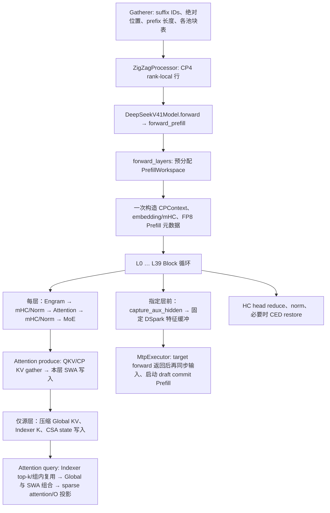

# DSV4.1 CP4 DSpark Prefill：执行图与迭代记录

## 范围、版本和验收口径

- **工作对象**：`ruixuan.zrx_GPU` 中 `feature/dsv41-dev-main-202161013` 的 target 40 层 Prefill，包含 DSpark 辅助 hidden 捕获；随后单列 draft commit Prefill。首次源码基线 HEAD：`fad3ed5f1e5c65783aef4f5f927140114c9379e5`。
- **参照源码**：DeepSeek 官方 [DeepInfer](https://github.com/deepseek-ai/DeepInfer/tree/553741557a57df44a46fb3ab72b6aafeaf945337)，固定提交 `553741557a57df44a46fb3ab72b6aafeaf945337`。这是源码对照，未取得相同 CP4 DSpark 负载的 DeepInfer 运行结果。
- **主指标**：同一完整 batch 中所有请求完成时的 Prefill engine RT；按每轮完整 batch 的 `max(aux_info.cost_time)` 记录原始轮次，再比较无 profiler 的配对正式轮次。算子时间、层时间、target model forward、TTFT 和全请求 E2E 分开记录。不能把局部 launch 减少直接报成 engine RT 收益。
- **控制项**：同一 checkpoint、token IDs、每请求 prefix 命中与 fresh 长度、CP4/TP/EP/DP、batch、KV 页预算、DSpark 策略、后端及环境开关。记录实际加载的 Python/native 包、rank、缓存状态、内存峰值和错误。另收一轮匹配的全 rank trace 验证工作是否真的消失。
- **当前状态**：本页按时间记录候选、对照和撤回；末节是最新决策。HEAD `fad3ed5f1e5c` 的同形状 CP4 B64 无 profiler 结果已在 2026-10-29 补齐。历史服务、PID 和结果只代表对应运行，不能替代当前服务核验。
- **2026-10-30 证据更正**：本页各次单独 Prefill role 的一 token 冻结语料，原始响应 `output_ids` 均为 `[0]`、`aux.pd_sep=false`；旧文中的“输出 ID 一致”只表示该占位字段一致，**不构成模型数值、生成质量或真实 P→D 精度证明**。这些结果仍可用于请求成功、实际复用/长度及 Prefill engine RT 核对；数值须另用有独立 oracle 的算子/模型测试，生成质量须用真实 P→D 和既定数据集门禁。

## 名词、数据归属与时间轴

| 名词 | 含义与所有者 | 本轮用途 |
| --- | --- | --- |
| SWA KV | 每层私有的滑动窗口 K/V，池 tag 为 `swa_kv`（深层 bounded replay 可用 `decoder_swa_kv`）；FP8、每条 528 B。 | 查最近 128 个 token；每层写自己的池。当前 forward 的新 K 优先用 BF16 工作张量计算，池供后续 forward/复用读取。 |
| Global KV | 源层生成的压缩全局 K/V，`csa_kv` 的 ratio 2 将两 token 合成一条，`hca_kv` 的 ratio 1 每 token 一条；FP4、每条 288 B。 | 组内跨层共享，供被检索命中的远处条目参与注意力。 |
| Indexer K | `indexer_kv`；只有检索用 K，没有注意力 V；每条 68 B。 | 对 query 打分并产生 top-k 下标；不直接充当 sparse attention 的 K/V。 |
| CSA state | ratio 2 压缩器的递归 FP32 状态。 | prefix/suffix 跨 chunk 的续压；源层持有。 |
| prefix / suffix | prefix 长度 `P` 是本次 forward 前已在缓存的 token 数；suffix 长度 `n` 是本次新计算行数。 | 两者是时间轴位置，不是 KV 池类型；query 绝对位置位于完整请求坐标。 |
| CP4 | Context Parallel 四 rank；RTP-LLM 的 C++ ZigZagProcessor 将新 query 行分给 rank。 | rank-local Q/hidden 和请求全局坐标并存；KV gather/写入及物理页归属要逐池核对。 |
| DSpark | target 指定层的注意力输入均值作为 draft 特征，另提交到 draft 特征 KV。 | target Prefill 捕获在层执行前，draft commit 在当前 RTP executor 的第二次 forward。 |
| mHC | 四条残差流，形状 `[T_local, 4, 5120]`。 | 捕获时沿四流求均值为 `[T_local, 5120]`。 |
| CED | 深层查询行剪裁。 | 代码条件为 `allow_ced` 且 `DSV41_CED=1`；`_env_flag` 默认 `0`，不能假定当前生产启用。 |

层域应由实际 checkpoint 的 `compress_ratios`、`kv_source_layer_ids`、`index_source_layer_ids` 决定。2026-10-29 已核对本次 GPU0–3 服务所加载的 checkpoint `config.json::text_config`：`num_hidden_layers=40`，target L0–1 为 ratio 0、L2–19 为 ratio 2、L20–39 为 ratio 1；KV 源为 `[2,8,14,20]`，索引源为 `[2,8,14,20,24,28,32,36]`，`dspark_target_layer_ids=[37,38,39]`。这些值来自本次服务 checkpoint，不自动代表另一个生产 checkpoint。`decoder_swa_kv`、CED 和 bounded replay 的激活分别核对，不把它们当作所有部署的默认路径。

### 层域、池实例和条件开关

| 本次服务 checkpoint 的层域 | 当前层写入 | 当前层注意力读取 | 跨层关系 |
| --- | --- | --- | --- |
| L0–L1，ratio 0 | 各层自己的 `swa_kv`；bounded replay 不适用。 | 仅自己的近邻 SWA 工作区或 fresh `kv_full`。 | 没有 Global KV/Indexer K。 |
| L2、L8、L14，ratio 2 源 | 自己的 `swa_kv`、`csa_kv`、`indexer_kv`、`csa_state`。 | 组内 Global KV 命中与本层 SWA。 | 各源生成一次 ratio 2 数据，后续消费层复用源物理池。 |
| L3–L7、L9–L13、L15–L19，ratio 2 消费 | 仅自己的 `swa_kv`。 | 最近源层的 `csa_kv`，以及自己的 SWA。 | index source 的 top-k 在可复用组内共享。 |
| L20，ratio 1 源 | 自己的 `swa_kv`、`hca_kv`、`indexer_kv`。 | `hca_kv` 与自己的 SWA。 | L20 的 Global KV 可供深层共享。 |
| L21–L39，ratio 1 消费 | 自己的 SWA；仅启用 bounded replay 时 tag 改为 `decoder_swa_kv`。L24/28/32/36 可更新 index query 源。 | L20 的 `hca_kv` 与本层 SWA。 | index source 每四层一换，不能笼统地说全域复用 L20 的 top-k。 |
| DSpark draft | draft 层自己的 SWA 特征池。 | draft 路径，与 target 的三类 KV 不混用。 | target 指定层特征在 target forward 后提交。 |

池描述由 `rtp_llm/models/dsv41_kv_cache.py::build_v41_kv_cache_spec_descs`（28–88 行）创建：`swa_kv` 与条件启用的 `decoder_swa_kv` 均为 528 B/entry，`csa_kv`/`hca_kv` 为 288 B/entry，`indexer_kv` 为 68 B/entry，`csa_state` 为 FP32 且每槽 `2*head_dim` 个元素。只有源层声明 Global/Indexer/State 池；消费层通过 `attention_v41.py::AttentionV41FP8.__init__`（806–818 行）的最近源层 ID 查对应物理池。`decoder_swa_kv` 明确关闭跨请求 prefix 复用（`dsv41_kv_cache.py` 60–67 行），它与同请求 chunk 续算是两个不同问题。实际每块条目数和物理 CP 切片由配置/描述符决定，不能把某次 136-entry 布局当成所有部署的常量。

### 模块地图与重要数据边界

| 层级 | 入口与职责 | 当前分析须追踪的对象 |
| --- | --- | --- |
| C++ engine | Gatherer 收集请求、prefix 长度与块表；ZigZagProcessor 分 CP4 suffix 行；`MtpExecutor.cc` 顺序调用 target 与 draft commit。 | host pinned 长度、rank-local 行、target 辅助缓冲、第二次 `forwardModel`。 |
| 模型装配 | `rtp_llm/models/deepseek_v41.py` 读配置；`dsv41_kv_cache.py` 宣告池；`models_py/model_desc/deepseek_v41_model.py` 装配 target。 | checkpoint 层域、索引源、pool tag、DSpark 捕获层。 |
| Prefill 编排 | `prefill/forward.py` 建 CPContext/工作区/元数据、执行 40 层、处理 CED/捕获/退出归还。 | `[T_local,4,5120]`、每次 forward 共享状态、跨层缓冲最后消费者。 |
| Block 与注意力 | `block.py` 编排 mHC、Norm、Engram、MoE；`fp8/attention.py` 投影与 CP SWA K gather；`fp8/attention_v41.py` 负责 SWA/Global/Indexer produce 和 sparse query。 | rank-local Q、全请求顺序新 K、FP8/FP4 池、top-k 下标。 |
| Kernel | `_v41_swa_triton.py`、`_v41_fp4_triton.py`、`_v41_deepselect.py` 与 Mega/FlashMLA 后端。 | 量化舍入、masked slot、写后读事件、launch/Graph。 |

Engram 是 token 级 n-gram 旁路，注入在 Block 的注意力 mHC pre 前，**不是第四种 KV 池**；MoE 位于注意力后的 FFN 半层。它们会影响第一层前或层间 CPU/GPU 工作，但本轮没有改动。MegaAttention/FlashMLA、CED、bounded replay、batch producer 等为有资格条件的分支；须记录实际 dispatch 和开关，不能仅凭默认值判断执行路线。

## 当前 RTP-LLM target Prefill 执行图

锚点：`rtp_llm/models_py/modules/dsv41/prefill/forward.py::forward_prefill`（约 937 行）进入 `forward_layers`（约 321 行）；工作区 360–393 行、CPContext 395–433 行、embedding/mHC 452–475 行、FP8 元数据 540–627 行、层循环 656 行起、捕获 721–722 行。`block.py::_forward_prefill_fast_fp8`（约 554 行）调用 `attention_v41.py::_prefill_produce`（约 2671 行）和 `_prefill_query`（约 2902 行）。`transformer.py::capture_aux_hidden`（约 336 行）执行 mHC 均值及固定缓冲复制。`MtpExecutor.cc` 的 target forward 约 1615 行，draft commit 约 1721 行。

### L0 前：一次性准备及仍需量化的成本

1. C++ Gatherer/CP 切分给出 rank-local `input_ids`、请求边界、绝对位置、prefix 长度、各池块表。`forward_prefill` 优先使用已有设备边界；CP 路径在 `forward_layers` 建立 `CPContext`，把 rank-local ZigZag 行映射到请求全局位置。
2. 先分配 `PrefillWorkspace`，再嵌入并扩展 mHC。工作区位于本 forward；其地址复用、峰值与随后的 draft commit 均需在实际运行中核对。
3. `build_and_propagate_prefill_meta_fp8` 每 forward 生成并广播元数据；当前 `attention_v41.py::_v41_prefill_meta_cache_key` 还复用相同输入的 SWA 规划结果。`_prefill_fast_path_layer_calls` 缓存层调用入口。这些已有去重不能再次记为拟新增收益。
4. 当前 CP 的 host 长度优先从 `CPContext.input_lengths_global_host` / `prefix_lengths_host` 取，避免在正常 CP 路径上从 GPU `.tolist()` 同步；fallback 仍需按实际触发条件统计。
5. 成本待测：`prepare_cp_context`、`propagate_cp_context`、embedding/mHC、metadata build/传播、路由 metadata、aux hidden buffer 写入的 CPU 提交、GPU launch、同步和峰值。不能只数 Python 分支数判断热点。

### L0/L1：SWA-only 的两种时间轴分支

`attention.py::_prefill_compute_qkv`（约 4343 行）在本 rank 投影 Q 与 SWA K，CP 时把新 K all-gather 为全请求顺序的 `kv_full`。`attention_v41.py::_prefill_produce` 在 SWA 写入前决定是否需要 prefix 尾部快照：

- **fresh，`P=0`**：query 直接用 BF16 `kv_full`，无需把新 K 再读出 SWA 池；SWA FP8 池仍为后续 forward 写入。`_prefill_query` 约 2917–2930 行。
- **continuation，`P>0`**：`_swa_prefill_concat` 先读旧 SWA 环的 prefix 尾部，构造 `[B, M, 512]` BF16 工作区，再把本次 suffix 的 `kv_full` 放入其请求内位置；随后写本层 SWA 池。读必须先于环回写，以免旧尾被覆盖。`_prefill_query` 约 2905–2915 行使用组合索引读工作区。
- **当前可检验冗余**：ratio 0 的 continuation 被 `_can_fuse_swa_fresh` 排除，故 `_swa_prefill_concat` 的 suffix 填充走 `index_copy_`，缓存写入另有一次 kernel。ratio 1/2 的 CP 字节切分已可用同一缓存写 kernel 顺带把原 BF16 位写到工作区；代码在 `attention_v41.py` 约 2448、2519、2780–2797 行及 `_v41_swa_triton.py` 约 62–99 行。要扩至 L0/L1，须证明所有 suffix 槽位有效且互不别名、缓存槽位为 -1 时仍写工作区、prefix 先读后写、CP rank 字节切分及 Graph replay 的行为一致。

### L2 以后：本轮只记录依赖，后续逐组下钻

ratio 2 源层写 `csa_kv`、`indexer_kv` 和 `csa_state`；ratio 1 源层写 `hca_kv`、`indexer_kv`。消费层只写自己的 SWA 池，复用源层 Global KV，索引源层的 top-k 在组内复用。`_prefill_query` 构造 `[Global 命中 ≤512 | SWA 窗口 128]` 的行索引，注意力读的是 Global KV 与本层 SWA 工作区，不读 Indexer K 作注意力 V。现有跨层索引计划缓存位于 `attention_v41.py` 约 2958–2995 行。每个组仍需分别核对 prefix、suffix、CP 池物理归属和 async 生产/消费事件。

### sparse query 的索引与读写次序

对 query 的绝对位置 `p`，近邻窗口最多 128 条；Indexer K 只产生至多 512 个 Global 条目下标。`attention_v41.py::_select_indices`（约 2087 行）在 index-source 层对已有及本次写入的 Indexer K 评分，消费层从 per-forward shared state 取选中下标；短序列、长序列和内存预算超限的具体打分后端有不同资格条件。`_prefill_query` 约 2966–3005 行把两段下标映射至 `[Global 行 | 当前层 SWA 行]` 工作区，压紧无效 `-1` 并给 sparse attention。最终注意力的 K/V 是两段工作区内容，Indexer K 从未作为注意力 V。ratio 2 以压缩 entry 的因果边界约束当前 query，不能让尚未完成的 pair 泄漏给自己。

继续处理时，旧 prefix SWA 环尾必须在当前 suffix 回卷写池之前完成读取；Global/Indexer 源层也必须在 query 取其结果前完成写入或等待对应事件。CP 下新 K 的 all-gather 与各池的物理页切片是两种不同数据流；“每 rank 能在 Decode 读取完整逻辑历史”不等于“每 rank 的每个物理页字节相同”。比较 DeepInfer 时也必须分别标注逻辑行序、物理页归属及 writer/reader 的 rank 布局。

### CED 边界与 Decode：供 Prefill 改动检查副作用

CED 的静态模型门禁位于 `prefill/ced.py::_supported_model`（90–120 行），要求 40 层、窗口 128、宽度 5120、mHC 四流，并检查深层 L20 的 KV 源和每四层 index 源；实际进入还需 `allow_ced` 与 `DSV41_CED=1`。若进入，L20 仍需生产完整的 `hca_kv`/`indexer_kv`，然后可剪裁查询行；L21 起重建元数据、按保留行执行深层，最后恢复输出行。L0/L1 的本次改动不更改 CED 资格，但其 SWA 缓存正确性仍关系后续读者。

Decode 入口 `decode/forward.py::forward_decode`（397 行）区分 CUDA Graph 的持久元数据与 eager 元数据。`attention_v41.py::_forward_decode_body`（3662 行）先准备位置，若 MegaAttention 的形状/池门禁成立可走融合路径；否则计算 QKV 并写本层 SWA，源层更新 Global/Indexer，index-source 层选下标，再以 SWA/Global 双池注意力和输出投影得到结果。Decode 本轮不改；需要它作为 Prefill 写池的跨阶段消费者来核对尾块、前缀复用、CP 页归属和 Graph 重放。DSpark draft commit 只提交 target 捕获的 suffix 特征行，不在 Prefill 阶段生成投机 proposal。

## DeepInfer 源码对照：可以借鉴什么

| 机制 | DeepInfer 证据 | RTP-LLM 现状与迁移条件 |
| --- | --- | --- |
| target 指定层的 DSpark 特征捕获 | [`decoder_layer.py` 92–95、143–145](https://github.com/deepseek-ai/DeepInfer/blob/553741557a57df44a46fb3ab72b6aafeaf945337/deepinfer/model_executor/models/decoder_layer.py#L92-L95) 调用 [`dflash_input_store`](https://github.com/deepseek-ai/DeepInfer/blob/553741557a57df44a46fb3ab72b6aafeaf945337/deepinfer/model_executor/layers/tilelang_ops/dflash.py#L130-L155)，一个 kernel 完成四流均值与目标缓冲写入。 | RTP 在层前捕获正确语义，但 `hidden.mean` 和 `copy_` 分开。可考虑融合；先核对捕获层、BF16 舍入、行顺序、固定地址与 Graph。 |
| draft main-K 提交边界 | [`deepseek.py` 154–223](https://github.com/deepseek-ai/DeepInfer/blob/553741557a57df44a46fb3ab72b6aafeaf945337/deepinfer/model_executor/models/deepseek.py#L154-L223) 在 target forward 末调用 [`dflash.py::update_main_cache`](https://github.com/deepseek-ai/DeepInfer/blob/553741557a57df44a46fb3ab72b6aafeaf945337/deepinfer/model_executor/models/mtp/dflash.py#L198-L228)，合并多个 draft main-K 投影。 | RTP 的 `MtpExecutor.cc` 返回 target 后单独 `forwardModel(DRAFT_PREFILL)`，并同步输入。合并边界可能减 CPU 提交，但改变 executor/缓存所有权、CP 同步与 graph 约束；留到 target 40 层局部优化之后。 |
| CP 通信与跨层复用 | [`attn.py` 752–875](https://github.com/deepseek-ai/DeepInfer/blob/553741557a57df44a46fb3ab72b6aafeaf945337/deepinfer/model_executor/models/v4_modules/attn.py#L752-L875) 提前开始压缩 KV all-gather；[`cross_layer.py` 277–323](https://github.com/deepseek-ai/DeepInfer/blob/553741557a57df44a46fb3ab72b6aafeaf945337/deepinfer/model_executor/models/v4_modules/cross_layer.py#L277-L323) 在每次 forward 内持有组共享数据。 | RTP 已有 QKV gather、异步源层生产、top-k/索引计划共享。比较实际依赖、暴露等待和 launch，而非仅比较函数数量。 |
| CP 行布局 | [`input_metadata.py` 169–208](https://github.com/deepseek-ai/DeepInfer/blob/553741557a57df44a46fb3ab72b6aafeaf945337/deepinfer/model_executor/input_metadata/input_metadata.py#L169-L208) 构造 mirror CP 索引和 reverse index。 | RTP 用 ZigZag rank-local 行及自己的 slot mapping。不能直接复制 DeepInfer 的重排索引或页写入顺序。 |

DeepInfer 链路是 **CP>1 的源码路径**；尚未取得其 CP4 DSpark 启动配置、checkpoint 与同负载 engine RT。其吞吐 benchmark 边界与这里的完整 batch engine RT 不等价。

## 迭代台账

| 序号 | 位置 / 触发 | 假设与拟消除的工作 | 正确性和性能验收 | 状态 |
| --- | --- | --- | --- | --- |
| 0 | L0 前，每次 target Prefill | 枚举 TP 同步、CP metadata、mHC 扩展、缓存写计划、路由 metadata 的 CPU/GPU 成本；找暴露在 engine RT 上的重复项。 | 同形状 profiler-off baseline + 全 rank trace、首次/重复 shape、prefix 命中矩阵。 | TP 接收端 pinned 分配候选已通过双 rank 单测和 B64 A–B–A；CP/CED/metadata 的更细归因待测。 |
| 1 | L0/L1，CP4 continuation | 缓存写 kernel 同时把新 BF16 K 放进 SWA 工作区，消去独立 `index_copy_`。 | 与旧路径逐位对比工作区及 FP8 池；覆盖多请求、prefix=0/非 0、masked slot、ragged/tail、四 rank、Graph changed-input；比较完整 batch engine RT。 | 局部 42 项聚焦测试通过，但独立完整 batch A–B–A 无稳定收益，候选已撤回；原路径保留。 |
| 2 | 指定 target 捕获层 | 借鉴 DeepInfer 将 mHC 均值和固定缓冲写入融合。 | 捕获位精度/顺序、CUDA Graph、draft commit 输出、完整 batch RT。 | 待 L0/L1 后评估。 |
| 3 | target→draft 边界 | 评估消除独立 draft commit forward 的 CPU 调度/同步成本。 | 所有 rank 的特征 KV、prefix/suffix 续算、DSpark verify/rollback、Graph 与 E2E。 | 后续架构候选；当前不改。 |

每次迭代在此表后追加：源码 HEAD、实际生效开关/形状、基线与变体唯一差异、验证命令、原始结果路径、结论和未验证项。失败或回退也保留记录。

### 2026-10-28：L0 前准备及 L0/L1 首个候选

- **What / Where / When**：在 `attention_v41.py::_can_fuse_swa_fresh` 允许 ratio 0 进入既有 CP 字节切分的 fresh store 资格检查；`_prefill_produce` 的 SWA-only continuation 将该决定传给 `_swa_prefill_concat`。仅 `common.any_cont`、CP、非 bounded replay、有效 SWA 元数据及 `is_supported_fresh_store` 全部满足时生效；其它形状保留旧工作区填充和独立写池分支。L0/L1 使用相同的 per-layer 方法，但分别写自己的 SWA 池。
- **Why / How**：旧路径在读取 prefix 尾部后对 suffix 执行 BF16 `index_copy_`，然后另起 FP8 写池。已有 Triton writer 的 `STORE_FRESH` 能在按槽量化写池时把原始 BF16 位写入工作区；缓存槽为 -1 时仍写有效的 fresh 工作区行。这样可消去一次 suffix scatter kernel，且保持 prefix 先读后写。是否减少完整 batch engine RT 尚无运行证据。
- **L0 前准备的决定**：CPContext、层调用入口与 FP8 Prefill 元数据已有每 forward 级构造/复用；当前没有证明另一处前置操作暴露在 engine RT 临界路径，因此本次未删前置分支。后续以全 rank trace 判断第一层前的 CPU 提交、H2D 与 GPU 空窗，而不是凭代码行数删分支。
- **验证**：在选定容器内以 `CUDA_VISIBLE_DEVICES=0 /opt/conda310/bin/python3 -m unittest` 运行 `test_v41_swa_fresh`、`test_v41_swa_codec`、`test_v41_host_swa_metadata`，42 项通过。扩展后的 produce 级测试覆盖 ratio 0/1/2、三请求 ragged prefix、全 -1 缓存槽、旧/新工作区 BF16 位一致、FP8 缓存字节一致、prefix 读先于写、CUDA Graph 变输入重放。该测试用单 GPU 模拟 CP4 字节切分，未执行四 rank NCCL 或完整 target 模型。
- **局部计时，仅用于筛选候选**：单 GPU0、合成 BF16 suffix 1024 行、CP4 字节切分 writer 的 rank 0、136 个非负缓存槽。CUDA Event 热态 50 次中位数：旧式 `zero_ + index_copy_ + FP8 writer` 为 39.552 µs，融合 writer 为 32.384 µs。两臂共用输入/池/目标工作区，计时未含实际 prefix 读取、分配、CP 通信、完整层或 engine；GPU 上有其他驻留进程，不能据此声明 18% 的模型收益。
- **待测**：实际 CP4 DSpark checkpoint 与服务、真实四 rank 调用、同一 batch 的 profiler-off engine RT、全 rank trace、峰值/保留内存及后续 draft commit。容器已有其他驻留模型，本次没有替换服务或制造一个不可归因的 DSV4.1 数字。

### 2026-10-28：L0 前 CPU 耗时定位

**测量边界。** 历史 [service56 manifest](/data0/ruixuan.zrx/rtp_llm_eval/runs/deepseek_v41/service56_baseline_profile_20261026/manifest.json) 与 [四 rank 原始 trace](/data0/ruixuan.zrx/rtp_llm_eval/runs/deepseek_v41/service56_baseline_profile_20261026/profile/timelines) 对应旧 HEAD `9a0a4e8add15b9b37969e868ca830cd0bc3b1af7`、CP4/TP4/EP4、64 个独立请求、每请求 32768 输入/31744 实际 prefix 复用/1024 新行、输出 1。下表是 **一次 profiler-on target forward** 中 CPU scope 从入口到 `dsv4.fp8.attn.L00.prefill` 的时长；其余列是嵌套 scope，**不能求和**。单位 ms。

| rank | target→L0 | CPContext | CP 传播 | embedding | CED query layout | FP8 metadata 全部 | ratio 0 metadata | SWA varlen |
| --- | ---: | ---: | ---: | ---: | ---: | ---: | ---: | ---: |
| 0 | 13.453 | 0.392 | 0.219 | 0.227 | 4.359 | 3.627 | 2.803 | 2.218 |
| 1 | 14.590 | 0.660 | 0.493 | 0.356 | 2.234 | 3.169 | 2.427 | 1.870 |
| 2 | 18.501 | 1.212 | 0.610 | 0.625 | 2.564 | 4.288 | 3.654 | 2.693 |
| 3 | 13.197 | 0.411 | 0.221 | 0.194 | 3.279 | 3.611 | 2.861 | 2.160 |

**Where / When / How。** `deepseek_v41_model.py::forward`（225–281 行）先准备 Engram 窗口、hash 和 CPU 预取；随后 `prefill/forward.py::forward_prefill`（937 行）进入 `forward_layers`。`forward_layers` 先领工作区（360–393 行），建/传播 CPContext（395–433 行），做 embedding 与 mHC 扩展（452–475 行），按 CED 门禁执行 `CEDPlan.create`（`prefill/ced.py` 740–868 行），再调用 `build_and_propagate_prefill_meta_fp8`（`prefill/forward.py` 540–627 行），最后才进入 L0。CED 的 `query_layout` 在 `ced.py::_query_layout`（595–605 行）；默认 `DSV41_CED_VECTOR_LAYOUT=1` 时先尝试 `_host_query_layout`（406–592 行），否则进入 GPU fallback。ratio 0 元数据中的 SWA host slot/read 计划位于 `fp8/attention.py::_build_swa_prefill_meta_varlen`（4030–4340 行），host 页表压紧位于 `fp8/_v41_swa_metadata.py::_host_compact_table`（128–158 行）。这些都是 prefix 已驻池、suffix 即将进入 L0 时的一次性准备，L0/L1 读的是每层自己的 SWA 池；没有 Global KV 或 Indexer K。

**Why：可归因程度。** rank 2 到达 L0 比 rank 0 晚约 5.05 ms；其 CP 准备入口已晚约 3.17 ms，随后 CP/metadata 也更慢。第一轮 SWA AllGather 因此出现早到 rank 等待晚到 rank 的现象，但只有一次 profiler-on B64，不能把全部 5.05 ms 当成可消除的 CPU 成本。rank 0 的 CED `query_layout` 内仅 36 个 `aten` CPU 事件，组成与 host vector 路径相符，未看到大量 GPU fallback 算子；此为 trace 推断，缺少直接的分支标记。旧 HEAD 的无 profiler 12 轮完整 batch `max(aux_info.cost_time)` 中位数为 242.980 ms（范围 238.820–245.489 ms；[历史分析](/data0/ruixuan.zrx/rtp_llm_eval/runs/deepseek_v41/service56_baseline_profile_20261026/analysis.md)）；它不衡量当前 HEAD，也不能为某个前置函数分配收益。另一个历史 profile 中，不同 forward 的 CP 准备至 L0 约 4–13 ms，因未逐个核对输入形状，此数字只用于提示轮次差异，不能作同形状性能对照。

**当前源码的隔离 CPU 测量。** 在同一容器当前 HEAD 上，以合成 CP4、B64、每请求 `P=31744,n=1024`、bounded replay 的输入重复热态计时：`ced.py::_host_query_layout` 单 GPU CPU 提交 rank 0 中位 0.782 ms、p95 0.895 ms；rank 2 中位 0.629 ms、p95 0.706 ms（各 30 次）。该 fixture 只验证函数本身，不含 CED gate、真实 NCCL、Engram、服务或 engine RT。`_v41_swa_metadata.py::_host_compact_table` 同形状合成页表 200 次热态中位：write 36.24 µs、read 30.74 µs，故该 NumPy 页表压紧本身不足以解释 trace 中约 2–3 ms 的整个 `swa_varlen` scope。历史同类热态 `PrefillWorkspace` 构造中位约 17 µs；不应把工作区分配先当成多毫秒主因。

**下一步优化顺序（提案，尚未实现）。**

1. 给当前真实服务做低开销四 rank 时间戳：target 入口、CPContext 开始/结束、CED 布局开始/结束、FP8 元数据开始/结束、L0/首个 NCCL issue。先证明无 profiler、同一请求中稳定的最后到达 rank 和暴露等待；只在服务可用且不影响驻留模型时执行。
2. 若稳定耗时落在 CED host 布局，先保留现有 fast path，针对 `_host_query_layout` 的 CPU 数组构建与单次 pinned upload 做最小候选，并覆盖 prefix/suffix、ragged、四 rank 交换、restore 及 DSpark 捕获行。0.6–0.8 ms 隔离计时是上限线索，非 engine 收益预报。
3. 若稳定耗时落在 `swa_varlen`，以 kernel/CPU 事件拆开 host slot write、prefix read、CP byte compaction、combined indices、GPU 等待；只移除确认重复的环节。`_host_compact_table` 的 30–36 µs 不值得单独大改。
4. `host_block_tables` 在 CED 与 FP8 metadata 各调用一次，源码上可复用一次 host 表，但现有 trace 的 `aten::pad` 仅约 0.1 ms 量级；排在前两项之后。Engram 的异步 H2D 可能与前置范围重叠，必须先按线程与 CUDA correlation 归属，再考虑改它。

上段仅记录在当前服务启动前完成的历史 trace 与隔离测量。下面补记同日当前 HEAD 的真实 CP4 服务；两组数字不得直接做前后收益比较。

### 2026-10-28：当前服务的 L0 前 CPU 定位与候选

**服务与测量边界。** 选定工作树 HEAD 为 `fad3ed5f1e5c65783aef4f5f927140114c9379e5`，容器 `ruixuan.zrx_GPU` 的 GPU0–3 上运行 CP4/TP4/EP4、DSpark target 的 PREFILL 服务，端口 29820。当前服务以 `RESERVER_RUNTIME_MEM_MB=50000` 启动，后续同服务的比较必须保持这个内存预算。64 个请求各输入 32768 token，其中 31744 token 实际前缀复用、1024 token 新算、输出 1 token；12 轮无 profiler 的完整 batch Prefill engine RT（每轮 `max(aux_info.cost_time)`）中位数 247.3565 ms，范围 242.875–254.767 ms。原始请求、响应、逐轮结果和四 rank trace 在 [本次运行目录](/data0/ruixuan.zrx/rtp_llm_eval/runs/deepseek_v41/dsv41_l0_cpu_replayed_20261028_215134)。此服务在以下 C++ 改动之前启动，**没有加载改动**；目前尚无候选 engine RT。

**Where / When / How。** profiler-on 的一次 target forward 从 Python 入口到 L0 CPU scope 分别为 rank0 12.346 ms、rank1 15.189 ms、rank2 15.540 ms、rank3 15.209 ms。包含 CED `query_layout` 约 2.1–3.9 ms、FP8 `build_all_ratios` 约 2.3–3.6 ms；这些是嵌套 scope，不可相加。更早的 TP 输入同步阶段，rank2/3 对 int32 `[65536]` 的 `aten::pin_memory` 分别耗时 10.646/12.789 ms，对 int32 `[65536,4]` 分别为 1.544/0.766 ms；rank1 对应两次只有 0.242/0.056 ms。rank1 第一层 SWA AllGather kernel 比 rank2 早约 13.09 ms 开始，持续 13.193 ms，而 rank2 的同一 kernel 只有 0.105 ms。这说明早到 rank 在跨 rank 同步处等待，不能把 NCCL 持续时间直接归因于 L0 算力。

`rtp_llm/cpp/models/ModelTypes.cc::tpSyncModelInputs` 的非 root `allocBuf` 为接收广播而建张量，旧写法先 `torch::empty` 后 `.pin_memory()`；此时没有需要保留的内容。调用序列包含 `combo_tokens` 与 `engram_token_windows`，形状与 trace 一致；打包 CPU buffer 也用相同写法。候选把这两处改为 `torch::empty(..., TensorOptions(...).pinned_memory(true))`，保持张量形状、dtype 与 pinned 属性，并省去新建 pageable 张量及其 pin 拷贝。该通用 TP 同步代码也服务于其他模型，故需原有 TP sync 单测和完整 CP4 服务验证。隔离热态 100 次交替测量中，int32 `[65536]` 的旧/新中位数为 37.53/7.45 µs，`[65536,4]` 为 38.33/8.20 µs，uint8 `[1529696]` 为 40.60/7.47 µs；它只证明常态单次分配路径差异，**不能证明**服务中 10–13 ms 偶发 pin 耗时会消失。

**验证与当前状态。** 候选 `ModelTypes.cc` 已以 GCC13 构建 `model_data_test` 与 `libth_transformer.so`；后者 SHA256 为 `dc49f140f451543f7194c3cf2aada8faa4f48058c0cf96b032a6749310a8638f`。构建时给老版 Abseil 增加外部目标专属 `-include cstdint`，给 jsoncpp/BoringSSL 增加外部目标专属 GCC13 警告降级；这些仅是本次 Bazel 命令参数，未修改仓库 BUILD 或依赖源码。`ModelInputTpSyncTest.PreservesIdentityAcrossRankOrderings` 用编译出的相同二进制直接运行，双 rank 测试通过（2.18 秒）；Bazel test 包装器因 GPU 资源锁等待而中止，不能把包装器结果记为通过。

尝试在旧服务运行时，以同一 CP4 模型和 45000 MB 预留于端口 30120 并行启动候选服务，`MemoryEvaluationHelper.cc:131` 报各 rank 可预留内存仅 4–13 GiB，未通过启动；旧服务端口 29820 仍报告 PREFILL/alive。并行服务失败说明当前 GPU0–3 显存不足以保持两套完整服务，不能用失败的影子实例测性能。旧服务仍映射启动时的旧 native，候选库只在磁盘上。

**当时的证据缺口。** 截至 2026-10-28 该段记录时，trace 仅一轮 profiler-on，候选尚未加载进健康服务。后续运行证据见下节；前面的 247.3565 ms 基线受当时 GPU 驻留进程影响，不与下节数字直接相减。旧服务在 22:46 左右收到 `SIGTERM` 并退出；日志未指明信号来源。

### 2026-10-29：L0 前 pinned 分配的同形状 A–B–A

**What / Where / When。** A1 与 A2 是 `ModelTypes.cc::tpSyncModelInputs` 直接 `torch::empty(..., pinned_memory(true))` 的候选；B 将且仅将该文件还原为 HEAD 的先 `torch::empty()` 再 `.pin_memory()`。三臂均为同一源码 HEAD `fad3ed5f1e5c65783aef4f5f927140114c9379e5`、同一未提交 Python 状态（包含 L0/L1 SWA 融合）、同一 checkpoint、GPU0–3、CP4/TP4/EP4、DSpark target、PREFILL role、端口 29820、`RESERVER_RUNTIME_MEM_MB=50000`。三次都用相同 GCC13 Bazel 命令参数构建，三次服务均通过 1M 启动真实 warmup。A 候选 native SHA256 `dc49f140f451543f7194c3cf2aada8faa4f48058c0cf96b032a6749310a8638f`；B 对照 native SHA256 `c9d0c78d061c588346b7c30ae2a5ca6917305ecd872aca5149ff3230b63cefa4`。实际加载库的 inode 逐次核对；A2 进程为 PID 818790，测量后仍保持运行，端口健康检查为 `PREFILL/alive`。

**指标和负载。** 每臂同一份原始 HTTP 请求文件，2 轮预热、12 轮无 profiler 测量、1 轮 profiler trace；每正式轮有 64 个请求，每请求输入 32768 token，其中 prefix 复用 31744、新算 suffix 1024、输出 1。每臂 768/768 请求完成，累计复用 24,379,392 token，`wait_time` 最大为 0。主指标是每轮完整 batch Prefill engine RT 的 `max(aux_info.cost_time)`，不是 HTTP wall、单 kernel 或 profiler-on 耗时。

| 顺序 | native | 12 轮中位数 | 范围 | 相对 B 中位数 |
| --- | --- | ---: | ---: | ---: |
| A1 候选 | 直接 pinned 分配 | 241.3775 ms | 237.262–251.510 ms | −3.3475 ms（−1.37%） |
| B 对照 | 先普通分配再 pin | 244.7250 ms | 242.145–252.612 ms | 0 |
| A2 候选复测 | 直接 pinned 分配 | 242.5745 ms | 239.374–247.112 ms | −2.1505 ms（−0.88%） |

逐轮按相同请求文件配对：A1 比 B 低 10/12 轮，候选减对照的差值中位数 −5.1505 ms；A2 低 8/12 轮，差值中位数 −2.596 ms。两次候选中位数均低于 B，方向一致，但逐轮范围重叠；这些数据支持本负载约 1% 的方向性收益，不能证明所有形状均加速或 10–13 ms 的极端 pin 抖动已被稳定消除。A1 的 profiler-on 完整 batch 值 2124.905 ms 是异常大值，未用于主指标；B/A2 profiler-on 为 292.123/290.957 ms，也未与无 profiler 结果混算。

**Why / How。** B trace 的非 root rank 对 int32 `[65536]`、`[65536,4]` 及 packed uint8 `[1529696]` 仍有 `aten::pin_memory`；相关事件在本轮 profiler-on 约 45–437 µs。A trace 的非 root rank 没有这三种形状的 `aten::pin_memory`，说明改动确实删除了接收端普通内存到 pinned 内存的重复分配/拷贝；rank0 的其它 pin 仍可能出现，因为根 rank 的源张量路径未改。因三臂都已启用 ratio 0 的 SWA fresh store 融合，本次 A–B–A **只归因于 C++ pinned 分配**，不得把差值归给 L0/L1 Python 改动。三臂测后 GPU 显存仍有约 2.8–8.9 GiB 空余；KV 池的实际容量与内存峰值未逐页审计，仍是对比限制。

**原始证据与验证。** [A1](/data0/ruixuan.zrx/rtp_llm_eval/runs/deepseek_v41/dsv41_l0_cpu_candidate_20261029_0030)、[B](/data0/ruixuan.zrx/rtp_llm_eval/runs/deepseek_v41/dsv41_l0_cpu_matched_baseline_20261029_0040)、[A2](/data0/ruixuan.zrx/rtp_llm_eval/runs/deepseek_v41/dsv41_l0_cpu_candidate_repeat_20261029_0055) 各含 `manifest.json`、`measure/results.json`、四 rank trace 与服务日志。双 rank TP 同步测试通过，L0/L1 的 42 项聚焦测试见前节，但本轮未找到其原始测试日志供复核。`git diff --check` 通过；仅在本任务三个代码文件做了一次 code-simplifier 检查，没有高置信可删的新增复杂度，因此未改代码。一次独立只读代码审查未发现三个代码文件的确认阻塞项；审查也明确指出本轮没有 Python 融合的独立服务 A/B、四 rank 续算/后续 Decode 消费、质量与峰值/保留 HBM 验证。CED/FP8 metadata CPU 小算子的下一轮工作尚未开始。

**下一处 L0 前 CPU 线索（只读定位，尚未改动）。** A2 profiler-on 的第一次 B64 `py_model.forward(normal)` 入口到 L0 CPU scope，rank0/1/2/3 分别为 5.714/18.911/12.087/17.944 ms；B 对照为 5.060/14.035/20.436/13.115 ms。A2 的 `dsv41.ced.query_layout` 分别为 0.483/3.351/2.575/3.339 ms，`dsv4.fp8.prefill_meta.ratio_0` 为 0.921/6.043/2.128/4.254 ms，其中 `swa_varlen` 为 0.550/5.117/1.509/3.247 ms；它们是嵌套 CPU scope，不可相加。rank1 ratio-0 范围内有一次 `aten::empty([64,66], pin_memory=True)` 1.982 ms，rank0 同形状一次 0.644 ms，rank2/3 仅 0.012/0.029 ms；B 同形状事件均 ≤0.040 ms。该形状对应 `_v41_swa_metadata.py::_host_compact_table`（128–158 行）生成 pinned compact 页表的路径，说明偶发 pinned 分配抖动仍在，但尚不能说它稳定落在无 profiler 的临界路径。下一轮先以低开销、多轮四 rank 时间戳拆开 CED query layout、ratio-0 SWA metadata 与 pinned compact 页表，再决定是否复用已有 host 页表或其 pinned 存储；任何复用都须证明异步 H2D 的生命周期和跨请求/Graph 重放安全。

A2 profiler-on 的第一次 B64 target forward 中，rank0 的 L0/L1 CPU attention scope 均未出现 `aten::index_copy_` 或 `aten::zeros`，符合 ratio-0 continuation 进入 fresh+cache writer 融合分支；trace 未提供该 Python 分支的显式布尔标记，因此这里只记作运行时旁证。三臂均包含该 Python 改动，仍缺少单独的 L0/L1 服务 A/B。

**驻留服务。** A2 服务在 GPU0–3、端口 29820 保持运行；进程 PID 818790、native SHA256 `dc49f140f451543f7194c3cf2aada8faa4f48058c0cf96b032a6749310a8638f` 是本次核验时的状态，后续须实时复核。为满足持续占用要求，实验目录中的 [keep_service.py](/data0/ruixuan.zrx/rtp_llm_eval/runs/deepseek_v41/dsv41_l0_cpu_candidate_repeat_20261029_0055/keep_service.py) 由 Docker detached exec 托管：仅在没有同时匹配 checkpoint、PREFILL role、端口 29820、GPU0–3 与选定工作树的主进程且端口空闲时，按相同启动脚本与配置重启；存在 `keep_service.pause` 文件时跳过重启，存在 `keep_service.stop` 文件时退出守护但不停止现有服务，两个标记在普通轮询及启动后等待期间最多约 15 秒生效。守护的 exec ID 存于同目录 `keep_service_exec_id`，动作记录在 `keep_service.log`。后续 A/B 切换前先置 pause 标记，避免误判为服务缺失。

### 2026-10-29：L0/L1 融合写入的独立 A–B–A 与阶段决策

**What / Where / When。** 对照的是 `attention_v41.py::_can_fuse_swa_fresh`（约 2448 行）和 `_prefill_produce`（约 2780 行）仅在 L0/L1、ratio 0、CP4 continuation 时是否把 BF16 fresh 工作区写入合到 SWA FP8 写池 kernel。A1/A2 启用两行候选，B 使用原始 `index_copy_` 加独立写池；三臂都保留 `ModelTypes.cc::tpSyncModelInputs` 的直接 pinned 接收缓冲改动，且同一 HEAD、checkpoint、TP4/CP4/EP4、PREFILL role、GPU0–3、端口 29820、运行内存预留 50000 MB、DSpark、CED、输入请求文件和 native 库。每次切换均在服务空闲后停止任务进程组，等真实启动 warmup 结束才计时。GPU4–7 的 MiniMax 进程未操作。上述差异只用于隔离 ratio 0 融合；前节 C++ A–B–A 的两臂均启用融合，因此两个实验不能混加为一个收益。

| 无 profiler 的完整 batch Prefill engine RT | A1 融合 | B 原写法 | A2 融合复测 |
| --- | ---: | ---: | ---: |
| 12 轮中位数，ms | 244.9405 | 241.9075 | 241.7585 |
| 范围，ms | 241.492–248.467 | 240.356–246.031 | 239.499–245.168 |
| 与 B 逐轮同请求配对差值中位数，ms | +2.0940 | 0 | −0.7385 |
| 比 B 快的轮数 | 4/12 | — | 7/12 |

每轮均为 64 请求，每请求输入 32768 token、其中 31744 token 复用、1024 fresh、输出 1；每臂 768/768 请求完成、累计实际复用 24,379,392 token。指标是同一完整 batch 的 `max(aux_info.cost_time)`，不含 profiler 时间，也不是 HTTP wall。原始逐轮数据、请求和响应分别在 [A1](/data0/ruixuan.zrx/rtp_llm_eval/runs/deepseek_v41/l01_fusion_ab_candidate_20261029)、[B](/data0/ruixuan.zrx/rtp_llm_eval/runs/deepseek_v41/l01_fusion_ab_baseline_20261029)、[A2](/data0/ruixuan.zrx/rtp_llm_eval/runs/deepseek_v41/l01_fusion_ab_candidate_repeat_20261029)。A1 比 B 慢，A2 与 B 近似；方向不稳定，不能把删除 `index_copy_` 当成整批收益。A2 与 A1 的差异还说明服务重启/系统状态的漂移足以盖过本地小算子收益。A2 的旧 profiler-on trace 能证明融合路径没有 `index_copy_`，但不能代替无 profiler 的 RT 结论。

**Why / How / 决策。** 融合确实把 L0/L1 的 BF16 fresh 工作区写入交给既有 SWA FP8 writer，并删除独立 `index_copy_` 提交；writer 现在同时负责全部 fresh BF16 行与选择性的 FP8 页写入，核函数工作量/占用可能增加。后一机制是源码推断，尚无独立 kernel 计时证明它解释 A1 偏慢。按照本项目“全 batch engine RT 可重复改善”保留条件，撤回这两行及对应新增测试，恢复 ratio 0 的原分支；不把一个未稳定加速的局部融合留在目标代码。L0/L1 的 `swa_kv` 仍是每层独立的 FP8 池；本次查询新段使用 `kv_full` 或 prefix 尾窗加 fresh 工作区，下一 forward 才消费本次写入的池。L0/L1 不生产或读取 `csa_kv`、`hca_kv` 或 `indexer_kv`。

**L0 前 CPU 结论。** `forward_layers` 的 CPContext、embedding/四流展开、CED query layout 和三 ratio 的 FP8 metadata 是本次 target Prefill 的实际前置工作，不能按行数删除：CPContext 提供绝对位置与 rank 请求映射，CED 计划供 L20/L21 的行收缩，ratio 0 的 SWA 写/读计划区分本次 suffix 写池与已有 prefix 尾窗读池。此前四 rank trace 在首个 B64 的 CED query layout 见约 0.48–3.35 ms、ratio 0 metadata 见约 0.92–6.04 ms，但同一 trace 后续同类调用多数回到约 0.5–0.9 ms；这些是 profiler-on CPU scope，存在 pinned 分配和调度抖动，不能作为无 profiler 临界路径收益上界。已保留的 `ModelTypes.cc::tpSyncModelInputs` 直接 pinned 接收缓冲消掉了非 root TP 广播前的 `aten::pin_memory` 复制；前节独立 C++ A–B–A 在此负载两次候选方向性快约 0.9%–1.4%，逐轮范围仍重叠。

**阶段边界。** 已完成 L0 前及 L0/L1 的源码分支审计、一个保留的前置 CPU 改动、一个被 A–B–A 否决的 L0/L1 候选，以及真实四 rank B64 prefix 复用/续算验证。生产 Decode 消费、质量集、峰值/保留 HBM、混合及长上下文形状仍未由本实验覆盖；这些缺口不应被写成已验收。下一阶段若继续处理 pinned 页表偶发抖动，先做低开销多轮四 rank 前置分段计时，并验证异步 H2D 生命周期；没有稳定暴露的成本前，不增加跨请求缓存或新的分支。

### 2026-10-29：最终 Python 分支下的 C++ 接收缓冲归因与驻留状态

**What / Where / When。** 上节撤回 ratio 0 融合后，重新比较 `rtp_llm/cpp/models/ModelTypes.cc::tpSyncModelInputs` 约 417–424、687–694 行的两种 CPU 接收/打包缓冲分配：A 为直接 `torch::empty(... pinned_memory(true))`（native SHA256 `dc49f140f451543f7194c3cf2aada8faa4f48058c0cf96b032a6749310a8638f`），B 为原始 `torch::empty(...).pin_memory()`（native SHA256 `c9d0c78d061c588346b7c30ae2a5ca6917305ecd872aca5149ff3230b63cefa4`）。A1、B1、A2、B2 的 Python L0/L1 都是 HEAD 原始分支；同一 checkpoint、GPU0–3、CP4/TP4/EP4、PREFILL role、DSpark、CED、50000 MB 运行内存预留、端口 29820、B64 输入文件和无 profiler 计时。每臂 2 轮预热、12 轮正式测量，768/768 请求完成、累计实际复用 24,379,392 token；每请求输入 32768，prefix 复用 31744，fresh 1024，输出 1。每次服务启动均通过真实 warmup，实际加载的库 SHA 由 rank 进程映射核对。A1 来自 [Python 融合对照中的 B 臂](/data0/ruixuan.zrx/rtp_llm_eval/runs/deepseek_v41/l01_fusion_ab_baseline_20261029)；B1、A2、B2 在 [最终栈对照目录](/data0/ruixuan.zrx/rtp_llm_eval/runs/deepseek_v41/l0_final_cpp_ab_20261029)。

| 完整 batch Prefill engine RT（每轮 max(aux_info.cost_time)） | A1 直接 pinned | B1 旧分配 | A2 直接 pinned | B2 旧分配 |
| --- | ---: | ---: | ---: | ---: |
| 12 轮中位数，ms | 241.9075 | 242.0595 | 245.0935 | 245.4250 |
| 范围，ms | 240.356–246.031 | 239.358–245.583 | 239.908–248.063 | 242.192–248.260 |
| 相邻臂中位数差（A−B），ms | −0.1520 | — | −0.3315 | — |
| 按相同请求文件逐轮配对的差值中位数（A−B），ms | +0.1845 | — | −1.1785 | — |
| 逐轮 A 快于相邻 B | 5/12 | — | 8/12 | — |

**Why / How / 决策。** 两组相邻臂的整体中位数都向 A 方向移动约 0.15–0.33 ms，但逐轮差值混合、范围大幅重叠；A2/B2 同时比 A1/B1 慢约 3 ms，说明运行时间段的外部漂移远大于此候选的可归因整批收益。因此最终 Python 栈下**不能宣称有稳定的 Prefill engine RT 百分比提升**，也没有重复的整批回退证据。前节启用 Python 融合时观测的约 0.9%–1.4% 方向性收益只适用于当时的融合栈，不能迁移到本节最终栈。保留 C++ 修改的理由限于已核对的机制：非 root 对尚未填入内容的接收张量直接分配 pinned，避免先建 pageable 再 pin 的重复分配/复制；对应形状的 `aten::pin_memory` 在候选 trace 中消失。已编译的双 rank `ModelInputTpSyncTest.PreservesIdentityAcrossRankOrderings` 通过，最终代码只改这两处空缓冲分配，未增加运行时分支。它是明确的 CPU 工作量简化和局部稳定性候选，**不是已证实的整批加速**。独立只读审查未发现该 C++ 差异的确认正确性阻塞项，指出跨节点 NCCL、其他 TP 模型、质量、峰值/保留 HBM 与 Decode 消费仍未核验。

**Prefix/suffix 续算探针的边界。** [最终服务两次请求原始记录](/data0/ruixuan.zrx/rtp_llm_eval/runs/deepseek_v41/l01_final_continuation_20261029) 先送一条 32768-token prompt（reuse 0），再送其文本追加 6 token 的 prompt（input 32774，reuse 31744）；两次都完成并输出 1 token。预期“复用至少 32640”未满足，因此该探针只证实跨请求有 31744-token prefix 命中，**不能证明最后 1024-token suffix 写入后被完整读取**。31744 也与本轮 B64 负载的实际复用长度相同；缓存发布/块对齐的唯一原因尚未通过源码与独立形状测量闭环，不把它判成写池缺陷。

**阶段状态。** L0 前 TP host 接收路径已有保留的简化，L0/L1 ratio 0 融合经真实 CP4 A–B–A 否决并撤回；L0 前 CED/SWA metadata 的偶发 pinned 分配抖动尚无无 profiler 稳定临界路径证据。当前不把 L0 前/L0/L1 阶段宣称“性能优化完成”或推进 L2–L7；下一项需要低开销、多轮、四 rank 的前置分段时间戳，区分 CPU 执行、H2D 提交和首个 GPU/NCCL 等待，再选择确有整批收益上界的改动。2026-10-29 02:35 启动了 GPU0–3 的最终候选 PREFILL 服务，PID 1134309、端口 29820，自动驻留监督器恢复运行；这些是启动时记录，健康与加载库须以随后核验为准。

### 2026-10-29：L0 前四 rank 低开销分段计时

**What / Where / When。** 在同一选定 HEAD、最终 Python L0/L1 原分支、保留的 C++ pinned 接收缓冲和真实 GPU0–3 CP4/TP4/EP4 DSpark PREFILL 服务上，临时用 `time.perf_counter_ns()` 在 `prefill/forward.py::forward_layers` 的工作区申请、CPContext/position、embedding/routing、`CEDPlan.create`、`build_and_propagate_prefill_meta_fp8` 及 L0 循环入口打点。只在专门的诊断服务中启用 `DSV41_PRE_L0_CPU_DIAG=1`，每 forward 于 L0 入口写一条 rank 日志；没有 GPU 同步。测完已撤销临时代码并以原代码重启服务。固定负载是 64 请求 × 输入 32768、实际 prefix 31744、fresh suffix 1024、输出 1，CP4 每 rank 16384 行；先热身 2 轮，再取 12 轮。原始四 rank 日志及 [分段 JSON](/data0/ruixuan.zrx/rtp_llm_eval/runs/deepseek_v41/l0_pre_l0_lowoverhead_20261029/pre_l0_analysis.json)、[请求和整批结果](/data0/ruixuan.zrx/rtp_llm_eval/runs/deepseek_v41/l0_pre_l0_lowoverhead_20261029/manifest.json) 均保存。下表是每 rank 12 次 host 墙钟间隔的中位数，单位 ms；这些分段同一线程顺序执行，可相加但不等于 GPU 耗时。

| rank | 工作区 | CP+position | embed+routing | CED plan | FP8 metadata | 到 L0 循环 | 入口→L0 |
| --- | ---: | ---: | ---: | ---: | ---: | ---: | ---: |
| 0 | 0.142 | 0.786 | 0.425 | 5.157 | 2.801 | 0.262 | 9.166 |
| 1 | 0.143 | 0.791 | 0.502 | 3.556 | 2.936 | 0.261 | 8.272 |
| 2 | 0.133 | 0.805 | 0.520 | 3.623 | 2.880 | 0.269 | 7.953 |
| 3 | 0.172 | 0.903 | 0.762 | 4.619 | 3.253 | 0.424 | 10.574 |

四 rank 同轮 L0 入口最早与最晚到达差的中位数为 **3.644 ms**，范围 2.065–9.256 ms；12 轮最晚 rank 分布为 rank0 三轮、rank1 零轮、rank2 四轮、rank3 五轮。该诊断运行的 12 轮完整 batch engine RT 中位数 244.5735 ms，但诊断日志与打点仍开着，不能拿它与无诊断的 A–B 数据推算优化收益。

**Why / How。** CED plan 和 FP8 metadata 是 L0 前最显著的主机段，而工作区申请约 0.1–0.2 ms，不足以解释多毫秒空窗。`CEDPlan.create`（`prefill/ced.py` 740–868 行）先校验 bounded replay/CP/池布局，构造 kept 行，再经 `_query_layout` 的 NumPy host 计划、一次 pinned H2D 和 `cu_seqlens` H2D 生成 L20/L21 将消费的裁剪计划。FP8 metadata（`fp8/prefill_meta.py::build_and_propagate_prefill_meta_fp8` 126–320 行）在 L0 前构造 ratio 0/2/1 桶并传播给各层；ratio 0 的 SWA prefix 读槽和 suffix 写槽是 L0/L1 所需。四 rank 的最晚者逐轮变化，不能把固定某 rank 的全部主机时间都当成整批可节省时间。旧 profiler-on trace 的首个 B64 中，rank1 的 `dsv41.ced.query_layout` 3.351 ms，`dsv4.fp8.prefill_meta.build_all_ratios` 6.882 ms，其中 ratio 0 为 6.043 ms；这与当前低开销计时的量级相符，但旧 trace 含 profiler 干扰、冷 pinned 分配和先前已撤回的 Python 融合，因此不当作当前精确分项。新的 py-spy 100Hz GIL 采样每 rank 仅 4–6 个 L0 前样本，不能用其样本占比证明具体热点。

**阶段决策与缺口。** 重复可见的主机成本集中在 CED host layout 与 ratio 0 SWA metadata 的计划/上传，而不是工作区分配；它们对完整 batch engine RT 的可消除份额尚未证明。下一候选先在这两段内拆出纯 CPU 数组构建、pinned 分配、H2D 提交和 event 等待，核对是否存在重复表构造或可移出 L0 临界路径的工作；每次只改一处、维持相同 prefix/suffix 与 CP4 B64 对照，并覆盖 ragged、无 prefix、跨请求复用、同请求续算、CED restore、draft 捕获。当前没有证据支持删掉 CED 或 SWA 元数据门禁，亦没有稳定的最终栈整批 RT 提升；L0 前/L0L1 阶段仍在进行，不推进 L2–L7。

**恢复状态。** 临时代码撤销后，2026-10-29 02:56 重启的任务服务主 PID 1185536 在 GPU0–3 驻留；03:01 后 `/health` 返回 200。rank0 实际映射的 `libth_transformer.so` inode 为 34017267、SHA256 为 `dc49f140f451543f7194c3cf2aada8faa4f48058c0cf96b032a6749310a8638f`，即本节保留的 C++ 候选；常驻监督器 PID 937337 已恢复，pause/stop 标记均不存在。以上是该时刻的运行核对，不保证未来状态。

### 2026-10-29：CED 前置 CPU 子段与 L2–L7 路径审计

**CED 诊断。** 同一 CP4 DSpark B64 负载（每请求 P=31744、fresh=1024、输出 1，2 热身+12 正式轮）在 `CEDPlan.create` 与 `_host_query_layout` 加临时主机打点，未同步 GPU；四 rank 的 [原始分段汇总](/data0/ruixuan.zrx/rtp_llm_eval/runs/deepseek_v41/l0_ced_cpu_granular_20261029/ced_cpu_analysis.json) 和 [整批请求结果](/data0/ruixuan.zrx/rtp_llm_eval/runs/deepseek_v41/l0_ced_cpu_granular_20261029/manifest.json) 已保存。每 rank 的目标 batch 选中 8192 个 L21+ 保留行。以下为 12 次 host 墙钟中位数，单位 ms；打点和日志在测量服务上启用，整批 RT 不作为无诊断 A–B 收益。

| rank | CEDPlan.create 全段 | `_host_query_layout` | host 校验 | NumPy 行/peer 计划 | pinned 上传 | 交换对象/上下文 |
| --- | ---: | ---: | ---: | ---: | ---: | ---: |
| 0 | 5.139 | 3.779 | 0.480 | 1.530 | 0.258 | 1.423 |
| 1 | 5.604 | 3.599 | 0.563 | 2.407 | 0.343 | 0.173 |
| 2 | 4.936 | 3.039 | 0.551 | 2.045 | 0.285 | 0.160 |
| 3 | 4.821 | 2.620 | 0.547 | 1.667 | 0.349 | 0.155 |

`_host_query_layout` 的后段包括构造 `_RowExchange`、`candidate_rows_host`、typed device 视图和 `replace(CPContext)`，故表中 rank0 的 1.423 ms 不能直接归给单独的 `sorted`。独立 B64/CP4 CPU fixture 在当前容器中对同一选行数测得 `_host_query_layout`：rank0 host 墙钟/线程 CPU 中位 0.710/0.699 ms，rank3 0.548/0.544 ms（各30次，CPU device、无 H2D 与服务模型）。服务内墙钟明显更长；CPU 调度、pinned allocator 与实际 GPU 上传均可能贡献差额，**尚未在真实服务记录线程 CPU 时间，不能断言唯一原因**。直接把 `sorted(ndarray.tolist())` 换为 `np.sort(ndarray).tolist()` 的独立 8192 元素逆序微测从约 100.7 µs 增至 121.6 µs，因此不保留这个看似向量化的候选。下一步先核实真实服务的线程 CPU 与 off-CPU 时间及 CED/metadata 是否覆盖 GPU 忙时，再决定是否缩减 NumPy 计划；纯 CPU fixture 的 0.5–0.7 ms 不能支撑多毫秒整批收益预报。

**L2–L7 当前代码边界。** `fp8/attention_v41.py::_prefill_produce`（2671 行）在 L2 以 ratio=2 源层身份计算 QKV、写本层 `swa_kv`，并经 `_produce_global` 写组共享的 `csa_kv`、`indexer_kv` 与压缩状态；L3–L7 进入同一函数但在写各自的 `swa_kv` 后于 `not self.is_kv_source` 返回，不重复压缩与全局池写。`_prefill_query`（2902 行）中，L2 计算 top-k，L3–L7 复用 L2 的 `shared["topk"]`，仍各用本层 SWA 行与 L2 的全局行组合做注意力。当前服务设置 `DSV41_CED=1`，未设置 `RTP_V41_BATCHED_PRODUCER`；后者的实验分支没有当前运行证据。既有 profiler-on 首个 rank0 注意力 CPU scope 为 L2 约 4.982 ms、L3–L7 各约 1.2–1.4 ms，L2 内含源层状态快照、hidden gather 与 pool readback；这不是无 profiler 的逐层净成本，也尚未证明哪一分支拖慢整批 RT。现阶段没有删掉 L2–L7 的已执行分支或改变池语义。

同一历史 profiler-on trace 的 L2 记录包含 `state.async_start`、`x_gather.async_start`、`pool.async_start`、owned-pool gather 和 `pool.wait`；`pool.async_start` 的源码位于 `attention_v41.py::_produce_global` 约 1992 行，`_v41_cp_async.launch` 的侧流执行 `try_gather_prefill_pools`。但四 rank trace 起止处记录的 forward 数量/顺序不齐：按“各 rank 首个 L2 事件”配对会把不同请求形状混在一起，不能用其 4.982/7.754/8.104/7.816 ms 做跨 rank 差值或认定 B64。且嵌套 CPU scope 含线程调度、Python 启动与 event 操作，不可相加。下一次 L2 候选先以请求 ID/形状对齐实际 B64 的 `small_cp`/projected-x 与 owned-pool 分支，再核对 L2 producer→L3 消费的 GPU 事件依赖，才判断可删的 CPU 计划或小 kernel；仅凭未对齐的主机 scope 不能删除异步池读回。

**恢复与验收边界。** CED 临时打点已从选定工作树撤销。2026-10-29 03:29 启动的无诊断服务 PID 1289150 在 GPU0–3 运行，`/worker_status` 为 `alive=true`、运行/排队均 0；一条独立 `hello`、输出 1 token 的请求返回 HTTP 200 且 `response_batch` 长度为 1。rank0 实际映射 `libth_transformer.so` inode 34017267、SHA256 `dc49f140f451543f7194c3cf2aada8faa4f48058c0cf96b032a6749310a8638f`。常驻监督器未暂停；这些是该时刻的局部服务核验。L0 前/L0–L1 及 L2–L7 的完整简化和稳定整批 RT 增益尚未完成，不据此标记整个阶段验收。

### 2026-10-29：L2 CSA 状态快照探索候选，已撤回

**What / Where / When。** `fp8/attention_v41.py::_prefill_produce` 在 L2/L8/L14 ratio=2 KV 源层、CP 分片的 Prefill 中，于 QKV 投影前异步读取上一段的 `csa_state`。原路径执行 prefix 转 long、减一、截断、槽位映射、索引读、clone 与无效槽清零。探索候选曾在 `_v41_prefill_metadata.py` 用一个 Triton kernel 合并这段本 rank 读取，并在 `_v41_attention_jit_warmup.py` 预编译；不改变跨 rank 的 all-reduce。该候选已从四个 Python 文件撤回，当前源码回到原路径。

**How / Why。** CP2/CP4 各 rank、无效块、前缀长短变化及 CUDA Graph 重放的聚焦测试通过；metadata 文件的 13 个 CUDA 单测通过。B64 合成输入的单进程 host 调度微测，旧读取中位 0.071 ms、融合读取 0.021 ms（每臂 5 组 × 200 次）；这个差只量 CPU 调用排队，不含完整层、NCCL 或 engine。相同 checkpoint、GPU0–3、CP4/TP4/EP4、DSpark PREFILL、CED 开、50000 MB 运行内存预留、64 请求 × 输入 32768/实际 prefix 31744/fresh 1024/输出 1 的无 profiler 服务对照，均先热身 2 轮、正式 12 轮；基线完整 batch engine RT 中位 **242.2355 ms**，候选 **243.377 ms**，分布重叠且候选更慢。逐轮数据与服务标识在 [基线 manifest](/data0/ruixuan.zrx/rtp_llm_eval/runs/deepseek_v41/l2_state_snapshot_ab_20261029/baseline/manifest.json) 和 [候选 manifest](/data0/ruixuan.zrx/rtp_llm_eval/runs/deepseek_v41/l2_state_snapshot_ab_20261029/candidate/manifest.json)。因此局部减少小算子未带来可验证的整批收益，不保留这条更复杂的实现。此探索不构成 L2–L7 阶段验收；按当前计划继续 L0 前与 L0/L1。

### 2026-10-29：L0 前线程 CPU 与墙钟归因

**What / Where / When。** 在 `prefill/ced.py::CEDPlan.create`、`_host_query_layout` 和 `fp8/prefill_meta.py::build_and_propagate_prefill_meta_fp8` 临时增加 `perf_counter_ns` 与 `thread_time_ns` 同点打点。服务仍是选定 HEAD、原始 Python L0/L1 路径与保留的 C++ pinned 接收缓冲，GPU0–3、CP4/TP4/EP4、DSpark target PREFILL、CED 开；只输出 B64、每请求实际 prefix 31744/fresh 1024 的目标 forward。12 轮测量的 [逐段汇总](/data0/ruixuan.zrx/rtp_llm_eval/runs/deepseek_v41/l0_pre_thread_cpu_20261029/after_startup/thread_analysis.json) 与 [请求结果](/data0/ruixuan.zrx/rtp_llm_eval/runs/deepseek_v41/l0_pre_thread_cpu_20261029/after_startup/manifest.json) 已存。下面是各 rank 12 次中位数，单位 ms；wall 与 CPU 分别独立取中位，故差值不等于逐轮 off-CPU 中位。

| rank | CEDPlan wall / CPU | CED host layout wall / CPU | FP8 metadata wall / CPU |
| --- | ---: | ---: | ---: |
| 0 | 4.455 / 4.410 | 3.472 / 3.450 | 2.794 / 2.577 |
| 1 | 3.508 / 3.423 | 2.447 / 2.396 | 2.572 / 2.473 |
| 2 | 2.060 / 1.998 | 1.318 / 1.300 | 2.040 / 2.017 |
| 3 | 3.574 / 3.469 | 2.327 / 2.306 | 2.482 / 2.313 |

**Why / How。** `thread_time_ns` 只累计当前线程实际占用 CPU 的时间；CED host layout 的两种计时几乎相同，因此本次真实服务形状下其多毫秒成本主要是 CPU 执行，先前依据独立 fixture 推测的“大部分是 off-CPU 等待”不成立。FP8 metadata 有少量墙钟超过线程 CPU 的部分，可能含异步操作提交与调度，尚未细分。隔离 fixture 的 CED host layout 0.5–0.7 ms 不能代表真实服务；下一诊断拆分校验、NumPy 行计划、peer 分组、pinned 上传和尾部对象构建。首次诊断请求与服务启动的 23 个真实 gRPC warmup 重叠，产生一个卡住的 prime HTTP 请求；该运行已中止，调度器恢复。随后首批 prime 命中其缓存，不满足 prime 复用 0 的测试契约，故有效线程计时只使用尚未请求过的 12 轮正式语料，跳过该次测试 warmup。带临时日志的整批 RT 不能作为无诊断加速对照。

**CED host 五段细分。** 在再次启动的相同配置服务明确出现 `startup warmup health gate marked ready`、`/worker_status` 空闲后，使用 12 轮未污染的 B64 语料，仅作诊断。`_host_query_layout` 在输入/掩码校验、NumPy 行映射、peer 分组、`_upload_layout_arrays`、`_RowExchange` 与 `CPContext` 尾部构造之间打线程 CPU 与墙钟点；[五段原始汇总](/data0/ruixuan.zrx/rtp_llm_eval/runs/deepseek_v41/l0_pre_thread_cpu_20261029/subphase/subphase_analysis.json) 和 [请求 manifest](/data0/ruixuan.zrx/rtp_llm_eval/runs/deepseek_v41/l0_pre_thread_cpu_20261029/subphase/manifest.json) 已保存。下表为每 rank 12 次各段墙钟独立中位数，单位 ms；独立中位数不可相加当作总中位。

| rank | 总段 | 校验 | 行映射 | peer 分组 | pinned 上传 | 尾部构造 |
| --- | ---: | ---: | ---: | ---: | ---: | ---: |
| 0 | 2.907 | 0.307 | 0.603 | 0.451 | 0.411 | 0.986 |
| 1 | 2.083 | 0.294 | 0.460 | 0.769 | 0.359 | 0.122 |
| 2 | 2.177 | 0.418 | 0.736 | 0.770 | 0.353 | 0.122 |
| 3 | 2.074 | 0.325 | 0.610 | 0.441 | 0.371 | 0.114 |

rank0 尾部构造较长，主要包括 `candidate_rows_host` 的排序与 Python tuple、`projection_groups_host` 的 NumPy→Python tuple、`_RowExchange` 和上下文 `replace`；现有打点未将这些尾部操作逐一归因。`candidate_rows_host` 供 L20 候选行的 `bisect_left` 使用，不能仅因 CPU 显著就删除；peer 分组也用于原布局 router 权重投影。下一候选应先证明某项数据结构转换可省且不改变 CED 行/组顺序，再用无诊断完整 batch A/B 验收。此次没有保留 CED 可执行代码改动。

### 2026-10-29：把 CED 计划从 L0 前移到 L19 前的候选

**What / Where / When。** `prefill/forward.py::forward_layers` 原先在 FP8 metadata 与 L0 前执行 `CEDPlan.create`，而 CED 行计划首次由 L20 消费；当前候选在相同 `allow_ced`、`DSV41_CED`、非调试/无录制条件下，把计划建立移到层循环的 L19 入口。初始 FP8 元数据仍只建到 L20；若 L19 的 CED 准入返回 `None`，就在 L19 补建 L21+ `decoder_swa_kv` 元数据。被 `PendingDecodePost` 延迟 mHC 包裹的 hidden 仅向元数据构造提供已有 `output` 张量的行数与设备，不提前执行 mHC post。L20 全量生产 `hca_kv/indexer_kv`、L21 compact、CED 选行算法与 KV 池写入均沿用原路径。

**Why / How。** 前述真实服务线程计时表明 CED 规划在 L0 前实际占用 CPU 数毫秒，移动到 L19 后可与已提交的 L0–L18 GPU 工作重叠；这一 overlap 是代码时序推导，尚无直接 CPU/GPU timeline 证据。首版候选在启动短请求的拒绝分支因把 `PendingDecodePost` 传给元数据构造而报 `.shape` 不存在，已修为传其 `output`；随后真实启动 warmup、独立 `hello` 输出 1 token 请求和 64 请求 B64 目标路径均成功。`CedHostLayoutTest` 与 `CedCandidatePublicationTest` 合计 10 项通过；旧 AST 夹具补上新的 `ced_requested=False` 局部变量。审查确认没有已知正确性阻断，同时指出此夹具未独立覆盖 L19 拒绝/异常清理，短请求服务只覆盖已运行形状。

**同配置无 profiler A–B–A。** A1 是原 CED 时序，B 是延迟 CED，A2 撤回补丁重启原路径；三臂都在 GPU0–3、CP4/TP4/EP4、DSpark PREFILL、CED 开、同 checkpoint、50000 MB 运行内存预留、同 64 请求文件、每请求输入 32768/实际 prefix 31744/fresh 1024/输出 1 下，等服务真实启动 warmup 完成，另做 2 轮测试预热与 12 轮正式测量。指标是每轮完整 batch 的 `max(aux_info.cost_time)`，取 12 轮中位。A1 **242.3825 ms**、B **240.7415 ms**、A2 **242.6585 ms**；B 对两次原路径中位快约 1.64–1.92 ms（约 0.7%–0.8%），各轮范围重叠，A2 有 370.763 ms 的异常轮。A1/B 的 768/768 条目标输出 ID 完全一致，且每条实际 prefix 复用均为 31744。原始轮次和请求在 [A1](/data0/ruixuan.zrx/rtp_llm_eval/runs/deepseek_v41/ced_late_ab_20261029/baseline/manifest.json)、[B](/data0/ruixuan.zrx/rtp_llm_eval/runs/deepseek_v41/ced_late_ab_20261029/candidate/manifest.json)、[A2](/data0/ruixuan.zrx/rtp_llm_eval/runs/deepseek_v41/ced_late_ab_20261029/baseline_return/manifest.json)。此结果支持方向性收益，随后以独立 B2 服务实例复测；跨形状质量、Decode、峰值/保留内存和真实 overlap 均未验收。

**B2 与当前驻留。** 独立候选 B2 服务在同一配置、同一 2+12 轮 B64 语料下的完整 batch Prefill engine RT 中位 **238.5735 ms**，逐轮范围 235.568–242.792 ms；两次候选 B1/B2 都快于两次原路径 A1/A2 的中位。B2 的 768/768 条输出 ID 与 A1 相同，768/768 条实际 prefix 复用均为 31744；[B2 manifest](/data0/ruixuan.zrx/rtp_llm_eval/runs/deepseek_v41/ced_late_ab_20261029/candidate_repeat/manifest.json) 和响应文件保留。性能收益的保守说法是此 B64 形状下四个独立服务臂呈稳定方向，量级约 1.6–4.1 ms；不把一次异常轮或不同启动实例的均值当成精确加速比。一次 `code-simplifier` 限定范围检查未找到可无风险删除的新增回退逻辑；独立只读 RTP-LLM 审查没有确认阻断，指出 L19 拒绝/异常清理没有独立单测、CPU/GPU overlap 未直接追踪，这些保留为验证缺口。

B2 正式测量后，另发一批两个不同长度的短请求（实际输入 7/4 token，输出各 1），均返回成功且实际 prefix 复用为 0；[短批响应](/data0/ruixuan.zrx/rtp_llm_eval/runs/deepseek_v41/ced_late_ab_20261029/candidate_repeat/short_batch_probe.json) 保留。这覆盖 CED 拒绝时的另一种实际请求形状，但不替代多长度质量集或异常注入单测。

截至 2026-10-29 05:18，本次候选已重新加载到 GPU0–3 的 PREFILL 服务（端口 29820、服务 PID 1535435、rank0–3 GPU PID 1535645–1535648），`/worker_status` 为 `alive=true`、运行/排队 0、前端空槽 64/64；启动真实 warmup 在 05:13:50 完成。rank0 映射的 native `libth_transformer.so` inode 34017267、SHA256 `dc49f140f451543f7194c3cf2aada8faa4f48058c0cf96b032a6749310a8638f`，启动日志标明源码为选定 opensource 工作树；驻留监督器 PID 937337 处于运行且未暂停。PIDs 与健康仅是此时快照，后续应现场复核。L0/L1 ratio 0 的独立融合候选此前已因完整 batch 无稳定收益撤回；本阶段保留 C++ TP pinned 接收简化与本次 CED 时序改动。L0 前/L0–L1 的其它形状与质量/Decode 未全量验收，不以此宣称整个模型或 L2–L7 已完成。

### 2026-10-29：CP4 L0/L1 未使用的 gather-length 小算子实验（撤回）

**What / Where / When。** `fp8/attention.py::AttentionFP8._build_swa_prefill_meta_varlen`（约 4183–4335 行）在 CP 写域、host prefix/suffix 长度齐全时，仍执行 `_swa_ops.compute_prefill_gather_lens`。该分支的 `M` 直接由 host 长度求出，continuation 索引调用 `combine_topk_swa_indices_cp`，不读取 `combined_gather_lens`；源码搜索也未发现此字段在返回后有运行时消费者。实验仅在此条件下把该字段置 `None` 并跳过 kernel，非 CP 或 host 长度缺失时保持原构造。L0/L1 的 ratio 0 在本次 CP4、prefix 31744 的负载上满足此条件；L2 等其它层共用此元数据构造，但本实验未把它们的收益单独归因。

**Why / How。** 少一次 GPU kernel 提交和一张长度张量能简化 L0 前准备；该 kernel 的时长未单独测得，因而只有代码路径层面的工作消失证据，没有毫秒级临界路径预估。新增 CUDA 测试在 batch 1/4 时 mock 该 kernel 为抛错，完整 metadata 构造仍通过；所在 `V41SwaHostPlanCudaTest` 4 项测试通过。该测试只证明被测 CP host 长度分支不依赖 kernel，不能证明完整 batch RT 会改善。

**同配置无 profiler A–B。** A 为原路径，B 为跳过该 kernel 的候选；两臂均为同一 HEAD、同一其余脏文件与 native、checkpoint、GPU0–3、CP4/TP4/EP4、DSpark PREFILL、CED 开、同一 64 请求文件，每请求输入 32768、实际复用 prefix 31744、新算 suffix 1024、输出 1。各自独立重启、等启动真实 warmup gate 完成后执行 2 轮测试预热及 12 轮正式测量。主指标是每正式轮完整 batch 的 `max(aux_info.cost_time)`。A 12 轮中位 **241.449 ms**，范围 235.245–244.183 ms；B 中位 **239.652 ms**，范围 235.816–245.822 ms。B 比 A 中位低 1.797 ms，但同序轮次仅赢 7/12、配对差值中位仅 −0.2475 ms，分布高度重叠。两臂各 768/768 请求完成、实际 prefix 复用均为 31744、输出 1，且 768/768 目标输出 token ID 相同，最大 wait_time 为 0。原始请求/逐轮结果分别在 [A](/data0/ruixuan.zrx/rtp_llm_eval/runs/deepseek_v41/l01_unused_gather_len_ab_20261029/baseline/manifest.json) 和 [B](/data0/ruixuan.zrx/rtp_llm_eval/runs/deepseek_v41/l01_unused_gather_len_ab_20261029/candidate/manifest.json)，实验补丁保存在同目录 `candidate.patch`。

**决策。** 在完整 batch RT 上没有稳定可归因收益，故已从工作树撤回 kernel 跳过及其专用测试。这个负结果不等于 kernel 无成本，只说明当前 B64 负载的暴露收益小于测量波动；后续优先查 GPU 空闲间隙、CPU 到 L0 的跨 rank 到达差和多毫秒真实 CPU 工作，而不是逐个删除已隐藏的小算子。截至 05:52，撤回后服务 PID 1601400 已完成启动真实 warmup，端口 29820 的 `/worker_status` 为 `alive=true`、运行/排队 0、前端空槽 64/64，GPU0–3 仍由该任务服务占用，监督器 PID 937337 运行且没有 pause/stop 标记。PIDs 为此时快照。L0 前/L0/L1 阶段仍未满足跨形状与质量验收，L2–L7 尚未开始修改。

### 2026-10-29：当前 CED 延后路径的 L0 到达差与 SWA host 规划拆分

**What / Where / When。** 在撤回上一实验、保留 C++ pinned 与 CED 延后补丁的服务 PID 1601400 上，采一轮 CP4/TP4/EP4 DSpark target 的 B64 profiler trace：64/64 请求输出 1，实际 prefix 31744、fresh 1024；每 rank 的 JSON 在 [四 rank trace](/data0/ruixuan.zrx/rtp_llm_eval/runs/deepseek_v41/l01_current_trace_20261029/profile/timelines)。目标 batch 在 rank0 的 `prefill_stream_size=64,total_prefix_length=2031616,total_execute_length=65536`，避免与启动 warmup、draft commit 混淆。四 trace 的 `baseTimeNanoseconds` 相同；按记录的同主机时间戳，target forward 入口相差不到 0.5 ms，L0 入口却相差 **5.933 ms**。rank0/1/2/3 的 ratio-0 元数据 CPU scope 分别为 4.072/2.644/9.045/3.334 ms；L0 CPU scope 分别为 5.453/13.383/8.199/4.456 ms。rank1 较早进入 L0 却有最长的 L0 scope，符合它等待晚到的 CP peer；不能把 13.383 ms 当作 L0 算力耗时。rank2 的 `dsv4.fp8.meta.swa_varlen` 为 8.553 ms，其中一个约 5.9 ms 的 host 事件空档没有同时执行的该 rank GPU kernel 或拷贝。这是 profiler-on 单次异常，不能直接换算为 profiler-off 整批 RT。

**How / Why。** `fp8/attention.py::_build_swa_prefill_meta_varlen` 在当前 CP host 长度分支调用 `fp8/_v41_swa_metadata.py::try_host_slot_metadata` 做 SWA 页表去重和写/读槽位；该函数先由 `_host_compact_table` 生成 NumPy alias 表，再分配槽位与上传，最后启动 `_planned_slots`。为辨别上述空档是否来自这里，临时在此函数加入 `perf_counter_ns`/`thread_time_ns` 四段打点，服务 PID 1616841 完成真实启动 warmup 后用同形状 2 预热 + 12 正式轮次诊断，768/768 请求完成、复用均为 31744。每 rank 有 14 次 prefix 读计划和 42 次写计划；三次写分别属于初始、后续重建或 draft，不能算成 L0 前重复规划。实际 host 表为每请求 66 列。读计划各 rank 墙钟中位 0.359–0.540 ms，写计划 0.311–0.405 ms；单次最大读 0.895 ms、写 1.141 ms。rank2 读/写最大仅 0.649/1.009 ms，墙钟与线程 CPU 接近。因此该函数有真实 CPU 成本，却未在这 12 轮中复现单次 5.9 ms 停顿，也不能解释 trace 异常的全部时间。[逐项原始记录与汇总](/data0/ruixuan.zrx/rtp_llm_eval/runs/deepseek_v41/l01_swasta_diag_20261029/subphase_summary.json) 和 [请求 manifest](/data0/ruixuan.zrx/rtp_llm_eval/runs/deepseek_v41/l01_swasta_diag_20261029/manifest.json) 已保存；诊断日志影响 RT，不与无诊断结果做 A/B。

曾对 rank2 用 `py-spy` 高频采样四轮 B64，采样器报告长期落后于实时进度；[原始采样](/data0/ruixuan.zrx/rtp_llm_eval/runs/deepseek_v41/l01_rank2_pyspy_20261029/rank2.speedscope.json) 仅供定位线索，不能据其样本比例或时间轴归因。临时打点和采样器均已停止，`_v41_swa_metadata.py` 已恢复原代码。下一步应在 L0 前元数据整体范围采低开销、同轮 CPU/墙钟及跨 rank 时间戳，区分 NumPy、PyTorch 提交和 OS/GIL 停顿；随后只对可暴露的多毫秒工作设计改动。当前证据不足以通过新增跨请求页表缓存或删掉更多小算子的复杂性换取稳定 RT。

### 2026-10-29：L0/L1 CP4 prefix/suffix 边界与 ragged 功能门禁

**What / Where / When。** 当前服务的基础配置日志显示物理 `seq_size_per_block=256`，但 CP4 分片时 `CPSlotMapper`（`cpp/cache/CPSlotMapper.cc` 15–28、83–99 行）构造 4 rank 的虚拟复用块，大小为 `256*4=1024` token。`CoordinatorCacheManager::initMallocForCommonLen`（约 538–558 行）按此单位裁剪可复用 prefix；`CacheConfig::maxPrefixReuseTokens`（`CacheConfig.h` 42–44 行）还保留 `cache_min_replay_tokens` 个 fresh token。当前 bounded replay 配置在 `models/dsv41_kv_cache.py` 第 146 行将该值设为 128。因此本服务只有满足 1024 对齐且 target 本次至少留下 128 fresh token 的 prefix 长度才可能被复用；128 是 SWA 窗口/最少 replay，不是 CP4 的 prefix 复用块大小。

**How / Why。** 真实请求先 prime 相同 token 前缀，再发 target ragged batch。首版误把 128 当复用单位，P=128 实测复用 0；次版 P=512 仍为 0；第三版 P=1024、总长1026（fresh 2）也为 0，P=2048、总长2049（fresh 1）只复用1024。这些结果与 1024 单位、至少128 fresh 的源码规则一致，失败源于测试预期，非模型异常；各失败响应已留在对应 `l01_ragged_gate_{,v2_,v3_}20261029` 目录，脚本均恢复 batch scheduler 为 1。重新生成独立标签的 [v4 请求与结果](/data0/ruixuan.zrx/rtp_llm_eval/runs/deepseek_v41/l01_ragged_gate_v4_20261029/manifest.json) 后，同一 CP4 DSpark PREFILL 服务、CED 开的八请求 batch 全部完成并返回一个 token：`(input,reuse)` 依次为 `(129,0),(256,0),(257,0),(1152,1024),(1153,1024),(1280,1024),(2176,2048),(4096,3072)`。其中 fresh 长度为 128、129、256、1024，覆盖 L0/L1 SWA-only 的无 prefix 与 continuation、窗口边界附近以及 ragged CP 行。每个正复用请求的 prime 与 target 前 P 个 token ID 已由生成器逐个比较相等。该批是功能门禁，没有参考输出质量分数，也不作为 B64 性能样本。

**阶段判断。** 当前 CP4 B64 主负载保留了经 A–B–A 验证的 C++ pinned 接收简化与 CED 延后；L0/L1 的融合写入和未使用 gather-length kernel 两个候选因整批 RT 未稳定改善而撤回。L0/L1 的实际 ratio-0 fresh/continuation 分支及 CP4 ragged prefix 规则已有源码、CUDA 聚焦测试与服务请求证据；没有再发现可无条件删掉的 L0/L1 池读写分支。后续对 L0 前偶发 rank 到达差仍需同轮、低开销定位，质量与 P→D Decode 消费仍是整个变更的验收缺口。下一层域可开始 L2–L7 的独立成本和分支审计；不得把 L0 阶段的未验证轴或失败候选带成 L2 的已获收益。

### 2026-10-29：L2–L7 第一轮源码与同轮 trace 审计（只读）

**What / Where / When。** 同一份 [CP4 B64 四 rank trace](/data0/ruixuan.zrx/rtp_llm_eval/runs/deepseek_v41/l01_current_trace_20261029/profile/timelines) 中，L2 是 ratio=2 的 `csa_kv` / `indexer_kv` / `csa_state` 源层，L3–L7 是该源的消费层；生产与查询分别由 `fp8/attention_v41.py::_prefill_produce`（2671 行）和 `_prefill_query`（2902 行）调度。rank0/1/2/3 的 L2 inclusive CPU scope 分别为 11.56/9.50/9.28/9.31 ms，L3–L7 多数为每层约 2.4–2.9 ms，少数 rank/层达到 4.25–5.56 ms。上述数字来自开启 profiler 的单次 B64，不是无 profiler 的完整 batch engine RT 份额，也不证明 L2 独占了所见时间。

**How。** L2 的 `_produce_global` 在 `attention_v41.py` 约 1992 行通过 `_v41_cp_async.launch` 把 `try_gather_prefill_pools` 提交到通信 stream；`_select_indices` 2209–2212 行在投影后、索引打分前用 `Pending.wait` 接上该结果，短 prompt 等未消费该 pending 的路径再由 `_prefill_query` 2948–2954 行接上。`_v41_cp_async.py:85–112` 中 `launch` 仍在调用线程同步执行 Python callback、记录输入 storage、提交 kernel 和 NCCL，然后记录 CUDA event；这里的“async”指 GPU stream 依赖，不表示 host callback 在后台线程运行，也没有主动 CPU CUDA synchronize。`_v41_prefill_pools.py::try_gather_prefill_pools` 先算 ratio=2 行数和组，再经 `_v41_joint_pool.py::try_gather` 选择 `_v41_owned_pool.py::try_gather`；当前 B64 target L2 trace 中 `dsv41.prefill.pool.owned.pack/all_gather/restore` 各出现一次，证实走 owned 单组路径。`_v41_owned_pool.py:816–822` 做自适应组计划，859–943 行分配传输 scratch、提交 pack/NCCL/restore，最后为每请求创建 Global BF16 与 Indexer key 视图。`_v41_joint_pool.py:523–540` 的小 batch 分段回退、通用组回退和不支持布局回退仍覆盖其它形状，不属于此次 B64 已执行工作。

**Why / 归因边界。** 用同一 target B64 的时间戳配对后，L2 `dsv41.prefill.pool.async_start` 在 rank0/1/2/3 分别持续 3.385/2.059/2.129/2.110 ms；同期各 rank 所有 GPU kernel/拷贝的区间并集覆盖约 3.381/2.052/2.106/2.103 ms。因此这四个多毫秒 inclusive scope 在各自 rank 上几乎全与 GPU 工作重叠，不能直接列作暴露 CPU 空档或预期加速。rank0 在更早的短请求还有一条 0.763 ms 的同名事件，仅 0.024 ms GPU 覆盖；那是不同请求，不能与 B64 三张卡比较。B64 scope 内 owned `pack`/`all_gather`/`restore` 的 host 标注在 rank0 为 0.140/0.212/0.045 ms，在 rank2 为 0.117/0.176/0.036 ms；rank0/2 在首次被 profiler 记录的 `aten::empty` 前分别有约 1.96/0.90 ms，来源可能是 Python 调度、GIL 或未标注的本地规划，现有 trace 不能判定。rank2 对 64 个请求构造结果视图时，两次 `aten::split_with_sizes` 各约 0.124 ms；这些视图仍被后续每请求索引/注意力消费，不能只按小算子数量删除。GPU 区间并集只是覆盖检查，不能证明 host 工作在整批临界路径外，也不能证明 CPU 可与 GPU 无代价重叠。

**决策与下一验证。** 不因 L2 inclusive scope 直接删掉 owned/segmented/fallback 或 `Pending.wait`：前者维持不同 CP/长度/显存几何，后者保证 L2 全局 KV、Indexer K 在查询前就绪。下一步对 `pool.async_start` 的 Python 规划/分配/结果视图及跨 rank 到达做低开销同轮打点，结合 B64 profiler-off engine RT 选候选；另用 B8、阈值邻近和长单请求验证将来任何分支简化。此前 CSA 状态快照融合的局部 CPU 降幅未转化为 B64 RT 收益，已撤回，不在此轮重复。

**L3–L7 消费层同轮明细。** 在 target B64 的 rank2 trace，`dsv4.fp8.attn.L03` 至 `L07.prefill` 的 inclusive host scope 分别为 1.659/1.796/1.806/1.631/1.572 ms。每层仍有本层 QKV 投影、一次 CP 的本层 KV all-gather、本层 `swa_kv` 写入、`[L2 global | 本层 SWA]` 注意力与输出投影；`attention_v41.py::_select_indices` 2087–2090 行使这些非 index source 层直接取 `shared["topk"][L2]`，`kv_source_layer_id` 由 813–818 行选 L2，所以不重复 L2 的 CSA/Indexer 生产和检索打分。rank2 每层 `dsv4.fp8.attn.qkv.cp_gather_varlen` host 标注约 0.275–0.335 ms、`dsv4.fp8.attn.swa_kv_full.cp_gather_varlen` 约 0.267–0.326 ms；源码 `fp8/attention.py::_prefill_compute_qkv` 4411–4423 行证明后者完全嵌套在前者中，内部只调用**一次** `cp_all_gather_full_varlen`。`dsv4.cp.all_gather.Lxx...launch` 又是其中的嵌套标注，三者不能重复相加或当作三次通信。此 gather 的结果 `kv_full` 同时供本层 SWA 写池和注意力查询使用，不存在可删除的重复 KV gather。

### 2026-10-29：L2 池回调线程 CPU 诊断（临时打点已撤回）

**What / Where / When。** 在 `_v41_cp_async.py::launch` 临时以 `perf_counter_ns` 和 `thread_time_ns` 分隔通信 stream 设置、`_record_stream(inputs)`、Python callback 加 completion event；仅对五项输入且第四项是原生块表 dict 的池生产调用记录日志。四 rank 的 CP4/TP4/EP4 DSpark PREFILL 服务真实启动 warmup 完成后，使用同一 B64 语料做 2 轮测试预热、6 轮正式 target；384/384 正式请求完成，均为输入 32768、实际 prefix 31744、fresh 1024、输出 1。[逐轮/逐 rank 原始归组与汇总](/data0/ruixuan.zrx/rtp_llm_eval/runs/deepseek_v41/l2_pool_launch_diag_20261029/phase_summary.json)、[请求 manifest](/data0/ruixuan.zrx/rtp_llm_eval/runs/deepseek_v41/l2_pool_launch_diag_20261029/manifest.json)、[诊断补丁](/data0/ruixuan.zrx/rtp_llm_eval/runs/deepseek_v41/l01_swasta_diag_20261029/cp_async_diagnostic.patch) 已留存；补丁随后用反向应用撤回，`_v41_cp_async.py` 与 HEAD 无差异。带打点的完整 batch RT 中位 243.757 ms，仅作请求完整性记录，不与无打点基线比较。

**How / Why。** 以每轮 target 响应时间前最近的四条连续源层记录配对 L2/L8/L14/L20；每个 rank、每轮都恰有四条，记录距响应结束约 0.3–0.4 s。L2 在 rank0/1/2/3 的各阶段 wall 独立中位分别为 stream 设置 0.029/0.028/0.031/0.030 ms、输入 storage 记录 0.038/0.040/0.039/0.051 ms、callback 加事件 1.085/1.127/1.173/1.231 ms；相应 callback 线程 CPU 中位为 1.072/1.117/1.162/1.213 ms。wall 与线程 CPU 接近，说明这一轮真实 B64 中池回调的大部分时间是调用线程在执行 CPU 工作或提交操作，而非线程停顿。另以 CPU 单进程、相同 B64 ratio=2 计数做局部微测，`adaptive_plan_groups` 命中计划缓存约 0.006 ms、`_request_groups` 约 0.011 ms；它们的计时口径不同于服务，不能直接相加或当作 engine 收益，但量级排除“组计划计算本身占了 1 ms”。

**下一步。** 诊断将热点定位到 `try_gather_prefill_pools`/`_v41_joint_pool`/`_v41_owned_pool` 的 callback：池布局校验、scratch 分配、pack/NCCL/restore 提交、按请求结果视图。下一轮在 callback 内仅量这些边界，再决定是否能删除重复 host 转换或减少小算子；不能把未运行的 fallback 删掉来解释本轮 B64。当前没有保留 L2–L7 可执行优化，也没有证明整批 RT 收益。

### 2026-10-29：L2 owned 回调内部拆分（临时打点已撤回）

**What / Where / When。** 在 `_v41_owned_pool.py::try_gather` 的 B64、每请求绝对结束位置 32768 分支临时记录五段 wall 与线程 CPU。按同一服务配置完成真实 warmup，再用相同请求文件跑 2 预热 + 6 正式轮；六轮 target 共 384/384 请求完成，实际 prefix 复用均为 31744，输出均为 1。每轮响应结束前约 0.3–0.4 秒的四条连续日志按 checkpoint 源层 `[2,8,14,20]` 配对；其 ratio 依次 `[2,2,2,1]`，每次 owned 计划只有一组。[原始逐轮/逐 rank 数据](/data0/ruixuan.zrx/rtp_llm_eval/runs/deepseek_v41/l2_pool_owned_diag_20261029/phase_summary.json)、[请求 manifest](/data0/ruixuan.zrx/rtp_llm_eval/runs/deepseek_v41/l2_pool_owned_diag_20261029/manifest.json)、[诊断补丁](/data0/ruixuan.zrx/rtp_llm_eval/runs/deepseek_v41/l2_pool_owned_diag_20261029/diagnostic.patch) 保留。该补丁随后撤回，带日志服务的 RT 不用于 A/B。

**How / Why。** L2 的五段 wall 中位（rank0/1/2/3，单位 ms）分别是：`counts+adaptive_plan_groups` 0.030/0.030/0.029/0.028；本地校验、`prepare_global_workspace` 与 Global 请求视图 0.471/0.326/0.299/0.322；四个 scratch tensor 分配 0.015/0.014/0.016/0.014；pack、NCCL 与 restore 的 host 提交 0.280/0.263/0.277/0.268；结果按请求的 Indexer key 视图 0.373/0.381/0.412/0.362。前述第一轮诊断测得整个 callback 约 1.08–1.23 ms；此次分段中位独立求取，不能逐项相加等同该值。各段线程 CPU 与 wall 接近。`_v41_prefill_kv_workspace.py::PreparedGlobalWorkspace` 124–164 行为 direct output 建交错布局、分配输出和上传 pinned 小表；`_v41_owned_pool.py` 930–945 行再按 64 请求拆出 Indexer quant/scale 视图。它们比组计划和 scratch 分配重，且每个 KV 源层重做。L3–L7 消费层沿用 L2 发布的结果，不重复这些生产步骤。

**决策。** 不为省约 0.03 ms 删除 owned 分组准入，也不为省 scratch 分配改写生命周期。优先审查 Global/Indexer 每请求视图是否可在现有 batched scorer 与 `combine_kv` 消费契约下延后或复用，以及 pinned 布局是否能在 L2/L8/L14 相同几何下共享；任何跨层共享都必须保持 pool/stream 归属和 ragged、CED 形状正确。下一候选需先证明整体工作量减少，再以无打点的完整 batch Prefill engine RT 和阈值邻近形状验收。当前仍没有保留 L2–L7 优化代码。

**DeepInfer 参考与适用边界。** 2026-10-29 读取 `deepseek-ai/DeepInfer` main 的提交 `553741557a57df44a46fb3ab72b6aafeaf945337`：其 [CrossLayerRuntime](https://github.com/deepseek-ai/DeepInfer/blob/553741557a57df44a46fb3ab72b6aafeaf945337/deepinfer/model_executor/models/v4_modules/cross_layer.py#L277) 用明确槽位保存最近源层的 loaded Prefill KV、Indexer KV 和 topk；[index_attn.py::_topk_prefill](https://github.com/deepseek-ai/DeepInfer/blob/553741557a57df44a46fb3ab72b6aafeaf945337/deepinfer/model_executor/models/v4_modules/index_attn.py#L327) 对扁平 Q 行按预算分 chunk，通过 device `ks/klen/ke` 计算 logits/topk。其设计提示 RTP-LLM 当前 `_v41_owned_pool.py` 930–945 行的 64 个 Indexer 请求视图和 `_v41_grouped_prefill_score.py::_group_layout` 224–320 行的再拼组检查可能被“扁平 slab + device bounds”消费契约替代；这是**待验证的重构方向**，尚非本工作树实现或性能结论。DeepInfer 的 [部署说明](https://github.com/deepseek-ai/DeepInfer/blob/553741557a57df44a46fb3ab72b6aafeaf945337/doc/inference_deployment_qa.md#L53) 称当时线上未用 TP/CP，而其 [benchmark.py](https://github.com/deepseek-ai/DeepInfer/blob/553741557a57df44a46fb3ab72b6aafeaf945337/examples/benchmark.py#L26) 支持 `--cp`；所以不能直接搬用线上指标或把其 CP benchmark 当作 RTP-LLM CP4 DSpark 的对照。重构前必须确认 RTP-LLM 的 grouped scorer、CED、prefix continuation、sparse attention 与 Decode 读取仍保持同一索引语义。

### 2026-10-29：L2/L8/L14 grouped score 重复 slab 校验实验（撤回）

**What / Where / When。** `_v41_grouped_prefill_score.py::_group_layout` 224–329 行已逐个校验 Indexer key 的 dtype/shape/连续性/对齐，并在合组循环逐对验证 quant 与 scale 的 storage 指针及 256 行 padding 后的 offset。实验候选仅将合组末尾的两个 `_slab_view` 全组二次扫描改成用首末视图的 offset 构造相同 `as_strided` 别名，不改分组预算、回退条件、GPU kernel、池写入或 L3–L7 对 L2 topk 的复用。[候选补丁](/data0/ruixuan.zrx/rtp_llm_eval/runs/deepseek_v41/l2_group_layout_ab_20261029/candidate.patch) 留存，当前工作树已反向撤回。

**Why / How。** 相同 B64 几何（64 个请求，每个 ratio=2 Indexer key 长 16384、每请求本 rank Q 行 256）的单进程 CPU 微测，原 `_group_layout` 中位约 0.419–0.422 ms，候选 0.213 ms；这只量 Python 分组函数。现有 `GroupedScoreLayoutTest` 与 `GroupedScoreEnvironmentTest` 合计 19/19 通过，包含 ragged、非零 offset、两个平面不同存储边界、4096 行及 logits 字节预算。候选通过这组契约，但小函数变快不代表完整 batch 变快。

**无 profiler 完整 batch A–B。** A 为撤回诊断后的原代码，B 为上述候选；同一 checkpoint、GPU0–3、CP4/TP4/EP4、DSpark PREFILL、CED 开、50000 MB 运行内存预留、同一 64 请求文件，每请求输入 32768/实际复用 prefix 31744/fresh 1024/输出 1；两臂各独立重启并等真实 startup warmup gate 完成，再做 2 轮测试预热 + 12 轮正式测量。指标为每正式轮的完整 batch `max(aux_info.cost_time)`。A 中位 **238.0455 ms**（234.546–251.139），B **238.820 ms**（235.911–243.877）；同序轮次 B 只赢 4/12，B−A 配对差中位 **+0.7145 ms**，分布重叠。两臂各 768/768 请求完成、长度及 prefix 复用一致，768/768 响应文本一致。[A 逐轮结果](/data0/ruixuan.zrx/rtp_llm_eval/runs/deepseek_v41/l2_group_layout_ab_20261029/baseline/manifest.json)、[B 逐轮结果](/data0/ruixuan.zrx/rtp_llm_eval/runs/deepseek_v41/l2_group_layout_ab_20261029/candidate/manifest.json) 保留。故不保留这项局部 CPU 优化；它没有证明完整 batch RT 或稳定性改善。下一步应处理生产端 64 份请求视图与消费端再拼组的**接口级**重复，而不是只优化其中一次扫描；方案需要先证明跨源层生命周期与 ragged/阈值正确性。

### 2026-10-29：L0 前与 L0/L1 阶段收口、服务恢复

**What / Where / When。** 用户指定先完成 target 40 层的 L0 前准备与 L0/L1，再进入 L2–L7；本阶段保留 `ModelTypes.cc::tpSyncModelInputs` 的两处直接 pinned 空缓冲分配，以及 `prefill/forward.py::forward_layers` 在 L19 前创建 CED 计划。L0/L1 的 ratio-0 SWA 融合写入已按独立 A–B–A 撤回。上述结论适用于当前 CP4/TP4/EP4、DSpark target、CED 开的 Prefill 路径，不外推到 Decode、其它模型或其它请求分布。

**Why / How。** 直接 pinned 分配删除接收端先建 pageable 再复制到 pinned 的 CPU 工作；L19 建 CED 计划使其不再阻塞 L0 启动，实际 B64 完整 batch A–B–A–B 中两次候选中位均低于两次原路径。SWA 融合只减少局部 `index_copy_`，完整 batch A–B–A 方向不稳，因此不保留。阶段证据包含源分支审计、相关聚焦测试、B64 prefix=31744/fresh=1024 的多轮整批 RT 和一次 ragged 功能探针；生产 Decode 消费、质量集、长上下文、峰值内存及 CED 拒绝/异常独立测试仍是验收缺口。前置 CPU 抖动来源还有 profiler-on 的 pinned 页表分配，但没有证明它在 profiler-off 整批 RT 中稳定暴露，故当前不增加跨请求缓存或新分支。

**驻留核验。** 回滚 L2 grouped-score 小扫描候选后，监督进程 PID 937337 于 07:20:41 拉起干净服务 PID 1747824，GPU0–3 rank PID 1747896–1747899；07:24:41 真实 startup warmup gate 标记 ready。端口 29820 的 `/worker_status` 返回 `RoleType.PREFILL`、`alive=true`、`running_query_len=0`、`waiting_query_len=0`、可用并发 64。`_v41_cp_async.py`、`_v41_owned_pool.py`、`_v41_grouped_prefill_score.py` 与选定 HEAD 无 diff，`git diff --check` 通过。PID/状态是本时刻快照，后续须实时复核。下一阶段只在上述 L0 边界及验收缺口明确后，处理 L2 源层与 L3–L7 消费层。

### 2026-10-29：L2–L7 共用索引计划的 131072 行回退门禁

**What / Where / When。** 当前候选只从 `fp8/_v41_prefill_index_plan.py::is_supported` 删除 `_MAX_ROWS=131072` 及其行数准入判断，并在 `fp8/test/test_v41_prefill_index_plan.py` 增加 131073 行的完整输出分块 oracle。L2 是 ratio=2 的索引源，L3–L7 从 `shared["topk"][L2]` 与同一 `prefill_index_plan` 缓存消费索引；实际 600001-token 无复用单请求在 CP4 下每 rank 有 150002 个 target 查询行。原门禁令 L2/L8/L14 每组首次构建退回 `attention_v41.py::_prefill_query` 的全行 `sort/argsort/gather`，其余消费层复用该计划。当前服务的 `max_batch_tokens_size=524288` 约束多请求 batch，但 `FIFOScheduler::fitsPrefillTokenLimits` 的单请求 fast path 可绕过这一 batch cap；模型上限 1048576，因此 600001 单请求是可执行形状，不能据 B64 不触发而称该分支不可达。

**How / 正确性。** 独立 `test_v41_prefill_index_plan.py` CPU/CUDA 15/15 通过，新增测试逐块与原 eager 参考比较了全部 131073 行，保留既有 Graph、metadata stride/dtype、int32 wrap 和 invalid/padding 断言。真实服务基线 PID 1747824 在源码修改前启动；同语料长请求 profiler trace 四 rank 每 rank均见 3 次 `[150002,640]` 的 `aten::argsort`。候选 PID 1765893 在改后启动并完成真实 startup warmup；四 rank 的这 3 次 `argsort` 全部消失，融合 plan kernel 数由 24 增至 27。两臂 1 热身 + 3 无 profiler 正式请求 + 1 独立 profiler 请求的 5 组输出 ID、文本、input/reuse 长度逐组一致，均为输入 600001、reuse 0、输出 1。[基线请求和 trace](/data0/ruixuan.zrx/rtp_llm_eval/runs/deepseek_v41/l2_index_plan_threshold_20261029/baseline)、[候选请求和 trace](/data0/ruixuan.zrx/rtp_llm_eval/runs/deepseek_v41/l2_index_plan_threshold_20261029/candidate)、[聚焦测试日志](/data0/ruixuan.zrx/rtp_llm_eval/runs/deepseek_v41/l2_index_plan_threshold_20261029/focused_test.log)。基线 profile runner 的 trace 收集因漏传 `trace_dir` 抛 KeyError，但实际模型请求成功且四 rank 完整原始 trace 已复制到本实验的 baseline/profile/timelines；该异常不计为模型失败或性能样本。

**Why / 性能边界。** GPU1 独立算子、同形状相同输入、双方热身后交替八轮：旧 eager `sort/argsort/gather` 中位 5.4005 ms，新融合计划 0.8395 ms；本算子进程的 `torch.cuda.max_memory_allocated` 峰值旧 2305.0 MiB、新 577.5 MiB。[逐轮测量](/data0/ruixuan.zrx/rtp_llm_eval/runs/deepseek_v41/l2_index_plan_threshold_20261029/paired_probe.log)。这证明超阈值回退在算子级别多出约 4.56 ms 和约 1.69 GiB 的分配峰值，但并不等于模型峰值或整批收益。同配置长单请求无 profiler 完整 Prefill engine RT 的三轮基线为 2175.707/2121.024/2129.699 ms（中位 2129.699），候选为 2152.511/2121.163/2132.956 ms（中位 2132.956）；方向不稳定，不能声称 model-level RT 加速。当前保留为删除实际已执行性能/内存退化分支的**待验收候选**；B64 主负载低于门禁，语义不变但尚无本补丁下的独立 B64 对照。真实模型峰值/保留 HBM、更多长形状和自然 Decode 消费未验。独立只读审查进行中，未将它写为已完成优化。

**补充门禁与审查。** 131073 行、预分配 `out/lengths_out` 的独立 CUDA Graph 在同一地址捕获后，先把所有 selected 改为 -1、position 改为 10，再把 selected 改为 17、position 改为 5000；两次 replay 都逐块对照 eager 参考，全部 131073 行逐位一致。[Graph 原始日志](/data0/ruixuan.zrx/rtp_llm_eval/runs/deepseek_v41/l2_index_plan_threshold_20261029/large_graph_probe.log)。一次新鲜的独立只读 RTP-LLM 代码审查仅检查这两个文件的 scoped diff，未发现确认正确性问题；指出模型整批 RT 仍无已证实收益，且新单测不覆盖混合 CP 请求的超阈值行布局。当前模型的多请求 batch cap 使这种超阈值布局不可达；若配置变化，应重新验证。此 Graph 探针没有改源码，审查仍适用于同一 diff。`git diff --check` 通过。

### 2026-10-29：L2–L7 CPU 视图候选的临界路径复核

**What / Where / When。** 对已有 [CP4 B64 四 rank profiler-on trace](/data0/ruixuan.zrx/rtp_llm_eval/runs/deepseek_v41/l01_current_trace_20261029/profile/timelines) 重新选中同一 target batch：从每 rank `dsv4.fp8.attn.L02.prefill` 的开始，到 `L07.prefill` 的结束。rank0 的首个 L2 属于早先短请求，故明确选取时间戳约 2367537086030 µs 的 B64 L2，不能按“文件中第一条 L2”取窗口。这个 trace 在索引计划行数门禁修改前采集，但 B64 rank-local 查询行低于旧门禁，执行路径对该修改不敏感。

| rank | L2→L7 墙钟窗 ms | 同 rank 所有 GPU kernel/copy 区间并集 ms | GPU 全空合计 ms | 最大单次空隙 ms |
| --- | ---: | ---: | ---: | ---: |
| 0 | 25.545 | 25.420 | 0.124 | 0.004 |
| 1 | 24.308 | 24.156 | 0.152 | 0.005 |
| 2 | 28.128 | 27.978 | 0.150 | 0.004 |
| 3 | 22.501 | 22.371 | 0.130 | 0.005 |

**How / Why。** 这些区间是各 rank 的同一目标 forward 时间窗口中所有 GPU kernel、memcpy、memset 的时间并集，包含其它 stream 上前后层工作；不能把它们全部归给 L2–L7，也不能把 profiler-on 数字直接换算为整批 RT。然而四 rank 在此窗口均无稳定的多毫秒 GPU 空窗，这与 `_v41_owned_pool.py::try_gather` 回调 CPU 约 1.1–1.2 ms、分拆 Indexer 视图约 0.36–0.41 ms 却未在 grouped-score 单点微优化的整批 A/B 中形成收益相符。它支持把“立刻重写每请求视图接口”降为待证候选：只有进一步证实 callback 推迟关键 GPU 提交、增加峰值/Graph 内存，或在 ragged/混合形状落入劣化回退时，才值得扩大 `_v41_owned_pool.py`、`PreparedGlobalRows` 和 grouped scorer 的接口范围。rank2 此窗内单类 GPU 累计较大的条目包括 MegaMoE-SE 3 次约 10.94 ms、融合注意力 3 次约 3.07 ms、NCCL AllGather 8 次约 1.40 ms；这些按 kernel 名汇总含并发重叠，不可相加为层 RT。下一步应以实际执行分支、全链工作量和完整 batch engine RT 筛选 L2–L7 的 GPU/通信或真正暴露的 CPU 候选。

### 2026-10-29：L2/L8/L14/L20 CP 全序位置元数据复用（保留候选）

**What / Where / When。** 在当前 CP4 DSpark target Prefill 的多请求源层，`fp8/attention_v41.py::_prefill_produce` 原先为 L2/L8/L14/L20 每层分别调用 `_cp_metadata_triton.try_build_cp_full_prefill_positions`，从同一 `CPContext` 的全局输入长度和 prefix 起点重新生成相同的全序位置 `pos_full` 与请求编号 `ids_full`。候选在原有 `cp_on && batch_size>1 && CUDA && starts/lengths contiguous` 准入下，改用 `cp.py::build_cp_full_prefill_positions(common.cp_ctx,x.device)[:2]`。这个现成 helper 把四个元数据张量缓存在 `CPContext._full_prefill_positions_cache`，没有增加新开关或跨请求状态；CED 在 L21 新建 CPContext，其缓存独立。L0/L1 不走此源层分支，L3–L7 消费 L2 的全局池和 topk，不重复构造源层位置。

**Why / How。** 同一次 target forward 的这四个源层读取相同的全序 token 几何，但先前每层启动一次 `_cp_positions_varlen_kernel`。当前候选首次调用生成缓存，以后返回同一 tensor 对象。GPU1 独立构造探针在 B64（每请求 fresh 1024、prefix 31744）、B1 长 600001 token，以及两组多请求 ragged/mixed-prefix 几何（长度 [17,3,67,1] / prefix [0,1024,31744,2048]；长度 [1,1,1,131073] / prefix [9,0,17,256]）下，与直接 builder 的 `pos/req` 逐位一致，第二次返回同一对象。相同 B64 的四 rank profiler-on target trace 中该 kernel 每 rank 从 4 次降为 1 次；[旧 trace](/data0/ruixuan.zrx/rtp_llm_eval/runs/deepseek_v41/l01_current_trace_20261029/profile/timelines) 与 [候选 trace](/data0/ruixuan.zrx/rtp_llm_eval/runs/deepseek_v41/l2_cp_positions_reuse_20261029/profile/profile/timelines) 可复查。profile-on 次数证明重复 GPU 小算子被移除，不等于无 profiler 的 engine RT 节省三倍该 kernel 时间。

**同配置无 profiler B64 A/B。** A 是旧调用点服务 PID 1765893，B 是新调用点服务 PID 1796644；同一选定工作树 HEAD、其它代码及 native、checkpoint、GPU0–3、CP4/TP4/EP4、DSpark PREFILL、CED 开、同一原始 64 请求语料，每请求输入 32768、实际复用 prefix 31744、新算 suffix 1024、输出 1。各臂完成真实 startup warmup，然后按同一 2 轮测试预热 + 12 轮正式测量，正式指标为每轮完整 batch 的 `max(aux_info.cost_time)`。A 中位 **240.472 ms**（238.947–243.518），B 中位 **239.3135 ms**（235.473–242.490）；B−A 同序配对差中位 −1.1855 ms，仅赢 7/12 轮，分布重叠，因此**未证明稳定的完整 batch RT 提升**。两臂各 768/768 条 target 请求成功、实际复用长度均为 31744、响应文本逐条相同。[A manifest](/data0/ruixuan.zrx/rtp_llm_eval/runs/deepseek_v41/l2_cp_positions_reuse_20261029/baseline/manifest.json)、[B manifest](/data0/ruixuan.zrx/rtp_llm_eval/runs/deepseek_v41/l2_cp_positions_reuse_20261029/candidate/manifest.json) 及响应文件保留。

**决策与边界。** 当前保留为已验证消除三次重复位置 kernel 的源码简化候选；不把约 1.16 ms 的单组中位差报告为稳定提速。正式语料只覆盖均匀 B64 prefix continuation，长 B1 仅独立 metadata 对照且该层路径走 B1 fallback；ragged CP、跨 chunk 的完整模型/质量、Decode 和峰值 HBM 未经本补丁独立验收。GPU0–3 的当前服务由监督器维持驻留；PID/健康需使用时现场复核。

**简化与独立审查。** 对本次单文件 diff 执行一次 `code-simplifier` 限定范围检查，没有发现可高置信删除的新增包装或回退；`py_compile` 与 `git diff --check` 通过。新鲜的独立只读 RTP-LLM 审查核对了 `common.prefix_lengths` 与 `CPContext.prefix_lengths` 的来源、helper 的 int64/device/fallback、每 forward 缓存生命周期和 CED 新上下文，未发现确认正确性阻断；这不代替模型级 mixed-prefix/ragged/chunk/CED/Graph 验收。08:03 后现场检查端口 29820 的 `alive=true`、前端空槽 64/64，服务 PID 1796644 与监督器 PID 937337 均在运行；此状态是检查时快照。

**补充真实 ragged 门禁。** 当前候选服务上执行一轮 CP4 四请求 target Prefill，四条输入长度分别为 1025/2051/3077/4099，实际 prefix 复用分别为 0/1024/2048/3072，fresh 为 1025/1027/1029/1027；三条可复用请求先用同 token 前缀独立 priming。四条请求均完成、输出各 1，报告的总 fresh 4108 与预期一致，调度 batch 已恢复为 1。[原始响应与校验结果](/data0/ruixuan.zrx/rtp_llm_eval/runs/deepseek_v41/l2_cp_positions_reuse_20261029/ragged_model/result.json)。这验证当前服务的 ragged/mixed-prefix 功能路径；没有旧调用点的同语料输出对照，不能称为跨版本质量一致性证明。

### 2026-10-29：L2–L7 实际回退准入与 owned-pool scratch 级别复核

**What / Where / When。** 当前 B64（64 请求，每请求输入 32768、实际 prefix 31744、fresh 1024，CP4）候选四 rank trace 的 L2 源层出现 `dsv41.prefill.pool.owned.pack/all_gather/restore`，说明执行的是 `attention_v41.py::_produce_global` → `_v41_prefill_pools.try_gather_prefill_pools` → `_v41_joint_pool.try_gather` → `_v41_owned_pool.try_gather` 的 owned 路径，而非回退到逐请求 FP4 池读取。L3–L7 复用 L2 的 Global/Indexer 池及 topk，因此不再次执行源层 pool gather 或 score。trace 的 L2 `pool.async_start` CPU scope 约 0.88 ms 包含 callback 内实际 GPU/NCCL 提交与 stream ownership，不可全算为纯 CPU 空转；此前同目标 batch 的 L2→L7 各 rank GPU 全空并集仅约 0.12–0.15 ms。因此不能根据该 scope 单独删除 stream 依赖或按 0.88 ms 预估整批加速。

**Why / How：阈值风险。** `_v41_prefill_pools.py::_request_groups` 的单组 scratch 基准为 256 MiB，`_v41_owned_pool.py::adaptive_plan_groups` 先要求 256 MiB 方案可行，再按 512/1024 MiB 减少 transport group。对当前 B64 的 L2 ratio=2（每请求 16384 个压缩条目，owner_rows=128）做同源码纯 CPU planner 探针：256 MiB 档是 2 组、最大临时 254.30 MiB；512 MiB 档变 1 组、465.0 MiB；1024 MiB 档仍是同一个 1 组、465.0 MiB。L2 在模型 max_seq_len=1048576 下，单请求最多 524288 个 ratio=2 条目；planner 探针在 CP4 该最大输入上 256 MiB 档仍可形成 1 组（临时 232.5 MiB）。这说明 L2–L7 当前所担心的单请求 `groups=None` 超预算回退不能仅由模型允许的最长 B1 触发；其它布局、设备和池准入仍需实测，不能宣称全部回退不可达。

**跨域边界。** L20 ratio=1 与 L2 不同，同一 B64 的纯 planner 结果为 256 MiB 档 4 组、512 MiB 档 2 组、1024 MiB 档 1 组，最大临时分别约 247.03/508.59/930.0 MiB。因此不能为了简化 L2–L7 直接删除共享 `_v41_owned_pool` 的分段/大 scratch 策略；它仍服务 L20 后的另一域。上述是准入与 scratch 计划，不是实际峰值 HBM 或整批 RT 的 A/B；没有改动默认档位。

**下一项设计约束。** 当前 L2–L7 B64 主路径已在 owned pool、batched grouped score 和 fused index plan 上，局部 Python 检查/小算子的单点改写先前未带来稳定整批收益。后续应先找在实际支持形状中确实切到旧路径的边界，并证明该回退的全链 GPU/CPU/内存代价；保持 L20 的共享行为独立。长 B1 的 131072 行 index-plan cap 删除仍是已执行回退的候选，未在完整模型 RT 上证明稳定提速。

### 2026-10-29：L2 混合 batch 的零 Indexer K 退化回退（候选通过主形状 A/B）

**What / Where / When。** 在 CP4 DSpark target Prefill 的 L2 ratio=2 源层，若一个请求只有 1 个 token、因 ratio=2 尚没有可检索的 Indexer K，而同 batch 另有长请求，`_v41_grouped_prefill_score.py::_group_layout` 原先对零 key 宽度直接拒绝整个 grouped scorer。`attention_v41.py::_select_indices` 随后按请求走 `indexer.fused_logits`。最终补丁让零 key 请求跳过 score、相邻有 key 请求仍由同一 grouped scorer 处理；`_GroupedScores.split_rows` 按原始绝对查询行 slice 取视图，保持输出行归属。fused Indexer-Q kernel 已在 `_v41_indexer_q_triton.py` 初始化所有 selection/candidate 列为 `-1`，非融合路径的 `attention_v41.py` 也已有 `out.fill_(-1)`，所以最终补丁不增加清空小算子。L3–L7 继续消费 L2 的 topk，不重复评分。该准入只覆盖查询行数为正、Indexer K 条目数为零的请求；零查询行仍按原有门禁处理。

**源码与功能门禁。** 最终零 key 补丁仅修改 `fp8/_v41_grouped_prefill_score.py`、`fp8/attention_v41.py` 与 `fp8/test/test_v41_grouped_prefill_score.py`；同一 `attention_v41.py` 还含前述 CP 位置缓存候选。布局/环境/CED CPU 24/24、显式分配 GPU1 的 GroupedScoreCudaTest 10/10、fused Indexer-Q 初始化门禁 2/2 通过；`py_compile`、`git diff --check` 通过。独立只读审查提示 `[非空,零 K,非空]` 可能形成两个不能合组的 singleton；最终源码对这类全 singleton 布局沿用逐请求路径，同时保留无零 K 的大请求预算拆组，这两种边界均由 24 项 CPU 测试覆盖。整文件的 4 个 Candidate publication native 调用次数断言仍失败，位于未改的 `_try_publish_with_tokens`/topk 路径；单独运行亦失败，不能把整文件测试写作通过，也没有这些失败在改动前的独立运行对照。此前新增的 GPU mock 输出测试会扰动相邻测试的 strict allocator memory 断言，已连同冗余输出填充一起撤回；最终 GPU 类 10/10 通过。

**同语料无 profiler A/B。** A 为旧 grouped 准入、服务 PID 1796644；B 为首次零 key 候选（含额外 `-1` 填充）、服务 PID 1863732；C 为删除额外填充、尚未收紧 singleton 门禁的载入候选，服务 PID 1903580；D 为最终源码（删除额外填充并收紧 singleton 门禁）、服务 PID 1949569。各臂使用同一选定 Git HEAD、已有其它脏文件/native、checkpoint、GPU0–3、CP4/TP4/EP4、DSpark PREFILL、CED 开。每正式轮目标 batch 64 条：1 条 input=1/reuse=0，63 条 input=32768/reuse=31744/fresh=1024，各输出 1；63 条长请求先分四批 prime（16/16/16/15）建可复用 prefix。各臂等真实 startup warmup 门禁，执行 2 轮测试预热及 12 轮正式请求。主指标每轮完整 batch `max(aux_info.cost_time)` 中位：**A 251.0075、B 246.6615、C 249.457、D 246.211 ms**；D−A 同序差中位 **−5.329 ms**、D 赢 **10/12** 轮。A/D 各 768/768 条完成，输出文本、完成状态、输入/输出长度和 prefix 复用逐条一致。[A manifest](/data0/ruixuan.zrx/rtp_llm_eval/runs/deepseek_v41/l2_zero_row_group_20261029/baseline/manifest.json)、[B manifest](/data0/ruixuan.zrx/rtp_llm_eval/runs/deepseek_v41/l2_zero_row_group_20261029/candidate/manifest.json)、[C manifest](/data0/ruixuan.zrx/rtp_llm_eval/runs/deepseek_v41/l2_zero_row_group_20261029/final_no_extra_fill/manifest.json)、[D manifest](/data0/ruixuan.zrx/rtp_llm_eval/runs/deepseek_v41/l2_zero_row_group_20261029/final_singletons_guard/manifest.json) 与响应保留。B/C/D 的差别包含代码变化和不同时间段的服务运行噪声，不可把候选间 RT 变化直接归因于某一行代码。A→D 是当前混合形状的实测收益，不能外推所有形状。

**机制 trace。** 使用相同四请求（1 条 input1 + 3 条 input32768/reuse31744）的独立 profiler-on 请求，四 rank 的目标 L2 CPU scope 内 `dsv41.prefill.indexer.fused_logits` 从每 rank **7 次降为 0 次**；该 scope 约 64–65 ms 降为约 17–19 ms，但 profiler-on scope 不可换算成无 profiler 的整批 RT。四条请求的输出 ID、完成状态和实际复用长度在两臂一致。[旧四 rank trace](/data0/ruixuan.zrx/rtp_llm_eval/runs/deepseek_v41/l2_zero_row_group_20261029/profile/timelines)、[候选四 rank trace](/data0/ruixuan.zrx/rtp_llm_eval/runs/deepseek_v41/l2_zero_row_group_20261029/candidate_profile/profile/timelines)。旧 trace 收集器因同服务标签已有一次旧 profile 的 `_1` 文件，同时匹配到本轮 `_2` 文件而超时；模型目标请求成功，runner 的 `finally` 恢复 batch=1，随后按新文件四 rank 复制并检查每份 JSON 非空。因此不能把 trace 收集异常计为模型失败，也不能忽略这个采集缺口。

**正常形状回归检查。** 旧服务（已含前一轮 CP 位置缓存）与两个零 K 候选服务另跑同语料均匀 B64：每请求 input32768/reuse31744/fresh1024/output1，2 预热 +12 正式。完整 batch RT 中位 **239.3135→240.385→240.3815 ms**，最后一次仅赢旧服务 **5/12** 轮，分布重叠；旧服务与最后一次候选的 768/768 输出文本、完成状态及复用逐条一致。[旧 manifest](/data0/ruixuan.zrx/rtp_llm_eval/runs/deepseek_v41/l2_cp_positions_reuse_20261029/candidate/manifest.json)、[首次候选 manifest](/data0/ruixuan.zrx/rtp_llm_eval/runs/deepseek_v41/l2_cp_positions_reuse_20261029/zero_key_uniform/manifest.json)、[删除额外填充后 manifest](/data0/ruixuan.zrx/rtp_llm_eval/runs/deepseek_v41/l2_cp_positions_reuse_20261029/zero_key_final_uniform/manifest.json)。此形状尚无稳定加速或稳定回退证据；需关注正常负载的长时统计。混合形状的 peak HBM/KV 容量、完整质量集与自然 Decode 未验。最后收紧的 singleton 条件不改变上述均匀 B64 的实际准入。

**最终源码单例门禁与驻留。** 24 项相关 CPU 测试在 singleton 收紧后全部通过；只读 RTP-LLM delta review 逐项核对全零 K、零 K 夹层、跨零 K 仍有多请求 group、无零 K 大请求预算拆组，未发现新增正确性阻断。最终源码服务 PID 1949569 由监督器 PID 937337 于 09:12:04 启动，源码文件修改时间早于进程启动；09:15:59 真实 startup warmup health gate ready。一次真实 CP4 三请求 `[长,短,长]` Prefill 各输出 1、均完成，实际复用 `[31744,0,31744]`、实际执行 token 2049，调度 batch 恢复到 1；[结果](/data0/ruixuan.zrx/rtp_llm_eval/runs/deepseek_v41/l2_zero_row_group_20261029/final_singletons_smoke/result.json)。随后完整混合 B64 的 D 臂也 768/768 通过，调度 batch 再恢复到 1。监督器和 GPU0–3 四 rank 仍驻留；健康是测量时快照，不证明长期健康。peak HBM/KV 容量、完整质量集和自然 Decode 尚未验证。

**均匀 B64 同服务复测。** 最终源码服务在混合 B64 之后首次运行均匀 B64（2 预热 + 12 正式）的完整 batch RT 中位为 **242.9505 ms**，相对旧服务的 239.3135 ms 偏慢、同序仅赢 3/12；同一服务、同一文件再运行一次 2+12，中位为 **239.0795 ms**，与旧服务分布重叠，768/768 输出和复用逐条一致。[首次最终源码](/data0/ruixuan.zrx/rtp_llm_eval/runs/deepseek_v41/l2_cp_positions_reuse_20261029/zero_key_singletons_final_uniform/manifest.json)、[同服务复测](/data0/ruixuan.zrx/rtp_llm_eval/runs/deepseek_v41/l2_cp_positions_reuse_20261029/zero_key_singletons_final_uniform_repeat/manifest.json)。这说明单次偏慢没有复现，尚无稳定退化证据；也不能据第二次中位数小于旧服务就称正常形状加速。请求全为非零 Indexer K，新增零 K 准入不触发，但 CPU 调度、服务状态或其它未控因素仍可能造成轮次波动。

### 2026-10-29：L0 前 host 块表重复 stack 的成本筛选（未保留代码）

`kv_cache_utils.py::host_block_tables` 对各 tag 的 host `kv_cache_block_id` 做 pad/stack；`prefill/forward.py::forward_layers` 在 FP8 metadata 初建、CED 拒绝重建或 L21 compact 重建时可能对同一批输入再次调用。曾用一个 `host_tables` 局部变量尝试同 forward 复用，但这需要把状态跨过 L0–L21 并额外兼容 BF16/实验 batch producer，代码复杂度增加。选定容器内用 64 请求、每表约 66 列的合成 CPU 张量做 5 组 × 1000 次线程 CPU 微测，4/6/8 个 tag 的单次中位分别约 **20.45/28.71/39.61 µs**。这是合成局部成本，不是当前服务实测或完整 batch RT；它不能支撑为几十微秒增加跨层状态。试验代码已撤回，未重启服务或声称性能收益。`test_ced.py` 整文件在当前环境有 6 项 fixture/依赖错误，其中含早先 CED 测试片段缺失 `ced_requested` 和其它未修改路径；本试验没有以整文件通过作验收。后续优先找同轮 trace 中暴露的毫秒级 host 工作和实际劣化分支。

## 当前阶段验收账本与下一步

| 范围 | 保留的改动及因果 | 已证实边界 | 未完成验收 |
| --- | --- | --- | --- |
| L0 前 C++ 输入同步 | `ModelTypes.cc::tpSyncModelInputs` 直接分配 pinned 接收缓冲，删掉先普通内存分配再拷到 pinned 的步骤。 | 双 rank 单测及配对完整 B64 A–B–A 已在上文记录。 | 其它 batch/长度、长期服务波动。 |
| L0 前 CED 准备 | `prefill/forward.py::forward_layers` 延迟到 L19 创建 CED 计划，把 CPU 准备排在此前已提交的 GPU 工作之后。 | 同配置 B64 A–B–A–B2 均显示方向性收益，短 batch 的 CED 拒绝成功；完整输出一致。 | 异常清理、ragged/Decode/质量、峰值 HBM 与真实重叠比例。 |
| L0/L1 SWA-only | fresh 直接消费本次 BF16 `kv_full`；prefix continuation 必须先读旧 SWA 池尾再写当前 suffix。尝试融合 suffix 工作区写入与 SWA 池写入，42 项局部测试通过，但完整 B64 无稳定收益，已撤回。 | 当前没有保留会改变 L0/L1 算法的 Python 候选。 | 不能把“删除分支”视作验收；若再动需找到暴露的 host/GPU 瓶颈和跨形状不劣化证据。 |
| L2–L7 索引计划 | 删除 131072 行上限，使长单请求不退回全行 `argsort`；L3–L7 消费 L2 的结果。 | 600001-token CP4 operator 从 5.4005 到 0.8395 ms，5 组模型输出一致；完整模型 RT 约 2.13 s 两臂交叠。 | 长 B1 模型 RT 稳定性、模型峰值 HBM 与更多阈值邻近。 |
| L2–L7 位置和评分 | L2 源层复用 CP 全序位置缓存，零 Indexer K 请求不再把整个混合 batch 赶回逐请求评分；L3–L7 仍只读 L2 的 Global/Indexer/topk。 | 四 rank trace 中重复位置 kernel 4→1；混合 B64 旧→最终 251.0075→246.211 ms、10/12 快、768/768 输出一致；均匀 B64 同服务复测无稳定劣化。 | 跨形状、完整质量、自然 Decode 和峰值内存；均匀 B64 曾有一轮偏慢须继续监测。 |

下一步依照真实同轮 trace 找暴露在完整 batch engine RT 上的多毫秒 CPU 准备或阈值回退；`_v41_swa_metadata.py::try_host_slot_metadata` 的 read/write host 计划、`ced.py::_host_query_layout` 的 NumPy/peer 计划与 L2 owned-pool 结果视图是已有量化线索。必须先证明当前执行路径、正确性和整批收益，再决定是否扩大接口或删除 fallback。已证实与未证实形状分开；不为了减少分支数量删掉 prefix 续算、CP 页归属、池生产完成事件或其它真实消费者需要的路径。

### 2026-10-29：最终候选四 rank 当前 trace 的下一瓶颈

**What / Where / When。** 在最终零 K/CP 位置缓存/CED 延后源码服务 PID 1949569 上，以与前述 B64 相同的 CP4/TP4/EP4 DSpark PREFILL、每请求输入 32768/实际 prefix 31744/fresh 1024/输出 1，采一轮 profiler-on target trace；64/64 完成，调度 batch 恢复到 1。四 rank 的 `baseTimeNanoseconds` 相同、每份 JSON 约 23–24 MB，原始文件和请求在[本轮 trace](/data0/ruixuan.zrx/rtp_llm_eval/runs/deepseek_v41/l0_l27_current_trace_20261029/profile/timelines)；profile-on 完整 batch `max(aux_info.cost_time)=245.305 ms` 只作执行路径记录，不与 profiler-off A/B 混算。按 rank0 `executor.mtp.prefill_step(prefill_stream_size=64,total_prefix_length=2031616,total_execute_length=65536)` 定位目标 forward，再用相同时间窗的 `py_model.forward(normal)`、`forward(layer=0)`、L2、L7 锚点对齐其余 rank，排除了 warmup 和 draft commit。

| rank | Python model forward 到 L0 入口 ms | 此窗 GPU 忙时并集 ms | FP8 metadata 全段 / ratio 0 CPU scope ms | ratio 0 窗 GPU 忙时并集 ms | L2 到 L7 末墙钟 / GPU 忙时并集 ms |
| --- | ---: | ---: | ---: | ---: | ---: |
| 0 | 9.312 | 0.303 | 4.958 / 4.237 | 0.043 | 21.307 / 21.159 |
| 1 | 8.622 | 0.304 | 3.296 / 2.782 | 0.045 | 22.256 / 22.138 |
| 2 | 7.764 | 0.304 | 3.382 / 2.822 | 0.042 | 21.550 / 21.416 |
| 3 | 7.645 | 0.301 | 3.203 / 2.636 | 0.042 | 21.606 / 21.484 |

**Why / How 与边界。** GPU 忙时对同 rank 所有 kernel、memcpy、memset 区间求并集，再裁到所列 CPU 窗；不是把各 stream kernel 时长相加。L0 前各 rank 大部分时间 GPU 未执行这些工作，而 L2–L7 窗内 GPU 近乎连续忙，因此当前负载下优先减少 L0 前暴露的主机准备，不能凭 L2 owned 回调的 inclusive CPU scope 预估整批加速。rank0 的 ratio-0 metadata 内 `dsv4.fp8.meta.varlen.freqs_topk` 0.656 ms、`dsv4.fp8.meta.swa_varlen` 3.241 ms；其余 rank 后者约 2.025–2.219 ms。ratio-0 窗内同线程 ATen/CUDA Runtime 标注区间并集 rank0 约 0.977 ms，其余约 0.572–0.654 ms，剩余时间是未逐段标注的 Python/NumPy/调度，不能只凭 trace 判为可消除纯 CPU 计算。既有低开销线程 CPU 诊断与 SWA host read/write 分段见上文。接下来在 `_build_swa_prefill_meta_varlen` 的真实 B64 路径分开核对 host 页表去重、GPU 上传/元数据 kernel 提交、prefix 合并索引和空白段；只有证明某段暴露且可与现有消费者等价替换，才实施跨层接口或 kernel 简化。

### 2026-10-29：L0 前 SWA 元数据的消费者核对与分支保留判定

**What / Where / When。** 当前 CP4/DSpark、prefix=31744/fresh=1024 的 target Prefill 中，`fp8/prefill_meta.py::build_and_propagate_prefill_meta_fp8` 先建 ratio-0 代表层的 SWA 元数据，`fp8/attention.py::_build_swa_prefill_meta_varlen` 先经 `_v41_swa_metadata.py::try_host_slot_metadata` 分别规划写入与 prefix 读取，再生成 SWA 的 combined indices/slot-in-flat。主路径同时调用 `compute_prefill_gather_lens`，但 bounded CP 且 host prefix/length 齐备时，工作区最大行数由 host 长度计算；该 GPU gather-lens 张量在此分支只保存在 `SwaPrefillMeta.combined_gather_lens`，没有运行时读者。源码全 `dsv41` Python 搜索的读点只有本函数中非 CP 的 `combine_topk_swa_indices` 回退，另有测试逐字段对照旧元数据。不能仅凭此把字段删除：它涉及独立 SWA 元数据返回契约，且单个小 kernel 的成本远小于 profiler-on ratio-0 总 scope。当前没有修改这条路径。前文“CP4 L0/L1 未使用的 gather-length 小算子实验”已对跳过该 kernel 做过真实 A–B，整批 RT 无稳定收益并已撤回；本轮不重复该实验。

**Why / How。** 最终源码四 rank B64 trace 的 ratio-0 CPU scope 为 2.636–4.237 ms，同窗 GPU 忙时约 0.042–0.045 ms；`meta.swa_varlen` 占其中 2.025–3.241 ms。该 scope 内 ATen/CUDA Runtime 标注区间并集约 0.572–0.977 ms，余下未标注 Python/NumPy 工作不能按 kernel 名归因。`try_host_slot_metadata` 的读、写计划各执行一次：CPU `np.unique` 页别名、pinned mapping、异步 H2D 和 `_planned_slots` kernel 都在其中，且读/写区间及输出形状不同。先前 `_host_compact_table` 合成微测每次仅约 30–37 µs，故单改其扫描不足以解释多毫秒总 scope。`RTP_V41_BATCHED_PRODUCER` 在当前驻留服务未设置；`attention_v41.py::_produce_global` 与 `prefill/forward.py` 的该可选路径有实际调用和测试，不因当前服务未启用就删除兼容分支。

**验收状态。** 本轮是源码消费者审计与 profiler-on 定位，没有新可执行代码或无 profiler A/B，因此不能声称 L0 前已全面优化。服务 PID 1949569、监督器 PID 937337 仍在 GPU0–3 驻留；本轮 `/worker_status` 为 `alive=true`、前端可用并发 64/64、running/waiting=0。下一步只有在同轮低开销计时证明 `try_host_slot_metadata` 的哪一段处于完整 batch RT 临界路径后，才考虑读写共用页别名或合并 metadata kernel；候选需要覆盖 fresh、prefix continuation、ragged、CED 重建与 B64 主指标。

### 2026-10-29：L2 零 Indexer K 间隔的合组回退消除（当前候选）

**What / Where / When。** `fp8/_v41_grouped_prefill_score.py::_group_layout` 原来只跨连续非空 key 请求合组；在 CP4 DSpark target Prefill 的 L2 ratio=2 源层，交替出现长请求与 1-token 请求时，每个短请求的 Indexer K 为零，长请求被割成单例，`attention_v41.py::_select_indices` 退到逐请求评分。当前候选只在间隔两侧的非空 FP4 quant 与 scale 视图位于同一存储并满足 256 行 padding 后物理相邻、且 group 行数/score inflation/字节预算仍满足旧门禁时，跨过零 K 间隔；零 K 的 query 行保留在原绝对行位置，key slab 视图只拼非空 key。不能跨越独立分配、额外存储洞或超预算区间；这些仍回退。L3–L7 继续复用 L2 topk，不额外评分。变更文件仅此模块及对应布局/GPU 边界测试；驻留服务的 `RTP_V41_BATCHED_PRODUCER` 未启用。

**Why / How。** `_grouped_score_bounds_kernel` 从 `key_counts` 的 padded cumsum 取得各请求在组合 slab 中的起点；零 K 的 padded 宽为 0、`visible=0`，grouped top-k 的 bounds/finite 筛选把该行结果保持为 `-1`。真实 owned-pool 的零 K 分区也占 0 行；若量化 payload 或 scale 中任一平面不连续，既有准入检查阻止合组。新增 CPU 测试覆盖 `[长,短,长]` 的绝对行视图、两侧存储洞拒绝、全零拒绝及两侧普通非空请求；GPU 测试逐行对照 bounds oracle，特别验证零 K 行可见长度 0 和后续请求起点。CPU `GroupedScoreLayoutTest+GroupedScoreEnvironmentTest` 20/20、GPU `GroupedScoreCudaTest` 11/11，`py_compile` 与 scoped `git diff --check` 通过。仅新增测试格式整理后，受影响 CPU 20/20 和新增 GPU 1/1 重跑通过。

**无 profiler 完整 batch A/B。** 旧服务 PID 1949569 与候选 PID 2098594 都来自选定 HEAD 的同一工作树和相同其它保留补丁、native/checkpoint、GPU0–3、CP4/TP4/EP4、DSpark PREFILL、CED=1、50000 MB 运行内存预留；不同的是本节零 K 间隔合组补丁。两臂均等真实 startup warmup gate 后以同一原始请求语料做 2 轮客户端预热 + 12 轮正式测量，指标为每轮完整 batch 的 `max(aux_info.cost_time)` 中位；profiler 关闭。交替 B64：32 条长请求各 input32768/reuse31744/fresh1024 与 32 条 input1/reuse0 交替，旧 **149.1505 ms**（140.637–163.847），候选 **137.4065 ms**（134.897–152.582），同序差中位 **−11.929 ms**、候选赢 10/12；768/768 完成、输出 ID/文本、input/reuse 逐条一致。[旧结果](/data0/ruixuan.zrx/rtp_llm_eval/runs/deepseek_v41/l2_zero_gap_20261029/baseline_alternating/manifest.json)、[候选结果](/data0/ruixuan.zrx/rtp_llm_eval/runs/deepseek_v41/l2_zero_gap_20261029/candidate_alternating/manifest.json)。这证明当前混合形状的整批收益，不外推均匀形状。

**不劣化对照与尾部。** 一个短请求置于 B64 中间、其余 63 长请求的旧/候选中位 **250.36/246.5775 ms**；候选 12 轮中有一次 **1149.404 ms** 的整批异常峰值，所有 64 条响应的 engine cost 同时升高、wait_time=0，输出/复用与旧臂 768/768 一致。同一候选服务同语料再做 2+12 轮，中位 **248.707 ms**、最高 **296.493 ms**；1.149 s 峰值未复现，但尾部波动未完全解释。[旧](/data0/ruixuan.zrx/rtp_llm_eval/runs/deepseek_v41/l2_zero_gap_20261029/baseline/manifest.json)、[候选](/data0/ruixuan.zrx/rtp_llm_eval/runs/deepseek_v41/l2_zero_gap_20261029/candidate/manifest.json)、[同服务复测](/data0/ruixuan.zrx/rtp_llm_eval/runs/deepseek_v41/l2_zero_gap_20261029/candidate_repeat/manifest.json)。均匀长请求 B64 不触发零 K 桥接；旧服务此前同语料复测中位 **239.0795 ms**（235.953–245.295），本候选 **240.081 ms**（237.631–244.983），分布重叠，768/768 输出/复用一致；这没有证明稳定回退，也不能称其加速。[旧均匀 B64](/data0/ruixuan.zrx/rtp_llm_eval/runs/deepseek_v41/l2_cp_positions_reuse_20261029/zero_key_singletons_final_uniform_repeat/manifest.json)、[候选均匀 B64](/data0/ruixuan.zrx/rtp_llm_eval/runs/deepseek_v41/l2_zero_gap_20261029/candidate_uniform/manifest.json)。

**实际分支和边界。** 候选服务的交替 B64 四 rank profiler-on trace 在 L2 target CPU scope 附近每 rank观察到成组 bounds kernel（rank0/1/3 各 3 次），而非 32 个逐请求 `fused_logits`；rank2 的 GPU 异步提交跨过 CPU scope 边界，不能按同一 CPU 窗计数。profiler-on 完整 batch 198.6 ms 不与无 profiler RT 混算。[原始四 rank trace](/data0/ruixuan.zrx/rtp_llm_eval/runs/deepseek_v41/l2_zero_gap_20261029/profile_alternating/profile/timelines)。一次新鲜的独立只读 RTP-LLM 审查核对了 loop 不变量、两平面存储相邻、绝对行切片、零 K 的 visible=0 和输出 `-1` 初始化，未发现确认阻断；它指出新增 GPU 用例只断言 bounds，没有单独断言零 K 行的实际 score/topk 输出，现有 768/768 模型输出对照覆盖交替形状但不能外推所有边缘布局。补充 GPU0 独立探针用同样 9 行 visible `[1,2,3,4,0,1,2,3,4]`、BF16 logits `[9,1024]`、预填 777 的 int32 输出调用 `topk.try_select_tokens`，零可见行的 512 个输出全为 `-1`，左右相邻有效行的无效尾也为 `-1`；该探针验证选 token 边界，仍不是完整 grouped score/候选发布的独立 oracle。完整质量集、自然 Decode 消费、峰值 HBM/KV 容量及其它 ragged/跨阈值形状仍是未验收轴。

### 2026-10-29：L0 前 ratio-0 SWA 元数据低开销分段

**What / Where / When。** 在当前 CP4/TP4/EP4、DSpark target PREFILL、CED 开、B64 每请求 input32768/实际 prefix31744/fresh1024 的 `fp8/attention.py::AttentionFP8._build_swa_prefill_meta_varlen` 临时加入无 GPU 同步的 `perf_counter_ns/thread_time_ns` 阶段戳，仅当 L0、batch=64、本 rank query 行数 16384 时记录。等服务 PID 2184911 的真实 startup warmup gate ready 后，用同一语料做 1 轮客户端预热 + 8 轮诊断；四 rank 共 36 条记录，原始日志为 `prefill_latest_20261024T1115Z/engine_log/dsv41_l0_cpu_resident_20261029_102639/prefill/stdout.log`，整理见[分段汇总](/data0/ruixuan.zrx/rtp_llm_eval/runs/deepseek_v41/l0_ratio0_stage_diag_20261029/stage_summary.json)及[请求 manifest](/data0/ruixuan.zrx/rtp_llm_eval/runs/deepseek_v41/l0_ratio0_stage_diag_20261029/uniform/manifest.json)。诊断日志、临时分支和服务实例影响时序；本次请求 RT 不作为无诊断 A/B。

| 阶段（前一戳→本戳） | 墙钟中位 ms | 线程 CPU 中位 ms | 墙钟范围 ms |
| --- | ---: | ---: | ---: |
| 入口→写 slot 完成（含 block-table/shape 前置检查和 host write 计划） | 0.723 | 0.7085 | 0.567–1.181 |
| 写 slot→gather 长度与最大工作区完成 | 0.099 | 0.097 | 0.076–0.202 |
| gather 长度→prefix 读 slot 完成（含 read host 计划） | 0.320 | 0.3185 | 0.275–0.693 |
| 读 slot→CP combined indices 完成 | 0.103 | 0.103 | 0.086–0.164 |
| combined indices→slot-in-flat 完成 | 0.0795 | 0.079 | 0.058–0.156 |
| 函数入口→返回前 | **1.305** | **1.287** | **1.141–2.311** |

**Why / How。** 独立阶段的中位数不能机械相加成总中位。墙钟与线程 CPU 接近，支持该函数主要占用当前线程 CPU，而不是等待 GPU；但入口→写 slot 阶段包含函数前置检查、block-table 视图和 host 计划，不可全部归给 `try_host_slot_metadata`。prefix 读计划约 0.32 ms，与前文独立 host read 诊断相符；`compute_prefill_gather_lens`、combined indices 和 slot-in-flat 各约 0.08–0.10 ms，前文逐个跳小 kernel 的完整 B64 A/B 未证实稳定收益，因此不重做。相比既有 profiler-on Python forward→L0 约 7.6–9.3 ms，这 1.3 ms 内层函数不是全部暴露 CPU；下一阶段应量化 `PrefillWorkspace`、CPContext/传播、embedding 后到 metadata 之间的未标注时间及外层 `build_and_propagate_prefill_meta_fp8`，先选更大且重复的工作。

**恢复。** 诊断前 `attention.py` 的 byte-for-byte 备份 SHA256 为 `12a403e43a75ce82e48ecef3f8a4a7c6d0b7d3275a4008254d50ae1e3dc04d46`；采样后已逐字节恢复并由 `git diff --quiet -- attention.py` 核验，该模块无保留改动。监督器 PID 937337 已拉起恢复源码服务 PID 2213610；10:38:26 真实 startup warmup health gate 标记 ready，随后 `/worker_status` 为 `RoleType.PREFILL`、`alive=true`、前端可用并发 64/64、running/waiting=0。PID 和健康为检查时快照，不保证后续状态。

### 2026-10-29：L0 前外层准备低开销分段

**What / Where / When。** 在 `prefill/forward.py::forward_layers` 的当前 CP4/TP4/EP4 DSpark target PREFILL 路径临时加入 `perf_counter_ns/thread_time_ns` 戳，只记录 B64、本 rank 16384 query 行。源码文件采样前 SHA256 `90dc710bfac31761062f66ef06661208811381f0a61d949cb66813c04dc04eb0`。服务 `dsv41_l0_cpu_resident_20261029_104055` 启动门禁 ready 后，以原始均匀 B64 语料的 8 个未使用过的正式测量批次（input32768/reuse31744/fresh1024/output1，profiler 关闭）取得四 rank 共 32 条阶段记录；每轮 64/64 完成，整批 engine RT 为 249.890、240.130、237.754、239.942、240.369、244.829、238.950、241.483 ms。诊断代码改变时序，且未做额外客户端预热，这些 RT 仅识别请求，不作为无诊断 A/B。[阶段汇总](/data0/ruixuan.zrx/rtp_llm_eval/runs/deepseek_v41/l0_outer_stage_diag_20261029/stage_summary.json)、[请求 manifest](/data0/ruixuan.zrx/rtp_llm_eval/runs/deepseek_v41/l0_outer_stage_diag_20261029/outer_measure/manifest.json)、原始 `prefill_latest_20261024T1115Z/engine_log/dsv41_l0_cpu_resident_20261029_104055/prefill/stdout.log`。

| `forward_layers` 阶段（前一戳→本戳） | 墙钟中位 ms | 线程 CPU 中位 ms | 墙钟范围 ms |
| --- | ---: | ---: | ---: |
| 入口→共享状态释放 | 0.066 | 0.064 | 0.059–0.119 |
| 共享释放→工作区分配 | 0.077 | 0.076 | 0.064–0.232 |
| 工作区→CPContext/位置整理结束 | 0.818 | 0.672 | 0.636–1.326 |
| CPContext→cache-store writer 准备 | 0.171 | 0.165 | 0.148–0.409 |
| writer→embedding/expand_hc 结束 | 0.334 | 0.242 | 0.193–1.549 |
| embedding→MoE routing metadata 结束 | 0.010 | 0.009 | 0.006–0.022 |
| routing→fastpath/CED 门禁结束 | 0.057 | 0.056 | 0.035–0.115 |
| fastpath→FP8 元数据全部构造/传播结束 | **3.420** | **3.289** | 3.076–7.853 |
| FP8 meta→L0 层循环入口 | 0.036 | 0.033 | 0.024–0.053 |
| 函数入口→L0 层循环入口 | **4.966** | **4.635** | — |

**Why / How。** 阶段中位数不能机械相加成总中位。FP8 元数据段在 `fp8/prefill_meta.py::build_and_propagate_prefill_meta_fp8` 中依次构造 ratio 0、2、1 代表层并广播到实际层；先前 ratio-0 内部 `_build_swa_prefill_meta_varlen` 仅约 1.305 ms，因此剩余约 2 ms 是其它 ratio 元数据、构造外围与传播的合计，不能归因到单个小算子。当前 CED 已在 L19 才创建，初次元数据 `stop_layer=21`，避免在 L0 前构造 decoder bucket。CPContext 段次之；workspace 和 routing 段远小于此前 profiler-on 间隙推测。墙钟与线程 CPU 接近说明主要在本线程执行，但本诊断没有与 GPU 时间线同轮融合，暴露关键路径以先前 profiler-on trace 佐证，精确可省上界尚未实测。下一步在 `build_and_propagate_prefill_meta_fp8` 内按 ratio 0/2/1 与 40 层传播分段，结合消费者审计选择真正重复且可删除的工作；不可只凭减少分支数量移除 prefix 续算或 bounded replay 语义。

**恢复。** 采样后 `prefill/forward.py` 已逐字节恢复为上述 SHA256、`py_compile` 通过；监督器 PID 937337 正在重启任务服务。门禁与 idle 状态需以后续实际检查为准。

**恢复后健康复核（10:54 CST）。** 监督器 PID 937337 保持运行，恢复源码服务 PID 2243795 的启动健康门禁已标记 ready；`/worker_status` 报 `RoleType.PREFILL`、`alive=true`、running/waiting=0。`prefill/forward.py` SHA256 再核对为 `90dc710bfac31761062f66ef06661208811381f0a61d949cb66813c04dc04eb0`。这是检查时快照，不代表未做的性能或质量验收。

### 2026-10-29：L0 前 FP8 元数据构造按代表层拆分

**What / Where / When。** 在同一 CP4/TP4/EP4 DSpark target PREFILL、CED 开、B64 每请求 input32768/reuse31744/fresh1024/output1 下，对 `fp8/prefill_meta.py::build_and_propagate_prefill_meta_fp8` 与 `fp8/attention.py::AttentionFP8._build_shared_prefill_meta`（只在 L0）临时加无 CUDA 同步的 `perf_counter_ns/thread_time_ns` 阶段戳。服务 `dsv41_l0_cpu_resident_20261029_113859` 启动健康门禁后，以同一语料做 1 客户端预热 + 8 正式诊断批次，四 rank 共 36 条阶段记录。8 批 64/64 完成，完整 batch engine RT 为 240.944、241.646、240.200、241.396、237.657、238.857、237.204、240.741 ms。该 RT 含临时诊断影响，不能与无诊断 A/B 混算。[阶段原始整理](/data0/ruixuan.zrx/rtp_llm_eval/runs/deepseek_v41/l0_meta_stage_diag_20261029/stage_summary.json)、[请求 manifest](/data0/ruixuan.zrx/rtp_llm_eval/runs/deepseek_v41/l0_meta_stage_diag_20261029/uniform/manifest.json)；原始 worker 输出在 `prefill_latest_20261024T1115Z/engine_log/dsv41_l0_cpu_resident_20261029_113859/prefill/stdout.log`。

| 外层阶段 | 墙钟中位 ms | 线程 CPU 中位 ms |
| --- | ---: | ---: |
| 入口→flatten 与 40 层 bucket 整理 | 0.415 | 0.403 |
| ratio 0（L0 代表层）构造 | **2.503** | **2.476** |
| ratio 2（L2 代表层）构造 | 0.223 | 0.218 |
| ratio 1（L20 代表层）构造 | 0.100 | 0.100 |
| 40 层 metadata 传播 | 0.181 | 0.177 |
| `build_and_propagate_prefill_meta_fp8` 全函数 | **3.519** | — |

| L0 代表层内部阶段 | 墙钟中位 ms | 线程 CPU 中位 ms |
| --- | ---: | ---: |
| 入口→query reuse 判定 | 0.013 | 0.012 |
| reuse→RoPE 频率 gather、window top-k 与 continuation 判定 | 0.383 | 0.345 |
| 上述完成→SWA metadata 构造结束 | **1.800** | **1.770** |
| 其后返回前 | 0.008 | 0.006 |
| L0 父函数合计 | **2.173** | — |

**Why / How。** 这与上一轮外层 FP8 meta 约 3.42 ms 方向一致；独立阶段中位数不可相加成总中位。ratio 2/1 在当前初次构造时复用 L0 的同 SWA region 元数据，合计仅约 0.32 ms；删除其分支最多只能影响这部分且会失去压缩层 RoPE/查询契约，当前不作为优先项。L0 的 SWA metadata 在 `attention.py::_build_swa_prefill_meta_varlen` 中依次形成写池 slot、prefix 读池 slot、combined indices/slot-in-flat；上一轮内层约 1.305 ms，本轮父范围约 1.800 ms，说明计时与运行轮次有波动，不应把差值当成某个缺失算子的固定成本。40 层 bucket 整理约 0.415 ms，有可预计算的静态拓扑可能性，但需要证明 KVCache 对象和 region 绑定跨请求稳定，且收益上界小于 SWA 主段。当前优先审计读/写 host alias 去重及上传是否可共享，而不是对 ratio 2/1 或传播作大面积重构。

**恢复。** 临时计时代码已逐字节撤销：`prefill_meta.py` SHA256 `da4763769604028adfc394a8ae665c19daab24b8e1117f8de0f5dbdc218f6bcd`，`attention.py` SHA256 `12a403e43a75ce82e48ecef3f8a4a7c6d0b7d3275a4008254d50ae1e3dc04d46`；两文件 `py_compile` 通过。常驻监督器已重新拉起恢复源码服务，健康状态以随后门禁复核为准。

**恢复后健康复核（11:50 CST）。** 监督器 PID 937337 和恢复源码服务 PID 2315315 均在运行；真实 startup warmup health gate 已标记 ready，`/worker_status` 为 `RoleType.PREFILL`、`alive=true`、running/waiting=0。仅证明检查时常驻服务健康，不作为未测的性能或质量验收。

### 2026-10-29：SWA host 页别名共享方案的成本与消费者判定

**What / Where / When。** 当前 L0 ratio-0 的 `attention.py::_build_swa_prefill_meta_varlen` 对 CP4 prefix continuation 分别调用 `_v41_swa_metadata.py::try_host_slot_metadata`：写计划为本次 fresh suffix 对 `swa_kv` 的选择性写入服务，读计划为本次 Prefill 续算读取旧 prefix 尾部最多 127 行服务。两次 `_host_compact_table` 都按各自有效物理块产生局部 `unique_blocks` 与 `compact_slots`；后者是前者的下标编码，被 `_v41_swa_triton.py` 的 FP8 写入和 `_swa_dequant_triton.py` 的 prefix 读取分别消费。因此把两个集合简单合成同一份 `unique_blocks` 会改变 compact ID、可能扩大读/写工作区，不能凭“去重一次”视作等价简化。

**量化。** 先前目标 B64 的 rank0 profiler-on trace 中，最长 L0 `dsv4.fp8.meta.swa_varlen` CPU scope 为 3.241 ms；同窗 GPU H2D 仅有两组各 512 B unique block 和 16896 B compact 表，后一大小对应 B64×66 列×4 B。该上传量很小，不能把多毫秒 host scope 解释为 H2D 带宽。以同样 B64×66 表宽、prefix31744/fresh1024 的 CPU 合成表调用现有 `_host_compact_table` 1000 次，无 profiler 中位写 0.0357 ms、读 0.0304 ms，p95 分别 0.043/0.0361 ms；合成表不是运行时物理块分布，故只支持“单独优化 NumPy unique 不足以解释约 1.8 ms SWA 段”的上界判断，不支持真实整批收益宣称。

**Why / How 与选择。** 当前 SwaPrefillMeta 的两套 compaction 是不同消费者的独立局部地址空间。下一轮应审计 `try_host_slot_metadata` 的 pinned tensor 创建、两次 H2D 提交、`_planned_slots` launch，以及 SWA 段外的 `torch.to`/元数据 kernel 提交；只有能证明消除完整调用且不增加读写块数，才考虑共享。当前未改可执行代码，也未删除有用的 prefix/suffix 分支。

**补充排除项。** 同轮 trace 的 L0 SWA scope 内约 120 个 ATen/CUDA Runtime 事件，其中 `aten::to` 22 次、`cudaMemcpyAsync` 4 次、`cudaLaunchKernel` 3 次；这指向 Python 分支与提交开销，不能把调用次数相加为可省的整批 RT。单独合成 40 层、缓存命中的 `cached_swa_region` 加六个连续 1D `_flat_optional` 的 CPU 微测中位仅 0.017 ms（1000 次），与真实 bucket 前段约 0.415 ms 差异很大；目前未证明真实 KVCache region 缓存是否每次命中，不能据合成微测直接删除或缓存 40 层扫描。须先核对真实对象身份和该前段细分，再设计候选。

### 2026-10-29：FP8 bucket 前段真实 KVCache 身份与缓存命中

**What / Where / When。** 对当前 CP4 DSpark target PREFILL 的 B64 input32768/reuse31744/fresh1024，在 `fp8/prefill_meta.py::build_and_propagate_prefill_meta_fp8` 临时记录 `v4`/KVCache 对象身份、`v4._swa_region_binding` 命中和 40 层 bucket 形成前后主机时间。服务 `dsv41_l0_cpu_resident_20261029_120530` 健康门禁 ready 后采 1 客户端预热 + 2 目标批次，四 rank 共 12 条记录；两批均 64/64 完成，完整 batch engine RT 239.479/239.467 ms（诊断时长，非 A/B）。[原始记录与汇总](/data0/ruixuan.zrx/rtp_llm_eval/runs/deepseek_v41/l0_bucket_identity_diag_20261029/summary.json)，原始日志 `prefill_latest_20261024T1115Z/engine_log/dsv41_l0_cpu_resident_20261029_120530/prefill/stdout.log`。

**Where / How。** 同一个 rank 的三轮 `id(v4)` 与 `id(kv_cache)` 逐项相同；12/12 次在进入 bucket 扫描前 `_swa_region_binding[0] is kv_cache` 为 True 且映射已有 40 条，扫描后仍为 40。入口→六个 `_flat_optional` 中位墙钟 0.009 ms/线程 CPU 0.007 ms；其后遍历 40 层、读取 ratio 和已缓存 region、形成 bucket 中位墙钟 **0.362 ms**/线程 CPU **0.356 ms**（范围 0.257–0.564 ms）。同代码结构的合成 SimpleNamespace/CPU 测试中位仅 0.017 ms，不能用来替代真实模型模块开销。

**Why / 决策。** 真实请求的 region 缓存已经命中，因此本段耗时并非每轮重新调用 C++ `get_layer_cache_groups`；再添加按 KVCache 对象的第二级 region 缓存会重复现有机制。可继续检查 `nn.ModuleList` 逐层属性访问与 Python bucket 对象构造，但该段最多约 0.36 ms，优先级低于 L0 SWA metadata 约 1.80 ms。当前不保留该缓存候选。临时诊断已逐字节撤销，`prefill_meta.py` SHA256 恢复 `da4763769604028adfc394a8ae665c19daab24b8e1117f8de0f5dbdc218f6bcd`，`py_compile` 通过；监督器正在拉起恢复源码服务，健康状态待检查。

### 2026-10-29：固定 bucket 计划缓存候选已撤回

**What / Where / When。** 真实 CP4 B64 的 `build_and_propagate_prefill_meta_fp8` bucket 遍历约 0.362 ms/thread CPU，且既有 `cached_swa_region` 40/40 命中。为尝试移除每 forward 的 40 层 Python 属性读取，临时在 `prefill_meta.py` 对同一 `v4.layers`/KVCache 绑定缓存固定的 `(attn, ratio, SWA region)` tuple；CED 的 `first_layer/stop_layer` 仍每次处理，KVCache 对象或 layer list 变化时重建。对现有 `test_v41_prefill_meta_cache.py::V41SwaWriteReuseDispatchTest` 添加一次重入不重扫的断言；该类 4/4 测试、`py_compile` 与 diff 检查通过。候选仅为实验，现已撤回，未形成保留代码。

**无 profiler 完整 batch A/B。** 同一当前补丁、checkpoint、CP4/TP4/EP4 DSpark PREFILL、CED 开、每请求 input32768/reuse31744/fresh1024/output1、B64、GPU0–3、50 GB 运行内存预留，唯一变化为 bucket 计划缓存。两臂都等真实 startup warmup gate ready 后做 2 客户端预热 + 12 正式轮，指标为每轮完整 batch `max(aux_info.cost_time)` 的中位。恢复源码基线服务 `dsv41_l0_cpu_resident_20261029_121331`：**239.1595 ms**（234.728–243.141）；候选服务 `dsv41_l0_cpu_resident_20261029_122417`：**238.9745 ms**（237.279–247.369），同序差值中位候选 **+0.272 ms**，候选快 6/12。两臂分布高度重叠，不能证明稳定收益；新增缓存和失效状态与“简化代码”的目标不符，故不保留。[基线](/data0/ruixuan.zrx/rtp_llm_eval/runs/deepseek_v41/l0_bucket_plan_candidate_20261029/baseline/manifest.json)、[候选](/data0/ruixuan.zrx/rtp_llm_eval/runs/deepseek_v41/l0_bucket_plan_candidate_20261029/candidate/manifest.json)。两臂 runner 均正常完成并恢复 scheduler B1；本节未做完整模型输出逐 token 差异比对，因为候选被性能门禁淘汰，不把局部测试等同于精度验收。

**恢复。** `prefill_meta.py` 逐字节恢复 SHA256 `da4763769604028adfc394a8ae665c19daab24b8e1117f8de0f5dbdc218f6bcd`，临时测试断言已撤销、`py_compile` 和 diff 检查通过。常驻监督器已拉起恢复源码服务 `dsv41_l0_cpu_resident_20261029_123417`；门禁与健康待随后复核。

**恢复后健康复核（12:38 CST）。** 监督器 PID 937337 与恢复源码服务 PID 2418416 均在运行；真实 startup warmup health gate 已标记 ready，`/worker_status` 报 `RoleType.PREFILL`、`alive=true`、running/waiting=0。`git status` 中没有 `prefill_meta.py` 或其本轮测试文件改动；其它既有任务改动及用户 Engram WIP 保留。

### 2026-10-29：单短请求混合 B64 尾部复测（恢复源码常驻服务）

**What / Where / When。** 使用当前选定工作树的恢复源码常驻服务 `dsv41_l0_cpu_resident_20261029_123417`（PID 2418416，GPU0–3，CP4/TP4/EP4、DSpark target PREFILL、CED 开、端口 29820），复测一个 1-token、零复用短请求夹在 63 个长请求中间的完整 B64。长请求各 input32768/reuse31744/fresh1024/output1；短请求 input1/reuse0/output1。语料与先前旧版和候选版测试相同，profiler 关闭，2 轮客户端预热后 12 轮正式测量。指标为每轮 64 条响应中 `max(aux_info.cost_time)`，再取 12 轮中位，属于 batch 形成之后的 Prefill engine RT；不是 HTTP wall 或 P→D E2E。[原始 manifest、请求、逐轮响应](/data0/ruixuan.zrx/rtp_llm_eval/runs/deepseek_v41/l2_zero_gap_repeat_20261029/current/manifest.json)。

**结果与对照。** 当前源码中位 **248.707 ms**，12 轮范围 **243.315–255.454 ms**，逐轮为 244.735、249.997、248.278、251.416、255.454、248.127、245.308、251.263、249.136、250.667、243.315、247.871 ms。先前旧版零 K 合组分支的独立服务为 **250.360 ms**（247.431–256.462）；第一轮候选为 **246.5775 ms**，但有一次 **1149.404 ms** 峰值；同候选服务第一次复测为 **248.707 ms**（242.793–296.493）。本次第二次复测的中位与上次恰好相等，但逐轮分布不同，不能据此推断精确零差。第一轮候选及其首次复测共用一台服务，本次第二次复测使用恢复源码后的另一服务实例；旧版与候选版之间有意改变的是零 K 合组代码。本次新服务复测只衡量当前运行态的尾部，不构成新的配对 A/B。

**Why / How 与验收界。** 本次 12/12 个完整 batch、768/768 个请求完成；每轮 64 条，短请求实际复用 0，其余实际复用 31744，`wait_time` 最大 0；与旧版对应请求的 768 个输出 token ID 全部一致。此前 1149.404 ms 异常轮在当前 12 轮没有重现，说明该异常不是此请求形状每轮必现的算法退化；其来源仍未由同轮四 rank CPU/GPU trace、系统调度或内存事件解释，不能宣称已消除尾部风险。当前没有新增可执行代码；下一处优化仍以同一请求的暴露 CPU 时间、完整 batch engine RT 和跨形状不劣化为门禁。

**复测后驻留核验。** runner 正常退出并收到 `restore_b1` 调度控制成功响应；监督器 PID 937337 与 PREFILL 服务 PID 2418416 仍在运行。`/worker_status` 报 `alive=true`、running/waiting=0；该接口的 `available_concurrency` 当前返回 0，不能据此声称有 64 个可用槽位，需按后续真实请求或调度状态另行核对。`git diff --check` 通过；本节只追加文档与评测制品，未修改可执行源码。PID、接口值仅为本次检查快照。

### 2026-10-29：CED 短请求提前拒绝实验（已撤回）

**What / Where / When。** 当前 CP4/TP4/EP4、DSpark target PREFILL、`DSV41_CED=1`、`DSV41_SWA_BOUNDED_REPLAY=1` 时，`prefill/forward.py::forward_layers` 的初次 FP8 元数据只建到 L20；`CEDPlan.create` 在 L19 若拒绝，则补建 L21+ 元数据。`prefill/ced.py::CEDPlan.create` 对每请求 fresh 长度不超过 128 的 bounded replay，必然由 `_bounded_replay_selected` 选中全部行，最后在 `selected.numel()==seq_len_full` 返回 `None`。一次 profiler-on B8×128 target trace 显示 L0 前 `build_all_ratios` 1.231 ms、L19 前第二次 0.740 ms；L18 结束至第二次元数据开始还有约 0.5 ms，包含 CED 判断与循环开销，不能全部归给 CED。[四 rank 原始 trace](/data0/ruixuan.zrx/rtp_llm_eval/runs/deepseek_v41/ced_reject_b8_128_20261029/current/profile/timelines)。profile runner 的收集阶段因未传 `trace_dir` 返回 `KeyError`，但目标请求已运行、四 rank 原始 trace 已从当前服务目录复制并按 `prefill_stream_size=8,total_execute_length=1024` 定位；该失败不计作一次完整 profile 流程通过。

**实验与机制。** 临时仅在 `CEDPlan.create` 验证所有输入长度为正且总长度一致之后，加 `if bounded_replay and max(lengths) <= 128: return None`，使确定拒绝的请求跳过 `host_block_tables`、pool 视图和 selected 构造；不改变 L19 补建 L21+ 元数据的位置或注意力读写。聚焦测试构造 CP4 B8×128，断言返回 `None` 且不调用 host 表或 pool；正例 bounded replay 计划测试仍通过。该两行与专用测试已经逐字撤回，`ced.py` 回到 HEAD，`test_ced.py` 只剩此前任务自有的一行 fixture 修正。

**无 profiler 整批 A–B–B–A2。** 同一冻结语料：每轮 8 条各 128-token、零复用、输出 1 的独立请求；每臂 2 预热 + 12 正式轮，指标为每轮 `max(aux_info.cost_time)` 的中位。A 是恢复源码服务，B 是仅加上述提前拒绝的候选；B-repeat 与 B 共用服务，A2 是撤回候选后新启动的恢复源码服务。四臂均为同一 checkpoint、GPU0–3、CP4/TP4/EP4、DSpark PREFILL、CED 开、50000 MB 运行内存预留和 BatchDecodeScheduler，均通过真实启动预热。A **79.4665 ms**（78.399–90.970）；B **88.0575 ms**（79.685–102.039）；B-repeat **85.6725 ms**（82.159–115.182）；A2 **88.4425 ms**（79.288–104.256）。A2 与两个 B 臂分布重叠，说明 A 到 B 的跨实例变慢不能归因于两行代码；候选没有稳定整批收益，故按性能门禁撤回。[A](/data0/ruixuan.zrx/rtp_llm_eval/runs/deepseek_v41/ced_reject_b8_128_20261029/current/manifest.json)、[B](/data0/ruixuan.zrx/rtp_llm_eval/runs/deepseek_v41/ced_reject_b8_128_20261029/candidate/manifest.json)、[B-repeat](/data0/ruixuan.zrx/rtp_llm_eval/runs/deepseek_v41/ced_reject_b8_128_20261029/candidate_repeat/manifest.json)、[A2](/data0/ruixuan.zrx/rtp_llm_eval/runs/deepseek_v41/ced_reject_b8_128_20261029/baseline_return/manifest.json)。四臂各 12×8=96 条请求全部完成，input=128/reuse=0/output=1、wait_time=0，96 个输出 token ID 逐条一致。profiler-on 数值不参与 RT 比较。

**Why / 后续。** 当前 L19 的第二次元数据构造仍是短请求真实路径；移除 CED 页表规划虽有局部工作减少，却不足以在整批 RT 上证明收益，也没有消除真正重复的元数据构造。短请求路径的更大优化须保持 L0 前与 L19 的工作重叠，不能简单把 decoder 元数据提前到 L0 前。撤回后监督器 PID 937337、恢复源码服务 PID 2505178 保持 GPU0–3 驻留，启动真实 warmup gate ready，`/worker_status` 为 `PREFILL/alive=true`、running/waiting=0，runner 恢复调度 B1；`git diff --check` 通过。PID 和健康是检查时快照。

### 2026-10-29：L0 前至 L7 整组简化候选与 DeepInfer 对照（验收进行中）

**What / Where / When。** 当前目标限定 CP4/TP4/EP4 DSpark target PREFILL，候选把 `attention_v41.py::_prefill_produce`（L2674）按三种真实职责收束：L0/L1 ratio=0 在 QKV、必要的 SWA prefix 尾读取、本层 SWA 写之后直接返回；L3–L7 ratio=2 非 KV 源在 QKV、本层 SWA 工作区、选择性写之后返回；只有 L2 源层继续进入 CSA state 快照、CP hidden gather、全局 FP4 KV/indexer KV 写入。SWA continuation 保持先读旧池尾再写新 token；L3–L7 不再执行 `_use_small_cp_x_gather`、源层分组和 x gather 的 Python 判断。`attention.py::_build_swa_prefill_meta_varlen`（L4014）在 CP4 且已有 host prefix/fresh 长度时不再生成只供非 CP 查询布局使用的 `combined_gather_lens` 与其 `write_combined_seq_lens`，保留 host 计算的 `M` 和 CP 专用 combined indices。`prefill_meta.py::build_and_propagate_prefill_meta_fp8`（L126）跳过 V4.1 每层的空 `_ensure_freqs_cis_bound` 调用；V4 仍绑定 compressor/indexer RoPE。L2 短上下文的 `_select_indices`（L2090）直接生成 int32 top-k，删掉一次预分配后的 GPU `copy_`。这些都是本轮候选，尚不能称作已证实整批加速。

**DeepInfer 取舍。** 参考 DeepInfer commit `553741557a57df44a46fb3ab72b6aafeaf945337` 的 [`prepare_prompt_v4`](https://github.com/deepseek-ai/DeepInfer/blob/553741557a57df44a46fb3ab72b6aafeaf945337/csrc/engine/input_metadata/prepare_tensor_input_v4.cpp#L356)：它把 prefix/fresh、压缩键范围和 SWA 槽规划从请求元数据一次性导出；其 [CrossLayerRuntime](https://github.com/deepseek-ai/DeepInfer/blob/553741557a57df44a46fb3ab72b6aafeaf945337/deepinfer/model_executor/models/v4_modules/cross_layer.py#L252) 明确区分源层写入与消费者复用 top-k / 已加载 KV。当前 RTP 的 C++ Gatherer 已有 host pinned prefix 与物理块表，Python 仍在 ratio bucket 中补算 SWA 索引；因此本轮先删除可证明无消费者的小算子和无关源层分支。DeepInfer 的 `state_id * swa_block_size` 环与 RTP 每逻辑块的 136-entry、prefix 复用尾槽布局不同，不能直接复制其槽位公式；将更多元数据搬到 C++ 需另做池 ABI 与边界验证。不把 DeepInfer 性能数字用于 RTP A/B。

**一次整组验收矩阵。** 旧服务为 PID 2505178、label `dsv41_l0_cpu_resident_20261029_131205`，同一 checkpoint、端口、GPU0–3、50000 MB reserve、CED/ bounded replay 开，profiler 关。三种冻结语料均 2 预热 + 12 正式轮、每轮以完整 batch 的 `max(aux_info.cost_time)` 表示 engine RT，并检查实际 input/reuse/output 与逐请求输出 token。候选服务将一次重启后连续跑完三种形状；不再为每个小改动 ABBA。B64 每请求 input32768/reuse31744/fresh1024/output1 的旧服务中位 **240.6235 ms**，逐轮 242.939、242.313、238.391、241.172、242.999、242.401、236.443、239.613、239.682、241.607、240.075、237.677；该 B64 过程中一项 GPU 单测曾短暂重叠，虽未见明显异常，仍按可能干扰标注，不据此单独宣称亚毫秒收益。[B64 原始 manifest](/data0/ruixuan.zrx/rtp_llm_eval/runs/deepseek_v41/l0_bucket_plan_candidate_20261029/ratio0_base/manifest.json)。两种短形状是 B8×128 冷前缀（fresh128）旧服务中位 **86.0095 ms**，逐轮 83.313、82.736、82.390、80.288、86.431、90.074、89.841、78.663、85.588、91.054、91.659、86.552 ms，以及 B8×2176、复用2048（fresh128）旧服务中位 **97.546 ms**，逐轮 98.895、107.012、105.737、94.599、98.452、102.928、91.482、91.898、92.406、96.640、91.990、101.332 ms。[两种短形状基线](/data0/ruixuan.zrx/rtp_llm_eval/runs/deepseek_v41/prefill_refactor_batch_20261029/baseline)。短形状验证 CPU 暴露时的行为，B64 验证长前缀 CP4 不劣化；当前仍需候选 RT、输出逐项对比与独立 review。

**候选整组结果（14:02 CST）。** 候选服务 `dsv41_l0_cpu_resident_20261029_134838` 在真实启动 warmup 后一次连续运行冻结矩阵，服务源码保持不变。相同完整 batch engine RT 口径下：B64 长前缀 **237.474 ms**（较旧服务 -3.1495 ms，-1.31%）；B8×128 零复用 **80.2445 ms**（-5.765 ms，-6.70%）；B8×2176、复用2048、fresh128 **85.5555 ms**（-11.9905 ms，-12.29%）。三组分别 12×64、12×8、12×8 请求全部成功；每条实际 `(input_len,reuse_len,output_len)` 与预设一致、`wait_time=0`，与旧服务的逐请求输出 token ID 完全一致。以上是跨服务实例的观察差值，不把它解释为每项小修改的独立贡献，也不是 P→D E2E 或质量评分。[B64 候选逐轮与原始响应](/data0/ruixuan.zrx/rtp_llm_eval/runs/deepseek_v41/l0_bucket_plan_candidate_20261029/ratio0_bundle_candidate/manifest.json)、[两种短形状候选](/data0/ruixuan.zrx/rtp_llm_eval/runs/deepseek_v41/prefill_refactor_batch_20261029/candidate)。

**异常轮与复测。** B8×128 候选第 5 正式轮为 **1095.053 ms**，同轮 8 个请求的 engine cost 都约 1095 ms、等待时间仍为 0；其余 11 轮 76.156–95.125 ms。`engine.log` 在该轮执行结束处第一次记录 `ExpertLoadMonitor::Impl::report` 和 EPLB metric 注册，但现有日志无法证明这 1 秒由 EPLB、GPU、系统调度或别的环节造成。保持同一候选服务、相同冻结语料追加 2 预热 + 12 正式轮，中位 **80.471 ms**，范围 **75.345–86.488 ms**，未重现长尾，runner 恢复 scheduler B1。[复测原始响应](/data0/ruixuan.zrx/rtp_llm_eval/runs/deepseek_v41/ced_reject_b8_128_20261029/refactor_candidate_repeat/manifest.json)。单次长尾风险仍待连续运行证据，不能宣称已消除。

**CPU / 小算子证据。** 对同一 B8×128 冻结语料的 profiler-on 四 rank trace，定位 `prefill_stream_size=8,total_execute_length=1024` 的目标步；`dsv4.fp8.prefill_meta.build_all_ratios` 内，每 rank 的 `aten::to` 从旧服务 **17** 次降至候选 **15** 次、`cudaLaunchKernel` 从 **5** 降至 **4** 次，`cudaMemcpyAsync` 均为 **2** 次。这与 CP host 长度分支去掉 `write_combined_seq_lens`/`combined_gather_lens` 的机制相符，说明至少删除了可见的小算子提交。该 scope 的 rank0 时长旧服务 **1.231 ms**、候选 **1.395 ms**，其他 rank 也有正负波动；profiler-on 不证明该阶段墙钟稳定缩短，也不拿它与无 profiler 的 engine RT 相减。[旧 trace](/data0/ruixuan.zrx/rtp_llm_eval/runs/deepseek_v41/ced_reject_b8_128_20261029/current/profile/timelines)、[候选 trace](/data0/ruixuan.zrx/rtp_llm_eval/runs/deepseek_v41/prefill_refactor_batch_20261029/candidate/b8_cold128_profile/profile/timelines)。

**收束与审查。** 依 `code-simplifier` 对当前任务代码差异做了一次限定检查：L0/L1、L3–L7 和源层的早退职责已经直接表达；合并重复 QKV 调用会把不同职责重新交织，没有更高置信的删减，因此本次不再改可执行代码。`py_compile` 与 `git diff --check` 通过；本组新增分支相关的 59 项聚焦测试、完整 FP8 metadata cache 26 项、CED 71 项通过（测试范围和前述 index-plan/grouped-score 专项记录互补）。一位新鲜的独立只读 RTP-LLM reviewer 检查了当前任务 diff，包括 SWA 先读后写、源/消费者分流、CED L19 拒绝回补、零 key 行号、CP 位置缓存和 index-plan 行数门禁，未发现确认阻塞项。它未运行 GPU 测试。自然 Decode/P→D、模型质量、峰值 HBM/KV、更多 ragged/阈值形状和长时间尾部稳定性仍未验证，不能写成生产验收已完成。

### 2026-10-29：CSA state 异步快照简化实验与最新 BS64 CP4 timeline（已撤回）

**What / Where / When。** 在已完成的 L0 前、L0/L1、L3–L7 整组简化之上，单独实验删除 fp8/attention_v41.py::_prefill_produce（L2674）里 L2/L8/L14 源层的 state.async_start，让 _produce_global（L1498，读旧状态在 L1675–1693）同步读取 CSA_STATE；同步读取仍早于本次状态环写入。相应删去 fp8/prefill_meta.py::release_v41_prefill_shared（L53）的异常退出 pending-state 清理。触发范围是 CUDA、ratio=2 源层、CP4、sharded CSA_STATE、非 graph capture 的 target Prefill；L0/L1 和消费者层代码未改变。候选 attention_v41.py SHA256 为 89656f8178a563decb3d7f5eee625fbc30edf3a276ba983efb353dfa4d3972b0，旧路径为 85fc78f6ff5ac7f7834a7fd363e3f1e5747ba951a75dc51c139db54d708fb79c。

**运行态归因修正。** 常驻监督器在 14:49:42 自动重启并装载了候选源码，服务 PID 2806822、label dsv41_l0_cpu_resident_20261029_144942。因此最初存到 baseline/ 目录的三形状结果实际均属于**同步读取候选**，目录名不能用来判定实验臂；各 manifest 已标记实际 PID/label/SHA，并留有[归因修正记录](/data0/ruixuan.zrx/rtp_llm_eval/runs/deepseek_v41/prefill_state_sync_20261029/attribution_correction.json)。旧路径对照是随后单独重启的 PID 2865154、label dsv41_l0_cpu_resident_20261029_152800。两臂同一 checkpoint、GPU0–3、CP4/TP4/EP4 DSpark target PREFILL、CED 开、相同冻结语料，均关 profiler、2 轮客户端预热 + 12 轮正式。指标是每轮完整 batch 的 max(aux_info.cost_time) 中位，即 batch 形成后的 Prefill engine RT，不含 HTTP 排队或 P→D E2E。

| 冻结输入；每请求输出 1 token | 旧路径：异步 CSA state 快照 | 候选：同步 CSA state 读取 | 候选减旧路径 |
| --- | ---: | ---: | ---: |
| B8，各 128 token，复用 0 | 84.3975 ms | 79.4840 ms | -4.9135 ms (-5.82%) |
| B8，各 2176 token，复用 2048、fresh 128 | 86.3810 ms | 85.8040 ms | -0.5770 ms (-0.67%) |
| B64，各 32768 token，复用 31744、fresh 1024 | 239.0090 ms | 240.1475 ms | +1.1385 ms (+0.48%) |

三形状实际 input/reuse/output 与预设一致，wait_time=0；两臂对应请求输出 token ID 一致。[候选短形状原始响应](/data0/ruixuan.zrx/rtp_llm_eval/runs/deepseek_v41/prefill_state_sync_20261029/baseline)、[候选 B64 合并清单](/data0/ruixuan.zrx/rtp_llm_eval/runs/deepseek_v41/prefill_state_sync_20261029/candidate_auto_restart_b64_combined.json)、[旧路径三形状对照](/data0/ruixuan.zrx/rtp_llm_eval/runs/deepseek_v41/prefill_state_sync_20261029/restored_async_control)。候选 B64 正式轮在第 2 轮后被 runner 中断，余下 10 轮在**同一 PID 和源码**上续跑；12 个样本有效但不连续，降低对亚毫秒差值的归因把握。两服务不同实例且轮间有多毫秒波动，+0.48% 不能证明确定性回退；也不能据 B8 冷请求单点收益宣称全形状加速。

**最新 BS64 timeline。** [可视化分段 SVG](/data0/ruixuan.zrx/rtp_llm_eval/runs/deepseek_v41/prefill_state_sync_20261029/bs64_latest_timeline.svg)、[可机读摘要 JSON](/data0/ruixuan.zrx/rtp_llm_eval/runs/deepseek_v41/prefill_state_sync_20261029/bs64_latest_timeline_summary.json)、[当前保留旧路径的四 rank 原始 Chrome trace](/data0/ruixuan.zrx/rtp_llm_eval/runs/deepseek_v41/prefill_state_sync_20261029/restored_async_control/bs64_profile/profile/timelines)、[已撤回候选四 rank 原始 trace](/data0/ruixuan.zrx/rtp_llm_eval/runs/deepseek_v41/prefill_state_sync_20261029/candidate/bs64_profile/profile/timelines)。两臂各一次 profiler-on B64，实际 reuse 每请求 31744。当前保留旧路径的 rank0 executor.mtp.prefill_step CPU annotation 范围 **243.830 ms**；相对该步，gather_model_input 0.113–0.735 ms、tp_sync_input 0.735–1.975 ms、target 40 层 forward 2.133–159.290 ms（**157.157 ms**）、target sample 159.292–163.763 ms（4.471 ms）、draft forward 163.766–170.157 ms（6.391 ms）、DSpark cache store publication 170.158–241.464 ms（71.306 ms）、末尾同步/输出至 243.830 ms。target 内初次 FP8 metadata 从 6.394 ms 起、持续 **2.730 ms**；L0 10.328–13.416 ms（3.088 ms），L1 15.417–17.303 ms（1.886 ms），L2 18.469–27.235 ms（8.766 ms）；CED 后第二次 metadata 在 100.698 ms 起、持续 0.835 ms。L2/L8/L14 的 state.async_start CPU 范围合计 **2.504 ms**，wait 范围合计 0.165 ms。候选 trace 这些 scope 消失，但同一次 rank0 step **248.701 ms**，且 L0、L1、metadata、CED 等其他阶段也有时序波动；**不能**把单次 profile 差值全归给状态读取，更不能把 CPU annotation 当作 GPU 计算时间。SVG 只画 rank0 的可读分段，四卡原始 trace 保留了 CP worker 的等待与 kernel 事件。

**Why / How / 决策。** 旧路径在 QKV 投影前排入旧 CSA state 异步读，随后 previous_state.wait() 只在全局压缩消费前建立事件依赖，能够与投影和 SWA 准备重叠；候选把读推到全局压缩之前。长 B64 的已测中位没有收益、单次 profile 亦偏慢，说明省掉 CPU 发起成本没有转化为稳定的长输入 engine RT 改善；“损失重叠导致变慢”是机制推断，尚缺 GPU 依赖链的定量归因。为遵守长输入不劣化门禁、避免用一个短 shape 换长 shape 风险，已撤回本实验及专用测试改动。当前 attention_v41.py、prefill_meta.py 分别恢复 SHA256 85fc78f6...、eeceb310...，对应前述已完成整组验收和只读审查的 L0 前至 L7 简化候选；恢复后两项 CPU 聚焦测试 **33 例通过，4 例因需 CUDA 跳过**，git diff --check 通过。16:02 CST 快照：监督器 PID 937337、PREFILL 服务 PID 2865154 运行，worker_status 为 alive=true、无 running/waiting 请求，GPU0–3 各有该服务 worker 驻留。这些是当时状态，不代表长期稳定性或 P→D 验收。

### 2026-10-29：L0 元数据冷 top-k 与未消费 row scalar 的删减实验（均已撤回）

**What / Where / When。** `fp8/attention.py::_build_shared_prefill_meta` 每次初建 ratio-0 元数据时调用 `_swa_ops.compute_window_topk_and_length_varlen`，并分配 `torch.full((1,), seqlen_full)` 为 `PrefillMeta.row_seqlens_full`。本次在已验收的 L0 前至 L7 整组补丁上尝试两步删减：第一臂在 V4.1、KV 池已绑定且存在 prefix continuation 时跳过冷 `kv_full` top-k，保留所需长度；第二臂删除 DSV4.1 中没有消费者的 `row_seqlens_full` 字段、GPU 分配和跨 bucket 传递。没有改 DSV4 的独立实现。CP4 target PREFILL 的运行配置、checkpoint、GPU0–3、CED、bounded replay 与前一整组实验一致。两项都是实验，最终均撤回。

**How / 证据。** 联合候选的 `attention.py` SHA256 为 `920dc53b2dd224d89a1b5bca44e7304fd70e625b0b8684980c7d2879879463e0`，服务 PID 2952443；在 B8 复用 2048/fresh128 的 profiler-on trace，rank0 首次 ratio-0 metadata CPU scope 只发出一次频率 gather kernel，rank1–3 仍各发出两次 kernel。因尚未证明 rank 间 `any_cont`、KV 绑定和实际消费条件为何不同，不能把 rank0 的条件直接推广到四卡。该分支额外引入 Optional top-k 与 fallback，代码复杂度增加，且整批复用输入没有收益，因此先撤回冷 top-k 跳过。余下仅删 row scalar 的源码 SHA256 为 `84b6c5159dcd854a7d6059ab359ad8bf329cb72d88d2ee12c4c3185487ab7fb0`，服务 PID 3072505、label `dsv41_l0_cpu_resident_20261029_165622`；真实 startup warmup ready 后测量。相关 CPU 单测为 119 通过、8 项需 CUDA 跳过；该测试只证明元数据结构仍可用。

**完整 batch 对照。** 三臂均使用同一冻结语料，每形状 2 轮客户端预热 + 12 轮正式，profiler 关闭；单轮指标是该批所有响应的 `max(aux_info.cost_time)`，表中取 12 轮中位，单位 ms，边界为 batch 形成后的 PREFILL engine RT。旧路径指仍保留异步 CSA state、且无本次两个删减的服务 PID 2865154；联合候选只增加冷 top-k 跳过与 row scalar 删除；row-only 候选只增加 row scalar 删除。三臂均为 CP4/TP4/EP4 的 DSpark target PREFILL；不同服务实例是归因限制。

| 输入形状，每请求输出 1 token | 旧路径 | 联合候选 | row-only 候选 |
| --- | ---: | ---: | ---: |
| B8，各 input128、reuse0、fresh128 | 84.3975 | 77.7415 | 82.8120 |
| B8，各 input2176、reuse2048、fresh128 | 86.3810 | 88.4455 | 94.5045 |
| B64，各 input32768、reuse31744、fresh1024 | 239.0090 | 241.6360 | 238.3820 |

[旧路径逐轮数据](/data0/ruixuan.zrx/rtp_llm_eval/runs/deepseek_v41/prefill_state_sync_20261029/restored_async_control)、[联合候选逐轮数据与四 rank B8 复用 trace](/data0/ruixuan.zrx/rtp_llm_eval/runs/deepseek_v41/prefill_cold_topk_20261029/candidate)、[row-only 逐轮数据](/data0/ruixuan.zrx/rtp_llm_eval/runs/deepseek_v41/prefill_cold_topk_20261029/row_only)。row-only 三形状共 960/960 正式请求成功，实际 input/reuse/output 长度及 `wait_time=0` 均满足预设，与旧路径对应的 960/960 个输出 token ID 一致；联合候选亦 960/960 一致。row-only 的 B8 复用正式轮范围 87.169–141.513 ms，旧路径中位 86.381 ms；即使不能把跨实例 +8.1235 ms 直接归因于一个无消费者的 scalar，保留该小删减也不符合当前的跨形状稳定性门禁。B64 的 -0.627 ms 落在轮间波动内，不能抵消 B8 风险。row scalar 最终恢复到实验前源码；`attention.py` SHA256 恢复为 `9082ad84f93357a642c8653f1c385e8c9c94ede509ef78b5b6bc558c8e78e569`，对应测试夹具与断言也恢复。当前保留的仍是前述一次整组验证的 L0 前、L0/L1、L3–L7 简化与 L2 短上下文索引改动。

**Why / 决策。** 代码上缺少 row scalar 消费者仅证明它可删，不能证明删除后完整 engine RT 稳定改善；联合分支反而增加条件和类型状态。两项实验都没有跨三形状的可靠收益。已将它们与保留补丁分开记录，后续优化继续从占主导的 L0 SWA metadata 调度与 L2 源层暴露 CPU 路径寻找成组简化，不把无 profiler 的整批 RT 归因给单个小算子。

### 2026-10-29：rebase 后运行基线、BS64 最新有效目标时间线与下一组简化

**What / Where / When。** 用户选定工作树 `feature/dsv41-dev-main-202161013` 先更新至 `67b3289b0c0af62b4003144c55577bfad0cff6f8`，完成构建并在 GPU0–3 的 CP4/TP4/EP4 DSpark target PREFILL 常驻服务 PID 3216832 上测量。随后远端同名分支前进一个 `daf8ddb2c234ff22941030025fa08c4c8e956140` 提交，本地已安全 fast-forward；该提交只改 BTC/cache/metrics 的 15 个 C++ 文件，未触及 DSV4.1 模型计算源码，但本节时间线的**已加载二进制仍是 67b3289 构建**。当前更高 HEAD 的重新构建和候选验收另记，不把源码 HEAD 冒充运行态身份。67b3289 相比先前 `fad3ed5` 改动 `attention.py::_prefill_compute_qkv` 中的 SWA norm/RoPE 路线和 DSpark executor 等，因此跨 HEAD 的 RT 差值不能归因于本轮 task 补丁。

**无 profiler 的三形状运行基线。** 同一 checkpoint、GPU0–3、CP4/TP4/EP4、CED 与 bounded replay 开、BatchDecodeScheduler；每形状 2 轮客户端预热 + 12 轮正式。单轮指标为完整 batch 的 `max(aux_info.cost_time)`，表中是 12 轮中位，边界为 batch 形成后的 Prefill engine RT；每请求输出 1 token，`wait_time=0`。这是新 HEAD 上**当前保留补丁的基线**，不是新增候选的提速结论。前一列为旧服务 PID 3125206，后一列为新服务 PID 3216832；两臂同时改变上游源码、native 构建与服务实例，故只用于运行迁移核对。

| 形状 | 旧服务 PID 3125206 | 67b3289 服务 PID 3216832 |
| --- | ---: | ---: |
| B8，input128、reuse0、fresh128 | 85.630 ms | 79.5635 ms |
| B8，input2176、reuse2048、fresh128 | 91.3435 ms | 86.749 ms |
| B64，input32768、reuse31744、fresh1024 | 239.549 ms | 239.4525 ms |

三形状正式请求共 960/960 成功、实际 input/reuse/output 符合输入，且对应输出 ID 960/960 一致；未代替质量、PD E2E、长时稳定性门禁。[新 HEAD 原始三形状 manifest 与逐轮响应](/data0/ruixuan.zrx/rtp_llm_eval/runs/deepseek_v41/rebase_67b3289_20261029_build/matrix/new_head)。新构建的 `libth_transformer.so` 与服务 rank0 实际映射 SHA256 均为 `109c823a66cff4ca3cef6d0443b355b6917a30f89febb4f242f04ea51ebfa110`；CPU 聚焦测试 166 例运行、33 例因需 CUDA 跳过，其余通过，`git diff --check` 通过。

**最新有效目标时间线（运行态 67b3289）。** [可视化 SVG](/data0/ruixuan.zrx/rtp_llm_eval/runs/deepseek_v41/rebase_67b3289_20261029_build/new_head_b64_delayed_profile_v3/new_head_bs64_timeline.svg)、[机读摘要 JSON](/data0/ruixuan.zrx/rtp_llm_eval/runs/deepseek_v41/rebase_67b3289_20261029_build/new_head_b64_delayed_profile_v3/new_head_bs64_timeline_summary.json)、[四 rank 原始 trace](/data0/ruixuan.zrx/rtp_llm_eval/runs/deepseek_v41/rebase_67b3289_20261029_build/new_head_b64_delayed_profile_v3/timelines)。Profiler-on 单次 rank0 `executor.mtp.prefill_step` 为 **243.687 ms**，标记 `prefill_stream_size=64,total_prefix_length=2031616,total_execute_length=65536`；64 条响应各 `reuse_len=31744`。其他三 rank 的 trace 在同一窗口均有 L0–L7 范围，batch 标签仅由 rank0 executor 打印。该单次 CPU annotation 不能与关闭 profiler 的 239.4525 ms 中位混为加速对照；CPU 范围与 GPU stream 范围相互重叠，不可直接求和。

| rank0 executor 阶段（profiler-on） | 时间范围，相对该步起点 | CPU annotation 持续 |
| --- | ---: | ---: |
| gather input + TP input sync | 0.105–1.902 ms | 0.614 + 1.182 ms |
| target 40 层 forward | 2.065–154.437 ms | 152.372 ms |
| target sample | 154.439–158.269 ms | 3.830 ms |
| DSpark draft forward | 158.272–165.797 ms | 7.525 ms |
| DSpark cache-store publication | 165.798–242.222 ms | 76.424 ms |
| 末尾 publication TP sync + output dispatch | 241.914–243.678 ms | 0.307 + 1.364 ms |

target 内首次 `dsv4.fp8.prefill_meta.build_all_ratios` 位于 6.834–9.815 ms，持续 **2.981 ms**（ratio-0 为 2.423 ms，`meta.swa_varlen` 为 1.883 ms）；L0 11.126–14.333 ms（3.207 ms），L1 17.336–19.406 ms（2.070 ms），L2 21.066–29.575 ms（**8.509 ms**），L3–L7 各 1.521–1.961 ms。L2 内 `state.async_start` 0.915 ms，`pool.async_start` 1.638 ms，尚不能把它们全部当成可消除的关键路径；状态快照删减曾使 B64 中位变慢，已撤回。CED 的 `query_layout` 1.392 ms、`compact` 1.443 ms 属 L20/L21 分界，不在当前 L0–L7 改动范围。

**为什么先前 profile 失效，如何获得本次证据。** `TorchProfiler.cc::StepWindowProfiler::configure/startStep` 的 `num_steps` 上限 1000，而空 executor 轮次约 3.5 秒内耗尽窗口；完整 BS64 HTTP 请求体进入模型约需 6 秒。前四个窗口虽生成四 rank trace，但未包含目标 batch，不作为时间线。改用源码已有的 `start_step=1350,num_steps=1000` 延迟启动后，rank0 成功捕获实际 B64 步，四 rank 模型层范围对应，调度器已恢复 B1。下一次若需要覆盖当前更高 HEAD，应重新验证映射二进制与目标事件，不沿用本图为完全同版性能结论。

**下一组已落源码、待整批验收的简化。** `fp8/attention.py::_build_swa_prefill_meta_varlen` 在 CP 写池分支不再构造仅供非 CP query 使用的 `query_start_loc` 与 `combined_seq_lens`；CP 写仍用 `cp_ctx.cu_seqlens_global`，CP SWA 续算索引仍用绝对位置。`fp8/attention_v41.py::_prefill_chunk_meta` 在多请求、源池已绑定且设备 `try_chunk_metadata` 可用时先返回设备计划，跳过每个请求的 global/SWA 形状遍历；设备计划失败、单请求、无池 warmup 继续原逻辑。新增 CPU 回归断言成功设备计划不读取 global 行形状；相关两个模块 62 个 CPU 测试运行、7 个因需 CUDA 跳过，其余通过，`py_compile` 与 `git diff --check` 通过。**尚未**以当前更高 HEAD 的实际加载服务完成三形状整批性能、四卡精度与长期稳定性，因此此段仅为候选，不写成收益。

### 2026-10-29：daf8ddb 上两处热路径删减的整批测量与边界验证

**What / Where / When。** 选定分支的 HEAD 已 fast-forward 到 `daf8ddb2c234ff22941030025fa08c4c8e956140`，无冲突且保留用户独立的 Engram WIP。当前任务候选在 `fp8/attention.py::_build_swa_prefill_meta_varlen`（约 L4097）使 CP 写池路径跳过非 CP query 用的 `query_start_loc` / `combined_seq_lens`；在 `fp8/attention_v41.py::_prefill_chunk_meta`（约 L2582）把多请求的设备端 chunk 元数据计划提前到全局行形状遍历之前。设备计划不可用时仍按原路径读真实行形状并建立索引；单请求保留 scalar 路径。新服务 PID 3332201、rank0 PID 3332276、label `dsv41_l0_cpu_resident_20261029_185249` 使用 GPU0–3，CP4/TP4/EP4、BatchDecodeScheduler、CED 与 bounded replay 开；四 rank 实际映射的 `libth_transformer.so` inode 33846724、SHA256 `af49a8421507559b8221c4eec3847c0c883f03233f1e40b7ec9c1258c7bbec23` 与 daf8ddb 构建一致。真实 startup warmup health gate ready 后才测量。

**完整 batch 性能与正确性。** 三形状使用前节同一冻结语料；关闭 profiler，2 轮客户端预热后 12 轮正式。单轮取所有响应的 `max(aux_info.cost_time)`，表中是 12 轮中位（ms），边界为 batch 形成后的 Prefill engine RT。两服务 checkpoint、GPU、CP/TP/EP、CED、输入形状和语料相同；基线为上一节的 67b3289 服务 PID 3216832（未做本节两处删减），候选为 daf8ddb 服务 PID 3332201（增加本节两处删减）。两臂**还差一个上游 BTC/cache/metrics 提交和 native 服务实例**，故表中差值只能作为方向性、不劣化检查，不能作严格的代码因果加速数字。

| 形状，每请求输出 1 token | 67b3289 基线 | daf8ddb 候选 | 候选减基线 |
| --- | ---: | ---: | ---: |
| B8，input128 / reuse0 / fresh128 | 79.5635 | 78.2570 | -1.3065 |
| B8，input2176 / reuse2048 / fresh128 | 86.7490 | 86.3300 | -0.4190 |
| B64，input32768 / reuse31744 / fresh1024 | 239.4525 | 237.1815 | -2.2710 |

正式 960/960 请求完成，input/reuse/output 计数正确、`wait_time=0`，与对应冻结语料的基线输出 ID **960/960 一致**。B64 候选 12 轮范围 233.878–265.597 ms；约 2.27 ms 中位差小于轮间尾部波动量，不能声称稳定提速。[候选三形状原始 manifest、请求及逐轮响应](/data0/ruixuan.zrx/rtp_llm_eval/runs/deepseek_v41/rebase_daf8ddb_20261029_build/matrix/daf_candidate_20261029)，[构建终态](/data0/ruixuan.zrx/rtp_llm_eval/runs/deepseek_v41/rebase_daf8ddb_20261029_build/build_status.json)。

**最新有效 BS64 timeline。** [当前 daf8ddb 候选可视化 SVG](/data0/ruixuan.zrx/rtp_llm_eval/runs/deepseek_v41/rebase_daf8ddb_20261029_build/candidate_bs64_profile/bs64_current_timeline.svg)、[PNG](/data0/ruixuan.zrx/rtp_llm_eval/runs/deepseek_v41/rebase_daf8ddb_20261029_build/candidate_bs64_profile/bs64_current_timeline.png)、[机读摘要](/data0/ruixuan.zrx/rtp_llm_eval/runs/deepseek_v41/rebase_daf8ddb_20261029_build/candidate_bs64_profile/bs64_current_timeline_summary.json)、[四 rank 原始 trace](/data0/ruixuan.zrx/rtp_llm_eval/runs/deepseek_v41/rebase_daf8ddb_20261029_build/candidate_bs64_profile/timelines)。单次 profiler-on rank0 目标 `executor.mtp.prefill_step` CPU annotation **247.701 ms**，其中 target 40 层 forward **152.459 ms**、target sample **3.822 ms**、draft forward **14.715 ms**、cache-store publication **73.033 ms**；这与 profiler-off B64 中位 237.1815 ms 是不同边界，不能相减。rank0 首次 FP8 metadata **3.032 ms**，其中 `meta.swa_varlen` **1.906 ms**；L0 3.220 ms、L1 2.066 ms、L2 8.547 ms、L3–L7 各 1.558–1.616 ms。四 rank 目标窗口均含对应 L0–L7 范围，只有 rank0 executor 打印 B64 标签。与 67b3289 单次基线 trace 相比，候选首次 SWA metadata 内主线程 `aten::add` 1→0 次、`aten::to` 20→17 次、`cudaLaunchKernel` 2→1 次，符合删减机制；`meta.swa_varlen` 范围 1.883→1.906 ms，单次没有可分辨下降，不能把小算子计数等同 RT 收益。新 trace 的 draft forward 14.715 ms 高于旧 trace 的 7.525 ms，进一步说明单次总时长不适合作代码因果对照。

**边界补充。** 用冻结的“63 条长请求 + 1 条 1-token、零复用短请求”B64 语料，1 轮预热 + 4 轮正式验证提前设备计划的零 global 条目。四轮完整 batch engine RT 244.442、246.721、245.055、245.628 ms；256/256 请求完成、长请求复用 31744、短请求复用 0、wait_time 0、与旧版同语料的输出 ID 256/256 一致。[混合 B64 原始响应](/data0/ruixuan.zrx/rtp_llm_eval/runs/deepseek_v41/rebase_daf8ddb_20261029_build/mixed_b64/candidate)。四轮仅是边界功能烟测，不作稳定性能比较。

**一次代码简化复核后的修正与证据界。** 复核发现空 `globals_by_req` / `swa` 时，最初的 `pool_bound = min(len(...)) > 1` 会错误归入无池回退；现改为 `!= 1` 以保留原空池形状路径，新增 CPU 零行回归。此修正只改变空请求分支；上述服务性能与 timeline 测于修正前已加载的 `attention_v41.py` SHA256 `82499a7d2a7c1758fc372dab0799c9e1b30c15d7fdceaa0b86d0e2d141006fee`，当前源码 SHA256 为 `3cc991072253947f27497134d671de7883ed726e40d10b9c2c9f54a621f20b56`。修正后相关 CPU 测试 63 例运行、7 例因需 CUDA 跳过，其余通过，`git diff --check` 通过；服务仍驻留且本节非空请求形状的执行分支不变。需在下次服务重载后核对新 SHA，不能把前述运行态结果写成修正后完全同字节验证。当前独立只读代码审查进行中；PD E2E、正式数据集质量、长期压力与 GPU 峰值/KV 容量对照未验证。

**最终源码重载与审查（19:16–19:20 CST）。** 上述零行修正后，常驻监督器重新拉起服务 PID 3399394、label `dsv41_l0_cpu_resident_20261029_191605`；当前 `attention_v41.py` 源文件 mtime 早于该进程创建，rank0 映射同一已构建 native inode 33846724。真实 startup warmup health gate 已标记 ready；实际 B8 cold128 请求 8/8 成功、reuse0，单次 engine RT 100.866 ms 仅为重载后功能 smoke（包含该服务首个外部请求的因素），**不列入正式性能比较**。请求后调度器恢复 B1，`/worker_status` 为 `alive=true`、running/waiting=0、前端可用并发 64；GPU0–3 继续由该任务服务驻留。

应用 `code-simplifier` 后的一次独立只读 `rtp-llm-code-review` 已针对 daf8ddb 上当前任务代码差异完成，**无确认的可执行代码缺陷**。审查核对 CP 查询张量的消费者、L0/L1 SWA 读后写、L2 源层与 L3–L7 消费层的提前分流、设备计划失败后的旧形状回退、CED 与零 key 边界；审查没有修改文件或运行 GPU 测试。其明确保留的证据缺口是 7 个 CUDA 单测跳过、跨 HEAD 性能不能严格隔离本补丁收益，以及 PD E2E、正式质量、长期尾部稳定性、峰值内存/KV 容量尚未验收。当前分支不提交、不推送，继续以此文档逐项推进。

**下一处已定位的工作。** 首次 L0 SWA metadata 的 CPU 范围仍约 1.9 ms；`attention.py::_build_swa_prefill_meta_varlen` 在 CP continuation 分别准备 SWA 写池和 prefix 读池的 host alias / pinned tensor / H2D / slot kernel，两个局部 compaction ID 不可直接合并。L2 注意力 CPU annotation 约 8.55 ms，其中 CSA state 异步快照与 global pool 异步启动有真实重叠，先前简单删去 state 异步已出现 B64 劣化。后续应在同一实际 B64 和两个短形状下，量化可消除的**暴露**主机间隙与 launch 数，再成组重构；不能靠多次微小 ABBA 或把 profiler-on CPU 范围直接当 profiler-off engine RT。DSpark cache publication 约 73 ms 是整步更大的独立阶段，不属于本轮 target L0–L7 改动，但完整 batch RT 后续必须单列。

### 2026-10-29：最终 L0 前/L0–L7 运行态复核与 CSA state 同步读取复测（新增 BS32）

**What / Where / When。** 当前分支 HEAD 为 `daf8ddb2c234ff22941030025fa08c4c8e956140`；已审查的 L0 前、L0/L1 与 L2–L7 简化保持在工作树。最终 `fp8/attention_v41.py` SHA256 `3cc991072253947f27497134d671de7883ed726e40d10b9c2c9f54a621f20b56`，保留 `AttentionV41FP8._prefill_produce`（L2711–L2744）在 ratio=2 源层 L2/L8/L14、CUDA CP>1、sharded CSA_STATE、非 Graph capture 时的异步旧状态快照；`_produce_global`（L1680–L1695）在压缩消费前 `previous_state.wait()`。临时同步候选只删去了这个快照发起块，令 `previous_state=None` 后由 `_produce_global` 在本次写环前同步调用 `_read_state`；候选 SHA256 为 `d4bf7f565a5331aa1b6cae310ef8c941573c899c3361a971d3b681113fe97161`。实验后源码已逐字恢复，**没有保留这次 CSA 代码改动**。

**How / 形状和指标。** GPU0–3 上 CP4/TP4/EP4 DSpark target PREFILL、CED 与 bounded replay 开，BatchDecodeScheduler，checkpoint 与冻结 prompt ID 不变，输出每请求 1 token，profiler 关闭。每形状客户端 2 轮预热；B8/B64 各 12 轮正式、B32 6 轮正式。每轮完整 batch 取所有响应的 `max(aux_info.cost_time)`，再取正式轮中位，单位 ms；这是 batch 成形后的 Prefill engine RT，包含 target forward、DSpark 辅助和发布等，不是纯模型 forward 或 PD E2E。B32/B64 各请求 input32768、复用31744、fresh1024；B8 另有 cold128 和 reuse2048/fresh128。所有正式轮的实际 input/reuse/fresh/output、请求数和零 wait 均匹配，三臂同语料输出 ID 在 **1152/1152 请求**上一致。恢复异步服务的最后一轮 B32 在 `worker_status` 中有同一 batch ID 的 **32 条**记录，均为 input32768/prefix31744，确认不是 32 条请求被拆成多批。

| 完整 batch 形状 | 最初异步服务（旧原生库） | 同步候选（重建原生库） | 恢复异步服务（原生库再次变化） |
| --- | ---: | ---: | ---: |
| B8，cold128 | 83.5460 | 77.3495 | 83.8060 |
| B8，reuse2048/fresh128 | 87.5975 | 89.4455 | 95.1485 |
| B32，reuse31744/fresh1024 | 133.8775 | 135.8325 | 135.8045 |
| B64，reuse31744/fresh1024 | 237.9455 | 239.1855 | 239.0495 |

[逐轮结果、源码与运行态身份、输出核对汇总](/data0/ruixuan.zrx/rtp_llm_eval/runs/deepseek_v41/rebase_daf8ddb_20261029_build/csa_sync_retest_summary_20261029.json)；各行内 `path` 指向未聚合的 manifest 和请求响应。最初异步服务 PID3399394、同步服务 PID3509864、恢复异步服务 PID3554624；后两者的 `libth_transformer.so` 均映射 SHA256 `931c5f28...`，但 `librtp_compute_ops.so` 分别为 `d05a2bb4...` 与 `82ad4d3...`。并行采样开发在基线运行后重建原生库，导致一次启动的旧 `libth_transformer.so` / 新 `librtp_compute_ops.so` 缺失符号；本任务随后用容器现有 GCC13 构建匹配库并恢复服务。恢复异步启动时另一并行构建又更新了 compute library。因此表中三个服务的性能**不是同原生库的纯 CSA A/B**，数值差不能全部归因于 CSA 读取时序；旧库下的前次实验另见本页“CSA state 异步快照简化实验与最新 BS64 CP4 timeline”。

**Why / 决策。** `_read_state`（L1471）会克隆 CSA_STATE 环旧槽并在 CP 分片时经 `_gather_shards` 做 all-reduce。异步发起可把这段读/通信与 QKV 投影、SWA 准备重叠；同步候选减少 CPU 发起与 pending 清理，却把读/通信移到压缩消费点。早先实验的 B8 cold128 提升约 4.9 ms，但 B64 中位慢约 1.14 ms；这次 B32/B64 的同步与恢复异步中位分别仅差 +0.028/+0.136 ms，远小于逐轮波动，并有原生库变化。重叠损失是代码机制推断，尚无同库 GPU 依赖链定量归因。**没有证据表明同步方案能稳定提高 B32/B64 完整 batch RT，故保留异步默认路径**；不为了 B8 单点收益加入新的形状门禁分支。最终源码恢复后，针对 producer 和 Prefill metadata 的 CPU 测试 33 例运行、4 例需 CUDA 跳过，其余通过；`git diff --check` 通过。之前对同一最终源码补丁的独立只读审查仍适用，尚未完成 PD E2E、正式质量、长时压力及 GPU 峰值/KV 容量验收。

**服务终态。** 前四卡仍由常驻监督器管理，异步服务 PID3554624 已通过真实启动预热、正式 B32/B64 请求与恢复 B1 调度；最后检查 `alive=true`、running/waiting=0。运行中原生映射按进程 inode 记录，磁盘上的 Bazel 输出在服务启动后再次变化，不能把磁盘当前 SHA 当成该进程的加载版本。

### 2026-10-29：BS64 时间线中 output projection 的 CPU 与 `record_stream`

**What / Where / When。** 分析的是本页 daf8ddb 候选四 rank 的同一次 profiler-on B64 trace：每请求 input32768、复用31744、fresh1024，CP4/TP4/EP4 的 DSpark target PREFILL，CED 开。`attention_v41.py::_prefill_sparse_attention` 在 MegaAttention 生效时逐层调用 `mega.project_output`；`_v41_mega_attention.py::MegaAttention.project_output` 把稀疏注意力产生的 FP8 data/scale pair 交给 `_v41_wo_a_quant.try_grouped_quant` 做 WoA 与 group32 输出量化，再由 `V41MXFP8Linear.forward_quantized` 做 WoB。六次 `aten::record_stream` 均来自 `_v41_wo_a_quant.py::_launch` 的一次循环，分别登记两个输入、两个 WoA 权重/scale、两个新产出的 FP8 data/scale；四 rank 各有 40 个 output projection CPU scope、每 scope 恰好六次，共每 rank 240 次。`record_stream` 是 allocator 的异步生命周期登记，不是六个 GPU 小 kernel。该通用 `_launch` 也被非 Mega 输出投影调用，`try_grouped_quant` 允许传入调用者分配的 `out`；不能只凭此 B64 trace 全局删掉生命周期保护。

**How / 量化。** rank0 的 40 个 CPU output scope 包含时间合计 **8.243 ms**，其中 240 次 `aten::record_stream` 算子自身合计 **0.281 ms**，从每层第一笔登记起至最后一笔完成的跨度合计 **0.447 ms**（含 Python 调用间隔）；40 个 scope 内两次 DeepGEMM kernel 提交间的总间隔 **2.322 ms**，不能全归因于登记。对应 GPU output scope 合计 **19.984 ms**，每层 WoA 和 WoB 各一段 DeepGEMM GEMM；CPU/GPU scope 时间重叠，不能相加。其他 rank 的 `record_stream` 算子合计分别为 **0.264 / 0.278 / 0.273 ms**。四 rank 的同层 GPU output scope 相对 CPU scope 启动至少落后 **6.950 / 6.497 / 1.043 / 6.245 ms**，中位落后约 **91.1 / 90.8 / 79.5 / 89.5 ms**；rank0 最后一层 output GPU 开始时比其 CPU scope 晚 **87.098 ms**。该观察支持本形状的 CPU 提交明显领先 GPU 消费，未看到这六次登记造成暴露的 GPU 等待。

**Why / 决策与证据界。** 即便把每 rank 0.447 ms 登记跨度全部理想化删除，相对本形状关闭 profiler 的完整 batch Prefill engine RT 约 237–239 ms 也只有约 0.2% 的理论上界；实际是否改变完整 batch RT 仍需同版运行态对照，不能由 profiler-on CPU 累计时间直接推定。当前没有足够证据证明输入、权重和可选调用者 `out` 在所有 Prefill/Decode/Graph/跨 stream 情况下都不需要登记；为省这点理论 CPU 开销增设专用分支会增加维护与稳定性风险。因此本轮**没有修改** `_v41_wo_a_quant.py` 或服务，保留当前生命周期保护；后续只有在短形状显示 CPU 提交追上 GPU，且能证明具体张量同 stream 归属时才考虑把安全的登记消除并做整组性能/正确性验证。来源：[四 rank 原始 trace](/data0/ruixuan.zrx/rtp_llm_eval/runs/deepseek_v41/rebase_daf8ddb_20261029_build/candidate_bs64_profile/timelines)，本节数值只属于该单次 profiler-on B64 运行，不代表同步 CSA state 候选或最后恢复服务的测量。

### 2026-10-29：BS8 真实目标窗口复核 output projection 的 `record_stream`

**What / Where / When。** 当前原异步 CSA 服务 `dsv41_l0_cpu_resident_20261029_213330` 上，以 `start_step=0,num_steps=1000` 捕获 CP4/TP4/EP4 DSpark target Prefill 的两个 BS8 真实目标窗口：每请求 prefix0+fresh128 与复用2048+fresh128。rank0 executor 标签分别为 `prefill_stream_size=8,total_prefix_length=0,total_execute_length=1024` 和 `prefill_stream_size=8,total_prefix_length=16384,total_execute_length=1024`；各窗口有40个 `dsv4.fp8.attn.prefill.output_proj` CPU scope，每 scope 六个 `aten::record_stream`，rank0 各 240 次。调用链是 `attention_v41.py::_prefill_sparse_attention` → `_v41_mega_attention.py::project_output` → `_v41_wo_a_quant.py::try_grouped_quant/_launch` → `utils.py::V41MXFP8Linear.forward_quantized`。登记的是 attention 输出 FP8 data/scale、WoA 权重/scale、WoA 输出 FP8 data/scale 的 allocator 使用流，不是 GPU kernel。

| profiler-on rank0 目标窗口 | target forward CPU scope | 40层 output scope 包含时间 | `record_stream` 算子自身累计 |
| --- | ---: | ---: | ---: |
| BS8 cold128 | 113.634 ms | 7.906 ms | 0.262 ms |
| BS8 reuse2048/fresh128 | 121.205 ms | 7.841 ms | 0.248 ms |

**Why / How / 证据界。** 登记仅占 output CPU 包含时间约 3.2–3.3%；余下主要是两次 DeepGEMM 的 Python 分派、张量布局与分配等，尚未分离出暴露的 GPU 空档。通用 `try_grouped_quant` 同时用于其他 Prefill/Decode 入口并接受调用者 `out`，不能凭本路径全局移除 allocator 跨流保护。真实 trace 在 `/data0/ruixuan.zrx/rtp_llm_eval/runs/deepseek_v41/l0l7_current_short_profile_20261029/{b8_cold128_real,b8_reuse2048_n128_real}/profile/timelines/`；两次 profile 的 engine RT（123.338/127.599 ms）包含 profiler 开销，不与关闭 profiler 的正式中位比较。此前以 `num_steps=6` 捕获的 8.300/0.275 ms 实际属于 B1、256 token 激活请求，**不是 BS8 目标窗口**；该误标已在此纠正，原 trace 留在 `cold_state_skip_profile_20261029` 作采集窗口反例。

### 2026-10-29：output projection CPU 子项与优化优先级

**What / Where / When。** 对上节两个真实 BS8 目标窗口的 rank0 CPU scope 再按子事件分解。当前 MegaAttention 路径在 `attention_v41.py::_prefill_sparse_attention` 的 40 层各调用一次 `_v41_mega_attention.py::project_output`；`_v41_wo_a_quant.py::_output` 每次新建 FP8 data/scale 两个张量，`_launch` 提交 WoA GEMM 后给输入两张量、WoA 权重两张量、输出两张量各做一次 `record_stream`，再由 `utils.py::V41MXFP8Linear.forward_quantized` 提交 WoB GEMM。因而每层是 **2 次 GEMM 提交、2 次 `aten::empty`、6 次 `aten::record_stream`**；这些登记不产生 GPU kernel。

| profiler-on rank0，40 层合计 | output CPU scope | 80 次 `aten::empty` | 160 次 `aten::permute` | 40 次 `aten::numpy_T` | 80 次 `cuLaunchKernelEx` | 240 次 `aten::record_stream` |
| --- | ---: | ---: | ---: | ---: | ---: | ---: |
| BS8，cold128 | 7.906 ms | 0.291 ms | 0.274 ms | 0.132 ms | 0.470 ms | 0.262 ms |
| BS8，复用2048/fresh128 | 7.841 ms | 0.243 ms | 0.322 ms | 0.175 ms | 0.388 ms | 0.248 ms |

四 rank 的 output CPU scope / `record_stream` 算子时间分别为 cold **7.906/0.262、8.278/0.277、8.228/0.281、7.877/0.260 ms**；短复用 **7.841/0.248、7.699/0.248、7.809/0.256、7.705/0.251 ms**。表中是嵌套事件的包含时间和选定子项，不能把子项相加当成完整分解；未列出的 Python/C++ 分派、DeepGEMM 参数准备及事件间隔仍未逐项归因。

**Why / How / 决策。** `record_stream` 把张量 allocator 的复用时机关联到当前 CUDA stream，保护异步 GEMM 使用期间的 storage；六个调用对应六个不同张量，GPU trace 没有六个对应小 kernel。对这两个 profiler-on BS8 batch，登记算子自身时间分别只占完整 batch engine RT 的 0.262/123.338 ≈ **0.21%**、0.248/127.599 ≈ **0.19%**；从每层第一笔登记到最后一笔完成的整段跨度合计 **0.442/0.412 ms**（含 Python 调用间隔），约占 **0.36%/0.32%**。这些比例不是可实现加速或严格关键路径上界，删除还可能改变临时输入/输出、调用者传入 `out` 和 Graph/跨流生命周期。冷形状的 output GPU scope 对多数层明显滞后于 CPU 提交，短复用形状更接近；单次 profiler-on 轨迹不能证明每层登记都暴露在最终关键路径。当前**保留登记，不新增形状或流判断分支**。若继续优化 output projection CPU，应先定位约 7.8–7.9 ms 调用链中尚未归因的重复分派与布局开销，再按完整 batch RT 和正确性决定是否改代码；不能把 `record_stream` 数量等同于 GPU 小算子数量。

### 2026-10-29：全冷 CSA state 快照跳过候选的同原生库复测与撤回

**What / Where / When。** 实验候选只在 `attention_v41.py::_prefill_produce` 的 ratio=2 源层 L2/L8/L14、Prefill、全请求 prefix=0 时不发异步 CSA state 快照，并在 `_produce_global` 给闭包压缩器一个零 FP32 previous；有 prefix 的 chunk 继续异步读 state。候选的 45 项定向测试通过，BS8 冷 trace 中 `dsv41.prefill.state.async_start` 消失。该候选已从执行代码和专用测试中撤回，`attention_v41.py` 恢复到 SHA256 `3cc991072253947f27497134d671de7883ed726e40d10b9c2c9f54a621f20b56`。

**比较条件与数据。** 候选服务 `dsv41_l0_cpu_resident_20261029_205728` 与恢复原异步行为的对照服务 `dsv41_l0_cpu_resident_20261029_213330` 同为 CP4/TP4/EP4、GPU0–3、相同 checkpoint/启动配置，四 rank 映射的 `libth_transformer.so` inode 均为 33846504、`librtp_compute_ops.so` inode 均为 33846436。指标均为关闭 profiler、每轮完整 batch 的 `max(aux_info.cost_time)` 中位；冷/短复用/BS64 各 2 次预热 + 12 次正式，BS32 为 2+6。两臂首 token 逐请求一致（BS8 冷 96/96、BS8 复用 96/96、BS32 192/192、BS64 768/768），成功请求计数和实际复用/新算 token 数一致。

| 形状（每请求） | 候选中位 ms | 恢复异步中位 ms | 候选 − 对照 ms |
| --- | ---: | ---: | ---: |
| BS8，prefix0 + fresh128 | 90.768 | 88.620 | +2.148 |
| BS8，复用2048 + fresh128 | 102.637 | 97.361 | +5.276 |
| BS32，复用31744 + fresh1024 | 137.427 | 135.754 | +1.674 |
| BS64，复用31744 + fresh1024 | 241.106 | 240.438 | +0.668 |

**Why / How / 证据界。** BS8 复用和 BS32/BS64 的压缩路径在两臂相同，仍有毫秒级轮次/服务差，说明这不是可直接归因于冷快照条件的性能差；对照 BS64 一轮 2002.458 ms 为离群值，原样保留。全冷 BS8 虽在 trace 中删去快照提交，完整 batch RT 没有可重复收益，故按本轮保留/淘汰规则撤回，不能把单段 CPU 缩短当作整模型加速。首次对照服务曾在启动 1M 预热与外部测试重叠时挂起；该运行的目录 `cold_state_control_same_native_20261029` 无效，不进入表格。随后全新服务先完成 23 个启动预热请求并出现 `startup warmup health gate marked ready`，才运行上表对照。正式结果路径：`/data0/ruixuan.zrx/rtp_llm_eval/runs/deepseek_v41/rebase_daf8ddb_20261029_build/matrix/{cold_state_skip_candidate_20261029,cold_state_control_ready_20261029,cold_state_skip_candidate_b32_20261029,cold_state_control_ready_b32_20261029}/`。服务最终 PID3688098，rank PID3688361–3688364，`alive=true` 且 running/waiting=0，GPU0–3 继续驻留。

### 2026-10-29：六文件 Prefill 简化整包同原生库 A/B 与 output projection 优先级

**What / Where / When。** 选定工作树仍是 `feature/dsv41-dev-main-202161013`、HEAD `daf8ddb2c234ff22941030025fa08c4c8e956140`。基线把本任务的六个 Python 文件临时切回 HEAD：`fp8/_v41_grouped_prefill_score.py`、`fp8/_v41_prefill_index_plan.py`、`fp8/attention.py`、`fp8/attention_v41.py`、`fp8/prefill_meta.py`、`prefill/forward.py`；候选为当前工作树这六个文件的补丁。两臂同 checkpoint、GPU0–3、CP4/TP4/EP4、DSpark target PREFILL、CED 与 bounded replay、BatchDecodeScheduler、原生库和输入语料；两个服务均先通过 23 个启动预热请求及 health ready 门禁。基线服务 PID 3751863、候选服务 PID 3777816，rank0 加载的 `libth_transformer.so` inode 均为 33846504，`librtp_compute_ops.so` inode 均为 33846436；六文件两臂 SHA256 列于 [source_manifest.json](/data0/ruixuan.zrx/rtp_llm_eval/runs/deepseek_v41/l0l7_bundle_same_native_20261029_222125/source_manifest.json)。候选源码现已恢复，监督器保持候选服务驻留四卡。

**How / 指标。** 每轮是完整 batch 的 `max(aux_info.cost_time)`，表中是关闭 profiler、2 轮客户端预热后的正式轮次中位数，单位 ms；`wait_time=0`，每请求输出 1 token。BS8 两形状和 BS64 各 12 正式轮，BS32 为 6 轮。复用形状按固定 corpus 先 prime 再测；所有正式轮次的实际复用长度和新算 token 数与目标相符。基线/候选按顺序服务切换，故服务时间漂移仍可影响小差值，尤其 BS32/BS64。

| 每请求形状 | 基线 ms | 候选 ms | 候选 − 基线 | 逐请求输出一致 |
| --- | ---: | ---: | ---: | ---: |
| BS8，prefix0 / fresh128 | 84.694 | 80.305 | -4.389 (-5.18%) | 96/96 |
| BS8，复用2048 / fresh128 | 94.928 | 89.692 | -5.236 (-5.52%) | 96/96 |
| BS32，复用31744 / fresh1024 | 135.491 | 133.563 | -1.928 (-1.42%) | 192/192 |
| BS64，复用31744 / fresh1024 | 242.312 | 240.253 | -2.059 (-0.85%) | 768/768 |

**Why / 稳定性边界。** 两个 BS8 case 的整包优势为 4–5 ms，但数据只证明这六处补丁作为整体在本次运行中更快，未隔离任一修改。BS64 候选 12 轮中连续两轮为 545.070/497.328 ms，基线最高 277.194 ms；当轮全部 64 个请求同时变慢、`wait_time=0`、实际新算总数仍为 65536。为核查复现性，只在**同一候选服务**上追加一次 BS64 单形状 2+12 复测：正式轮中位 237.511 ms，最高 258.130 ms，无 >300 ms 轮次，768/768 输出与基线相同。异常的根因仍未确定，不能把中位改善当成长时稳定性证明。[基线原始逐轮与响应](/data0/ruixuan.zrx/rtp_llm_eval/runs/deepseek_v41/rebase_daf8ddb_20261029_build/matrix/l0l7_bundle_baseline_same_native_20261029_222125)、[候选](/data0/ruixuan.zrx/rtp_llm_eval/runs/deepseek_v41/rebase_daf8ddb_20261029_build/matrix/l0l7_bundle_candidate_same_native_20261029_222125)、[BS64 专项复测](/data0/ruixuan.zrx/rtp_llm_eval/runs/deepseek_v41/rebase_daf8ddb_20261029_build/matrix/l0l7_bundle_candidate_repeat_same_native_20261029_222125)。

**output projection 的 What / Where / How。** 当前 `fp8/attention_v41.py::_project_output`（约 L946）在 MegaAttention 的 FP8 路径由 `fp8/_v41_mega_attention.py::project_output` 调用；`fp8/_v41_wo_a_quant.py::_launch`（L147–159）一次 WoA DeepGEMM 后为两份 FP8 输入、两份常驻权重和两份 FP8 输出各做一次 `record_stream`，`utils.py::V41MXFP8Linear.forward_quantized`（L67–100）随后提交 WoB GEMM。该操作只登记 allocator 的流使用，不是六个 GPU 小算子。本机 DeepGEMM `csrc/apis/einsum.hpp` 的 BF16 分支 L31–37 显式使用当前 CUDA stream；本次 WoA FP8 分支 L228–242 进入 JIT BMM，尚未审计 JIT launch 的全部 stream 细节。PyTorch 本机 `Tensor.record_stream` 文档说明同创建流的 tensor 由 allocator 自行管理，但通用 `try_grouped_quant` 还供其他 Prefill/Decode 入口和调用者自带输出使用，尚未证明全部张量创建流都相同。

同一候选源码的真实 BS64 profiler-on rank0 trace 中，40 层 `dsv4.fp8.attn.prefill.output_proj` CPU 包含时间 **8.243 ms**（单层中位 199.36 µs），240 次 `aten::record_stream` 自身合计 **0.281 ms**，80 次 `aten::empty` 合计 0.377 ms，160 次 `aten::permute` 合计 0.304 ms。嵌套算子时间不能简单与包含时间相减当作精准 Python 独占时间；trace 来自 [BS64 rank0 原始文件](/data0/ruixuan.zrx/rtp_llm_eval/runs/deepseek_v41/rebase_daf8ddb_20261029_build/candidate_bs64_profile/timelines/delayed_bs64_headdaf_20261029_004_wr0_1.json)，属于 profiler-on 单次运行，不能与上表 profiler-off RT 混算。

**优化决策。** 目前不删六次 `record_stream`：可见 CPU 时间仅约 0.28 ms/40 层，且删除需要证明 MegaAttention/普通输出/Decode、调用者输出缓冲和跨流生命周期的安全性。若下一轮针对 `o_project`，优先在真实服务中拆分 `_project_output` 的支持门禁、量化、WoA/ WoB 分派与 GPU 发射的 CPU 时间，再将高收益且可简化的重复检查或分配合并为一个任务补丁，并用完整 batch RT、输出一致性和 Graph/跨流边界验收。当前六文件补丁的整体性能和一 token 输出已验证；质量、PD E2E、长时稳定性及 BS64 两轮异常的成因未验证。

### 2026-10-29：DeepInfer 对照与 L2–L7 / output projection 下一轮取舍

**What / Where / When。** 继续按当前 `daf8ddb` 工作树和 CP4 DSpark target Prefill 分析，未改执行代码。公开 DeepInfer main 的固定提交 `553741557a57df44a46fb3ab72b6aafeaf945337` 中，`deepinfer/model_executor/models/v4_modules/attn.py::V4Attention.forward` 先在 CP session 发 compressor input all-gather，再执行 Q/SWA 投影；`_prepare_swa_kv` 在 prompt 的 SWA FP8 roundtrip（`cast_back=True`）后发 SWA all-gather，真正的 SWA 池写在其后的 `store_kv_cache`；`_prefill_attention` 拼 SWA 与压缩全局索引；`_wv_and_o_proj` 仍分别提交 WoA 与 WoB 两次 GEMM。见 [DeepInfer 固定提交源码](https://github.com/deepseek-ai/DeepInfer/blob/553741557a57df44a46fb3ab72b6aafeaf945337/deepinfer/model_executor/models/v4_modules/attn.py)。这说明其 CP 提前通信顺序值得对照，但公开源码未给出与本服务相同的 checkpoint、KV pool ownership、吞吐配置和性能数字，不能直接移植或宣称其更快。

**Why / How：L2–L7 的真实约束。** 当前 `attention_v41.py::_prefill_produce`（约 L2685–2912）让 ratio=0 的 L0/L1 和非 KV 源层 L3–L7 提前返回；L2 才异步快照 CSA state、生成压缩及 indexer KV。L2 `_produce_global`（L1971–2028）对 CP sharded pool 发异步 `try_gather_prefill_pools`；`_v41_prefill_pools.py:92–212` / `_v41_joint_pool.py:438–640` 优先走 owned-pool 联合包，将 FP4 global 和 FP4 indexer 的字节按所有权汇聚后还原为组内共用的查询数据。短输入若每请求 global 条目数不超过 512，`attention_v41.py::_select_indices`（L2153–2164）直接生成所有因果下标，不做 indexer 打分；此时本次查询不消费回读的 indexer payload，但 indexer 的**持久池写入仍必须保留**，以供后续 chunk / Decode 使用。现有联合包同时运输 global 与 indexer；要删本次 indexer 回读，需要证明 main-only 包可与所有 rank 对称、图捕获、前缀复用、输出布局及 FP4 roundtrip 一致，不能只删 `index_pool` 参数。

真实 BS8 cold128 rank0 trace 的 L2 `state.async_start` 约 0.66–0.69 ms、`pool.async_start` 约 0.78–0.83 ms，`state.wait` 约 0.05 ms、`pool.wait` 约 0.06–0.08 ms；异步段与其他工作重叠。由此只能确认 CPU 提交成本，不能把其范围全额当成完整 batch 可节省时间。此前同步状态读取和全冷跳过快照的整批测量无稳定收益，已撤回。下一轮若动联合包，先用受控短输入测**实际 index payload 传输和恢复在关键路径上的暴露量**，再决定是否值得增加 main-only 路径；若收益只在微秒级，不增加新的生产分支。

**output projection 子事件复核。** 同一真实 BS64 profiler-on rank0 trace 的 40 层 `dsv4.fp8.attn.prefill.output_proj` CPU 包含时间 8.243 ms，内部可见的 CUDA kernel launch 80 次合计 0.477 ms、`aten::empty` 80 次 0.377 ms、`aten::permute` 160 次 0.304 ms、`aten::numpy_T` 40 次 0.132 ms、`aten::record_stream` 240 次 0.281 ms、`cudaEventQuery` 146 次 0.093 ms。这些嵌套事件累计约 1.775 ms；剩余间隔包含 Python / DeepGEMM 分派和未单独标注的工作，**不是已归因的某一个算子独占耗时**。独立进程在物理 GPU1 上用真实布局张量做 CPU micro：`_v41_wo_a_quant.is_supported` 中位 4.575 µs/次、`_context` 0.451 µs/次、`torch.cuda.is_current_stream_capturing` 0.283 µs/次（5 组各 10000 次）；这是调用成本量级，不是完整 batch 的可实现收益。DeepInfer 同样使用两次 GEMM 和两份 WoA FP8 输出分配；公开实现没有提供可直接替代本地 allocator 生命周期约束的一次 GEMM 方案。当前保留 `record_stream`，不以增加快慢路径分支换取未经整批验证的小收益。

**后续验收界。** 下一组代码改动需在任务范围内减少实际执行的重复 CPU/GPU 工作并使控制流更短；集中成一个可审查补丁后，用同原生库、同服务配置的 BS8 cold128、BS8 reuse2048/fresh128、BS32/BS64 reuse31744/fresh1024 完整 batch engine RT、逐请求输出、边界正确性和稳定性核验。质量、PD E2E、长时尾部与显存/KV 容量对照仍待完成，当前整包仅有前节的一 token 正确性与短输入中位收益。

**BS64 两轮离群的补充定位（同一候选服务）。** 在前节 12 轮 BS64 整批测量的原始响应中，正式轮 07/08 的 target `max(cost_time)` 为 545.070/497.328 ms。其前置四批 cold prefix prime（每批 64 请求，prefix=0、input31745）通常约 1.55–1.58 s；从第 07 轮最后一批 prime 起，接下来第 08/09 轮 prime 多数升到约 1.83–2.43 s，第 10 轮又回到约 1.57 s。也就是说异常同时影响大批冷 Prefill 和复用后新算的 target，不只发生在 L0–L7 的 1024-token 后缀。此证据支持短时服务/设备/宿主机整体变慢的可能，但没有同期硬件、调度或 kernel 级 trace，**不能排除**候选代码造成的周期性状态影响，也不能据此完成稳定性验收。原始响应在前节候选目录的 `b64_reuse31744_n1024/measure/*summary.json`；单形状复测无同类 >300 ms target 轮次。后续若复现，应先同时记录 prime 与 target、GPU 时钟/功耗/其他进程和四 rank trace，再对具体阶段定位。

### 2026-10-30：短输入 CED 预检、L2–L7 复用核对与 output projection CPU 复核

**What / Where / When。** 选定工作树仍为 `feature/dsv41-dev-main-202161013`、HEAD `daf8ddb2c234ff22941030025fa08c4c8e956140`。在 `prefill/forward.py::forward_layers` L523–536，bounded replay、CED 允许且全部请求的本轮 fresh 长度 ≤128 时，提前将 `ced_requested` 置为 False。原因见 `prefill/ced.py::CEDPlan.create` L827–845：该模式每请求保留 `min(n,128)` 行，全部 `n≤128` 时 `selected.numel()==seq_len_full` 必然拒绝 CED。旧流程仍在 L0 前以 `stop_layer=21` 只建前半 metadata，到 L19 才发现计划为空，又为 L21–39 建一次 metadata；现在首次直接建完整层域。prefix 长度不改变这个判据，来源是 CPContext 的 host fresh 长度元组，不读取 CUDA length。BS32/BS64 每请求 fresh1024，仍走原 CED 计划路径；其额外 CPU 工作仅为 host `max(lengths_host)`。

**当前运行态。** GPU0–3 常驻服务 label `dsv41_l0_cpu_resident_20261029_234357`、主 PID 3882732、rank0 PID 3882950 于 23:43:56 CST 启动，晚于本次 `forward.py` mtime 23:41:23；服务使用同一 checkpoint、CP4/TP4/EP4、DSpark target PREFILL、CED/bounded replay、BatchDecodeScheduler。当前 `forward.py` SHA256 为 `92a23e7b731f65c5fe3375e9178ae23d91938998353fb3363c8914bbebf6ccf1`，`attention_v41.py` 为 `3cc991072253947f27497134d671de7883ed726e40d10b9c2c9f54a621f20b56`；rank0 映射的 native `libth_transformer.so` inode 33846504。服务完成 23 次启动预热且 health ready 后测量，测试结束调度器恢复 B1，服务继续驻留。源码文件时间与运行 trace 分支行为共同证明预检被执行；尚未对每个 Python 模块做进程内加载哈希。

**How / profiler-off 完整 batch。** 基线是前节六文件候选、但尚无本次短输入预检的服务；新臂仅增加上述预检，HEAD、native、checkpoint、GPU、CP/TP/EP、语料和服务配置相同，服务实例/时间不同。每轮为 batch 的 `max(aux_info.cost_time)`，表中为 2 次客户端预热后的正式轮次中位 ms，每请求输出 1 token、`wait_time=0`。BS8/BS64 各 12 轮，BS32 6 轮：

| 形状，每请求 prefix + fresh | 旧六文件候选 | 加短输入预检 | 新臂逐轮范围 |
| --- | ---: | ---: | ---: |
| BS8，0 + 128 | 80.305 | 76.2795 | 74.243–101.506 |
| BS8，2048 + 128 | 89.692 | 91.285 | 86.025–96.701 |
| BS32，31744 + 1024 | 133.5625 | 149.0635 | 133.857–272.828 |
| BS64，31744 + 1024 | 240.253 | 238.4565 | 236.373–268.012 |

对应正式请求的输出 ID、input/reuse 长度和 wait_time 与旧臂逐项一致：BS8 冷 96/96、BS8 复用 96/96、BS32 192/192、BS64 768/768；全部实际复用符合语料。BS32 新臂前半有 272.828/165.442 ms 慢轮，后半 133.857–140.720 ms；该形状的 CED 决策未改变，不能把中位 +15.5 ms 归因于预检本身，也不能宣布跨形状稳定提速。[新臂四形状 manifest/逐轮响应](/data0/ruixuan.zrx/rtp_llm_eval/runs/deepseek_v41/rebase_daf8ddb_20261029_build/matrix/ced_short_preflight_candidate_20261029_234357)；旧臂见前节链接。

**Why / profiler-on 路径证据。** 真实 BS8 cold128 rank0 target step，旧 trace 的 `dsv4.fp8.prefill_meta.build_all_ratios` 在 target 内 2 次、合计 1.691 ms；新 trace 在 target 内 1 次、1.560 ms。事件数证明 L19 的补建已消失，不能用两次不同 profiler-on 服务的 1.691−1.560 ms 作为实际可归因收益。新的 target CPU scope 为 140.29 ms，旧 trace 为 123.31 ms，均是单次 profiler-on，不能和上表无 profiler 中位混算；四 rank trace 存于[新臂 BS8 cold128 目录](/data0/ruixuan.zrx/rtp_llm_eval/runs/deepseek_v41/rebase_daf8ddb_20261029_build/matrix/ced_short_preflight_candidate_20261029_234357/profile_b8_cold128/profile/timelines)。此外，`_v41_prefill_kv_workspace.py::PreparedGlobalWorkspace/PreparedGlobalRows` 已使 L2 源层准备全局+SWA 联合工作区，L3–L7 只刷新各自 SWA；旧真实 BS8 trace 的 L3–L7 每层无 `aten::cat` / `aten::copy_` / `_foreach_copy_`，不再把“重复拼全局 KV”列为待删分支。

**output projection 的进一步定位。** 上述新 BS8 target 内 40 次 `dsv4.fp8.attn.prefill.output_proj` CPU scope 合计 8.256 ms，中位每层 199.0 µs；内部 240 次 `aten::record_stream` 合计 0.249 ms。旧 BS8 target 对应 7.906/0.262 ms；另一个较早 67b3289 运行态的 BS64 rank0 target 对应 8.189/0.275 ms，仅用于核对调用量级，不当作同版性能对照。执行链为 `attention_v41.py::_prefill_sparse_attention` L1254–1263 → `_v41_mega_attention.py::project_output` L378–394 → `_v41_wo_a_quant.py::try_grouped_quant/_launch` L162–187/L147–159 → `V41MXFP8Linear.forward_quantized`。WoA GEMM 后的 6 次登记分别针对 FP8 输入/scale、常驻 WoA 权重/scale、FP8 输出/scale；本模型调用点的 WoA 权重常驻，两次权重登记是候选冗余，约占本组登记的三分之一；通用 helper 还接受外部权重，不能直接把此结论推广到任意调用。输入/输出也允许调用者提供缓冲和侧 stream，当前不在通用 helper 中一并删除。另有每层两次 `aten::empty`；已安装 DeepGEMM 的 `csrc/apis/einsum.hpp::fp8_einsum`（约 L231–242）对 A、scale 和输出建立若干 `permute` 视图以适配 BMM 布局，这些是 CPU 视图操作而非 GPU kernel。已有 PrefillWorkspace 的 Q/量化缓冲与 MegaAttention 输出同时存在；共用空间需证明别名不覆盖未完成的 Q、WoA 和 WoB 消费，并核验 Decode/Graph，不能只凭事件数加分支。约 8 ms 是包含范围，不等于 8 ms 可节省 CPU；`record_stream` 的 0.25–0.28 ms 也不是六个 GPU 小算子。后续优先查 DeepGEMM 两次 GEMM 分派和重复支持检查的暴露量，只有能让完整 batch RT 稳定受益且代码更短的改动才合入。

**验证边界。** `test_ced` 的 71 个 unittest 全部通过、`forward.py` 可编译；四形状一 token 的请求与输出一致。真实多 token 精度、PD E2E、Decode Graph/侧流生命周期、长时稳定性和峰值显存/KV 容量尚未由本次预检覆盖；BS32 慢轮需同期系统/四 rank trace 才能解释。

### 2026-10-30：output projection 的 record_stream 归因及下一处 CPU 热点

**What / Where / When。** 当前 CP4/TP4/EP4、DSpark target Prefill、MegaAttention+WoA FP8Group32 路径中，`_v41_mega_attention.py::project_output` L378–394 将稀疏注意力产生的 FP8 `(data, scales)` 交给 `_v41_wo_a_quant.py::try_grouped_quant` L162–187；其 `_launch` L147–159 调用 DeepGEMM 后，对输入 FP8/scale、WoA 权重/scale、输出 FP8/scale 各调用一次 `Tensor.record_stream`，每层固定 6 次。该调用给 CUDA caching allocator 登记当前 stream 对 storage 的使用，避免张量在 GPU 尚未读写完时被释放并复用；本身不发 GPU 计算 kernel。`V41MXFP8Linear.forward_quantized` 随后执行 WoB。通用 helper 的 `out` 参数可以接收调用者缓冲，且 `test_v41_wo_a_quant.py::test_reused_output_changed_graph_inputs_and_side_stream` L1107–1128 覆盖侧流和 Graph，因此不能仅凭主路径权重常驻就删除通用 helper 的全部登记。

**How / 真实事件。** 同一 [BS8 cold128 四 rank trace](/data0/ruixuan.zrx/rtp_llm_eval/runs/deepseek_v41/rebase_daf8ddb_20261029_build/matrix/ced_short_preflight_candidate_20261029_234357/profile_b8_cold128/profile/timelines) 的 rank0 target L2 `output_proj` CPU 包含 0.192 ms：6 次 `aten::record_stream` 合计 0.006 ms、2 次 `aten::empty` 0.010 ms、4 次 `aten::permute` 0.007 ms、2 次 CUDA launch 0.016 ms。全 40 层 `output_proj` 合计 8.256 ms、240 次 `record_stream` 合计 0.249 ms。聚合 scope 是包含时间，不能把上述嵌套项与它再相加；剩余 CPU 涉及 Python/DeepGEMM 分派及未单独标注区间。两次 `aten::empty` 来自 `_output` 的 FP8 结果与 packed scale 分配；视图操作来自 DeepGEMM 布局适配。对模型常驻 WoA 权重/scale 单独免登记只覆盖 80/240 次登记，若每次成本近似相同，约为 0.083 ms；各对象登记成本未单独测量，这不是收益上限或已测收益。调用点还需增加特例，因此当前不加入，整批 RT 收益亦未验证。

**Why / 后续优先级。** 同一 L2 target `forward(layer=2)` CPU 5.962 ms，`state.async_start` 0.748 ms、`pool.async_start` 0.769 ms、`x_gather.async_start` 0.223 ms，均比 L2 的 6 次登记大。前两者由 `attention_v41.py::_prefill_produce` L2710–2749 和 `_produce_global` L1980–2028 启动，在 CP KV 分片、eager Prefill 源层读状态环/合并全局池时触发；其异步通信和计算存在重叠，不能把 CPU scope 全额当成可节省的完整 batch RT。state scope 内还包含一次 NCCL all-reduce 和多个小张量操作；pool scope 含 owned all-gather、pack/restore。后续先找跨 L2/L8/L14 共用的 CPU 构造和传输调度冗余，并用同配置完整 batch RT 验证；此前简单同步读取 state 的实验没有稳定收益，已撤回。

### 2026-10-30：L0 SWA 续算与 L2 CSA 源层的小算子删减（尚未重载服务）

**What / Where / When。** 仍在选定 `feature/dsv41-dev-main-202161013`、HEAD `daf8ddb2c234ff22941030025fa08c4c8e956140` 上。当前任务新增三处源级简化：① `fp8/attention.py::_build_swa_prefill_meta_varlen` L4214–4218 在 L0/L1 ratio-0、存在 prefix 续算时，从已生成的 int32 `cache_seq_lens` 直接 `clamp(max=127)` 得 `cache_gather_lens`，去掉原来 int64 截断后再次转 int32 的一次设备转换与临时张量；② `fp8/attention_v41.py::_read_state` L1471–1481 删除整数张量高级索引结果上的额外 `.clone()`，高级索引本身已分配独立输出，后续 masked fill/all-reduce 不会写回 CSA_STATE 源池；③ `_produce_global` L1548/L1744–1750 将 `pair_ranges` 的每请求 host 遍历移到无 producer metadata 的 ratio-2 fallback 第一次实际使用处，默认 CP4 多请求 producer-metadata 路径不再做这轮遍历。fallback 各 tile 共享首次建立的列表，数学式和 pair 边界不变。

**Why / 验证。** 前一版 BS8 cold128 rank0 L2 `state.async_start` 内可见 1 次 `aten::clone` 约 0.026 ms，删去后理论上可少该次设备复制；不能据此声称完整 batch RT 会快 0.026 ms。SWA 续算原来对同一前缀先 int32 转换用于读池，再以 int64 截断并转 int32；新式在当前服务最大序长 1,048,576 内数值一致，少一次 dtype 转换。CPU 的 `test_v41_decode_global.V41DecodeGlobalCPU.test_state_ring_uses_physical_coverage_and_reads_zero_for_unallocated` 通过，并新增源池内容不变断言；`test_attention_v41_prefill_producer` 7/7 通过；GPU0 上 `V41SwaHostPlanCudaTest.test_bounded_metadata_keeps_writes_skips_prefix_and_reuses_storage` 通过，新增 host 前缀独立 oracle 检查混合 prefix 的 `cache_gather_lens` 精确等于 `min(prefix,127)`；两个源文件 `py_compile`、相关 diff 空白检查通过。没有为每个小修改分别做 ABBA。

**运行态和待验收。** 编辑后 `attention_v41.py` SHA256 `cc979fdf9d2c682b55fb2bc427641bc8853af2350b94bf647448bd29dbfd6a5a`、`attention.py` `a67beac16545670520661fcfde5c784d83b2b03f03b6b1cea46929a2ead76340`。当前常驻服务 PID 3882732 于编辑前启动，仍运行旧字节；上述测试只证明局部语义，**不是新源码完整 batch 性能或 DSpark 质量验收**。下一次整组候选重载后，以同 checkpoint/原生库/GPU0–3/CP4/TP4/EP4/CED/bounded replay、同冻结语料，连续测 BS8 cold128、BS8 reuse2048/fresh128、BS32/BS64 reuse31744/fresh1024 的 profiler-off 完整 batch `max(aux_info.cost_time)`、输出 ID 和边界；另取匹配短形状 trace 验证 clone 与转换事件实际消失。PD E2E、长时稳定性、峰值 HBM/KV 容量尚未由这些局部测试覆盖。

### 2026-10-30：三处小删减的整批测量与 WoA `record_stream` 取舍

**What / Where / When。** 本次候选为上节的 `_read_state` 去额外 `.clone()`、ratio-2 fallback 的 `pair_ranges` 延迟构造，以及 ratio-0 SWA prefix `cache_gather_lens` 复用已转换 int32 长度。候选服务 label `dsv41_l0_cpu_resident_20261030_004502` 在 00:45:02 启动，主进程 PID 4008686；监督器 PID 937337 持续运行，GPU0–3 在测试结束后仍由该服务占用。旧服务在测量前意外退出，监督器启动新服务；新服务通过启动预热后才执行测量。新 rank 映射的 `libth_transformer.so` inode 为 33846504，`librtp_compute_ops.so` inode 为 33847921；旧服务映射的 compute 库 inode 未留存，因此旧/新服务的细小 RT 差异不能只归因于这三处 Python 改动。

**How / 完整 batch 指标。** 同 checkpoint、GPU0–3、CP4/TP4/EP4、DSpark target Prefill、CED/bounded replay、冻结语料与 BatchDecodeScheduler；profiler 关闭。每轮取完整 batch 的 `max(aux_info.cost_time)`，表中为 2 轮客户端预热之后的正式轮次中位。BS8/BS64 各 12 轮，BS32 6 轮。四组共 1152 个正式请求成功，`wait_time=0`，实际复用和新算 token 数全部符合目标；响应 `output_ids=[0]` 只是 Prefill-only 占位，不能作精度判断。

| 每请求 prefix + fresh | batch | 正式轮中位 ms | 全 batch 新算 token | 正式轮数 |
| --- | ---: | ---: | ---: | ---: |
| 0 + 128 | 8 | 79.7025 | 1024 | 12 |
| 2048 + 128 | 8 | 87.4320 | 1024 | 12 |
| 31744 + 1024 | 32 | 134.6545 | 32768 | 6 |
| 31744 + 1024 | 64 | 239.3860 | 65536 | 12 |

原始逐请求、逐轮与 manifest 位于 [本次候选矩阵](/data0/ruixuan.zrx/rtp_llm_eval/runs/deepseek_v41/rebase_daf8ddb_20261029_build/matrix/l0_l2_cleanup_candidate_20261030_004502)。相邻旧服务的对应中位为 76.2795 / 91.285 / 149.0635 / 238.4565 ms，方向不一致；BS32 旧服务含 272.828 ms 慢轮。由于服务和 native compute 版本证据不对齐，这组数据只能表明新候选在四形状可运行、复用账正确，**尚未证明三处删减使整批 RT 提升或不劣化**。

**Why / `o_project` 判断。** 当前 `fp8/attention_v41.py::_project_output` L949–981 的量化路径经 `fp8/_v41_output_projection.py::_try_grouped_output_quant_supported` L116–130 调 `fp8/_v41_wo_a_quant.py::_launch` L147–159。WoA DeepGEMM 一次提交后，输入 data/scale、WoA 权重 data/scale、输出 data/scale 各执行一次 `Tensor.record_stream`，随后 `V41MXFP8Linear.forward_quantized` 提交 WoB GEMM。每层六次登记是 allocator 生命周期记录，不是六个 GPU 小 kernel。此前同路径真实 BS8 target rank0 trace 的 40 层 `output_proj` CPU 包含时间 8.256 ms，240 次登记自身合计 0.249 ms；40 层还发生 80 次 `aten::empty` 和 DeepGEMM 布局视图操作。当前候选没有重新采 trace，故这些数是前版同调用链的定位证据，**不是本次候选的实时计时**。

已安装 DeepGEMM 的 `csrc/apis/einsum.hpp::fp8_einsum` L218–242 在 `bhr,hdr->bhd` 下创建 A/scale/output 的 permute 视图；此 FP8 分支后续进入 JIT BMM，当前未完成 JIT 内部 stream 审计。由于通用 WoA helper 允许调用者传入输出并支持侧流及 CUDA Graph（`test_v41_wo_a_quant.py::test_reused_output_changed_graph_inputs_and_side_stream` L1107–1128），不能无条件删除输入/输出登记。模型常驻 WoA 权重的两次登记在本服务有简化空间，但最多消掉 80/240 次登记，旧 trace 按平均每次成本估算约 0.08 ms，需增加模型专用生命周期前提；当前不加入该小收益分支。若要使 `o_project` CPU 明显下降，下一步应验证量化支持门禁、WoA/WoB 两次分派及输出分配的实际暴露时间，再决定是否将缓冲复用或分派合并为**结构更短**的实现；不要把 8.256 ms 包含 scope 当作可删量。质量、真实 P→D、Graph 跨流生命周期、长时稳定性和峰值 HBM/KV 仍未由本轮整批测试证明。

### 2026-10-30：QKV/CP gather 热路径直接化（待重载整批验收）

**What / Where / When。** `fp8/attention.py::AttentionFP8._prefill_compute_qkv`（L4346 起）在 L0–L7 以及其余 FP8 层每次 Prefill 都被调用。本次把顺序调用的 `compute_qr` / `compute_kv` 两个局部闭包内联，保留各自 profiler 标注、投影顺序、RMSNorm 与 RoPE；CP gather 输入直接使用 `swa_kv_norm_rope` 的 token-major `[T,1,head_dim]` 视图，去掉结果再 `unsqueeze(0)` / `squeeze(0)` 的往返，并删除与内层 `swa_kv_full.cp_gather_varlen` 完全嵌套的外层 `qkv.cp_gather_varlen` 范围。源文件 SHA256 为 `682d4c85b7ce1c269363b361aa9ba99b16f6fd52d2d48fd015ec8d987b9fe184`；当前常驻服务 PID 4008686 启动于 00:45，早于本次源码编辑，尚未加载这一改动。

**Why / How / 证据界。** 先前真实 BS8 cold128、CP4/DSpark target、rank0 profiler-on trace 中，40 个 `qkv.cp_gather_varlen` CPU 包含时间合计 11.470 ms，其内 40 个 `swa_kv_full.cp_gather_varlen` 已占 11.087 ms，两者是嵌套范围，不能相加。后者内部 `c10d::_allgather_base_` 4.512 ms、`aten::index_select` 2.105 ms，是真实通信/恢复工作；本次只减 Python 闭包与视图/范围开销，没有删除 NCCL、SWA restore 或 GPU kernel。单次 profiler-on 包含时间不能给出无 profiler 的可实现收益，尤其删除外层范围后未来 trace 的范围计数会变化。

**局部验证。** `test_attention_v41` 与 `test_v41_swa_fresh` 原有 44 项运行通过；新增 `test_prefill_qkv_cp_gather_receives_token_major_rows` 用独立构造的 QR/KV 张量验证 CP gather 接收到 `[T,1,head_dim]`、返回全局行无额外 batch 维，并验证非 CP 路径不调用 gather，单项通过。`attention.py` 可编译且 task-scoped diff 空白检查通过。完整 batch RT、数值质量与跨流/Graph 行为尚未由新源码服务验证，需和后续实质简化集中重载测量。

**`o_project` 小门禁的单独量级。** 在同容器 GPU0 的合成 128 行张量上，仅调用 Python 支持/生命周期检查、不发 GEMM 的 5×2000 次 CPU 微测中位：`_v41_output_projection.is_supported` 5.15 µs，`_v41_wo_a_quant.is_ready` 5.89 µs，`is_supported` 4.67 µs，`_check_output` 3.17 µs。它们是合成对象的独立调用成本，不是完整 `o_project` 分解或服务关键路径；即使粗乘 40 层也不足以解释旧 trace 的约 8.256 ms output scope。保留通用 helper 的侧流/Graph 登记，不为亚毫秒级估算增设模型专用分支。

### 2026-10-30：QKV 直接化整批运行与共享对象释放单遍扫描

**What / Where / When。** 新服务 `dsv41_l0_cpu_resident_20261030_012851`（主 PID 4149611、rank0 PID 4149683）在 01:28:50 CST 启动，晚于 `fp8/attention.py::_prefill_compute_qkv` 的 01:13:14 源码编辑；该改动将 QR/KV 的两个局部闭包改为顺序直写，CP all-gather 接受 `[T,1,head_dim]` token-major KV，不再做 batch 维往返。新服务仍用同一 checkpoint、GPU0–3、CP4/TP4/EP4、DSpark target PREFILL、CED/bounded replay 和 BatchDecodeScheduler。服务 rank0 映射 `libth_transformer.so` inode 33846504、`librtp_compute_ops.so` inode 33847948；上一服务 compute 库 inode 为 33847921，故两服务的 RT 差异不能只归因于 QKV/Python 源码。新服务启动后，`fp8/prefill_meta.py::release_v41_prefill_shared` 又有源码编辑；它尚未由重启后的服务验收，不能算入本次加载臂。

**How / 整批证据。** 冻结语料、profiler 关闭、每形状 2 客户端预热；每轮取整批所有响应的 `max(aux_info.cost_time)`，表中为正式轮中位 ms。BS8/BS64 各 12 轮，BS32 6 轮；四形状合计 1152 个正式请求全部完成，`reuse_matches_target=True`，各请求 `wait_time=0`，实际 input/reuse 长度符合语料。所有 `output_ids=[0]` 是 Prefill-only 占位，不能用于精度或 P→D 结论。

| 每请求 prefix + fresh | batch | 正式轮中位 ms | 正式轮数 |
| --- | ---: | ---: | ---: |
| 0 + 128 | 8 | 79.5680 | 12 |
| 2048 + 128 | 8 | 83.6820 | 12 |
| 31744 + 1024 | 32 | 135.8975 | 6 |
| 31744 + 1024 | 64 | 237.0120 | 12 |

[原始 manifest、逐轮响应和请求账](/data0/ruixuan.zrx/rtp_llm_eval/runs/deepseek_v41/rebase_daf8ddb_20261029_build/matrix/qkv_direct_loaded_20261030_012851)。同服务测试完恢复调度 B1，监督器 PID 937337 与四 rank 保持运行，`/health` 返回 `ok`；这些是检查时状态。旧服务的 79.7025/87.4320/134.6545/239.3860 ms 因 native inode 不同仅供形状可运行参考，**不作 QKV 改动的因果加速或不劣化证明**。QKV 的 45 项 SWA/attention 测试已通过，完整数值质量、PD E2E、Decode Graph 和长时稳定性仍未验收。

**另一个默认路径简化。** `fp8/prefill_meta.py::release_v41_prefill_shared` 在每层结束时释放 `shared["global"]`、`shared["topk"]` 和其依赖对象。旧实现先建后续层列表，再分别扫描 Global KV 消费者、top-k 消费者和未来 index source；新实现一次扫描中维护尚未找到的源集合，三项条件均满足时提前退出。每次调用都重新读取当前层 registry 和属性，保留现有测试要求的非连续层号及动态消费者变更语义。该改动只影响 Python 引用释放时机的判定，不改变池写入、top-k 数值或层计算。第一次不提前退出的实验版在合成 40 层 CPU 微测中由旧 0.0933 ms/forward 退化到 0.1462 ms/forward，已替换；当前提前退出版按相同 5×500 forward 测得旧中位 0.09313、新 0.06649 ms/forward。这是独立进程合成对象成本，**不是整批 engine RT 收益**。相关 `test_v41_prefill_meta_cache` 与 `test_ced` 共 97 项通过，`py_compile` 与 diff 空白检查通过；待与下一组实质改动一起重载服务验收，不逐项做 ABBA。

**`o_project` 的进一步 CPU 分解。** 前版真实 BS8 cold128、rank0、target step 的 40 次 `dsv4.fp8.attn.prefill.output_proj` CPU 包含范围共 8.256 ms。其直接可见的子事件包括 80 次 `cuLaunchKernelEx` 0.647 ms、80 次 `aten::empty` 0.249 ms、240 次 `aten::record_stream` 0.249 ms、40 次 `aten::numpy_T` 0.228 ms、120 次 `aten::permute` 0.220 ms；这些是 profiler-on 嵌套事件，不能与包含范围相加或当成无 profiler 的 RT。6 次/层的 `record_stream` 由 `_v41_wo_a_quant.py::_launch` 在 WoA GEMM 后登记输入、常驻权重和输出各自的 data/scale storage，服务于 CUDA allocator 的跨流生命周期，不是六个 GPU 小 kernel。其可见成本约占 `output_proj` 包含范围 3%；当前保留通用 helper 的侧流/Graph 安全语义，后续若优化应先定位 DeepGEMM 两次分派和未单独标注的 Python 间隔。

### 2026-10-30：V4.1 SWA 元数据显式选择与四形状加载验收

**What / Where / When。** `fp8/attention_v41.py::AttentionV41FP8._build_shared_prefill_meta` L1152–1176 原先临时将 `self.compress_ratio` 改成 0，再通过 V4 基类构造完整 SWA 查询元数据，最后在 `finally` 恢复。当前改为传入 `swa_query_meta=True`；`fp8/attention.py::AttentionFP8._build_shared_prefill_meta` L3244/L3398 将其交给 `_build_swa_prefill_meta_varlen` L4034/L4058，后者按该标志决定是否构造 SWA 查询元数据。V4 调用默认值为 False，V4.1 的真实 ratio 0/1/2 在整次构造中保持不变。触发阶段为 target Prefill L0 前的 bucket 元数据广播及 CED 后再建元数据，不改变 SWA、Global 或 Indexer KV 池的物理读写。`test_attention_v41_request_rows` 中的 mock 契约改为检查 ratio 保持 2 且标志传入；包含真实 CP4 parent/broadcast 重入的 152 项相关单元测试在本次代码上通过。

**Why / How。** V4 基类过去只在 `compress_ratio==0` 时走 SWA 查询元数据完整分支，因此 V4.1 用临时改写层状态绕过该分支。显式参数消除了可变层状态与 `try/finally`，保持 V4 默认路径及 V4.1 的 bounded replay `swa_write_only` 门禁；ratio 仍用于 RoPE cache key 和层域选择。`_swa_ops_triton.py::compute_window_topk_and_length_varlen` L172 起固定返回 `[T,window]` int32；因此 `attention_v41.py::_prefill_query` L2928–2936 的 L0/L1 fresh 路径删去运行时三维判断与再次 `.to(int32)`，直接传 `common.topk_idxs`。这一后续小改动发生在下述服务启动之后，尚未由服务测量；对应 45 项 attention/SWA 测试通过。`attention.py` 的返回路径说明也同步区分“只写 SWA 元数据”和“需要 SWA 查询元数据”。

**加载服务与指标。** 外部并行 rebase 在 02:26:32 CST 将选定分支 HEAD 从 `daf8ddb2` 更新到 `1654a79e`，其中包含 Prefill 位置合成 pinned H2D 改动；本节源码编辑均在 rebase 后，工作树任务修改仍在。驻留监督器 PID 937337 在 02:30:01 自动启动服务 `dsv41_l0_cpu_resident_20261030_023001`，晚于显式元数据标志及前述 `release_v41_prefill_shared` 源码修改，早于 L0/L1 fresh 的索引直传修改。服务通过 internal_source/github-opensource 指向选定 opensource 工作树，GPU0–3、CP4/TP4/EP4、DSpark target PREFILL、相同 checkpoint、CED/bounded replay、BatchDecodeScheduler，`/health` 返回 `ok`。rank0 映射 `libth_transformer.so` inode 33846504、`librtp_compute_ops.so` inode 33847923；上一个 01:28:51 服务的 compute inode 是 33847948，且源码 HEAD 不同。因此下表是**当前加载臂的绝对值**，不能将与上一服务的差直接归因到 Python 改动。每轮指标为完整 batch 响应中 `max(aux_info.cost_time)`，取正式轮中位，profiler 关闭，预热 2 轮。

| 每请求已复用 prefix + 本次 fresh | batch | 正式轮 | 中位 engine RT ms | 最大轮 ms |
| --- | ---: | ---: | ---: | ---: |
| 0 + 128 | 8 | 12 | 76.2275 | 111.691 |
| 2048 + 128 | 8 | 12 | 87.8830 | 126.962 |
| 31744 + 1024 | 32 | 6 | 138.2080 | 165.417 |
| 31744 + 1024 | 64 | 12 | 240.3130 | 1784.186 |

四形状共 1152 个正式请求全部返回，实际复用长度匹配语料，`aux.wait_time` 最大 0；输出 ID 全为 Prefill-only 占位 `[0]`，不能作精度验收。[冻结语料、manifest 与逐轮结果](/data0/ruixuan.zrx/rtp_llm_eval/runs/deepseek_v41/rebase_daf8ddb_20261029_build/matrix/ratio_flag_loaded_20261030_023001)。BS64 最后一轮的 1784.186 ms 是真实 `aux.cost_time`，`prefill_without_wait_ms=1784.173`，不能当调度等待排除；同期容器 `uptime` load average 65.48 且存在多路 `cc1plus` 编译，但没有同轮系统 trace 证明编译就是异常原因。四形状 RT 分布和 native 库变动仍不足以证明本组源码有稳定整批收益；下轮需在固定原生库、较低主机争用下做相同语料的成组配对，并单独检查该尾部。两个 runner 均恢复调度 B1，监督器保留前四卡服务。数值质量、P→D、Decode Graph、长时稳定性仍未验收。

**服务启动后的源码补丁验证。** L0/L1 fresh 索引直传使 `test_ced.py::test_unsplit_swa_only_keeps_cold_and_prefix_order_and_outputs` 的旧合成 `[1,T,W]` fixture 失败。实际元数据生产函数固定产出 `[T,W]` int32，故把该 fixture 改成真实形状，并在 `test_v41_prefill_meta_cache.py::test_actual_parent_cp4_broadcast_exact_region_rope_and_reentry` 增加生产者 shape/dtype 断言。修正后相关 152 项单元测试通过，新增生产者契约单项重跑通过；`git diff --check` 与 `py_compile` 通过。该直传补丁不在 02:30 服务进程内，不能将上表数值归给它；待下一次成组加载验证。

### 2026-10-30：新 HEAD 短输入 target timeline 的采集边界

**What / When。** 用同一驻留服务、CP4/TP4/EP4 DSpark target、BS8×128 全冷语料采 profiler-on trace。通用 `run_prefill(profile)` 的 6-step 窗只捕到激活 B1×256 请求；随后 8-step 重试在目标前停止，均不能当作 BS8 target。1000-step 重试的 rank0 trace 包含一条 `executor.mtp.prefill_step(prefill_stream_size=8,total_execute_length=1024)`，rank1–3 的 trace 各只有 1000 条空 step，故**只可分析 rank0 的局部 CPU 包含范围**，不能给出四 rank 最晚到达、GPU 关键路径或整批收益。有效 rank0 原始 trace 与采集账在 [profile_b8_cold128_target_1000](/data0/ruixuan.zrx/rtp_llm_eval/runs/deepseek_v41/rebase_daf8ddb_20261029_build/matrix/ratio_flag_loaded_20261030_023001/profile_b8_cold128_target_1000)。目标 profiler-on `max(aux_info.cost_time)=183.604 ms`，不与关闭 profiler 的 76.2275 ms 中位比较。

**Where / How。** rank0 `executor.mtp.prefill_step(target_model_forward)` CPU 包含 113.998 ms；其入口到 `dsv4.fp8.attn.L00.prefill` 为 7.178 ms。L0 前可见 `dsv4.prefill.prepare_positions` 0.090 ms、CPContext 构造 0.492 ms、CP 传播 0.375 ms、embedding 0.330 ms、`dsv4.fp8.prefill_meta.build_all_ratios` 1.849 ms；后者含 ratio0 代表层 1.005 ms，其中 `swa_varlen` 0.655 ms。单层 CPU 包含范围 L0 1.924 ms、L1 1.308 ms、L2 5.244 ms；L0 内 `swa_kv_full.cp_gather_varlen` 0.418 ms、output projection 0.262 ms，L2 内 `state.async_start` 0.786 ms、`pool.async_start` 0.962 ms。上述范围彼此有嵌套或跨阶段间隙，不能相加成可节省 RT；trace 中 `pid=0` 的同名 GPU scope 也不能误算为第二次 CPU 层调用。

**Why / 决策。** 新 HEAD 的 pinned 位置合成在这一次 rank0 trace 只占 0.090 ms；L2 冷前缀异步 state 快照虽有 0.786 ms CPU scope，先前同原生库的“全冷跳过快照”实验在四形状无稳定整批收益，已经撤回（见上文），不因这次单 rank profile 重做。当前更有价值的下一步是获得可靠的四 rank target 窗，拆出 L0 前尚未标注的约 2.2 ms 入口间隙和 ratio0 SWA metadata 的实际 CPU/GPU 空窗；在此之前不把 profiler-on 局部耗时当作可实现的整批收益。

### 2026-10-30：每次 Prefill 只构造一次 host 块表；新加载臂四形状复测

**What / Where / When。** `prefill/forward.py::forward_layers` L553 在 FP8 Prefill 入口调用一次 `kv_cache_utils.py::host_block_tables` L305–315，得到按 KV tag 排序、pad 并 `torch.stack` 的 CPU 物理块表 `[tag, batch, width]`。同一 forward 的 L0 前元数据广播、可选 batched producer、L19 CED 准入失败后的 decoder 元数据恢复、L21 CED compact 后重建共用这一局部张量（L640、L653–655、L705、L768）。CED 回退和 L21 重建互斥，四个静态调用点一次最多执行三次；默认 batched producer 关闭时，长输入至多省一次重建。BS8 每请求 fresh=128 时 bounded replay 的 CED 预检关闭 compact，默认路径原本仅构造一次，所以此次修改没有可直接解释其 RT 变化的机制。`test_ced.py` 两个提取层循环执行的夹具改为显式提供 `host_tables=None`。

**Why / How。** `attn_inputs` 的 per-tag host block id 与 `kv_cache.group_tags` 在本次层循环内不变；`host_block_tables` 每调用都会重新 pad/stack，返回只读元数据。保持同一张量的引用，减少重复 CPU 分配并保证 L0 前、CED 之后读取相同块表；没有改变 SWA、Global、Indexer KV 的地址、写入、prefix/suffix 语义或 GPU kernel。六 tag 合成 CPU 微测（5×300 次、batch=8/32/64、表宽分别 3/129/129）每次构造中位约 21.77/26.93/35.70 µs；它只表示单次重复构造的量级，不能按所有静态调用点累加，也不是 engine RT 加速。`code-simplifier` 对本次局部 diff 的一次检查未发现更小且保持行为的写法，未追加源码编辑。

**验证与运行态。** 分支 `feature/dsv41-dev-main-202161013`、HEAD `1654a79e53de494142c90a87a428fbb35d746984`；当前源文件哈希 `attention_v41.py=e9d76f04f73d6b0d8bac61ff40105267a4cc405af0c7a86284ac88ffb6692f60`、`prefill/forward.py=a93c0578f91db4da550b914e36778125245c99d5741053c605f93380edf0beb1`。驻留监督器 PID 937337 在 03:13:34 CST 启动任务自有服务 `dsv41_l0_cpu_resident_20261030_031334`；前一次服务已退出，新服务 GPU0–3、CP4/TP4/EP4、DSpark target PREFILL、相同 checkpoint 和冻结语料，完成矩阵后 `/health=ok`，调度器恢复 B1。新 rank0 映射 `librtp_compute_ops.so` inode 33847923，与 02:30 服务相同，但 `libth_transformer.so` inode 33848005 与旧服务 33846504 **不同**。因此两次服务不是全原生库相同的受控 A/B，下面差值只能作为运行态参考，不能归因于 host 表复用或 L0/L1 fresh 索引直传。

每形状预热 2 轮，profiler 关闭，正式轮指标是完整 batch 所有响应的 `max(aux_info.cost_time)`，表内取中位 ms；prefix 是已复用 token 数，fresh 是本次目标 Prefill 新算 token 数。

| 每请求 prefix + fresh | batch | 正式轮 | 02:30 旧加载臂中位 | 03:13 新加载臂中位 | 新加载臂最大轮 |
| --- | ---: | ---: | ---: | ---: | ---: |
| 0 + 128 | 8 | 12 | 76.2275 | 80.8665 | 111.517 |
| 2048 + 128 | 8 | 12 | 87.8830 | 88.0615 | 100.964 |
| 31744 + 1024 | 32 | 6 | 138.2080 | 134.4125 | 136.325 |
| 31744 + 1024 | 64 | 12 | 240.3130 | 237.6720 | 239.918 |

[新加载臂原始 manifest、逐轮响应与请求账](/data0/ruixuan.zrx/rtp_llm_eval/runs/deepseek_v41/rebase_daf8ddb_20261029_build/matrix/host_table_reuse_loaded_20261030_031334)记录 1152/1152 个正式请求成功，实际 reuse 与目标完全一致，`aux.wait_time` 最大 0；所有返回 `output_ids=[0]` 是 Prefill-only 占位，不能证明输出质量或 P→D。旧 BS64 最大轮 1784.186 ms 在新加载臂的 12 轮中未重现，但它是真实旧服务 engine cost，原因仍未定位。当前五模块相关单测 152 项通过，`git diff --check` 通过；完整数值质量、P→D、Decode Graph、长时稳定性、固定全部原生库的成组性能因果验证仍未完成，因此本节只确认新候选可运行和观察到的 RT 分布，不宣称稳定加速。

**下一处有证据的 CPU 位置。** 旧 rank0 BS8 cold128 target trace 中，`PyWrappedModel.cc::py_model.forward(normal)` L1361 进入后到 `prefill/forward.py::forward_prefill` 的 `prepare_positions` L1053 前约 1.46 ms。该区间的可见 aten 事件包括 6 次 `cudaLaunchKernel`、`eq/ge/and`、`clone/contiguous`，与 `deepseek_v41_model.py::_prepare_engram` L104–132 的 GPU n-gram hash/mask 及 L226–274 的 CPU lookup prefetch 准备相容；**尚未以细分范围证明每一项占时或是否在四 rank 关键路径**。下一轮应先把这段按 Engram GPU hash、CPU prefetch 提交、模型分发分别标注或采样，再决定是否合并/延迟重复 hash。直接删 GPU hash 会影响 CPU lookup 不可用时的回退及各层 hash shape 契约，现阶段不作该变更。

在 03:13 服务上，对 rank0 PID 198754 以 `py-spy --gil --nonblocking` 采 20 秒、1000 Hz，同时重复三次 BS8 cold128 的 12 轮冻结请求，得到 [原始栈样本](/data0/ruixuan.zrx/rtp_llm_eval/runs/deepseek_v41/rebase_daf8ddb_20261029_build/matrix/host_table_reuse_loaded_20261030_031334/pyspy_b8_cold/rank0_gil.raw)：2164 条 GIL 样本、6 次采样错误；1926 条含模型 `forward`，其中只有 16 条位于进入 `forward_prefill` 前，4 条位于进入 `forward_layers` 前。样本确实见到 `_prepare_engram`、GPU hash、CPU prefetch 的 `executor.submit` / `allocate_output`，但窗口太短，且 `--gil` 排除了释放 GIL 的 CUDA/native 等待，不能用这 16 条估算 1.46 ms 的分项占比。采样请求测完已把调度器恢复 B1，服务仍健康；该采样结果只帮助确定下一次细分 profiler 范围的位置。

### 2026-10-30：L0 前 Engram hash/mask 融合与按层连续布局（候选）

**What / Where / When。** 选定工作树为 `feature/dsv41-dev-main-202161013`、HEAD `1654a79e53de494142c90a87a428fbb35d746984`。`model_desc/deepseek_v41_model.py::DeepSeekV41Model._prepare_engram` 在 target Prefill 进入 L0 前，为 GPU token windows 调用 `_engram_triton.py::hash_token_windows(..., image_token=...)`；同一 Triton hash kernel 现在输出每 token 的 Engram mask，并把 hash 按层连续写入存储，返回逻辑形状仍为 `[T, layers, n_hash_cols]`。CPU 窗口路径保持原计算。Engram 是 token 旁路，不是 SWA、Global 或 Indexer KV；此修改不更改任何 KV 池、prefix/suffix 位置或 L2 压缩。

**Why / How。** 旧 GPU 入口先用 `windows == image_token` 形成 dead mask，hash kernel 后以 `ge/ne/and` 形成 token mask，再对两个 Engram 层各执行 `hashes[:, index].contiguous()`；旧 BS8 cold128 rank0 profiler-on 的 Python forward 入口到 `prepare_positions` 约 1.459 ms，其中可见这些逐项 CUDA launch 和两次 `aten::clone/copy_`，但整段还有 CPU prefetch 分配和提交，不能把 1.459 ms 全归给 mask。新 kernel 在每个窗口 shift 内直接判断 image token，仅 layer 0 的 CTA 写一次 token mask；输出物理布局为 `[layers,T,cols]`，通过 metadata view 返回 `[T,layers,cols]`，故 `hashes[:, index]` 已连续，原 `.contiguous()` 变成无复制检查。普通 `NgramHashState.hash_token_windows` 仍返回相同逻辑形状并支持原 dead-mask 参数；新返回的总体 view 可能非连续，但每层视图连续。因 CPU lookup 失败时仍需要 GPU hash 作为回退，未移除 hash 本身。

**局部正确性与简化。** GPU 定向测试覆盖 T=0/1/33/257、行间 stride、image token、边界 token、按层连续、以及变输入 CUDA Graph replay；与独立 CPU hash 和 mask 逐值一致。原有 GPU hash + host lookup Graph replay 也通过。两项在最终源码上重跑通过；`py_compile` 与 `git diff --check` 通过。按 `code-simplifier` 对本次三文件补丁做一次轻量检查，删除 kernel 中布局改为 layer-major 后已无用途的 `LAYERS` constexpr；无其它高置信可删项。尝试运行 `test_engram_cuda` 全套时共 23 项，22 项通过；`test_chunked_forward_reuses_hidden_with_option_and_grad_fallback` 的 T=32769 子例在 GPU0 驻留模型占约 262.56 GiB 时申请 1.56 GiB 发生 OOM，故该项**未通过/未验证**，不能计为代码故障或完整套件通过。

**局部执行证据。** 在同一工作树、单 GPU0、合成 pinned `[256,4]` token windows 上直接调用最终源码 `DeepSeekV41Model._prepare_engram`，warmup 后的单次 profiler-on 仅见 1 次 `_hash_windows_kernel` 和 1 次输入 H2D `aten::copy_`；`aten::eq/ge/ne/bitwise_and/clone/contiguous` 均未出现，两个层的 hash view 均连续。此为局部算子计数，不是实际服务的 pre-L0 CPU 用时，也不提供完整 batch 加速量。

**真实 CP4 DSpark target 服务。** 监督器仅重启任务自有 GPU0–3 PREFILL 服务，label `dsv41_l0_cpu_resident_20261030_034936`，端口 29820；23 次启动真实 warmup 完成并标记 health ready 后测。相同 checkpoint、CP4/TP4/EP4、CED/bounded replay、BatchDecodeScheduler、冻结请求语料；GPU4–7 的 PDFUSION 服务未动。rank0 实际导入路径在 `.../rtp_llm_dsv41_opensource/rtp_llm/start_server.py` 与模型日志中，映射 `libth_transformer.so` inode 33846504、`librtp_compute_ops.so` inode 33847923。服务启动时融合 kernel 源 SHA256 `23bb3f9f3fbc19a3dc40ffde65718e4533aff0fad5f24355467e88b27e96443f`、模型源 `339c3bd3cf5cb71bb03bf67db74660b3fb442b9c1793e2608ffd40ecdbb87bc1`；随后简化只删除未使用的 constexpr，磁盘 kernel SHA256 变为 `732d1c9ca5b0bae10664960d7b83509bc9832ea7703e24a1f341030c00beb1c0`，服务尚未重载这个非数值改动。

**How / 性能边界。** 关闭 profiler；每轮完整 batch 的 `max(aux_info.cost_time)`，表中为 2 轮客户端预热后的正式轮次中位数。BS8/BS64 各 12 轮、BS32 6 轮，每请求输出 1 token。四形状合计 1152 个正式请求均返回，实际 prefix 复用长度与语料一致、`wait_time` 最大 0；输出 ID 均为 Prefill-only 占位 `[0]`，不能作为数值精度证据。

| 每请求 prefix + fresh | batch | 新服务中位 ms | 新服务最大 ms |
| --- | ---: | ---: | ---: |
| 0 + 128 | 8 | 76.8065 | 113.658 |
| 2048 + 128 | 8 | 82.857 | 123.503 |
| 31744 + 1024 | 32 | 133.670 | 134.625 |
| 31744 + 1024 | 64 | 236.809 | 245.031 |

[冻结语料、manifest、逐轮响应](/data0/ruixuan.zrx/rtp_llm_eval/runs/deepseek_v41/rebase_daf8ddb_20261029_build/matrix/engram_hash_mask_fused_20261030_034936)。上一个 `host_table_reuse_loaded_20261030_031334` 服务的四形状中位分别为 80.8665/88.0615/134.4125/237.672 ms，但其 native `libth_transformer.so` inode 为 33848005，且服务时间/系统状态不同；**不能把差值归因于本次 Engram 修改**。当前数据证明新服务可运行且本组形状未见中位性能灾难，尚未证明稳定加速、真实 P→D、Decode Graph、质量、长时尾部或峰值 HBM/KV 非劣化。BS8 各有 113.658/123.503 ms 慢轮，须保留在后续配对和稳定性判断中；BS64 本组最大 245.031 ms，无 >300 ms 目标轮。调度器已恢复 B1，GPU0–3 服务继续驻留。

**下一步。** 将本次 Engram 前置链与既有 prefill 简化作为同一候选，在最终源和相同 native 库下做一次成组对照；只在可归因的完整 batch RT 与正确性/稳定性均成立后宣称收益。先前对 `release_v41_prefill_shared` 的 CPU-only 合成测量表明 40 次调用中位约 0.140 ms，因此没有为减少此循环另加预计算计划和分支。

### 2026-10-30：融合 Engram 后的四 rank 短输入 target trace

**What / Where / When。** 在 GPU0–3 常驻的 CP4/TP4/EP4 DSpark target PREFILL 服务 dsv41_l0_cpu_resident_20261030_034936 上，对 8 个独立请求、每请求 prefix=0/fresh=128/output=1 捕获四 rank 的 profiler-on trace。8/8 请求完成，实际 reuse=0；控制接口已将调度 batch 恢复为 1，随后 /health=ok、/worker_status.alive=true。服务加载的是 _engram_triton.py 删除未使用 constexpr 前的融合版本；磁盘最终源码只在该无效 constexpr 上不同。[原始四 rank trace、请求和 manifest](/data0/ruixuan.zrx/rtp_llm_eval/runs/deepseek_v41/rebase_daf8ddb_20261029_build/matrix/engram_hash_mask_fused_20261030_034936/profile_b8_cold128_current)。

**How / 直接观察。** 同一 rank 主线程从 py_model.forward(normal) 到 dsv4.prefill.prepare_positions 的包含范围为 1.678/1.640/1.711/1.681 ms（rank0–3）；到 L0 attention 入口为 7.651/6.752/6.260/6.121 ms。四 rank 在第一段均有一次 Engram hash 的 cuLaunchKernelEx，但 cudaLaunchKernel、aten::clone、aten::copy_ 均为 0；旧 02:30 服务的 rank0 同段可见 6 次 cudaLaunchKernel、2 次 clone/copy_、eq/ge/ne/bitwise_and，与本次源码将 image mask 融入 hash kernel、改为按层连续存储的机制一致。当前 rank0 首次 build_all_ratios 2.068 ms，其中 ratio-0 1.215 ms、SWA metadata 0.758 ms；其余 rank 的首次完整 metadata 为 1.591–1.772 ms，说明删掉 Engram 小算子后，SWA/CP 元数据仍是前置 CPU 工作。第二次 swa_varlen 发生在 L19 CED 拒绝后的 decoder bucket 重建，不属于 L0 前。

**Why / 证据界。** 这是算子消除的运行态证据，不是整批 RT 加速证明。当前 profiler-on 完整 batch max(aux_info.cost_time)=348.760 ms，其中 rank0 的 DSpark cache-store publication scope 为 227.237 ms；profiler 大幅改变时序，不能与此前关闭 profiler 的 76.8065 ms 中位或旧服务 183.604 ms profile 值直接比较。两条 trace 属不同服务实例且中间还有其他源码/原生库状态变化，旧/新 1.459/1.678 ms 也不是受控 Engram CPU 耗时差。四 rank JSON 虽均含一次大模型 forward，但 rank1–3 缺少可对齐的非空 executor step 标签，跨 rank 绝对时间暂不用于关键路径推断。下一步若继续前置优化，应先针对 EngramCPULookupPrefetch.__init__ 的 CPU hash/两层 output 分配与提交分别量化；直接删预取会改变 CPU lookup 的截止时间和 GPU 回退语义，不以本 trace 为依据。

### 2026-10-30：Engram CPU hash 按层连续布局的加载对照

**What / Where / When。** target Prefill L0 前的 CPU Engram 预取使用 engram_cpu.cpp::engram_cpu_hash 和 engram_cpu.py::hash_token_windows_cpu。旧布局为 token-major 的逻辑 [T,layers,columns]，engram.py::_EngramCPULookupSlot.run L1155–1158 对两个层分别执行 NumPy 连续化复制。新 C++ 写成物理 [layers,T,columns]，Python 返回 permute(1,0,2) 保留逻辑形状和值；每层 [T,columns] 视图因此连续。普通 target Prefill、CPU lookup 启用时生效；SWA、Global、Indexer KV 及 prefix/fresh 语义未改。本轮新增代码仅涉及两个 CPU hash 文件及其连续性测试。

**Why / How。** 旧层切片跨层跳步，native lookup 需要连续 ids，两个层各复制一次；新布局让 NumPy 连续化返回原视图。16 线程合成微测：T=256 时两次复制/切片中位从 0.0406 降到 0.0026 ms，T=16384 时从 2.631 降到 0.0042 ms；hash 本身分别约 0.0254→0.0273 ms、0.460→0.4425 ms。微测只证明 worker 本地操作，不能当作整批 RT。旧四 rank BS8 trace 每 rank 有两次 unpack kernel、零次 GPU host lookup kernel，说明该形状使用了 CPU 预取结果。

**运行身份与验证。** 选定分支 feature/dsv41-dev-main-202161013、HEAD 1654a79e53de494142c90a87a428fbb35d746984。旧服务 dsv41_l0_cpu_resident_20261030_034936 加载 engram_cpu.so SHA256 5591550f…/inode 27687389；新服务 dsv41_l0_cpu_resident_20261030_044155 的四 rank 均加载 SHA256 d4f319ef…/inode 28206810。两臂 libth_transformer.so 和 librtp_compute_ops.so 的 SHA256/inode 一致，Python 模型源为选定 opensource 工作树。完整映射见 /data0/ruixuan.zrx/rtp_llm_eval/runs/deepseek_v41/rebase_daf8ddb_20261029_build/matrix/cpu_hash_layout_ab_20261030/source_manifest.json。native hash oracle/边界及 CPU/CUDA prefetch 共 12 项通过；py_compile、git diff --check 通过。code-simplifier 对局部三文件 diff 检查一次，无进一步高置信删减。

**整批 Prefill。** 两臂同 checkpoint、GPU0–3、CP4/TP4/EP4、DSpark target、同冻结语料和 native 主库；profiler 关闭。指标为每轮完整 batch 的 max(aux_info.cost_time)，表内是两轮客户端预热后的正式轮次中位；BS8/BS64 各 12 轮，BS32 六轮，每请求输出一个 token。两臂各 42 轮/1152 请求全部返回，实测复用量匹配语料，最大 aux.wait_time=0；输出 ID 均为 Prefill-only 占位 [0]，不能作为数值质量证明。

| 每请求 prefix + fresh | batch | 旧服务中位 ms | 新服务中位 ms | 新−旧 ms | 旧/新最大轮 ms |
| --- | ---: | ---: | ---: | ---: | ---: |
| 0 + 128 | 8 | 88.7865 | 75.5655 | −13.2210 | 106.278 / 89.982 |
| 2048 + 128 | 8 | 95.5540 | 86.7130 | −8.8410 | 133.280 / 122.400 |
| 31744 + 1024 | 32 | 133.3990 | 134.1600 | +0.7610 | 134.990 / 138.501 |
| 31744 + 1024 | 64 | 237.0805 | 239.5545 | +2.4740 | 240.043 / 243.158 |

旧服务逐轮记录：/data0/ruixuan.zrx/rtp_llm_eval/runs/deepseek_v41/rebase_daf8ddb_20261029_build/matrix/cpu_hash_layout_baseline_20261030；新服务逐轮记录：/data0/ruixuan.zrx/rtp_llm_eval/runs/deepseek_v41/rebase_daf8ddb_20261029_build/matrix/cpu_hash_layout_candidate_20261030。短形状的跨服务差远大于复制微测成本，不能归因于布局；BS64 约高 1.0% 也不足以由单组跨实例测量判定代码回退。**结论：局部复制已消除，整批收益与非劣化尚未证实。** 后续与下一组前置 CPU 简化合并验证。数值质量、真实 P→D、Decode Graph、长时稳定性、峰值 HBM/KV 尚未验收。新服务已恢复调度 B1，health=ok、worker alive，GPU0–3 保持驻留。

### 2026-10-30：全冷 SWA 查询元数据早退与 CPU Torch 切片合组实验

**What / Where / When。** 在前节 CPU hash 按层连续布局服务之上，本轮为普通 DSpark target Prefill 加两处候选：engram.py::_EngramCPULookupSlot.run L1156 将 Torch→NumPy→连续化→Torch 链缩为直接取层切片并 .contiguous()；fp8/attention.py::_build_swa_prefill_meta_varlen 曾在 V4.1 且整批 prefix 全为 0 时，写完 SWA slot_mapping 后提前返回，不再为不存在的旧池尾构造 query 元数据。前者对 native 按层连续 hash 是零复制，对旧非连续 hash 仍复制；后者只影响全冷查询，prefix 续算继续先读旧 SWA 尾再写 fresh。目标是 L0 前 CPU 工作与 L0/L1/L2–L7 的 SWA 元数据；Global/Indexer 池写入和 top-k 长度未动。

**代码与局部验证。** Torch 切片一行替换旧三行转换。全冷早退在 fp8/attention.py 增加一个运行时条件，故属于要以可归因收益证明才值得保留的分支。27 项 CPU worker/hash 测试、43 项 CP4/SWA 元数据测试、1 项冷/续算顺序测试、1 项 CPU 预取与 GPU Engram 全链匹配通过；py_compile 和 scoped git diff --check 通过。测试覆盖行为与结果，不等于整批 RT。

**运行态与 A/B。** 旧臂为 dsv41_l0_cpu_resident_20261030_044155：已有 CPU hash 新布局，但尚无本节两处修改；新臂 dsv41_l0_cpu_resident_20261030_050226：同时加载两处。两臂同 HEAD 1654a79e、同 checkpoint、GPU0–3、CP4/TP4/EP4、DSpark target、同 native engram_cpu.so 路径及主要原生库、同冻结语料；新服务四 rank PID 478693–478696，启动 23 次真实预热后 health=ok。每轮完整 batch 的 max(aux_info.cost_time)，profiler 关闭，2 轮客户端预热；BS8/BS64 各 12 正式轮、BS32 六轮。两臂各 42 轮/1152 请求完成，实际 prefix 复用符合语料，最大 wait_time=0，输出 ID 都是 Prefill-only 占位 [0]。

| 每请求 prefix + fresh | batch | 旧臂中位 ms | 新臂中位 ms | 新−旧 ms | 新臂范围 ms |
| --- | ---: | ---: | ---: | ---: | ---: |
| 0 + 128 | 8 | 75.5655 | 75.1585 | −0.4070 | 73.437–92.071 |
| 2048 + 128 | 8 | 86.7130 | 85.2335 | −1.4795 | 81.789–102.881 |
| 31744 + 1024 | 32 | 134.1600 | 133.4755 | −0.6845 | 132.441–134.754 |
| 31744 + 1024 | 64 | 239.5545 | 240.7270 | +1.1725 | 237.128–242.997 |

新臂原始 manifest 和逐轮结果：/data0/ruixuan.zrx/rtp_llm_eval/runs/deepseek_v41/rebase_daf8ddb_20261029_build/matrix/cold_swa_skip_worker_torch_20261030_050226；旧臂见前节链接。BS8 全冷的 0.407 ms 中位差接近轮间波动，且新臂 BS8 有数次 89–92 ms 慢轮；BS8 prefix 形状根本不触发全冷早退却也快 1.48 ms，说明服务时间/系统状态混杂。BS64 不触发该早退却高 1.17 ms，不能把这项当成确定回退，也不能宣称整组稳定非劣化。**决策：已撤回 fp8/attention.py 的全冷早退及对应 docstring；保留更短的 Torch 切片作为下一组前置 CPU 简化候选。** 撤回后源码与当前仍驻留的 05:02 服务在这一处不同，下次整批性能验收必须重载最终源码；此处表格只描述已测合组，不能冒充撤回后的最终臂。当前服务已恢复 B1、health=ok，GPU0–3 持续驻留。

### 2026-10-30：DeepInfer 当前 main 的小形状 Q/KV 投影对照

**What / Where / When。** 2026-10-30 查询 DeepInfer main，当前提交仍为 553741557a57df44a46fb3ab72b6aafeaf945337。其 deepinfer/model_executor/models/v4_modules/attn.py::V4Attention._init_q_projections 将 Q LoRA A 与 SWA KV A 权重合并，前提是未启用 YOCO 共享 hidden。RTP-LLM 当前 fp8/attention.py::AttentionFP8._try_fused_qr_kv L1696–1722 和 _v41_fused_qkv.py::try_project_qr_kv L78–93 已通过 wq_a_wkv 对满足 dtype/形状/连续性条件的输入执行一次融合投影；这里没有 32768 行下限。另一个 can_fuse_prefill_attn_norm_input_quant 的 32768 门禁只属于 attention norm 与输入量化的融合，不应误认为小 shape 的 Q/KV 仍必然是两次 GEMM。

**Why / How / 决策。** DeepInfer 的合权重模式在当前目标路径已经有对应实现；若直接照搬或删除 32768 门禁，会混淆两种不同的融合并引入未证明的短形状回退风险。下一轮仍从真实四 rank trace 和直接消费者出发，优先找 L0 前暴露的主线程准备或 L2 源层回退；不为已有 Q/KV 融合再添一条路径。DeepInfer 固定源码链接：https://github.com/deepseek-ai/DeepInfer/blob/553741557a57df44a46fb3ab72b6aafeaf945337/deepinfer/model_executor/models/v4_modules/attn.py 。

### 2026-10-30：撤回全冷 SWA 早退后的源码重载与四形状复测

**What / Where / When。** 在选定分支 `feature/dsv41-dev-main-202161013`、HEAD `1654a79e53de494142c90a87a428fbb35d746984` 上，`fp8/attention.py::_build_swa_prefill_meta_varlen` 已撤回全冷早退；保留 `engram.py::_EngramCPULookupSlot.run` 的 Torch 层切片及 `engram_cpu.cpp`/`engram_cpu.py` 的按层连续 hash 布局。只重启任务自有 GPU0–3 PREFILL 服务，监督器 PID 937337 自动拉起 `dsv41_l0_cpu_resident_20261030_052613`，root PID 571394，四 rank 571940–571943；GPU4–7 服务未操作。23 次真实 startup warmup 完成，门禁标记 ready，测后 `/health=ok`、worker alive/running=0/waiting=0，调度器恢复 B1。当前源码、四 rank 的 native 映射与 SHA256 见 [runtime_identity.json](/data0/ruixuan.zrx/rtp_llm_eval/runs/deepseek_v41/rebase_daf8ddb_20261029_build/matrix/engram_torch_only_loaded_20261030_052613/runtime_identity.json)。本服务 `libth_transformer.so` SHA 前缀 `c564c8b670a149ed749d`、`librtp_compute_ops.so` 前缀 `1d0c91e3927cc3c401d5`；前一 05:02 服务的主库 SHA 不同，所以两服务的 RT 差值不可归因于本节源码变化。

**How / 当前加载结果。** 同 checkpoint、CP4/TP4/EP4 DSpark target PREFILL、同冻结语料、profiler 关闭；每形状先 2 轮客户端预热，表中为正式轮完整 batch 的 `max(aux_info.cost_time)` 中位数。prefix 是本次 forward 前已复用 token，fresh 是本次新算 token；每请求输出 1 token。四形状 42 轮、1152/1152 正式请求返回，实际复用全部符合语料，所有响应的 `wait_time` 均为 0，所有输出 ID 为 Prefill-only 占位 `[0]`，不能证明生成质量或 P→D。

| 每请求 prefix + fresh | batch | 正式轮 | 中位 ms | 最小—最大 ms |
| --- | ---: | ---: | ---: | ---: |
| 0 + 128 | 8 | 12 | 80.693 | 75.155—86.178 |
| 2048 + 128 | 8 | 12 | 92.0005 | 86.390—103.218 |
| 31744 + 1024 | 32 | 6 | 134.771 | 132.945—143.686 |
| 31744 + 1024 | 64 | 12 | 241.3425 | 236.349—1915.413 |

[原始四形状 manifest 和逐轮响应](/data0/ruixuan.zrx/rtp_llm_eval/runs/deepseek_v41/rebase_daf8ddb_20261029_build/matrix/engram_torch_only_loaded_20261030_052613)可复核。BS64 第 4、6 正式轮分别为 374.087、1915.413 ms；各自 64 条响应的 `cost_time` 约 373–374、1914–1915 ms，`wait_time=0`，说明慢的是同一个已成批的执行阶段，未定位到具体层、CPU 准备或原生调用。服务日志同窗没有足以归因的错误；旧服务亦曾有 1784 ms 慢轮，因此当前无法把尾部归因于保留或撤回的 Engram/SWA 代码。**结论：当前候选源码可运行且中位 RT 有当前值；跨臂增益、稳定非劣化与尾部原因均未证实。** 不因本次一项小改动再做一次逐项 ABBA；下一轮应先用同原生库、同服务/相邻时间窗的基线与候选，配合短输入四 rank trace，验证 L0 前首次 FP8 元数据的实际 CPU/空 GPU 暴露，并把新简化成组验收。

### 2026-10-30：DeepInfer CP Prefill 的 L0 准备和读写顺序再对照

DeepInfer 固定 `main` 提交 `553741557a57df44a46fb3ab72b6aafeaf945337` 的 [v4_modules/attn.py](https://github.com/deepseek-ai/DeepInfer/blob/553741557a57df44a46fb3ab72b6aafeaf945337/deepinfer/model_executor/models/v4_modules/attn.py#L752-L869) 在 `V4Attention.forward` 每层调用 `input_metadata.compute_attn_info`，CP prompt 中先启动 compressor input 的 all-gather，再做 Q/SWA KV 投影；Prefill 把 `[旧 SWA 缓存 | 本次 SWA KV | 压缩缓存]` 装到工作缓冲，先从旧 SWA 池 `load_paged_kv_cache`，再 `store_kv_cache` 写本次 KV（L782–855）。这与 RTP 当前 L0/L1 prefix 续算必须先读旧 SWA 池尾、再写 suffix 的因果约束一致。DeepInfer 的 `kv_swa_cur.copy_(kv_swa)` 是其非 CP 工作缓冲装配；RTP 当前全新 L0/L1 直接读本次 BF16 `kv_full`，不能仅因 DeepInfer 有该 copy 而加回一条。DeepInfer 的请求级 `InputMetadataV4` 和 RTP 的 `build_and_propagate_prefill_meta_fp8` 都避免 40 层重复生成完全相同的请求元数据；两者的池 ABI、CP block ownership 与 bounded replay 不同，不能把其索引布局直接替换到 RTP 的 `_v41_swa_metadata.py`。本节是源码对照与方案筛选，未验证 DeepInfer 本身的 CP4 服务时间，也不构成 RTP 性能增益。

### 2026-10-30：L0 前按 SWA tag 直取 host 块表，CED 不再堆叠全组

**What / Where / When。** 普通 CP4 DSpark target Prefill 在 `prefill/forward.py::forward_layers` 的 L0 前元数据阶段，原来调用 `kv_cache_utils.py::host_block_tables`，把 `swa_kv/csa_kv/indexer_kv/csa_state/hca_kv/decoder_swa_kv` 六张物理块表按最宽列补齐、`torch.stack` 成 3D。实际 `fp8/prefill_meta.py::build_and_propagate_prefill_meta_fp8` 只把 `swa_kv` 或 `decoder_swa_kv` 的二维表传给该 SWA 区域的 planner。现在用已有 `host_block_table_for_tag` 直接持有两张原始 CPU 表，按区域传入；`prefill/ced.py::CEDPlan.create` 在 L19 也直接取所选 SWA 区域的二维表，仍检查所有组存在、所选表的 batch 形状与精确 CED 必须在 CPU 的条件。显式 `RTP_V41_BATCHED_PRODUCER=1` 路径仍在层循环前按原方式生成全组 3D host 表；本轮不改变该可选路径。没有改 Global KV、Indexer KV、prefix/fresh 池写入或 CED checkpoint 选择算法。

**Why / How。** 旧 3D 拼接会读取并复制五张此阶段不消费的池表，补齐 `csa_state` 等较窄表；按 tag 直取后，SWA 写 suffix 与续算读 prefix 尾仍各自保持原始物理块 ID 和独立 compact 映射。精确 CED 的 `checkpoint_positions` 只遍历所选 SWA 表的首请求行，旧 3D 的填充值为 `-1` 且不产生 checkpoint；直接二维表在有效输入上等价。合成 6 组、B64、SWA 表宽 132 的 CPU 单次调用微测（1000 次）中位，旧堆叠加选两张为 **0.03331 ms**，按 tag 返回原张量为 **0.00263 ms**；这是表组装边界，不是整批 RT。潜在省时只有约 0.03 ms/forward，因此整批毫秒级差异不能归因于它。

**局部契约。** `test_cache_tags.py` 6/6、`test_ced.py` 72/72、`test_v41_prefill_meta_cache.py` 26/26 通过；新增 CED 用例覆盖另一 pool 比选中 SWA 表宽 17 列仍按所选表得到 checkpoint。改动文件 `py_compile`、`git diff --check` 通过。未新增热路径环境开关。

**加载身份与四形状。** 用户选定分支 `feature/dsv41-dev-main-202161013`、HEAD `1654a79e53de494142c90a87a428fbb35d746984`。旧臂是前节已加载旧 Python 源码的 `dsv41_l0_cpu_resident_20261030_052613`；候选是监督器重载后的 `dsv41_l0_cpu_resident_20261030_055259`，root PID 646196、rank0–3 PID 646403–646406。两臂均在选定 opensource 树，GPU0–3、同 checkpoint、CP4/TP4/EP4、DSpark target PREFILL、CED、同主要 native 库 SHA256：`libth_transformer.so=c564c8b6…`、`librtp_compute_ops.so=1d0c91e3…`、`engram_cpu.so=d4f319ef…`。四形状各 2 客户端预热，profiler 关闭；指标为每正式轮完整 batch 的 `max(aux_info.cost_time)` 中位，输出 1 token。两臂各 42 正式轮/1152 请求全部完成、逐条实际复用量一致、逐条占位输出 ID/文本一致，`wait_time` 最大 0。候选重启通过真实 startup warmup，测后调度 B1 已恢复。

| 每请求 prefix + fresh | batch | 正式轮 | 旧臂中位 ms | 候选中位 ms | 候选−旧 ms | 旧/候选正式轮范围 ms |
| --- | ---: | ---: | ---: | ---: | ---: | ---: |
| 0 + 128 | 8 | 12 | 80.6930 | 78.6210 | −2.0720 | 75.155–86.178 / 75.598–114.326 |
| 2048 + 128 | 8 | 12 | 92.0005 | 82.6375 | −9.3630 | 86.390–103.218 / 80.878–121.345 |
| 31744 + 1024 | 32 | 6 | 134.7710 | 134.3030 | −0.4680 | 132.945–143.686 / 132.470–147.995 |
| 31744 + 1024 | 64 | 12 | 241.3425 | 239.7200 | −1.6225 | 236.349–1915.413 / 235.555–242.341 |

[逐轮比较与响应核对](/data0/ruixuan.zrx/rtp_llm_eval/runs/deepseek_v41/rebase_daf8ddb_20261029_build/matrix/host_table_direct_20261030_055259/comparison.json)、[旧臂原始文件](/data0/ruixuan.zrx/rtp_llm_eval/runs/deepseek_v41/rebase_daf8ddb_20261029_build/matrix/engram_torch_only_loaded_20261030_052613)、[候选原始文件](/data0/ruixuan.zrx/rtp_llm_eval/runs/deepseek_v41/rebase_daf8ddb_20261029_build/matrix/host_table_direct_20261030_055259)。旧臂 BS64 有 374.087 与 1915.413 ms 同批长尾，候选 BS8 有 114.326 与 121.345 ms 慢轮；当前无法证明长尾原因。BS8 复用的 9.36 ms 中位差远超本次 0.03 ms 的表组装上界，应视为跨服务波动或其它未隔离状态，**不能归因于块表改动**。BS32/BS64 中位分布重叠，仅支持当前形状未观察到明显稳定回退。Prefill-only 占位输出不证明数值质量；P→D、自然 DSpark Decode、峰值 HBM/KV 与长时尾部稳定性仍未验收。此处按用户要求保留简化候选，后续与其它前置 CPU 改动成组评估，不为这项微小成本再逐项 ABBA。

**审查与驻留复核。** 对本节新改的 `forward.py`、`prefill_meta.py`、`ced.py` 与对应测试做一次新鲜的独立只读 RTP-LLM 审查，未发现确认的候选引入正确性阻断；审查指出 CED 一处旧 3D 索引注释，已改成 `host[0].tolist()` 并由同一审查者对该注释增量复核。注释改动后 `py_compile`、`git diff --check` 通过，运行逻辑未变。06:11 CST 的端口 29820 `/health=ok`、`/worker_status` 为 Prefill/alive、running=0、waiting=0、前端空槽 64/64；这是检查时快照。审查不能代替缺失的质量、P→D、Graph/侧流、峰值内存和长时尾部验证。

### 2026-10-30：prefix 续算不再生成全新 SWA 查询的 flat-window 索引

**What / Where / When。** `fp8/attention.py::AttentionFP8._build_shared_prefill_meta` 在 ratio-0 的 L0 代表层进入 `swa_query_meta=True` 的 V4.1 元数据构造时，原来无论 prefix 是否存在，均调用 `compute_window_topk_and_length_varlen` 生成 `[T,128]` int32 的 `topk_idxs` 与 `[T]` 的长度。当前仅在 `any_cont=True` 且 KV 池已绑定时跳过这两份全新请求专用数据；`_build_swa_prefill_meta_varlen` 不再因收到 `None` 把长度又单独算回来。全冷、无 KV 池的 warmup 和普通 V4 继续走原 kernel。BS64、每请求 prefix=31744/fresh=1024、CP4 时每 rank `T=16384`，省去约 8 MiB 的索引张量与一个填表 kernel；这是由形状与源码推得的*逻辑工作量*，不是实测 HBM 峰值或 engine RT 收益。

**Why / How。** `attention_v41.py::_prefill_produce` 在任一请求有 prefix 且池已绑定时，L0/L1 先把旧 `swa_kv` 窗口尾读入 BF16 工作区，再加入本次 fresh KV；`_prefill_query` 此时用 `swa_meta.combined_indices/combined_lens` 查该工作区。即使同批其它请求全冷，也共用这条整批续算分支。只有没有工作区的全冷分支才以 `kv_full` 和 `common.topk_idxs/topk_length_kv_full` 算稀疏注意力。L2–L39 的 Global/Indexer 查询没有消费该 flat-window 索引；同组元数据复用及 L21 CED 重建仍保留原源/区域边界。代码锚点：`attention.py` L3346–3365、L4067–4069，`attention_v41.py` L2687–2698、L2913–2935。

**局部与实际服务验证。** `test_v41_prefill_meta_cache.py` CP4 测试覆盖四 rank 的混合 prefix `(127,0,129)`、全冷、无池 warmup、另一组 `(1,0,513)` 及跨 SWA 区域广播，明确断言只在续算池绑定时不调用 flat-window kernel；该文件 26/26 项，另 `test_v41_swa_fresh.py` 7/7、`test_attention_v41.py` 38/38，`py_compile` 与 scoped `git diff --check` 通过。任务自有监督器在 GPU0–3 重载 `dsv41_l0_cpu_resident_20261030_091812`，root PID 719664、四 rank 720467/720480/720481/720491；选定 opensource 工作树/DSpark/PREFILL/CP4/TP4/EP4/CED，真实启动 warmup 23 项完成，native 库 SHA 与上一节相同。新服务启动后的 `attention.py` 文件 SHA256 为 `d74e61435283aedc5f0f184b9346ec68e89c8f65b56cd475429e538838294209`。05:26 服务的运行态清单记录该文件旧 SHA 为 `9eb08d58a1709800c1db4f6a025315bcd1e355edfdd4499a2caf173aa6defe71`；05:52 旧臂 manifest 的 `loaded_attention_sha256=e9d76f04…` 实际对应 `attention_v41.py`，没有独立记录 `attention.py`，因此不能证明两臂全部 Python 依赖逐文件相同。

**四形状无 profiler 完整 batch。** 旧臂为上一节已加载“按 tag 直取 host 块表”的服务，候选臂在此基础上跳过续算 flat-window。两臂同 checkpoint、GPU0–3、CP4 DSpark target PREFILL、CED、冻结语料和主要 native 库；每形状 2 客户端预热，正式轮指标为完整 batch 的 `max(aux_info.cost_time)` 再取中位，而不是 HTTP wall、纯 GPU 时间或 P→D。旧/候选各 42 轮、1152/1152 请求完成，实际 input/reuse 符合预设，`wait_time=0`，输出 ID 逐条相同（Prefill-only 占位 `[0]`）。

| 每请求 prefix + fresh | batch | 正式轮 | 旧臂中位 ms | 候选中位 ms | 候选−旧 ms | 候选范围 ms |
| --- | ---: | ---: | ---: | ---: | ---: | ---: |
| 0 + 128 | 8 | 12 | 78.6210 | 75.9250 | −2.6960 | 72.748–87.455 |
| 2048 + 128 | 8 | 12 | 82.6375 | 83.1095 | +0.4720 | 79.692–94.057 |
| 31744 + 1024 | 32 | 6 | 134.3030 | 133.2710 | −1.0320 | 130.562–134.091 |
| 31744 + 1024 | 64 | 12 | 239.7200 | 238.4810 | −1.2390 | 233.948–1640.401 |

[逐轮对照、输入和复用核对](/data0/ruixuan.zrx/rtp_llm_eval/runs/deepseek_v41/rebase_daf8ddb_20261029_build/matrix/cold_window_skip_20261030_091812/comparison_vs_host_table_direct.json)和[候选原始请求与响应](/data0/ruixuan.zrx/rtp_llm_eval/runs/deepseek_v41/rebase_daf8ddb_20261029_build/matrix/cold_window_skip_20261030_091812)可复核。候选 BS64 第 9 轮为 1640.401 ms，次轮为 297.870 ms，旧臂曾有 1915.413 ms 长尾；跨服务状态未隔离，当前只能说中位分布附近没有明显稳定回退，不能把 1 ms 级差值或长尾归因于本次改动。

**Trace 证据界。** 三次 profiler 请求均完成目标 BS64、prefix 复用正确，且调度恢复 B1；但 trace 窗只记录到启动探针/空步，没有目标 `executor.mtp.prefill_step(prefill_stream_size=64, ...)`。服务端将 `num_steps=2500` 截到 1000，约 3.5 秒；同语料前端传递长 prompt 的 HTTP 阶段有 6–14 秒波动，固定 step 窗未覆盖到 backend。原始 trace 与请求见候选目录的 `profile_b64`、`profile_b64_target_long`、`profile_b64_target_delayed`；它们**不能**作目标 kernel 消失的运行态证据，也不能与无 profiler RT 混算。本轮不再重复靠时间偏移碰运气；后续若需直接 trace，应由请求进入 backend 的事件触发或在 profiler 之外用低开销计数。完整数值质量、P→D、Decode Graph、峰值 HBM/KV 与长时尾部稳定性仍未验收。

**审查。** 在上述局部测试和四形状运行后，对本轮 `attention.py` 两处条件与 `test_v41_prefill_meta_cache.py` 断言做一次新鲜的独立只读 RTP-LLM 审查；审查者核对 L0/L1 的 `combined_indices` 消费、压缩层无 flat-window 消费、CED L21 重建以及普通 V4 的 `swa_query_meta=False`，没有确认的候选引入缺陷。审查未重跑 GPU 测试或证明 RT 增益，也不替代尚缺的生产验收。`code-simplifier` 对本轮精确差异做一次轻量检查，未发现应再加入抽象或移除的高置信冗余；保持已测试代码不变。

### 后续定位：L0 前 Engram CPU 预取的可删工作

**What / Where / When。** 当前 DSpark target Prefill 在 `model_desc/deepseek_v41_model.py::_prepare_engram` 先生成每 token 的 GPU hash/mask，再在 `DeepSeekV41Model.forward` 构造 `engram.py::EngramCPULookupPrefetch`。CPU 预取构造器只在 host `[T,4]` token windows 有效、CPU lookup runtime 可用且不处于 CUDA capture 时，先向 executor 提交一次跨层 CPU hash，再为实际 Engram 层分别创建 `_EngramCPULookupWork`、分配 GPU 输出并提交查 host 表/H2D 工作；进入 L0 前已排队，后续层消费或按 deadline 回退。它与三类 KV 池独立，prefix/fresh 只决定输入 token windows 的内容。

**Why / How / 本轮决策。** 已有 `engram_cpu.cpp` 的按层连续 hash 布局和 `_EngramCPULookupSlot.run` 的直接 Torch 切片移除了两次中间 NumPy 连续化复制；`_prepare_engram` 的 GPU hash 仍给 layer-side lookup 与 CPU 失败时的回退提供同一逻辑 hash，直接删除会改变 deadline/回退契约。两层 GPU 输出虽然是小分配，但各自拥有拷贝事件和消费生命周期；简单拼成一个输出不能由当前 trace 证明等价或带来完整 batch RT 收益。现有 BS8 GIL 采样只在模型进入 `forward_prefill` 前看到少数栈，不能把该段约 1.46 ms 全归给预取构造器。本轮不再新增 Engram 分支或重启服务；下一次若继续该点，先用非侵入式分段/采样把 CPU hash 提交、每层 output 分配与请求到 L0 的关键路径分别量化，再决定是否合并分配或调整提交顺序。

### 2026-10-30：decoder SWA 元数据推迟实验（已撤回）

**What / Where / When。** 在当前 DSpark target 40 层 Prefill，`prefill/forward.py::forward_layers` 原先仅在 CED 请求时把 L21–L39 的 `decoder_swa_kv` 元数据留到后半段；当每请求 fresh 行数 ≤128 时，bounded replay 的 CED 必然不裁行，旧代码于是于 L0 前同时准备 L0–L20 的 `swa_kv` 与 L21–L39 的 `decoder_swa_kv`。现在凡 FP8 KV、bounded replay 且存在后半层，初次 `build_and_propagate_prefill_meta_fp8` 都只构造 L0–L20；L21 在原 CP/请求域内补建 decoder 元数据。CED 计划在 L19 创建但被拒绝时也走同一 L21 入口；CED 确实压缩时仍使用原有 L21 compact 与元数据重建。L0/L1 的 `swa_kv` prefix 尾读和 fresh 写顺序、L2 源层的 CSA/Indexer 以及 L20 全局源写均未改。代码锚点：`prefill/forward.py` L540–559、L632–654、L685–720、L736–779；`fp8/prefill_meta.py::build_and_propagate_prefill_meta_fp8` L173–305。

**Why / How。** `decoder_swa_kv` 是 L21 起每层私有、前缀复用关闭的 bounded replay SWA 池，不是 L0–L20 的 `swa_kv`，也不是组共享的 Global KV 或只供检索的 Indexer K。L21 之前没有该域的消费者；初次元数据构造提前扫描它，只会把 CPU 分支、pinned 表处理和小算子提交放到首层 GPU 工作之前。`stop_layer=21` 保留 L20 所需的 ratio-1 HCA/indexer 源层准备，L21 在第一位 decoder 消费者前以原始 prefix/fresh 元数据构造该域。这样 CED 关闭、短输入拒绝和其它 CED 拒绝场景共享一处补建时机。推迟可减少 L0 前的暴露 CPU，但全部 forward 的 CPU 总工作不会自动减少；只有与 L0–L20 的已提交 GPU 工作重叠，engine RT 才可能下降。

**定位证据与局部契约。** 修改前 GPU0–3 任务服务 `dsv41_l0_cpu_resident_20261030_091812` 对 BS8、每请求 prefix=2048/fresh=128 的 profiler-on 请求，rank0 trace 中目标 `prefill_stream_size=8,total_prefix_length=16384,total_execute_length=1024`，目标步 121.106 ms，目标入口→L0 5.153 ms，L0 前 FP8 metadata 1.731 ms，其中 ratio-0 1.026 ms、第二个 ratio-1/decoder 域 0.389 ms。其余三 rank 的 1000-step 窗仅记录空步，故这些阶段值只代表 rank0 的该次 profiler-on 请求，不能用来宣称四 rank RT 收益；一次仅六步的初次采集也只截到启动探针。原始四 rank trace 位于 `/data0/ruixuan.zrx/rtp_llm_eval/runs/deepseek_v41/rebase_daf8ddb_20261029_build/matrix/cold_window_skip_20261030_091812/profile_b8_target_long/timelines/`。更新后的 `test_ced.py` 72/72、`test_v41_prefill_meta_cache.py` 26/26 分进程通过；前者在原层循环中验证无 CED 时 L20 之后、L21 之前恰好补建一次，后者验证 CED/bounded-replay 两个准入组合。两文件与 `forward.py` 的 `py_compile` 和 `git diff --check` 通过。测试仍不能代替真实多 rank 请求或性能验收。

**运行态验证与撤回。** 候选服务 `dsv41_l0_cpu_resident_20261030_095214` 在 GPU0–3 按同 checkpoint、CP4/TP4/EP4、DSpark target Prefill、CED 和同 native 库重启，四 rank PID 875802/875806/875807/875808、加载的 `prefill/forward.py` SHA256=`1dc750b6…`，真实启动 warmup 20 项完成；测后 `/health=ok` 且调度恢复 B1。与前节旧服务 `dsv41_l0_cpu_resident_20261030_091812` 相比，两臂各形状客户端预热 2 轮、正式轮 profiler 关闭，指标为每轮完整 batch 的 `max(aux_info.cost_time)` 后取中位，输出 1 token。所有正式请求完成、逐条实际复用量符合输入、两臂占位输出 ID/文本逐条相同，`wait_time` 最大 0；这不构成模型数值质量验证。

| 每请求 prefix + fresh | batch | 正式轮 | 旧臂中位 ms | 候选中位 ms | 候选−旧 ms |
| --- | ---: | ---: | ---: | ---: | ---: |
| 0 + 128 | 8 | 12 | 75.9250 | 79.9575 | +4.0325 |
| 2048 + 128 | 8 | 12 | 83.1095 | 85.6830 | +2.5735 |
| 31744 + 1024 | 32 | 6 | 133.2710 | 132.8580 | −0.4130 |
| 31744 + 1024 | 64 | 12 | 238.4810 | 237.8325 | −0.6485 |

[逐轮值、正式响应及输出对照](/data0/ruixuan.zrx/rtp_llm_eval/runs/deepseek_v41/rebase_daf8ddb_20261029_build/matrix/decoder_meta_late_20261030_095214/comparison_vs_cold_window_skip.json)与[候选加载身份](/data0/ruixuan.zrx/rtp_llm_eval/runs/deepseek_v41/rebase_daf8ddb_20261029_build/matrix/decoder_meta_late_20261030_095214/runtime_identity.json)保存了原始可复核证据。BS8 候选有 967.558 ms 长尾，旧臂 BS64 有 1640.401 ms 长尾；这些偶发值的原因尚未隔离，不能只由中位差归因。分布重叠的 BS32/BS64 不支持稳定收益，BS8 则没有显示改进。

旧/新服务各一次相同 BS8、prefix=2048/fresh=128 的 rank0 profiler-on 目标步分别为 121.106/123.352 ms；L0 前 `build_all_ratios` 1.731/1.473 ms，候选另在 L21 前出现 0.615 ms 构造，L0 入口分别在目标步后 5.153/5.365 ms，L21 入口为 71.219/72.248 ms。它证实 CPU 工作从首层前搬到 L21 前，但不证明四 rank 的关键路径收益；其余三 rank 的 1000-step trace 窗没有目标步。[旧 rank0 trace](/data0/ruixuan.zrx/rtp_llm_eval/runs/deepseek_v41/rebase_daf8ddb_20261029_build/matrix/cold_window_skip_20261030_091812/profile_b8_target_long/timelines/dsv41_bs8_target_prefill_20261030_0947_wr0_6.json)、[候选 rank0 trace](/data0/ruixuan.zrx/rtp_llm_eval/runs/deepseek_v41/prefill_latest_20261024T1115Z/engine_log/dsv41_l0_cpu_resident_20261030_095214/timelines_raw/prefill/dsv41_decoder_meta_late_b8_20261030_1013_wr0_2.json)。

**决定。** 这项新分支只重排同一份元数据工作，代码复杂度增加且未显示可靠的完整 batch 收益；已撤回 `decoder_meta_deferred`，恢复短输入在 L0 前一次构造两域、CED 被拒绝在 L19 回补后半域的原实现。恢复后的 `test_ced.py` 72/72、`test_v41_prefill_meta_cache.py` 26/26 分进程通过；驻留服务随后由任务监督器重载为 `dsv41_l0_cpu_resident_20261030_100745`，root PID 922122、rank0–3 PID 922467/922468/922469/922470，四 rank cwd 均为选定工作树；服务启动时 `prefill/forward.py` SHA256=`3c06e989…`；随后仅修正一处说明 CED 预检行为的注释，当前磁盘 SHA256=`c87ced04…`，可执行逻辑相同。`/health=ok`、worker 为 Prefill/alive、running/waiting=0；调度明确恢复 B1，一条新冷 prompt 的真实请求成功完成，实际复用 0、占位输出 `[0]`。这是恢复源码的启动与功能冒烟，不是新一轮完整 batch 性能测量。此前 L19 CED 规划、按 tag 直取 host 表与续算 flat-window 跳过仍保留。

### 2026-10-30：提交前的 SWA 工作区隔离与真实 P→D 质量

**What / Where / When。** 本次提交候选把 `fp8/attention_v41.py::_swa_prefill_concat` 中“非融合时用 `torch.zeros`”恢复为原有实现；强制使用 `torch.empty` 的单个代码 hunk 和对应两个安全性测试、一个测试 import 存入本地 Git stash（`wip(dsv41): defer SWA torch.empty workspace and safety tests`），不进入当前提交。当前 24 个已修改的 DSV4.1 文件及本文件仍保留；无关的 `stub_source` 符号链接不纳入提交。

**Why / How。** 强制 `torch.empty` 省去 BF16 SWA 工作区清零，但正确性依赖每个有效稀疏索引行都在查询前由 prefix gather 或 fresh scatter 写入。已有 ragged/CP 索引测试不能覆盖所有 MegaAttention 消费与真实模型数值，故先保留原有的非融合清零分支。stash 仅隔离这一候选，不改变其它 CP4 DSpark Prefill 简化。

**质量证据及限制。** 在隔离前启动的 CP4/TP4/EP4 Prefill（GPU0–3）与 DP4/TP1/EP4 Decode（GPU4–7，`DECODE_CAPTURE_CONFIG=16`）服务上，用冻结 manifest `gsm300_lb160_from_quality2173_20261024.jsonl`、自然采样 `temperature=1,top_p=0.95,top_k=0`、4 个请求 worker 跑完真实 P→D：460/460 HTTP 200、无生成错误、均报告 `pd_sep=true`。官方打分 GSM8K 为 289/300=0.963333，与保存参考相同；LongBench160 宏平均为 0.216027、47 条触及长度上限，保存参考为 0.568095、11 条截断。参考运行的服务拓扑不同，因此这不是同拓扑 A/B；差距仍是未解决的质量风险。此轮服务在 stash 前加载代码，不能把结果认作 stash 后提交候选的质量验收。原始请求、逐条响应和分数见 `/data0/ruixuan.zrx/rtp_llm_eval/runs/deepseek_v41/prefill_release_validation_20261030_1150/quality_gsm300_lb160/`。原先计划的 30 分钟、并发 8、每请求最多 256 输出 token 混合负载尚未启动；原生 MAL 也尚未汇总。

### 2026-10-30：SWA `torch.empty` 恢复验证后再次隔离

**What / Where / When。** 在分支 `feature/dsv41-dev-main-202161013`、HEAD `125e1c79dad75856db5bf073a7c36069128cb84e` 上，曾把 `fp8/attention_v41.py::_swa_prefill_concat` 的非融合 BF16 工作区从 `torch.zeros` 改为 `torch.empty`，以跳过清零；`stash@{0}` 保留该代码和两项安全测试。107 项聚焦测试通过。实际验证后，按用户决定把这两处文件恢复到 HEAD，工作树不再包含 SWA `torch.empty` 试验；stash 保留，未提交。

**How / 质量、MAL 与稳定性。** 恢复试验的八卡 CP4 Prefill + DP4 Decode 服务上，真实 P→D 自然采样 460/460 HTTP 200；GSM8K 287/300=0.956667，LongBench160 宏平均 0.217595、45 条达到输出长度上限。相同拓扑的 `torch.zeros` LongBench160 对照为 0.235373、47 条截断；单轮配对差 `empty−zeros=-0.017778`，样本 bootstrap 区间 `[-0.05538,0.01933]` 跨零，且两臂服务/缓存状态不同，不能归因为 SWA 初始化方式。[质量原始结果](/data0/ruixuan.zrx/rtp_llm_eval/runs/deepseek_v41/prefill_release_validation_20261030_1150/swa_restore_20261030/quality_gsm300_lb160_reload)和[对照结果](/data0/ruixuan.zrx/rtp_llm_eval/runs/deepseek_v41/prefill_release_validation_20261030_1150/swa_restore_20261030/longbench160_zeros)保留。压力后原生 DSpark 计数复测 128/128 请求成功，`MAL=1+accepted_draft_tokens/draft_rounds=1+13241/4612=3.870989`；GSM8K 4.001003、LongBench 3.631092，见 [MAL 汇总](/data0/ruixuan.zrx/rtp_llm_eval/runs/deepseek_v41/prefill_release_validation_20261030_1150/swa_restore_20261030/mal_after_pressure/raw_mal_summary.json)。

30 分钟混合负载按并发 8、每请求最多 256 输出 token、短 GSM8K 与长 LongBench 各半运行；已在截止时开始的第二轮继续自然排空。两轮共 640 请求，635 成功，4 个 HTTP 500 `8307_CACHE_STORE_LOAD_BUFFER_TIMEOUT` 和 1 个 HTTP ReadTimeout，失败均为长请求且约 900 秒。计划的 30 分钟内 176 次健康采样均返回 200，但这不能代替逐请求成功。失败前后日志出现本地 cache-transfer packet timeout；Decode 侧 `LoadContext` 等待多个池 tag 的回调超时，不能据此单独归咎 `swa_kv` 或证明 `torch.empty` 有精度错误。[压力原始结果](/data0/ruixuan.zrx/rtp_llm_eval/runs/deepseek_v41/prefill_release_validation_20261030_1150/swa_restore_20261030/stability_clean_20261030_1259)保留。更早一轮的 1 小时服务强制终止造成三次请求失败，单独记录且未计入上述干净轮次。没有同负载的 `torch.zeros` 压力对照，故 8307 的代码归因未证明；当前严格稳定性门禁未通过。隔离 `torch.empty` 是保守收敛，不宣称已定位或修复 8307。

### 2026-10-30：删除默认关闭的 batched producer 可选路径

**What / Where / When。** 当前 CP4 DSpark target Prefill 的环境未设置 `RTP_V41_BATCHED_PRODUCER`，故 L2 等全局 KV 源层原来始终令 `batched_groups=False`。这次删除 `fp8/_v41_batched_producer.py` 的 829 行实现、877 行专项测试、JIT 预热和 `prefill/forward.py::forward_layers` 的 host 全组块表准备；`fp8/attention_v41.py::_prefill_projected_x_groups` 与 `_produce_global` 删除该旗标的包装、压缩、状态和 indexer 写入分流，直接保留原 `False` 分支。审查后还删除 `fp8/prefill_meta.py::release_v41_prefill_shared` 中唯一残留的 host 表清理键。精确任务代码差异为 33 行新增、1956 行删除，其中生产代码净减少 994 行；无关 C++ MTP 工作树改动和 `stub_source` 未碰。显式把旧变量设为 `1` 的实验模式已失效，这是本次有意淘汰的兼容性变化。

**Why / How。** 此路径没有当前服务启用记录，也没有匹配配置的完整 batch engine RT 收益证据；测试只证明其局部正确性。默认分支原本执行 `torch._foreach_copy_` 打包、`index_select` 恢复、按原 owner tile 分段产出，随后 `prefill_global.compress_main`、`_write_states`、`F.linear` 和 `prefill_global.store_index`。删除可选路径后这些运算及 ratio=2 carry、物理池槽位、prefix/suffix 读写顺序保持原样，同时消除环境开关误启用后的另一套状态/池写入算法。它直接降低维护和配置风险；由于生产开关原本关闭，不能声称本次删除带来稳定速度提升。L0/L1 的 ratio=0 SWA 路径和 L3–L7 的消费层没有引入新算法。

**验证与边界。** 108 项相关 CPU 单测、`py_compile` 和 `git diff --check` 通过；服务轮换后 GPU0–3 的新 Prefill 进程从选定工作树加载当前源码，短请求 P→D 冒烟 HTTP 200、`pd_sep=true`。原四形状 corpus 中 B8 cold128 与 B64 使用种子 291029、B8 reuse2048 使用 1729；旧 corpus 文件清理后按相同 case/种子/本地同 SHA tokenizer 重建，并核对首轮 prompt 与历史请求逐条相同。B32 使用仍在的原 corpus。BatchDecodeScheduler、CP4/TP4/EP4、每请求输出 1、profiler 关闭，2 轮预热后分别 12/12/6/12 轮正式，完整 batch 指标为 `max(aux_info.cost_time)` 再取中位：B8 cold128 75.413 ms、B8 prefix2048/fresh128 85.246 ms、B32 prefix31744/fresh1024 133.493 ms、B64 同长度 238.652 ms；42/42 轮均通过请求数、实际复用和输出长度检查，测后调度恢复 B1。[四形状逐轮结果](/data0/ruixuan.zrx/rtp_llm_eval/runs/deepseek_v41/prefill_release_validation_20261030_1150/batched_producer_retired_20261030/matrix_loaded_20261030_1401)可复核。更早 `swa_empty_baseline_20261030_1018` 的对应中位为 79.291/91.980/132.676/238.861 ms，但其 attention 源码 SHA 不等于当前 HEAD，服务实例也不同，只作历史量级参考，不构成纯删除分支 A/B。当前用户把 GPU4–7 交给其他人；已停止本任务 Decode 守护与服务，仅在 GPU0–3 保留 Prefill。因此此候选的正式 P→D 质量、自然 MAL、30 分钟双角色稳定性及 8307 归因仍未验收，不能称为生产完成。

**审查收敛。** 独立只读审查未发现默认路径正确性阻断，指出退出清理中仍有已删除 host 表的键；移除这一行后，对应的 `test_v41_prefill_meta_cache.py` 26/26 通过，审查者复核了增量。仓库 Python/BUILD 已无该键、旧模块或旧环境开关的读写引用。当前四卡 Prefill 运行健康；这一清理行的修改发生在服务加载之后，运行态矩阵只能证明其前一版，清理行本身由源码等价性和单测验证。

### 2026-10-30：删除没有计算调用者的 grouped index GEMM

**What / Where / When。** 在同一工作树继续清理 L2 等 Indexer K 源层的实验路径。删除 batched producer 后的当前工作树中，`fp8/_v41_grouped_gemm.py::try_grouped_index_gemm` 已无 Prefill/Decode 计算调用者，唯一生产侧引用是 `fp8/_v41_attention_jit_warmup.py` 的 `INDEXER_KV` 启动预热。原 HEAD 中它曾被 `attention_v41.py::_produce_global` 的 `batched_groups=True` 分支调用；上一节已删除该分支。旧 `DSV41_GROUPED_INDEX_GEMM` 默认 `0`，本次四卡服务环境也未设置它。现在删除 Python shim、对应 `.cc`、专项测试和预热分支，并清掉 BUILD 项与测试夹具的无效 stub；显式设置旧开关 `1` 不再生效。

**Why / How。** 旧 shim 维护一次独立的 cuBLAS grouped GEMM、运行时编译、锁、pinned 指针表、异步 H2D 和 stream 登记，却没有运行态调用入口。删除后 L2/L8/L14 的 `index_wk` 权重、`F.linear` 投影、Indexer K FP4 写入以及 L3–L7 消费层的 top-k 复用均不变；也不改变 `swa_kv`、`csa_kv`、prefix/suffix 位置或 CP 的全局行归属。这是消除不可达的可选启动分支和维护负担，默认 Prefill engine RT 不应据此宣称加速。

**验证与限制。** 全仓生产/测试源码引用检查在删除后找不到旧开关、模块或符号；相关 warmup 与 producer metadata 的 unittest 52/52 通过，`py_compile`、`git diff --check` 通过。当前 GPU0–3 的驻留进程是在这次磁盘改动之前加载的，因此不把之前的四形状结果称为此磁盘版本的重新加载测量。正式 P→D 精度/自然 MAL/双角色稳定性仍因 GPU4–7 已交给其他人而未补齐。

### 2026-10-30：四卡切换与 CP4 prefix replay 阈值复测

**What / Where / When。** 用户把本任务从 GPU0–3 调整到 GPU4–7；任务自有前四卡 Prefill 和监督器已停，后四卡监督器以 `PD_PREFILL_GPUS=4,5,6,7` 启动同一 CP4/TP4/EP4 DSpark target PREFILL，端口仍为 29820。`/health` 返回 `ok`，四 rank 启动预热完成，测试前运行/排队请求数为 0。切换期间三次前四卡初始化在不同阶段收到 `SIGTERM`，随后出现 TCPStore Broken pipe；发送者未查明，日志不足以归因为模型源码、显存或本轮简化。后四卡服务启动成功后执行以下无 profiler 测试，结束已把 BatchDecodeScheduler 恢复为 batch=1。

**How / Why。** 当前 `seq_size_per_block=256`、CP4 的 `CPSlotMapper::reuseBlockTokens`（`rtp_llm/cpp/cache/CPSlotMapper.cc:83-99`）按 1024 token 复用；bounded replay 使 `model_config.cache_min_replay_tokens=128`（`rtp_llm/models/dsv41_kv_cache.py:146`）。`CoordinatorCacheManager::initMallocForCommonLen`（`rtp_llm/cpp/cache/CoordinatorCacheManager.cc:559-581`）先按 `CacheConfig::maxPrefixReuseTokens`（`rtp_llm/cpp/cache/CacheConfig.h:42-44`）保留至少 128 个本次新算 token，再把可匹配 key 数向下裁成 1024 的整数倍。因此目标输入 2175、先前已 prime 2048 时，最多可复用 `floor((2175−128)/1024)*1024=1024`，实际要算 1151 行；输入 2176/2177 时才可复用 2048，分别计算 128/129 行。这是缓存准入阈值，不是 L0/L1 计算分支在 127→128 行发生突变。

**测量。** 同一后四卡驻留服务、batch=8、每请求独立 prime 2048 token、输出 1 token，每形状 1 轮预热和 4 轮正式；主指标是每轮完整 batch 的 `max(aux_info.cost_time)`，再取 4 轮中位。三形状每轮均为 8/8 请求成功、实际复用量与上述预测一致。`fresh=127` 的正式值为 99.209/94.035/90.190/94.889 ms，中位 94.462 ms；`fresh=128` 为 87.032/85.816/87.488/88.435 ms，中位 87.260 ms；`fresh=129` 为 89.328/89.400/84.523/88.979 ms，中位 89.154 ms。[原始 corpus、逐轮响应和汇总](/data0/ruixuan.zrx/rtp_llm_eval/runs/deepseek_v41/prefill_release_validation_20261030_1150/l0_boundary_20261030_1426/corrected_summary.json)保留。127 与 128 的实际计算行数不同，不能把两者的 RT 差称为同工作量的模型性能回退；128 与 129 只有 1 行之差，但 4 轮样本也不足以证明稳定的毫秒级收益或损失。该测试只覆盖 Prefill-only，不证明 P→D 质量、自然 MAL 或长时稳定性。

**驻留和审查。** 14:48 CST 快照中，后四卡服务 root PID 1552002、监督器 PID 1551999；端口 29820 的监听 PID 1552188 是该 root 的 frontend 子进程，GPU4–7 的持卡 PID 1552259–1552262 是它的四个 rank，GPU0–3 没有本任务持卡进程；`/health=ok`。对监督器的三处 GPU 配置改动做了一次独立只读审查，未发现阻断；`py_compile`、运行态 `task_service_exists=True` 与上述进程链核验通过。旧 `prefill.sh` 注释仍描述原前四卡拓扑，但实际选择由本次覆盖的 `PD_PREFILL_GPUS` 决定。上述 PID/健康状态只是该时刻快照，监督器负责服务被定时终止后的重拉。

### 2026-10-30：后四卡已加载版本的 B32/B64 复测与 batched producer 释义

**What / Where / When。** GPU4–7 的 CP4/TP4/EP4 DSpark target Prefill 服务加载当前工作树的 `attention_v41.py`（SHA256 `70ed57e54845bf859ae8edfa2ffd002e332687b1bb95a551185b6ba541ddbb5b`），旧 `_v41_batched_producer.py` 和 `_v41_grouped_gemm` 均已从该工作树删除。旧 `HEAD:rtp_llm/models_py/modules/dsv41/fp8/_v41_batched_producer.py:1-15,122-155` 明确将它定义为可选 group-local producer epilogue，只有 `RTP_V41_BATCHED_PRODUCER=1` 且完整 CP 请求组、BF16 连续 CUDA 输入、块表/状态槽无写入别名等检查通过才启用。它不是 BatchDecodeScheduler，也不参与 L0/L1 的 ratio-0 SWA 路径。当前服务没有设置旧开关，删除的是原来默认关闭的 L2/L8/L14 ratio-2 和 L20 ratio-1 全局源层备选实现。

**How / Why。** 旧路径按完整请求组构造 plan 和边界/宽度描述，打包源层的 `wkv`（ratio-2 另有 `wgate`）投影并在 CP all-gather 后恢复全序列组；用压缩 kernel 把本次 fresh/suffix 行写入 ratio-2 的 `csa_kv` 或 ratio-1 的 `hca_kv`，ratio-2 压缩读取写前保存的 prefix 前驱 `csa_state`，随后写新 state，再把 latent 经 `index_wk` 投影、归一化和量化写入 `indexer_kv`。旧模块头注释说明 GEMM 本身未融合，投影由调用方负责。它不产出 SWA KV、TopK 或注意力输出；写完池后，当前 `attention_v41.py::_produce_global` 的 `try_gather_prefill_pools`（L1872–1925）仍单独从物理 Global/Indexer 池读回 `prefix+fresh` 范围供 query。该处局部变量 `batched` 指池读回结果，与已删除的 batched producer 无关。删除前没有启用该分支的匹配配置完整 batch engine RT 收益证据；这次删除降低维护/误开分支风险，不能据此声称默认路径加速。

**运行态验证与边界。** 使用冻结 corpus、每请求输入 32768 token，其中实际 prefix 复用 31744、fresh 计算 1024，输出 1 token；BatchDecodeScheduler、无 profiler、各 2 轮客户端预热。主指标为每正式轮完整 batch 的 `max(aux_info.cost_time)`，再取中位。B32 6 轮正式为 `133.459 ms`（范围 `131.914–134.203`），192/192 请求成功；B64 12 轮正式为 `239.957 ms`（范围 `233.036–243.305`），768/768 请求成功。所有正式轮实际复用量与预设相符，`wait_time=0`；有限容量的 `finished_task_list` 只保留最近 8 个 B64 `batch_id`，这 8 个各有 64 个请求，不能凭该列表逐一证明被淘汰的前 4 轮。测后 batch 上限恢复 B1，`/health=ok`，服务仍驻留。原始[逐轮汇总](/data0/ruixuan.zrx/rtp_llm_eval/runs/deepseek_v41/prefill_release_validation_20261030_1150/rear_four_loaded_20261030_1451/summary.json)和[真实 batch 证据](/data0/ruixuan.zrx/rtp_llm_eval/runs/deepseek_v41/prefill_release_validation_20261030_1150/rear_four_loaded_20261030_1451/batch_evidence.json)可复核。桥接命令在内层已打印完成和 B1 恢复后报 JSON 解析错误；结果文件与服务状态独立核对通过，这是桥接传输错误，不能记为模型请求失败。此前前四卡中位 B32 `133.493 ms`、B64 `238.652 ms` 属不同 GPU/服务状态，只能作量级参考，不能作为删除 `_v41_grouped_gemm` 的因果 A/B。Prefill-only 输出为占位 token `[0]`，本轮不证明 P→D 数值质量、自然 MAL 或双角色长时稳定性。

### 2026-10-30：后四卡同加载版本补齐短输入矩阵

**What / Where / When。** 沿用上一节 GPU4–7 的已加载 DSpark target Prefill 服务、同一 `attention_v41.py` SHA 和 BatchDecodeScheduler，在无 profiler 状态下补测 B8 全冷 `prefix=0,fresh=128` 与 B8 复用 `prefix=2048,fresh=128`。两种 `prefix` 均表示实际从 KV 池复用的旧 token 数；128 行是本次新算的 suffix。该测试覆盖 L0/L1 的 ratio-0 SWA 与 L2–L7 的 ratio-2 Global/Indexer 消费路径，但只通过结果和实际批次核对路径运行，未对每个 kernel 做独立计时。

**How / 数值。** 复用原冻结 corpus，每形状 2 轮客户端预热、12 轮正式、每请求输出 1；指标仍为每轮完整 batch `max(aux_info.cost_time)` 的中位。全冷 B8 正式值范围 `75.649–79.801 ms`，中位 **78.101 ms**；复用 B8 范围 `84.299–104.174 ms`，中位 **90.897 ms**。各 96/96 正式请求成功，逐请求复用、执行和输出 token 数匹配，`wait_time=0`。`finished_task_list` 中每形状各有 14 个完整的 8 请求 `batch_id`（2 轮预热加 12 轮正式），证明这两组没有被调度器拆成更小 batch。测后 B1 恢复、`/health=ok`、运行和等待请求数均为 0；后四卡服务仍驻留。[运行脚本及逐轮原始响应](/data0/ruixuan.zrx/rtp_llm_eval/runs/deepseek_v41/prefill_release_validation_20261030_1150/rear_four_short_20261030_1504)、[汇总](/data0/ruixuan.zrx/rtp_llm_eval/runs/deepseek_v41/prefill_release_validation_20261030_1150/rear_four_short_20261030_1504/summary.json)和[batch ID 核对](/data0/ruixuan.zrx/rtp_llm_eval/runs/deepseek_v41/prefill_release_validation_20261030_1150/rear_four_short_20261030_1504/batch_evidence.json)保留。

**Why / 下一处简化边界。** 至此当前加载版本有 B8/B32/B64 四种正式形状，但前四卡旧服务与后四卡当前服务不是同机位受控 A/B，不能用中位差宣称删除实验分支的速度收益或回退。源码核对显示 `attention_v41.py::_prefill_produce` L2652–2663 在短 CP 输入命中 `_use_small_cp_x_gather` 时跳过复杂 `_prefill_x_group_plan`；该 planner 的 raw group 函数 `_prefill_raw_x_groups` L287–315 目前仅有测试调用，生产调用已经改用 projected groups，且传入 `_produce_global` 的 `raw_tiles` 始终为 `None`（L2728、L2787）。这是后续可成组清理的死路径，预期收益是减分支和维护风险，不能假称能解释短 B8 的 RT。短输入 L0 前已测主项仍是 FP8/SWA 元数据构造；下一组有效优化要核对其 CPU 构造、H2D 与首层 GPU 空窗的真实重叠，保留冷/续算、CP/非 CP 和 CED 边界行为。当前 Prefill-only 输出为占位 `[0]`，不证明模型精度、P→D、自然 MAL 或长时稳定性。

### 2026-10-30：移除仅由测试调用的 raw-group producer 分流

**What / Where / When。** 上一节发现的 `_prefill_raw_x_groups` 和 `_produce_global(raw_tiles=...)` 已从 `fp8/attention_v41.py` 删除；现行 `_prefill_produce` 在 CP 短输入使用 raw full gather，在较长组使用 projected owner groups / owner tile，二者最后都走 `_produce_global`，其中仅 `projected_tiles` 可携带已投影迭代器。名称相近的短输入 raw full gather 仍在，并未删除。删掉的 raw-group 函数从当前生产调用链不可达；原 `raw_tiles` 由 `_prefill_produce` 固定为 `None`，只在旧专项测试中构造。B8 短输入、B32/B64 前缀复用的生产计算不应因此改变。

**Why / How。** 此次删除减少一个 29 行的 raw-group gather/restore 生成器，以及 `_produce_global` 的 raw/projected 双迭代器选择、门禁和异常关闭分支；不增加环境变量、兼容包装或新分派。旧 raw 专项测试随不可达实现删除，producer metadata 的数值/池写入对照改为当前实际使用的 projected owner-tile 输入；已有 projected group 的顺序、跨请求压缩 pair、各 rank owner 及生命周期检查继续保留。这是维护性和误用风险收敛，不是已测得的 GPU 小算子消除，也不应把旧/新 RT 毫秒差归因于该死代码删除。

**局部与运行态验证。** `test_attention_v41_cp_raw_groups.py` 18/18、`test_v41_producer_metadata.py` 24/24、`test_attention_v41_prefill_producer.py` 7/7 通过；后者需用选定工作树设置 `PYTHONPATH`，首次未设置时解析到 `~/.local` 安装包导致导入失败，属于无效测试环境，不计为通过或模型失败。三处修改文件的 `py_compile` 和 scoped `git diff --check` 通过。任务自有后四卡服务空闲后，原 root 1552002 退出，监督器在 15:11:21 CST 拉起新 root 1643160；`attention_v41.py` 编辑时间 15:07:37 早于新进程，磁盘 SHA256 为 `21ce0a4be6ea5294bf010f980a78a12292c63c6c3d73fde415c108f99462a9c6`，四 rank 1643961/1643992/1644022/1644045 属同一后四卡进程组。真实启动 warmup 后 `/health=ok`、worker alive；同冻结 corpus、CP4/TP4/EP4 DSpark target、BatchDecodeScheduler、每请求输出 1、无 profiler、各 2 轮客户端预热，正式轮完整 batch `max(aux_info.cost_time)` 中位如下。旧臂为同后四卡编辑前已加载服务；两臂服务实例和时间不同，只比较量级与是否有明显回退，不作为严格因果 A/B。

| 每请求实际 prefix + fresh | batch | 正式轮 | 编辑前中位 ms | 新加载中位 ms | 新加载范围 ms |
| --- | ---: | ---: | ---: | ---: | ---: |
| 0 + 128 | 8 | 12 | 78.101 | 75.495 | 74.917–88.950 |
| 2048 + 128 | 8 | 12 | 90.897 | 91.752 | 82.938–95.889 |
| 31744 + 1024 | 32 | 6 | 133.459 | 135.129 | 133.169–136.479 |
| 31744 + 1024 | 64 | 12 | 239.957 | 239.593 | 236.432–241.435 |

新加载四形状合计 1152/1152 正式请求成功，实际输入/复用/执行/输出 token 数及 `wait_time=0` 均通过核对。worker 的有界历史在 B8 两形状各保留 14 个完整 B8 `batch_id`（含预热），B32 留 8 个完整 B32，B64 留最近 8 个完整 B64；B64 前四轮从历史淘汰，不能用该接口逐轮证明其原生批次。原始[脚本、逐轮响应与汇总](/data0/ruixuan.zrx/rtp_llm_eval/runs/deepseek_v41/prefill_release_validation_20261030_1150/raw_group_retired_loaded_20261030_1514)可复核。结束后调度恢复 B1、服务健康且无排队/运行请求。对本轮精确代码差异按 `code-simplifier` 做一次轻量检查，未发现新引入的高置信冗余；独立只读 RTP-LLM 审查核对了删除开关后的调用入口、owner tile 顺序、压缩状态及写池，未发现源代码阻断，审查者未重跑 GPU/单测。输出 `[0]` 是 Prefill-only 占位，未证明数值质量、真实 P→D、自然 MAL、长时尾部稳定性或峰值 HBM/KV 不劣化。完整目标仍要求继续简化 L0 前与 L0–L7 的实际执行 CPU/小算子工作。

### 2026-10-30：当前加载版本的 SWA 复用阈值复测与 L0 前 CPU 定位

**What / Where / When。** 后四卡 CP4/TP4/EP4 DSpark target Prefill 服务仍运行；本次复测时 root PID 1643160 已加载 `attention_v41.py` SHA256 `21ce0a4be6ea5294bf010f980a78a12292c63c6c3d73fde415c108f99462a9c6`，`/health=ok`。复用阈值由 `CPSlotMapper::reuseBlockTokens` 的 CP4 块粒度和 `CoordinatorCacheManager::initMallocForCommonLen` 保留至少 128 个新算 token 共同决定；这是缓存准入阶段，L0/L1 看到的是其结果。每请求先 prime 2048 token，B8、输出 1 token、各 1 轮预热和 4 轮正式，测后恢复 BatchDecodeScheduler B1。

**How / 验证。** 目标输入 2175/2176/2177 对应名义 fresh 127/128/129。实际每请求的 `prefix+执行行数` 分别为 `1024+1151`、`2048+128`、`2048+129`，四轮逐轮一致；完整 batch `max(aux_info.cost_time)` 的四轮中位分别为 99.786、87.772、95.733 ms。逐轮数值分别为 [89.292, 99.050, 100.522, 131.531]、[88.657, 86.887, 84.942, 90.531]、[91.087, 100.379, 135.667, 87.372] ms。[脚本、corpus 与逐轮响应](/data0/ruixuan.zrx/rtp_llm_eval/runs/deepseek_v41/prefill_release_validation_20261030_1150/raw_group_retired_boundary_20261030) 保留。127→128 的实际计算量变了；129 的离群轮显示此服务时间窗的噪声，不能用这些中位差归因于死分支删除或判断 1 行的稳定成本。

**Why / 下一步。** 现存 profile-on rank0 B8 cold128 trace 显示 L0 前 `dsv4.fp8.prefill_meta.build_all_ratios` 1.849 ms，内含 ratio0 SWA 元数据 0.655 ms；CPContext 构造 0.492 ms，target step 入口至 L0 7.178 ms。它只覆盖单 rank 且带 profiler，不能证明整批 GPU 关键路径收益。当前 `prefill/forward.py::forward_layers` 先准备 workspace、CPContext、embedding、routing，再调用 `build_and_propagate_prefill_meta_fp8`；该函数在 `fp8/prefill_meta.py` 为各 ratio/区域建立一次元数据并广播至层。下一轮应先取得四 rank 同一 target batch 的 CPU/GPU 时间关系，再对其实际构造/传输做最小的成组简化；此前“全冷跳过 state 快照”和“decoder metadata 延后”候选未有稳定完整 batch 收益，已撤回，不作为现行优化。此次只新增证据文档，无执行代码变更。Prefill-only 占位输出仍不证明 P→D 精度、自然 MAL、长时稳定性或峰值 HBM/KV。

### 2026-10-30：CP Global producer 分组规划器的实际活跃边界

**What / Where / When。** 审计 `fp8/attention_v41.py::_prefill_produce` 与 `_prefill_x_group_plan` 后，确认现行生产调用只在 `common.cp_on and not small_cp` 时创建分组，传 `allow_owner_tiles=True` 和投影宽度；`_prefill_x_group_fits` 虽以 BF16 raw 字节计算，却仍在规划器的 `fits` 内决定何时结束一个请求组。它是现行 projected group 切分启发式的一部分，不能随已删除的 `_prefill_raw_x_groups` 一起视为死代码。旧规划器的 `output_width=None`/禁用 owner tile 接口仅由测试调用，但删掉它需要同时重写其专门测试；该清理不消除现行 CPU 小算子，暂不扩大这轮代码差异。

**How / Why。** 使用当前源码的 AST 函数、现有 CP4 zigzag 独立夹具和 meta 张量（只执行 Python 形状判断，不运行模型），按隐藏宽 5120、Global 投影宽 512/1024 检查：B8×fresh128 的 padded rows=1024，B32×fresh1024 为 32768，B64×fresh1024 为 65536，三者均满足 `_use_small_cp_x_gather`；`_project_before_small_cp_gather` 的结果依次是 B8 两 ratio 均 False、B32/B64 两 ratio 均 True。原因是默认 `DSV41_LOCAL_PROJECT_MIN_SAVED_MB=160` 使小 B8 的传输节省不足，而 B32/B64 足以抵消新增的先投影启动成本。该静态判断与实际运行时的输入形状相符，但没有在 kernel trace 中直接标记分支，所以不能代替加载态分支取证或速度测量。

**后续边界。** L0/L1 不调用此 Global producer 分组器；L2 ratio-2 源层和之后的源层才相关。短输入 B8 的 L0 前 CPU 与 ratio-0 SWA metadata 仍是优先分析对象；长混合请求的分组切分需保留当前输出顺序、owner 和内存预算契约。此次仅记录新的源码依赖与静态形状判断，无执行代码修改。

### 2026-10-30：当前加载版本的 B64 混合长短请求

**What / Where / When。** 同一后四卡已加载服务补测完整 B64 batch：63 条请求各输入 32768、实际复用 31744、新算 1024；第 32 条改为仅 1 token、复用 0。语料从已冻结 B64 corpus 取 1 轮预热和 4 轮正式，短 prompt 为该 checkpoint tokenizer 验证的单 token `a`。这比均匀 B64 多覆盖 mixed CP 请求与零 key 边界；总 padded rows 仍低于短 CP gather 阈值，不覆盖长混合请求的 `_prefill_x_group_plan` 分组规划器。没有改变模型服务配置或可执行源码。

**How / 验证。** 每轮 64/64 请求成功、全批实际输入 `63×32768+1`、复用 `63×31744`、执行 `63×1024+1`、输出 64 token，所有请求 `wait_time=0` 且 Prefill-only 占位输出 `[0]`。worker 的完成历史在预热加四轮正式各保留一组共同的 `batch_id`，每组含 63 条长请求和 1 条短请求，证实未拆 batch。正式轮完整 batch `max(aux_info.cost_time)` 为 248.056、397.552、252.606、246.180 ms，中位 250.331 ms。第二轮 397.552 ms 时 64 条响应的 cost 均约 396–398 ms，不能归因为短请求单独排队；没有 trace 定位其原因，保留为尾部异常，不以中位掩盖。运行脚本、corpus、逐轮响应和[摘要](/data0/ruixuan.zrx/rtp_llm_eval/runs/deepseek_v41/prefill_release_validation_20261030_1150/mixed_b64_loaded_20261030/summary.json)可复核。

**Why / 限制。** 此形状的逻辑/复用计数和本机 worker batch 归属通过，是新加载版本的动态形状功能证据；四轮中一次高尾部及不同于均匀 B64 的工作量，不能证明全形状性能稳定不劣化。脚本内部完成后因容器桥接查询返回空 JSON 而以外层 exit 1 结束，但已打印四轮结果与 `RESTORE_B1_OK`，原始摘要/响应落盘；后续 `/health=ok`、调度恢复和 worker 完成历史已独立核对。该桥接错误不计为模型失败。真实 P→D 质量、自然 MAL、长时压力与峰值 HBM/KV 仍未覆盖。

### 2026-10-30：超过短 CP gather 阈值的长混合请求

**What / Where / When。** 后四卡同一已加载 DSpark CP4 target Prefill 服务补测 B64：63 条各输入 34044、复用 31744、新算 2300 行，另 1 条仅 1 token、复用 0。按当前源码 `attention_v41.py::_use_small_cp_x_gather`，该组 zigzag padded rows=145160，超过默认 131072 短 gather 阈值；`_prefill_produce` 因而进入 `_prefill_x_group_plan` 的形状门禁。使用同一长度的 CP4 独立夹具、隐藏宽 5120 的 meta 张量和当前 planner 函数，投影宽 512/1024 均静态得到 3 个组，边界为 `(0,16128,0,64400)`、`(16128,32256,64400,128800)`、`(32256,36290,128800,144901)`。实际服务没有直接标记 planner 返回值，因此“运行中恰为 3 组”仍是待 trace 证实的推断。

**How / 验证。** tokenizer 生成精确长度、不同首块的 corpus；每轮检查全批输入 `63×34044+1`、复用 `63×31744`、执行 `63×2300+1`、输出 64 token，所有请求 `wait_time=0` 且 Prefill-only 占位输出 `[0]`。1 轮预热和 2 轮正式均为 64/64 成功，worker 历史各有同一个完整 B64 `batch_id`（63 长 + 1 短）。正式完整 batch `max(aux_info.cost_time)` 为 719.450、826.705 ms；样本少且波动明显，不用于性能收益/无回退结论。[脚本、corpus、逐轮原始响应和摘要](/data0/ruixuan.zrx/rtp_llm_eval/runs/deepseek_v41/prefill_release_validation_20261030_1150/mixed_b64_long_group_20261030)保留。

**Why / 限制。** 这补足了均匀 B8/B32/B64 与前一条短 gather 混合 B64 没覆盖的长混合输入功能边界，但仅证明当前加载版本的计数和完成性；不能证明每个 Global/Indexer KV 数值与基线一致，也不能替代 P→D 精度、自然 MAL、长时稳定性或 matched RT。模型运行与 B1 调度恢复均成功；容器桥接器在内层脚本完成后查询 exec 状态时再次报空 JSON，外层进程 exit 1，与前一条同型桥接错误，不能计为模型失败。

### 2026-10-30：收束 Global producer 分组规划器的测试专用模式

**What / Where / When。** 在 `fp8/attention_v41.py::_prefill_x_group_plan` 删除生产调用不可达的 `allow_owner_tiles=False` 和 `output_width=None` 两种测试专用接口状态，签名改为必需的投影宽度；`_prefill_produce`、两个 CP NCCL 专项测试和 CPU planner 测试按该签名调用。仍保留 `_prefill_x_group_fits`：它按原 BF16 hidden 字节给长请求分组，实际生产 planner 仍调用，删除会改变动态形状分组。没有新增开关、缓冲或算法。改动发生在 L2/L8/L14/L20 的 CP Global producer 规划阶段；L0/L1 ratio-0 SWA 不进入它，短 CP gather 也跳过该 planner。

**Why / How。** 原生产调用总传 `allow_owner_tiles=True` 和 `output_width=self.head_dim × ratio`；禁用 owner 与无宽度分流只由旧 raw group 专项测试触发。现行 planner 仍以 raw `fits` 决定组界，再检查 projected group/owner 的 FP32 内存预算；超预算时保留原 owner tile。此次只删除不可达接口门禁，不改变这个现行启发式。旧 HEAD 与当前 planner 函数按 210 个确定性形状（含 B8/B32/B64、零行、单请求、长混合、随机长度）、两种投影宽度 512/1024、三种短 gather 阈值 32/65536/131072 逐项对比，1260/1260 个生产调用的返回 plan 完全相同。该对照使用 meta 张量和代码 AST，只证明分组计划，不证明 GPU 数值或 RT。

**验证与限度。** `test_attention_v41_cp_raw_groups.py` 18/18、`test_v41_producer_metadata.py` 与 `test_attention_v41_prefill_producer.py` 合计 31/31，`py_compile` 与 scoped `git diff --check` 通过。两个 CP NCCL 文件只做了调用签名更新和语法检查，未在驻留服务占满后四卡时启动额外进程。按 `code-simplifier` 对本轮精确新增差异检查一次，无额外高置信简化；不碰无关 C++ MTP 工作树。磁盘 `attention_v41.py` SHA256 为 `70e0c5fbc7500a830d1c564b91a1d4e8373f9567c4e01b1e2a5f00cf246e0dad`，检查时后四卡 root PID 1643160 仍为编辑前加载的版本，因此前述真实模型 RT 不属于这次签名收束候选。待服务按一小时生命周期自然轮换后，再做当前候选的匹配动态形状功能/RT；本次仅能称为源级行为等价与局部测试通过。

**高尾部定位状态。** 前一条 B64（63 长×1024 fresh + 1 短）中 397.552 ms 的高尾部，64 条请求的 `first_token_cost_time`/总 `cost_time` 同时从约 247 ms 升到约 397 ms，全部 `wait_time=0` 且复用量一致；它是整批执行阶段高尾部，当前无 profiler 分段，不能归因到分组器或短请求。没有以删分支声称解决它。

### 2026-10-30：规划器签名收束的后四卡加载态验证

**What / Where / When。** 后四卡任务自有旧 Prefill 服务 root PID 1643160 在无运行/排队请求时收到 TERM；旧服务进入 503 但根与子进程未退出，核对进程组 1643160 仅含本任务旧服务后清理，监督器 PID 1551999 自动重拉新 root PID 1819429，标签 `dsv41_l0_cpu_resident_20261030_155239`。新 root 与四 rank 的 cwd 为选定工作树，启动时间晚于 `attention_v41.py` 编辑时间，新磁盘 SHA256 `70e0c5fbc7500a830d1c564b91a1d4e8373f9567c4e01b1e2a5f00cf246e0dad`；模型 warmup 后 `/health=ok`。旧前四卡/其他人服务未碰。根进程的启动时序、工作目录和源码哈希支持加载归属，但未从进程内读取模块字节码，因此不把它写成进程内逐字节证明。

**How / 测量。** 同冻结 corpus、同后四卡 CP4/TP4/EP4 DSpark target PREFILL、BatchDecodeScheduler、输出 1、无 profiler、各 2 轮客户端预热。完整 batch 的 `max(aux_info.cost_time)` 中位：B8 冷128 75.1785 ms、B8 复用2048/fresh128 82.0555 ms、B32 复用31744/fresh1024 134.2975 ms、B64 同长 240.512 ms；正式请求 1152/1152 成功，逐轮实际输入/复用/执行/输出和 `wait_time=0` 满足冻结 case，结束调度 B1 恢复。[脚本、四组逐轮响应和汇总](/data0/ruixuan.zrx/rtp_llm_eval/runs/deepseek_v41/prefill_release_validation_20261030_1150/planner_signature_loaded_20261030)保留。编辑前同后四卡已加载服务的四中位分别为 75.495/91.752/135.129/239.593 ms，但两臂为不同实例/时间；仅作量级与明显回退筛查，不构成因果加速或严格无回退证明。

**长混合边界。** 复用上一轮精确 corpus：63 条各输入34044/复用31744/fresh2300 + 1 条单 token，padded rows=145160，超过默认短 gather 阈值。1 轮预热 + 2 轮正式各 64/64 成功，实际全批输入、复用、新算、输出与 `wait_time=0` 检查通过；worker 历史每轮恰一个完整 B64 `batch_id`（63 长 + 1 短），调度恢复 B1、运行/排队请求数为 0。正式完整 batch RT 为 690.208/699.276 ms；编辑前同语料为 719.450/826.705 ms，旧臂第二轮本就有高尾部，且每臂仅两轮，所以不能宣布稳定收益。[新加载逐轮响应](/data0/ruixuan.zrx/rtp_llm_eval/runs/deepseek_v41/prefill_release_validation_20261030_1150/planner_signature_long_mixed_20261030)可复核。该工作负载按源码会进入 planner；实际 3 组返回值仍未在运行态单独标注，静态 1260-plan 等价性是该细节的直接证据。

**Why / 仍缺。** 此次候选只收束测试专用 planner 参数，现行分组计划字面一致，不能合理将毫秒差归因于它；新服务重启/预热、宿主机前四卡负载及请求时间均可能影响结果。真实 P→D 精度、自然 MAL、长时混合压力、峰值 HBM/KV 和四 rank CPU/GPU 关键路径仍待验收。运行长混合脚本的内层任务完成并打印 `RESTORE_B1_OK`，外层容器桥接器随后查询 exec 状态时再次报空 JSON；已用落盘响应、完整 worker batch 和调度响应独立核验模型成功。没有修改 L0/L1 的非连续 SWA 工作区分支：`test_v41_swa_fresh.py::test_ragged_views_preserve_offsets_strides_and_aliasing` 明确覆盖其视图契约，移除前需要重新设计调用契约与更充分的性能证据。

### 2026-10-30：batched producer 删除后的当前只读核验

**What / Where / When。** 选定工作树仍为 `feature/dsv41-dev-main-202161013`、HEAD `125e1c79dad75856db5bf073a7c36069128cb84e`；后四卡驻留的 CP4 DSpark target Prefill root PID 1819429 在本次检查时 `/health=ok`，进程环境未设置 `RTP_V41_BATCHED_PRODUCER`。磁盘 `fp8/attention_v41.py` SHA256 为 `70e0c5fbc7500a830d1c564b91a1d4e8373f9567c4e01b1e2a5f00cf246e0dad`，与上一节已加载候选一致。旧 `HEAD:_v41_batched_producer.py` 的可选 group-local epilogue 只在显式开关、ratio=1/2 源层和完整请求组等门禁通过时可能运行；现行 `attention_v41.py::_prefill_produce` 在 ratio=0 的 L0/L1 直接走 SWA 分支，在 L2/L8/L14/L20 则经 `_produce_global` 保留常规压缩与池写入。旧路径没有匹配配置的完整 batch engine RT 收益证据，删除降低多套池写入算法的维护与误开风险，不能解释当前默认路径的速度变化。

**How / 验证。** 现行源码的 `CPRawGroupsCPU`、`ProducerMetadataCPU`、`PrefillProducerIntegrationCPU` 合计 39/39 unittest 通过，`git diff --check` 通过；全仓 DSV41 Python/BUILD 搜索无旧开关、模块或 host 表键引用。已加载服务的冻结四形状正式请求 1152/1152 成功，完整 batch `median(max(aux_info.cost_time))` 为 B8 cold128 75.1785 ms、B8 复用2048/fresh128 82.0555 ms、B32 复用31744/fresh1024 134.2975 ms、B64 同长度 240.512 ms。超过 131072 padded-row 短 gather 阈值的 B64（63×fresh2300+1×fresh1）正式两轮均 64/64 成功，完整 batch RT 690.208/699.276 ms。上述为 Prefill-only、输出一枚占位 token 的执行与调度证据，不证明数值精度或删除分支带来增益。

**CPU timeline 边界。** 尝试在 B8 cold128 排队时为四 rank 启动 1000-step Torch profile；目标请求成功且 rank0 trace 包含一次 `prefill_stream_size=8,total_execute_length=1024` 的 target step。初次按该 step 名称过滤时，误把 rank1–3 的 follower step 当成全部空转；其 Python 模型 scope 须独立核对。因此这次初判不能用于跨 rank 关键路径结论，也不把 profiler-on 的 274.966 ms 与无 profiler 的约 75 ms 比较。原始 trace 在 `/data0/ruixuan.zrx/rtp_llm_eval/runs/deepseek_v41/prefill_release_validation_20261030_1150/b8_prequeued_profile_retry_20261030/timelines/`。真实 P→D 精度、自然 MAL、双角色长时稳定性、峰值 HBM/KV 及匹配四 rank 时间线仍缺。

**rank0 子窗补充。** 上述不完整 B8 profile 的 rank0 目标线程中，`dsv4.prefill.prepare_cp_context` 0.474 ms、`propagate_cp_context` 0.665 ms、`dsv4.fp8.prefill_meta.build_all_ratios` 2.346 ms；其中 ratio-0 为 1.156 ms，`dsv4.fp8.meta.swa_varlen` 0.702 ms，`freqs_topk` 0.293 ms，L00.prefill scope 2.445 ms。`swa_varlen` 内已标注的单个 ATen/CUDA API 均不超过 0.042 ms；其余时间含 Python/NumPy 与 profiler 开销，不能直接相加称为 CPU 空窗。源码 `attention.py::_build_swa_prefill_meta_varlen` 的 cold CP 仍要创建 SWA 写槽位、查询长度和相关索引；`prefill_meta.py::build_and_propagate_prefill_meta_fp8` 的多字段跨区域复用检查服务 L21 CED 切换，不宜因 L0 profile 就删除。此次只把瓶颈范围缩小到元数据构造，尚没有可证明不劣化的简化补丁。

### 2026-10-30：B8 cold128 的四 rank L0 前 CPU scope

**What / Where / When。** 后四卡同一 CP4 DSpark target Prefill 服务，BatchDecodeScheduler，8 条各 128-token 全冷请求（总新算 1024），输出各 1 个 Prefill-only 占位 token。先把 batch 目标设为 B9 并排队请求，调用 `/start_profile` 后等待四 rank 都记录 `timeline profiler started`，再释放为 B8；目标 8/8 完成，Profiler 窗口 1000 step，结束恢复 B1。rank0 trace 的 engine step 标注 `prefill_stream_size=8`；rank1–3 的 C++ follower step 标注 0，但同一四份 trace 中每 rank 都有一次 Python L0 元数据和 L0/L1 前向 scope。先前只用 C++ step 名过滤得出的“rank1–3 没有目标计算”判断已撤回。原始四 rank [timeline 与脚本](/data0/ruixuan.zrx/rtp_llm_eval/runs/deepseek_v41/prefill_release_validation_20261030_1150/b8_all_rank_profile_20261030)可复核。

| CPU scope（profiler-on，ms） | rank0 | rank1 | rank2 | rank3 |
| --- | ---: | ---: | ---: | ---: |
| `prepare_cp_context` | 0.670 | 0.608 | 0.575 | 0.627 |
| `propagate_cp_context` | 0.324 | 0.312 | 0.472 | 0.515 |
| `prefill_meta.build_all_ratios` | 1.846 | 1.722 | 2.654 | 2.655 |
| 其中 `ratio_0` | 1.043 | 0.939 | 1.419 | 1.412 |
| 其中 `meta.swa_varlen` 首次调用 | 0.623 | 0.599 | 0.808 | 0.807 |
| `L00.prefill` | 1.995 | 1.734 | 2.946 | 2.946 |
| `L01.prefill` | 1.301 | 1.231 | 1.999 | 1.999 |

**Why / How。** `prefill_meta.py::build_and_propagate_prefill_meta_fp8` 在 L0 前按 ratio 建元数据；`attention.py::_build_swa_prefill_meta_varlen` 对 cold CP 仍构造 SWA 写槽、长度与查询元数据。rank2/3 的首次 ratio-0 `swa_varlen` 约 0.8 ms，是可继续分析的 CPU 范围；其内各已标注 ATen/CUDA API 更短，不能把整个 scope 称作 GPU 空窗。各行含嵌套范围，也不能相加推算 engine RT。Profiler-on 完整 batch `max(aux_info.cost_time)=191.629 ms`，与无 profiler 的 B8 cold128 中位 75.1785 ms 属不同测量条件，不能直接比较。此次没有发现可在维持动态形状、prefix 续算与 CED 契约下直接删除的 L0 元数据主分支，因而没有改模型代码；后续应先定位 `swa_varlen` 中真实暴露的 Python/NumPy 工作与 GPU 忙时重叠，再选能删计算而不增复杂性的候选。

**同窗 GPU 活动核对。** 按每份 trace 自己的 `args.device`，把 `build_all_ratios` CPU annotation 内的 kernel/copy 区间取并集，四 rank 分别仅 0.016/0.016/0.014/0.015 ms；这个窗口的 GPU 几乎空闲，证明这一次 profiler-on B8 cold128 的 L0 前 metadata 属于可见主机提交阶段。它仍不能把 1.7–2.7 ms 全部当作 profiler-off 可节省时间，或证明单个小算子删除会改善整批 RT。该计算只覆盖此 B8 窗口，不外推到 B32/B64 的 GPU 重叠状态。

### 2026-10-30：同一 B8 trace 的 L2–L7 主机成本复核

**What / Where / When。** 使用上一节已核对的后四卡 CP4 DSpark target Prefill B8 cold128 四 rank trace。L2 是 ratio=2 的 `csa_kv/indexer_kv/csa_state` 源层；L3–L7 只写各自 `swa_kv`，消费 L2 的共享全局池和 top-k。Profiler-on CPU `L02.prefill` 在 rank0–3 分别为 5.528/5.830/8.405/8.405 ms；L3–L7 单层大多 1.2–2.1 ms，rank3 的 L5 有一次 3.315 ms 高值。不能将这些范围直接相加当作完整 batch RT。

**Why / How。** rank2 L2 内可见 `state.async_start` 1.239 ms、SWA KV CP gather 0.367 ms、hidden `x_gather.async_start` 0.344 ms、`state.wait` 0.093 ms、`pool.async_start` 1.464 ms、`pool.wait` 0.162 ms，随后才进入 MegaAttention 和 output projection；部分范围包含 NCCL 提交、线程调度及并行 GPU 工作。`attention_v41.py::_prefill_produce` 只在 L2 源层启动状态快照与 hidden gather，`_produce_global` 写物理池并异步读回，L3–L7 在非源层早返回。历史的“全冷跳过 state 快照”和“改同步读 state”候选已经做过同类完整 batch 对照，均没有稳定收益并撤回，不能因这次局部 CPU scope 再宣称有效。此轮未修改模型代码；下一项需找可跨源层复用且不增加独立后端的主机计划工作，或证明现有 pool readback 中本次未消费部分确实在整批关键路径暴露。

### 2026-10-30：B64 CP hidden gather 动态形状边界

**What / Where / When。** 后四卡同一已加载 CP4/TP4/EP4 DSpark target Prefill 服务、无 profiler、BatchDecodeScheduler，64 个请求各实际复用 31744 token、输出 1，fresh 由 2048 增至 2049 时，CP padded rows 由 131072 增至 131584。每形状 1 轮预热、3 轮正式，全部每轮 64/64 成功、wait_time=0、实际 prefix/fresh 与输入相符、iterate_count=1。完整 batch 指标为每轮 max(aux_info.cost_time)；fresh2048 正式 433.914/434.229/433.780 ms，中位 433.914 ms；fresh2049 正式 699.021/692.557/690.055 ms，中位 692.557 ms。[原始脚本、corpus 和汇总](/data0/ruixuan.zrx/rtp_llm_eval/runs/deepseek_v41/prefill_release_validation_20261030_1150/cp_gather_threshold_20261030/summary.json)。

**Why / How。** 当前 `fp8/attention_v41.py::_use_small_cp_x_gather` 的默认全局 padded-row 门槛为 131072。fresh2048 命中 `_prefill_produce` 中的 local FP32 projection + 单次 CP all-gather；fresh2049 越过门槛，进入 `_prefill_projected_x_groups` 的按 zigzag owner/半段投影、打包与多次 group gather。目标请求窗口的四 rank profiler 已捕获：rank0 fresh2048 的 target step 441.697 ms、1568 个 kernel、90 个 NCCL kernel；fresh2049 为 929.399 ms、11194 个 kernel、98 个 NCCL kernel。低形状有四次 `dsv41.prefill.x_gather.async_start` 和四次 `project_local_before_ag`（四个 KV 源层），高形状均为零；L2 CPU scope 从 11.75 ms 增至 144.34 ms。profiling 本身改变绝对 RT，因此这里只用其证明分支和小算子扩张，不把它与无 profiler 的 433.914/692.557 ms 直接比较。[目标窗四 rank trace 与汇总](/data0/ruixuan.zrx/rtp_llm_eval/runs/deepseek_v41/prefill_release_validation_20261030_1150/cp_gather_threshold_20261030/profile_hold65/summary.json)。

**归因边界及下一步。** 两个精确长度 corpus 的 token 内容不同，因此这是动态形状断崖的强证据，不是严格同 token A/B；实际运行分支由 trace 标记直接证实。该断崖发生于当前默认 CP hidden transport，和已删除、原本默认关闭的 `_v41_batched_producer` 无因果关系。可考虑让 projected-local 单次 gather 以实际 FP32 投影传输和恢复内存为预算延伸到 131072 padded rows 以上，同时维持 raw BF16 gather 原有上限；需先实现边界/回退测试并测峰值 HBM、KV 容量与同配置完整 batch RT。当前没有实施该候选，也不把它写成已验证优化。

### 2026-10-30：按投影后字节预算延伸 CP 单次 gather 的候选

**What / Where / When。** 在同一选定工作树的 `fp8/attention_v41.py::_prefill_produce`，保留 `_use_small_cp_x_gather` 的原始 BF16 行数门槛；仅当多请求 CP 输入满足既有 `_project_before_small_cp_gather` 布局/收益门禁，并且 projected-local 发送、本 rank 全量 gather、最多两份恢复空间的合计字节不超过旧 raw gather+restore 的预算时，让超过原门槛的源层沿用已有单次 FP32 gather。ratio=2/1 的 L2/L8/L14/L20 使用原压缩和池写入算法；L0/L1 ratio=0 与 L3–L7 非源层的路径不变。新增一个边界回退测试，覆盖 fresh2049 的 B64、ratio=1/2 宽度、非连续输入、显式缩小行数控制和超预算形状。没有新增环境开关或传输后端。候选源码 SHA256 `071c09c7b1e262200e95301364d43f2e33ee75d52ee3501571a0e79281398f8a`。

**How / Why。** B64 fresh2049 的 projected 预算按 `(32896+131584+2*131136)*1024*4` 计约 1.63 GiB，低于旧 raw 上限 `2*131072*5120*2` 即 2.5 GiB；原始 BF16 全量 gather 仍受 131072 行上限保护。当前后四卡新 root PID 1976770 在源码编辑后启动，进程 PYTHONPATH 包含选定工作树，健康检查通过；未从进程内逐字节读取已导入模块，因此运行态身份仍以启动时序和导入搜索路径为证。71 项相关 CPU 测试、`py_compile`、`git diff --check` 通过。

**完整 batch 复测。** CP4/TP4/EP4 DSpark target Prefill、BatchDecodeScheduler、无 profiler、每请求输出 1，主指标为每轮 `max(aux_info.cost_time)` 再取中位。基线与候选使用逐文件 SHA256 相同的冻结 corpus、同 GPU4–7 和服务配置，但服务实例/时间不同；每轮均通过实际输入、prefix 复用、suffix 新算、输出和 `wait_time=0` 校验。B64 prefix31744/fresh2048 旧 433.914 ms（3 轮）→ 新 433.911 ms（3 轮）；fresh2049 旧 692.557 ms（3 轮）→ 新 440.048 ms（3 轮），相对下降约 36.5%。另一个 63 条各 prefix31744/fresh2300 加 1 条短请求的混合 B64，旧两轮 690.208/699.276 ms → 新两轮 482.403/482.371 ms。新服务测后恢复 BatchDecodeScheduler B1 且健康。[边界候选逐轮结果](/data0/ruixuan.zrx/rtp_llm_eval/runs/deepseek_v41/prefill_release_validation_20261030_1150/cp_gather_projected_single_20261030/summary.json)、[混合请求逐轮结果](/data0/ruixuan.zrx/rtp_llm_eval/runs/deepseek_v41/prefill_release_validation_20261030_1150/cp_gather_projected_mixed_20261030/summary.json)。

**常规形状与限制。** 新加载版本 B8 全冷128 的后续 6 轮中位 75.598 ms（旧加载版本 12 轮 75.179 ms）；B8 prefix2048/fresh128 的 6 轮中位 88.247 ms（旧 82.056 ms，单轮波动 80.890–97.020 ms）；B32 prefix31744/fresh1024 的未重复 4 轮中位 133.842 ms（旧 6 轮 134.298 ms）；B64 同长度 2 轮中位 240.057 ms（旧 12 轮 240.512 ms）。B8/B32/B64 均低于旧 raw 门槛，源码中仍走原分支；这些跨服务时间比较仅筛查明显回退，B8 prefix 的时变波动未归因。一次 B32 重用相同 priming corpus 时，客户端拒绝已缓存 prefix，改用尚未执行的轮次完成，不是模型失败。[常规形状逐轮](/data0/ruixuan.zrx/rtp_llm_eval/runs/deepseek_v41/prefill_release_validation_20261030_1150/cp_gather_projected_controls_20261030/summary.json)、[短输入确认](/data0/ruixuan.zrx/rtp_llm_eval/runs/deepseek_v41/prefill_release_validation_20261030_1150/cp_gather_projected_short_confirm_20261030/summary.json)、[B32 余下轮次](/data0/ruixuan.zrx/rtp_llm_eval/runs/deepseek_v41/prefill_release_validation_20261030_1150/cp_gather_projected_b32_remaining_20261030/summary.json)。本轮仍是 Prefill-only 占位输出；未测真实 P→D 精度、自然 MAL、30 分钟双角色稳定性或请求时峰值 HBM。当前 `worker_status` 在空闲时显示 `total_kv_cache=533412864`，没有旧进程同口径记录，不能声称 KV 容量 A/B 不变。

### 2026-10-30：CP gather 预算封顶后的最终加载版本

**What / Where / When。** `fp8/attention_v41.py::_use_projected_single_cp_x_gather` 为超过原 raw BF16 131072 padded-row 门槛的多请求 CP 源层，复用既有 local FP32 projection + 单次 all-gather；新增分支以发送、gather、最多两份恢复缓冲的合计字节为预算，并把预算封顶到原默认 raw gather 的 2.5 GiB，即使显式提高 `DSV41_SMALL_CP_X_GATHER_MAX_ROWS` 也不扩大该新分支的内存许可。低于原门槛的 raw 路径和超预算的 grouped/owner 回退仍在。此项没有改 L0/L1 的 SWA 池、L3–L7 消费层、Global/Indexer 物理池内容或 prefix/suffix 定义。最终源码 SHA256 `ae2273142d0127f456800768ae6ac7f342cbd1306424a6272d21b4f705b48441`；后四卡 root PID 2069663 在该源码写入后启动并通过预热、健康检查。启动顺序和 PYTHONPATH 是已加载身份的证据，未做进程内模块字节码提取。

**默认配置的完整 batch 收益。** 旧加载版源码 SHA256 `70e0c5fbc7500a830d1c564b91a1d4e8373f9567c4e01b1e2a5f00cf246e0dad` 与最终版使用相同 CP4/TP4/EP4 DSpark target Prefill、GPU4–7、BatchDecodeScheduler、checkpoint、无 profiler 和逐文件 SHA256 完全相同的冻结 corpus。B64 每请求实际复用 prefix31744、输出 1；fresh2048 旧正式三轮 433.914/434.229/433.780 ms，中位 433.914 ms，最终版 428.262/435.774/435.341 ms，中位 435.341 ms（+1.427 ms，约 +0.33%，在轮间波动范围内）；fresh2049 旧 699.021/692.557/690.055 ms，中位 692.557 ms，最终版 441.115/439.902/439.405 ms，中位 439.902 ms（减少 252.655 ms，约 36.48%；同口径新算 token/s 约提高 57.43%）。每轮 64/64 响应成功、实际 input/reuse/fresh/output 与请求一致、wait_time=0；新服务 `finished_task_list` 对每形状记录四个完整 B64 batch（含预热）。两臂是不同服务实例/时间，因此这是相同语料的跨重启对照，未消除所有机器状态差异。[旧逐轮](/data0/ruixuan.zrx/rtp_llm_eval/runs/deepseek_v41/prefill_release_validation_20261030_1150/cp_gather_threshold_20261030/summary.json)、[最终版逐轮及 batch 证据](/data0/ruixuan.zrx/rtp_llm_eval/runs/deepseek_v41/prefill_release_validation_20261030_1150/cp_gather_budget_capped_20261030/summary.json)。

**How / timeline 归因。** 单独的目标请求 profiler-on trace 在四 rank 均观察到四次 `dsv41.prefill.project_local_before_ag` 和四次 `dsv41.prefill.x_gather.async_start`，分别对应 L2/L8/L14/L20 源层。rank0 fresh2049 的旧路径目标 step 为 929.399 ms、11194 kernels、98 NCCL kernels（累计 213.861 ms）；最终版为 448.491 ms、1776 kernels、90 NCCL kernels（累计 27.183 ms）。L2 CPU scope 从 144.339 降至 10.875 ms，L8 从 225.680 降至 8.657 ms，L14 从 227.391 降至 9.620 ms。profile 输入的文本前缀不同、profiler 对 RT 有扰动；这些数字只证明执行分支和小算子/通信数量变化，不与无 profiler RT 相减。[最终版四 rank trace](/data0/ruixuan.zrx/rtp_llm_eval/runs/deepseek_v41/prefill_release_validation_20261030_1150/cp_gather_budget_capped_profile_20261030/summary.json)。

**资源、测试与边界。** 最终测试文件校正了 CP4 B64 4097 行/请求的 real、local 和 padded 长度，覆盖显式提高门槛时预算仍封顶；相关 CPU unittest 71/71、py_compile、git diff --check 通过。独立只读审查者指出并复核解决了原预算随配置升高的 P2 风险，未发现新的任务内问题。前一加载版在 fresh2049 的一次新语料 B64 测试中，100 ms NVML 采样的 GPU4–7 已用显存没有可见增长，GPU7 最低剩余 766 MiB；这不是最终源码的 PyTorch allocated/reserved 峰值。最终服务空闲时报告 `total_kv_cache=529107968`，前一服务实例报告 `533412864`（约 -0.81%）；启动状态不同且该分支只在运行期触发，不能把单点容量差归因于此改动，也不能称容量无回退。此轮仍是 Prefill-only 占位输出，真实 P→D 精度、自然 MAL、双角色稳定性与峰值分配内存尚未完成；仅在本地 CP4 Prefill engine RT 边界验收该候选。后四卡 Prefill 服务继续驻留，测后调度恢复 B1、健康且无运行/等待请求。

### 2026-10-30：B64 32K 与 fresh2049 的口径澄清

先前约 238 ms 的 B64 32K 指每请求输入 32768、实际 prefix 复用 31744、fresh 仅 1024 行，旧 GPU0–3 服务的正式 12 轮中位 238.652 ms；后四卡旧加载候选另有 239.957/240.512 ms 等不同实例结果。本文上一节的 439.902 ms 指输入 33793、同样复用 31744、fresh 为 2049 行，约两倍新算 token，并非 32K 原形状。36.48% 的收益只在 fresh2049 同形状比较旧 692.557 ms 与最终版 439.902 ms，不是 238 ms 与 440 ms 的比较。

为补齐最终源码 SHA256 `ae2273142d0127f456800768ae6ac7f342cbd1306424a6272d21b4f705b48441` 的原 B64 32K 口径，在 GPU4–7 同一 CP4/TP4/EP4 DSpark target Prefill 服务上，以原冻结 corpus、BatchDecodeScheduler、输出一枚占位 token、无 profiler 运行 2 轮预热和 3 轮正式。正式完整 batch `max(aux_info.cost_time)` 为 241.615/241.783/242.400 ms，中位 **241.783 ms**；64/64 请求的实际输入、复用、新算、输出及 wait_time=0 均核对，服务端记录 5 个完整 B64 batch（含预热）。旧 238.652 ms 来自前四卡和较早实例，不构成严格同机位因果 A/B；与后四卡上一实例 240.512 ms 的差约 1.271 ms，样本/实例差异不能判为此分支造成回退。32K 形状的 CP padded rows 低于旧 131072 门槛，新增 budget 分支在源码上不会执行。测试后 B1、健康和空闲状态恢复。[逐轮原始结果及 batch 证据](/data0/ruixuan.zrx/rtp_llm_eval/runs/deepseek_v41/prefill_release_validation_20261030_1150/cp_gather_budget_capped_b64_32k_20261030/summary.json)。

### 2026-10-30：CP4 分支断崖与显存风险的形状域审计（分析，未完成矩阵验收）

**What / Where / When。** 当前 `fp8/attention_v41.py::_prefill_produce` 在 L2/L8/L14/L20 的 CP4 target Prefill 中选择三种 hidden transport：`_use_small_cp_x_gather` 的原单次路径、`_use_projected_single_cp_x_gather` 的投影后单次路径、以及 `_prefill_x_group_plan`/owner tiles 回退。SWA-only L0/L1 不走这段 Global KV 源层搬运。对于本实现的普通 zigzag CP4，请求 fresh 长度 `n_i` 对本 rank chunk 的贡献是 `2*ceil(n_i/8)` 行，总 padded 行数是 `8*sum(ceil(n_i/8))`。所以默认 131072 行门槛的等长触发点包括 B8 的 16384→16385、B16 的 8192→8193、B32 的 4096→4097、B64 的 2048→2049；不等长批次必须按各请求逐项取整计算，不能用平均长度替代。prefix 长度虽不直接进入这个 padded 行数，却改变历史池读回、缓存命中和总显存，必须作为独立轴。

**Why：显存尚未证明不增长。** 新路径的静态准入量为 `(chunk_length+padded_seq_len+2*seq_len_full)*output_width*4`，不超过 `2*min(DSV41_SMALL_CP_X_GATHER_MAX_ROWS,131072)*hidden_width*2`。B64/fresh2049、ratio2 的估计约 1.63 GiB、默认上限 2.5 GiB；ratio1 宽度减半。这个上限相对旧 raw gather 预算，并非相对原 grouped/owner 路径的实际峰值。旧路径按组流式释放，新路径的本地投影、全量 gather、恢复张量可能与 SWA、QKV、Global/Indexer 读回及 allocator 保留空间重叠。此前 100 ms NVML 只采样候选的一次请求，未有同负载旧路径和最终预算封顶源码的 PyTorch allocated/reserved 峰值；空闲 KV 容量 533412864 与 529107968 来自不同服务实例，不能因果归因。故当前结论是“预算有限、峰值差未知”，不是“显存无增长”。

**How：根治这类断崖的审计与准入。** 把每个 Prefill 分支注册成可核对的谓词/形状/估算字节/回退原因，不在层内每次临时猜测；按 `B、每请求 fresh、prefix 复用、CP padding、ratio、CED 域、KV/Indexer 长度、布局` 对谓词做离线扫描，自动生成 `阈值-1/阈值/阈值+1`、最大可达、长短混合和随机 ragged 批次。静态/CPU 测试要验证每个形状的派发和跨 rank 集体通信顺序；GPU 只在每个执行等价类选有代表性的形状及断崖邻域，复查数值、完整 batch RT、kernel/NCCL 数、四 rank allocated/reserved 峰值、NVML 峰值、启动后 KV 容量和请求后回落。匹配旧/新源码、同 GPU/权重/调度/语料、无 profiler 的性能与内存对照；采样粒度不足时用层级内存计数或分配快照补证。不能以一个固定 B64 形状放行所有合理形状；“全部”应定义为当前服务实际可准入的配置域和每个分支等价类，不等于穷举所有 token 长度。

**下一批需优先核对的同类源头（尚未证实有断崖）。** `attention_v41.py` 的 160 MiB 本地投影收益门禁、65536 行 group 门禁及 projected owner 字节预算；`_v41_prefill_pools.py::_request_groups/try_gather_prefill_pools` 的 256 MiB/128 请求分流；`_v41_grouped_prefill_score.py::_group_layout` 的 4096 行/256 MiB logits 门禁；`_v41_producer_metadata.py` 的 16 MiB 元数据门禁；CED 在 fresh=128 附近的 compact 准入。每一处先证明当前 CP4 DSpark target 实际命中和回退后的计算增量，再决定是否统一为有界流式路径。当前 `_v41_prefill_index_plan.py::is_supported` 的实时源码没有历史笔记所说的 131072 行门禁，不能把旧笔记当作本次候选。

**首轮静态派发扫描（非 GPU 性能/显存验证）。** 使用当前工作树 helper 与 meta device，只构造 CP4 host 形状及张量元信息，B1/8/16/32/64 在各自 raw 门槛的 -1/0/+1/+8 与 2 倍位置共 25 点：B1 fresh65536 为 raw、65537 为 groups:1；B8 fresh16384 为 raw、16385 为 projected-single、32768 为 groups:4；B16 为 8192/8193/16384；B32 为 4096/4097/8192；B64 为 2048/2049/4096，分别对应同样三类。它证明当前谓词还有从 projected-single 到 groups 的下一处形状切换，未证明后一切换有 RT 断崖。该扫描未运行真实层、通信或内存分配，不能替代每个执行等价类的实际验证。

### 2026-10-30：CP4 源层 hidden transport 的目标架构修正（设计，未实施）

**What / When。** L2/L8/L14/L20 的 target Prefill、`cp_size>1` 时，目标是以固定局部行块上限 `C` 流式产生 Global producer 所需的 FP32 投影，覆盖调度器准入的任意单请求/多请求、均匀/不均匀 fresh 长度及 prefix 长度。末块按实际行数截断。`C` 由明确的每 rank 暂存预算和 `cp_size × ratio × head_dim × 4` 字节推导，不由整批 padded 行数决定是否进入优化路径。正常执行中不应因为 131072 行、160 MiB 收益启发式或某次请求刚好越界而切换整套算法。

**Where / Why。** 当前 `attention_v41.py::_prefill_produce` 先通过 `_use_small_cp_x_gather`、`_use_projected_single_cp_x_gather` 选择全量 gather，否则再进 `_prefill_x_group_plan` 或 `_prefill_x_tiles`。这些是全批 shape 准入分流，前一条 B64 fresh2048→2049 已实测其断崖。`_prefill_projected_x_groups` 虽包含有界 gather，但 planner 仍按原 BF16 字节、请求半段和 projected owner 预算择路，且可构造整组 restored FP32 副本。这样不足以证明与输入规模无关的峰值显存，也增加后续维护时新的边界风险。修正方案应删除整批准入作为性能算法选择的角色，仅保留对真正不兼容布局/后端的显式错误或清晰的兼容路径。

**How / 分块执行不变量。** 先把普通 CP zigzag 的请求拆为全局顺序的 owner span（前半按 rank 递增，后半按 rank 递减），每个 span 再拆为最多 `C` 个局部行；跨请求可把多个完整 span/tile 装入同一固定预算包。每个 rank 对自己拥有的原 BF16 `x` 行做原权重的 FP32 `wkv`/`wgate` 投影，按全局 tile 描述符送入 FP32 暂存。多 owner 包用有界 all-gather，单 owner 超长 span 用同样有界的 broadcast；这是同一流式调度器的通信原语选择，不是整批 shape 的快慢路径准入。消费者按描述符读取 gathered rank-major 视图，按原请求的绝对全局位置依次 yield 给 `_produce_global`，无需 materialize `seq_len_full × projection_width` 的恢复副本。每 rank 的 send、gather 和可并发投影输出须分别满足 `C×d×4`、`cp_size×C×d×4` 和 `C×d×4` 字节上界（`d=ratio×head_dim`）；双缓冲、NCCL、CUDA allocator 和 producer 临时量另计，最终预算必须以实际峰值验证。所有 rank 从相同 host 请求长度和 `C` 生成完全相同的 collective 序列；无本地有效行的 rank 仍参加相同 collective。

**顺序/精度约束。** 不能机械地每 rank 连续取 `C` 行做 all-gather 后直接消费：一个很长请求的同一 owner span 若跨多个 chunk，这样会把 rank1 的前块排在 rank0 的后块之前，破坏 ratio=2 pair carry 与 pool slot 对应。调度器必须先完成当前全局 span 的所有块，再进入下一 span；压缩器保持当前 `_produce_global` 的 `t0/t1`、`previous_state`、跨 tile `carry`、FP4 写入和 indexer 写入边界。原投影 GEMM 的 BF16 输入、FP32 输出及请求/tile 边界要做数值对照；若拆小 GEMM 导致舍入差异，应按精度门禁处理，不能仅凭输出形状相同判等价。

**所有合理 shape 的验证定义。** 先从运行时调度器、CP packing、每请求/全批 token cap、KV 页和 CED 条件推导实际准入域。对任意该域输入，CPU/符号测试证明：每个真实行恰好出现一次、全局顺序正确、所有 rank collective 描述符完全相同、每块字节不超过预算、空/末尾/跨请求/跨 prefix 边界合法；随机 ragged 批次与极端单请求作性质测试。GPU 数值和完整 batch RT、CPU/GPU timeline、allocated/reserved 与 NVML 峰值、KV 容量在每个执行等价类和边界邻域抽样，包含 B1/B8/B16/B32/B64、短长混合、fresh=1、SWA 窗 128 附近、CP padding ±1、原 131072 门槛 ±1、ratio1/2、prefix 0/非零、CED 前后、接近准入上限。测试不是挑一个固定 shape 代表全部，也不要求穷举每个 token 长度上 GPU；通用不变量覆盖全域，GPU 样本验证实际数值与资源行为。

**状态。** 本节是设计修正；未修改执行代码，未声称固定 chunk 路径已经实现、无显存增长或全形状性能不回退。当前已测的 B64 fresh2049 收益只属于现行预算准入候选，不能外推到新方案。

### 2026-10-30：固定预算 CP 源层传输首版候选（开发中）

**What / Where / When。** L2/L8/L14/L20 的 CP4 target Prefill 源层，attention_v41.py::_prefill_produce 现以固定投影字节预算分组；普通 zigzag 请求按完整请求或半请求汇集，超长 owner span 按固定 tile 广播。删除了原 BF16 全批 gather 行数门槛、160 MiB 投影收益门槛和延伸单次 gather 预算分支。Global/Indexer 写池与 ratio=2 压缩 carry 未改。当前只是候选，未宣称收益。

**How / 上界。** CP4 ratio2、投影宽1024 时，一个包最多 32768 个 rank-local 行；FP32 send 最多 128 MiB，gather 最多 512 MiB，合计 640 MiB。ratio1 宽512 时分别为 64/256 MiB。超长 owner 双缓冲分别最多 256/128 MiB。权重拼接、cuBLAS/NCCL 内部暂存、producer metadata、SWA/QKV 另计；这只是传输新增暂存的上界，不是整模型峰值上界。

**Why / 已验。** CPU 独立 zigzag oracle 对短混合、B64 fresh2048/2049、百万行单请求和长短混合核对四 rank 行序、值和计划一致；126 项相关 CPU 测试通过。另有 10,000 组随机/边界、B1 至 B64、总 fresh 至多 1M 的符号形状扫描，两种投影宽度均连续覆盖真实行且每包不超预算。真实四 rank NCCL 小混合（8 请求、3200 行）与原 owner tile 的 native cuBLAS 投影比较，ratio1/2 的 FP32 最大绝对差分别为 4.3869e-5/4.5776e-5，BF16 舍入后不同元素分别为 323/1638400、548/3276800；原因是 GEMM 几何改变，物理 FP4 池与模型精度仍未验证。长单请求独立 probe 曾因与驻留服务并行导致 GPU7 剩余显存仅 78 MiB，已终止该 probe，服务随后健康；该尝试不能算算法通过或死锁。

**旧加载态基线。** 后四卡服务 PID 2166645 于本轮源码编辑前启动，同配置冻结 corpus、无 profiler 的完整 B64 engine RT：prefix31744/fresh2048 三轮中位 433.852 ms；fresh2049 三轮中位 440.178 ms；原 B64 32K（fresh1024）两轮 238.813/239.207 ms。20 ms NVML 采样的旧臂整卡占用在请求前/峰值/后均相同，不能据此推断 PyTorch allocated/reserved 临时峰值。原始语料、逐轮响应、batch 计数和 NVML 序列保存在 /data0/ruixuan.zrx/rtp_llm_eval/runs/deepseek_v41/cp_stream_candidate_20261030/。

**未完成。** 候选源码尚未由驻留服务加载；待同 corpus 三形状 RT/显存/容量、其他准入形状、Global/Indexer 数值、P→D 精度和自然 MAL、稳定性及独立 review。若首包失去 SWA 重叠造成短形状回退，只在同一分块调度器内恢复预发，不重新引入整批 shape 准入。

### 2026-10-30：首版候选失败与固定生产块修正

**What / Where / When。** 上节候选已由后四卡 CP4/TP4/EP4 DSpark target Prefill 服务 PID 2277033 加载。相同冻结 corpus、BatchDecodeScheduler、无 profiler、每请求 prefix 复用 31744、输出占位 1，20 ms NVML 采样下完整 B64 batch `max(aux_info.cost_time)` 的三轮中位：fresh2048 旧加载态 429.487 ms，候选 623.405 ms；fresh2049 旧 438.623 ms，候选 634.879 ms。服务实例和时间不同，尚不能据此分离所有机器时变因素，但两个形状的劣化很大且方向一致。候选 `total_kv_cache=529065984`，旧加载态 `529007616`；这只是两次服务的容量读数，不能归因于单个函数。NVML 的候选峰值在 GPU7 比旧臂高约 1.07 GiB，其他卡变化不一致，且采样不等于 allocator 峰值。[原始逐轮及采样](/data0/ruixuan.zrx/rtp_llm_eval/runs/deepseek_v41/cp_stream_candidate_20261030/candidate_nvml/summary.json)。

**Why / How。** 首版 `attention_v41.py::_prefill_projected_x_groups` 虽将一次 all-gather 的大小限制为固定预算，却把每个 zigzag owner 小段直接 yield 给 `_produce_global`。B64 形状一个或几个通信包会被拆成数百次投影后生产迭代，使压缩、FP4 Global/Indexer 写入和边界元数据反复处理；这是由源码控制流推导的根因，尚未以该版本逐调用 trace 定量。故撤回“首版可能有收益”的任何推断。修正版将 transport 包先按 `unpad_restore` 放入固定 32768 行 FP32 producer slab，只有满块或最后尾块才 yield，保持跨块 ratio=2 carry 与全局行序。CP4 ratio2 的传输 send+gather 上限改为 160 MiB，加 slab 128 MiB，合计显式主缓冲不超过 288 MiB；ratio1 则不超过 224 MiB。超长 owner 用有界双缓冲和同一 producer slab。此上界与总 fresh 行数无关，未包括权重拼接、索引、cuBLAS/NCCL 暂存和其他模型计算。修正版尚未完成完整 batch 与数值验收，不报告性能收益。

**固定生产块三组候选的完整 batch 对照。** 三组均为相同后四卡 CP4/TP4/EP4 target Prefill 服务配置、相同冻结 corpus、每请求 prefix31744、输出占位1、20 ms NVML、无 profiler；各臂不同服务实例/时刻，每形状一轮预热和三轮正式，正式每轮64/64请求成功且实际复用/新算长度一致。以三轮 `max(aux_info.cost_time)` 中位计：旧加载态 fresh2048/2049 为 429.487/438.623 ms；160 MiB 传输包+32768行 slab 为 435.673/440.166 ms；在后者上加首包预发为 437.382/441.716 ms；把传输包增至640 MiB为 437.067/440.910 ms。预发与大包均未改善这两个形状，故撤销，最终保留160 MiB固定预算；这些跨实例的数毫秒差不能判为稳定回退或收益。[160 MiB逐轮](/data0/ruixuan.zrx/rtp_llm_eval/runs/deepseek_v41/cp_stream_candidate_20261030/candidate1_nvml/summary.json)、[预发逐轮](/data0/ruixuan.zrx/rtp_llm_eval/runs/deepseek_v41/cp_stream_candidate_20261030/candidate2_nvml/summary.json)、[640 MiB逐轮](/data0/ruixuan.zrx/rtp_llm_eval/runs/deepseek_v41/cp_stream_candidate_20261030/candidate3_nvml/summary.json)。

**其他真实形状。** 160 MiB 版本 B64 prefix31744/fresh1024 两轮为239.829/237.390 ms；旧加载态同 corpus 238.813/239.207 ms。63条 prefix31744/fresh2300 加1条cold短请求的混合B64，两轮为485.681/487.191 ms；历史同语料单次 gather 候选两轮约482.4 ms，均不足以判定数毫秒级差异的因果。单请求cold65537跨两个producer slab、触发有界owner广播，正式两轮210.062/204.782 ms，请求成功且服务恢复B1；没有同语料旧加载态RT对照。CPU 侧126项相关测试通过，另对9851个准入总token范围内的随机CP4形状检查两种投影宽度的连续覆盖和预算。当前没有完整形状矩阵的真实GPU精度、请求内PyTorch allocator峰值或P→D质量证据，不具备性能收益或提交就绪结论。

### 2026-10-30：精简后固定预算候选的验收状态

**What / Where / When。** 最终候选源码 `attention_v41.py` SHA256 `cd0e7599a28b96f0734bbb3e36c6202ed56d33c20e2c638c253c3c19c21f5ea0`；在160 MiB固定传输预算和32768行producer slab上，普通请求组不再生成只供超长owner回退使用的CPU逐段列表。相关126项CPU测试、`py_compile`、`git diff --check` 通过。后四卡任务自有服务PID 2385442在此源码写入后启动、健康，测后调度恢复B1；启动时序与PYTHONPATH证明导入来源，未从进程内提取模块字节码。分支HEAD随后由其他并行工作从`aaca581d`推进到`2aa5834e`，新增的两个提交只改MTP/CUDA采样C++文件，没有改本轮Prefill Python文件；服务二进制未针对新HEAD重建。

**How / 顺序、缓冲和资源。** 普通CP4 zigzag请求按固定局部行预算打包，rank-local BF16 hidden经过一次合并wkv/wgate的FP32 GEMM后all-gather；`unpad_restore`在固定32768行FP32 slab中恢复全局顺序，再交给原`_produce_global`处理ratio=2 carry、Global/Indexer FP4写池。超长请求owner span仍按固定上限广播入同一slab。ratio2投影宽1024时，send至多32 MiB、gather至多128 MiB、slab128 MiB，显式主缓冲至多288 MiB；ratio1宽512时至多224 MiB。局部restore索引临时量也受每包真实行数上界约束，合并权重、NCCL/cuBLAS工作区与其他模型张量另计。这个源码层上界与总输入长度无关，不是整模型峰值HBM证明。

**真实GPU及性能。** 四rank NCCL短混合3200行和跨slab的65539行，ratio1/2均完整覆盖且rank结果一致；短混合对原owner GEMM的FP32最大绝对差分别4.3869e-5/4.5776e-5，跨slab ratio1为9.5367e-5、ratio2逐位相同。随机权重3200行真实FP4写池对照，ratio1 Global/Indexer字节差11/42、反量化最大绝对差0.5625/0.5；ratio2字节差8/29、Global反量化最大绝对差0.34375。局部舍入可跨量化阈值，因此不能声称池逐位等价；真实checkpoint质量仍未验。[NCCL原始探针](/data0/ruixuan.zrx/rtp_llm_eval/runs/deepseek_v41/cp_stream_candidate_20261030/nccl_probe.py)、[FP4原始探针](/data0/ruixuan.zrx/rtp_llm_eval/runs/deepseek_v41/cp_stream_candidate_20261030/pool_bits_probe.py)。

**完整batch RT与容量。** 同冻结B64 prefix31744语料、GPU4–7、CP4/TP4/EP4、无profiler、20 ms NVML，旧加载态fresh2048/2049三轮中位429.487/438.623 ms，最终候选437.908/445.541 ms；差异约+8.4/+6.9 ms，跨服务实例时间变化及整机负载尚未排除。两臂`total_kv_cache`均为529007616，四轮batch大小均64且prefix/fresh计数正确。NVML整卡峰值四卡变化方向不一致，无法据此证明模型内PyTorch allocator峰值无增长。[最终逐轮](/data0/ruixuan.zrx/rtp_llm_eval/runs/deepseek_v41/cp_stream_candidate_20261030/candidate_final_nvml/summary.json)、[旧逐轮](/data0/ruixuan.zrx/rtp_llm_eval/runs/deepseek_v41/cp_stream_candidate_20261030/baseline_nvml/summary.json)。B32 prefix31744/fresh1024两轮134.116/133.907 ms；B8 cold127/128/129两轮分别82.859/82.349、78.198/86.915、85.121/84.979 ms；匹配旧B8 cold128 corpus的12轮新候选中位约85.3 ms，旧历史中位75.1785 ms，存在待归因差异。[边界矩阵](/data0/ruixuan.zrx/rtp_llm_eval/runs/deepseek_v41/cp_stream_candidate_20261030/final_shape_matrix_run3/summary.json)、[匹配B8逐轮](/data0/ruixuan.zrx/rtp_llm_eval/runs/deepseek_v41/cp_stream_candidate_20261030/matched_b8_final/summary.json)。

**Why / 审查与未通过项。** 独立只读审查未发现新的zigzag行序或rank collective顺序缺陷，但指出合并GEMM改变Global/Indexer数值；若契约要求池逐字节一致，此候选不满足，若允许舍入差异则必须以真实checkpoint质量门禁确认。B8 profiler自动归档超时，但四rank原始trace落在`engine_log/dsv41_l0_cpu_resident_20261030_201026/timelines_raw/prefill/`，target L2 CPU scope约5–7 ms，未比历史旧trace的约5.5–8.4 ms更大；profiler-on范围不能解释无profiler整批约10 ms差异。真实checkpoint精度、进程内allocator峰值、跨实例性能归因与新HEAD二进制集成尚缺，不能报告性能收益或可提交状态。

**补充内存与checkpoint权重局部精度。** 同一四rank NCCL探针在`torch.cuda.reset_peak_memory_stats`后量化操作额外allocated峰值：3200行ratio1旧owner/new固定流约143.0/75.4 MB、ratio2约268.4/161.2 MB；65539行跨slab ratio1约134–142.6/151.3 MB、ratio2约268–276.8/312.5 MB。长边界显式临时峰值增加，不能写成全形状显存下降；这些是独立探针进程的算子峰值，仍非服务内整模型峰值。[四rank输出](/data0/ruixuan.zrx/rtp_llm_eval/runs/deepseek_v41/cp_stream_candidate_20261030/nccl_probe_result.txt)。另从生产checkpoint读取L2 ratio2和L20 ratio1真实wkv/wgate/norm/indexer权重，配合随机BF16 hidden各2个种子比较原owner小GEMM与合并GEMM：FP32投影最大绝对差约6.3–6.8e-5，3200行FP4 Global/Indexer字节差分别为L2 4–5/11–32、L20 18–19/26–38。输入hidden不是实际模型激活，这仍不是端到端模型精度。[完整结果](/data0/ruixuan.zrx/rtp_llm_eval/runs/deepseek_v41/cp_stream_candidate_20261030/pool_checkpoint_probe.json)。上述新增证据补足局部GPU数值和显存，但不改变“无性能收益证明、不可提交”的状态。

**任务服务长边界HBM采样。** 当前PID2385442的环境核验为`SP_TYPE=dspark`、`PREFILL_CP_SIZE=4`、`ROLE_TYPE=PREFILL`、`DSV41_CED=1`、GPU4–7。B1 cold65537在该最终源码下运行1轮预热、1轮正式，20ms NVML按四个worker PID各采18个进程占用样本，正式RT215.717ms，四rank每个的首/峰/末usedGpuMemory相同（约279–283 GB），请求后健康且运行/等待队列为零、KV容量529007616。[逐样本与汇总](/data0/ruixuan.zrx/rtp_llm_eval/runs/deepseek_v41/cp_stream_candidate_20261030/peak_long_final/summary.json)。采样间隔可能漏掉短于20ms的瞬时峰值，且启动期reserved内存已包含临时块，不能当作`torch.cuda.max_memory_allocated`的整模型峰值。

**近时段 HEAD 模块对照与首包预发实验。** 为避免把旧驻留进程的加载态误称当前 HEAD，另用同一工作树、相同二进制与启动参数，仅将 `attention_v41.py` 注入为 `git show 2aa5834e:.../attention_v41.py` 的 HEAD 版本；四个 worker 的导入 PID 已核对。第一次注入因 runtime.sh 重建 `PYTHONPATH` 而没有加载 HEAD 模块，已判无效，未纳入数值。第二次基线及候选均在 GPU4–7、CP4/TP4/EP4、DSpark target Prefill、CED 开、无 profiler，冻结相同 corpus；每轮指标为完整 batch 的 `max(aux_info.cost_time)`，B8 测 12 轮，B64 每个 fresh 形状测 3 轮。HEAD / 固定预算候选 / 首包预发试验的正式中位分别为：B8 cold128 **79.8075 / 82.1035 / 81.2135 ms**；B64 prefix31744+fresh2048 **433.883 / 431.836 / 434.401 ms**；B64 prefix31744+fresh2049 **660.427 / 439.842 / 442.469 ms**。B64 每轮 64 请求成功且实际 prefix/fresh 计数相符，三臂各有独立服务启动；短形状的少量毫秒差仍受实例与背景负载影响。[HEAD B8](/data0/ruixuan.zrx/rtp_llm_eval/runs/deepseek_v41/cp_stream_candidate_20261030/controlled_head_baseline_ab/b8/summary.json)、[HEAD B64](/data0/ruixuan.zrx/rtp_llm_eval/runs/deepseek_v41/cp_stream_candidate_20261030/baseline_head_ab/summary.json)、[候选复测 B8](/data0/ruixuan.zrx/rtp_llm_eval/runs/deepseek_v41/cp_stream_candidate_20261030/controlled_head_baseline_ab/candidate_post_b8/summary.json)、[候选复测 B64](/data0/ruixuan.zrx/rtp_llm_eval/runs/deepseek_v41/cp_stream_candidate_20261030/candidate_post_ab/summary.json)、[预发 B8](/data0/ruixuan.zrx/rtp_llm_eval/runs/deepseek_v41/cp_stream_candidate_20261030/prelaunch_b8/summary.json)、[预发 B64](/data0/ruixuan.zrx/rtp_llm_eval/runs/deepseek_v41/cp_stream_candidate_20261030/prelaunch_b64/summary.json)。

**因果与保留决定。** HEAD 的 `_use_small_cp_x_gather` 以 `padded_seq_len <= 131072` 选择单次 gather；B64×2048 正好在边界，B64×2049 切换分组算法，近时段对照的约 226.5 ms 台阶与控制流一致。此因果是源码加测量共同支持，但尚无 HEAD 边界的逐算子 trace；此前 PID2166645 的约 438 ms 旧加载态并非本次 HEAD 模块基线，不应混为同一算法。候选消除了该台阶，但 B8 较 HEAD 慢约 2.3 ms。首包预发在 B8 改善约 0.9 ms，却让两个 B64 形状均慢约 2.6 ms，还增加异步异常清理负担，故实验代码已撤回；撤回后、下节CPU计划修正前的 `attention_v41.py` SHA256 为 `cd0e7599a28b96f0734bbb3e36c6202ed56d33c20e2c638c253c3c19c21f5ea0`。HEAD 与候选的服务 `total_kv_cache` 分别为529065984和529135616，启动实例间不同，不能归因为候选临时缓冲。全形状性能、真实模型精度和服务内 allocator 峰值仍未通过，当前不可提交。

### 2026-10-30：超长 owner 计划的 CPU 空间上界修正

**What / Where / When。** `attention_v41.py::_prefill_projected_x_groups` 在 CP4 源层遇到单请求局部行数大于固定包预算时进入 owner 广播分支。此前先将该请求所有 `_prefill_x_tile_plan` 项放进 `group_tiles` 列表；即使 GPU send/gather 已限额，CPU 描述符数仍随请求总长度线性增长。现改为 `group_plan()` 惰性消费，同一个 `_prefill_x_tiles` 双缓冲和 producer slab 处理，collective 顺序与数值计算未改。

**How / 上界。** ratio=2 宽1024的 CP4 固定包上限为8192局部行；两个 owner 缓冲各32 MiB、producer slab128 MiB，显式主缓冲192 MiB，另加固定大小权重和一个预取 tile 描述。普通分组的 CPU `groups` 至多与运行时请求数成正比，在当前服务 `concurrency_limit=64` 下有固定上界；超长请求不再另建与 token 总数成正比的 tile 列表。ratio=1 宽512按同公式界定。此上界针对本源层传输/producer暂存，不包括已有的全序列输入、KV、元数据、NCCL/cuBLAS工作区。

**Why / 验证。** CPU 回归测试把包限缩为1行、producer slab缩为32行，在1024行单请求只消费首个slab时要求 tile 计划访问不超过34项；旧列表方案会先遍历全部1024项，现4项 CPU 测试通过。GPU4–7 停止任务自有 Prefill 服务后执行真实4rank NCCL探针，覆盖短混合、跨slab混合、单请求65537行，各ratio1/2共24个rank/shape结果；65537行ratio2强制走此owner分支，四rank最大FP32差约1.03e-5、各3个BF16元素不同，旧/新算子额外allocated峰值约268–285/228.6 MB。源码由探针打印为选定工作树 `attention_v41.py`；[原始输出](/data0/ruixuan.zrx/rtp_llm_eval/runs/deepseek_v41/cp_stream_candidate_20261030/owner_probe_after_lazy_plan.txt)。这是局部算子证据，不替代真实checkpoint模型精度、服务内allocator峰值或完整batch RT；这些仍是未通过门禁。

当前局部修正后源码 SHA256 为 `708c743411625b85f4b189895760e236563ec4d5e7d29a145624307cf58ccd21`；新驻留服务的加载身份与健康状态须另行核验，不能把前一实例的模型RT自动归给此哈希。

### 2026-10-30：真实 target Prefill hidden 与检索索引的成组对照（精度阻断）

**What / Where / When。** GPU4–7 上分别启动当前 HEAD `2aa5834e` 的 `attention_v41.py` 模块与当前固定预算候选（SHA256 `708c7434...`），其余工作树代码、二进制、checkpoint、CP4/TP4/EP4、DSpark、CED和冻结语料相同。只在目标 Prefill batch 的 `DeepSeekV41Model.forward` 输出处抓取 `PyModelOutputs.hidden_states` 与 `mtp_target_hidden_states`；对 B8 cold128、B64 prefix31744/fresh2049、B64 混合63条prefix31744/fresh2300+1条cold1、B1 cold65537 各抓一次。每臂先真实prime prefix，目标batch全部请求成功，actual executed/reuse与语料吻合。抓取同步传回CPU并写盘，故其请求RT**不作为性能数据**。模型输入的请求顺序在两个服务实例间不同，比较器先按每请求CP局部`input_ids`和位置精确配对，再比较对应输出；[原始文件与对照](/data0/ruixuan.zrx/rtp_llm_eval/runs/deepseek_v41/cp_stream_candidate_20261030/model_capture/comparison.json)。

**How / 数值。** rank0每请求最后有效token的最终hidden与DSpark辅助hidden在 HEAD/候选之间：B8 平均绝对差0.00325/0.0194、最大0.119/0.824；均匀B64 prefix2049为0.000500/0.00926、最大0.0913/1.93；混合B64为0.0181/0.306、最大0.164/2.875；B1 cold65537两者逐位一致。rank1–3在这些抓取输出上逐位一致（混合B64的非rank0最终输出为零，符合当前CED裁剪输出形态，不能据此证明其内部无差异）。重复一次同HEAD模块、同混合语料作控制：B8、均匀B64、B1逐位一致；混合B64的HEAD/HEAD末token平均差仅0.00101/0.0196，分别约为候选差的1/18和1/16。[HEAD重复对照](/data0/ruixuan.zrx/rtp_llm_eval/runs/deepseek_v41/cp_stream_candidate_20261030/model_capture/comparison_head_head_repeat.json)、[重复HEAD对候选](/data0/ruixuan.zrx/rtp_llm_eval/runs/deepseek_v41/cp_stream_candidate_20261030/model_capture/comparison_head_repeat_candidate.json)。同HEAD重复并非完全确定，仍不足以把每个不同元素归因于候选，但其幅度不能解释候选混合批的全部差异。

**Why / 最早可见传播点。** 另在相同混合B64目标Prefill上分别抓 rank0 的 `_select_indices` 输出，按请求内容映射新旧req ID，再按绝对位置配对，比较每行选中条目的集合。L2有1,444/36,290行集合不同，其中905行只交换一个条目；L8为22,612/36,290，L14为28,080/36,290，L20经CED后为2,016/2,018。[逐层结果](/data0/ruixuan.zrx/rtp_llm_eval/runs/deepseek_v41/cp_stream_candidate_20261030/model_capture/topk_comparison.json)。这证实差异至少在L2检索阶段出现，并可经后续源层放大；尚未验证L2输入hidden、Global/Indexer物理池或打分logits，不能把首因断定为GEMM舍入或行映射。当前真实模型精度门禁**未通过**，不可提交，也不能把B64边界RT改善宣称为模型级收益。下步必须先比较L2源层输入和写入的Indexer KV/槽位，排除错行、错池及prefix复用差异；再由明确的数值验收口径决定是否允许纯舍入造成的检索变化。

### 2026-10-30：L2 源输入、投影数值和 HEAD 自身波动的归因补证

**What / Where / When。** 在同一混合 B64、63 条 prefix31744/fresh2300 加 1 条 cold1 的 CP4 DSpark target Prefill 中，抓四个 rank 进入 `AttentionV41FP8._prefill_produce` 的 BF16 `x`、位置、CP 分块元数据以及 L2 `global_wkv/global_wgate`。按请求的 input_ids 和位置对齐，HEAD/候选四个 rank 各 36,290 行的平均绝对输入差为 1.07–1.24×10⁻⁵，约 2.6%–3.1% 的 BF16 元素不相等；位置与 L2 权重逐位相同。相同 HEAD 模块重复服务的平均输入差反而为 2.08–2.34×10⁻⁵，约 5.2%–5.7% 元素不同。[输入对照](/data0/ruixuan.zrx/rtp_llm_eval/runs/deepseek_v41/cp_stream_candidate_20261030/model_capture/l2_input_comparison_head_l2_candidate_l2.json)、[HEAD 重复](/data0/ruixuan.zrx/rtp_llm_eval/runs/deepseek_v41/cp_stream_candidate_20261030/model_capture/l2_input_comparison_head_l2_head_l2_repeat.json)。这说明 L2 输入有独立于本改动的服务间浮动，不能仅用 HEAD/候选的输入差归咎于新投影；同样也不能据此放行后续输出差。

**How / 顺序与 GEMM 机制。** 把候选抓到的同一份 L2 `x` 和权重固定，在单卡复算旧 owner-span 投影与新分组投影，并按 `unpad_restore` 恢复全局行序。第一组 32,200 行和包含 cold1 的一组 32,201 行，FP32 输出最大绝对差分别为 3.10×10⁻⁵、3.24×10⁻⁵，平均差约 4.76×10⁻⁷，没有行级大错位。[离线投影对照](/data0/ruixuan.zrx/rtp_llm_eval/runs/deepseek_v41/cp_stream_candidate_20261030/model_capture/l2_projection_offline_comparison.json)。同一大 M 下把两套权重合为一次 GEMM 的输出与分开两次 GEMM 逐位相同，旧小 M 对新大 M 才产生这些差异；另对 M=256/288 的输入复算发现合并权重本身也可改变 cuBLAS 结果。因此首因更符合 GEMM 形状/算法舍入变化，而非大尺度行置换；尚未逐字节核对 Global/Indexer KV，不能排除其余细小错误。

**Why / 控制组。** 相同 HEAD 源码重复抓检索索引：L2 只有 572/36,290 行、2 个请求的选中集合不同，L8/L14 各 576 行、同 2 请求，L20 为 64/2,018 行；HEAD/候选则 L2 为 1,444 行、61 请求，L8 以后为大量请求。[HEAD 重复 top-k 对照](/data0/ruixuan.zrx/rtp_llm_eval/runs/deepseek_v41/cp_stream_candidate_20261030/model_capture/topk_comparison_head_topk_head_topk_repeat.json)。候选新增的广泛检索变化超出这次 HEAD 重复的自然波动，可能由小量 GEMM 舍入经 FP4、打分、top-k 和深层递推放大。是否满足数值契约仍需预先明确容差/质量门禁，并用真实 end-to-end 质量验证；当前不能报告可提交或净性能收益。

### 2026-10-30：固定预算通信下保留原 owner GEMM 形状（候选，待完整验证）

**What / Where / When。** `attention_v41.py::_prefill_projected_x_groups` 的普通 CP4 分组仍按 160 MiB projected transport 包预算和固定 32,768 行 producer slab 流式运行；每个 owner span 改为原先各自调用 `global_wkv/global_wgate` 的 BF16×BF16→FP32 GEMM，再以一次 `torch._foreach_copy_` 装入本 rank 的有界 send。owner 超长分支仍按固定 tile 双缓冲。这个改动只影响 L2/L8/L14/L20 target Prefill 的源层投影及通信，不改 Global/Indexer KV producer、ratio=2 carry、Decode 或 Draft。

**Why / How。** 上一候选把一组多个请求连续拼成一个大 M GEMM；cuBLAS 在 M 变化时选用不同的累加路径。对真实 L2 输入，分离/合并权重在同一大 M 下逐位相同，但小 M=256/288 时合并权重本身也可改变输出。保留原 owner 段的 M 和两组权重 GEMM，可在有界 packet 中恢复原数值；GPU send、gather 和 producer slab 的上界仍不依赖总 token 数。普通包额外同时持有的投影输出最多 `local_rows×width×4` 字节，因此 ratio=2 的显式 send+gather+slab+投影总上界约 320 MiB，另计 NCCL/cuBLAS 工作区、权重和现有模型张量。CPU `projections/destinations` 列表最多跟一个有限请求批的 owner span 数成正比，不跟单请求总长度成正比；这是为数值契约引入的局部代价，RT 仍须衡量。

**局部与真实模型证据。** 四 rank NCCL 探针在短混合和跨 slab 混合的 ratio=1/2 投影都与旧 owner 路径 FP32 逐位相同；单请求 65,537 行 ratio=2 因固定 owner tile 与旧 32,768 行 tile 边界不同，最大绝对差约 1.03×10⁻⁵、3 个 BF16 元素不同。CPU 顺序/collective 测试 4/4 通过。真实 mixed B64 target Prefill 与 HEAD 对照：末有效 token hidden 平均差由大 M 候选的 0.0181 降为 0.000968，DSpark 辅助 hidden 由 0.306 降为 0.0163；同 HEAD 重跑为 0.00101/0.0196。[输出对照](/data0/ruixuan.zrx/rtp_llm_eval/runs/deepseek_v41/cp_stream_candidate_20261030/model_capture/comparison_head_candidate_exact.json)。L2 top-k 集合差异从 61 个请求缩至 4 个请求；HEAD 重跑为 2 个请求；以第二次 HEAD 为基线，对此新候选为 2 个请求。[检索对照](/data0/ruixuan.zrx/rtp_llm_eval/runs/deepseek_v41/cp_stream_candidate_20261030/model_capture/topk_comparison_head_topk_candidate_exact.json)、[第二次 HEAD](/data0/ruixuan.zrx/rtp_llm_eval/runs/deepseek_v41/cp_stream_candidate_20261030/model_capture/topk_comparison_head_topk_repeat_candidate_exact.json)。服务之间 prefix priming/请求顺序仍有自然波动；这组结果支持 GEMM 形状是此前广泛分歧的主要原因，但尚不能把剩余两请求全部归为自然波动。同步抓取改变请求RT，不能把此处耗时作为性能证据。

当前源码 SHA256 为 `64355b438c5fdd00631d07f044bfbeb16b7336ad596ff5361ad5bdd49b4e211f`。仍缺同源码无抓取的完整 batch engine RT、服务内峰值、所有准入等价类的 GPU 精度与 KV 容量、最终精简/独立 review；当前不是可提交版本。

**补充无抓取 RT 与首 token logits。** 同 GPU4–7、checkpoint、服务配置、冻结语料、完整 batch `max(aux_info.cost_time)` 的中位数（无 profiler；服务源码模块在启动前固定）中，HEAD→当前 owner-GEMM 候选：B8 cold128 为 79.81→77.64 ms；B64 prefix31744/fresh2048 为 433.88→444.24 ms；fresh2049 为 660.43→449.18 ms。后两点的 HEAD 算法在 131072 行处切换，候选消除了台阶，但 fresh2048 有约 10 ms 回退。[当前 B8](/data0/ruixuan.zrx/rtp_llm_eval/runs/deepseek_v41/cp_stream_candidate_20261030/exact_b8/summary.json)、[当前 B64](/data0/ruixuan.zrx/rtp_llm_eval/runs/deepseek_v41/cp_stream_candidate_20261030/exact_b64/summary.json)；HEAD 对照见前节。当前候选另测 B32/B64 prefix31744/fresh1024 为 139.97/247.29 ms；历史同语料的约 134/239 ms 来自不同源码与时段，只是回退迹象，不能直接作受控收益计算。[常用形状](/data0/ruixuan.zrx/rtp_llm_eval/runs/deepseek_v41/cp_stream_candidate_20261030/exact_common/summary.json)。

把抓取的每请求最后有效 hidden 与生产 checkpoint `head.weight`（BF16 `[129280,5120]`）离线相乘得到 first-token 全词表 FP32 logits，按请求内容配对：同 HEAD 重跑 top1 改变 1/64、平均 KL 0.00133；HEAD→大 M 候选 top1 改变 27/64、平均 KL 0.0380；HEAD→当前 owner-GEMM 候选为 2/64、平均 KL 0.00217。[logits 对照](/data0/ruixuan.zrx/rtp_llm_eval/runs/deepseek_v41/cp_stream_candidate_20261030/model_capture/prefill_logits_comparison.json)。这只是 target Prefill 末 hidden 经静态 head 的离线数值门禁，尚未模拟引擎采样/Decode 或自然 MAL。大 M 候选显然不能因局部 FP32 误差小而视为模型数值等价；当前候选在该混合批接近重复 HEAD 波动，但常用形状 RT 回退仍阻断性能验收。

**跨形状精度反例与当前结论。** 对同一 owner-GEMM 候选再抓 B8 cold128、B64 prefix31744/fresh2049、B64 混合以及 B1 cold65537 的真实 target Prefill：均匀 B64 和 B1 各 rank 的输出与 HEAD 逐位相同，混合 B64 的差异仍集中在少数请求；但 B8 cold128 的 rank0 最后有效 hidden 平均绝对差达0.0153、DSpark辅助hidden达0.186，同 HEAD 重跑在 B8 逐位相同。[四形状比较](/data0/ruixuan.zrx/rtp_llm_eval/runs/deepseek_v41/cp_stream_candidate_20261030/model_capture/comparison_head_candidate_exact_all.json)。用同一 checkpoint `head.weight` 离线计算 B8 首 token logits，HEAD/HEAD top1改变0/8、HEAD/大M候选0/8、HEAD/owner-GEMM候选1/8；相应平均KL为0、0.000680、0.0158。[B8 logits](/data0/ruixuan.zrx/rtp_llm_eval/runs/deepseek_v41/cp_stream_candidate_20261030/model_capture/b8_logits_comparison.json)。因 HEAD 的小形状原本走整批 raw hidden gather+大 GEMM，混合大形状走逐 owner 小 GEMM，保留后一种 GEMM 的数值只修复后一域，不能外推到所有 shape。当前两种统一候选都未通过跨形状模型精度门禁；不能报告可提交状态。

**无效 timeline 与小算子原型。** 对 owner-GEMM 候选尝试一次 B64/fresh2048 Torch timeline，采集器超时；四 rank 各生成6.6–7.9 MB原始 JSON，但内容只覆盖每请求1行的 profile activation 辅助 forward（如源层 send `[64,1024]`），未覆盖目标 fresh2048 batch，故不得用于归因正式RT。[原始文件](/data0/ruixuan.zrx/rtp_llm_eval/runs/deepseek_v41/prefill_latest_20261024T1115Z/engine_log/dsv41_l0_cpu_resident_20261030_224351/timelines_raw/prefill)。局部 cuBLAS grouped batched 对 BF16输入/FP32输出返回NOT_SUPPORTED；普通 batched 输出与原小 GEMM 大量不同；逐段原 GEMM 的C++单次提交原型保持一组8,064行的FP32输出逐位一致，但单包稳定 wall 仅节省约0.05 ms，不能声称足以消除整批8–10 ms回退。[局部原型](/data0/ruixuan.zrx/rtp_llm_eval/runs/deepseek_v41/cp_stream_candidate_20261030/packed_source_gemm_probe.json)。这些原型均未合入生产源码。

### 2026-10-30：固定 256 行投影粒度试验（已撤回）

What/Where/When：attention_v41.py::_prefill_projected_x_groups 的普通 CP4 包曾按每 rank 最多 256 行投影 L2/L8/L14/L20；试验 SHA256 c699f3ae46da82f66da9cdbe94d849bf39896739f29016f6d6c733aede506cb6。试验后已撤回，恢复 SHA256 64355b438c5fdd00631d07f044bfbeb16b7336ad596ff5361ad5bdd49b4e211f。

Why/How：同一真实 L2 输入的 cuBLAS BF16×BF16→FP32 投影在 M=128/256/288 上逐位一致，M≥512 出现不同舍入；因此尝试固定 M=256 减少逐 owner GEMM 提交，同时维持 160 MiB projected CP 包预算、zigzag restore 与超长 owner 流。CPU 行序测试 4/4 通过，但这个局部结论不能代表所有源层及 top-k 递推。

GPU 与整模型反证：四 rank NCCL 探针的短混合、跨 slab 混合、B1 cold65537、ratio=1/2 顺序断言通过；B1 ratio=1 旧/新 FP32 投影约 3146 万元素不同，BF16 约 1.4 万元素不同。[原始探针](/data0/ruixuan.zrx/rtp_llm_eval/runs/deepseek_v41/cp_stream_candidate_20261030/micro256_probe.txt)。真实 CP4/TP4/EP4 DSpark target Prefill 的 rank0 最后有效 token hidden_states 平均绝对差（HEAD→试验）：B8 cold128 0.015392、混合 B64 0.020120、B1 cold65537 0.009621；对应 mtp_target_hidden_states 0.176726、0.340394、0.174994。[抓取比较](/data0/ruixuan.zrx/rtp_llm_eval/runs/deepseek_v41/cp_stream_candidate_20261030/model_capture/comparison_head_candidate_micro256.json)。抓取同步 GPU→CPU，耗时不可作为性能数据。精度未过，故未进行无抓取 RT 和提交门禁。

未决：HEAD 的不同整批行数分支本身采用不同 GEMM 形状。若数值契约要求对 HEAD 每个 shape 的首 token/top-k 严格一致，统一流式实现需要新的确定性投影/检索算法；若用指定数据集质量与自然 MAL 容差验收，需先冻结门禁并完成实测。当前候选不能宣称收益或可提交。

**固定 cuBLAS 算法编号探针。** 在同一已抓取 L2 BF16 输入和权重上，以外部 C++ 诊断原型直接调用 cublasGemmEx，将 1024 行一次 GEMM 与 4×256 行 GEMM 对照；CUBLAS_GEMM_DEFAULT 及 ALGO0–23 全部得到相同的两臂差异：520080/524288 个 FP32 元素不等、最大绝对差 2.6703×10⁻⁵。此编号探针没有发现可把不同 M 变成逐位一致的简单 cuBLAS 开关；只覆盖一份 L2 输入和这一组算法编号，不能排除另一个 GEMM 实现。诊断原型位于外部评估目录，未合入生产源码。

### 2026-10-30：形状稳定的四段 K 累加源投影（试验已撤回）

What/Where/When：仅在 L2/L8/L14/L20 target Prefill 的普通 CP4 projected 包内，用 Triton BF16×BF16→FP32 投影替代逐 owner cuBLAS GEMM 和 foreach_copy；仍由原固定预算 group/owner 流、zigzag restore 与 Global/Indexer producer 消费。试验时 attention_v41.py SHA256 e204918b8afb92605a8c98e2dbfa32530a07f2ddd39067c48fd2e0890467c46d，投影模块 SHA256 7824acfb6801bb0d25f477a4a4e419a2b74f459c0a88b8c9a34cba4b6a83000a。试验后源码恢复到 attention_v41.py SHA256 64355b438c5fdd00631d07f044bfbeb16b7336ad596ff5361ad5bdd49b4e211f，新模块已删除。

Why/How：cuBLAS 的小 M 与大 M 含不同累加舍入。离线固定 K 分段探针中，2 段与小 M=256 的 cuBLAS L2 wkv 逐位一致；4 段的 FP64 参考平均绝对误差为 9.04e-8，小 M cuBLAS 为 1.91e-7，大 M 为 3.93e-7。Triton 四段输出在同一输入的 M=1/16/64/256/257/288/512/8192 上逐位一致；宽度512/1024、M8192的单算子延迟约0.178/0.344 ms。现行原生大 GEMM 宽512约0.041 ms，单算子并不更快；原 owner 多次提交约0.37 ms，仅说明可能减少提交成本。CPU zigzag 测试4/4、py_compile、git diff --check与四 rank NCCL顺序/局部误差探针通过。[四 rank 原始探针](/data0/ruixuan.zrx/rtp_llm_eval/runs/deepseek_v41/cp_stream_candidate_20261030/split4_probe.txt)。

真实模型反证：同冻结 corpus、checkpoint、CP4/TP4/EP4、DSpark、CED，按请求内容和位置对齐 HEAD，rank0 最后有效 token hidden_states 平均绝对差为 B8 cold128 0.011824、B64 prefix31744/fresh2049 0.019176、混合 B64 0.020287、B1 cold65537 0.009981；对应 mtp_target_hidden_states 0.161083、0.336857、0.345950、0.190238。[四形状输出比较](/data0/ruixuan.zrx/rtp_llm_eval/runs/deepseek_v41/cp_stream_candidate_20261030/model_capture/comparison_head_candidate_split4.json)。这是带同步抓取的真实 target 输出，不是无 profiler 完整 batch RT。投影更接近 FP64 没有带来更接近 HEAD 的模型输出，故候选撤回，不宣称性能收益或可提交。

试验实现把 rows 标为 Triton 编译期常量，会对每个不同包行数重新编译；若以后重新尝试该算法，必须改成运行时行数，并验证动态 shape 的 JIT 稳定性。此次未继续投入正式 RT、峰值 HBM/KV 和最终 review，因为整模型数值门禁已经否定试验候选。

### 2026-10-30：删除源层流式 producer 的无用权重拼接

What/Where/When：attention_v41.py::_prefill_projected_x_groups 在 L2/L8/L14 ratio=2 的每次 CP4 target Prefill 调用开始，原先无条件拼接 global_wkv 与 global_wgate 为 combined_weight；当前普通包逐 owner 用原始 weights，超长包也把原始 weights 传给广播投影，因此该变量没有消费者。现删除这一次 torch.cat；L20 ratio=1 原本只取已有权重别名，不涉及新分配。

Why/How：L2/L8/L14 每次少分配一份 BF16 [1024,5120] 即 10 MiB 的临时权重，且少一次设备拼接小算子；其余发送、gather、zigzag restore、ratio=2 carry、Global/Indexer 写入和 GEMM 形状均不变。该 10 MiB 是源码张量尺寸的确定上界，不等于已经测得的整服务峰值 HBM 降幅。变更后 attention_v41.py SHA256 1d76468123e01e6b95aaa85bf4c248ffee24927327a0a2036646ad136760721d，CPU 行序测试 4/4 与 git diff --check 通过。需新加载服务的完整 batch RT、allocator 峰值和 KV 容量同口径对照才能报告收益；主重构仍受数值契约与形状验收阻断。

### 2026-10-30：固定预算证明的范围与全长元数据缺口

What/Where/When：当前 attention_v41.py::_prefill_x_chunk_rows 在 CP4 ratio=2 宽1024 时限制普通包最多8192本 rank行，ratio=1宽512时最多16384行；_prefill_projected_x_groups 中 send、CP gather、32768行 producer slab 与逐 owner投影输出都由该包或固定 slab 限制。对 ratio=2，保守相加上界为32+128+128+32=320 MiB；对 ratio=1为32+128+64+32=256 MiB，另计权重、NCCL/cuBLAS工作区、缓存保留和其余模型张量。超长 owner路径的两个32 MiB缓冲加 slab为 ratio=2约192 MiB、ratio=1约128 MiB。CPU group描述符数量至多随运行时 batch 数增长；超长 owner tile计划惰性生成，不随单请求总 token 数持有列表。删除无用权重拼接后，上述显式传输缓冲不再额外持有ratio=2的10 MiB合并权重。

Why/How/缺口：这只能证明“源投影与通信工作区”与输入总长度无关，不能证明整个源层producer的所有临时张量。attention_v41.py::_prefill_produce 在调用 _produce_global 前，仍通过 cp.py::build_cp_full_prefill_positions 或 repeat_interleave 构造完整新算段的 int64 pos_full和ids_full，各占8T字节，T为本次全局新算token数；_v41_producer_metadata.prepare_raw 另有固定16 MiB准入上限，超过后改走回退。pos_full/ids_full虽受runtime最大序列长度的总量限制，但不是所要求的固定chunk工作区上界。若完成标准覆盖整个源层producer，必须把位置/请求ID生成和其消费者改为逐chunk，并验证ratio=2跨块状态及物理槽位。当前没有完成这项，不能声称全流程显存上界已证明。

**离线首 token logits 补证。** 用同一checkpoint的BF16 head.weight，对抓取的最后有效hidden计算全词表FP32 logits：HEAD重复对照在B8为0/8 top1变化、混合B64为1/64；HEAD对四段Triton试验分别为2/8与29/64，平均KL约0.01231与0.05099。后者大幅高于同HEAD重复和当前owner-GEMM候选混合B64的2/64、KL0.00217，进一步支持撤回试验。它仍只是首token离线数值诊断，不是自然MAL或任务数据集精度。[B8 logits](/data0/ruixuan.zrx/rtp_llm_eval/runs/deepseek_v41/cp_stream_candidate_20261030/model_capture/b8_logits_split4.json)、[混合B64 logits](/data0/ruixuan.zrx/rtp_llm_eval/runs/deepseek_v41/cp_stream_candidate_20261030/model_capture/prefill_logits_split4.json)。

**归属补充。** L0前的 fp8/attention.py::_build_csa_prefill_meta 与 _build_hca_prefill_meta 已调用 cp.py::build_cp_full_prefill_positions；后者把全长 pos/req 缓存在 CPContext._full_prefill_positions_cache，indexer.py 也消费同一缓存。L2/L8/L14/L20 的 _prefill_produce 再取该缓存，通常并不为每个源层重复分配这两张表。因此仅改源层投影/通信不会消除它们；若验收将“固定临时缓冲”定义为整个 target Prefill 的所有元数据，所需修改跨越 L0 前元数据、compressor 与 indexer，不应把源层工作区的上界冒充为它的完成证据。

### 2026-10-30：CP4 固定预算计划的准入域属性扫描

What/Where/When：对当前 attention_v41.py::_prefill_x_group_plan（SHA256 1d76468123e01e6b95aaa85bf4c248ffee24927327a0a2036646ad136760721d）独立运行 1074 个输入长度组合、ratio=1/2 共2148次CPU计划检查；覆盖B1/B2/B8/B32/B64、长度1/2/7/8/9、8191/8192/8193、16383/16384/16385、65535/65536/65537、1,048,575/1,048,576以及1000组固定种子的混合请求。使用仅含shape/dtype/device接口的假x和restore，不分配真实hidden或GPU缓冲。

How/Why：独立按每请求zigzag chunk公式建立“完整请求，必要时两半”单元序列，再要求计划各group恰好覆盖连续单元、无遗漏/重复、local与real边界同步；普通group的本rank行数≤固定字节预算导出的limit，超限group只能是单个超长请求单元，group数≤2×请求数。2148次检查全通过，最大group数33。它证明受测长度域的CPU计划顺序与描述符上界，不证明全GPU数值、Global/Indexer物理池、峰值HBM或完整batch RT。[可重跑属性脚本](/data0/ruixuan.zrx/rtp_llm_eval/runs/deepseek_v41/cp_stream_candidate_20261030/plan_admission_sweep.py)。

### 2026-10-30：源层双路径的可达条件审计

What/Where/When：`attention_v41.py::_prefill_produce` 在 CP4 target 源层 L2/L8/L14/L20 每次调用 `_prefill_x_group_plan`；计划成功时走 `_prefill_projected_x_groups` 的有界 projected all-gather，失败时走 `_prefill_x_tiles` 的有界逐 owner broadcast。该选择不再由整批行数或收益阈值决定，但目前仍是两套通信/恢复算法，不满足最终简化目标。

How/Why：`cp.py::build_cp_context` 的正常 fused 与非 fused 构造都填充 `input_lengths_global_host`、`chunk_lengths_per_req` 和全局顺序 `unpad_restore`；每请求 chunk 按 `2*ceil(length/(2*cp_size))` 建立。prefix 只改变绝对位置，不改变这些 fresh 行的 zigzag 布局。`prefill/forward.py` 在 L21 才把 context 切为 CED compact 版本；`prefill/ced.py::_host_query_layout` 为该版本设置 `gather_restore_positions`，故 L2/L8/L14/L20 正常使用原始 context。上述源码支持正常形状不会仅因单请求、混合长短、prefix 或 L20 CED 而转入 broadcast；但尚未捕获实际各源层的 `x.dtype/is_contiguous/shape` 与所有计划谓词，不能把回退判为运行时不可达。

风险与下一步：`_prefill_x_group_plan` 仍对缺少 host 长度、非 BF16/非连续输入、恢复表设备或长度不符、replay/compact context 返回 `None`。这些是元数据/布局条件，不是输入总长度阈值。若直接删去 broadcast，可能把非标准但可运行的 CP 输入变成错误；先用真实服务的四源层实际 dispatch/谓词证据及准入域测试确定契约，再将统一路径作为一组改动验证。`block.py::_forward_prefill_fast_fp8` 的 fused norm/QKV 另有 32768 行条件，它不属于此次源层投影/通信选择，但属于后续全 Prefill 形状风险清单。当前未改动可执行代码，未完成全 GPU 精度、峰值 HBM、KV 容量或完整 batch RT 验收。

**补证与更正（10 月 31 日）。** 上段的“回退”并非唯一 broadcast 入口：即使 `_prefill_x_group_plan` 成功，`_prefill_projected_x_groups` 遇到单请求本 rank chunk 超过固定包上限时，也会进入 `_prefill_x_tiles` 的逐 owner 广播。已保存的真实 target L2 混合 B64 输入（64 请求、fresh 总行 144901、本 rank 36290 行）是连续 BF16；把该输入和真实 restore/chunk 元数据代入当前源码，ratio=2 宽1024得到5组、上限8192行，ratio=1宽512得到3组、上限16384行，计划均成功。此证据只覆盖该已抓取的 L2 输入；当前服务四源层的实际通信分支仍未直接捕获。

统一 collective 的候选不能仅凭源码替换：将所有超长 owner tile 改成等长 projected all-gather，会让每个只有一名 owner 有效的 tile 仍传输四份 payload；在现有 ratio=2 的 8192 行包上，单次 send 为32 MiB、receive 为128 MiB，而广播只有32 MiB有效 payload。按当前单请求近1M行的32次广播计划，若固定8192行且按 owner tile all-gather，则变成约128次 gather，通信轮数和接收字节都增长。DeepInfer 固定提交 `553741557a57df44a46fb3ab72b6aafeaf945337` 的 `V4Attention::_project_current_hidden_inputs`/`forward` 使用先投影再 CP all-gather，并在通信期间计算 Q；它提供计算顺序参考，没有提供本仓库所需的总长度无关分块上界。一次在常驻服务旁新开四 rank collective 微测时，GPU7仅余766 MiB，rank3建 NCCL context 后为128 MiB gather buffer 分配报 OOM；进程已退出，常驻服务健康。该失败只说明当前同卡并测缺少空间，不是任何 collective 的延迟结果；不据此选择算法。

**下一算法候选的 CPU 规划实验。** 以全局连续顺序切固定 tile：逐请求枚举 zigzag 的8个 owner 段，按 `owner=min(segment,7-segment)`、本 rank 前半/后半偏移映射，只在段超过 tile 容量时切段；所有 shape 使用相同 tile 规则。每 rank 只投影其拥有的行，把该 tile 的紧凑 payload 用一组 NCCL P2P send/recv 发送给其他三 rank，接收侧按段描述符放回全局顺序。它尚是设计，不是已实现的 RTP-LLM 路径。一次独立 CPU 属性运行对1023组长度组合、宽1024/512分别以固定16384/32768全局行容量检查全局位置连续、无重叠/遗漏、各 rank payload≤tile 容量、段描述符≤8B，全部通过；包含单请求1,048,576行和混合边界。此运行不验证通信匹配、数值或耗时，且合成批量未按真实调度准入上限过滤。[结果](/data0/ruixuan.zrx/rtp_llm_eval/runs/deepseek_v41/cp_stream_candidate_20261030/fixed_tile_plan_property_20261031.json)。若用单份 send/recv 缓冲、一个 producer slab 和一份投影结果，ratio=2 宽1024的显式上界为 `64+64+128+64=320 MiB`；ratio=1 宽512为 `64+64+64+64=256 MiB`，与当前工作区预算同量级且不依赖总 token 数。NCCL/cuBLAS工作区与全长元数据另计。单缓冲可能失去跨 tile 通信/压缩重叠；尚未证明 P2P 性能和服务数值，不能据此替换现行路径。

### 2026-10-31：全局 tile all-reduce 统一路径试验（已撤回）

What/Where/When：曾在 `attention_v41.py::_prefill_produce` 把四源层 CP4 projected all-gather/owner broadcast 改为单一 FP32 all-reduce：每 rank 把自己拥有的 zigzag 行投影放到全局顺序固定 tile 的相应位置，其他位置置零，all-reduce 求和后直接交给 `_produce_global`。ratio=2/1 都用两份最多32768行的输出 slab；每个 owner GEMM 仍以原上限8192/16384行切分。实验现已全部撤回，`attention_v41.py` 恢复到实验前 SHA256 `1d76468123e01e6b95aaa85bf4c248ffee24927327a0a2036646ad136760721d`，相关测试恢复为4/4通过。

How/Why：第一版为了避免拆开 owner GEMM 在段边界提前结束 tile，遇长 prefix 的首个 tile 结束在行31745；`_v41_producer_metadata.ProducerMetadata.tile` 的 raw 计划只为32768行倍数建立 key，四 rank 都抛 `KeyError: 31745`，当轮请求失败。[失败服务日志](/data0/ruixuan.zrx/rtp_llm_eval/runs/deepseek_v41/prefill_latest_20261024T1115Z/engine_log/dsv41_l0_cpu_resident_20261031_001141/prefill/engine.log)。临时关闭该 metadata 快路径后，B64 prefix/混合/B1 长请求都成功，但批耗时分别约490.3/518.5/245.3 ms；B8 cold128 首次136.7 ms、热后84.0 ms。这些是各形状单轮启动后探针，不是受控性能结论。

第二版把输出 tile 固定在32768行边界，使 raw metadata 可用；跨边界时完整重复投影同一 owner 段并只拷贝本 tile 切片，保留 owner GEMM 的 M 形状。CPU zigzag 测试5/5通过，真实 B64 prefix、混合B64和B1 cold65537的执行/复用/输出 token 数匹配。B64 prefix 三个不同语料轮次完整 batch `max(aux_info.cost_time)` 为487.6、450.2、474.0 ms（中位474.0）；混合B64一次521.0 ms，B1一次213.4 ms。[请求与耗时原始材料](/data0/ruixuan.zrx/rtp_llm_eval/runs/deepseek_v41/cp_stream_candidate_20261030/allreduce_service_probe_20261031/)。此前 owner-GEMM 候选相同硬件和语料但不同服务实例的B64 prefix2049/混合B64中位量级为449.2/486.4 ms；此次试验没有出现稳定收益且有明显回退迹象。all-reduce 每个 tile 即使只有一 rank 有效，仍让四 rank 交换整张 FP32 tile，通信放大是可解释的风险；未采匹配 timeline，不能把全部耗时差精确归给 NCCL。没有做模型 hidden/topk 精度、峰值显存和 KV 容量验收，因为性能门禁已阻止保留此候选。实验撤回后，监督器于00:33:27启动 PID 2776819（源码修改时间00:32:41），四卡服务 `/health=ok`，同冻结 B8 cold128 请求8/8成功且实际执行1024、复用0、输出8 token；该单轮92.1 ms只是恢复烟测，不是性能验收。[恢复请求](/data0/ruixuan.zrx/rtp_llm_eval/runs/deepseek_v41/cp_stream_candidate_20261030/allreduce_service_probe_20261031/restored_owner_smoke_summary.json)。

### 2026-10-31：固定预算 P2P 源层流式候选（工作树保留，未通过性能门禁）

**What / Where / When。** 当前 `attention_v41.py::_prefill_produce` 在 CP4 target Prefill 的 L2/L8/L14/L20 源层统一调用 `_prefill_projected_x_stream`，再由 `_produce_global` 以32768行 slab 消费。它删除了先前按整批长度和收益阈值选择 grouped gather、异步 tile gather 或整批 fallback 的相关规划/调度代码。L0/L1、消费层和 Decode 不走这条源投影路径。该候选尚未证明性能收益，也没有提交。

**Why / How。** `_prefill_x_stream_plan` 从每请求有效长度和 zigzag chunk 长度产生全局连续 tile；每个 rank 保留原 owner span 的 GEMM M 和独立 wkv/wgate 权重，只把本 rank 的有效 FP32 投影行紧凑打包，经 `batch_isend_irecv` 发给其他三 rank；接收端按描述符恢复全局顺序。ratio=2 投影块最多8192行、通信 tile 最多16384行；ratio=1 分别最多16384/32768行。共同的 producer slab 最多32768行。ratio=2 压缩状态和 Global/Indexer 写入继续由原 `_produce_global` 负责。明确的投影/通信临时张量上界：ratio=2 slab128 MiB + send64 MiB + recv64 MiB + 当前投影输出最多128 MiB，合计384 MiB；ratio=1 分别64+64+64+128=320 MiB。此证明不含 NCCL/cuBLAS 私有工作区、全长 `pos_full/ids_full` 和 `prepare_raw` 元数据，因此**不是完整 Prefill 临时内存的常数上界**。

**顺序、数值、GPU 内存证据。** CPU planner 覆盖166组长度组合、ratio=1/2及单请求1,048,576行，检查连续顺序、所有者唯一和容量；真实 mixed B64 的144901个 restore 位置逐个等于新 planner 的 owner/local 映射。冻结真实 L2 输入上的新旧 owner GEMM 描述符 `(owner, source, M, offset)` 完全相同。独占 GPU4–7 的真实 NCCL/原生 GEMM 测试对混合214693行和单请求1,048,576行、ratio=1/2、不同输入和非默认 stream 均逐元素精确匹配编码投影参考值；PyTorch 分配峰值最大约366 MiB（混合 ratio=2），单请求1M ratio=2 为320 MiB，均低于512 MiB测试阈值。[四卡测试结果](/data0/ruixuan.zrx/rtp_llm_eval/runs/deepseek_v41/cp_stream_candidate_20261030/p2p_nccl_validation_20261031_before_tile_change/)；精选 CPU 契约共63项通过。真实模型 B8 cold128、B1 cold65537 的 hidden 四 rank 逐位相同；B64 prefix2049与混合批的 rank0 少数请求有差异，而相同候选重跑也产生同量级差异。因此目前只能说该差异未超出已观察的同源码波动，不能宣称全量 Global/Indexer KV 字节级等价。[模型抓取与比较](/data0/ruixuan.zrx/rtp_llm_eval/runs/deepseek_v41/cp_stream_candidate_20261030/model_capture_p2p_20261031/)。

**性能与容量边界。** 简化后同一候选服务、冻结语料、完整 batch `max(aux_info.cost_time)` 的单次无 profiler 测量：B64 prefix31744/fresh2048 为444.44 ms，fresh2049 为457.44 ms，B64 混合 fresh144901 为491.85 ms，B1 cold65537 为209.63 ms；B8 cold127/128/129及B32 prefix1024也成功。[完整 batch 请求证据](/data0/ruixuan.zrx/rtp_llm_eval/runs/deepseek_v41/cp_stream_candidate_20261030/p2p_simplified_matrix_20261031/)、[边界](/data0/ruixuan.zrx/rtp_llm_eval/runs/deepseek_v41/cp_stream_candidate_20261030/p2p_simplified_boundaries_20261031/)。先前 owner-GEMM 候选的 B64 fresh2048/2049 中位数约437.91/445.54 ms，但服务实例和时段不同；目前是约1–2%回退信号，不能作严格 A/B。当前服务 `total_kv_cache=529040384`，另一实例曾为529007616；受外部显存占用及启动时机干扰，尚无匹配 KV 容量证明。一次 B64 fresh2048 profiler 的 trace 已落盘，但运行器因未收齐四份完整 trace 报超时；rank0 raw trace显示 L2/L8/L14 CPU区间分别约5.62/5.35/5.47 ms，旧实例对应5.31/5.13/5.12 ms；此诊断不能替代受控 RT。

**已撤回的 tile 放大试验。** 把 ratio=2 通信 tile 从16384增到32768行、投影结果立即拷入 send，四卡数值测试仍通过且上界独立于总长度；实际 ratio=2 PyTorch 峰值从最多约366 MiB升到416 MiB。完整 batch 单次 RT：B64 fresh2048 446.37、fresh2049 460.21、混合495.55、B1 211.97 ms，均高于同口径此前候选的444.44/457.44/491.85/209.63 ms。[试验结果](/data0/ruixuan.zrx/rtp_llm_eval/runs/deepseek_v41/cp_stream_candidate_20261030/p2p_tile32k_matrix_20261031/)、[四卡内存](/data0/ruixuan.zrx/rtp_llm_eval/runs/deepseek_v41/cp_stream_candidate_20261030/p2p_nccl_validation_20261031/)。该修改已撤回，源码恢复16384/32768通信 tile。单轮服务实例不同，不能对差值做统计显著性声称；四种形状同向变慢且占用增加，足以停止这一实验。

**待完成。** 需要消除整批 `pos_full/ids_full` 等全长临时张量或明确缩小验收范围；获得实际准入域而非合成长度域的覆盖证明；抓取源层 Global/Indexer KV 与 ratio=2 跨块状态并比对；做 prefix、CED、极端边界的模型 GPU 精度、匹配服务显存/KV 容量、完整 batch engine RT；若取得性能收益，再执行最终代码精简和独立只读 review。当前候选既无完整内存证明，也无稳定性能收益，**不可报告为可提交**。

**固定 owner 包 all-gather 试验（已撤回）。** 在同一固定32768行 producer slab 内，曾按每 rank 最多8192行（ratio=2）或16384行（ratio=1）把 zigzag owner span 连续打包，使用一次 `all_gather_into_tensor` 交换各 rank 的等长包，仅恢复有效行。均匀批可在一个 slab 内完成一次 collective；长单请求自动拆包，仍保留原 owner GEMM M。CPU 契约63项通过；GPU4–7 上混合214693行及单请求1,048,576行、ratio=1/2 的投影逐元素相同，PyTorch 临时峰值 ratio=2 为320 MiB。[GPU 探针](/data0/ruixuan.zrx/rtp_llm_eval/runs/deepseek_v41/cp_stream_candidate_20261030/p2p_nccl_validation_20261031/)。但冻结语料的完整 batch 单次 RT（BS64 fresh2048/2049、BS64混合、BS1 65537）为447.27/460.67/504.02/215.16 ms；先前 P2P 候选同语料为444.44/457.44/491.85/209.63 ms。[服务记录](/data0/ruixuan.zrx/rtp_llm_eval/runs/deepseek_v41/cp_stream_candidate_20261030/allgather_packet_matrix_20261031/)。不同服务实例及期间并发 Bazel 重建动态库使严格归因不足，但四形状均无收益，故撤回。撤回后 `attention_v41.py` SHA256 恢复为 `9e24f1bdbd7218c95f6c486e345718cce17fb681661884ede0a1a9a757f995bd`。重建期间 `libth_transformer.so` 曾为未写完的短文件并使一次服务启动失败；构建完成后文件已恢复 ELF，服务重新健康。这是构建产物竞争，不能归因于 Python 算法。

动态库重建后再次启动 P2P 候选，同一冻结语料的完整 batch 单次 RT 为444.41/459.44/495.17/215.53 ms；all-gather 同一轮重建后的对应值为447.27/460.67/504.02/215.16 ms。[重建后 P2P](/data0/ruixuan.zrx/rtp_llm_eval/runs/deepseek_v41/cp_stream_candidate_20261030/p2p_after_rebuild_matrix_20261031/)。均匀及混合批仍不支持 all-gather 改动有收益；BS1 两者约相同。两臂虽使用同一新动态库和语料，但服务实例与运行时段不同、各仅一轮 measure，不能据此给出显著性结论。

### 2026-10-31：准入形状不变量与匹配 RT 的证据状态

**What / Where / When。** 给 `test_attention_v41_cp_raw_groups.py::test_admitted_shape_owner_coordinates_and_bounds` 增加独立公式 oracle：在 CP4 target Prefill 的四源层可见的 fresh 长度域内，以最多64请求、每批最多524288 fresh token 的当前服务启动配置构造300组随机混合长度，并显式覆盖1/7/8/9、127/128/129、8191/8192/8193、16383/16384/16385、32767/32768/32769、65537等边界及单请求1,048,576行压力。每个规划 span 的起止位置通过独立 `bisect` 请求边界和八段 zigzag 公式检查 owner rank、局部行号及连续性；每个 tile 检查总行数上界、GEMM M 上界与被切片保留的完整 GEMM 输出行数上界。原小 shape 四 rank 内容模拟和现有元数据测试一并运行，共64项通过，`git diff --check`通过。这是 CPU 证明辅助，不代替所有准入等价类的模型 GPU 精度。

**Why / How。** 对每请求长度 `n`，C++ CP4 zigzag 的 rank-local chunk 为 `2·ceil(n/8)`，半 chunk 为 `h=ceil(n/8)`；有效全局位置 `u` 的段号为 `floor(u/h)`，owner 为 `min(segment,7-segment)`，该 rank 的局部位置为该请求的 chunk 基址加 `u mod h`，后四段再加 `h`。planner 的每个 span 只在请求段、原 GEMM 块和全局 tile 边界切割，因此端点公式相同即可推出整个 span 的每行映射相同。显式投影输出列表保留完整 GEMM 结果视图；一个 tile 里最多只有首尾两个被截断的 GEMM 块，所以每 rank 被保留的 GEMM 行数至多为该 rank 的有效行数加 `2·projection_rows`。结合 `projection_rows=8192/16384`、`tile_rows=16384/32768`、共同 slab32768行，可得到前节所述384/320 MiB显式张量上界，且不随总 fresh 行数增长。

**匹配 RT 测量为何中止。** 在同一工作树、同一动态库哈希、固定五种语料的两服务对照脚本中，owner 臂已完成：BS64 fresh2048 三轮462.978/446.198/459.447 ms，fresh2049三轮455.682/452.072/448.006 ms，混合BS64两轮491.002/491.832 ms，BS32 fresh1024三轮137.607/137.624/135.770 ms，BS1 cold65537两轮206.768/207.236 ms；owner 服务报告 `total_kv_cache=529075200`。[原始结果](/data0/ruixuan.zrx/rtp_llm_eval/runs/deepseek_v41/cp_stream_candidate_20261030/matched_owner_p2p_20261031/summary.json)。切换 P2P 臂前，脚本重新计算 `libth_transformer.so` SHA256，发现并发 Bazel 构建改写了动态库，遂中止该臂并恢复后四卡常驻服务。此结果只有基线，没有匹配 variant，不能计算收益；fresh2048 的轮次波动也说明单轮差值不足以判定1–2%变化。当前其他构建仍在同工作树运行，不能把跨构建的二进制混成 A/B。测试脚本和导入标记均保存在同一证据目录；未改动、终止或清理其他构建进程。

**现有 producer 的单卡 CUDA 证据。** 在常驻服务空闲且保留时，以 `CUDA_VISIBLE_DEVICES=4` 执行 `ProducerMetadataRawCUDA` 和 `FusedProducerMetadataCUDA`，10项全部通过；覆盖 ratio=1/2、四 rank 物理槽位、奇偶 prefix、跨32768/65536行边界、尾部空 pair、stride、非默认 stream 与 graph replay。与 CPU 流式 planner 的64项一起，这些测试支持“投影行序和源池元数据仍遵循既有契约”，但元数据测试的 FP4 pool byte 对照和完整模型输出属于不同层级；仍需针对真实服务在相同输入及状态下抓 Global/Indexer KV 和 CSA state 才能关闭模型级精度门禁。

### 2026-10-31：冻结二进制的五形状 owner/P2P 完整 batch RT

**What / Where / When。** 为避开同工作树并发 Bazel 重链，复制并核对本工作树五个顶层扩展库，形成只读测量快照；两服务启动脚本只在原脚本基础上把该快照前置到 `PYTHONPATH` 和 `LD_LIBRARY_PATH`。四个 rank 的 `/proc/maps` 均证实 `libth_transformer.so` 和 `librtp_compute_ops.so` 映射到快照，attention 导入标记则证实 owner/P2P 分别加载 SHA256 `1d764681...`/`9e24f1bd...`。共同二进制 SHA256 为 `1c6eda4c...`。两臂在 GPU4–7、相同 checkpoint、CP4/TP4/EP4、DSpark Prefill、同五种冻结语料和同一测量器 `max(aux_info.cost_time)` 下，按 owner→P2P 顺序测量；每形状一轮 warmup 后，使用语料原有的2或3轮 measure。其他构建仍可能占用 CPU，但不会改变这两臂实际映射的二进制。[快照清单](/data0/ruixuan.zrx/rtp_llm_eval/runs/deepseek_v41/cp_stream_candidate_20261030/matched_owner_p2p_20261031/binary_snapshot/manifest.json)、[逐轮结果与导入标记](/data0/ruixuan.zrx/rtp_llm_eval/runs/deepseek_v41/cp_stream_candidate_20261030/matched_snapshot_20261031/summary.json)。

| 冻结语料 | 输入/复用/执行 token | owner 各轮 ms（中位） | P2P 各轮 ms（中位） | P2P 中位差 |
|---|---:|---:|---:|---:|
| BS64 prefix31744/fresh2048 | 2162688/2031616/131072 | 450.973, 458.283, 441.007（450.973） | 438.852, 450.149, 443.064（443.064） | -7.909 ms，-1.75% |
| BS64 prefix31744/fresh2049 | 2162752/2031616/131136 | 449.464, 450.287, 460.233（450.287） | 449.411, 448.278, 450.691（449.411） | -0.876 ms，-0.19% |
| BS64 混合长短 | 2144773/1999872/144901 | 497.817, 502.040（499.929） | 492.792, 490.253（491.523） | -8.406 ms，-1.68% |
| BS32 prefix31744/fresh1024 | 1048576/1015808/32768 | 136.504, 138.181, 141.762（138.181） | 137.284, 139.381, 141.722（139.381） | +1.200 ms，+0.87% |
| BS1 cold65537 | 65537/0/65537 | 212.944, 208.151（210.548） | 211.751, 204.708（208.230） | -2.318 ms，-1.10% |

**Why / How。** 两臂只变更源层投影通信实现；其余模型、语料、采样、动态库及测量边界保持相同。所有 measure 轮的实际执行行数均等于输入减复用，输出 token 数等于请求数。P2P 在五形状中四个中位数较低，BS32略高；但每形状仅2–3轮，fresh2048 的 owner 单臂跨度17.276 ms，且测试顺序固定，不能把表中差值直接称为稳定可归因性能收益。两臂启动的 `total_kv_cache` 为529107968/529117184，差9216；该服务级容量指标受启动时外部显存占用影响，不证明候选不增加峰值。结束后监督器恢复原 P2P 常驻服务，`/health=ok`，PID3118782、源码哈希`9e24f1bd...`；未留下暂停标记。

**仍缺。** 运行时准入域的模型 GPU 精度、真实 Global/Indexer KV 与 CSA state 的一致性、prefix/CED/极端边界的模型级验证、匹配服务峰值显存及 KV 容量、足以消除轮次/时段噪声的完整 batch RT；整批 `pos_full/ids_full` 也仍随输入长度增长。因此仍不报告正式性能收益或可提交状态。

### 2026-10-31：按请求身份对齐的源池数值对照

**What / Where / When。** 对冻结二进制、同一 checkpoint、GPU4–7 CP4 target Prefill 的 owner 基线与当前固定预算 P2P 候选，在 L2/L8/L14/L20 的 `AttentionV41FP8._prefill_produce` 返回后捕获真实池条目。四种冻结语料为 BS8 cold128、BS64 prefix31744/fresh2049、BS64 混合长短与 BS1 cold65537；每臂每个 rank、每源层均有捕获。比较对象是 `csa_kv` / `hca_kv`、`indexer_kv` 和 ratio=2 的 `csa_state`，按请求身份及绝对位置索引条目。两臂输入语料 SHA 相同，但服务调度使多请求的内部请求顺序不同；未经重排的请求号、pool bytes 与 topk 对照无效。

**How / Why。** 从每 rank 的真实 `input_ids` 按每请求 CP4 padding 长度 `2·ceil(fresh/8)` 切片，匹配完整 token 切片，建立 owner 请求号到候选请求号的一一映射。四种 case 的四个 rank 均可完整匹配；BS8、BS64 prefix、BS64 mixed 的内部请求排列分别有 7、45、32 个位置变化，BS1 无变化。随后以映射后的请求号和 pool 绝对位置查找同一逻辑条目，逐字节比较 payload。全部四个 rank、四个源层的被捕获条目差异均为零，包括 ratio=2 的 state；BS8 rank0 原始比较中每层数百条差异，在重排后归零。rank1–3 对某些池只捕获到少量当前 rank 可见条目，所以该证据证明的是**已捕获的逻辑条目**一致，不能冒充每 rank 全物理池的完整扫描。捕获会触发 GPU→CPU 同步，因此不能用于 RT 或峰值显存测量。[捕获与原始文件](/data0/ruixuan.zrx/rtp_llm_eval/runs/deepseek_v41/cp_stream_candidate_20261030/pool_capture_snapshot_20261031/)。

**证据边界。** 本对照关闭这四种形状的源层 Global/Indexer KV 与 CSA state 条目级精度疑问；其它准入形状、完整模型输出与自然 MAL、同口径峰值 HBM/KV 容量、稳定完整 batch RT 仍未验收。源投影/通信的显式缓冲有固定上界，但现有全长 `pos_full/ids_full` 属于 Prefill 公共元数据，仍随 fresh 总行数增长；整个 target Prefill 的总临时显存上界尚未证明。

### 2026-10-31：同版本重复捕获推翻“已关闭精度疑问”

**What / Where / When。** 在上一节四形状池条目一致后，为核对 top-k 少数末行差异，以同一冻结动态库和 BS64 prefix31744/fresh2049 语料在 GPU4–7 依次运行 owner_a→P2P candidate→owner_b；每臂在 L2 的 `_prefill_produce` 返回后额外捕获输入 `x`，并捕获四源层池条目。两组 owner 用同一 owner 实现但调度顺序各自变化；所有对照先按 rank-local `input_ids` 的每请求 514 行切片建立请求号置换，再比较逻辑位置与字节。[原始捕获](/data0/ruixuan.zrx/rtp_llm_eval/runs/deepseek_v41/cp_stream_candidate_20261030/l2_input_repeat_20261031/)。

**结果。** owner_a 与 owner_b 的 L2 `x` 在四 rank 的全部 32896 行逐元素相同；rank0 的 L2/L8/L14/L20 Global/Indexer KV 与 CSA state 条目也逐字节相同。candidate 的 L2 `x` 相比 owner_a 仅在请求 59、63 的后半段出现差异，四 rank 的差异行数分别为 484、432、476、240；位置逐元素一致，偏差为非零有限 BF16 数值而非全零/NaN。rank0 的 candidate 源池差异集中在同两请求：L2 csa/index/state 为116/94/6条，L8为123/118/6条，L14为124/118/6条，L20 hca/index为248/250条。其余62请求源池条目逐字节一致。L2/L8/L14 top-k 的 owner_a→owner_b 各有64个末行差异，owner_a→candidate 各有576行差异；L20 owner重复0行，candidate64行。top-k 差异含现有末行波动，不能单独证明源层原因；L2输入和源池的两请求差异则超过同版本重复对照。

**Why / How / 修正。** 上一节“关闭四形状源层精度疑问”的结论仅限于那次无 L2 输入额外捕获的运行；本次额外捕获改变同步行为或调度，候选暴露两请求数值差异。当前尚不能证明差异发生在 L2 入口、投影通信内部，还是其前的异步计算/缓存依赖；`x` 是在 `_prefill_produce` 返回后读取，不能当作入口快照。需在入口点记录设备态快照并比较 owner重复/候选，同时检查 P2P NCCL 与前层计算流、producer slab消费的依赖边。候选未通过生产精度门禁，不报告性能收益或可提交状态。捕获结束后监督器恢复 GPU4–7 常驻服务，端口29820 `/health=ok`。

**入口快照补证。** 另启一轮仅候选服务，在 L2 `_prefill_produce` 入口先在当前 CUDA stream 克隆 `x`，函数返回后同时保存入口副本与原 `x`。按相同 token 身份重排后，四 rank 的入口副本相对 owner_a 分别有452/486/482/241行差异，均只落在两个请求（本轮为请求62、63）的后半段；入口副本与候选本轮返回后的 `x` 四 rank 逐元素相同。因此该轮差异在 L2 源投影/通信开始前已经存在，P2P 函数没有在这次观测中改写 `x`。这不能排除更早层的异步依赖、调度顺序敏感性或 prefix 缓存问题，也不能由此证明候选安全；入口克隆本身改变了时序。两臂的所有64请求 `reuse_len=31744`、`input_len=33793`，所以并非复用长度不同。[入口捕获](/data0/ruixuan.zrx/rtp_llm_eval/runs/deepseek_v41/cp_stream_candidate_20261030/l2_entry_candidate_20261031/)。

**无层内同步的 L0–L2 边界对照。** 再以同一 BS64 prefix31744/fresh2049 语料、冻结动态库运行 owner→candidate；仅在 L0/L1/L2 的 `_prefill_produce` 入口将最后16个内部请求的 `x` 克隆到设备态，整次模型 forward 结束后回传，不在层循环做 `.cpu()` 或物理池索引。四 rank 的 token 身份映射完整；L0、L1、L2 三个入口、每 rank 各8224行 BF16，在重排后**全部逐元素一致**。这说明该次无层内同步运行没有重现此前 L2入口差异；此前 pool hook 的动态布尔索引和逐层GPU→CPU同步可改变时序，不能将其结果直接定性为 P2P 算法数值错误。另一方面，仅比较 L2入口并未比较 P2P 后的源池或最终hidden，候选精度仍未通过。下一步应在相同 captured `x` 和真实权重上做独立投影通信对照，并用不在层循环同步的设备态源池快照验证模型结果。[边界捕获](/data0/ruixuan.zrx/rtp_llm_eval/runs/deepseek_v41/cp_stream_candidate_20261030/boundary_l0_l2_20261031/)。

**真实权重 GEMM 分块检查与资源边界。** 在常驻服务完全加载、GPU4–7 各仅剩约2.8–9 GiB时，四卡真实输入 NCCL 探针因显存余量不足和进程 CPU 争用而中止，未得到输出；已确认只终止该任务探针，常驻服务 `/health=ok`。改用 GPU4 的单卡低占用数值检查：以同一 BS64 prefix2049 捕获的四 rank L2 BF16 `x` 与真实 `global_wkv/global_wgate`，逐 rank 比较整 rank 32896 行原生 `cublas_gemm_bf16_bf16_fp32` 与每请求两段257行 GEMM 的 FP32输出。四 rank、两权重的差异行数与最大绝对差均为0，峰值PyTorch allocated约778 MiB。它排除了该fixture中**仅因 GEMM M 分块不同**造成的数值差异；不检查 P2P 传输、producer压缩、全模型输出，不能替代被中止的四卡探针。

### 2026-10-31：forward 后源池与 hidden 确认的精度阻断

**What / Where / When。** 用冻结二进制、同一 BS64 prefix31744/fresh2049 语料和 owner→P2P candidate 两臂，在 L2/L8/L14/L20 `_prefill_produce` 中只保留 Python 块表/缓存/CP 上下文引用，直到整个 `DeepSeekV41Model.forward` 完成后才计算 slots、读取四源层 pool 和模型输出。首版探针未保存块表，forward 后 `_slots` 返回 None 并触发探针自身断言；该服务由监督器恢复。修正版已两臂成功并恢复常驻服务。[修正版捕获](/data0/ruixuan.zrx/rtp_llm_eval/runs/deepseek_v41/cp_stream_candidate_20261030/end_pool_capture_fix_20261031/)。

**结果 / How。** 每 rank 的 `input_ids` 按每请求514行完整匹配并重排。rank0 的两个请求（owner内部号61、63）在最终 `hidden_states` 和 `mtp_target_hidden_states` 各有连续128行不同，位于本 rank 请求行379–506；hidden最大绝对差约0.251，MTP hidden最大绝对差分别4.3125和5.875。rank0的L2 csa/index/state差异为116/94/6条，L8为123/118/6，L14为124/118/6，L20 hca/index为248/250；其它62请求源池条目一致。其余三个rank输出hidden在该次逐元素相同，但源池仍各有对应两请求的差异。不同条目的绝对位置主要集中在32900–33023，此外L20包含33792最后token。此运行的层循环没有GPU→CPU池读回，因此先前差异不能仅归因于逐层同步插桩。候选**未通过模型精度门禁**，不能报告收益或可提交状态。

**随后 L2 投影边界定位。** 另以同样两臂捕获最后8个内部请求的L2入口 `x` 和 `_produce_global` 消费的FP32 projected tile，仅在GPU上克隆，forward结束后回传；按 `input_ids` 映射有7个请求在两臂截取范围内，四rank的这7个请求 `x` 与投影输出均逐元素一致。第8个请求因两臂内部顺序跨出尾8截取范围未比较。该运行未直接再捕获源池，不能说明上一轮源池差异已消失；加入设备态克隆本身也可能影响时序。当前首个差异仍未定点，下一步必须在同一次运行中关联 L2输入、投影tile与源池，或用固定输入/状态的独立复现排除调度差异。[投影边界捕获](/data0/ruixuan.zrx/rtp_llm_eval/runs/deepseek_v41/cp_stream_candidate_20261030/projection_boundary_20261031/)。

**BS64×2049 四卡通信探针资源缺口。** 针对原四卡GPU测试未覆盖的64请求、每请求2049 fresh行，构造4维身份编码、真实NCCL P2P、ratio1/2的逐全局行精确性探针，避免大宽度GEMM及全量expected缓冲；计划在常驻服务旁执行。运行时GPU7仅剩约1.8 GiB，NCCL `batch_isend_irecv` 报 `ncclUnhandledCudaError: Cuda failure 2 'out of memory'`，四卡探针失败并由mp.spawn终止各子进程；确认常驻服务 `/health=ok`，无探针残留。该结果是测试资源不足，不是算法行序失败，也不能算准入形状GPU通过。[探针与错误](/data0/ruixuan.zrx/rtp_llm_eval/runs/deepseek_v41/cp_stream_candidate_20261030/b64_2049_p2p_nccL_20261031/)。

### 2026-10-31：预留 HBM 的成组四卡边界探针

**What / Where / When。** 原服务在 GPU7 只留约1.8 GiB导致BS64×2049 NCCL探针OOM。为不反复切换模型，使用同一冻结动态库、同一checkpoint与CP4/TP4/EP4/DSpark配置启动一次测试服务，仅把 `RESERVER_RUNTIME_MEM_MB` 从50000调至60000，为额外探针留显存；服务在两项测试期间保持运行。两项探针顺序执行，结束后监督器恢复原50000配置。此临时服务的KV容量和RT不能与正常服务作性能对比。[测试编排与原始日志](/data0/ruixuan.zrx/rtp_llm_eval/runs/deepseek_v41/cp_stream_candidate_20261030/headroom_probe_20261031/)。

**GPU结果 / How。** 第一项用真实四卡NCCL及4维身份编码覆盖64请求×2049 fresh行，共131136全局行；ratio1与ratio2在四rank的投影内容、全局zigzag顺序逐元素相同，显式PyTorch峰值增量分别361371648B（约344.6MiB）与352850944B（约336.5MiB）。第二项用前述模型捕获的最后8请求真实L2 BF16输入、真实 `global_wkv/global_wgate` 和native FP32 GEMM，再通过相同P2P路径传输；16392全局行的ratio1/2结果在rank0与独立重建全局输入后直接GEMM逐元素一致，四rank全部完成collective，rank0峰值增量分别478412800/570605568B（约456.2/544.2MiB，含独立参考GEMM），其它rank约208.2/272.1MiB。这证明这两种fixture中的P2P行序、payload、真实权重投影正确；不证明模型级源池与hidden无差异，前节的两个请求不一致仍是阻断项。

**跨运行同源码对照。** 把 `l2_input_repeat_20261031` 的 owner_a 与 `end_pool_capture_fix_20261031` 的 owner 按请求 token 身份和绝对位置重排，四rank的L2/L8/L14/L20已捕获源池条目全部逐字节相同（rank0 164928条，rank1–3各164608条）。同样比较 `pool_capture_snapshot_20261031` 与 `end_pool_capture_fix_20261031` 的两次P2P候选，四rank都有差异且仍集中于两个请求；rank0的L2 csa/index/state 分别有123/108/6条不同，L8为124/118/6，L14为124/119/6，L20 hca/index为248/250。该对照提示候选对执行时序或请求状态更敏感，但尚未识别首个差异的生产者；不能据此直接归咎P2P字节传输。下一轮把L2入口、投影tile、forward后源池和最终hidden放在同一次捕获中比较。

**合并边界捕获。** 按上述计划对同一BS64 prefix31744/fresh2049语料做一次owner→候选服务对照；在L2 `_produce_global` 消费前克隆最后8请求的输入和projected tile，在整个模型forward后读取L2 csa_kv/indexer_kv/csa_state和最终hidden，不在层循环做GPU→CPU同步。请求身份重排后，四rank共同覆盖的7个尾请求L2输入与FP32投影逐元素一致；L2三池已捕获条目分别为每rank16384/16384及rank0 320、rank1–3 256条，全部逐字节一致；四rank的最终 `hidden_states` 与 `mtp_target_hidden_states` 也逐元素一致。第8个尾请求在两臂的内部顺序跨出截取边界，其输入/投影未逐项比较；池与最终输出则覆盖全部64请求。[合并捕获与比较](/data0/ruixuan.zrx/rtp_llm_eval/runs/deepseek_v41/cp_stream_candidate_20261030/combined_boundary_20261031/comparison.json)。

这次通过与前次forward后两请求不一致并存，说明差异随运行时序或插桩变化；不能把一次通过提升为准入域精度验收，也不能把前次不一致直接定位在P2P。固定预算通信的局部正确性已由四卡独立探针支持，模型级首次差异来源仍未定位。精度风险保持开放，不报告性能收益或可提交状态。

### 2026-10-31：显式 CP 通信流依赖候选

**What / Where / When。** 在 `attention_v41.py::_prefill_projected_x_stream` 的固定 tile P2P 路径上，投影复制留在当前计算流；`batch_isend_irecv` 改在 `_get_cp_comm_stream` 返回的通信流提交。每块提交前通信流等待计算流，所有 Work 在通信流等待完成后计算流再等待通信流；`send/recv` 记录通信流使用，供 CUDA caching allocator 处理跨流生命周期。CPU模拟路径维持原调用方式。没有改动owner坐标、tile大小、投影GEMM形状、Global/Indexer写入或ratio=2 carry。此改动基于旧owner路径的显式流交接与候选跨运行时序敏感性，**目前是原因假设，不是已证实根因**。

**局部检查。** `test_attention_v41_cp_raw_groups` 3/3通过（其中计划覆盖300组随机形状、1M单请求与2048/2049边界），`py_compile`和`git diff --check`通过。复用此前出现差异的BS64 prefix31744/fresh2049冻结语料、checkpoint、动态库、GPU4–7及forward后统一读池插桩做owner→补丁候选对照；按每请求514行token身份重排后，四rank最终hidden和MTP target hidden逐元素相同，L2/L8/L14的csa_kv/indexer_kv/csa_state及L20的hca_kv/indexer_kv已捕获条目逐字节相同。rank0每个ratio2源层各比较16384/16384/320条，L20比较32832/32832条；rank1–3的state为256条、L20为32768条。[本轮原始对照](/data0/ruixuan.zrx/rtp_llm_eval/runs/deepseek_v41/cp_stream_candidate_20261030/stream_order_fix_20261031/comparison.json)。

**Why / 证据边界。** 该次通过不能证明补丁修复了此前间歇性差异，因为未补丁候选在合并边界插桩的一次运行也通过。需在无额外GPU克隆的重复运行中检查复现率，并完成四卡NCCL形状测试、完整batch RT/峰值HBM/KV同口径对照；如果补丁带来明显CPU或RT回退，应重审通信算法。旧 `plan_admission_sweep.py` 针对已删除的 `_prefill_x_group_plan`，在新版本运行报 `AttributeError`，不能当作当前路径的验证；当前准入域属性测试位于仓库 `test_attention_v41_cp_raw_groups`。

**重复反证与撤回。** 用相同补丁源码、冻结语料和forward后统一读池插桩启动新的候选服务，首批64请求仍有owner身份号62、63各128行最终hidden和MTP hidden不等。原拟在一个服务内连续运行三批，但第二批prime命中了第一批留下的prefix缓存，工作负载的“prime实际复用0”断言报 `Expected actual reuse 0, got 30720`，测试在第二批目标请求前停止；这不是模型计算错误，也不是第二批精度结果。第一批已充分反证“显式流交接解决间歇性差异”，因此取消后续服务重启，**撤回该补丁**，`attention_v41.py`恢复SHA256 `9e24f1bdbd7218c95f6c486e345718cce17fb681661884ede0a1a9a757f995bd`。[首批失败捕获](/data0/ruixuan.zrx/rtp_llm_eval/runs/deepseek_v41/cp_stream_candidate_20261030/stream_order_repeat_20261031/)。

该首批按请求身份与绝对位置对齐后的四rank源池对照进一步确认：差异都只落在请求62、63。rank0的L2 csa/index/state为117/94/6条，L8为123/118/6，L14为124/119/6，L20 hca/index为248/250；rank1–3的L2 csa分别243/241/227条，L20 hca各512条。rank1–3最终hidden在本次仍逐元素一致，rank0两个请求各128行不同。[逐层逐rank比较JSON](/data0/ruixuan.zrx/rtp_llm_eval/runs/deepseek_v41/cp_stream_candidate_20261030/stream_order_repeat_20261031/comparison.json)。

结论：单纯缺少显式计算流/通信流事件边并非已证实的唯一根因；原固定tile候选仍有模型级精度阻断。下一步应针对同一失败批次比较L0/L1输入或prefix池与L2源池，识别首个实际分歧，避免继续通过不相关的流同步掩盖问题。

### 2026-10-31：同次失败的 L0/L1/L2 最早分歧

**What / Where / When。** 在原固定tile候选与owner两臂的同一BS64 prefix31744/fresh2049目标Prefill中，`AttentionV41FP8._prefill_produce` 的L0/L1/L2入口各只对最后4个内部请求克隆 `x` 到GPU；forward完成后统一回传这些入口副本、四源层pool和最终hidden。此插桩不在层循环GPU→CPU同步。按每rank完整514行fresh token身份重排，owner和候选的尾4交集为请求60、61、63。[原始捕获和比较](/data0/ruixuan.zrx/rtp_llm_eval/runs/deepseek_v41/cp_stream_candidate_20261030/early_boundary_20261031/comparison.json)。

**结果 / How。** 四rank的L0入口在这3个共同请求上逐元素相同。请求61、63的L1入口已不同：rank0分别18/22行、最大绝对差均0.00048828125，rank1为14/16行、rank2为16/19行、rank3为12/19行。到L2入口差异扩大：rank0分别218/243行、最大绝对差0.09082/0.10156；rank1为247/250行，rank2为231/215行，rank3为128/125行。rank0最终hidden和MTP hidden中两个请求各128行不同；源池差异仍只集中于这两个请求。其余rank最终hidden逐元素一致，但源池与L2入口差异存在。四层源池的逐tag计数在比较JSON中。

**Why / 证据边界。** 在该次目标forward，最早可见分歧出现在L0执行之后、L1入口之前，早于L2投影/通信；因此不能把这次L2及后续源池差异直接归因于同次forward的固定tile P2P。L0入口相同不证明L0内部SWA池或前缀历史相同，前一批prime与服务调度也可能影响L0注意力。需在相同插桩下做owner→owner重复对照，检查基线自身是否随请求顺序波动；即便是既有上游时序问题，候选在生产精度门禁上仍需明确可接受性，当前不报告收益或可提交状态。

### 2026-10-31：owner→owner 反证旧的逐位验收归因

**What / Where / When。** 用完全相同的 `early_boundary_20261031` 插桩、BS64 prefix31744/fresh2049语料、checkpoint、冻结动态库和GPU4–7，启动两次独立的owner算法服务；两个实例均在冷prime后执行一次目标Prefill。按完整fresh token身份建立请求置换，比较共同落入尾4截取范围的请求，以及全64请求源池和最终输出。[owner重复原始文件与比较](/data0/ruixuan.zrx/rtp_llm_eval/runs/deepseek_v41/cp_stream_candidate_20261030/owner_repeat_boundary_20261031/comparison.json)。

**结果 / How。** 四rank的共同请求60、62、63在L0入口逐元素相同；请求63的L1入口在rank0/1/2/3分别有18/14/16/12行不同，最大绝对差约0.00049–0.00098，L2入口分别扩展到218/247/231/128行。全64请求池对照还显示请求59、63在所有四个源层的Global/Indexer KV及CSA state上不同；rank0 L2 csa/index/state为123/108/6条，L8为124/118/6，L14为124/119/6，L20 hca/index为248/250。rank0最终hidden与MTP hidden的请求59、63不同；rank1–3最终hidden在该次逐元素相同。这个形态与此前owner→候选差异高度相似，包含相同的L0后首差位置、约128行最终输出差异和后续源池传播。

**Why / 修正。** 同源码、同语料、同插桩的owner两次运行已不满足跨服务逐位一致，因此此前把owner→候选不等直接定性为“固定tile P2P引入数值错误”的归因不成立。候选仍可能改变调度时序或放大既有SWA/prefix波动，且本证据只是一组owner重复，不足以证明候选无新增误差。源路径的正确验收应拆为：同一固定L2/L8/L14/L20输入与prefix状态的投影、ratio2 carry和池写入对照；以及模型级误差相对于owner重复分布、自然MAL/质量及多形状稳定性。旧的“严格跨服务hidden逐位一致”不能作为唯一门禁。L0/SWA首差的根因属独立上游问题，尚未定位。

### 2026-10-31：真实 BS64 全行通信与 1M 边界

**What / Where / When。** 在GPU4–7保留同模型测试服务、将 `RESERVER_RUNTIME_MEM_MB` 临时设为70000释放探针空间时，顺序运行两项真实NCCL测试：一项把已抓取的BS64 prefix31744/fresh2049 L2 BF16输入及真实 `global_wkv/global_wgate` 投影完整131136全局行；另一项运行仓库 `test_attention_v41_cp_mixed_nccl`，覆盖混合长短请求及B1 1,048,576行、ratio1/2和第二计算流复用。[测试编排和日志](/data0/ruixuan.zrx/rtp_llm_eval/runs/deepseek_v41/cp_stream_candidate_20261030/real_full_headroom_20261031/)。

**结果 / How。** 混合与1M NCCL测试1/1通过；其断言完整zigzag顺序、两次不同数据/计算流运行、rank同步和显式临时分配增量不超过512MiB。真实BS64输入四rank都完成131136行，rank0与“每32768全局行一次原生GEMM”参照比较，ratio1/2各有64行不逐位相同，最大绝对差分别1.58e-6/1.43e-5；rank1–3未构造独立参照，日志中的0差不构成它们数值比较。rank0 PyTorch峰值增量含独立参照GEMM，ratio1/2为746717184B/939524096B，不是产品代码的独立峰值。此参照的GEMM M维度不同于owner/候选逐zigzag owner段的投影，故64行微差不能判为P2P错误，也不能称逐位通过。已把探针参照改为同owner段GEMM形状，待复测后给固定输入的精度结论。

**同owner GEMM形状补测。** 使用同一真实L2输入和权重，把独立rank0参照改为对每个zigzag owner段按与运行路径相同的source_rows（普通段257行，尾段250行）分别做native FP32 GEMM，再按global tile位置拼回；不改变被测P2P生成器。四rank完整执行ratio1/2各131136行，rank0两种ratio相对独立参照均为0差异行、最大绝对差0；其它rank参与真实collective但没有独立重建参照。rank0 PyTorch峰值增量含参照GEMM，ratio1/2为411172864B/603979776B，rank1–3分别226689024B/285278208B。补测日志、脚本与摘要在[同形状全行探针](/data0/ruixuan.zrx/rtp_llm_eval/runs/deepseek_v41/cp_stream_candidate_20261030/real_owner_shape_headroom_20261031/)。这关闭了**已抓取L2真实输入的完整BS64投影及通信**数值疑问；L8/L14/L20真实输入、ratio2跨块producer状态、完整模型质量和其它准入形状仍需各自证据。

### 2026-10-31：固定 tile 的 collective 试验及短输入回退门禁

**What / Where / When。** 对 L2/L8/L14/L20 的 CP4 target Prefill 源投影，保留同一 zigzag owner GEMM 与 32768 行 producer slab，分别试验每 tile 一次 uneven `all_to_all_single`、每 tile 一次定长 `all_gather_into_tensor`，以及后者在专用 CP 通信流上的版本。三者都不按整批行数、收益阈值或输入 shape 切换算法。基线 owner-GEMM 源码 SHA256 `1d764681...`，A2A 候选 `8eb51727...`，缩小 tile 后的默认流 gather `44bc7701...`，专用流 gather `d66ce651...`；同 checkpoint、冻结二进制、GPU4–7、CP4/DSpark/target、无 profiler。完整 batch 指标为每轮 `engine_cost_max_ms` 中位数，输出均为每请求 1 token。短输入 B8 cold128 实际新算 1024 行、复用 0；BS64 prefix31744/fresh2048 与 fresh2049 分别新算 131072/131136 行、复用 2031616 行。比较使用固定语料；gather 专用流只做短输入门禁，未完成六 shape 正式对照。

| 算法与源码 | B8 cold128 | BS64 fresh2048 | BS64 fresh2049 | 混合 BS64 | BS32 fresh1024 | B1 cold65537 |
|---|---:|---:|---:|---:|---:|---:|
| owner 分组基线 | 76.424 | 441.449 | 452.186 | 495.015 | 138.544 | 208.627 |
| uneven A2A，固定 tile | 89.643 | 442.443 | 451.899 | 493.887 | 139.734 | 205.552 |
| 小 tile 定长 gather，默认流 | 86.644 | 445.565 | 450.169 | 493.465 | 135.955 | 211.044 |
| 小 tile 定长 gather，专用流 | 84.926 | 未测 | 未测 | 未测 | 未测 | 未测 |

**How / Why。** A2A 直接按 owner 有效行数做 uneven split，投影行向三个 peer 复制，省去六个 P2P 操作但增加发送复制与 split 构造；完整 batch B8 比 owner 慢 13.219 ms。定长 gather 把每 rank 投影行 pad 到本 tile 最大 owner 行数，一次汇集后按 rank 定长分段恢复。最初 `tile_rows=2·projection_rows` 在混合 ratio=2 的 rank3 显式峰值达到 584908800 B，超过 512 MiB 门禁；统一改为 `tile_rows=projection_rows` 后，同样的混合形状四 rank 最高约 365 MiB，B1 1,048,576 行 ratio=2 为 320 MiB，均不随总 fresh 行数增长。真实 L2 输入与权重、BS64 fresh2049 的 131136 行 ratio=1/2 投影对同 owner GEMM 形状参照逐元素相同；混合与 1M 的 ratio=1/2、第二计算流及完整行序测试通过。专用流恢复旧路径的通信流事件依赖，B8 仍比 owner 慢 8.502 ms。CPU 抽离测试的 `_prefill_x_stream_plan` 对 B8/BS64 单次约 0.043/0.350 ms，单独不足以解释短输入整批差距；具体关键路径尚需对齐 timeline，不能仅凭 RT 把差距归给某一个 NCCL kernel 或 CPU 操作。[A2A 测量](/data0/ruixuan.zrx/rtp_llm_eval/runs/deepseek_v41/cp_stream_candidate_20261030/matched_a2a_20261031/summary.json)、[默认流 gather 测量](/data0/ruixuan.zrx/rtp_llm_eval/runs/deepseek_v41/cp_stream_candidate_20261030/matched_allgather_20261031/summary.json)、[专用流 B8 门禁](/data0/ruixuan.zrx/rtp_llm_eval/runs/deepseek_v41/cp_stream_candidate_20261030/matched_commstream_20261031/summary.json)、[四卡精度与内存](/data0/ruixuan.zrx/rtp_llm_eval/runs/deepseek_v41/cp_stream_candidate_20261030/allgather_commstream_real_20261031/summary.json)。

**保留决定与证据缺口。** 以上 collective 试验均因短输入完整 batch 回退而撤回；当前工作树恢复 P2P 固定 tile 源码 SHA256 `9e24f1bd...`，对应 CPU 契约测试恢复并增强到 300 组随机 shape 的 owner 坐标和顺序检查。该 P2P 候选的早先同口径 B8 对照仍有约 4.1% 回退，不能宣称性能收益或可提交。A2A/gather 服务结束均由守护器恢复 GPU4–7 驻留服务；容量统计受各次启动空闲 HBM 影响，未证明同口径峰值和 KV 容量。模型级 ratio=2 跨块状态、各源层真实 Global/Indexer KV、prefix/CED 边界的最终候选验证及自然质量仍缺；固定上界目前只覆盖投影与 CP 通信显式缓冲，整批 `pos_full/ids_full` 仍与 fresh 总长度相关。

### 2026-10-31：短 batch 的完整 timeline 与统一 transport 反证

**What / Where / When。** 对同 checkpoint、冻结动态库和 B8 cold128 语料的 owner 分组路径及固定 tile P2P 路径采集四个 rank 完整 target Prefill Torch/CUPTI trace。源路径是 `attention_v41.py::_prefill_projected_x_stream`。P2P rank1 有12386个 `cpu_op` 事件，owner 为11202个；P2P 多632个 `aten::slice`、620个 `aten::as_strided`、16个 `record_param_comms`、12个 c10d send和12个 recv，而 owner 多4个 `_allgather_base_`。P2P 在四源层各出现一次 NCCL SendRecv；两路径的 `dsv41.prefill.x_gather.async_start` 事件都为0，证明所测 owner 是分组路径而非旧异步回退。P2P 每段构造源/目标视图再 `foreach_copy_` 是额外切片的可能来源，但尚未对每个切片做调用栈归因。Profiler 改变运行时间并使两路径的绝对RT顺序反转，因此只用它解释事件结构，不用其绝对耗时宣称收益。[owner trace](/data0/ruixuan.zrx/rtp_llm_eval/runs/deepseek_v41/cp_stream_candidate_20261030/profile_owner_matched_b8_20261031/profile/results.json)、[P2P trace](/data0/ruixuan.zrx/rtp_llm_eval/runs/deepseek_v41/cp_stream_candidate_20261030/profile_p2p_matched_b8_16step_20261031/profile/results.json)。

**How / 试验。** 为减少每 span 的两张视图和复制，试验把本 rank 的投影与其它 rank 的接收段放入一张不重叠的 FP32 `transport` tile；NCCL Work 全部完成后在 CPU 构造长度不超过 tile_rows 的 int32 全局行序索引，并用一次 `torch.index_select(..., out=slab)` 重排。与原 P2P 相比少一张 FP32 tile，显式缓冲 ratio2 上界约320MiB、ratio1约256MiB，外加不超过128KiB的索引；这些上界与总 fresh 行数无关。局部 GPU4 微基准中，B8 每 tile 恢复约170→52微秒，BS64首tile约171→91微秒，B1首tile约31→32微秒。26项 CPU 契约测试通过，含300组随机形状、多tile与数据复用；局部结果不代表完整 batch RT。[候选源码快照](/data0/ruixuan.zrx/rtp_llm_eval/runs/deepseek_v41/cp_stream_candidate_20261030/attention_v41_unified_transport_failed_20261031.py)、[局部基准](/data0/ruixuan.zrx/rtp_llm_eval/runs/deepseek_v41/cp_stream_candidate_20261030/restore_index_micro_20261031.py)。

**完整 batch 结果。** 原 owner 与统一 transport 候选只变源层投影/通信实现；同 checkpoint、动态库、GPU4–7、CP4 DSpark target、固定语料、每请求1输出token、无 profiler，指标为 `engine_cost_max_ms` 中位数。每轮实际执行行数等于输入减复用。每个形状2–8轮，顺序固定，仍受运行噪声影响。

| 形状 | owner ms | 统一 transport ms | 候选相对变化 |
|---|---:|---:|---:|
| B8 cold128，fresh1024 | 81.744 | 82.136 | +0.48% |
| BS64 prefix31744/fresh2048 | 442.672 | 458.623 | +3.60% |
| BS64 prefix31744/fresh2049 | 452.619 | 460.908 | +1.83% |
| BS64 混合长短，fresh144901 | 491.774 | 501.172 | +1.91% |
| BS32 prefix31744/fresh1024 | 142.616 | 140.892 | -1.21% |
| B1 cold65537 | 207.862 | 207.581 | -0.14% |

**Why / 决定。** 统一缓冲降低局部恢复算子成本，但完整 batch 在四个形状回退，尤其BS64前缀形状；因此没有保留。测量后守护器恢复常驻服务，`/health=ok`，源码恢复P2P SHA256 `9e24f1bd...`，26项 CPU 测试和 `git diff --check` 再次通过。[原始服务、请求与HBM记录](/data0/ruixuan.zrx/rtp_llm_eval/runs/deepseek_v41/cp_stream_candidate_20261030/matched_unified_20261031/summary.json)。该试验未覆盖四卡统一缓冲的独立精度/容量门禁，故局部 CPU 测试和 RT 回退只是撤回理由，不是生产验收。下一步应保留 owner 的短输入通信效率，同时把长请求拆到固定预算 tile；在真实源层上定位额外 CPU 视图/collective 开销，避免继续把局部算子提速当作完整 batch 收益。

### 2026-10-31：固定 4096 行原始 BF16 汇集试验与撤回

**What / Where / When。** 试验在 `attention_v41.py::_prefill_projected_x_stream` 中按不超过4096行的全局 tile 汇集各 owner 原始BF16 hidden，然后每rank在全局顺序 tile 上投影。L2/L8/L14的两个权重、L20的一个权重都走相同路径；`_produce_global` 的ratio=2 carry、池写入和32768行输出slab不变。该算法不按整批输入行数或收益阈值切换。显式工作区包括CP4 send/recv、全局原始tile、FP32投影结果和producer slab；在hidden宽5120、ratio2输出宽1024时，公式上界为384MiB，与总fresh行数无关。它以汇集更宽的原始张量换取每tile更少的投影GEMM；M维变大，FP32舍入可能不同于owner分段GEMM，必须单独验收数值。

**验证。** 63项CPU契约测试通过。冻结二进制、GPU4–7的真实NCCL混合长短（214693行）与B1 1,048,576行，ratio1/2、第二计算流、全局行序与精确身份投影均通过；四rank测得的最大PyTorch allocated增量为402653184B（384MiB），未超过512MiB门禁。真实BS64输入/权重的旧逐owner段参照脚本在rank0耗时超过六分钟，只有rank1–3先完成ratio1的131136行；为避免其它rank长时间在barrier等待，终止这四个任务自有探针进程，**真实权重数值对照未完成**。该脚本退出1不应误记为算法数值失败。[四卡测试和资源记录](/data0/ruixuan.zrx/rtp_llm_eval/runs/deepseek_v41/cp_stream_candidate_20261030/raw_gather_headroom_20261031/summary.json)。

**完整 batch RT。** 候选与上一轮owner对照使用同checkpoint、冻结二进制、CP4 DSpark target和相同六语料，每请求1输出token、无profiler；候选单臂在之后独立启动，因此时段漂移未被同轮owner重测抵消。指标为`engine_cost_max_ms`中位数；按B8 cold128、BS64 prefix31744/fresh2048、BS64 prefix31744/fresh2049、BS64混合、BS32 prefix31744/fresh1024、B1 cold65537顺序，owner为81.744/442.672/452.619/491.774/142.616/207.862ms，原始汇集候选为82.378/452.330/468.318/516.427/143.114/227.602ms。六项候选中位数都更高，B1约+9.5%，BS64混合约+5.0%。[候选逐轮RT、HBM与KV容量](/data0/ruixuan.zrx/rtp_llm_eval/runs/deepseek_v41/cp_stream_candidate_20261030/raw_gather_full_20261031/summary.json)。

**Why / 决定。** 原始BF16汇集减少小GEMM数量，但增加宽张量通信与逐tile复制，完整batch未表现出收益；加上真实权重舍入及模型精度未验收，撤回该候选。服务恢复后`/health=ok`，当前源码回到固定tile P2P SHA256 `9e24f1bd...`，63项CPU测试和`git diff --check`通过。继续寻找可保留原owner短输入通信效率、同时对长输入施加固定tile显存上界的结构，不能把这两次失败方案当作可提交优化。

### 2026-10-31：DeepInfer CP 实现对照与下一步约束

**What / Where / When。** 对照DeepInfer `main`提交`553741557a57df44a46fb3ab72b6aafeaf945337`。`deepinfer/model_executor/models/v4_modules/attn.py::V4AttentionBase.forward` 在prompt且CP size>1时先本rank投影压缩器输入，通过 `_make_cp_gather_getter` 发起CP all-gather，再做Q/SWA投影，直到 `_store_main_kv` 消费时等待。`deepinfer/model_executor/parallel_utils/cp.py::CPManager.all_gather` 用 `BucketBuffer` 的会话缓冲和wait回调；`userbuffer.py::_UserBufferManager.allocate_cp` 在模型装载时按最大token数与每token最大通信字节预留容量。DeepInfer的公开部署Q&A说明当前生产参考部署不使用TP/CP；公开benchmark虽支持`--cp`，不能把其实现冒称为生产CP4 DSpark同配置结果。[DeepInfer源码](https://github.com/deepseek-ai/DeepInfer/blob/553741557a57df44a46fb3ab72b6aafeaf945337/deepinfer/model_executor/models/v4_modules/attn.py)、[CP会话缓冲](https://github.com/deepseek-ai/DeepInfer/blob/553741557a57df44a46fb3ab72b6aafeaf945337/deepinfer/model_executor/parallel_utils/cp.py)、[部署Q&A](https://github.com/deepseek-ai/DeepInfer/blob/553741557a57df44a46fb3ab72b6aafeaf945337/doc/inference_deployment_qa.md)。

**Why / How。** 可借鉴的是“投影后通信、提前发起、会话内重用预分配缓冲、在真正消费前等待”的流水线结构。RTP的运行时允许单请求和混合请求的zigzag owner段跨越许多固定tile：简单按本rank连续4096行all-gather，会先拿到其它owner的未来行，无法在不存放随请求长度增长数据的前提下立刻按全局顺序交给ratio2压缩器。因此必须证明每次通信包与全局输出tile的映射，不能直接照搬连续本地chunk。当前待研究的是按**固定tile内的owner几何**聚合短段、流式处理长段；此处是设计推论，不是已完成的算法或性能结果。

### 2026-10-31：固定 owner 包合并 GEMM 试验的性能与数值阻断

**What / Where / When。** 第三种试验仍在 `attention_v41.py::_prefill_projected_x_stream`，固定最多8192全局行/tile。本rank先把tile内属于自己的原始BF16行按owner顺序打包，分别对ratio1的一个或ratio2的两个权重各做一次FP32输出GEMM；多owner tile使用一次投影后all-gather，单owner tile使用broadcast。单span且本rank是owner时直接用`x`视图，省去打包复制。选择只取决于当前tile的owner分布，不以整批长度/收益阈值切换。显式缓冲公式在CP4、hidden=5120、ratio2输出宽1024时最多400MiB，独立于总fresh行数；B1只走broadcast，实际分配更少。[撤回后的候选源码](/data0/ruixuan.zrx/rtp_llm_eval/runs/deepseek_v41/cp_stream_candidate_20261030/attention_v41_packed_failed_20261031.py)。

**形状与显存。** 63项CPU契约测试通过。GPU4–7真实NCCL混合长短214693行和B1 1,048,576行、ratio1/2、第二计算流与全局顺序测试通过；四rank测得的最大PyTorch allocated增量为混合ratio2的419430400B（400MiB）及B1 ratio2的285212672B（272MiB），均不随本两种测试的总行数增长。[四卡探针](/data0/ruixuan.zrx/rtp_llm_eval/runs/deepseek_v41/cp_stream_candidate_20261030/packed_headroom_20261031/summary.json)。真实L2输入/权重的8个prefix请求共16392全局行，rank0相对旧owner段GEMM的ratio1/2各8行FP32不逐位相同，最大绝对差1.94e-6/6.79e-6；这是分组GEMM的舍入变化，不是行序错。[真实权重小样本](/data0/ruixuan.zrx/rtp_llm_eval/runs/deepseek_v41/cp_stream_candidate_20261030/packed_real_x8_20261031/rank0.json)。

**完整 batch RT。** 同轮owner→候选使用同checkpoint、冻结动态库、GPU4–7 CP4 DSpark target、六套相同语料，每请求1输出token，无profiler；`engine_cost_max_ms`中位数：

| 形状 | owner ms | owner包候选 ms | 候选相对变化 |
|---|---:|---:|---:|
| B8 cold128，fresh1024 | 80.205 | 81.059 | +1.06% |
| BS64 prefix31744/fresh2048 | 441.219 | 437.636 | -0.81% |
| BS64 prefix31744/fresh2049 | 454.828 | 443.236 | -2.55% |
| BS64混合长短，fresh144901 | 490.923 | 493.092 | +0.44% |
| BS32 prefix31744/fresh1024 | 141.426 | 134.809 | -4.68% |
| B1 cold65537 | 208.595 | 212.744 | +1.99% |

每形状仅2–8轮且两臂固定先后顺序，不能把局部改善称为稳定收益。NVML采样峰值增量几乎全为0，是大块预分配下无分辨率的指标；两臂启动的`total_kv_cache`为529049600/529091584，受外部显存和启动布局影响，不能证明容量不退化。[逐轮RT/HBM/KV](/data0/ruixuan.zrx/rtp_llm_eval/runs/deepseek_v41/cp_stream_candidate_20261030/matched_packed_20261031/summary.json)。

**模型级精度。** 用同一BS64 prefix31744/fresh2049语料，在forward后按请求token身份及绝对位置对齐L2输入、投影、csa_kv/indexer_kv/csa_state及hidden。owner→候选的L2差异只在请求61、63；rank0 L2 csa/index/state分别117/94/6条不同，与用**同一捕获hook**比较两次owner运行的差异位置、数量和L2投影差异完全相同。两次owner的rank0最终hidden只在请求61、63各128行不同；owner→候选还在请求7、8、19、31、35、47、51各128行不同。该额外差异可能来自L8/L14/L20的新GEMM舍入或消费链，也可能受跨时段/其它代码变化影响；尚未在同一固定上游输入下定点，不能直接宣称根因。但候选未满足生产数值门禁，且BS8/B1 RT回退，故**撤回整个owner包合并GEMM试验**。[owner→候选比较](/data0/ruixuan.zrx/rtp_llm_eval/runs/deepseek_v41/cp_stream_candidate_20261030/packed_precision_l2_20261031/comparison.json)、[owner→owner同hook比较](/data0/ruixuan.zrx/rtp_llm_eval/runs/deepseek_v41/cp_stream_candidate_20261030/packed_precision_l2_20261031/comparison_owner_repeat.json)。

**当前状态。** 监督器恢复GPU4–7常驻服务，`/health=ok`。工作树恢复固定tile P2P SHA256`9e24f1bd...`，63项CPU测试与`git diff --check`通过。该旧候选本身仍有短输入RT回退和未完成的全形状模型精度/峰值/KV容量证据，不应标记可提交。下一步若保留合并GEMM，必须先以相同固定输入/状态证明其池与hidden差异可接受；否则应保持owner段GEMM数值形状，优化通信与CPU规划而不改变投影算术。

### 2026-10-31：owner 分组函数复用试验与 CPU 元数据耦合

**What / Where / When。** 在 `attention_v41.py::_prefill_produce` 及 `_prefill_projected_x_groups` 试验固定 160MiB 本地投影传输预算：短请求组成有界 owner 包，长请求按 owner span 流式分块；禁止 `x_groups is None` 时进入另一套整批路径。候选源码 SHA256 `a8741eaa...`，同轮冻结 owner 源码 `1d764681...`；目标均为 CP4 DSpark target 的 L2/L8/L14/L20 Prefill。63 项 CPU 测试通过，含 300 组随机 CP 行序；本轮未做四卡显存和模型精度门禁。

**How / Why。** 这次试验同时把分组规划移到 SWA 工作区之后，并收紧了 `_produce_global` 的 producer 元数据分支。因而虽然传输函数来自 owner，完整 batch 的差异不能单独归因于通信。与 owner 同轮、同 checkpoint/二进制/GPU4–7/固定六语料、每请求 1 输出 token、无 profiler 的 `engine_cost_max_ms` 中位数如下；每形状 2–8 轮，先 owner 后候选。

| 形状 | owner ms | 候选 ms | 变化 |
|---|---:|---:|---:|
| B8 cold128，fresh1024 | 77.36 | 85.05 | +9.94% |
| BS64 prefix31744/fresh2048 | 437.73 | 443.68 | +1.36% |
| BS64 prefix31744/fresh2049 | 452.76 | 455.11 | +0.52% |
| BS64 混合长短，fresh144901 | 491.69 | 490.75 | -0.19% |
| BS32 prefix31744/fresh1024 | 140.19 | 139.34 | -0.61% |
| B1 cold65537 | 204.24 | 206.61 | +1.16% |

**决定。** 这份候选未过短输入 RT 门禁，已快照至[候选源码](/data0/ruixuan.zrx/rtp_llm_eval/runs/deepseek_v41/cp_stream_candidate_20261030/matched_owner_stream_20261031/attention_v41_trial_rejected.py)。[逐轮 RT、启动 KV 容量及 HBM 记录](/data0/ruixuan.zrx/rtp_llm_eval/runs/deepseek_v41/cp_stream_candidate_20261030/matched_owner_stream_20261031/summary.json)记录了原始值。监督器恢复 GPU4–7 常驻服务，`/health=ok`。当前进一步试验只在冻结 owner 源码上删除 fallback，保留原来的分组规划时机、owner GEMM 与 producer 元数据，先隔离算法分支删除本身；尚无该新候选性能或精度结论。

### 2026-10-31：只删除整批 fallback 的隔离候选

**What / Where / When。** 当前 `attention_v41.py::_prefill_produce` 从冻结 owner SHA256 `1d764681...` 出发，仅在 CP4 源层 L2/L8/L14/L20 的 `x_groups` 规划处把 `None` 回退改成显式契约检查，并删除 `_prefill_produce` 调用另一套 `_prefill_x_tiles` 的分支；候选 SHA256 `bb11289b...`。短 owner 包与长 owner span 都继续使用 `_prefill_projected_x_groups`，owner GEMM 的 M、分组规划时机、producer 元数据逻辑没有改变。对实际六个 E2E 形状，断言未触发，表明这些 runtime CPContext 满足分组路径的结构准入；这不等于已经穷举所有可准入 shape。匹配的 63 项 CPU 契约测试通过。

**How / 局部边界。** `_prefill_x_chunk_rows` 用固定 160MiB 投影传输预算推导每包上限：CP4、ratio2、输出宽1024时为8192本地行。四卡真实 NCCL 探针覆盖混合214693全局行和单请求1048576全局行，ratio1/2 均逐元素恢复精确投影结果、全局顺序及第二计算流；四rank最大额外 PyTorch allocated 为293265408B（约280MiB），所有测试低于512MiB门禁。[探针输出](/data0/ruixuan.zrx/rtp_llm_eval/runs/deepseek_v41/cp_stream_candidate_20261030/owner_group_gate_20261031/result.json)与同目录四个`stream_rank*.json`。该数只计源投影通信探针的临时分配；`_prefill_produce` 的整批 `pos_full/ids_full` 及 `_v41_producer_metadata.prepare_raw` 的 ratio2 `state` 仍随总fresh行数增长，**整个源层临时内存固定上界尚未成立**。

**完整 batch RT。** 同 checkpoint、冻结动态库、GPU4–7、CP4 DSpark target、相同六语料、每请求1输出token、无profiler；指标为每轮`engine_cost_max_ms`中位数，按形状2–8轮。owner先在同日上午跑完六形状，候选随后独立启动，因此时段噪声不能排除。

| 形状 | owner ms | 只删 fallback ms | 变化 |
|---|---:|---:|---:|
| B8 cold128，fresh1024 | 77.36 | 77.86 | +0.65% |
| BS64 prefix31744/fresh2048 | 437.73 | 443.08 | +1.22% |
| BS64 prefix31744/fresh2049 | 452.76 | 456.80 | +0.89% |
| BS64混合长短，fresh144901 | 491.70 | 494.34 | +0.54% |
| BS32 prefix31744/fresh1024 | 140.19 | 140.47 | +0.20% |
| B1 cold65537 | 204.24 | 208.23 | +1.95% |

**Why / 状态。** 对六形状，owner与候选实际都调用相同的 `_prefill_projected_x_groups`，因而表中差异不能被解释为算法收益；删除死回退只改善代码结构，尚无稳定 RT 收益。启动`total_kv_cache`为owner529049600、候选529058816，差9216但不同次启动的空闲HBM不同，不能据此证明KV容量持平或变好。NVML采样大多数形状峰值增量为0，说明现有大块预分配掩盖了额外临时峰值；完整模型 HBM 验证仍缺。[候选逐轮RT/HBM/KV](/data0/ruixuan.zrx/rtp_llm_eval/runs/deepseek_v41/cp_stream_candidate_20261030/matched_owner_group_gate_20261031/summary.json)。模型级四源层Global/Indexer KV、ratio2跨块状态与CED/prefix极端边界的精度验收、真正全流程固定上界、最终代码精简和独立review仍未完成，故尚不可报收益或提交状态。

### 下一组根因：producer 元数据仍按整批行数切换

**What / Where / When。** `_v41_producer_metadata.py::_raw_plan` 用整批`rows/count`计算元数据字节数，超过`_MAX_METADATA_BYTES=16MiB`直接返回`None`；`prepare_raw`随之退回。`attention_v41.py::_produce_global`的`producer_meta is None`分支在ratio2逐tile构造`torch.arange/torch.cat` pair索引、调用`_slots`并用不同的state写法；因此同一CP4源层算法会因**整批**长度跨越16MiB而变化，仍违背本目标。`_prepare_fused_raw`还分配ratio2长度为整批`rows`的`state`；`_prefill_produce`经`build_cp_full_prefill_positions`构造并缓存整批`pos_full/ids_full`。这些是已核对代码事实，尚未量化它们对engine RT的单独贡献。

**Why / How（拟议，未实现）。** 下一实现应以固定`_PRODUCE_GLOBAL_TILE_ROWS`为元数据工作单位：从已有请求长度/前缀小表推导每tile的全局行起点、请求区间和ratio2闭合pair计数，GPU一次生成该tile的`pos/req`及Global/Indexer/state槽位，消费完tile即复用缓冲。跨tile保留现有`previous`快照与`carry`，严格保持`(prefix+position)`奇偶闭包语义和当前owner GEMM形状；不要用整个batch的`rows/count`决定是否进入另一套计算流程。只有证明每tile临时缓冲公式、四rank前缀与混合shape的Global/Indexer字节及状态一致、完整batch RT和KV容量后，才能替换现有`prepare_raw`/fallback分支。该设计目前只是一份实现约束，不是性能结论。

### 2026-10-31：固定 tile producer 元数据候选（待优化与验收）

**What / Where / When。** 在 _v41_producer_metadata.py::raw_tile_plan/prepare_fused_tile 新增按32768全局行流式生成位置、请求号、ratio2闭合pair、Global/Indexer槽位及state槽位；attention_v41.py::_prefill_produce/_produce_global 对CP4、分片KV且池已绑定的四个源层L2/L8/L14/L20使用它，不再由该源层构造整批pos_full/ids_full或因整批元数据超过16MiB切到逐tile回调。未绑定池的startup warmup及非目标配置暂留原逻辑。当前候选attention_v41.py SHA256为9dc444ff...；仍是未验收工作树候选，不是稳定优化。

**How / 有界性。** CPU规划器只保留每请求长度、prefix及两组累计长度/闭合pair计数，空间O(batch_size)；每tile产出(row_start,row_end,entry_start,entry_end)，不存整批tile列表。GPU复用一张[8,32768] int64工作区，显式容量2097152B，与fresh总长度无关；投影/通信的既有定长owner包另有160MiB传输预算及32768行producer slab。ratio2的previous快照在首tile前完成，carry仍跨tile传递；新kernel只生成本tile的槽位和边界，不改BF16/FP32投影、压缩器及FP4写入算术。**限制：**CPContext/Indexer等其它模块仍可能构造整批行元数据，本证据只覆盖当前源层新增/保留的临时缓冲，尚不能宣称全Prefill临时内存固定上界。

**局部正确性。** 独立CPU oracle覆盖100组随机请求、prefix奇偶、32768边界、64请求及单请求1048576行，逐tile闭合pair计数一致。单卡GPU oracle对ratio1/2、跨tile混合请求及1M单请求逐tile比较位置、请求、边界索引与Global/Indexer/state物理槽位，逐元素一致；还未覆盖四rank所有池字节与模型hidden。完整六形状真实服务请求均成功、执行/复用/输出计数断言通过，但这不能代替精度验收。

**完整batch性能。** 同checkpoint、冻结二进制、GPU4–7、CP4 DSpark target、同六语料、每请求1输出token、无profiler；指标为每轮engine_cost_max_ms中位数。上一轮只删fallback的owner分组候选与本轮tile元数据候选先后独立启动，下面差异含时段噪声，尚未做同轮A/B：

| 形状 | 旧分组 ms | tile元数据 ms |
|---|---:|---:|
| B8 cold128，fresh1024 | 77.86 | 87.36 |
| BS64 prefix31744/fresh2048 | 443.08 | 445.63 |
| BS64 prefix31744/fresh2049 | 456.80 | 452.93 |
| BS64混合长短，fresh144901 | 494.34 | 493.30 |
| BS32 prefix31744/fresh1024 | 140.47 | 139.93 |
| B1 cold65537 | 208.23 | 213.70 |

BS8八轮全在84.09–93.26ms，短输入回退不能当作单次编译；B1两轮也偏慢。独立B8元数据微基准ratio1旧/新为约67.7/76.0微秒、ratio2约77.1/83.1微秒，这个局部差不足以解释完整batch约9.5ms的BS8差异。需要同源同轮对照和timeline归因，当前不得报告收益。启动KV容量本轮533346304、上一轮529058816，受不同启动空闲HBM影响，不能证明容量变化；NVML多数形状峰值增量为0，分辨率不足以验收额外临时峰值。[逐轮RT/HBM/KV](/data0/ruixuan.zrx/rtp_llm_eval/runs/deepseek_v41/cp_stream_candidate_20261030/matched_tilemeta_20261031/summary.json)。新tile kernel尚未纳入startup JIT warmup；四源层pool字节、ratio2跨chunk状态、CED/prefix边界、数值与稳定性仍待验证。

### 2026-10-31：tile 元数据模型级精度采样与混合请求诊断

**What / Where / When。** 同一冻结 checkpoint、CP4 DSpark target、二进制和采集 hook，在 GPU4–7 分别启动冻结 owner 源码（attention_v41.py SHA256 `1d764681...`）与 tile 元数据候选（SHA256 `9dc444ff...`）。采集 L2/L8/L14/L20 的 csa_kv/hca_kv、indexer_kv、csa_state 物理池，并按输入 token 身份、请求及绝对位置对齐；同时对比最终 hidden 与 MTP target hidden。B8 cold128、BS64 prefix31744/fresh2049、B1 cold65537 三个 case 的四 rank 所有采集池和输出逐位相等。BS64 混合长短（fresh144901）在首轮 owner→候选中，rank0 的请求 57/58/62/63 出现输出差异，L2 池也不同；这些请求的 **L2 输入已先发生差异**，不能直接把下游池差异归于新的元数据写入。[四 case 比较](/data0/ruixuan.zrx/rtp_llm_eval/runs/deepseek_v41/cp_stream_candidate_20261030/tilemeta_precision_20261031/comparison_all.json)、[逐请求首差异](/data0/ruixuan.zrx/rtp_llm_eval/runs/deepseek_v41/cp_stream_candidate_20261030/tilemeta_precision_20261031/mixed_analysis.log)。

**Why / How。** 混合语料两次服务的请求调度排列不同：owner→候选有46个请求的 batch 序号变化。为判别采集运行自身的差异，用相同 hook、相同旧源码再启动一次 owner2。owner→owner2 在 rank0 的请求57/58也出现 L2 输入、L2池与最终 hidden 差异；owner2→候选只剩请求62/63不同，且它们的 rank0 L2 输入分别已有124/106行不同。其它按身份对齐、L2输入相同的混合请求，其四源层池与最终输出均相等。[owner复跑对比](/data0/ruixuan.zrx/rtp_llm_eval/runs/deepseek_v41/cp_stream_candidate_20261030/tilemeta_precision_20261031/owner_repeat_compare.log)、[owner2对候选](/data0/ruixuan.zrx/rtp_llm_eval/runs/deepseek_v41/cp_stream_candidate_20261030/tilemeta_precision_20261031/owner2_candidate_compare.log)。这证明该跨启动采集方法存在上游非确定性，且观察到的不同池条目均随上游输入差异发生；**不能据此证明候选对混合shape完整数值等价**。需在同一固定L2输入、相同请求顺序及池状态下重放两套producer，或建立能固定调度的模型级对照，方可解除混合精度门禁。

**状态。** 当前候选仍未验收：BS8完整batch RT偏慢、峰值HBM与KV容量未做可归因对照、全Prefill临时内存上界未证明、CED及ratio2跨forward续压等边界未覆盖。新路径尚不得称为性能收益或可提交。

### 2026-10-31：tile 元数据六形状同轮 RT 对照

**What / Where / When。** 使用同一 checkpoint、冻结二进制、GPU4–7 CP4 DSpark target、相同六语料、每请求1输出token、profiler关闭，先冻结owner源码再候选源码各启动一次。每轮指标为完整batch的 `engine_cost_max_ms`，下表是各语料测量轮次中位数；原始值、请求执行/复用计数、服务导入源码SHA及NVML采样见[同轮原始记录](/data0/ruixuan.zrx/rtp_llm_eval/runs/deepseek_v41/cp_stream_candidate_20261030/paired_tilemeta_20261031/summary.json)。该两臂仍是先后启动，不是同一服务内的交错A/B。

| 形状 | owner ms | tile元数据 ms | 候选减owner |
|---|---:|---:|---:|
| B8 cold128，fresh1024 | 84.409 | 91.749 | +7.340 |
| BS64 prefix31744/fresh2048 | 445.975 | 447.046 | +1.071 |
| BS64 prefix31744/fresh2049 | 452.447 | 452.454 | +0.007 |
| BS64混合长短，fresh144901 | 501.907 | 499.147 | -2.760 |
| BS32 prefix31744/fresh1024 | 143.025 | 141.879 | -1.146 |
| B1 cold65537 | 212.578 | 205.653 | -6.925 |

**Why / How（证据边界）。** B8 owner的八轮为79.377–94.725ms、候选为84.203–102.858ms，分布重叠但候选中位数偏慢；不能仅凭中位数断定确定性7.34ms计算回退。旧版约77.86ms与本轮owner84.41ms的差异也说明跨时段漂移。BS64和BS32差值在本轮噪声附近，B1仅两轮不足以认证稳定收益。单独元数据微基准差数微秒，不能解释B8整batch毫秒级差异；必须用服务端CPU/GPU timeline找暴露的等待链，再做必要的针对性改动。两臂NVML相对空闲峰值均为0，处于预留显存分辨率以下；启动 `total_kv_cache` 分别528990208/529099776，但不同次启动空闲HBM不同，不能由这两个数证明容量变化。模型精度的混合请求同输入对照仍未完成。故候选维持未验收，不得宣称性能收益或可提交。

### 2026-10-31：B8 候选 timeline 的归因边界

**What / Where / When。** 在恢复的 GPU4–7 CP4 DSpark target 常驻服务上，仅对当前tile元数据候选的 B8 cold128 做一次带 Torch/CUPTI 的8步服务端采集；四个rank均有非空[原始 trace](/data0/ruixuan.zrx/rtp_llm_eval/runs/deepseek_v41/cp_stream_candidate_20261030/profile_tilemeta_b8_20261031/profile/timelines)。rank0 的四个 `_fused_raw_tile_metadata_kernel` 合计 GPU kernel duration 9.792微秒；L2/L8/L14/L20 的 `forward(layer=...)` CPU包含区间分别约6.748/6.331/6.255/5.205ms，不能把这些重叠区间相加当作临界路径。

**Why / How。** 此trace有一次330.307ms的NCCL AllGather等待和约210ms的logits `aten::copy_`/TP同步，带profiler请求的 `engine_cost_max_ms` 为127.253ms。NCCL持续时间含等peer，且该一次GPU异常长等待与profiling请求/数据窗口不等于无profiler八轮的RT；不能直接归因于新增元数据。按源层 kernel本身约10微秒的GPU成本，尚无证据解释无profiler B8中位数约7ms差。一个较早时段的旧路径trace也有不同的采集窗口和源码，不能直接相减归因。需要同条件、同窗口的CPU提交/等待对照或更细的定点计时，避免把观察者效应当成算法退化。服务采集后 `/worker_status` 显示alive且运行/等待队列为0。

### 2026-10-31：源层显式工作区的固定上界（静态证明，非整模型峰值）

**What / Where / When。** 当前CP4、ratio2最大输出宽1024的源层写源流，在 `attention_v41.py::_prefill_projected_x_groups` 内有一个32768×1024×4B=128MiB的FP32全局序slab。`_prefill_x_chunk_rows` 从160MiB传输预算除以 `(cp_size+1)×输出宽×4B`，得到每包最多8192本地行；短组send与CP4 gather同时存在时最多(1+4)×8192×1024×4B=160MiB。因此这两个主要显式缓冲并存最多288MiB，和整个forward的fresh token总数无关。长请求流式分支使用两张8192×1024×4B缓冲，共64MiB，加同一个128MiB slab；owner投影临时输出和restore索引均按当前包/当前tile释放，不累积为整请求表。新增 `_v41_producer_metadata.py::prepare_fused_tile` 复用8×32768×8B=2MiB scratch，CPU `raw_tile_plan` 仅保留每请求累计表并按需yield tile。ratio2 `previous` 和 `carry` 是每请求与单行常量规模，四个源层顺序执行而非四层同时驻留。给定运行时batch上限，**这些显式源层投影/通信/元数据缓冲**具有独立于fresh总长度的上界。

**Why / 限制。** `_prefill_produce` 的QKV/SWA工作区和其它Prefill模块不在上述288+2MiB计算中；allocator的reserved内存、NCCL内部缓冲、压缩/index量化的当前tile临时量也不由该数字覆盖，尽管后两者的行维上限同为32768。不能把此式写成完整模型GPU峰值或KV容量验收；需在相同启动空闲HBM下定点记录源层 `max_memory_allocated`、全模型 `max_memory_reserved`/NVML以及KV块数，再与旧实现比较。当前NVML差为0仅表明模型预留内存掩盖了临时峰值。

**补充GPU映射边界测试。** `test_v41_producer_metadata.py::FusedProducerMetadataCUDA.test_mixed_64_requests_all_cp_ranks_match_slot_oracle` 新增64请求长短混合、冷/31K前缀、奇偶prefix、32768前后边界，在ratio1/2和CP四rank上按每tile逐元素比对全局位置、请求、闭合pair与Global/Indexer/CSA state槽位，实卡GPU4通过（1 test，约2s）。另外CED创建与batched bounded replay的14项单测、ratio2 previous FP32 state与跨tile bit-identical的2项单测通过。这些是局部契约，不代替混合请求同输入模型级重放或峰值HBM门禁。

**CED实际激活补证。** 当前常驻服务进程环境 `DSV41_CED=1`、`DSV41_SWA_BOUNDED_REPLAY=1`、`SP_TYPE=dspark`；候选B8服务端trace含 `dsv41.ced.query_layout`、`dsv41.ced.compact`、`dsv41.ced.restore` 各2次，证明该采样实际执行CED，而非仅配置打开。该证据仅对应B8 profile窗口；BS64/B1精度采集未单独记录CED range，不能由环境变量独自推定每种shape的最终裁剪行数。

### 2026-10-31：无prefix冷混合 E2E 仍有上游非确定性

**What / Where / When。** 固定8个冷请求的输入长度为64/127/128/129/2049/32767/32768/65537，fresh合计133569，复用0，输出8；同checkpoint、冻结二进制、GPU4–7 CP4 DSpark target，用同一hook按请求token身份和绝对位置比较owner3→candidate3。四rank物理池键集合相同，全部请求的batch排列位置都改变；请求2与6的L2输入先有差异，其L2及后续源池也有差异。rank0最终hidden还在请求1上有128行不同，虽然该请求的L2输入及四源池比较均相等。[固定冷混合语料](/data0/ruixuan.zrx/rtp_llm_eval/runs/deepseek_v41/cp_stream_candidate_20261030/tilemeta_precision_20261031/b8_mixed_cold_corpus.json)、[逐rank比较](/data0/ruixuan.zrx/rtp_llm_eval/runs/deepseek_v41/cp_stream_candidate_20261030/tilemeta_precision_20261031/comparison_cold.json)。

**Why / How。** 为检验“请求顺序改变造成上游/消费侧非确定性”，相同旧源码owner4再跑完全相同语料。owner3→owner4的四rank L2输入在请求0/2/5/6发生差异，L2/后续池和最终hidden的差异比owner3→candidate3更广；请求1的rank0最终hidden同样不同。[旧实现复跑比较](/data0/ruixuan.zrx/rtp_llm_eval/runs/deepseek_v41/cp_stream_candidate_20261030/tilemeta_precision_20261031/comparison_cold_owner.json)。这说明即使不用prefix缓存，跨启动动态batch排列仍不能提供严格逐位模型精度oracle。候选在L2输入相同且池状态可比较的请求中，物理池值相等；请求1的最终hidden变化也并非候选特有。**仍未证明**所有混合输入在固定L2输入/相同物理池状态下的完整输出等价，不能据此放行。采集请求含大量CPU/GPU读回，两个臂的8.503/7.881秒不属于性能RT。

### 2026-10-31：同一投影输入的源层 GPU 写池复放

**What / Where / When。** `test_v41_producer_metadata.py::FusedProducerMetadataCUDA.test_fixed_input_compression_and_pool_writes_match_scalar_metadata` 固定两个请求：prefix 为1/31744，fresh 为32767/32769；第一个请求的末行和第二个请求的首行分处32768行 tile 边界两侧。每个 ratio（1、2）使用完全相同的 FP32 `values/scores`、BF16 index 投影权重、FP32 previous state、RoPE 频率、FP4 池和物理页表，分别用独立的逐行位置/闭合 pair/槽位 oracle 与新的 `prepare_fused_tile` 生成元数据。两臂均执行真实 `compress_main → F.linear → store_index`，ratio2 另执行 `store_states` 并把上一 tile 的末行 FP32 value/score 作为下一 tile carry。

**How / 结果。** 在实际 GPU5 上运行该单测，ratio1/2 的 BF16 latent、FP4 Global 池、FP4 Indexer 池，以及 ratio2 的 FP32 CSA state 池逐位相等；`unittest` 报告1项通过，耗时约2.8秒。`torch.where` 只在测试 oracle 构造闭合 pair 时使用，候选实际路径仍由 GPU tile kernel 生成。此测试消除了跨服务动态请求排序造成的 *producer 同输入* 对照歧义，并覆盖 ratio2 tile carry；它没有模拟完整 L2/L8/L14/L20 前后的 mHC、SWA、CED 和下游 query，因此不能代替模型级精度或生成质量。

**下一结构问题。** 当前 `attention_v41.py::_prefill_projected_x_groups` 对 `local_rows <= _prefill_x_chunk_rows` 的请求组做 pack + `all_gather`，对超限请求则按 owner tile 做 `broadcast`。这两个分支都受固定显存预算约束，但仍是按请求大小切换通信算法，违背本轮期望的统一固定块实现。后续需将所有可准入 CP4 请求收敛到一种固定预算分块通信/重排路径，并在相同投影输入下重跑本节数值契约和完整 batch RT；当前尚不能删除此分支并宣称性能稳定。

**当前准入域核对。** GPU4–7 常驻服务的实际进程 `--concurrency_limit=64`、`--tp_size=4`、`--ep_size=4`，环境中 `MAX_BATCH_TOKENS_SIZE=524288`、`SP_TYPE=dspark`、`DSV41_CED=1`。`raw_tile_plan` 的静态请求数上限是128，因此当前服务的64请求上限位于其内；这只说明该服务配置与元数据门禁相容，不能把128当成任意部署的运行时通用上限。总fresh行数没有相同的128式门禁，必须按固定tile在容量准入域内工作。

### 2026-10-31：补齐标准 32K、96.875% 复用的 BS32/BS64

**What / Where / When。** 前述 tile 元数据六形状表的 BS64 为 prefix31744/fresh2048 或2049，不是标准32K输入的97%复用形状。当前已加载候选服务在 GPU4–7、CP4/TP4/EP4、DSpark target Prefill、CED及bounded replay开启、BatchDecodeScheduler、同checkpoint和冻结动态库下，补测每请求 input32768、实际prefix复用31744、fresh1024、输出1 token。`31744/32768=96.875%`。源文件 `attention_v41.py` SHA256 `9dc444ff...`，进程在其最后修改后启动；前置 overlay 未提供同名 attention 文件。每形状2轮预热、3轮无profiler正式轮，按每轮完整batch所有响应的 `max(aux_info.cost_time)` 后取中位数；这不是模型forward或 P→D E2E。

| 形状 | 正式轮完整batch Prefill engine RT（ms） | 中位数（ms） | 每轮总input / 实际reuse / fresh |
|---|---|---:|---|
| BS32 | 140.412, 139.201, 139.775 | 139.775 | 1048576 / 1015808 / 32768 |
| BS64 | 248.473, 253.489, 246.728 | 248.473 | 2097152 / 2031616 / 65536 |

**How / Why。** 两组均使用原冻结 corpus 的相同 prompt/token哈希，runner核对每轮32/64条响应、逐请求实际复用和1 token输出。测后 `/worker_status` 的对应输入/前缀记录分别形成五个32条、五个64条且batch ID各不相同的批次，覆盖预热与正式轮，证明未拆成小batch。服务最后 `alive=true`、运行/等待数为0，KV容量报告529075200。逐轮响应、runner与摘要在[本次原始记录](/data0/ruixuan.zrx/rtp_llm_eval/runs/deepseek_v41/cp_stream_candidate_20261030/common32k_tilemeta_20261031_1303/summary.json)。本轮只测当前候选，没有同轮旧源码对照；先前约238ms的 BS64 结果来自旧源码/不同时段，不能与248.473ms相减并宣称确定性回退或收益。这项形状已补齐单臂 RT，最终受控 A/B 和显存/KV容量比较仍待做。

### 2026-10-31：统一投影通信包候选与跨 slab 数值修复

**What / Where / When。** `attention_v41.py::_prefill_x_group_plan/_prefill_projected_x_groups` 的新候选把所有可准入 CP4 源层输入按同一套固定预算规划为全局序 packet，不再按请求组大小调用两套完整投影通信流程。每包先保留原 zigzag owner span 的 GEMM 行数，再把该 rank 的 FP32 value/gate 投影压入最多8192行（ratio2）或16384行（ratio1）的发送缓冲；多个 owner 的包用一次 CP4 all-gather，单 owner 的包用一次 broadcast；最后按 packet 中的 owner span 恢复到32768行 producer slab。这个分支只根据当前包是否有一个 owner 选择集合原语，不根据整批行数、收益阈值或请求总长度选择算法。`_prefill_x_tiles` 双缓冲特殊路径及其额外权重投影回调已删除。当前代码 SHA256 `1631ce42...`，服务重载前的 CPU/GPU局部证据如下；它仍是候选。

**How / 固定上界。** `_prefill_x_chunk_rows` 仍按160MiB投影传输预算计算每rank最多可发的FP32行。CP4、ratio2输出宽1024时，send≤32MiB、all-gather接收≤128MiB，二者共≤160MiB；producer slab≤128MiB，当前 owner GEMM 结果≤32MiB，元数据 scratch=2MiB，均不随整个batch fresh行数增长。ratio1输出宽512时每rank上限16384行，send与接收的字节上界相同、slab为64MiB。packet元组最多保留一个受32768全局行与batch上限约束的owner段集合；没有构造整批packet列表或整批投影FP32矩阵。此式只覆盖源层投影/通信/元数据的显式缓冲，不包括 PrefillWorkspace、压缩池读回、CUDA allocator reserved、NCCL内部工作区或完整模型峰值。

**首先发现的精度失败。** 最初实现强制在32768行slab边界拆开 owner GEMM。用旧服务捕获的同一真实 L2 输入和checkpoint原始BF16 wkv/wgate，在GPU5上复放 B1 cold65537，四个CP rank各有8172个FP32投影元素与旧路径不逐位相等，最大绝对差5.7220459e-6；B8 cold128则逐位相等。因B1的8192行 owner span跨过slab边界，被拆成8189/3行，cuBLAS GEMM的M改变，解释了舍入差。该首次候选的七形状服务RT虽请求全部成功，也不能作为数值合格候选：[原始逐轮与计数](/data0/ruixuan.zrx/rtp_llm_eval/runs/deepseek_v41/cp_stream_candidate_20261030/packet_unified_matrix_20261031/unified_packet/summary.json)。与旧服务同语料、同二进制但不同启动窗口的中位数（ms）为B8 84.927→83.641、BS32 143.042→140.350、标准BS64 244.556→247.344、BS64 fresh2048 438.103→443.774、fresh2049 448.936→454.333、混合BS64 494.654→489.941、B1 211.740→208.954。两臂未交错，差值不能确认为代码因果；更重要的是首次候选不满足数值契约。

**修复与局部结果。** 规划器现保留完整owner GEMM span，packet可跨producer slab边界；只把已通信的FP32结果分两次复制到前后slab，不再拆 GEMM。相同真实L2输入复放再次运行，B1 cold65537与B8 cold128的四rank投影均逐位等于旧路径捕获结果；[复放摘要](/data0/ruixuan.zrx/rtp_llm_eval/runs/deepseek_v41/cp_stream_candidate_20261030/packet_unified_real_projection_20261031_r2/b1_cold65537.json)。30项CP流式与producer元数据CPU/GPU单测通过，含ratio1/2的Global/Indexer/state槽位及真实压缩写池测试。修复后较大的四rank NCCL探针因常驻服务旁GPU7显存仅约1.7GiB而未完成，已终止自建探针并确认服务健康；先前较小的真实四rank NCCL探针通过但对应修复前代码。修复后完整模型RT、池字节、峰值HBM/KV容量、CED及混合shape精度、最终精简和独立review仍待完成。

### 2026-10-31：修复后固定 packet 的完整 batch RT

**What / Where / When。** GPU4–7 的 CP4 DSpark target Prefill 服务 PID3960131 在 `attention_v41.py` SHA256 `1631ce428ee5...` 写入后启动，CED、bounded replay及同一checkpoint/二进制保持开启。沿用七份冻结 corpus，每形状一次预热、正式2–6轮，不开 profiler。每轮指标为该完整 batch 各响应 `aux_info.cost_time` 的最大值，再取轮次中位数。旧臂为修改前已加载分组投影实现的服务；两臂先后启动，旧臂摘要中的 *on-disk* SHA 是测量时工作树文件的哈希，不能当作进程已加载源码的哈希。

| 形状 | 旧臂正式轮中位数 ms | 修复后 packet ms | 新减旧 ms |
|---|---:|---:|---:|
| B8 cold128 | 84.927 | 85.247 | +0.320 |
| BS32 input32768/prefix31744/fresh1024 | 143.042 | 139.626 | -3.416 |
| BS64 同一32K单请求形状 | 244.556 | 246.583 | +2.027 |
| BS64 prefix31744/fresh2048 | 438.103 | 448.569 | +10.466 |
| BS64 prefix31744/fresh2049 | 448.936 | 454.076 | +5.140 |
| BS64 混合长短，fresh144901 | 494.655 | 495.106 | +0.451 |
| B1 cold65537 | 211.741 | 211.146 | -0.595 |

**How / Why。** 标准32K语料每请求实际复用31744/32768=96.875%，BS32每轮总 input/reuse/fresh 为1048576/1015808/32768，BS64为2097152/2031616/65536，均每请求输出1 token。BS32旧三轮154.466/143.042/140.862ms，新三轮140.520/139.626/139.080ms；BS64旧三轮244.556/244.204/248.715ms，新三轮249.127/246.583/245.549ms。所有七形状请求数、复用与执行计数断言通过；测试脚本最后恢复B1调度，服务 `/health=ok`。详细数据见[旧臂](/data0/ruixuan.zrx/rtp_llm_eval/runs/deepseek_v41/cp_stream_candidate_20261030/packet_unified_matrix_20261031/loaded_old/summary.json)和[修复后候选](/data0/ruixuan.zrx/rtp_llm_eval/runs/deepseek_v41/cp_stream_candidate_20261030/packet_unified_matrix_20261031/unified_packet_fixed/summary.json)。BS64标准形状及fresh2048/2049偏慢，故不能声称整个准入域的 RT 收益。两臂不交错，且旧臂缺少可靠的进程内源码哈希，此比较属于方向性证据；显存/KV容量可归因对照、混合shape模型精度与最终独立review仍未完成。

### 2026-10-31：短段投影小 GEMM 诊断与未采纳的合并实验

**What / Where / When。** `attention_v41.py::_prefill_projected_x_groups` 当前固定 packet 对每个本地 owner 片段分别调用 wkv/wgate FP32输出 GEMM。标准32K复用的BS32、BS64在rank0分别有64、128个owner片段，packet数为1、2；旧 `small_cp` 路径在对应形状满足 projected-before-gather 阈值，曾把本地8192、16384行用合并的wkv/wgate权重做一次 GEMM。故目前统一路径虽减少传输字节，仍增加很多小 GEMM。这里是源代码分支及片段计数的事实；完整engine RT差异尚不能仅归因于它。

**How / 单卡局部测量。** 在GPU5用实际 L2 BF16 checkpoint 权重和固定随机BF16输入，测一个源层、一个rank的投影加装包，不含NCCL、后续压缩、其它层或完整batch engine。7轮中位数：BS32旧式大 GEMM 0.082ms、当前碎片投影加装包2.469ms、按packet合并连续本地行后0.243ms；BS64分别0.132/4.864/0.446ms。[BS32原始记录](/data0/ruixuan.zrx/rtp_llm_eval/runs/deepseek_v41/cp_stream_candidate_20261030/packet_unified_matrix_20261031/projection_chain_b32.json)、[BS64原始记录](/data0/ruixuan.zrx/rtp_llm_eval/runs/deepseek_v41/cp_stream_candidate_20261030/packet_unified_matrix_20261031/projection_chain_b64.json)。合并版对这两个随机输入的FP32投影与旧式大 GEMM逐位相等；当前碎片版分别约831万、1663万元素不同，最大绝对差6.39e-5。该单卡实验只证明局部工作可缩，不能把差值直接外推成完整engine收益。

**Why / 数值门禁。** 曾临时在统一路径内对连续片段按packet合并投影，CPU顺序/边界单测通过。但用服务捕获的相同真实 B8 cold128 L2输入、checkpoint权重复放时，四rank各有1045679个FP32元素与当前已验证的逐片投影不同，最大绝对差1.812e-5。原先B8逐片复放逐位相等，不能为了BS32/BS64局部收益放宽这个精度断言。该源码实验及专项CPU测试已撤回，`attention_v41.py`恢复至SHA256 `1631ce428ee5...`，B8同输入四rank再次逐位相等。下一设计需保留当前可验证数值契约，或先建立完整Global/Indexer池及输出的明确误差界，再决定是否改变GEMM形状。

**写池复放补证。** 将上述B8两种投影送入同一套 `compress_main → index GEMM → store_index/store_states`，固定请求顺序、prefix=0、位置、页表、norm、RoPE与FP32 previous，比较后发现 BF16 latent 480个元素、Global FP4池3个字节、Indexer FP4池7个字节、FP32 CSA state 24504个元素不同。[同输入写池计数](/data0/ruixuan.zrx/rtp_llm_eval/runs/deepseek_v41/cp_stream_candidate_20261030/packet_unified_matrix_20261031/fused_b8_pool_probe.json)。它是针对一个真实L2输入的独立复放，证明“投影误差很小所以池一定相同”的推断不成立；它还不是完整模型精度或质量结果。另试以CUDA13 `cublasGemmGroupedBatchedEx` 同时提交保留每片M/N/K的FP32输出GEMM，原型返回 `CUBLAS_STATUS_NOT_SUPPORTED=15`，因此当前没有可用的分组cuBLAS替代；该原型未进源码。

### 2026-10-31：现有服务的显存/KV采样边界

**What / Where / When。** 对PID3960131的GPU4–7常驻服务，在标准BS64 32K/96.875%复用及新seed的B1 cold65537各做1次预热+2次正式请求，同时用NVML约10ms间隔采样。服务的 `total_kv_cache=available_kv_cache=529091584` 在请求前后相同，健康且队列为空。四卡相对空闲的观测峰值增量都为0；[BS64记录](/data0/ruixuan.zrx/rtp_llm_eval/runs/deepseek_v41/cp_stream_candidate_20261030/packet_unified_matrix_20261031/memory_probe/summary.json)、[B1记录](/data0/ruixuan.zrx/rtp_llm_eval/runs/deepseek_v41/cp_stream_candidate_20261030/packet_unified_matrix_20261031/memory_probe_b1_new/summary.json)。第一次复用已有B1语料时实际命中64512 token，与预期冷请求不符，runner正确拒绝；随后用新seed生成的65537-token冷语料重测。采样线程会干扰CPU，不用该运行的RT。

**Why / 限制。** NVML零增量说明这两个请求的临时张量未让已预留GPU显存继续增长，或短时峰值被采样错过；它不测进程内 `torch.cuda.max_memory_allocated/reserved`，也不与旧进程同空闲HBM对照，因此不能证明源层显式缓冲的实际峰值、KV容量无回退或全模型显存上界。需要同条件进程内峰值与旧臂对照。

### 2026-10-31：逐片 GEMM 直接写通信包候选

**What / Where / When。** 在 `Bf16GemmOp.cc::cublas_gemm_bf16_bf16_fp32_out` 保持现有BF16×BF16、FP32输出的 `cublasGemmEx` 参数，仅允许行跨度 `ldc≥N` 的FP32输出视图；`RegisterCudaOps.cc`把已有C++ out变体注册到Python。`compressor.py::_linear_bf16_bf16_fp32` 加可选 `out`，`attention_v41.py::_prefill_projected_x_groups` 对每个原owner片段直接写 `send[rows, wkv/wgate列]`，删除逐片FP32输出列表与 `_foreach_copy_` 装包。这是**同一固定 packet 算法内的输出所有权变化**，不改变owner GEMM的M/N/K、全局行序、集合原语或压缩计算。源文件attention SHA256 `39d78b88...`，新 `bazel-bin/librtp_compute_ops.so` SHA256 `75ad70dc...`，GPU4–7服务PID4020883的rank0映射inode与新库一致。

**Why / How。** 原路径每个片段先分配FP32结果，再复制进发送缓冲；BS32/BS64短新段分别有64/128个owner片段，复制和临时对象累积为CPU提交及GPU内存流量。直接写将发送缓冲的行跨度传给cuBLAS `ldc`，每片输出位置和原位置相同。独立CUDA13原型在B8、BS32、BS64、B1四形状逐片输出与原算子逐位相等；BS64单rank、单L2源层投影加装包GPU事件中位数约5.56→3.39ms，但此微测不含NCCL、压缩与完整模型。[原始原型](/data0/ruixuan.zrx/rtp_llm_eval/runs/deepseek_v41/cp_stream_candidate_20261030/packet_unified_matrix_20261031/strided_projection_b64.json)。

**局部正确性与内存。** 新绑定在GPU5的1/128/8192行测试逐位等于连续输出算子，且发送缓冲其它列未被改写；相关CPU/GPU测试30项通过。使用真实旧服务L2输入与checkpoint权重，B8 cold128、B1 cold65537四rank的全局序FP32投影仍逐位相等；[B1复放](/data0/ruixuan.zrx/rtp_llm_eval/runs/deepseek_v41/cp_stream_candidate_20261030/packet_unified_real_projection_20261031_r2/b1_cold65537.json)。实际四rank NCCL探针在混合4378行、单请求32769行、ratio1/2下所有投影逐位相等；ratio2的32769行 `torch.cuda.max_memory_allocated` 相对基线峰值由301989888B降到218124288B，少83865600B（80MiB），其它三个小case峰值持平。[新四rank原始记录](/data0/ruixuan.zrx/rtp_llm_eval/runs/deepseek_v41/cp_stream_candidate_20261030/packet_unified_20261031_small_nccl_r6/stream_rank0.json)、[旧四rank记录](/data0/ruixuan.zrx/rtp_llm_eval/runs/deepseek_v41/cp_stream_candidate_20261030/packet_unified_20261031_small_nccl_r3/stream_rank0.json)。显式源层packet上界从send32+receive128+slab128+投影临时32+元数据2=322MiB降至send32+receive128+slab128+元数据2=290MiB；这是条件最坏显式缓冲之和，不是全模型峰值或NVML/KV验收。

**完整batch RT。** 同checkpoint、GPU4–7 CP4 DSpark target、CED、bounded replay、无profiler和七份冻结语料；每形状一次预热、正式2–6轮。每轮取完整batch响应 `max(aux_info.cost_time)`，下表是轮次中位数。旧固定packet与新out服务先后启动，非交错A/B；新服务BS32正式首轮173.331ms、另两轮136.533/136.571ms，混合BS64两轮513.423/491.248ms，说明分布有明显波动。

| 形状 | 旧固定packet ms | 直接写 ms | 新减旧 ms |
|---|---:|---:|---:|
| B8 cold128 | 85.247 | 81.346 | -3.901 |
| BS32 input32768/prefix31744/fresh1024 | 139.626 | 136.571 | -3.055 |
| BS64 同一32K单请求形状 | 246.583 | 246.234 | -0.349 |
| BS64 prefix31744/fresh2048 | 448.569 | 441.133 | -7.436 |
| BS64 prefix31744/fresh2049 | 454.076 | 448.818 | -5.258 |
| BS64混合长短，fresh144901 | 495.106 | 502.336 | +7.230 |
| B1 cold65537 | 211.146 | 209.259 | -1.887 |

详细逐轮及执行/复用计数见[直接写服务记录](/data0/ruixuan.zrx/rtp_llm_eval/runs/deepseek_v41/cp_stream_candidate_20261030/packet_unified_matrix_20261031/direct_out/summary.json)。七形状请求计数均通过，测试后调度恢复B1、`/health=ok`。BS64标准形状无明确RT改善、混合形状高波动，因此尚不得宣称全准入域性能收益；新服务启动 `total_kv_cache=529049600`，旧服务测后为529091584，两次空闲HBM不同，不能由该差额证明KV容量回退。完整模型混合shape精度、模型级峰值HBM、稳定性和独立review仍是门禁。

**贪心输出补证。** 三臂均使用每请求1输出、`top_k=1`且相同冻结corpus。按round_id与request_index对齐，旧分组路径、修复后固定packet、直接写三臂在B8/BS32/标准BS64/BS64 fresh2048/fresh2049/混合BS64/B1的正式轮分别有48/96/192/192/192/128/2个共有请求，三个两两比较均为0个输出token ID不一致。此结果只证明这些确定性一token请求的最终选择相同，不能替代logits/hidden、四源层Global/Indexer池逐字节、长输出、自然DSpark接受率或MAL精度。

**等长批量GEMM反例。** 独立CUDA13原型对标准32K复用batch的rank内每片128行使用 `cublasGemmStridedBatchedEx`，保持每片名义M/N/K并把结果直接写发送缓冲。BS32/BS64单源层GPU事件中位数分别由逐片1.796/3.479ms降到0.088/0.153ms，但与现有逐片 `cublasGemmEx` 的FP32结果分别有8313938/16627442个元素不同，最大绝对差6.39e-5；[BS32原型](/data0/ruixuan.zrx/rtp_llm_eval/runs/deepseek_v41/cp_stream_candidate_20261030/packet_unified_matrix_20261031/strided_batched_b32.json)、[BS64原型](/data0/ruixuan.zrx/rtp_llm_eval/runs/deepseek_v41/cp_stream_candidate_20261030/packet_unified_matrix_20261031/strided_batched_b64.json)。名义GEMM维度相同不足以保证cuBLAS批量算法与逐片算法逐位相同；该原型未入源码。是否允许经完整精度验收后的有界差异，需先明确数值验收口径。

**BS64 timeline 覆盖审计（2026-10-31）。** 已有的[四 rank Torch trace](/data0/ruixuan.zrx/rtp_llm_eval/runs/deepseek_v41/cp_stream_candidate_20261030/packet_unified_b64_profile_20261031/profile/timelines)虽然对应的HTTP请求报告完整BS64、总fresh65536和 `engine_cost_max_ms=248.263ms`，但四个rank的 `executor.mtp.prefill_step` 范围中只有rank0出现一次非空批次，标记 `total_execute_length=256`；其它rank记录的8个step均为0。因此这些trace覆盖的是激活用的256行辅助 Prefill及空step，**没有覆盖目标BS64的65536行 Prefill**，不能据此把标准BS64回退归因于投影、通信或CPU调度。原因可以从runner看到：`workload.py::run_prefill` 在 `/start_profile` 后先发送辅助激活请求，再等待rank启动、更新scheduler，随后才发送大型目标请求；原采集只设置 `num_steps=8`，在目标请求解析/入队前已耗尽。`TorchProfiler.cc::StepWindowProfiler::configure` 将 `num_steps` 上限钳为1000，单纯把窗口无限加长也不是可靠修复。后续需让采集起点贴近目标批次进入rank的时刻，并用trace内 `total_execute_length=65536` 及L2/L8/L14/L20 source范围核验覆盖，然后再讨论重叠损失。

### 2026-10-31：逐片 GEMM 原生提交实验（尚未验收）

**What / Where / When。** 对当前固定packet的 `attention_v41.py::_prefill_projected_x_groups`，L2/L8/L14/L20 CP4 源层每packet仍逐owner片段在Python创建BF16输入/FP32输出切片，再调用cuBLAS。有效[BS64 rank0 target trace](/data0/ruixuan.zrx/rtp_llm_eval/runs/deepseek_v41/cp_stream_candidate_20261030/profile_bs64_target_late_arm_20261031/timelines/bs64_target_latearm_20261031_wr0_1.json)捕获 `prefill_stream_size=64,total_execute_length=65536`；L2/L8/L14各约1857次 `aten::slice`、2178–2194次 `aten::as_strided`、522次 `aten::reshape`，L20分别1322/1687/271次。这些计数来自带profiler的layer CPU包含范围；slice与per-span Python视图循环一致，是热点定位证据，不能把所有CPU范围都计为暴露临界路径。该次其它三rank的1000个step仍为空，不能做跨rank通信等待归因。

**How / 数值契约。** 实验在 `Bf16GemmOp.cc::cublas_gemm_bf16_bf16_fp32_segments` 中接收 `(source,destination,rows)` 三元组，按原owner顺序及每片原M/N/K循环调用同一个 `cublasGemmEx`，直接写固定packet发送缓冲；Python每packet只提交一次原生入口。没有合并GEMM或调用会改变舍入的cuBLAS batched API。单卡 `test_v41_full_projection` 对不等长片段逐位通过；真实捕获的L2 B8 cold128及B1 cold65537输入在四rank与旧片段结果逐位一致（分别每rank输出 `[1024,1024]`、`[65537,1024]`）；四卡真实NCCL测试对8请求混合小shape和32769边界、ratio1/2、跨stream再次执行均精确通过，ratio2相对测试起点临时峰值分别278380544B、218124288B。[B8/B1复放](/data0/ruixuan.zrx/rtp_llm_eval/runs/deepseek_v41/cp_stream_candidate_20261030/packet_unified_matrix_20261031/segments_real_projection)、[四卡边界结果](/data0/ruixuan.zrx/rtp_llm_eval/runs/deepseek_v41/cp_stream_candidate_20261030/packet_unified_matrix_20261031/segments_mixed_small_out)。原全量专项测试的1048576行冷请求和第一次约70K行混合请求在GPU6被常驻服务挤压显存，出现NCCL OOM/等待；保留失败日志，不计为通过。

**局部与模型测量。** 单卡单L2源层投影+装包，保持片段GEMM不变、七轮GPU事件中位数：BS32逐片Python 1.818ms→原生提交1.068ms；BS64 3.542ms→2.139ms。该测量不含NCCL、压缩与完整模型。[BS32原始记录](/data0/ruixuan.zrx/rtp_llm_eval/runs/deepseek_v41/cp_stream_candidate_20261030/packet_unified_matrix_20261031/segments_projection_b32.json)、[BS64原始记录](/data0/ruixuan.zrx/rtp_llm_eval/runs/deepseek_v41/cp_stream_candidate_20261030/packet_unified_matrix_20261031/segments_projection_b64.json)。新实例加载native库inode61428629且七形状均按冻结corpus完成；各形状新实例 vs 上轮直接写实例的完整batch `max(aux_info.cost_time)` 中位数（ms）依次为B8 cold128 78.673 vs81.346、BS32 32K/96.875%复用143.622 vs136.571、BS64同形状245.003 vs246.234、BS64 fresh2048 443.984 vs441.133、fresh2049 447.648 vs448.818、混合BS64 491.582 vs502.336、B1 cold65537 210.708 vs209.259。各臂顺序运行、2–6正式轮，BS32明显波动，不能由局部微测宣称完整模型获益。[七形状逐轮](/data0/ruixuan.zrx/rtp_llm_eval/runs/deepseek_v41/cp_stream_candidate_20261030/packet_unified_matrix_20261031/segments_native/summary.json)。同轮ID/请求ID对齐的850个贪心首token与旧路径及直接写路径均一致；这不是logits、长输出或自然DSpark MAL验收。

**CPU效果与限制。** 新实例的有效[BS64 rank0 target trace](/data0/ruixuan.zrx/rtp_llm_eval/runs/deepseek_v41/cp_stream_candidate_20261030/profile_bs64_segments_late_arm_20261031/timelines/bs64_segments_latearm_20261031_wr0_1.json)中，L2/L8/L14的 `aten::slice` 均降至1089、`as_strided` 降至约1410–1426、`reshape` 降至10–17；layer CPU包含区间分别由23.749/22.635/24.334ms变为17.579/17.189/17.912ms。L20 slice1322→1066、as_strided1687→1431，但CPU包含区间20.534→27.113ms，不能将其作为确定性加速。两个profile均只有rank0捕获目标、其它rank为空；profiler目标请求耗时398.242/486.803ms，不用于无profiler RT对照。实验增加原生绑定与校验代码，整批收益未确定，暂不视为完成的简化或可提交候选。

**收敛代码面。** 上述服务测量时还带有前一轮直接写实验增加的 `cublas_gemm_bf16_bf16_fp32_out` Python绑定和 `compressor._linear_bf16_bf16_fp32(..., out=...)` 可选参数。逐片原生提交路径已不调用它们，因此在同一任务diff中移除绑定、可选参数及单片row-strided测试，把C++原有输出检查/`ldc`恢复为HEAD语义；保留分段提交入口。重建成功，受影响CPU/GPU单测6项通过，`git diff --check`通过。当前常驻服务仍映射简化前inode61428629；当前磁盘native库是inode61427390，分段提交算法未改。简化后二进制的四卡补测在完整批次语料填满前缀缓存后再次遇到任务自有服务的GPU4显存仅剩约9MiB，90秒超时退出，未形成通过证据；测试子进程已退出且服务 `/health=ok`。简化后的二进制尚无独立完整batch RT，不能把上述服务数字冒充最终二进制的验收结果。

**四源层写池逐位补证。** 用简化后的磁盘native库、同一BF16输入及checkpoint权重，对L2/L8/L14的ratio2和L20的ratio1分别走旧逐片cuBLAS调用及新原生逐片提交，64个不等长片段、总3200行；随后各自执行同一 `compress_main` 与 `store_index`。四层的FP32投影、BF16 latent、Global FP4池字节和Indexer FP4池字节均逐位相同；[脚本与结果](/data0/ruixuan.zrx/rtp_llm_eval/runs/deepseek_v41/cp_stream_candidate_20261030/packet_unified_matrix_20261031/segments_pool_four_sources.json)。此复放固定prefix=0且不检查真实跨chunk CSA状态环地址/写回，不能替代那项门禁。

**ratio2 奇数边界续压补证（10 月 31 日）。** 对 L2/L8/L14 的真实 checkpoint 权重，分别在 GPU5 复放两次 forward：首段位置 0–2（fresh=3），续段位置 3–5（prefix=3、fresh=3）。首段把 FP32 value/gate 状态写入 `csa_state`，续段在压缩前读取绝对位置 2 的快照；两段均使用含不等长 owner 片段的投影提交。旧逐片 cuBLAS 与新原生逐片提交的 FP32 投影、BF16 latent、FP4 Global/Indexer 池全部字节、FP32 `csa_state` 池和续段读取的 previous 快照逐位相同，三层均通过。[复放脚本](/data0/ruixuan.zrx/rtp_llm_eval/runs/deepseek_v41/cp_stream_candidate_20261030/packet_unified_matrix_20261031/segments_ratio2_odd_prefix_state.py)、[结果](/data0/ruixuan.zrx/rtp_llm_eval/runs/deepseek_v41/cp_stream_candidate_20261030/packet_unified_matrix_20261031/segments_ratio2_odd_prefix_state.json)。这是单卡 producer 算子链的同输入比较，不涵盖 CP4 实际 pool 页表、CED 或完整 DSpark 生成；最终服务加载的原生库和跨请求质量仍需验证。

**当前投影通信临时张量的解析上界。** `attention_v41.py::_prefill_x_group_plan` 每包最多32768个全局行，并限制每个 rank 的 FP32 发送行数为 `floor(160MiB / ((cp_size+1)·output_width·4))`；`_prefill_projected_x_groups` 同时只持有一包的 `send`、`exchanged` 和一个复用的32768行 `slab`。CP4 ratio2（宽1024）的三者上限分别为32、128、128MiB，合计288MiB；ratio1（宽512）分别为32、128、64MiB，合计224MiB。单 owner 的 broadcast 接收更小。C++ 逐片提交直接写 `send`，没有另一个投影输出张量；`x.contiguous()` 因规划门禁要求连续而返回原张量；跨 slab 时的 `source_views/target_views` 仅是视图。packet 的片段数不超过32768，因为每片至少一行、每包最多32768行。生成器逐包消费，不保留全批 packet。这证明**本函数显式创建的投影/通信张量**和片段计划不随总 fresh 长度增长；不包含原输入 `x`、QKV/SWA/压缩工作区、NCCL内部缓存、allocator reserved 与完整模型峰值。此前文档把额外“元数据2MiB”合入290/226MiB，仅是外部估计；对该函数的可直接证明值应写为288/224MiB，不能把外部估计冒充源码上界。

**最终简化后二进制的服务补测。** GPU4–7任务自有Prefill服务在15:30:22重启；四个rank均映射新的 `librtp_compute_ops.so` inode61427390，磁盘 SHA256 `540cfbc78eac...`。保持CP4/TP4/EP4、DSpark、CED、bounded replay、同checkpoint/冻结corpus，用同一脚本按每形状1轮预热、正式2–6轮、每轮完整batch `max(aux_info.cost_time)` 测量。相同七份语料的各请求计数、实际复用、新算token与1 token输出均满足断言；与旧臂逐请求比较，850个正式轮贪心输出token逐位相同，预热轮也相同。正式轮中位数（ms）：B8 cold128 80.499；BS32 32K/96.875%复用 138.610；BS64同形状 246.430；BS64 prefix31744/fresh2048 441.344；fresh2049 449.767；混合fresh144901 492.312；B1 cold65537 210.049。[最终二进制逐轮原始记录](/data0/ruixuan.zrx/rtp_llm_eval/runs/deepseek_v41/cp_stream_candidate_20261030/packet_unified_matrix_20261031/segments_simplified_final/summary.json)。相对本轮旧臂中位数143.042/244.556ms，BS32低4.432ms、BS64高1.874ms；先后启动与轮次波动使小差值不能归因，且全形状没有一致收益。测后 `/health=ok`、队列为空、`total_kv_cache=529057792`；与旧臂不同启动空闲显存不匹配，这个容量数不能证明无回退。仍缺同条件allocator峰值、完整CP4跨chunk池页表与CED精度、自然DSpark质量及独立review，因此当前不具备性能收益或可提交结论。

**最终二进制的四 rank NCCL 补测。** 在上述任务自有服务继续驻留时，用最终简化后的磁盘原生库对混合请求 `fresh=(503,159,3263,583,8127,1940,5177,8370)`（总28122行）与单请求32769行执行CP4真实collective；两种ratio均逐位恢复预期全局顺序，第二条compute stream修改输入后也逐位正确，四rank测试13.320秒通过。四rank观测的 `torch.cuda.max_memory_allocated` 相对测试基线峰值一致：混合shape ratio1/2分别147677184/278380544B，单请求32769行分别151015424/218124288B，均低于测试512MiB界。[测试脚本](/data0/ruixuan.zrx/rtp_llm_eval/runs/deepseek_v41/cp_stream_candidate_20261030/packet_unified_matrix_20261031/segments_mixed_small_nccl.py)、[四rank结果](/data0/ruixuan.zrx/rtp_llm_eval/runs/deepseek_v41/cp_stream_candidate_20261030/packet_unified_matrix_20261031/segments_simplified_nccl_final_out/stream_rank0.json)。测试后常驻服务 `/health=ok`。这补齐最终二进制的小规模CP4投影通信证据，不是最大准入shape的全模型峰值、KV容量或CED/跨chunk精度验收。

**通信后行恢复实验与撤回。** `attention_v41.py::_prefill_projected_x_groups` 的旧恢复段，对每个owner片段创建source/target视图，再调用 `torch._foreach_copy_`；标准BS32/BS64 32K复用形状各有256/512片段。曾在同一固定packet路径内试用有界CPU行号表加 `torch.index_select(..., out=slab)`，减少大量PyTorch视图与逐片copy提交。GPU5局部复放的BS8、BS32、BS64及fresh2049形状，恢复段提交中位数分别从0.173/0.686/1.370/1.396ms降至0.020/0.043/0.124/0.325ms，输出逐位相同；[局部实验](/data0/ruixuan.zrx/rtp_llm_eval/runs/deepseek_v41/cp_stream_candidate_20261030/packet_unified_matrix_20261031/restore_index_select_probe_r2.json)。CPU顺序测试、四rank真实NCCL的混合28122行与单请求32769行均通过，四rank相对allocator峰值与旧恢复段相同；[四rank结果](/data0/ruixuan.zrx/rtp_llm_eval/runs/deepseek_v41/cp_stream_candidate_20261030/packet_unified_matrix_20261031/restore_index_select_nccl_out/stream_rank0.json)。

但在服务加载实验源码 SHA256 `81fcaafb...` 后，同一七份冻结corpus的完整batch Prefill engine RT中位数（ms）为B8 80.712、BS32 158.796、BS64标准32K 264.408、BS64 fresh2048 462.719、fresh2049 468.428、混合523.160、B1 cold65537 265.495；上一轮简化版分别为80.499、138.610、246.430、441.344、449.767、492.312、210.049。七形状请求计数、实际复用和正式轮850个贪心输出token均匹配；[实验整批逐轮](/data0/ruixuan.zrx/rtp_llm_eval/runs/deepseek_v41/cp_stream_candidate_20261030/packet_unified_matrix_20261031/restore_indexed/summary.json)。除B8外全形状出现明显回退，故已撤回实验，`attention_v41.py`恢复至上一轮已测SHA256 `caa1bfa...`，相关CPU测试2项通过。一个合理但**尚未单独验证**的原因是从pageable NumPy行号表到GPU的逐包 `.to(device)` 在模型流水线上形成同步；局部基准每轮主动同步，不能暴露这种等待。不能把该推断写成既定根因。该实验不构成收益，后续若再压缩恢复段，应先控制行号传输的异步生命周期，并以完整batch RT决定是否保留。

**同步机制补测及恢复状态。** 撤回后在同一GPU5上排入约12.31ms的 `torch.cuda._sleep`，随后上传同样32768个int64行号：`.to('cuda', non_blocking=False)` 的CPU提交中位数12.318ms，几乎等于此前GPU排队时长；`non_blocking=True` 的CPU提交0.032ms、完成仍需约12.314ms。[原始五轮](/data0/ruixuan.zrx/rtp_llm_eval/runs/deepseek_v41/cp_stream_candidate_20261030/packet_unified_matrix_20261031/index_h2d_sync_probe.json)。这验证**阻塞式行号上传会等待同stream既有GPU工作**，能解释实验中局部无等待微基准与整模型回退的方向；但未在那次服务trace里逐次归因18–55ms的全部差值。不能仅把 `.to` 改成异步就宣布可用：需要保证CPU源缓冲在DMA完成前不被复用、所有packet跨yield的生命周期安全，再做数值和整批RT验证。16:04:39任务自有四卡服务已重载撤回后源码，`/health=ok`、队列空；标准BS32 32K/96.875%复用的1轮预热和1轮正式请求全部32条成功，正式轮engine RT139.535ms，随后恢复B1调度。[恢复请求记录](/data0/ruixuan.zrx/rtp_llm_eval/runs/deepseek_v41/cp_stream_candidate_20261030/packet_unified_matrix_20261031/recovery_smoke_20261031/measure/results.json)。此单轮是恢复健康证明，不作为新的性能基线。

**异步上传修正实验仍未通过完整 RT。** 官方PyTorch教程说明pageable CPU→CUDA的 `non_blocking=True` 上传通常可安全读取源值，且本机32768个int64行号的排队探针测得CPU提交0.032ms；[PyTorch说明](https://docs.pytorch.org/tutorials/intermediate/pinmem_nonblock.html)。因此在同一行恢复实验里只把行号上传改为异步，源码SHA256 `41a70566...`。CPU顺序测试2项、四rank真实NCCL混合28122行/单请求32769行与ratio1/2逐位输出通过，四rank allocator相对峰值与旧恢复段相同；[四rank结果](/data0/ruixuan.zrx/rtp_llm_eval/runs/deepseek_v41/cp_stream_candidate_20261030/packet_unified_matrix_20261031/restore_nonblocking_nccl_out/stream_rank0.json)。

服务在16:14:40后加载该源码；同一冻结语料、每形状1轮预热+正式2–6轮、完整batch `max(aux_info.cost_time)` 的中位数（ms）依次为B8 87.952、BS32 137.434、标准BS64 244.629、BS64 fresh2048 452.001、fresh2049 465.221、混合504.961、B1 cold65537 207.993。[逐轮原始记录](/data0/ruixuan.zrx/rtp_llm_eval/runs/deepseek_v41/cp_stream_candidate_20261030/packet_unified_matrix_20261031/restore_nonblocking/summary.json)。与上一轮简化版对应的80.499/138.610/246.430/441.344/449.767/492.312/210.049ms相比，长新段和混合BS64分别偏慢约10.7/15.5/12.6ms，B8波动也偏高；BS32/标准BS64的小幅下降处于轮次噪声附近。正式轮850个贪心输出token与上一轮逐个相同。局部基准曾预先构造行号表，未计入每包CPU的NumPy规划；完整服务的回退不能仅归因于一个算子。该实验再次撤回，`attention_v41.py`恢复到已测SHA256 `caa1bfa...`，CPU顺序测试2项通过。不能报告该恢复方案的性能收益；后续若要减少逐片copy，应先用已在GPU的CP映射或有明确定义生命周期的固定预算元数据，避免把GPU等待或新的逐包CPU规划转移到关键路径。

**撤回后的常驻服务恢复。** 任务自有GPU4–7守护进程在16:27:11重新启动Prefill，四rank加载撤回后的 `attention_v41.py` SHA256 `caa1bfa...`；`/worker_status` 报告 `alive=true`、运行/等待均0、`total_kv_cache=529057792`。同一标准BS32冻结corpus执行1轮预热+1轮正式，32条请求的输入1048576/实际复用1015808/fresh32768/输出32 token全部满足断言，随后恢复B1调度。[恢复请求记录](/data0/ruixuan.zrx/rtp_llm_eval/runs/deepseek_v41/cp_stream_candidate_20261030/packet_unified_matrix_20261031/recovery_smoke_async_rollback_20261031/measure/results.json)。该单轮测得165.486ms，受启动实例和瞬时负载影响，不作为回归或收益判断；需要配对轮次才可归因。测后服务再次健康且空闲。源码 `git diff --check` 通过。整体目标仍缺模型级质量、峰值显存/KV容量可归因对照和独立review，未达到可提交门禁。

### 2026-10-31：BS64 32K 源层 timeline 复核与下一机制门禁

**What / Where / When。** 对当前固定 packet + 原生逐片 GEMM 服务的 BS64、每请求 input32768/prefix31744/fresh1024（96.875%复用）rank0 Torch/CUPTI trace，`dsv4.fp8.attn.L02.prefill` 的主机标注区间为16.660ms。该区间内有259个 `nvjet_sm103...` cuBLAS tile kernel，累计1.542ms；256个 `cublasLt::splitKreduce_kernel`，累计0.773ms，后者集中在标注区间的7.639–9.812ms。L2源层本 rank 的128个owner span各执行wkv、wgate两次 `cublasGemmEx`（`attention_v41.py::_prefill_projected_x_groups` → `Bf16GemmOp.cc::cublas_gemm_bf16_bf16_fp32_segments`），这与256次归约的计数相符，但trace未单独标注每次原生调用，因而不把区间全部GPU事件直接归因于投影。该区间另有6个NCCL kernel累计1.066ms，含SWA与pool通信，不能当作仅源层投影通信耗时。[原始trace](/data0/ruixuan.zrx/rtp_llm_eval/runs/deepseek_v41/cp_stream_candidate_20261030/profile_bs64_segments_late_arm_20261031/timelines/bs64_segments_latearm_20261031_wr0_1.json)；[聚合摘要](/data0/ruixuan.zrx/rtp_llm_eval/runs/deepseek_v41/cp_stream_candidate_20261030/packet_unified_matrix_20261031/bs64_segments_l2_trace_summary_20261031.json)。只捕获rank0的target计算，不能推断其它三rank的关键路径。

**Why / How。** 当前固定分块已限制FP32发送/接收和producer slab，却把短新段BS64的128个本地span分别送入cuBLAS；每片M小、launch链长。仅把同一packet的BF16行打包并改为两次大GEMM会改变GEMM的M及cuBLAS算法。前述真实L2 checkpoint复放已证实这会改变Global/Indexer FP4池字节与FP32 CSA状态，因此此方案不能在当前逐位数值契约下直接替换。这里的潜在收益来自减少提交与小GEMM数量，**不是**已测得的完整batch收益；当前BS32/BS64正式中位数分别138.610/246.430ms，相对旧臂143.042/244.556ms无一致改善。

**DeepInfer 对照与设计边界。** [DeepInfer Compressor](https://github.com/deepseek-ai/DeepInfer/blob/main/deepinfer/model_executor/models/v4_modules/compress.py) 在ratio1的Prefill对投影结果按 `mirror_cp_reverse_index` gather，在ratio2把同一reverse index传入 `compress_and_update_state_prefill`。这表明全局行序映射可以推迟到压缩读取阶段。RTP-LLM的当前 `compress_main` 同时按逻辑全局行读取 `values/scores`、前驱token、position、request，随后 `_write_states` 和跨tile `carry` 也依赖行序；因此若试图省掉 `_foreach_copy_` 的全局行恢复，必须一并证明这四处读取/写回和ratio2跨packet边界，而不能只改一个gather。DeepInfer的实现是设计参照，尚未证明能直接复用到本仓库的zigzag packet布局。此前CPU行号表+GPU `index_select` 两种上传方式在完整batch的长新段/混合形状均回退，已撤回。下一次代码改动应先从已在GPU的映射或压缩读取融合构造有界方案，并以完整batch RT和四源层池字节验收。

**保留每片M的batched cuBLAS原型也未过数值门禁。** 在GPU4独立原型用 `cublasGemmStridedBatchedEx` 对等长片段批量提交，BF16输入8192×5120、权重512×5120、FP32输出。与当前每片 `cublasGemmEx` 比较，64片×128行及128片×64行均有4155420/4194304个FP32元素不逐位相同，最大绝对差0.0017395、平均绝对差0.0001929；单片8192行逐位相同。原型支持该shape但采用不同数值累积路径，不能在既定逐位契约下替代逐片投影。未修改仓库源码、未重启服务、未做完整batch RT；[原型源码](/data0/ruixuan.zrx/rtp_llm_eval/runs/deepseek_v41/cp_stream_candidate_20261030/packet_unified_matrix_20261031/cublas_strided_batched_numeric_probe_20261031.cpp)与[数值记录](/data0/ruixuan.zrx/rtp_llm_eval/runs/deepseek_v41/cp_stream_candidate_20261030/packet_unified_matrix_20261031/cublas_strided_batched_numeric_probe_20261031.json)。

**逐片设备复制原型未显示收益。** 为避免CPU行号表上传，独立原型以一次Python调用在C++内对每段执行同stream `cudaMemcpyAsync(DeviceToDevice)`，输出与 `_foreach_copy_` 逐位相同。GPU4、FP32宽1024、总8192行、10轮中位数：64段×128行，原 `_foreach_copy_` CPU提交/GPU事件0.163/0.155ms，原生复制0.207/0.220ms；128段×64行分别0.309/0.301ms与0.391/0.386ms。单段8192行原生略快但不代表BS64多段形状。因此保留现有 `_foreach_copy_`，不把更多C++复制代码引入工作树。该局部测量不含NCCL、压缩和整批engine；[原型源码](/data0/ruixuan.zrx/rtp_llm_eval/runs/deepseek_v41/cp_stream_candidate_20261030/packet_unified_matrix_20261031/native_copy_segments_probe_20261031.cpp)。

### 2026-10-31：删除不可达的owner-tile producer元数据分派

**What / Where / When。** 在 `attention_v41.py::_prefill_produce`，CP source唯一调用点只有 `_prefill_x_group_plan` 成功才构造 `projected_tiles`，且原来同时传入 `grouped_projection=x_groups is not None`。所以 `_produce_global` 内的 `projected_tiles is not None and grouped_projection is False` 对实际Prefill不可达。删除重复flag、旧 `prepare` 分派及 `_v41_producer_metadata.py::prepare` owner-tile元数据实现，并删除仅验证这条旧路径的专项CPU测试；保留当前global raw tile的 `prepare_raw` 与 `prepare_fused_tile` 测试。CPU非CP/无pool逻辑及CP source固定packet路径不变。代码文件 `attention_v41.py` SHA256为 `8c5bd651ccac...`；这次是代码精简，不报告性能收益。

**Why / How / 验证。** 旧 `prepare` 要按owner片段分别生成boundary、slot和state向量；当前CP source先按bounded packet投影/通信，再由global raw tile元数据生成器驱动压缩，owner-tile分派只增大维护面。`_produce_global` 现在对仍需非fused元数据的条件直接调用 `prepare_raw`；CP4已绑定池的stream path仍使用 `prepare_fused_tile`。受影响的 `test_v41_producer_metadata.py` 全部25项（含CUDA）通过；随后删除旧测试并复跑保留的CPU12项，`test_attention_v41_prefill_producer.py` 7项通过，`py_compile`及 `git diff --check` 通过。尚未因这次删除重启服务；现存服务仍加载上一SHA的源码，不能把它的结果当作新源码E2E验证。待成组候选稳定后用完整batch、峰值显存/KV容量与精度门禁验收。

### 2026-10-31：固定32768行raw元数据tile并补最大batch计划检查

**What / Where / When。** 继续清理source Prefill旧raw-gather分支：`attention_v41.py::_produce_global` 的 `tile_rows=65536` 条件要求CP多请求且 `projected_tiles is None`，但唯一运行时调用点 `_prefill_produce` 对CP source L2/L8/L14/L20必先生成 `projected_tiles`（无效zigzag布局直接assert，不转入raw-gather）。因此生产可达路径的tile一直是 `_PRODUCE_GLOBAL_TILE_ROWS=32768`。现将 `_produce_global` 固定为该值；`_v41_producer_metadata._raw_plan/prepare_raw` 只接受32768行；JIT warmup只预热这一可达特化，保留跨32768边界与CUDA Graph重放测试。`attention_v41.py` SHA256 `ed7155537f7b7c...`、metadata SHA256 `632e830f30fb...`。这是删除不可达特化，不是新增shape准入或已测性能收益。

**How / 边界证据。** C++ `ContextParallelProcessorBase.cc::handleInputs` 给CP context写入 `prefill_actual_input_lengths_cpu` 与prefix host表；Python `cp.py::build_cp_context` 由实际长度构造每请求zigzag chunk，`prefill/forward.py::forward_layers` 将其传播给source层。CED在L20完成全量source produce后才裁query，L21的CPContext才带 `gather_restore_positions`/bounded replay标记。因此当前source规划器的完整zigzag门禁对应实际CP4 target Prefill阶段；test/legacy缺host长度时仍会assert，不被伪称为已覆盖的生产shape。CPU计划测试新增B128全短、B128每请求2049行和B128每请求65537行，逐包验证全局行序、各rank计数、32768全局行上限，并检查CP4输出宽1024/512时发送行上限8192/16384。

**验证与限制。** `test_attention_v41_cp_raw_groups.py::CPStreamPlanCPU` 2项、`test_v41_producer_metadata.py` 25项（含CUDA/Graph）、`test_v41_attention_jit_warmup.py::V41AttentionWarmupCPU` 28项、`test_ced.py` 的batched bounded replay与L20 split 11项均通过，`git diff --check`通过。常驻服务尚未加载本次磁盘源码，所以模型级CED、精度、完整batch RT及同条件显存/KV容量仍待验证。

**等形状batched GEMM算法扫描。** GPU4独立原型对BS64一个本地packet的64片×128行、K5120、N512，逐一传入 `cublasGemmStridedBatchedEx` 的默认与0–23、99–115算法编号；本机所有调用返回成功，但每种都与逐片 `cublasGemmEx` 有相同的4155420/4194304个FP32元素不逐位相同。将batch count改为1时相同M128逐位相同，改为2/4/8/16/64则逐步出现差异。这表明本机batched接口的跨batch计算方式有不同舍入；枚举这些编号未找到保持当前逐片数值的算法。未修改工作树或服务；[原始枚举](/data0/ruixuan.zrx/rtp_llm_eval/runs/deepseek_v41/cp_stream_candidate_20261030/packet_unified_matrix_20261031/cublas_batched_algo_sweep_20261031.json)与[原型源码](/data0/ruixuan.zrx/rtp_llm_eval/runs/deepseek_v41/cp_stream_candidate_20261030/packet_unified_matrix_20261031/cublas_batched_algo_sweep_20261031.cpp)。

### 2026-10-31：删旧分支后的四卡服务与七形状验证

**What / Where / When。** 任务自有GPU4–7 Prefill服务在17:00:27重新启动，父PID27068、四rank PID27150–27153；rank日志从用户选定工作树导入模型。启动前磁盘 `attention_v41.py` SHA256 `ed7155537f7b7c...`，新实例的原生库SHA256 `540cfbc78eac...`，运行时source/native/进程映射/健康状态见[身份记录](/data0/ruixuan.zrx/rtp_llm_eval/runs/deepseek_v41/cp_stream_candidate_20261030/packet_unified_matrix_20261031/cleanup_fixed_tile_runtime.json)。CP4/TP4/EP4、DSpark、CED、bounded replay、FP8 KV与checkpoint保持同配置。七形状沿用同一冻结corpus、每形状1轮预热+正式2–6轮、单token输出；每轮指标为完整batch `max(aux_info.cost_time)`，取正式轮中位数，不开profiler。

| 形状 | 前一固定packet服务 ms | 本次删分支服务 ms | 本次−前次 ms |
|---|---:|---:|---:|
| B8 cold128 | 80.499 | 78.745 | -1.754 |
| BS32 input32768/prefix31744/fresh1024 | 138.610 | 137.103 | -1.507 |
| BS64同上 | 246.430 | 243.988 | -2.442 |
| BS64 prefix31744/fresh2048 | 441.344 | 438.543 | -2.801 |
| BS64 prefix31744/fresh2049 | 449.767 | 447.663 | -2.104 |
| BS64混合长短、总fresh144901 | 492.312 | 492.173 | -0.139 |
| B1 cold65537 | 210.049 | 215.288 | +5.239 |

**Why / How / 证据边界。** 这次改动只删不可达owner-tile分派和65536行raw元数据特化，不改GPU投影与通信的实际生产算法，因此不应把6个形状的小幅变化归因为算法加速。两臂先后启动，前一臂总KV容量529057792，本次529040384（差17408），同条件进程内allocator峰值与空闲HBM未配对；不能证明容量无回退，也不能把该17个1024-token块差额归因于删分支。B1本次正式轮221.225/209.351ms波动明显。逐轮完整数据与输入/复用断言见[前一臂](/data0/ruixuan.zrx/rtp_llm_eval/runs/deepseek_v41/cp_stream_candidate_20261030/packet_unified_matrix_20261031/segments_simplified_final/summary.json)、[本次](/data0/ruixuan.zrx/rtp_llm_eval/runs/deepseek_v41/cp_stream_candidate_20261030/packet_unified_matrix_20261031/cleanup_fixed_tile/summary.json)。850个正式请求及所有预热请求的单token输出ID与前一臂逐个相同；[对照计数](/data0/ruixuan.zrx/rtp_llm_eval/runs/deepseek_v41/cp_stream_candidate_20261030/packet_unified_matrix_20261031/cleanup_fixed_tile_output_parity.json)。这仅是单token Prefill服务输出对照，不是自然DSpark生成质量/MAL。测试结束后调度恢复B1，`/health=ok`、运行/等待均0。

**四rank顺序/显存局部验证。** 当前源码下真实NCCL测试对混合八请求 `fresh=(503,159,3263,583,8127,1940,5177,8370)` 总28122行及单请求32769行，ratio1/2均逐位恢复zigzag全局序，修改compute stream后的输入仍正确。四rank相同的相对 `torch.cuda.max_memory_allocated` 峰值分别为混合ratio1/2的147677184/278380544B、单请求ratio1/2的151015424/218124288B，均低于该测试512MiB界；[rank0结果](/data0/ruixuan.zrx/rtp_llm_eval/runs/deepseek_v41/cp_stream_candidate_20261030/packet_unified_matrix_20261031/cleanup_fixed_tile_nccl_out/stream_rank0.json)。这是独立producer/collective探针，不是全模型峰值。真实checkpoint四源层单卡写池复放：L2/L8/L14 ratio2与L20 ratio1的投影、BF16 latent、Global/Indexer FP4池字节逐位相同；[四层记录](/data0/ruixuan.zrx/rtp_llm_eval/runs/deepseek_v41/cp_stream_candidate_20261030/packet_unified_matrix_20261031/cleanup_fixed_tile_segments_pool_four_sources.json)。L2/L8/L14首段fresh3、续段prefix3/fresh3的previous快照、FP32 CSA state池及Global/Indexer池逐位相同；[奇数边界记录](/data0/ruixuan.zrx/rtp_llm_eval/runs/deepseek_v41/cp_stream_candidate_20261030/packet_unified_matrix_20261031/cleanup_fixed_tile_segments_ratio2_odd_prefix_state.json)。这些不替代完整CP4 paged池/CED精度、峰值HBM/KV容量和自然DSpark MAL。

### 2026-10-31：单请求131073行跨阈值Prefill实测

**What / Where / When。** 在上述加载当前磁盘源码的GPU4–7 CP4 DSpark Prefill服务上，新生成精确131073-token、无prefix复用的B1语料（服务 `max_batch_tokens_size=524288`，故该fresh长度在本配置准入范围内）。一次预热478.339ms，两次正式完整batch `max(aux_info.cost_time)` 为420.120/414.452ms，中位417.286ms；每轮请求数1、实际输入/新算均131073、reuse0、输出1 token，runner全部断言通过。该长度跨过32768 packet多次，且跨过131072行边界；[语料与逐轮结果](/data0/ruixuan.zrx/rtp_llm_eval/runs/deepseek_v41/cp_stream_candidate_20261030/packet_unified_matrix_20261031/b1_cold131073_20261031/summary.json)。它是边界可运行性与计数证据，不与旧路径做速度或精度归因。

**How / 容量与限制。** runner在finally恢复B1调度；服务随后 `/health=ok`、运行/等待均0，`total_kv_cache=available_kv_cache=529040384` 与此轮请求前相同，说明该用例的KV块已释放且未观察到容量丢失。这不测请求执行时的进程内 `torch.cuda.max_memory_allocated/reserved`；该服务接口只公开KV容量，没有allocator峰值。NVML采样即使零增量也可能漏过短峰或已在预留空间内复用，不能据此宣称全模型峰值验证完成。

### 2026-10-31：BS32/BS64 32K 复用形状的驻留显存采样

**What / Where / When。** 保持当前GPU4–7 CP4/TP4/EP4 DSpark target Prefill服务运行，对每请求input32768、prefix复用31744（96.875%）、fresh1024、输出1 token的BS32和BS64各跑一次完整batch；同一冻结corpus在目标请求前先完成真实prefix priming。只在目标batch HTTP请求窗口内，以目标1ms间隔采样四张GPU的NVML设备已用显存，BS32/BS64分别得到2708/5299组采样。请求前、采样最大、请求后三个值在每张卡上相同；BS32请求窗口的engine max(aux_info.cost_time)为165.652ms，BS64为246.802ms。采样并有不同预热/轮次，后两个RT仅标识请求，不加入无采样的性能比较。[逐卡采样摘要](/data0/ruixuan.zrx/rtp_llm_eval/runs/deepseek_v41/cp_stream_candidate_20261030/packet_unified_matrix_20261031/sampled_hbm_b32_b64_20261031/summary.json)。

**How / Why / 证据边界。** 两形状请求前后服务均alive=true、队列空，total_kv_cache=available_kv_cache=529040384；目标请求没有留下可见KV容量损失。现有C++ TorchProfiler::TorchProfile仅启用CPU/CUDA activity与输入形状，未启用allocator内存记录；dump_torch_allocator需服务启动时开启认证，本实例未启用（TorchProfiler.h、frontend_app.py::dump_torch_allocator）。NVML读的是设备占用，固定模型和缓存预留可掩盖执行期allocator增量，1ms循环还可能漏掉短峰。因此这轮只证明“所采时点未见设备占用增长”，不能替代进程内torch.cuda.max_memory_allocated/reserved峰值或与旧臂匹配的容量比较；该完成标准仍未满足。

### 2026-10-31：四rank进程内target forward allocator峰值

**What / Where / When。** 为补上NVML预留空间内看不到的峰值，在prefill/forward.py::forward_prefill入口（set_cp_info之前）临时reset torch.cuda峰值统计，在forward_layers返回后记录每rank的allocated/reserved当前值与峰值。仅对四十层target且local_rows为8192、16384、32770的诊断请求启用；诊断源码已撤销，forward.py SHA256恢复为2d3c8822...。同一GPU4–7、CP4/TP4/EP4、DSpark、CED、bounded replay、FP8 KV服务实例对冻结corpus各跑一次完整batch：BS32 input32768/prefix31744/fresh1024，BS64同形状，B1 cold131073。四rank日志共12条且每形状覆盖0–3四rank，输入/复用/输出计数均断言通过；[逐rank原始峰值整理](/data0/ruixuan.zrx/rtp_llm_eval/runs/deepseek_v41/cp_stream_candidate_20261030/packet_unified_matrix_20261031/peak_allocator_20261031/allocator_peaks_by_rank.json)、[请求与容量记录](/data0/ruixuan.zrx/rtp_llm_eval/runs/deepseek_v41/cp_stream_candidate_20261030/packet_unified_matrix_20261031/peak_allocator_20261031/summary.json)。

| 形状 | 本次target forward四rank allocated峰值增量范围 | reserved峰值增量 |
|---|---:|---:|
| BS32 32K/96.875%复用 | 2459.477–2459.493 MiB/rank | 0 MiB/rank |
| BS64同形状 | 5769.998–5770.044 MiB/rank | 1024 MiB/rank |
| B1 cold131073 | 4136.045–4136.108 MiB/rank | 0 MiB/rank |

**Why / How / 证据边界。** 每个target forward入口重置该进程PyTorch CUDA allocator峰值，表中增量=本forward内max_memory_allocated−入口memory_allocated；因此这是四十层target Prefill调用边界内的真实allocator峰值，含embedding、workspace和各层计算，并非源层投影单独增量。BS64的reserved增长说明缓存allocator又向CUDA申请/保留1GiB，即使此前1ms NVML轮次未观察到设备占用变化，也不能推断“没有显存增加”。三个诊断请求后该实例total_kv_cache=available_kv_cache=529057792且队列空；上一服务启动实例报告529040384，差17408逻辑token，说明跨启动容量波动存在，不能将差额归因于本次诊断或重构。该测量仍不包括forward返回后的引擎/lm_head/通信分配及非PyTorch allocator，也没有同条件旧算法四rank峰值；全引擎峰值与配对容量验收继续开放。诊断轮次的RT受额外统计/日志影响，只作请求识别，不与无诊断RT比较。

**恢复服务后的KV容量归因。** 正常源码SHA256恢复为2d3c8822...后，监督器启动的新实例PID75155、rank75227–75230均健康、队列空，GPU4–7无旧rank残留；但total_kv_cache=available_kv_cache=524754944，比上一诊断实例的529057792少4302848逻辑token。启动日志给出了直接机制：MemoryEvaluationHelper::getKVCacheMemorySize取各rank启动时设备available_bytes减去固定运行预留50000MiB；上一实例最小预算是rank0的134237MiB，FULL组516659块，本实例最小预算是rank3的133219MiB，FULL组512457块。三类FULL池(csa_kv/indexer_kv/hca_kv)均按这一个块数分配；差4202块×1024逻辑token=4302848，恰与status差额相等。[两次启动逐rank预算与池块数](/data0/ruixuan.zrx/rtp_llm_eval/runs/deepseek_v41/cp_stream_candidate_20261030/packet_unified_matrix_20261031/peak_allocator_20261031/kv_capacity_startup_comparison.json)。这是跨启动可用设备内存改变、跨rank取最小值导致的容量差，不能归因为本轮源层重构或诊断代码；究竟是什么占用使rank3启动时可用内存较少，现有记录未捕获。后续容量A/B必须记录各rank启动前free bytes，并在匹配的内存预算下比较。当前正常服务保持运行。

**恢复后可用性。** 正常源码服务完成B8 cold128单轮完整batch Prefill：8/8请求成功，input/fresh各1024、reuse0、每请求输出1 token；恢复B1调度后/health=ok、队列空，total=available=524754944。[请求记录](/data0/ruixuan.zrx/rtp_llm_eval/runs/deepseek_v41/cp_stream_candidate_20261030/packet_unified_matrix_20261031/peak_allocator_20261031/restored_service_smoke/summary.json)。此轮只用于服务恢复检查，不作RT对照。

### 2026-10-31：固定分块源层编排的轻量化

**What / Where / When。** attention_v41.py::AttentionV41FP8._prefill_produce 的CP源层分支现于同一个common.cp_on块内创建x_group_plan和惰性projected_tiles生成器，删除未使用的x_gather局部变量和第二次common.cp_on分支。目标为L2/L8/L14/L20在CP4 target Prefill中的Python编排；非CP源层继续传projected_tiles=None给原有全局写池路径。生成器的函数体直到_produce_global消费时才执行，所以SWA尾部读取、写入及global投影/通信的实际执行次序不变。当前驻留服务启动日志确认prefill_cp_config.kv_cache_sharded=1，FULL三池与CSA state都已绑定，故正常target请求的stream_metadata条件成立；warmup/非CP仍保留原有路径。

**验证与边界。** py_compile、test_v41_swa_fresh与test_attention_v41_cp_raw_groups共9项、git diff --check通过。此更改只删重复编排，尚未由驻留服务加载，也没有新增完整batch RT或精度结论；下一组成组验证需在加载最终源码后进行。

**同组补充。** _produce_global的非tile_metadata CP sharded元数据分支已以kv_cache_sharded为准入条件，内部再次用sharded在三处选择owner block大小/CP size/rank是死条件；已固定为该分支唯一可达的sharded值，删除三个三元分支。重跑test_v41_producer_metadata、test_attention_v41_prefill_producer、test_v41_swa_fresh、test_attention_v41_cp_raw_groups共41项通过，py_compile与git diff --check通过。正常驻留服务尚未加载这一组源码改动，GPU E2E仍待成组验证。

**BS64投影瓶颈的全源层计数。** 当前attention_v41.py::_prefill_projected_x_groups为每packet构造owner spans，Bf16GemmOp.cc::cublas_gemm_bf16_bf16_fp32_segments逐span、逐weight提交cublasGemmEx；L2/L8/L14各2个weight，L20为1个。BS64均匀32K/31744复用时每rank每请求两个128行局部span，四源层因此总计64×2×(2+2+2+1)=896次小GEMM提交。已归档rank0完整target Prefill CUPTI trace恰有896个cublasLt splitKreduce kernel，支持这个提交计数与小M形状的诊断；[原始trace](/data0/ruixuan.zrx/rtp_llm_eval/runs/deepseek_v41/cp_stream_candidate_20261030/profile_bs64_segments_late_arm_20261031/timelines/bs64_segments_latearm_20261031_wr0_1.json)。这些kernel不全是彼此独立的耗时求和，trace处于profiler-on，不能据此估算无profiler整批收益。当前一次Python调用已减少逐span Python开销，但cuBLAS/GPU小kernel数量仍按span数增长。将多个span改为一次batched GEMM的本机枚举已证明不满足当前逐位FP32/FP4池契约，后续是否可用模型级精度/MAL替代逐位中间态验收，需先明确数值口径；同时继续寻找保持逐位结果的统一投影实现。

### 2026-10-31：长上下文池读回与投影packet分支审计

**What / Where / When。** 核对CP4 target Prefill源层写池后的读回：_v41_prefill_pools.py::_request_groups的256 MiB整请求分组失败，**不直接等于**上层按整请求GPU回退。try_gather_prefill_pools先调用_v41_joint_pool.try_gather；后者先调用_v41_owned_pool.try_gather(oversized=groups is None)，而plan_segmented_groups将超限单请求按lcm(cp_size*owner_rows,256)对齐拆段。_gather_segmented复用有上界的send/receive/slots/inverse scratch，按段写最终Global BF16和Indexer payload/scale输出。此处当时遗漏了独立的整批请求数 B>128 门禁；该门禁曾直接导致逐请求回退，已在下文的分组修复中处理。前一条“单请求超过256 MiB就整请求回退”的推断已撤销。

**Why / How / 证据。** 现有test_v41_owned_pool.py::OwnedPoolHostTest覆盖CP1/2/4、ratio1/2、混合0/17/600001/1200003等条目、256/512/1024 MiB scratch档，并检查每段连续覆盖与预算；本轮重跑test_segmented_plan_covers_mixed_requests_with_bounded_scratch和test_segmented_path_requires_startup_kernels_before_collective，2项通过。这是CPU规划证据；这轮没有新增GPU大请求读回验证，也没有证明所有运行时布局都能进入owned路径。对源层投影packet规划单独统计：BS32每请求fresh1024时ratio2/ratio1均1个packet、四rank共同持有；BS64同形状均2个packet、每包四rank共同持有；B1 fresh1048576时ratio2共122包、其中116包仅一个owner，ratio1共58包、其中52包仅一个owner。因此按packet的broadcast/all-gather选择是长单请求的实质通信差异，不能在没有性能及显存证据时统一为all-gather。该选择按packet所有权而非整批行数或收益阈值触发；当前仍待消除的主要开销是BS64每rank四源层896次逐span cuBLAS GEMM提交。上述计数由当前_prefill_x_group_plan在对应形状计算，未测GPU RT。

**Grouped FP32 GEMM可行性探针。** 在同机GPU4上用当前CUDA/cuBLAS、BF16输入与权重、FP32输出，外部原型直接比较每span串行cublasGemmEx与cublasGemmGroupedBatchedEx。M=128时batch1/2/4/64，另测batch64的M127/129；串行路径六形状均返回0，grouped路径六形状均返回CUBLAS_STATUS_NOT_SUPPORTED(15)，因此没有可比较的FP32结果。这不是“grouped结果不精确”的证据，而是此API在这些参数下无法替代当前生产调用的证据；失败究竟由FP32输出、维度或其他API限制引起尚未单独拆分。原型/结果位于cp_stream_candidate_20261030/packet_unified_matrix_20261031/cublas_grouped_fp32_probe_20261031.{cpp,json}，不在工作树代码内。服务仍/health=ok、GPU4–7驻留显存未变化。下一步不能把这个API当成已验证的统一投影方案。

**批量指针数组修正与数值结论。** 上述首版grouped原型把矩阵指针数组放在host；按cuBLAS batched接口要求改为device数组后重跑，grouped在batch1/2/4/64、M128及batch64的M127/129仍返回NOT_SUPPORTED(15)，串行均返回0。NVIDIA cuBLAS 13.4文档的cublasGemmGroupedBatchedEx支持表列出BF16输入+BF16输出、FP32计算，但没有BF16输入+FP32输出；该输出类型组合正是本路径的数值契约，因此15符合文档列出的不支持类型。参见https://docs.nvidia.com/cuda/cublas/index.html#cublasgemmgroupedbatchedex 。另测cublasGemmBatchedEx指针数组版：batch64、M128、K5120、N512，枚举默认及0–23、99–115共42种算法，全部返回0，但没有一种与逐span cublasGemmEx的4194304个FP32结果逐位一致；默认算法相差4155694项，最大绝对差约1.55e-5。batch64的M127/129默认算法恰逐位相同，说明不能将此局部等价外推到常见M128或所有shape。原型与完整原始计数见同一外部artifact目录下cublas_pointer_batched_fp32_probe_20261031.cpp、cublas_pointer_batched_algo_sweep_20261031.json；这只是GPU4随机输入算子实验，不是checkpoint池精度或模型RT。当前严格逐位中间态契约下不引入该批量接口。

### 2026-10-31：zigzag恢复copy与相邻span合并的收益上界

**What / Where / When。** BS64每请求fresh1024、CP4 target Prefill的已有rank0 CUPTI timeline含8个aten::_foreach_copy_ CPU scope（4源层×每层2 packet），合计0.438 ms；对应multi_tensor_apply_kernel共32个、GPU耗时累计0.726 ms。该restore从rank-major gathered结果拷入32768行全局序slab，见attention_v41.py::_prefill_projected_x_groups。即使完全删除这些scope与kernel，其本次profiler-on观测到的CPU/GPU独立上界分别也仅为0.438/0.726 ms，二者可能重叠，不能相加作为完整batch RT收益；因此暂不引入新metadata kernel来替换foreach copy。原始trace是profile_bs64_segments_late_arm_20261031/timelines/bs64_segments_latearm_20261031_wr0_1.json。

**相邻span数值探针。** 相同GPU4/cuBLAS、BF16输入、FP32输出、K5120/N512，比较两个连续M行span逐次cublasGemmEx与合并后一次2M行cublasGemmEx：M128的两个span恰逐位相同，但四个M128合并一次已有259764/262144个FP32值不同。穷举对称M=1..256，有113种M合并结果不逐位相同；非对称如(1,127)、(127,129)、(64,192)也不同。当前BS64恰M128只能构成形状专用机会，无法据此制定覆盖所有准入shape的无分支逐位等价合并规则；若需采用，必须明确数值验收口径并以真实checkpoint/CED/前缀继续验证。原始形状扫描见cp_stream_candidate_20261030/packet_unified_matrix_20261031/cublas_merge_spans_shape_sweep_20261031.json；它是单GPU随机输入算子证据，不是模型RT。

### 2026-10-31：源层投影改用等形状 strided batched GEMM（数值容差候选）

**What / Where / When。** 用户将验收从中间结果逐位相等改为整体和端到端精度差距可接受。`Bf16GemmOp.cc::cublas_gemm_bf16_bf16_fp32_segments` 在固定大小的 source packet 内扫描相邻且等行数的 span；当输入和输出地址各按固定、不重叠步长前进时，对每个 weight 调用一次 `cublasGemmStridedBatchedEx`，其它 span 仍逐片调用 `cublasGemmEx`。触发层为 CP4 target Prefill 的 L2/L8/L14/L20 源层；没有按整批长度或收益阈值选择另一整套算法。BF16 输入与权重、FP32 输出和计算类型保持不变，但不同 cuBLAS 调用的累加顺序可能不同，因此 FP32 输出不要求逐位相同。

**Why / How。** BS64、每请求 32768 输入/31744 prefix/1024 fresh 的旧 native 路径每 rank 四源层共提交 896 次逐 span 小 GEMM；相邻等形状 span 的一组权重现在合成一次 batched 提交，减少 CPU 调用与小 kernel。固定 packet 的行数、zigzag 全局顺序、ratio=2 跨块 CSA 状态、Global/Indexer 池布局和已有 288 MiB（ratio=2）/224 MiB（ratio=1）显式投影通信缓冲上界不变；cuBLAS 内部工作区与全模型显存不在该静态上界内。

**局部数值证据。** GPU4 上对 16 个 128 行 span、两组真实 checkpoint 权重与池写入重放：L2/L8/L14/L20 投影最大绝对差依次为 6.0e-5、6.5e-5、1.07e-4、5.5e-5；Global FP4 池分别变化 13/294912、12/294912、10/294912、8/589824 字节，Indexer 池变化 15/69632、18/69632、22/69632、26/139264 字节；先前的 CSA state 不变。[真实权重与池记录](/data0/ruixuan.zrx/rtp_llm_eval/runs/deepseek_v41/cp_stream_candidate_20261030/packet_unified_matrix_20261031/strided_batched_pool_precision_20261031.json)。GPU4 独立算子对 M=1、2、3、4、7、8、9、15、16、17、31、32、33、63、64、65、127、128、129、255、256、257、1023、1024、8192 及 ratio=1 的 M=16384 均得到有限输出；这不是所有运行时 shape 的穷尽证明。

**完整 batch Prefill RT。** 两臂使用同一冻结输入集、CP4/TP4/EP4、DSpark、CED、FP8 KV、相同 checkpoint 与单 token 输出；旧臂加载最终 Python 简化加逐 span native，新臂只换 batched native。指标均为无 profiler 时完整 batch 的 `max(aux_info.cost_time)` 正式轮中位数，单位 ms。服务分别冷启动，KV 总容量旧臂 533396480、新臂 533379072 逻辑 token，因此数值尚不能解释为稳定的算法加速。

| 输入 shape | 逐 span native | batched native | batched−逐 span |
|---|---:|---:|---:|
| B8 cold128 | 83.957 | 75.304 | -8.654 |
| BS32 input32768/prefix31744/fresh1024 | 142.098 | 135.192 | -6.906 |
| BS64 同上 | 248.958 | 241.626 | -7.332 |
| BS64 prefix31744/fresh2048 | 442.989 | 433.678 | -9.311 |
| BS64 prefix31744/fresh2049 | 448.600 | 446.110 | -2.490 |
| BS64 混合长短、总fresh144901 | 490.768 | 497.764 | +6.996 |
| B1 cold65537 | 208.028 | 206.921 | -1.107 |
| B1 cold131073 | 419.686 | 416.443 | -3.243 |

旧臂[逐轮结果](/data0/ruixuan.zrx/rtp_llm_eval/runs/deepseek_v41/cp_stream_candidate_20261030/packet_unified_matrix_20261031/post_simplification_20261031/summary.json)，新臂[逐轮结果](/data0/ruixuan.zrx/rtp_llm_eval/runs/deepseek_v41/cp_stream_candidate_20261030/packet_unified_matrix_20261031/strided_batched_20261031/summary.json)。正式轮共 852 个 Prefill-only `output_ids` 两臂均为占位 `[0]`，**没有提供模型精度证据**。混合长短 shape 有约 7 ms 中位数差异，需复核。早期 profiler 多次在 BS64 请求进入 executor 前结束；后续延迟开启的有效目标窗口与 kernel 计数见下文。

**端到端精度边界。** 当前四卡 GPU4–7 为独立 PREFILL 角色。`MtpExecutor.cc::dsparkPrefillCPRoleIsValid` 与构造检查要求启用 Prefill CP 切分时 DSpark 只能运行 `PREFILL`；同四卡切成 `PDFUSION` 会被拒绝，故不能通过这种切换检验实际 CP4 source 路径的多 token 生成。GSM8K300 + LongBench160 清单已通过 460 样本、ID/manifest 哈希校验，但完整生成质量和自然拒绝采样 MAL 尚未测；不能由局部池差异或单 token 一致推断它们已经通过。需要保持四卡 CP4 Prefill 并配独立 Decode 角色做 PD 端到端验证，再按任务分数、生成错误率和 pooled native MAL 判断容差。

**数值验收口径。** 用户已明确不要求浮点投影或量化后池字节逐位相等，验收看整体计算精度与完整 PD 端到端质量的差距是否可接受。这个放宽不适用于 zigzag 行序、请求编号、因果边界、Global/Indexer/CSA state 物理槽位或 ratio2 跨块状态的结构正确性；这些索引和状态契约仍需精确验证。

### 2026-10-31：_produce_global旧raw分支的可达性边界

**What / Where / When。** attention_v41.py::_produce_global只由同文件_prefill_produce在运行时调用；测试另有直接调用。正常CP4 target源层L2/L8/L14/L20在_prefill_produce中总创建projected_tiles；当x在CUDA、kv_cache_sharded为真、Global/Indexer池绑定、ratio2另有CSA_STATE池时，stream_metadata为真，pos_full/ids_full置None。_produce_global据此令tile_metadata为真，执行prepare_fused_tile的固定32768行路径。故该函数内两个not tile_metadata的prepare_raw准备分支、pair_ranges CPU回退不会因本形状的行数阈值在正常CP4 sharded源层写池中激活。逐请求torch.arange读池另受后续池读回准入条件控制；本次审计漏掉整批 B>128 门禁，已在下文修复。其它兼容分支仍保留给pool未绑定、非sharded/非CUDA或测试直接调用。

**Why / How。** 这个可达性由唯一运行时调用点及stream_metadata布尔条件直接推导。后续19:09的完整batch测量服务已加载最终Python简化源码及batched native；它验证了正常CP4 target请求可运行，但没有在函数内逐分支打点。现有热路径CPU开销来自固定packet规划、逐span/批量GEMM提交和每tile producer元数据，而不是上述not tile_metadata回退分支的实际计算。后续精简应优先减少前者，删除兼容分支需先证明其它支持配置不再使用。此节的分支排除仍属静态可达性证据，不是RT或显存收益。

### 2026-10-31：BS64 新旧投影 kernel 的有效目标窗口

**What / Where / When。** 在同一冻结 BS64 输入（每请求 input32768、prefix31744、fresh1024）、CP4/TP4/EP4、DSpark target Prefill 服务上，旧臂为逐 span `cublasGemmEx` native，新臂为等形状 span 的 `cublasGemmStridedBatchedEx` native；两臂均开启 profiler，并在请求上传后延迟开启窗口。新臂 rank0 trace 明确包含一次 `executor.mtp.prefill_step(prefill_stream_size=64,total_prefix_length=2031616,total_execute_length=65536,total_length=2097152)`，对应目标 batch。旧臂 rank0 同样有该目标窗口；新臂其它三 rank 的 trace 未捕获目标 batch，故下述 kernel 计数只归于 rank0。

**How / Why。** 在目标 rank0 trace 内，旧臂源层投影有 896 个 `nvjet_sm103_tss_64x32_64x16_2x4_2cta_h_bz_splitK_TNT` 主 kernel 和 896 个 `cublasLt::splitKreduce_kernel`；新臂有 14 个 `nvjet_sm103_tss_256x128_64x5_2x1_2cta_v_bz_TNT` 主 kernel，前述 splitK reduce 为 0。14 与四源层每层两个 packet、L2/L8/L14 各两个 weight、L20 一个 weight 的 `2×(2+2+2+1)` 提交数一致。这证明目标服务实际走了批量投影且去掉了大量小 kernel。profiler-on 的对应 kernel 持续时间求和：旧臂主 5.647 ms + reduce 2.937 ms，新臂主 0.543 ms；求和不是 exposed critical-path 时延，也不能与前节无 profiler 完整 batch RT 差值相加或直接归因。旧臂[trace](/data0/ruixuan.zrx/rtp_llm_eval/runs/deepseek_v41/cp_stream_candidate_20261030/profile_bs64_segments_late_arm_20261031/timelines/bs64_segments_latearm_20261031_wr0_1.json)、新臂[trace](/data0/ruixuan.zrx/rtp_llm_eval/runs/deepseek_v41/cp_stream_candidate_20261030/packet_unified_matrix_20261031/profile_bs64_batched_late_arm_20261031/timelines/bs64_batched_latearm_20261031_wr0_5.json)及[程序化核对摘要](/data0/ruixuan.zrx/rtp_llm_eval/runs/deepseek_v41/cp_stream_candidate_20261030/packet_unified_matrix_20261031/profile_bs64_batched_late_arm_20261031/verified_comparison.json)。测后服务调度恢复 B1。

**补充验证与未决项。** 新 native 下源层投影/元数据/CP packet 规划 32 项、CED 72 项、attention 37 项、SWA 7 项分别通过；CED 与 attention/SWA 模块合并在一个 `unittest` 进程时导入 Triton 扩展失败，拆进独立进程后各自通过，属于测试环境/模块加载互相影响，未计作合并测试通过。`git diff --check` 通过。混合 B64（63 条 fresh2300 + 1 条 fresh1）旧臂正式轮为 487.057/494.478 ms，新臂为 492.259/503.269 ms；两组样本区间重叠，约 7 ms 中位数差异尚不能区分真实回退与启动/轮次波动。生产级全模型峰值 allocator、匹配 KV 容量、完整 PD 生成质量/自然 MAL 和最终独立审查仍未完成，因此当前是验证候选，不是可提交结论。

### 2026-10-31：连续 ragged span 预合并实验已撤回

**What / Where / When。** 在 `Bf16GemmOp.cc::cublas_gemm_bf16_bf16_fp32_segments` 曾短暂增加“源与目标行都连续则先合并”的通用规则，目的是让混合 B64（63 条 fresh2300 + 1 条 fresh1）的 rank0 也进入 strided batched GEMM。原规划下该 rank 的 ratio1/2 每个源层各有 127 个原始 span，现有等形状相邻扫描不能批量提交；其余三个 rank 每个源层可将约 126 个 span 合成 6 次提交。原代码未按 shape 切换算法，预合并实验也未增加配置开关。

**Why / How / 实测。** GPU4 独立算子把当前 packet 内连续 span 预合并后，混合 rank0 的 5 packet 投影耗时中位数从 ratio1 的约 1.03 ms 降到 0.24 ms，ratio2 从约 1.99 ms 降到 0.34 ms；均匀 B64 变化很小。真实 checkpoint 的四源层 ragged 投影最大绝对差 6.0e-5～1.22e-4，Global/Indexer FP4 池出现少量字节差异，[局部池记录](/data0/ruixuan.zrx/rtp_llm_eval/runs/deepseek_v41/cp_stream_candidate_20261030/packet_unified_matrix_20261031/coalesced_batched_ragged_pool_precision_20261031.json)。该实验 native SHA256 为 `12584dfb4e98220145009d776542a26962435647ab3a2f1d43edb239b09ad387`，四 rank 服务加载相同库。冻结八形状、完整 batch、无 profiler 测量全部完成，输入/复用/新算计数正确，调度恢复 B1；BS32 32K 为 136.760 ms，BS64 32K 为 239.558 ms，混合 B64 为 503.439 ms，[逐轮数据](/data0/ruixuan.zrx/rtp_llm_eval/runs/deepseek_v41/cp_stream_candidate_20261030/packet_unified_matrix_20261031/coalesced_batched_20261031/summary.json)。相对于前一 strided batched 候选的 135.192/241.626/497.764 ms，混合形状未显示整批收益，且新实例 KV 总容量从前一实例 533379072 降到 529091584 逻辑 token；分别冷启动的容量差不能归因于该代码。因整批关键路径收益不成立且精度变化面增大，已从工作树撤回这项实验及其专项测试；上述结果仅供追溯，不属于当前候选。

**精度口径更正。** 上述三个 Prefill-only 臂各 852 个正式响应的 `output_ids` 全部为占位 `[0]`，因此“输出 ID 一致”没有模型质量含义。局部投影/池探针是独立数值证据，完整 DSpark 多 token 质量和自然 MAL 必须在真实 CP4 Prefill + 独立 Decode 的 PD 拓扑上另测。

**恢复状态。** 撤回预合并后，当前 `Bf16GemmOp.cc` 只保留原等形状相邻 span batched 路径；`//:rtp_compute_ops` 重建通过，映射库 SHA256 为 `cc55a1ee8d009a7e56e1733c1e48849b5bc38b820d8809b6990aa78c58ad3fb0`，四个 rank PID 243158–243161 均核对到该文件。GPU4 上 `test_v41_full_projection` 原 5 项再次通过，`git diff --check` 通过。任务自有 GPU4–7 Prefill 服务父 PID 242801 已健康、队列空；恢复后 BS32 32K/31744复用一轮 warmup 141.818 ms、正式轮 135.066 ms，实际输入/复用/新算/输出计数全符合预期，调度恢复 B1。[恢复烟测](/data0/ruixuan.zrx/rtp_llm_eval/runs/deepseek_v41/cp_stream_candidate_20261030/packet_unified_matrix_20261031/recovery_smoke_restored_strided_20261031/measure/results.json)。启动时 KV 总容量 529108992，与预合并实验实例 529091584 相差 17408 逻辑 token，但与更早 strided 实例 533379072 差 4270080；在未配对启动空闲 HBM/进程峰值的情况下，不能把这两次容量差归因于预合并或撤回。

### 2026-10-31：独立审查发现并修复 B>128 源层元数据边界

**What / Where / When。** 独立只读审查发现 CP4 target Prefill 的 `_produce_global` 在 L2/L8/L14/L20 源层进入 `_v41_producer_metadata.raw_tile_plan` 时，旧代码对请求数 B>128 报错；紧接的 `_fused_raw_tile_metadata_kernel` 又固定以 128 为请求搜索维度，即使只放宽 Python 检查也会把后续请求错误映射到第 127 条。此次将热路径的请求维度扩展至本轮用户确认的生产准入域 B≤1024，按 B 的 2 次幂桶编译请求向量和二分步数；每个执行 program 仍处理 128 行，每个 source tile 仍为最多 32768 行，`scratch` 仍为 8×32768 个 int64。B≤128 的桶宽和搜索步数维持 128/8，未引入另一套投影或通信算法。C++ 的 `max_context_batch_size` 仍可设得更高，本轮只承诺经配置维持 B≤1024 的服务。

**Why / How / 验证。** 请求元数据 `prefix/length` 的累积和现在在 `REQUEST_BLOCK=max(128,next_power_of_2(B))` 的向量中计算；128 条输出行的二分搜索在该请求维度中寻找所属请求，随后仍用原 `_raw_slot` 计算 Global/Indexer/CSA state 物理槽位。GPU4 上 B129、B257、B1024，ratio1/2 和 CP rank0/3 的行、请求、边界与三池槽位均与独立逐行映射完全一致；B129 含 32769 行的请求，覆盖跨 tile 边界的 ratio2 元数据；融合元数据类全部 9 项通过。四卡真实 NCCL 投影另以 B129 混合长短请求验证全局 zigzag 顺序、两种 ratio、异步跨 stream 重放和显式临时缓冲峰值上界，测试通过，结果在 [四 rank 记录](/data0/ruixuan.zrx/rtp_llm_eval/runs/deepseek_v41/cp_stream_candidate_20261030/packet_unified_matrix_20261031/b129_nccl_20261031/)。原有含 B1×1M fresh 的整套 NCCL 测试在 GPU7 与驻留服务并跑时于 all-gather 报 CUDA OOM，故将 B129 用例分开运行；该资源失败不是精度或顺序回归证据。B129 完整模型、全模型 allocator 峰值、完整 PD 质量和自然 MAL 仍待验证；不报告新的稳定完整 batch RT 收益。

**同配置服务复测。** 任务自有 GPU4–7 Prefill 服务经监督器重启后健康，四 rank 的 cwd/PYTHONPATH 指向所选开源工作树，native SHA256 仍为 `cc55a1ee8d009a7e56e1733c1e48849b5bc38b820d8809b6990aa78c58ad3fb0`。用冻结语料、无 profiler 完整 batch `max(aux_info.cost_time)` 测得：BS32 input32768/prefix31744/fresh1024 正式轮 134.250/135.642/149.987 ms，中位 135.642 ms；BS64 同形状 243.609/238.630/239.153 ms，中位 239.153 ms；输入、复用、新算分别为 BS32 的 1048576/1015808/32768 和 BS64 的 2097152/2031616/65536，均逐轮核对。与此前不同启动实例的 strided native 中位 135.192/241.626 ms 相比，差值分别 +0.450/−2.473 ms，属于跨启动参考而非稳定收益；[逐轮记录](/data0/ruixuan.zrx/rtp_llm_eval/runs/deepseek_v41/cp_stream_candidate_20261030/packet_unified_matrix_20261031/post_b1024_20261031/summary.json)。测后恢复 B1 调度，`/health=ok`，`total_kv_cache=available_kv_cache=529142784` 逻辑 token，队列空。该服务 `CONCURRENCY_LIMIT=64`，因此复测只覆盖 B≤64 的完整模型；B129–1024 完整模型与 PD 质量仍开放。

**B129 跨 tile 写池重放。** 在同一源码下，GPU5 用 B129（首请求 prefix127、fresh32769，随后 128 条长短混合短请求）做两 tile 的逐行元数据 oracle 与融合元数据路径对照。ratio1 的压缩 latent、Global 池和 Indexer 池逐位相同；ratio2 的上述三项及 CSA state 池也逐位相同。测试显式沿两 tile 传递上一 tile 的值/门控 carry，因此覆盖跨 tile pair 闭合后的压缩与写回，而不仅是槽位计算。[可重放脚本及原始结果](/data0/ruixuan.zrx/rtp_llm_eval/runs/deepseek_v41/cp_stream_candidate_20261030/packet_unified_matrix_20261031/b129_cross_tile_pool_replay_20261031.json)。该脚本使用随机 values/scores 和随机 Indexer 投影权重，证明两种元数据路径在此输入下相等；它仍不代表真实 checkpoint 的完整模型精度，也不构成全模型峰值。比较时同时保留 oracle 与融合池，GPU5 PyTorch allocator 峰值增量 ratio1/2 分别为 4336520704/3274617856 字节，此数不是生产单路径临时缓冲。

**B129/B1024 真实 target Prefill 边界。** 驻留服务无需改变启动配置，基准入口的 `/update_scheduler_info` 将目标 batch 设为 129 或 1024；每轮结束恢复 B1。B129 cold128 三轮各 129 条请求归为同一个 batch_id，正式两轮完整 batch `max(aux_info.cost_time)` 为 550.415/519.983 ms，input=fresh=16512、reuse=0、output=129；[原始请求和逐轮结果](/data0/ruixuan.zrx/rtp_llm_eval/runs/deepseek_v41/cp_stream_candidate_20261030/packet_unified_matrix_20261031/b129_full_model_20261031/summary.json)。B129 prefix2048/fresh257 也通过：三轮各 129 条共享同一个 batch_id，input=297345、reuse=264192、fresh=33153、output=129；正式两轮为 711.638/605.617 ms。[逐轮结果](/data0/ruixuan.zrx/rtp_llm_eval/runs/deepseek_v41/cp_stream_candidate_20261030/packet_unified_matrix_20261031/b129_prefix2048_fresh257_20261031/summary.json)。后一形状整批 fresh 超过 32768，首个 tile 边界在某请求内部，实际经过四个源层的 ratio1/2 写池、CED 与模型下半层。该输入有真实 prefix 命中，因此是完整 target Prefill 可运行证据；只输出单 token 占位，不能当作端到端质量。

另构造 B1024、每请求两个互异 token 的冻结语料，使 ratio2 每请求产生一个完整压缩 entry。完整 target Prefill 1024/1024 响应成功，input=fresh=2048、reuse=0、output=1024，正式轮 3561.091/3798.732 ms；[逐轮和语料](/data0/ruixuan.zrx/rtp_llm_eval/runs/deepseek_v41/cp_stream_candidate_20261030/packet_unified_matrix_20261031/b1024_cold2_20261031/measure/results.json)。worker_status 只保留最后 1000 条任务，但同一实例的 rank0 engine.log 对三轮分别记录 `BatchDecodeScheduler::schedule: running_streams_.size() = 1024`（20:44:29、20:44:35、20:44:40），证明三轮各实际调度为一个 B1024 batch；最后 1000 条状态记录也归于同一个 batch_id。所有这些 RT 都没有同形状旧臂，不能报告性能收益。测后服务 `/health=ok`、队列空、`total_kv_cache=available_kv_cache=529142784` 逻辑 token。

**prefix768 失败记录。** 曾尝试 B129 input1025/prefix768/fresh257，priming 后 129 条目标请求的实际 reuse_len 全为 0，runner 按约定拒绝该轮并恢复 B1，结果不能与有效 prefix RT 合并。[原始响应](/data0/ruixuan.zrx/rtp_llm_eval/runs/deepseek_v41/cp_stream_candidate_20261030/packet_unified_matrix_20261031/b129_prefix257_20261031/warmup/b129_prefix768_fresh257_warmup_00_response.json)。随后选取 2048 的块对齐 prefix，三轮均实际命中 2048。现有证据支持小 prefix 没有满足本 CP4 缓存复用条件，但未逐条证明 C++ 门槛；这是负例输入有效性问题，不是源层投影精度证据。

### 2026-10-31：消除 B>128 的 Global/Indexer 池读回分支

**What / Where / When。** 有效 B1024 target Prefill 的 rank0 CUPTI 窗口显示 L2/L8/L14/L20 四个源层各对 1024 条请求逐条读回 Global/Indexer 池：`dsv4.cp.all_gather.indexer_k.quant.launch`、scale/restore 及 FP4 gather 各约 4096 次；源层每层约 1.4 秒 profiler-on。根因不是前面的投影 packet，而是 `_v41_prefill_pools.py::try_gather_prefill_pools` 的 B≤128 整批门禁、`_v41_joint_pool.py::try_gather` 和 `_v41_owned_pool.py::plan_groups/plan_segmented_groups` 的同类门禁。B>128 时 `_produce_global` 落到 `for b,end in enumerate(ends)`，每请求构造 `torch.arange` 并分别执行池 gather/CP 通信。原始 [rank0 target trace](/data0/ruixuan.zrx/rtp_llm_eval/runs/deepseek_v41/cp_stream_candidate_20261030/packet_unified_matrix_20261031/b1024_late_profile_20261031/timelines/b1024_latearm_20261031_wr0_2.json) 开启 profiler，不能将各段包含时间相加当无 profiler RT。

**How / Why。** 现在准入域按用户确认的 B≤1024；三处整批门禁放宽至 1024，`_v41_prefill_pools.py::_request_groups` 与 `_v41_owned_pool.py::_plan_groups_cached` 按每组最多 128 请求切分，同时保留原有字节预算边界。元数据 Triton kernel 的 128 请求向量与 8 次二分完全不变，每组携带全局 `first/stop` 请求索引，顺序读回并写入每请求最终输出。B1024、每请求 ratio2 一条 entry 的 owned transport 规划为 8 组，每组 128 请求，复用的 send/receive/slots/inverse scratch 为 754176 字节；该值不随总输入长度增长。B129、每请求 end2305 时 ratio1/2 的规划分别为 2 组、scratch 181796864/90898432 字节。所有比值的 scratch 上界仍受 256/512/1024 MiB tier 控制，最终 BF16 Global 与 Indexer 输出随真实输入增长，属于必需输出而非临时 scratch。无新增性能准入阈值或另一套算法。

**验证。** Host 规划测试覆盖 B129/B257/B1024、0 长请求、超长分段及不合法 B1025，检查全局请求覆盖、每组≤128和预算；22 项通过。GPU5 的 B129 ratio1/2 owned-pool 测试逐字节对照 Global/Indexer 输出，B129/B1024 ratio1/2 元数据分组与独立行号 oracle 一致；2 项通过。四卡服务重启后沿用同一冻结语料、CP4/TP4/EP4、DSpark、CED、FP8 KV、相同 checkpoint 和 native 库；每轮真实请求数、输入/复用/新算及输出均断言。指标为无 profiler 完整 batch `max(aux_info.cost_time)`，表中列原始正式轮，不把单 token 占位输出当质量证明。

| 输入形状 | 旧整批 B>128 门禁：正式轮 ms | 分组读回：正式轮 ms |
|---|---:|---:|
| B1024 cold2，fresh2048、reuse0 | 3561.091 / 3798.732 | 304.151 / 302.294 |
| B129 prefix2048 + fresh257/请求，整批 fresh33153 | 711.638 / 605.617 | 244.715 / 241.851 |
| B129 cold128，整批 fresh16512 | 550.415 / 519.983 | 144.582 / 128.301 |

旧 B1024 [逐轮结果](/data0/ruixuan.zrx/rtp_llm_eval/runs/deepseek_v41/cp_stream_candidate_20261030/packet_unified_matrix_20261031/b1024_cold2_20261031/summary.json)、新 B1024 [逐轮结果](/data0/ruixuan.zrx/rtp_llm_eval/runs/deepseek_v41/cp_stream_candidate_20261030/packet_unified_matrix_20261031/b1024_grouped_readback_20261031/summary.json)。新服务 rank0 日志三轮都记录 `running_streams_.size() = 1024`，状态保留的最后 1000 条均同一 batch_id，证明完整 batch 边界。新 B129 prefix [逐轮结果](/data0/ruixuan.zrx/rtp_llm_eval/runs/deepseek_v41/cp_stream_candidate_20261030/packet_unified_matrix_20261031/b129_grouped_readback_20261031/summary.json)。同一新实例 BS32 32K/31744 复用正式轮 135.616/141.234/138.519 ms，中位 138.519；BS64 为 246.844/241.650/244.947 ms，中位 244.947；与前实例 135.192/241.626 ms 接近，[结果](/data0/ruixuan.zrx/rtp_llm_eval/runs/deepseek_v41/cp_stream_candidate_20261030/packet_unified_matrix_20261031/post_grouped_readback_20261031/summary.json)。跨启动、轮次与设备状态仍可影响差值，不能将小幅差异归因于本改动。

**容量与剩余门禁。** 旧/新服务总 KV 容量分别 529142784/524738560 逻辑 token，差 4404224。启动日志显示旧实例最小 rank0 KV 预算 134257 MiB、FULL 池 516741 可用块；新实例最小 rank3 预算 133215 MiB、FULL 池 512440 可用块，块差 4301×1024 恰等于容量差。服务启动时按各卡可用显存取最小预算，故这次跨启动容量减少与预算变化直接对应；占用预算变化的进程来源未测，不能据此归因为 Python 分组代码，也不能宣称同条件容量不回退。执行后的服务队列空、KV available=total，没有观察到请求遗留块。尚缺匹配启动显存的容量 A/B、完整引擎峰值显存、真实 PD 多 token 精度/质量与自然 MAL；这些通过前仍是候选，不能报告生产可提交。

**补充：撤销池读回的 B32 阈值分流。** 独立审查指出 `_v41_joint_pool.py::try_gather` 还有原有 `_MIN_BATCH=32`：普通 owned 规划失败且 `_request_groups` 成功时，B<32 重试分段 owned，B≥32 直接改走 joint packet。CP4、ratio1 的 `counts=(580000,)+(1,)*31` 就会触发：普通规划失败、分段规划成功，而该长条目可来自前缀，fresh 仍可很小。现将分段重试放在所有 B≤1024 的统一位置，删除整批 B32 分流；只有分段规划也不支持的几何才进入原 joint packet 兼容路径。GPU5 用紧凑物理页 fixture 对上述 B32 长前缀几何的四个模拟 CP owner、直接目标工作区、Global BF16 与 Indexer payload/scale 逐字节 oracle 比较，结果通过；[探针](/data0/ruixuan.zrx/rtp_llm_eval/runs/deepseek_v41/cp_stream_candidate_20261030/packet_unified_matrix_20261031/compact_b32_segmented_pool_20261031.py)。joint-pool 20 项（含 B32 分段重试顺序、兼容 packet 与字节 oracle）通过。该补充源码尚未由当前服务加载，故前表 RT 归属于 B>128 修复、不能当作此 B32 改动的完整引擎收益。

**最终候选服务复测。** 21:19:13 启动的 GPU4–7 服务加载了 B32 阈值删除后的源码，仍是同一 CP4/TP4/EP4、DSpark、CED、FP8 KV 与 checkpoint。B32 长前缀的真实 32 请求 executor batch 已运行：长请求 input580609、实际复用579584、新算1025，另外31条各新算2，全部成功；`_request_groups` 可准入588800行，普通 owned 规划为None，分段规划为两组，scratch 269988612字节。有效重跑的完整 batch RT 为168.868 ms；[请求与计数](/data0/ruixuan.zrx/rtp_llm_eval/runs/deepseek_v41/cp_stream_candidate_20261030/packet_unified_matrix_20261031/b32_long_prefix_segmented_v3_20261031/summary.json)。首次 runner 假定整个580608-token priming前缀都被复用，但服务实际复用579584，故那轮被runner拒绝作为有效口径；原始32响应仍全部完成，不能混入正式RT比较。该长前缀形状无旧路径同形状RT，168.868 ms只用于可运行性，不作为优化收益。

同一最终服务、相同冻结语料、无 profiler 完整 batch `max(aux_info.cost_time)` 的正式轮：B1024 cold2 为321.824/343.918 ms，[结果](/data0/ruixuan.zrx/rtp_llm_eval/runs/deepseek_v41/cp_stream_candidate_20261030/packet_unified_matrix_20261031/b1024_final_pool_20261031/summary.json)；B129 prefix2048/fresh257 为266.107/234.299 ms，[结果](/data0/ruixuan.zrx/rtp_llm_eval/runs/deepseek_v41/cp_stream_candidate_20261030/packet_unified_matrix_20261031/b129_final_pool_20261031/summary.json)。BS32 32K/31744复用三轮137.254/136.860/133.857 ms，中位136.860；BS64三轮238.631/240.499/244.635 ms，中位240.499，[结果](/data0/ruixuan.zrx/rtp_llm_eval/runs/deepseek_v41/cp_stream_candidate_20261030/packet_unified_matrix_20261031/post_final_pool_20261031/summary.json)。B1024/B129旧门禁实例的结果见上表：不同启动实例但同代码基线与语料、完整batch边界，B1024大幅下降可归因于消除4096次逐请求读回；B32/B64的小幅变化处于历史轮次波动量级。

这次最终实例与旧 B>128 门禁实例的启动时最小 KV 预算同为134257MiB，`total_kv_cache` 同为529142784逻辑token；测后 `available=total`、队列空。中间实例的524738560来自其最小rank启动预算133215MiB，已证明是启动可用显存变化对应的块数差，不应计入代码容量回退。全模型执行期四rank allocator峰值仍未与旧门禁路径配对；真实PD多token质量、精度分数和自然MAL仍缺，因此不宣布生产发布通过。

**算子内分配峰值。** GPU5 独立 owned-pool CP4 B1024、每请求1条Global entry的直接目标工作区测试，对ratio1/2和四个模拟rank分别在池读回入口重置PyTorch CUDA allocator峰值。每次调用的 `max_memory_allocated − 入口memory_allocated` 为18,579,968～19,623,424字节，已包含每请求256行对齐所需的Indexer输出（规划值17,825,792字节）与复用的send/receive/slots/inverse scratch（规划值754,176字节）。[逐rank原始记录](/data0/ruixuan.zrx/rtp_llm_eval/runs/deepseek_v41/cp_stream_candidate_20261030/packet_unified_matrix_20261031/pool_allocated_peak_20261031.json)。该测量在单GPU进程中模拟四个rank并使用字节oracle，不是常驻四rank全模型峰值；后者见下节。

**整模型四 rank 分配探针（2026-10-31）。** 临时在 `forward_prefill` 入口同步、重置 PyTorch CUDA allocator 峰值，并在返回前同步记录 `max_memory_allocated - 入口 memory_allocated`；测后已撤除探针，`forward.py` SHA-256 恢复为 `2d3c88222389d8d9f7e6ca8901ff53ceb2d52a50fdd16379aa87dc1147918c0c`。四张 GPU 的结果基本一致：B1024 cold2 目标 batch 每 rank 430.3 MiB（正式轮最大值）；B129 prefix2048/fresh257 的目标 batch 每 rank 1959.2 MiB；BS32 input32768/prefix31744/fresh1024 目标 batch 每 rank 2459.5 MiB；BS64 同形状目标 batch 每 rank 5770.0 MiB。BS32/BS64 为建立 97% 前缀复用而先执行长前缀 priming，其 priming forward 峰值约 9.6 GiB/rank，不能混作目标 batch 的峰值。探针期间还记录了完整 batch 成功与实际复用/新算计数；[请求汇总](/data0/ruixuan.zrx/rtp_llm_eval/runs/deepseek_v41/cp_stream_candidate_20261030/packet_unified_matrix_20261031/full_allocator_probe_20261031/summary.json) 与 [四 rank 原始日志](/data0/ruixuan.zrx/rtp_llm_eval/runs/deepseek_v41/prefill_latest_20261024T1115Z/engine_log/dsv41_l0_cpu_resident_20261031_213513/prefill/main_0.log)。这测的是整个 `forward_prefill` 的增量峰值，含模型正常的随 fresh 行数增长的激活、CED/注意力工作区及本轮源层路径，不能单独归因为源层 scratch；旧门禁路径同探针边界的对照见下节。探针增加两次 CUDA 同步，其耗时不用于性能收益比较。

**探针撤除后的常驻实例。** 21:42:29 的新进程已从选定源码路径加载，`/health` 返回 ok，`/worker_status` 为 PREFILL、队列 0/0、`available_kv_cache=total_kv_cache=529091584` 逻辑 token，GPU4–7 四个 rank 均驻留；日志没有 `DSV41_ALLOCATOR_PROBE`。此新启动容量比 21:19 的 529142784 少 51200 逻辑 token；没有匹配的启动显存记录来解释差额，故不得把这次容量差计入算法变化。

**B>128 旧门禁的配对 allocator 对照（2026-10-31）。** 为隔离 `_v41_prefill_pools.py::try_gather_prefill_pools` 的整批请求数门禁，仅临时把 `_MAX_REQUESTS` 从 1024 改回 128，并在 `forward_prefill` 入口/出口加入与上一轮相同的同步 allocator 探针。旧门禁使 B129/B1024 在该入口返回 `None`，回到 `_produce_global` 的逐请求池读回；其余源层投影、native 实现、CP4/TP4/EP4、checkpoint、CED、FP8 KV、输入语料及探针边界不变。两个单独冷启动实例的完整 batch 均全部成功，warmup 与正式轮各一次；正式轮四 rank 的 `max_memory_allocated−入口memory_allocated` 最大值如下：

| 形状 | 旧门禁 | B≤1024 分组候选 | 候选−旧门禁 |
|---|---:|---:|---:|
| B1024 cold2，目标 forward 每 rank 2048 行 | 412.3 MiB | 430.3 MiB | +18.0 MiB |
| B129 prefix2048/fresh257，目标 forward 每 rank 8514 行 | 2035.7 MiB | 1959.2 MiB | −76.5 MiB |

[逐rank逐轮字节数与请求计数](/data0/ruixuan.zrx/rtp_llm_eval/runs/deepseek_v41/cp_stream_candidate_20261030/packet_unified_matrix_20261031/old_gate_vs_grouped_allocator_20261031.json)。B1024 的增加接近按每请求256行补齐的 Indexer 输出 17,825,792 字节，但这只是量级对应，未做单张量归因。B129 分组路径峰值反而更低，符合逐请求临时张量/读回减少的机制。探针轮完整 batch engine RT 旧/新分别为 B1024 3088.973/309.719 ms、B129 590.381/242.677 ms；额外 CUDA 同步使这些数只可辅助确认路径，不替代上文无探针正式 RT。

旧/新实例启动时最小 rank KV 预算分别为 134245/134255 MiB，`total_kv_cache` 分别 529099776/529091584 逻辑 token，差 8192；预算和容量的方向也不一致，不能把容量差直接归因为池读回代码。两个实例测后均空闲且 `available=total`。旧门禁与探针均已撤销，`_v41_prefill_pools.py` 和 `forward.py` SHA-256 分别恢复为 `fd839e51f496455c7ef699827ee110e514613a365fe359eacff088858867cacb`、`2d3c88222389d8d9f7e6ca8901ff53ceb2d52a50fdd16379aa87dc1147918c0c`。该对照仍未测整引擎非PyTorch分配与同条件整卡NVML峰值。

**最终候选恢复后实测。** 21:55:29 的 GPU4–7 CP4 Prefill 新实例加载了恢复后的源码，四rank日志无 allocator 探针，`/health=ok`。B1024 cold2 的恢复冒烟轮 1024/1024 请求成功，实际新算2048、复用0；无探针 `max(aux_info.cost_time)` warmup/正式轮为430.647/341.724 ms；[原始轮次](/data0/ruixuan.zrx/rtp_llm_eval/runs/deepseek_v41/cp_stream_candidate_20261030/packet_unified_matrix_20261031/restored_grouped_smoke_20261031/summary.json)。runner复用了旧的字段名 `engine_cost_max_ms_with_probe`，但当前源码和日志均无探针，不能把字段名当作实际配置。调度已恢复B1，`/worker_status` 显示队列0/0、`available_kv_cache=total_kv_cache=533404672`逻辑token。该实例比前两诊断实例容量高约430万逻辑token，进一步表明跨冷启动可用显存与池容量有波动，不能以跨实例绝对容量差推断源层代码影响。

**B≤1024 准入域的池传输 scratch 推导。** 当前 CP4 生产配置每池块256 token，ratio1/2 的 owner entry 块分别为256/128行；单请求全序列≤1048576 token，所以当前 Global/Indexer end 计数分别≤1048576/524288。`_v41_owned_pool.py::_plan_groups_cached` 的 256 MiB 最小 tier 给出 `scratch_per_local=356×5+16=1796` B、`local_cap=floor(256MiB/(1796+16×4))=144320` 行、`output_cap=577280` 行。若单请求在此 cap 内，planner按字节上限或128请求先切组，任意 B≤1024 的组都保持有界；若单请求超出，`plan_segmented_groups` 将其切为与CP owner块和256行共同对齐的段：ratio1每段最多576512 entry，ratio2每段最多577024 entry。这两者均≤output_cap，且单owner最多144128/144256≤local_cap，故每段仍可由同一 owned 传输处理；ratio1最坏1M计数只需2段，ratio2最大524288计数已在单段界内。所有组复用一套最多1024MiB的 send/receive/slots/inverse scratch，最终Global BF16与Indexer输出随历史长度增长，不能算进临时 scratch。以上证明限定于已验证的CP4、块256、ratio1/2、B≤1024和默认允许256MiB tier；池布局或启动warmup不满足门禁时另有兼容路径，不能由这个算式证明。

另用固定随机种子20261031对B=1/2/32/128/129/257/1024、计数0/1/127/128/129/255/256/257/32767/32768/32769/单请求最大值及40组随机混合，ratio1/2共276个CPU规划几何做覆盖检查：普通或分段规划均非空，最大报告scratch为1073477924B（小于1GiB），最多1024组，规划总耗时0.68s。随机检查只补足边界样例，准入域结论依据上面的上界和分段构造；GPU数值、精度及执行顺序仍由前述独立oracle和四rank测试证明。

### 2026-10-31：源层池传输采用固定 256 MiB 规划预算（B≤1024）

**What / Where / When。** `_v41_owned_pool.py::plan_groups` 和 `plan_segmented_groups` 现使用同一个 `DSV41_OWNED_POOL_MAX_SCRATCH_MB` 上限，默认 256 MiB；不再为同一请求几何试探 256/512/1024 MiB 三套计划。`_v41_joint_pool.py::try_gather` 先尝试普通 owned 计划，再尝试分段 owned 计划，兼容回退只在两者都不能处理时触发。入口接受生产准入域 B≤1024；CP4、块256、ratio1/2 的源层 L2/L8/L14/L20 Prefill 触发。环境变量显式 512/1024 MiB 仍是固定上限，不按输入 shape 改算法。此前一节的“最多 1024 MiB”是旧默认的上界；**当前默认临时传输 scratch ≤256 MiB**，不含必须返回的 Global BF16/Indexer 输出及模型其他激活。

**Why / How。** 旧 `adaptive_plan_groups` 对每个 shape 先按 256 MiB 规划；当组数大于一时再试 512、1024 MiB，并按组数选结果。这引入重复 Python 前缀和/分组循环及随 shape 变化的预算选择。新实现一次以固定预算构建最多 128 请求/组的 rank 一致包；单请求若超过包容量，按 owner 块和 Indexer 256 行共同对齐切段，所有段重用同一 send/receive/slots/inverse 缓冲。这个机制保持每个请求的最终 BF16 Global 和 FP4 Indexer 输出位置及字节契约，限制临时传输内存与总输入长度无关。旧的 `_request_groups` 256 MiB 联合包规划不再作为 owned 路径的准入门槛；若池布局不支持 owned，仍使用原兼容路径。B>1024 不属于本轮生产合同，入口返回 `None`。

**CPU 局部证据。** 相同冻结几何、无 GPU 推理的规划脚本中，B1024 cold2 ratio1/2 旧自适应中位 12.65/13.15 ms，固定 1024 MiB 版本 4.22/4.18 ms；两者均为 8 组，scratch 字节相同。B129 prefix2048/fresh257 ratio1 1.67→0.53 ms，ratio2 1.63→0.52 ms；两者均为 2 组、scratch 相同。BS64 32K ratio1 0.825→0.259 ms、ratio2 0.551→0.261 ms。该脚本测的是**规划函数**，不是完整 batch RT；固定 256 MiB 默认会增加某些 shape 的传输组数，不能直接套用固定 1024 MiB 的局部数字。[脚本和原始结果](/data0/ruixuan.zrx/rtp_llm_eval/runs/deepseek_v41/cp_stream_candidate_20261030/packet_unified_matrix_20261031/fixed_pool_plan_cpu_20261101.json)。

**同配置完整 batch Prefill 对照。** 两个臂均为 GPU4–7 上的 CP4/TP4/EP4、同 checkpoint、CED 开、FP8 KV、同冻结语料；边界是完整 batch 的 `max(aux_info.cost_time)`，正式轮不启用 profiler/NVML 采样。旧臂为自适应 256/512/1024 MiB；候选臂为固定 256 MiB。每轮均核对全部响应、总 input/reuse/fresh。结果如下，单位 ms，括号为正式轮样本数：

| 形状（实际 input/reuse/fresh，总 token） | 旧自适应中位 | 固定 256 MiB 中位 | 观察 |
|---|---:|---:|---|
| B1024 cold2，2048/0/2048 | 355.75 (2) | 299.03 (2) | 候选快 15.9%，但另一固定 1024 MiB 冷启动首轮为 387.66、复测为 311.93，启动/轮次波动显著 |
| B129 prefix2048/fresh257，297345/264192/33153 | 254.63 (2) | 240.93 (2) | 候选快 5.4% |
| BS32 32K、约97%复用，1048576/1015808/32768 | 138.27 (3) | 134.76 (3) | 候选快 2.5% |
| BS64 32K、约97%复用，2097152/2031616/65536 | 237.73 (3) | 240.65 (3) | 候选慢 1.2%，处于本次跨启动波动量级 |

[旧臂逐轮](/data0/ruixuan.zrx/rtp_llm_eval/runs/deepseek_v41/cp_stream_candidate_20261030/packet_unified_matrix_20261031/fixed_pool_service_ab_20261101/adaptive/summary.json)、[固定 256 MiB 逐轮](/data0/ruixuan.zrx/rtp_llm_eval/runs/deepseek_v41/cp_stream_candidate_20261030/packet_unified_matrix_20261031/fixed_pool_service_ab_20261101/fixed256/summary.json)。另有 B32 超长混合请求：显式先缓存 580608 token，目标 batch 实际 input/reuse/fresh=580671/579584/1087；旧臂单轮 144.73 ms，固定 256 MiB 单轮 171.08 ms。[旧/新原始记录](/data0/ruixuan.zrx/rtp_llm_eval/runs/deepseek_v41/cp_stream_candidate_20261030/packet_unified_matrix_20261031/fixed_pool_service_ab_20261101/adaptive_long_primed/summary.json)、[固定 256 MiB](/data0/ruixuan.zrx/rtp_llm_eval/runs/deepseek_v41/cp_stream_candidate_20261030/packet_unified_matrix_20261031/fixed_pool_service_ab_20261101/fixed256_long_primed/summary.json)。超长 case 只有一轮配对，不足以认定稳定回退或收益；固定 1024 MiB 的两轮相同目标为 192.43/344.71 ms，进一步说明该 case 的本次 RT 波动很大。

**显存、容量、验证边界。** 启动后 `total_kv_cache`：旧自适应实例 533404672、固定 1024 MiB 实例 529161216、固定 256 MiB 实例 529099776 逻辑 token；固定预算从 1024 降到 256 后容量未恢复，故跨启动容量差不能归因于传输 scratch。NVML 采样仅在热身轮，很多形状采得 0 增量，无法证明完整目标 batch 峰值；此前同探针 B>128 对照只覆盖旧逐请求/新分组路径，不覆盖本次固定预算 A/B。当前 49 个 owned/joint 池测试在 GPU5 通过，包括长短混合、ratio1/2、CP1/2/4、字节 oracle 与分段；随后新增的 B1024 ratio1/2 池字节 oracle 定向测试也在 GPU5 通过；GPU7 因驻留服务只剩约 2.8 GiB 而 OOM，该资源失败不能作为数值失败。服务测后恢复 B1，`available_kv_cache=total_kv_cache`、队列 0/0。完整 PD E2E 精度、自然 MAL、稳定压力和同边界峰值显存仍未完成；不能据此声明生产可提交或全域稳定收益。

**固定 256 MiB 准入域抽样。** 以种子 20261031 对 B=1/2/32/128/129/257/1024、ratio1/2 各 20 组边界与随机混合，共 280 个几何，在当前固定 256 MiB 默认下逐一执行普通或分段规划，校验每请求 entry 覆盖恰好一次、原顺序、每组最多 128 请求，均通过；最大报告 scratch=268404952 字节（小于 268435456 字节），最多 650 组。[原始几何与结果](/data0/ruixuan.zrx/rtp_llm_eval/runs/deepseek_v41/cp_stream_candidate_20261030/packet_unified_matrix_20261031/fixed256_geometry_20261101.json)。抽样不能代替所有整数输入的形式证明；上文的 cap/对齐推导给出生产域的上界。

**最终固定 256 MiB 完整模型 allocator 峰值（同边界复测）。** 在 `forward_prefill` 入口同步并重置 `torch.cuda.max_memory_allocated`，返回前同步记录 `peak - entry allocated`；四 rank 的正式目标轮最大值：B1024 cold2 为 430.3 MiB，B129 prefix2048/fresh257 为 1959.2 MiB，BS32 32K 97%复用为 2382.8 MiB，BS64 同形状为 5198.0 MiB。与上文旧自适应分组路径同探针边界的 430.3/1959.2/2459.5/5770.0 MiB 对照，前两者基本不变，BS32/BS64 分别降低约 76.7/572.0 MiB；后两者按固定 256 MiB 被切为更多传输组，因此源层 scratch 的峰值下降，仍需注意该探针包含整个模型 forward 的激活和工作区，不能把全部差额归因于池传输。前缀 priming 的 `rows=127008` 峰值约 9.6 GiB/rank，不纳入目标 batch。 [四 rank 原始日志](/data0/ruixuan.zrx/rtp_llm_eval/runs/deepseek_v41/prefill_latest_20261024T1115Z/engine_log/dsv41_l0_cpu_resident_20261031_224632/prefill/stdout.log) 与 [对应请求汇总](/data0/ruixuan.zrx/rtp_llm_eval/runs/deepseek_v41/cp_stream_candidate_20261030/packet_unified_matrix_20261031/fixed_pool_service_ab_20261101/fixed256_probe/summary.json)。探针轮额外 CUDA 同步，不用于 RT 收益比较。测后 `forward.py` 已从预先保存的文件恢复，SHA-256 为 `2d3c88222389d8d9f7e6ca8901ff53ceb2d52a50fdd16379aa87dc1147918c0c`；无探针服务已由守护器重新加载，状态 alive、队列 0/0、available=total=529083392 逻辑 token。该指标不覆盖整卡 NVML 的非 PyTorch 分配。

### 2026-10-31：B32 超长混合请求重复轮次复核

**What / Where / When。** 在最终无探针、固定 256 MiB 的 GPU4–7 CP4 target Prefill 服务上，先用单请求显式缓存 580608 token，然后将同一份 B32 长短混合语料连续发送 8 次。每轮目标 batch 的 input/reuse/fresh 均为 580671/579584/1087 token、32/32 响应成功；rank0 `engine.log` 在每轮均记录 `running_streams_.size() = 32`。指标仍是完整 batch `max(aux_info.cost_time)`，无 profiler。 [逐轮响应与原始计数](/data0/ruixuan.zrx/rtp_llm_eval/runs/deepseek_v41/cp_stream_candidate_20261030/packet_unified_matrix_20261031/fixed256_long_repeat_20261101/summary.json)、[实际 batch 日志](/data0/ruixuan.zrx/rtp_llm_eval/runs/deepseek_v41/prefill_latest_20261024T1115Z/engine_log/dsv41_l0_cpu_resident_20261031_225318/prefill/engine.log)。

**Why / How / 结果。** 8 轮为 174.445、156.599、106.240、102.641、106.121、107.065、106.108、108.119 ms；全 8 轮中位 106.653 ms，后 6 轮中位 106.181 ms、范围 102.641–108.119 ms。每轮 32 条请求的 `cost_time` 分布很窄，慢的前两轮是整个 batch 同时变慢，不是个别请求长尾；`prefill_without_wait_ms` 与 engine 最大耗时只差约 0.01 ms，故非排队等待。第一次出现该形状或缓存/编译准备可能解释前两轮，但没有 contemporaneous trace 证明，不能把原因写成事实。此前旧自适应路径只有单轮 144.727 ms，且与此轮的热身状态不匹配；因此新证据否定“固定 256 MiB 稳定为 171 ms”的说法，但仍**不能**从 106 ms 与旧单轮 145 ms 报告配对稳定收益。测试后调度恢复 B1，服务 alive、队列 0/0、available=total=529083392 逻辑 token。

**B1024 真四 rank NCCL 投影边界。** 在 `test_attention_v41_cp_mixed_nccl.py::test_wide_and_b1024_cp4` 中新增 B1024×每请求 2 token，与既有 B129 混合行一起运行；四 rank、ratio1/2 均按实际 `_prefill_x_group_plan → _prefill_projected_x_groups → NCCL` 路径，把每个 global-order tile 与独立 oracle 比较，且在非默认 compute stream 改变输入后重放再比较，全部通过。B1024 每 rank 的投影临时峰值 ratio1/2 为 77594624/155189248 字节，低于测试的 512 MiB 上限；[四 rank 输出](/data0/ruixuan.zrx/rtp_llm_eval/runs/deepseek_v41/cp_stream_candidate_20261030/packet_unified_matrix_20261031/b1024_nccl_20261101/)。该测试证明源层投影的实际 CP4 交换与顺序，不验证后续 Global/Indexer 写池的完整模型数值；后者的 GPU 字节 oracle 与服务成功证据在上文。测试后常驻服务 alive、队列 0/0、available=total=529083392 逻辑 token。

### 2026-10-31：统一 owned 池传输执行循环，删除重复实现

**What / Where / When。** `_v41_owned_pool.py::_gather_planned` 现在同时执行普通 `OwnedPlan` 组和超长 `SegmentedPlan` 组；`try_gather` 在完成原有普通/分段规划及本地布局校验后只调用这一份打包、NCCL collect、restore 与输出发布循环。相对本轮合并前文件由 980 行降至 815 行，删除约 165 行重复的普通执行代码；没有修改固定 256 MiB cap、B≤1024 准入、规划顺序、kernel 编号、collective 次序或池 ABI。只有组含 `base/count` 时才写入超长请求预分配输出的相应片段，普通组仍按请求分区输出。

**Why / How。** 原普通与分段函数均分配同形态 send/receive/slots/inverse 缓冲，调用同一元数据、FP4 pack、NCCL all-gather 和 restore kernel，区别只在分段结果放置。保留两份循环会使日后一个分支修复而另一个遗漏；合并后通过 `group.base` 是否存在选择输出位置，普通组的参数仍与旧函数的默认 `segment_base=0, segment_count=0, segmented=False` 完全相同。合并针对维护和分支劣化风险，不能预设 RT 增益。

**局部验证。** GPU5 的 owned/joint 49 个测试全部通过，包括普通、超长分段、direct workspace、ratio1/2 和字节 oracle；测试对热路径 Triton JIT 编译设断言。新增的真四 rank B1024 投影测试也通过，但它不覆盖池读回；完整模型服务测试如下。

| 完整 batch 形状 | 合并前固定 256 MiB 正式轮中位 | 合并后正式轮中位 | 输入/reuse/fresh 核对 |
|---|---:|---:|---|
| B1024 cold2 | 299.03 ms（2轮） | 298.00 ms（1成功正式轮） | 2048/0/2048 |
| B129 prefix2048/fresh257 | 240.93 ms（2轮） | 236.10 ms（2轮） | 297345/264192/33153 |
| BS32 32K、约97%复用 | 134.76 ms（3轮） | 134.50 ms（3轮） | 1048576/1015808/32768 |
| BS64 同形状 | 240.65 ms（3轮） | 242.22 ms（3轮） | 2097152/2031616/65536 |

[合并后 B129 逐轮](/data0/ruixuan.zrx/rtp_llm_eval/runs/deepseek_v41/cp_stream_candidate_20261030/packet_unified_matrix_20261031/fixed_pool_service_ab_20261101/unified256_b129/summary.json)、[B1024 成功重试](/data0/ruixuan.zrx/rtp_llm_eval/runs/deepseek_v41/cp_stream_candidate_20261030/packet_unified_matrix_20261031/fixed_pool_service_ab_20261101/unified256_b1024_retry/summary.json)、[BS32/64 逐轮](/data0/ruixuan.zrx/rtp_llm_eval/runs/deepseek_v41/cp_stream_candidate_20261030/packet_unified_matrix_20261031/fixed_pool_service_ab_20261101/unified256_b32_b64/summary.json)。这些跨启动差值不支持“统一循环提升 RT”的因果结论；其价值是删除重复代码并维持常见 shape 约同等 RT。新服务启动时 `total_kv_cache=529057792` 逻辑 token，与上一个固定 256 MiB 实例 529083392 差 25600，属于此前已观测的跨启动容量波动范围，不能归因于循环合并。

**失败与稳定性缺口。** 合并后的首次 B1024 warmup 发生 1024 请求 batch 的 HTTP 悬挂：worker_status 只保留最近 1000 条已完成记录，另有 1 条同 batch 请求停留 `TASK_PHASE_RECEIVED` 的 HTTP 悬挂；runner 被有界终止，手动恢复 B1 后短请求成功，服务仍 alive/空闲。[失败时状态](/data0/ruixuan.zrx/rtp_llm_eval/runs/deepseek_v41/cp_stream_candidate_20261030/packet_unified_matrix_20261031/fixed_pool_service_ab_20261101/unified256/b1024_hang_status.json)、[rank0 调度日志](/data0/ruixuan.zrx/rtp_llm_eval/runs/deepseek_v41/prefill_latest_20261024T1115Z/engine_log/dsv41_l0_cpu_resident_20261031_230934/prefill/engine.log)。当时服务全部 rank 的 startup ready 刚完成约 3 秒，且第一批发生了约 19.5 秒的首用开销；与本次循环合并的因果关系未证实，也不能因为后来成功就抹去失败。后续 B1024 有界热身与正式轮均 1024/1024 完成，约 294.0/298.0 ms。B32 超长混合请求在合并后第一组 4 轮为 170.044/184.856/109.993/119.433 ms；已缓存前缀后另 8 轮为 118.672/109.216/105.712/107.164/**1937.192**/122.296/105.531/123.924 ms，所有轮次实际 input/reuse/fresh=580671/579584/1087、32/32 成功，单次 1937 ms 是整个 batch 同时变慢且 `wait_time=0`。[全部轮次](/data0/ruixuan.zrx/rtp_llm_eval/runs/deepseek_v41/cp_stream_candidate_20261030/packet_unified_matrix_20261031/unified256_long_repeat_warm_20261101/summary.json)。无 contemporaneous GPU/CPU trace，不能归因为合并循环或其他具体机制。稳定性与完整 PD 精度/MAL 仍开放，当前不是可提交生产结论。

**1937 ms 轮次的同期 EPLB 证据（2026-10-31 23:24:58–23:25:02 CST）。** 在上述同一 rank0 `engine.log`，慢轮于 23:24:58.654 开始 `running_streams_.size() = 32`，23:25:00.581 同一 scheduler 线程记录 `[EPLB] model_type=target ... moe_lb 1.5907`，23:25:02.047 开始下一批；此前连续 B32 调度约每 1.5–1.6 秒一次，这次间隔 3.393 秒。`PyWrappedModel.cc::finalize_outputs` 在 Python target forward 后调用 `expert_balancer_.step`；`ExpertLoadMonitor.cc::recordStep` 每满 `capacity` 调 `consumeWindow`，在 EP4 下做跨 rank all-gather、GPU reduction、同步 scalar `.item<double>()` 再上报指标。启动未显式设置 `EPLB_METRICS_REPORT_INTERVAL`，`moe_group_args.py` 默认 -1 经 `engine_config.py` 在 Prefill 角色解析为每 100 次 forward。时间对齐、调用链和同步点使“EPLB 窗口上报放大该轮 RT”成为强假设，也说明不能把这次离群值直接归因于 owned 池循环；但尚无本轮 CPU/GPU 分段 trace 或同配置关闭 EPLB 的配对复现，不能断言 1937 ms 全由 EPLB 导致。EPLB 属于完整 engine RT 边界，后续正式对照必须两臂固定相同上报配置，并分别保留窗口轮与稳态轮。

**独立只读 review（当前执行循环合并范围）。** Reviewer 对 `_v41_owned_pool.py::_gather_planned/try_gather` 的普通组与分段组元数据默认值、scratch、NCCL 次序和输出分区逐项核对，未发现已确认的正确性缺陷。证据边界须分开：`test_v41_owned_pool.py::test_large_batches_use_owned_groups_across_metadata_boundary` 在 GPU 上对 B129/B1024、ratio1/2 验证 Global/Indexer 字节和 scratch 复用，但 `_collect` 是模拟；`test_attention_v41_cp_mixed_nccl.py::test_wide_and_b1024_cp4` 用真四 rank NCCL 验证的是 BF16 源层投影，不调用 owned 池；完整服务 B1024 成功轮证明请求交付与集成存活，不能证明 KV 字节或 PD 精度。Reviewer 未重跑 GPU 测试，测试摘要缺少独立 revision stamp；首次 B1024 悬挂、EPLB 慢轮机制以及完整 PD 质量/MAL 均保留为验收缺口。

**B1024 请求数证据补充。** 独立 reviewer 只查看 `summary.json` 时未找到逐请求记录；复核其下级 `b1024_cold2/{warmup_00/warmup,measure_01/measure}/results.json` 后，两轮各有 1024 条 `requests`、1024 个唯一 `request_index`，且每条 `output_ids` 长度均为 1。因此这两轮的 1024/1024 输出交付有原始逐请求证据；这仍不消除首次启动暖机悬挂。

### 2026-11-01：源层 zigzag 规划跳过空段

**What / Where / When。** `attention_v41.py::_prefill_x_tile_plan` 现在只遍历每请求包含真实 token 的 zigzag 段；L2/L8/L14/L20 的 CP4 target Prefill 源层投影均使用它。此前无论请求长度，均遍历 `2*cp_size=8` 个段；例如 B1024 cold2，每请求只有前 2 段有效，另外 6 段经 `min/max` 后产生 0 行并被后续 `range(0,0,...)` 丢弃。

**Why / How。** 每段容量为 `half=chunk//2`，真实有效段数为 `ceil(length/half)`，上限仍是 `2*cp_size`；`half=0` 的空请求直接给 0 段。循环次序、owner 映射、source 索引和每段行数对所有非空段保持原式，只有空段不再进入 Python 循环；不改 GPU kernel、collective、Global/Indexer KV、投影临时缓冲上限。

**局部验证。** 同进程 CPU 规划原实现/候选原型在 B1024 cold2、width1024 的中位数为 2.870/1.312 ms/源层；实际修改后复测为 1.302 ms/源层。B129 混合长度原/新为 0.526/0.420 ms，单请求 1M 为 0.058/0.060 ms；这些是 `_prefill_x_group_plan` 生成并消费 packet 计划的 CPU 耗时，不能乘 4 后直接当完整 engine RT 收益。[当前原始 CPU 汇总](/data0/ruixuan.zrx/rtp_llm_eval/runs/deepseek_v41/cp_stream_candidate_20261030/packet_unified_matrix_20261031/skip_empty_zigzag_20261101/planner_cpu.json)。CPU 独立 zigzag 顺序测试加入 0/1/2/3、混合零长及 B1024 cold2，通过 1 个测试（含既有 300 组随机几何）。四 rank 真 NCCL 投影测试的宽混合+B1024、ratio1/2 全部 exact_projection=true，测试对改输入和非默认 stream 重放；[四 rank 记录](/data0/ruixuan.zrx/rtp_llm_eval/runs/deepseek_v41/cp_stream_candidate_20261030/packet_unified_matrix_20261031/skip_empty_zigzag_20261101/)。当前常驻服务仍加载此前 Python 版本，因此尚无这一修改的完整 batch engine RT 或新的整模型峰值证据；按用户要求不为单处小改动做一次完整 ABBA，待同组修改稳定后测。

**同语料完整 batch Prefill 对照（2026-10-31 23:46–23:56 CST）。** 旧臂为重启前 PID 780377 已加载的 `2*cp_size` 全段遍历；新臂为重启后 PID 886583 从同一选定工作树加载的仅遍历有效段实现。除 `attention_v41.py::_prefill_x_tile_plan` 的循环界与不会执行空段的行数表达式外，服务均为 GPU4–7 CP4/TP4/EP4、同 checkpoint、CED 开、FP8 KV、固定 256 MiB owned 池；同一份冻结 corpus、各形状先 1 次暖机，再 2 或 3 次 profiler-off 正式轮，指标为完整 batch 的 `max(aux_info.cost_time)`。先 B129 再 B1024 再 BS32/BS64，两个实例顺序一致。两臂各 14 个轮次的原始 `results.json` 均有预期条数、唯一 `request_index` 且每条输出恰好 1 token；每正式轮 input/reuse/fresh 与 corpus 合同一致。

| 形状 | 旧臂正式轮 / 中位 ms | 新臂正式轮 / 中位 ms | 判断 |
|---|---|---|---|
| B129 prefix2048/fresh257 | 229.344, 231.025 / 230.185 | 234.019, 236.558 / 235.289 | 新臂慢约 5.1 ms，样本少，需视为可能回退 |
| B1024 cold2 | 313.905, 291.919 / 302.912 | 290.960, 296.650 / 293.805 | 新臂快约 9.1 ms，但旧臂两轮差 22.0 ms，不能证实稳定收益 |
| BS32 32K、约97%复用 | 133.727, 135.331, 135.145 / 135.145 | 135.577, 136.877, 133.611 / 135.577 | 近似持平 |
| BS64 同形状 | 240.838, 243.309, 241.890 / 241.890 | 246.912, 237.331, 242.941 / 242.941 | 近似持平，波动更大 |

[旧臂原始轮次](/data0/ruixuan.zrx/rtp_llm_eval/runs/deepseek_v41/cp_stream_candidate_20261030/packet_unified_matrix_20261031/skip_empty_zigzag_20261101/before_skip/summary.json)、[新臂原始轮次](/data0/ruixuan.zrx/rtp_llm_eval/runs/deepseek_v41/cp_stream_candidate_20261030/packet_unified_matrix_20261031/skip_empty_zigzag_20261101/after_skip/summary.json)。暖机轮的 2 ms NVML 采样四形状均报峰值增量 0，说明采样未捕捉到目标分配，不能拿它证明显存不变；本修改未改变 GPU tensor 形状或生存期，先前固定 scratch 上界仍由源码推导，但新实例尚缺同边界的整模型 allocator 峰值探针。两次冷启动的 `total_kv_cache` 分别为 529057792 与 529074176 逻辑 token，差 16384，属于已观察到的启动波动，不能归因于规划循环。新服务完整跑后调度恢复 B1、alive、队列 0/0、available=total；之前首次 B1024 暖机悬挂的稳定性缺口仍在。

**规划等价性补证。** 用独立保存的旧 `2*cp_size` 循环作 oracle，固定种子 20261101 对 CP1/2/4、B=1/2/32/129/1024、0/1/2/3/页边界/8192边界及单请求精确 1048576 长度，共 300 个几何逐条比较 `(owner, source, rows)` 输出序列，全部相等；最多 6505 个 piece。[原始等价性汇总](/data0/ruixuan.zrx/rtp_llm_eval/runs/deepseek_v41/cp_stream_candidate_20261030/packet_unified_matrix_20261031/skip_empty_zigzag_20261101/equivalence_random.json)。这是抽样及代码机制的补强，不代替未跑的正式 PD 精度或 B129 统计上的非回退判断。

**B129 同实例追加轮次的无效尝试。** 为检查上述约 5 ms 差异，曾将同一冻结 B129 corpus 的两条 measure 行循环复用到 8 轮；暖机和前两条正式轮完成，第三条在前缀 priming 阶段被维护 runner 拒绝：`Expected actual reuse 0, got 1024`。重复 token IDs 使 prime 自身命中已有 KV，破坏 corpus 对 prime 冷缓存的合同，故该尝试不作为 8 轮性能证据，不改写上表。runner 的 `finally` 已恢复 B1，服务 alive/空闲、available=total。[失败日志与部分原始结果](/data0/ruixuan.zrx/rtp_llm_eval/runs/deepseek_v41/cp_stream_candidate_20261030/packet_unified_matrix_20261031/skip_empty_zigzag_20261101/b129_repeat.log)。后续若要增加正式轮，须准备互异且匹配 baseline 的前缀语料，不能简单重复已有 row。

### 2026-11-01：合并 owned 池普通与分段规划入口

**What / Where / When。** `_v41_joint_pool.py::try_gather` 原来对相同的源层 Global/Indexer 输入调用 `_v41_owned_pool.py::try_gather` 两次，仅用 `oversized=False/True` 选择普通或分段规划。现在联合入口只调用一次；owned 入口先执行 `plan_groups`，返回 `None` 时再执行 `plan_segmented_groups`。这条路径在 CP4 target Prefill 的 L2/L8/L14/L20 源层汇集阶段触发，ratio1/2 均适用。

**Why / How。** 两种规划结果原本已由同一个 `_gather_planned` 函数执行；重复入口增加一次 Python 参数封装、返回判断及独立调度分支。合并后保留原先的规划先后顺序、布局与启动 kernel 校验、collective 执行及兼容回退条件。只有两种规划都返回 `None` 时，联合入口才走旧兼容路径。这个改动没有改变传输包、显存上界或 GPU 算子；常规规划命中时也不运行分段规划。

**验证边界。** GPU5 上 `test_v41_owned_pool` 与 `test_v41_joint_pool` 共 50 个测试通过，覆盖规划回退、B≤1024 的大 batch 字节 oracle、ratio1/2 与未支持布局；`git diff --check` 通过。当前 GPU4–7 Prefill 服务尚未重启加载这一 Python 改动，因此没有本改动的完整 batch RT、模型 allocator 峰值或 PD E2E 数值证据，不能报告性能收益。代码简化检查未发现还可安全删减的本次新增逻辑。

**PD 质量门禁现状。** 当前 GPU4–7 只有 Prefill 角色，尝试在该服务端口发送 4-token 请求时，前端约 11.5 秒后返回 HTTP 500：`8201_GET_CONNECTION_FAILED`，目标 Decode 地址 `127.0.0.1:29950` 的 gRPC channel 未就绪，响应 `output_len=0`。这表明该服务不能独立完成多 token PD 生成，故不能用它证明端到端精度、自然 MAL 或稳定性；此失败与上述 owned 入口改动无因果关系（服务当时仍运行旧模块）。

**真 CP4 collective 补证。** `test_v41_owned_pool.py::OwnedPoolNcclTest.test_common_and_segmented_cp4_transport` 在 GPU4–7 启动四个真实 NCCL rank，并以同种子构造各 rank 私有的 FP4 Global/Indexer 池。B1024、每请求2条压缩 entry、ratio2、默认256 MiB 预算明确命中普通规划；含 6001 条 entry 的长短混合、ratio1、测试用1 MiB预算明确拒绝普通规划并命中分段规划。两例都调用真实 `_collect`，逐请求将 Global BF16、Indexer quant/scale 与独立按各 rank 池字节重建的 oracle 做逐位比较；1 个测试通过，第二次确认运行耗时11.753s。1 MiB 仅用于缩短分段测试输入，生产默认预算仍为256 MiB；这个测试证明上述两种 collective 计划的执行与输出，不证明整模型精度或完整 batch RT。代码简化检查没有发现可安全删除的本次新增测试逻辑。

**加载合并入口后的完整 batch Prefill RT（2026-11-01 00:16–00:20 CST）。** 旧比较臂是前一实例已加载“跳过空 zigzag 段、但 owned 入口调用两次”的 Python 代码；新实例 PID 945805 加载当前“跳过空段、owned 入口调用一次”的代码。两臂均为 GPU4–7、CP4/TP4/EP4、相同 checkpoint、CED 开、FP8 KV、固定256 MiB owned 规划预算、相同冻结 corpus 与 case 顺序；两臂均每 case 暖机1轮，正式轮不启 profiler，指标为每完整 batch 的 `max(aux_info.cost_time)`。但实例启动时间不同，系统状态与轮间波动不能完全配对，不能将差值单独归因于入口合并。

| case（总 input/reuse/fresh token） | 旧臂正式轮 / 中位 ms | 新臂正式轮 / 中位 ms |
|---|---:|---:|
| B129 prefix2048/fresh257（297345/264192/33153） | 234.019, 236.558 / 235.289 | 285.186, 226.249 / 255.718 |
| B1024 cold2（2048/0/2048） | 290.960, 296.650 / 293.805 | 293.789, 328.596 / 311.193 |
| BS32 32K、约97%复用（1048576/1015808/32768） | 135.577, 136.877, 133.611 / 135.577 | 138.450, 135.105, 137.657 / 137.657 |
| BS64 同形状（2097152/2031616/65536） | 246.912, 237.331, 242.941 / 242.941 | 244.901, 243.281, 241.110 / 243.281 |

[新臂汇总](/data0/ruixuan.zrx/rtp_llm_eval/runs/deepseek_v41/cp_stream_candidate_20261030/packet_unified_matrix_20261031/skip_empty_zigzag_20261101/after_joint/summary.json) 和其下14份 `results.json` 可核对：每轮请求数符合 batch 大小、`request_index` 无重复、每请求恰好1个输出 token，输入与复用计数吻合。新服务的 `total_kv_cache` 启动/收尾均为529083392逻辑 token，旧实例为529074176，相差9216；两个实例的固定预算与 GPU tensor 分配公式相同，容量差不能归因于这次仅改 Python 入口的简化。runner 退出码0，恢复 B1 后服务 alive、队列0/0、available=total。暖机轮2ms NVML 峰值采样仍全部为0增量，未能提供新的整模型峰值证据。B129 新臂两轮相差58.9ms、B1024相差34.8ms，无法用本次数据排除性能回退或证明收益；先前完整模型 allocator 探针针对固定256 MiB 执行循环，最近两项修改只删空 CPU 循环与重复入口，没有改 GPU 缓冲形状/生命周期，但当前实例尚无同边界的 allocator 重测。

**慢轮范围与归因边界。** 从上述每轮 `results.json` 的逐请求 `aux.cost_time` 重算，B129 新臂285.186ms慢轮的129条请求全部在284.167–285.186ms，226.249ms快轮全部在225.153–226.249ms；B1024新臂两轮的逐请求中位分别为289.056/323.372ms，整体约34.3ms平移。因此波动发生于共享的 batch Prefill 执行边界，不是少数尾部请求把 `max` 撑高。`engine.log` 中相应轮均有 `BatchDecodeScheduler::schedule` 的129请求记录，但本次没有同轮 CPU/GPU 分段 trace，无法进一步区分模型 kernel、CPU 提交、collective 等待或其他共享工作；不能把波动归因于 owned 入口或 EPLB。

**跨块状态及 CED 定向复核。** 当前工作树在 GPU5 跑通 `test_attention_v41_prefill_producer.PrefillProducerIntegrationCPU::test_prefetched_state_matches_synchronous_snapshot_across_ring_writes` 和 `test_v41_producer_metadata.FusedProducerMetadataCUDA::test_fixed_input_compression_and_pool_writes_match_scalar_metadata`，共2项，覆盖ratio2状态环快照与跨tile carry、Global/Indexer写槽对照；`test_ced.CedEncoderSplitTest` 的 `test_source_phase_finishes_full_writes_without_selecting_queries` 及 `test_l20_queries_keep_prefix_halo_and_full_global_visibility` 共2项通过，覆盖L20先全写源再裁查询的逻辑。前两项含真实GPU算子，CED两项为逻辑/模拟测试；它们加强局部合同，不构成完整CP4 PD精度或峰值显存验收。

**Prefill 单 token 模型输出对照。** 将前一实例 `after_skip` 与新实例 `after_joint` 的同一14轮、同一 `request_index` 逐条配对，共3843条请求的 `output_ids` 均相同（0处差异）。两臂固定语料及贪心采样参数相同；这说明本次入口合并没有在已测四种shape上改变 Prefill 服务的首 token 输出。它不要求模型内部逐位一致，也不能代替多 token PD 精度或自然 DSpark MAL。

**当前源层分派复核。** `attention_v41.py::_prefill_produce` 对 CP 源层无条件构建 `_prefill_x_group_plan` 并断言其存在，再交给 `_prefill_projected_x_groups`；已绑定 Global/Indexer 源池的 CUDA CP 路径设置 `stream_metadata=True`，使 `_produce_global` 走固定32768行 raw tile 元数据与投影流。B1、B129、B1024和BS32/64输入行数本身没有选择另一套全量投影算法的阈值。`_produce_global` 仍保留 `tile_metadata=False` 的非流式/缺池兼容路径，它的门禁是运行模式与池/布局是否可用，而非整批行数收益判断；不应为了本目标删掉未证明等价的非目标配置。流式包内 `collective_owner` 按实际 owner 集合在 broadcast 和 all-gather 间选择，这是同一固定分块算法的通信原语选择，并非按总行数准入整套算法；它仍是后续 CPU/collective 成本分析点。

### 2026-11-01：合并入口后同边界 allocator 峰值复测

**What / Where / When。** 在当前候选源码的 `prefill/forward.py::forward_prefill` 临时加入与前次相同的入口/返回前 CUDA 同步及 PyTorch allocator 峰值读取，只在 GPU4–7 的探针版 Prefill 服务 PID 997711 上运行四种冻结形状的暖机与1轮目标测量。指标是每 rank `max_memory_allocated - forward入口memory_allocated`，下表取四 rank 正式目标轮最大值；它包含完整target Prefill forward的激活及工作区，不包含 C++/NCCL 等非PyTorch分配。每轮请求数、唯一请求索引、单token输出和input/reuse/fresh都已由8份 `results.json` 核对通过。

| 形状 | 当前候选峰值增量 | 前次固定256 MiB候选同边界 | 旧自适应池路径同边界 |
|---|---:|---:|---:|
| B1024 cold2 | 430.292 MiB | 430.3 MiB | 430.3 MiB |
| B129 prefix2048/fresh257 | 1959.239 MiB | 1959.2 MiB | 1959.2 MiB |
| BS32 32K、约97%复用 | 2382.835 MiB | 2382.8 MiB | 2459.5 MiB |
| BS64 同形状 | 5198.043 MiB | 5198.0 MiB | 5770.0 MiB |

**Why / How / 限制。** 两次固定预算探针的峰值在四种shape上重合到约0.1 MiB，符合最近两处只删空 zigzag CPU 段和重复 owned 入口、未改 GPU 缓冲形状/生存期的源码事实。相对旧自适应池路径，BS32/BS64 的峰值增量较低；这是完整模型 allocator 现象，不能把全部差额指定给池 scratch。探针同步使 B1024 正式轮的服务 `cost_time` 达351.864ms，不能与无探针轮混算性能收益。[四rank原始stdout](/data0/ruixuan.zrx/rtp_llm_eval/runs/deepseek_v41/prefill_latest_20261024T1115Z/engine_log/dsv41_l0_cpu_resident_20261101_002924/prefill/stdout.log)、[已解析峰值和实例状态](/data0/ruixuan.zrx/rtp_llm_eval/runs/deepseek_v41/cp_stream_candidate_20261030/packet_unified_matrix_20261031/after_joint_allocator_peak_20261101.json)、[请求汇总](/data0/ruixuan.zrx/rtp_llm_eval/runs/deepseek_v41/cp_stream_candidate_20261030/packet_unified_matrix_20261031/fixed_pool_service_ab_20261101/after_joint_allocator_20261101/summary.json)。

探针实例启动/收尾 `total_kv_cache=524780544` 逻辑token，低于上个无探针实例的529083392；此次额外差异不能据此归因于临时探针代码或源层算法。探针完成后逐行撤回，`forward.py` SHA-256 恢复为 `2d3c88222389d8d9f7e6ca8901ff53ceb2d52a50fdd16379aa87dc1147918c0c`；supervisor重新加载的无探针服务 PID 1026324 启动容量529000448，B1请求 HTTP200、1 token，随后alive、队列0/0、available=total。这次正常容量与探针容量差异约422万逻辑token，说明容量启动差受本次尚未隔离的实例条件影响；当前数据不足以精确归因。完整 PD 精度/MAL 和吞吐稳定性仍为独立验收项。

### 2026-11-01：B129 Prefill 时间线采样窗口核验

**What / Where / When。** 在 GPU4–7 当前无探针 Prefill 实例（当时 PID 1026324）上，对 B129、prefix=2048、fresh=257 的 target batch 尝试两次四 rank Torch trace。第一次使用 dsv41_perf/workload.py::run_prefill 的标准 profile 阶段，目标请求报告 cost_time=280.192ms、实际新算33153 token。第二次生成独立种子的同形状 corpus，在目标 HTTP 请求开始后0.35s调用 /start_profile，目标请求报告 cost_time=372.261ms、实际新算33153 token。两次目标请求均已完成；第二次排空请求阻塞时仅中断本次脚本，脚本的 finally 成功恢复 Prefill 调度 batch=1。服务本身未停止。

**Why / How / 证据边界。** 第一次四 rank trace 中被采到的主要执行是 profiler 的激活请求：executor.mtp.prefill_step(prefill_stream_size=1,total_execute_length=256)，它既非 B129，也没有本次目标的前缀。第二次四 rank trace 中完全没有 prefill_stream_size=129，仅有空调度步；因此它也未采到目标。profile 阶段在激活请求前启动采样，短 num_steps=6 的窗口先结束；延迟启动在模型真正执行时刻与 RPC 生效时刻之间仍存在竞态。两份 trace 的层耗时、CPU/CUDA 区间和有 profiler 的 cost_time 均**不得**用于说明本轮 B129 热点、与无探针完整 batch RT 比较、或归因此前的波动。有效目标 trace 的最低验收条件是 rank0 的 C++ 事件出现 prefill_stream_size=129，四 rank 均有相应 Python 层与 CUDA 活动，且请求 input/reuse/fresh 与调度日志匹配。原始文件分别在 rtp_llm_eval/runs/deepseek_v41/cp_stream_candidate_20261030/packet_unified_matrix_20261031/after_joint_b129_trace_20261101 和 after_joint_b129_late_trace_20261101。下一次采样需要先固定 profiler 的执行步边界或改用可在目标 forward 入口直接触发的采样；当前没有可归因的时间线结论。

### 2026-11-01：源层 packet 内打包后一次投影候选

**What / Where / When。** 第三次 B129、prefix2048/fresh257 采样在发送目标前启用 500 个 engine step 的窗口；rank0 trace 明确含一次 prefill_stream_size=129、total_prefix_length=264192、total_execute_length=33153，四rank均有本轮 L2/L20 Python 标记及 CUDA 活动。此有 profiler 轮 cost_time=375.208ms，不能与无 profiler RT 相比。rank0 的 L2/L8/L14/L20 注意力主机区间分别43.036/40.209/36.965/37.698ms，L2 内有129次 indexer.fused_logits、两类小矩阵乘 kernel 各约258次及对应归约。Bf16GemmOp.cc::cublas_gemm_bf16_bf16_fp32_segments 对每个输入片段循环提交 GEMM；B129 的 CP4 zigzag 段多而短，固定 packet 虽限制总显存，仍给每个源层制造大量提交。

**How / Why。** attention_v41.py::_prefill_projected_x_groups 现在只对本rank在一个固定 packet 内的真实 BF16 行建立按原 owner 次序的连续 packed 缓冲，使用 foreach_copy 装入，再给已有的 segmented GEMM 接口传一个 (source=0,destination=0,rows=local_rows) 片段。FP32 send 的有效行与全局还原顺序不变，padding继续置零，collective与 Global/Indexer 写入流程不变。每packet每rank、每权重的 GEMM 提交从本地片段数降为一次，但增加一次 BF16 pack；调用次数合同由 CPU 测试断言。新 packed 最大为 ratio2 的80MiB、ratio1 的160MiB；加现有 send+gather ≤160MiB 和 slab ≤128/64MiB，显式缓冲上界分别368/384MiB，均不随本次总行数增长。之前的按 packet 合并投影实验因 FP32 与池字节不同而撤回；用户现已明确接受非逐位相等，但仍要求模型整体和 PD E2E 精度相近，因此这次不能只凭首 token 宣称质量验收完成。

**已验证。** CPU zigzag/packet 合同2项通过，新增断言每packet最多一次投影调用；真实 GPU4–7 四rank NCCL 的 WIDE、B1024、B129/fresh257 的 ratio1/2 投影输出与各自 oracle 相等。B129专项探针的临时 PyTorch allocator 峰值约163/288MiB（ratio1/2），该探针不含整模型。较大的 MIXED 测试因 GPU5/7 仅余约160MiB而主动中止，测试进程退出后服务恢复空闲；它不计作通过。

**完整 batch Prefill engine RT 对照。** 旧臂是 PID1026324 加载的合并入口但未打包代码；新臂是 PID1096981 加载的 packet 内打包候选。两臂保持同checkpoint、GPU4–7、CP4 DSpark、CED、前缀语料、请求数及单token输出，先后启动，未交错；每形状1轮暖机、2轮正式，指标为整批响应的 max(aux.cost_time) 中位数。四形状的 input/reuse/fresh 总数逐轮相同，3747个首token ID均相同。

| 形状 | 旧臂正式轮 ms | 新臂正式轮 ms | 新减旧 ms |
|---|---:|---:|---:|
| B129 prefix2048/fresh257 | 263.274 / 255.805 | 213.246 / 223.187 | -41.323（中位数） |
| B1024 cold2 | 413.681 / 365.068 | 308.791 / 311.333 | -79.313（旧臂波动大） |
| BS32 input32768/prefix31744/fresh1024 | 137.806 / 137.240 | 137.550 / 136.703 | -0.397 |
| BS64同形状 | 243.529 / 240.567 | 246.973 / 240.653 | +1.765 |

B129 两轮差异方向一致，是本轮最强的性能证据；B1024 新轮落在更早无打包候选约294–328ms的范围内，不能把此次旧臂389ms中位数全部归因于打包。BS64约0.7%的差值处于已观察到的轮间波动内，尚不能定为稳定回退或收益。[同语料A/B原始汇总](/data0/ruixuan.zrx/rtp_llm_eval/runs/deepseek_v41/cp_stream_candidate_20261030/packet_unified_matrix_20261031/packed_projection_ab_20261101)。

**边界筛查与待验。** 新候选另跑 B1 cold65537 正式207.660/209.430ms、BS64 prefix31744/fresh2049 正式436.906/442.277ms、BS64长短混合正式477.369/478.131ms，请求均成功并恢复 batch=1；它们只可与历史臂方向性比较，不能当作本轮同语料 A/B。[原始记录](/data0/ruixuan.zrx/rtp_llm_eval/runs/deepseek_v41/cp_stream_candidate_20261030/packet_unified_matrix_20261031/packed_projection_edges_20261101/summary.json)。新实例启动 total_kv_cache=529152000，旧实例529000448；启动容量自身有波动，不能据此证明缓存容量不回退。尚缺同边界整模型 allocator 峰值、真实权重数值差异量化、完整 PD E2E 精度/MAL、稳定性及最终独立 review；当前为验证中候选，不是可提交结论。

**同边界整模型 allocator 补证。** 临时在 prefill/forward.py::forward_prefill 入口同步并重置 CUDA allocator 峰值，在返回前同步打印 max_memory_allocated 减入口 memory_allocated；探针实例 PID1148958 的四rank正式目标轮最大值分别为 B1024 430.292MiB、B129 1959.239MiB、BS32 2382.835MiB、BS64 5198.043MiB。它们与上节未打包候选的同边界探针值在报告精度内相同；可推断这四形状的整模型峰值由其它工作区决定，新增固定上界 pack 没有抬高观测峰值。不能由此推断所有shape的全模型峰值都不增长，也不包含非PyTorch HBM。探针实例启动KV容量533361664逻辑token，仍有启动差异，不能给 pack 做容量归因。[探针四rank stdout](/data0/ruixuan.zrx/rtp_llm_eval/runs/deepseek_v41/prefill_latest_20261024T1115Z/engine_log/dsv41_l0_cpu_resident_20261101_011727/prefill/stdout.log)、[请求记录](/data0/ruixuan.zrx/rtp_llm_eval/runs/deepseek_v41/cp_stream_candidate_20261030/packet_unified_matrix_20261031/fixed_pool_service_ab_20261101/packed_allocator_20261101/summary.json)。探针测完已撤回，forward.py 的 SHA-256 恢复为 2d3c88222389d8d9f7e6ca8901ff53ceb2d52a50fdd16379aa87dc1147918c0c；恢复后的无探针常驻服务 PID1177162 已通过 /worker_status alive、队列0/0 和 B1单token HTTP200 健康核对，启动KV容量529050624逻辑token。代码简化检查仅覆盖本次 packet 内打包及其专项测试，未发现不改变算法/数值/生命周期且可安全删除的新增逻辑。

**真实权重局部数值与只读review。** 使用先前保存的真实 L2 输入及 checkpoint wkv/wgate 权重，分别复放 B8 cold128、B1 cold65537 四rank源层投影；打包版与保存的逐段 FP32 投影在这两形状均逐位相等（每rank 0 个不同元素，max_abs=0）。这不证明其它shape的 Global/Indexer 池或完整 PD 输出逐位/统计相等。[B8复放](/data0/ruixuan.zrx/rtp_llm_eval/runs/deepseek_v41/cp_stream_candidate_20261030/packet_unified_matrix_20261031/packed_real_projection/b8_cold128.json)、[B1复放](/data0/ruixuan.zrx/rtp_llm_eval/runs/deepseek_v41/cp_stream_candidate_20261030/packet_unified_matrix_20261031/packed_real_projection/b1_cold65537.json)。本次稳定候选经一名新独立只读 reviewer 检查 attention_v41.py 的 pack/collective/restore、_prefill_x_group_plan、Bf16GemmOp.cc 绑定和专项测试；无确认代码缺陷。Reviewer 明确指出真实权重与 PD E2E 数值覆盖仍不充分，B1024基线波动大；未运行GPU或改动文件。此结论不覆盖此前其它脏文件的完整生产发布审查。

**B≤1024 几何准入补证（2026-11-01）。** 生产 batch 上限按用户确认取 B≤1024。C++ `ZigzagTokenLayout.cc::makeZigzagTokenLayout` 将每请求的 fresh 长度 `n` 补齐到 `2*cp_size` 的倍数，再除以 `cp_size` 得每 rank 行数；CP4 即 `2*ceil(n/8)`。`ContextParallelProcessorBase.cc` 逐请求调用它并发布 `prefill_cp_chunk_lengths`；Python `cp.py::build_cp_context` 由真实 `prefill_actual_input_lengths_cpu` 重算同一公式；`attention_v41.py::_prefill_x_group_plan` 在执行前核对该公式、各请求长度总和与本 rank 行数。`ZigzagProcessor.cc::generateQKVRestoreIndices` 的前半正序、后半逆 rank 顺序与 `_prefill_x_tile_plan` 的 owner/source 映射一致。这个核对只涉及 fresh 的分片位置；prefix 长度用于绝对位置和 KV 历史，不改变本次 fresh 行的 zigzag 排列。

`test_attention_v41_cp_raw_groups.py::CPStreamPlanCPU.test_zigzag_and_bounded_groups` 增加 B1024 混合零/短/长长度、B1024 单请求百万行加其它短请求，以及 B1024 全请求 65537 行；它只构造形状元数据，不分配整批 GPU/CPU hidden tensor。原有随机和边界 case 一同检查 packet 连续覆盖、每 owner 不超过固定上限、每 packet 不超过 32768 行，并用独立位置公式核对每个 tile 的首末行。专项模块 2 项通过，`git diff --check` 通过。百万/全长组合只验证规划数学和显存上界，与 KV 可容纳长度、调度准入或真实请求可运行性无关，不能当成这些 case 的 GPU/E2E 通过。当前新增的是测试覆盖，没有修改生产执行路径；此前只读 review 未覆盖这次测试增量，发布前仍需针对最终稳定 diff 复核。

**真实 CP4 B1024 混合短请求。** `test_attention_v41_cp_mixed_nccl.py::test_mixed_b1024_cp4` 用 GPU4–7 四个真实 NCCL rank、B1024 每请求 fresh 长度循环1到8（总4608行），对 ratio1/2 的投影、异步交换及全局行还原与独立 FP32 oracle 核对；换计算 stream、修改输入后再执行一次以检查旧数据复用。1项通过，四rank均报告 ratio1/2 临时 allocator 峰值90570752/157810688字节，低于测试的512MiB上限。[四rank结果](/data0/ruixuan.zrx/rtp_llm_eval/runs/deepseek_v41/cp_stream_candidate_20261030/packet_unified_matrix_20261031/packed_b1024_mixed_20261101/stream_rank0.json)。这个测试只验证源层传输算子，并非完整模型的 B1024 混合请求 RT 或精度；后者仍待 PD E2E 环境。新增测试两处只有形状和调用，没有可确定保持覆盖不变的进一步简化。

**ratio=2 跨块状态与池写入回归。** 当前 `attention_v41.py::_produce_global` 对每个投影 tile 先读取同一份旧 `csa_state` 快照，并保留上一 tile 最后一行的 `carry`；`compress_main` 用两者处理跨 tile 或跨 chunk 的 pair，随后分别写 `csa_kv`、`indexer_kv` 和状态环。GPU4 上重跑 `test_produce_global_tiling_is_bit_identical_across_tile_sizes` 与 `test_fixed_input_compression_and_pool_writes_match_scalar_metadata`，2项通过。前者以跨请求、奇偶 prefix 和不同 tile 切口核对压缩结果/状态写入，后者以真实 CUDA kernel 比较 ratio1/2 的 Global/Indexer/状态池字节和独立标量元数据路径。它们覆盖局部数学和物理写入，不覆盖四个真实模型源层在完整 PD 请求中的累计误差或异步 state 快照时序；该项仍须 E2E 验收。

补跑 `test_attention_v41_prefill_producer.py` 的 ratio1/2 多 tile 快慢写入组合、预取状态与同步快照等价两项 CPU 集成测试，2项通过；它们执行实际 `_produce_global` 控制流，但用模拟池和算子，验证 `carry` 克隆在 slab 复用前完成、旧状态先于 ring 写入被消费。连同上面的真实 CUDA 物理写入检查，覆盖控制流与 kernel 两侧；仍不能替代真实权重、四源层、跨 Prefill/Decode 的完整精度和自然 DSpark 接受率测试。

**B1024 fused tile 元数据门禁核对。** `_v41_producer_metadata.py::_raw_plan` 属于旧的整批元数据路径，限定2–128请求；当前 CP4 源层 `attention_v41.py::_produce_global` 在 `stream_metadata` 成立时改用 `raw_tile_plan`，其请求数合同为1–1024，且每 tile 用 `prepare_fused_tile` 生成 Global/Indexer/CSA state 的物理槽位。现有 `test_request_counts_above_128_match_row_and_slot_oracle` 已直接覆盖 B129、B257、B1024 和 ratio1/2；本轮把 rank 覆盖从首末两个扩到 CP4 全四个 rank，并让 B1024 第一请求也跨32768行后，在 GPU4 上1项通过。其余请求为短请求 `1+i%4`，prefix 混合127/128/129；这证明这些 batch 的 fused tile 几何与独立槽位映射一致，不证明所有运行时 pool table 布局或完整模型数值。`raw_tile_plan` 要求每请求 fresh 长度大于0；仓库默认 prefix-cache 准入通过 `CacheConfig::maxPrefixReuseTokens` 和 `cache_min_replay_tokens` 留至少1个 fresh token，DSV4.1 bounded SWA 配置留128个。零 fresh 的 CPU 几何用例不属于已证实的运行时准入域；若其他调度入口允许零 fresh，当前 `raw_tile_plan` 会拒绝，须单独核验该入口。

**显式投影通信缓冲上界。** 当前 CP4、hidden宽5120、ratio=2 时，`_prefill_x_chunk_rows` 最多给每rank一个 packet 8192行：BF16 `packed` 最多80MiB，FP32 `send + gathered` 最多160MiB，FP32全局序 `slab` 固定128MiB，合计最多368MiB；ratio=1 时最多16384行：三项分别160/160/64MiB，合计384MiB。`_produce_global` 的 fused tile 元数据 scratch 固定 `8×32768×8` 字节即2MiB，压缩和索引投影的中间量只按最多32768行的当前 tile 创建；`raw_tile_plan` 的主机边界数组按 B≤1024 创建。四个源层在 Block 循环中依次执行，以上 packet 缓冲不跨层持有。这证明**源层全局投影与通信的显式临时缓冲**不随本次 fresh 总行数增长；不包含已有的 QKV/SWA 工作区、持久 KV 池和消费阶段读取的全局 KV，因此不能推广为整个 Prefill 的恒定显存。较大形状的真实 allocator 峰值仍须按完整模型测量。

**B1024 混合长度完整 Prefill 请求（候选臂，仅形状验证）。** 复用已记录的 B1024 cold2 请求语料，每条追加0–7次短片段，形成每种 input 长度2–9各128条的固定语料（SHA-256 `04be89fae1c61154b8f3c951842e292e7ce29f713858d8f5ff4da24c76b46327`）；同一 GPU4–7、CP4 DSpark、CED、无 profiler 的常驻 Prefill-only 实例执行1次暖机和2次正式轮。三轮各1024个请求均完成，每轮 input=5632、reuse=0、fresh=5632、output=1024、每请求 iter_count=1；服务 `BatchDecodeScheduler::schedule` 日志在对应三轮各显示一次 `running_streams_.size() = 1024`，证明调度层接收了完整 B1024；这条日志不单独证明模型内部没有 microbatch。指标为每轮 `max(aux_info.cost_time)`：暖机409.754ms、正式358.200/369.597ms，正式中位数363.8985ms。调度 batch 已在 finally 中恢复1，收尾 alive、队列0/0、available_kv_cache=total_kv_cache=529050624逻辑token。[请求、三轮响应和汇总](/data0/ruixuan.zrx/rtp_llm_eval/runs/deepseek_v41/cp_stream_candidate_20261030/packet_unified_matrix_20261031/b1024_mixed_full_prefill_20261101/summary.json)、[源码身份、调度日志和收尾状态](/data0/ruixuan.zrx/rtp_llm_eval/runs/deepseek_v41/cp_stream_candidate_20261030/packet_unified_matrix_20261031/b1024_mixed_full_prefill_20261101/runtime_manifest.json)。容器 wrapper 在内部请求完成并恢复调度后读取 exec 状态时抛 JSONDecodeError；不能用 wrapper 退出码当作验证成功，以上保存的三轮完整响应、调度日志和最终状态构成有效证据。该形状没有同语料旧臂对照，不报告性能收益；仅输出1 token、Prefill-only，不能替代 PD E2E 精度/MAL。

**单 packet 原生 GEMM 分支收敛（2026-11-01，仍在验证）。** What/Where：`attention_v41.py::_prefill_projected_x_groups` 已把本 rank 的 zigzag 片段按 packet 打包为一张连续 BF16 `packed[local_rows,5120]`；此前调用 `Bf16GemmOp.cc::cublas_gemm_bf16_bf16_fp32_segments` 时始终传入一个 `(0,0,local_rows)` segment，却让原生算子保留多段遍历和 strided-batched GEMM 分支。现改为 `cublas_gemm_bf16_bf16_fp32_packed(input,weights,output)`：每个权重沿 FP32 `send` 的列偏移发一次与原单段路径同参数的 cuBLAS GEMM；空 owner 不调用，输出尾部 padding 不写。When：只在 DSpark CP4 target Prefill 的 L2/L8/L14/L20 源层 packet 投影触发，ratio=1/2 共用；Decode、普通单矩阵 GEMM 接口不变。Why：生产调用已经保证单个连续 packet，多段 native 分派无法带来额外覆盖，只增加 CPU 分支和维护面。How：删除过期 segments/strided-batch 绑定与相应多段测试，保留每 packet 的 pack、异步交换、zigzag 还原和固定预算；当前代码对每个非空 owner 的连续片段仅发一组列 GEMM。该调整不改变本轮显式缓冲上界：ratio2 最多368MiB、ratio1 最多384MiB（见上段），但并不证明整个模型显存恒定。代码简化技能仅检查这次 packed native diff，未发现可继续删去且确定保持数值/错误合同的新增逻辑。

**原生化后的局部与整批证据。** Bazel CUDA13 构建 `//rtp_llm/libs:librtp_compute_ops_so` 通过；新 `librtp_compute_ops.so` 在常驻 GPU4–7 Prefill 四 rank 进程中按 inode 61426016 验证加载。CPU raw-group 2项、CUDA packed GEMM 精确数值与 padding 1项、真实四 rank CP4 NCCL B129/B1024 的 ratio1/2 投影/还原 2项通过；`git diff --check` 通过。当前实例的 B1024 每请求输入2–9、总 fresh5632、reuse0，完整 batch 的正式 `max(aux_info.cost_time)` 为330.593/336.739ms，三轮1024/1024请求与单 token 输出均完整；BS32/BS64 每请求32K、prefix31744、fresh1024（约96.875%复用），各1暖机+3正式轮中位数分别134.236/241.624ms，输入/复用/fresh分别为(1048576/1015808/32768)、(2097152/2031616/65536)，每请求均输出1 token。[B1024原始响应与汇总](/data0/ruixuan.zrx/rtp_llm_eval/runs/deepseek_v41/cp_stream_candidate_20261030/packet_unified_matrix_20261031/packed_native_service_20261101/summary.json)、[32/64 原始响应与汇总](/data0/ruixuan.zrx/rtp_llm_eval/runs/deepseek_v41/cp_stream_candidate_20261030/packet_unified_matrix_20261031/packed_native_service_20261101/prefix_summary.json)。这些都是当前候选服务的 Prefill-only 单 token 结果，没有为原生单段改动单独重建同时间旧臂；不能把与历史数值的差异归因于本改动，也不能推断 PD E2E 精度或稳定收益。调度已恢复B1，服务 alive、队列0/0、available=total=529049600逻辑token。容器执行 wrapper 在上述请求成功与恢复后解析 exec 状态时抛 JSONDecodeError，因此以保存的响应、统计和收尾状态为证据，不以 wrapper 退出码为证据。

**PD E2E 与稳定性验收补证（2026-11-01）。** What/Where/When：GPU4–7 CP4/TP4/EP4 target Prefill 继续使用所选工作树的固定 packet L2/L8/L14/L20 源层，GPU0–3 DP4/EP4 DSpark Decode 使用同一 checkpoint；请求从 Prefill 入口进入，经 KV 传输到 Decode。首次 Decode 启动采用 capture=128/预留20.48GB，128条自然 PD 请求全部成功、MAL=3.837，但32条 LongBench 小样本比历史低；因历史 Decode 使用 capture=16/预留16GB，该比较的运行配置不一致。只重启自建 Decode 端为 capture=16/预留16GB 后，同一128请求口径全部成功、MAL=3.932；少数长输入仍可很早停止，单个回答不能证明源层精度缺陷。历史 MAL=3.871 来自旧源码运行，不能与当前差值做单改动因果归因。[两次自然请求及质量小样本](/data0/ruixuan.zrx/rtp_llm_eval/runs/deepseek_v41/cp_stream_candidate_20261030/packet_unified_matrix_20261031/pd_decode_packed_20261101/cap16/raw_mal_summary.json)、[cap16 小样本质量](/data0/ruixuan.zrx/rtp_llm_eval/runs/deepseek_v41/cp_stream_candidate_20261030/packet_unified_matrix_20261031/pd_decode_packed_20261101/cap16/quality_summary.json)。直接向 Decode 前端发生成请求返回 `server not implement GenerateStreamCall`，随后正式验证均从 Prefill 入口发起，属于角色入口更正，不计作模型错误。

**30分钟混合负载。** 为避开宿主机约1小时强杀窗口，先由既有 supervisor 重启自建 GPU4–7 Prefill，GPU0–3 Decode 保持驻留；新 Prefill 完成1M启动暖机并通过自然 PD 冒烟后才计时。沿用冻结 manifest（每轮 GSM8K短请求160、LongBench长请求160）、并发8、temperature=1、top-p=0.95、seed1729、最多256输出 token，连续1806秒完成50轮、16000/16000请求；每条 `pd_sep=true`，生成错误0，轮次退出码均0。请求端到端耗时 P50/P95/P99=846.384/1511.078/1755.866ms；它是混合自然请求耗时，不是 Prefill batch engine RT。177个10秒健康采样点的 Prefill及四个Decode入口全为200、进程均在，GPU0–7 NVML占用峰值相对起点最多+4MiB。结束后 Prefill空闲、`available_kv_cache=total_kv_cache=528991232`逻辑 token；这证明该实例没有观察到持续显存/KV泄漏，不证明所有准入shape的峰值恒定。[压测完整汇总和原始轮次](/data0/ruixuan.zrx/rtp_llm_eval/runs/deepseek_v41/cp_stream_candidate_20261030/packet_unified_matrix_20261031/pd_decode_packed_20261101/stability_cap16_20261101/final_summary.json)。首/末轮各320条在256输出上限下的GSM8K分数为0.850/0.881、LongBench为0.232/0.243，未见这两轮之间的质量坍塌；输出上限导致截断，不能与无覆盖上限的正式质量分数混用。

**完整质量集与比较边界。** 采用历史同一 `gsm300_lb160_from_quality2173_20261024.jsonl` manifest（SHA-256 `a11ed66e4a92b7939a634aa5f77d5be1f246f2f27289ff5689e0a917226059da`）、同一 `standard_eval.py` scorer、temperature=1、top-p=0.95、seed1729、并发4、原数据集各自输出长度，从完整 PD 服务跑得460/460生成成功、评分错误0。当前候选 GSM8K 289/300=0.9633，LongBench160=0.2160；历史 `swa_restore` 运行分别287/300=0.9567、0.2176。按相同ID的成对 bootstrap，当前减历史的GSM8K分数差+0.00667、95%区间[-0.0133,0.0267]；LongBench差-0.00159、区间[-0.0427,0.0397]。因此这套样本未观察到整体精度明显回退；历史源码HEAD为`125e1c79`，当前为`2aa5834e`加本轮未提交diff，服务时间/GPU角色布局也不同，不能把小差值归因于单个投影修改，也不能声称逐位相等。[当前质量评分](/data0/ruixuan.zrx/rtp_llm_eval/runs/deepseek_v41/cp_stream_candidate_20261030/packet_unified_matrix_20261031/pd_decode_packed_20261101/quality_gsm300_lb160_cap16/scores.summary.json)、[成对比较](/data0/ruixuan.zrx/rtp_llm_eval/runs/deepseek_v41/cp_stream_candidate_20261030/packet_unified_matrix_20261031/pd_decode_packed_20261101/quality_gsm300_lb160_cap16/paired_comparison.json)。

**最终局部代码门禁。** `code-simplifier` 只检查本次 packed native diff，未找到可高置信删除的新增复杂度；新 `cublas_gemm_bf16_bf16_fp32_packed` 的 CUDA13 构建、局部数值/padding、四rank ratio1/2 行序与前述完整批请求均通过。一个新独立只读 reviewer 检查所选工作树相对HEAD的任务范围（排除无关 `stub_source`），未发现确认的正确性阻断项；指出零fresh的其它调度入口、单个native调整缺少独立同轮旧臂、生产发布矩阵仍是边界。选定代码的默认前缀缓存 `CacheConfig.h::maxPrefixReuseTokens` 至少保留1个fresh，DSV4.1 bounded SWA `dsv41_kv_cache.py` 设 `cache_min_replay_tokens=128`；这不等同于证明所有外部调度入口都拒绝零fresh。既有同语料完整batch Prefill A/B（上表）是整个packet打包改动的性能证据：B129约-41.3ms；BS32/BS64 32K约97%复用在轮间波动内近似持平；B1024旧臂波动大，收益不能稳定归因。最终native单段简化仅有候选臂整批数据，不单独报告速度收益。当前为可供提交审查的本地候选，不代替线上灰度或严格生产发布验收。

### 2026-11-01：远端 rebase、独立复审与 PD4+4 55 分钟验收

**What / Where / When。** 把本轮 L2/L8/L14/L20 固定预算源层 packet 补丁 rebase 到远端 `c3afe396fb`，包含上游 `c438005eb6` 的 SWA 工作区打包。所选工作树仍为 `feature/dsv41-dev-main-202161013`；`stub_source` 为无关未跟踪目录，未纳入 stash、测试补丁或提交范围。三名独立只读 reviewer 分别审查边界/全局行序、精度/KV 写入、代码简洁性。前两者未发现已确认阻断项；简洁性审查指出 `_v41_attention_jit_warmup.py::_warm_fused_producer_metadata` 未预热 `_v41_producer_metadata.py::prepare_fused_tile`，使 B1/B129/B257/B513 等首次请求可能承担 JIT。现于启动阶段预热生产 B≤1024 的四个 request block 桶、ratio=1/2、int32/int64 block table；服务运行期源层算法和数值路径不变。CPU 暖机测试 28 项、真实 CUDA 暖机测试 1 项通过；B1 启动门禁也已覆盖。额外启动耗时尚无同实例配对 A/B，不能定量归因。

**How / Why：本轮形状与性能边界。** CUDA13 `//rtp_llm/libs:librtp_compute_ops_so` 构建通过，实际 Prefill rank 映射到新库。当前 rebased 候选对同一冻结语料各 1 次暖机、2 次正式 Prefill-only 完整 batch 测量，指标为 `max(aux_info.cost_time)`，不是 HTTP 墙钟或 PD E2E 时延：B1 cold65537 正式 211.795/204.814 ms；B129 prefix2048/fresh257 为 217.242/250.894 ms；B1024 cold2 为 303.115/356.128 ms；BS32/BS64 各 32K 输入、prefix31744/fresh1024 分别为 135.167/133.867 ms 和 239.792/242.981 ms。每轮实际 batch/input/reuse/fresh/output 均已核对。B129/B1024 轮间波动较大；没有同时间、同上游 HEAD 的未改臂，不把这些数值单独解释为新收益。历史同语料打包 A/B 的 B129 约 -41.3 ms 属于 rebase 前证据。当前 [形状原始记录](/data0/ruixuan.zrx/rtp_llm_eval/runs/deepseek_v41/cp4_stream_rebase_20261101/shape_matrix/summary.json)。

**PD4+4 精度与 MAL。** GPU4–7 的 CP4 target Prefill 和 GPU0–3 的 DP4 DSpark Decode 用同一 checkpoint、相同采样口径执行完整 P→D 请求。正式 GSM8K300/LongBench160 固定 manifest 460/460 HTTP200 且 `pd_sep=true`，评分错误0，分别为 285/300=0.9500 和 0.237681；相对上一候选实例 289/300=0.9633、0.216003 的同 ID 配对 bootstrap 差值 95% 区间分别为 [-0.0300,0.0033]、[-0.0162,0.0605]，均跨0。上游 HEAD、时间、GPU 布局并非完全匹配，不能把小差值归因于 packet 或上游 SWA；本样本未显示明确整体精度退化。另有 32K 前缀复用 P→D 请求：prime 31749 输入/0 复用，后续 32772 输入/31744 复用，两次均输出32 token、`pd_sep=true`。原生 DSpark MAL 定义为 `1 + accepted_draft_tokens / speculative_draft_rounds`；压测前 128/128 请求为 3.904985，压测后同口径 128/128 为 3.892395。[正式评分](/data0/ruixuan.zrx/rtp_llm_eval/runs/deepseek_v41/cp4_stream_rebase_20261101/quality_gsm300_lb160/scores.summary.json)、[配对区间](/data0/ruixuan.zrx/rtp_llm_eval/runs/deepseek_v41/cp4_stream_rebase_20261101/paired_quality_vs_prior.json)、[复用 P→D](/data0/ruixuan.zrx/rtp_llm_eval/runs/deepseek_v41/cp4_stream_rebase_20261101/pd_prefix32k_probe.json)、[前后 MAL](/data0/ruixuan.zrx/rtp_llm_eval/runs/deepseek_v41/cp4_stream_rebase_20261101/post_stress_mal/raw_mal_summary.json)。

**55 分钟稳定性与限制。** 同一组 Prefill/Decode 根进程在冻结混合负载下运行 3311 秒、91 轮、29120/29120 请求；每轮 GSM8K160+LongBench160、并发8、temperature1/top-p0.95/seed1729、最多256输出 token。退出非零轮0、生成错误0、HTTP非200=0、`pd_sep=false`=0；324 次 10 秒健康采样全为200，八卡 NVML 已用显存采样范围各为2–6 MiB。请求端到端 P50/P95/P99=874.215/1509.134/1729.773 ms，这不是完整 batch Prefill engine RT。首/末轮同评分器 GSM8K 0.85625→0.88125、LongBench 0.23036→0.23463；两轮都受256输出上限截断，不能与正式精度分数直接比较。结束后 Prefill `available_kv_cache=total_kv_cache=529040384`，四个 Decode rank 均为11605248，运行队列为空，说明此负载下未观察到持久 KV 泄漏。[完整压测汇总](/data0/ruixuan.zrx/rtp_llm_eval/runs/deepseek_v41/cp4_stream_rebase_20261101/stability55/final_summary.json)、[首轮](/data0/ruixuan.zrx/rtp_llm_eval/runs/deepseek_v41/cp4_stream_rebase_20261101/stability55/stress_round_001/scores.summary.json)、[末轮](/data0/ruixuan.zrx/rtp_llm_eval/runs/deepseek_v41/cp4_stream_rebase_20261101/stability55/stress_round_091/scores.summary.json)。显式源层 packet 投影通信缓冲的368/384MiB 上界仍由前节推导；本次 NVML 趋势不能证明整个模型所有合理 shape 的 allocator 峰值不变。生产前缀缓存至少留1 fresh、bounded SWA 留128 fresh，外部零 fresh 入口仍未验证。

**同边界 allocator 峰值补测。** 由于常驻服务的 NVML 已用显存被预留池掩盖，5ms 外部采样在五种shape上均显示0 MiB增量，不能据此判断活跃张量峰值。随后仅在自建 GPU4–7 Prefill 探针实例中，临时于 `prefill/forward.py::forward_prefill` 入口/返回前同步并读取 `max_memory_allocated - memory_allocated_at_entry`；每形状只测一轮目标 batch，四 rank 取最大值：B1 cold65537=3390.128 MiB、B129 prefix2048/fresh257=1959.241 MiB、B1024 cold2=428.494 MiB、BS32 32K/prefix31744=2382.835 MiB、BS64同形状=5198.043 MiB。输入/复用/fresh计数逐轮符合目标。[四rank原始行与请求](/data0/ruixuan.zrx/rtp_llm_eval/runs/deepseek_v41/cp4_stream_rebase_20261101/allocator_probe/summary.json)。这测量完整 target Prefill forward 的 PyTorch allocator 峰值增量，不含非PyTorch分配；探针引入同步，相关 RT 不作性能比较。B129/BS32/BS64 与 rebase 前相同边界的历史探针值约1959.2/2382.8/5198.0 MiB 接近，B1024 由约430.3变为428.5 MiB；但上游 SWA 工作区已改变，实例条件亦非配对，不能把差值归因于本补丁。探针文件已逐字节恢复，`forward.py` SHA-256 为 `2d3c88222389d8d9f7e6ca8901ff53ceb2d52a50fdd16379aa87dc1147918c0c`，正式实例重新加载中。

### 2026-11-01：B129–B1024 稠密 Indexer 打分分组

**What / Where / When。** 在 `feature/dsv41-dev-main-202161013` 的 `4d9ea6ee` 上，下一优化点是 target Prefill 的稠密 Indexer 打分。`attention_v41.py::_select_indices` 经 `_v41_batched_prefill_select.py::try_select_batched` 调用 `_v41_grouped_prefill_score.py::try_grouped_scores`；旧 `_MAX_REQUESTS=128` 让 B129–B1024 退回逐请求 `logits_chunk_plan`、FP4 MQA 打分与 top-k。当前改动将准入扩到生产 B≤1024，`_group_layout` 每组最多纳入 128 请求，`_write_score_bounds` 把全局请求号减去组起点；超过 256 组时 `_iter_bounds` 按固定 256 组流式计算。零 key 行的 top-k/candidate ID 由 Q 准备阶段初始化为 -1；可选 candidate bitmap 不保证初始化，存在空行时仍回退原路径。此改动只影响稠密打分，不改变 Global/Indexer KV 池写入、Q/K 量化或 ratio=1/2 因果可见长度。

**Why / How。** B129、prefix2048/fresh257 的原版 rank0 trace 有 1032 个逐请求 `dsv41.prefill.indexer.fused_logits` 事件；新版本在有效 `prefill_stream_size=129` 的 rank0 trace 中为 0，FP4 MQA score kernel 为 24 次，bounds kernel 为 6 次。分组仅在相邻物理 key slab 可作 `as_strided` 视图时合并，不复制 Indexer K；每组 score buffer 受 256 MiB 配置上限约束，bounds 一批至多 256×4096×4×4B=16 MiB，跨批消费时至多两个 bounds slab 重叠。Python layout 仍随 Q 分块数增长，故本轮不能声称所有临时内存均与输入总长度无关。`_v41_sparse_prefill_indexer.py` 中消费层的 128 请求上限也未改；L24+ 有 sparse candidate 时本轮收益不覆盖那条路径。

**完整 batch Prefill engine RT。** 新旧臂都基于 `4d9ea6ee`、同一 CUDA13 构建和 PD4+4 配置；A 臂只把 `_v41_grouped_prefill_score.py` 换回 HEAD 原版，B 臂是本轮候选。B129、prefix2048/fresh257、实际复用264192/new33153 token：A 正式两轮 208.645/234.982 ms，B 181.740/183.398 ms。交错 B1024（129 个同形长请求穿插 895 个 cold1；实际复用264192/new34048 token）的同一新语料：A 两轮 1030.568/967.675 ms，B 419.682/392.261 ms。首轮含各自实例的冷启动/JIT；两轮均列出而非只报最优值。B1024 cold2 为313.458/300.114 ms，BS32 32K/prefix31744 为134.728/139.146 ms，BS64同形状为241.023/239.306 ms；这些用于非回退检查，cold2 的 key≤512 不触发稠密 Indexer score。[B129 新旧请求](/data0/ruixuan.zrx/rtp_llm_eval/runs/deepseek_v41/cp4_stream_rebase_20261101/next_grouped_score_candidate/matched_baseline_4d9ea6/b129_shape_matrix/summary.json)、[B1024 交错 A](/data0/ruixuan.zrx/rtp_llm_eval/runs/deepseek_v41/cp4_stream_rebase_20261101/next_grouped_score_candidate/matched_baseline_4d9ea6/mixed_zero_long_b1024_alternating_baseline_second/summary.json)、[B1024 交错 B](/data0/ruixuan.zrx/rtp_llm_eval/runs/deepseek_v41/cp4_stream_rebase_20261101/next_grouped_score_candidate/matched_baseline_4d9ea6/mixed_zero_long_b1024_alternating_candidate_second/summary.json)、[新臂形状矩阵](/data0/ruixuan.zrx/rtp_llm_eval/runs/deepseek_v41/cp4_stream_rebase_20261101/next_grouped_score_candidate/shape_matrix_rebased_4d9ea6/summary.json)、[有效 rank0 trace](/data0/ruixuan.zrx/rtp_llm_eval/runs/deepseek_v41/prefill_latest_20261024T1115Z/engine_log/dsv41_l0_cpu_resident_20261101_081701/timelines_raw/prefill/candidate_b129_grouped_score_rebased_4d9ea6_20261101_wr0_1.json)。

**精度、显存与 review。** rebase 后的官方固定样本 460/460 无生成错误，GSM8K 285/300=0.9500、LongBench=0.238453；前一已提交臂同样 285/300、LongBench=0.237681。原生 DSpark MAL 128/128 请求、`pd_sep=true`、0 错误，为 3.900665；前一已提交臂同口径 3.904985。同输入的 B129 两轮 258/258 个首 token ID、交错 B1024 两轮 2048/2048 个首 token ID 在 A/B 间一致；这只是所测形状的强数值证据，不要求逐位相等。模型级 PyTorch allocator 四 rank 峰值增量为 B1 3390.128、B129 1959.245、B1024 428.494、BS32 2382.835、BS64 5198.043 MiB，与前一已提交臂的同边界探针值接近；探针引入同步，RT 不混入性能比较，且这些值不含非PyTorch分配。三位独立只读 reviewer 没有确认正确性或精度阻塞；他们指出超长 key 的全单请求组可能绕过原 scheduled BF16 路径，以及稀疏候选消费层仍有 B128 上限。B1024 零 key 交错形状的实测未显示 bounds 逐组退路造成整体回退。随后在本机 L20D 和实际 DeepGEMM 绑定上复核：操作签名有 `logits_dtype`、无 `schedule_meta`，`supports_fp8_fp4_mqa_schedule()` 为 false，K=262144 的 `logits_chunk_plan` 返回 `(256, false)`；所以原 scheduled BF16 分支在本次部署中并未启用。一次试加的长 key 回退 guard 因前提不成立且增加 CPU 分支而撤回，最终源码 SHA 未变。其他 wheel/硬件上的超长 key 性能仍需独立测量。[正式评分](/data0/ruixuan.zrx/rtp_llm_eval/runs/deepseek_v41/cp4_stream_rebase_20261101/next_grouped_score_candidate/quality_rebased_4d9ea6/scores.summary.json)、[MAL](/data0/ruixuan.zrx/rtp_llm_eval/runs/deepseek_v41/cp4_stream_rebase_20261101/next_grouped_score_candidate/mal_rebased_4d9ea6/raw_mal_summary.json)、[allocator](/data0/ruixuan.zrx/rtp_llm_eval/runs/deepseek_v41/cp4_stream_rebase_20261101/next_grouped_score_candidate/allocator_rebased_4d9ea6/summary.json)。探针和临时 A 臂源码均已撤回；当前 `forward.py` 与分组打分文件 SHA-256 分别为 `2d3c88222389d8d9f7e6ca8901ff53ceb2d52a50fdd16379aa87dc1147918c0c` 与 `83cad95bfd9aedc19a369c94c38347d55c9be42ad4b82029c53a77e647c91374`。

**55 分钟稳定性验收。** 首次无探针压力轮为核实 scheduled ABI 提前停止，单独归档为部分结果，不计本次验收。最终轮使用原 SHA 和新 P/D 根进程，连续 3330.958 秒、95 轮、30400/30400 请求；每轮 GSM8K160+LongBench160、并发8、temperature1/top-p0.95/seed1729、最多256输出 token。HTTP 非200=0、生成错误=0、`pd_sep=false`=0、每轮 ID 集合完整；329 次 P/D 健康采样全通过，八卡 NVML 已用显存的最大波动为2–6 MiB。请求端到端 P50/P95/P99=828.801/1486.416/1716.323 ms，不能与完整 batch Prefill engine RT 混算。结束时 P/D 队列均为0，Prefill 的 `available_kv_cache=total_kv_cache=533386240`，Decode 为11609088，未观察到持久 KV 占用；该容量是本次 rebase 后实例的绝对值，不能把与旧实例的差异归因于分组打分。`stress.completed` 已生成。[完整汇总](/data0/ruixuan.zrx/rtp_llm_eval/runs/deepseek_v41/cp4_stream_rebase_20261101/next_grouped_score_candidate/stability55_final_4d9ea6/final_summary.json)、[KV 收尾状态](/data0/ruixuan.zrx/rtp_llm_eval/runs/deepseek_v41/cp4_stream_rebase_20261101/next_grouped_score_candidate/stability55_final_4d9ea6/kv_status_end.json)。最终 task diff 简化检查无高置信度可删减项；其后的一位新独立 reviewer 对三文件 diff 与证据只读复核，未发现确定的正确性阻塞。完整 batch Prefill engine RT 已做同 HEAD A/B；PD 请求端到端吞吐/延迟没有同负载 A/B，所以本文只报告候选压力绝对值，不把它称为 PD 性能增益。代码已以 `392716488cd4c24ac1016093c85d3e9d2e27c9a9` 提交并核对远端 SHA；强制终止后的新 P/D 实例均健康，8-token 冒烟请求 HTTP 200、`pd_sep=true`。

### 2026-11-01：稠密 Indexer 打分后续规划简化试验（撤回）

**What / Where / When。** 在已提交的 B≤1024 分组打分路径上，试将 `_v41_grouped_prefill_score.py::_group_layout` 的相邻 Indexer K 视图元数据（storage、offset、stride）每请求只读取一次，并在校验相邻布局后直接构造 `as_strided` 视图；因此删除只服务于该规划器的 `_slab_view` 及对应重复测试。该试验只影响 DSpark CP4 target Prefill 的稠密 Indexer 分组，不改 SWA/Global/Indexer 持久池、Q/K 量化、ratio=1/2 因果边界或 Decode。

**Why / How 与局部结果。** 旧规划器在 B1024 相邻 K 视图中反复查询同一张量元数据。相同 CPU 模拟布局的 `_group_layout` 中位数：B129 约 1.14→0.49 ms，B1024 全密集约 8.96→3.84 ms；最终试验 diff 为 48 行新增、64 行删除。CPU 48项通过（23项 GPU 用例跳过），指定 GPU0 上布局及打分专项 30项通过；B129 两轮 258/258、交错 B1024 两轮 2048/2048、B1024 全密集配对 1024/1024 的首 token ID 一致。首 token 一致不能替代正式 E2E 精度。

**完整 batch Prefill engine RT 判断。** 同一冻结语料、CP4、无 profiler、真实 batch 计数下，B129 旧臂 205.968/178.111 ms、候选 204.862/182.208 ms；交错 B1024 旧臂 416.063/404.831 ms、候选 424.618/375.592 ms。B1024 全密集每请求输入1152、复用1024、新算128（共复用1048576、新算131072 token），对缓存状态和执行顺序重新配对后，旧臂暖后 911.070/912.170/911.935 ms，候选暖后 938.104/910.392/901.767 ms，收益处于波动范围。更早候选约 988–1006 ms 的慢轮之前已运行其他大批量语料并采集 profile，不能归因于代码。首次构造的 fresh2 形状实际复用0，不符合 bounded SWA 前缀复用准入，已排除。所有有效轮 1024/1024 请求完成且复用/fresh 计数吻合；容器执行 wrapper 的 JSONDecodeError 发生在内部请求完成和结果落盘之后，不能将其退出码当作模型失败或成功，以上结论来自原始响应。

**关键路径与决策。** B32、每请求32K输入/31744复用/1024新算的有效 rank0 目标 trace 中，目标 `engine.normal.execute(stream_size=32)` 为189.006 ms，11次密集 MQA 打分 kernel 合计1.812 ms，分组边界 kernel 约0.010 ms；DeepSelect 的孤立 BF16 K512 算子在宽16384/32768的单次节省仅约0.004/0.009 ms，不能推导模型收益。B1024 的首次 profile 未覆盖目标 batch，B32 先后两次提前采集也未覆盖，均不计关键路径证据。重复降低 Python 规划成本没有带来稳定的完整 batch RT 改善，因此本试验代码和测试已撤回，保留已提交的 B≤1024 分组实现；无新提交、无性能收益声明。后续若转向 L24+ sparse candidate 或 L20 candidate pooling，需要另立范围和基线。[本轮原始结果与候选补丁](/data0/ruixuan.zrx/rtp_llm_eval/runs/deepseek_v41/dense_score_layout_20261101/)。

### 2026-11-01：稠密 Indexer 扩大 Q 分组试验（撤回）

**What / Where / When。** 在 target Prefill 的 `_v41_grouped_prefill_score.py::_group_layout` 中试将单组 Q 行上限从 4096 提到 16384；`_MAX_LOGITS_BYTES` 仍为默认 256 MiB，组内最多 128 请求。该改动仅在多请求、FP4 Indexer K 分组准入且历史条目数超过 top-512 时影响 L2/L8/L14/L20 的稠密打分；短历史、单请求、L24+ sparse candidate 和 Decode 不受这项行上限改变。测试补充了 B1024×128 行和 16384/16385 边界。试验补丁已归档并从工作树撤回。

**Why / How。** B1024 全密集每请求 128 fresh、prefix1024 时，规划组数从 32 降至 8；孤立 DeepGEMM K1024 探针中，4×4096 行耗时约 0.139 ms，1×16384 行约 0.079 ms。增大 M 可减少 bounds、打分和 TopK 的逐组提交，但同组 BF16 score 张量从 8 MiB 增至 32 MiB；隔离的完整 group 迭代峰值增量 8.25→32.25 MiB。单次 score 的固定字节预算未变，整个模型的 allocator 峰值未测。DeepInfer `index_attn.py:112-118` 也按 logits 行宽固定预算分块，但把 Q chunk 硬限在 8192 行，注释说明更大的 M 会使 MQA 降频；这提供了进一步反对盲目放大组的外部实现线索，不能单独证明本次整批波动的原因。CPU 规划测试 25 项通过；指定 GPU 的数值测试含新 16384 行样本通过，随机 B2–B1024 的 32 个布局满足行覆盖、每组 128 请求和预算上限。GPU 全套 48 项中 4 个子用例的 native TopK 调用次数断言失败；将行上限临时恢复 4096 后同样失败，属于基线既有断言差异，本试验没有修改该断言。

**完整 batch Prefill engine RT。** 在同一 HEAD、同一 CP4 配置、同一冻结语料、无 profiler，先按一套相同启动后请求顺序分别运行 4096 行原版和 16384 行候选。B1024 全密集每请求输入1152、复用1024、fresh128，原版正式两轮 964.779/940.063 ms，候选 1021.843/942.618 ms；混合 B1024（129 个 prefix2048/fresh257 长请求加 895 个 cold1，合计复用264192/fresh34048）原版 461.508/417.598 ms，候选 457.238/436.183 ms。两形状各轮 1024/1024 首 token ID 一致。前一次不同缓存顺序的全密集 959.181/955.803→938.177/935.197 ms 看似改善，配对复测没有重现，不能报告稳定收益。B129 187.306→186.629/185.921 ms、BS32 32K 133.983/137.869→133.085/133.920 ms、BS64 32K 241.607/244.550→242.403/243.986 ms 也处于轮间波动；额外 B1 cold65537 与 B1024 cold2 只作为候选形状检查，后者短历史根本不打分。所有有效请求复用/fresh 计数符合语料。

**PD 精度/MAL 与决策。** 候选 PD4+4 官方同 ID GSM8K300/LongBench160 为 460/460 无生成或评分错误，得分 288/300=0.9600、0.218012；既有参考为 285/300=0.9500、0.238453，配对 bootstrap 95% 差值区间分别 [-0.0067,0.0267]、[-0.0547,0.0113]，都跨 0。LongBench 截断 47 对参考 45。自然 DSpark 128/128 请求 `pd_sep=true`，原生 MAL=`1 + accepted_draft_tokens/speculative_draft_rounds`=3.93011，对既有参考 3.90067；这不是同服务时间的 A/B。由于完整 batch RT 未稳增、score 峰值提高，候选已撤回，不继续以它执行 55 分钟压力或独立提交 review。原版源码已恢复，后续需从打分/TopK 消费链找更大且稳定的收益。[原始基线、候选、补丁、精度与 MAL](/data0/ruixuan.zrx/rtp_llm_eval/runs/deepseek_v41/dense_score_group16384_20261101/)。

### 2026-11-01：稠密 Indexer 长 K 目标批次关键路径复核（只读测量）

**What / Where / When。** 在已恢复 HEAD 的 PD4+4 服务上，测量 CP4 target Prefill：B32 包含一条输入 580609、实际复用 579584、新算 1025 token 的长 prefix 请求，以及 31 条 cold2 请求；合计新算 1087 token。目标批次完整 engine_cost_max_ms 为 252.407 ms。此次只做基线测量，未修改执行代码；trace 仅截取含 stream_size=32 的 rank0 目标窗口。原始请求、回复和计数在 /data0/ruixuan.zrx/rtp_llm_eval/runs/deepseek_v41/dense_score_longk_profile_20261101/target_summary.json；目标 trace 在 /data0/ruixuan.zrx/rtp_llm_eval/runs/deepseek_v41/prefill_latest_20261024T1115Z/engine_log/dsv41_l0_cpu_resident_20261101_133658/timelines_raw/prefill/baseline_longk_b32_20261101_wr0_1.json。

**Why / How。** attention_v41.py::_select_indices 在 L2/L8/L14/L20 源层对 FP4 Indexer K 执行密集打分，再由 _v41_batched_prefill_select.py 消费分组 score 和 TopK。真实目标 rank0 target_model_forward 为 180.457 ms；17 次 sm100_mqa_logits kernel 合计 4.371 ms，30 次 BF16 DeepSelect kernel 合计 0.451 ms、3 次 TopK v3 cluster kernel 合计 0.387 ms，2 次 fused bounds kernel 合计 0.006 ms；相比之下 75 次 AllGather kernel 合计 63.866 ms，40 次 Mega MoE kernel 合计 74.991 ms。kernel 耗时求和不是独占关键路径，也不等于完整 engine RT；profile 有额外开销，不能把其 252.489 ms 与无 profiler A/B 直接比较。即便将上述打分、TopK 和 bounds 的 GPU 时间全部消除，这个形状的直接 kernel 时间上界约 5.215 ms，约为所测完整批次 engine RT 的 2.1%；该比例仅对这个形状成立。CPU 提交和同步的独立贡献仍未量化，不可把 1.9% 当作整体收益硬上界。

**决定和证据缺口。** 在 B32 32K 形状，既有目标 trace 的密集打分也只有 1.812 ms；B1024 的 CPU 规划缓存试验虽将规划函数中位数约 8.96→3.84 ms，完整 batch RT 没有稳定获益；增大 score 组行数也没有稳定获益。这些独立证据支持暂不把扩组、重复 Python 元数据缓存或直接替换 TopK 当作生产优化。没有新的可提交代码候选，也没有完成本目标的 PD 精度、MAL、显存和 55 分钟稳定性验收。后续若仍要求稠密 Indexer 路径的代码简化，需先确定可删除的兼容分支和生产准入合同；若优先追求完整 batch RT，应先测其他耗时更大的链路。

### 2026-11-01：BF16 稠密 Indexer score 物理 padding 复用试验（撤回）

**What / Where / When。** 候选仅改 target Prefill 的 _v41_prefill_topk.py::_select_tokens：当 DS V4.1 的 BF16 score 逻辑宽 K 不是 512 倍数、DeepGEMM 已分配足够物理行宽时，用零拷贝 as_strided 视图暴露到下一 512 列，令已启用的 DeepSelect 接受 ragged K；逐行 ends 保持原逻辑 K 以内，最后一行存储不足时保留原 TopK v3。生产服务 DSV41_PREFILL_DEEPSELECT=1、score 预算 256 MiB；原版在 K=513/1023/1025 等逻辑宽上因 DeepSelect BF16 的整 512 tile 条件落回 TopK v3。候选补丁位于 /data0/ruixuan.zrx/rtp_llm_eval/runs/deepseek_v41/dense_score_padding_20261101/candidate.patch，已从工作树撤回。

**Why / How 与局部验证。** DeepGEMM 实测 K=513 的输出为 shape(4,513)、stride(1024,1)、物理存储 8192 B，说明末尾 padding 已存在；新路径不新建 score 缓冲。GPU 单测覆盖 K=513/1023/1025/16385、有效长度 0/1/511/512/513/K-1/K、NaN/±Inf、延迟 finite epilogue、末行存储不足回退；相关 TopK/DeepSelect 单测共 37 项通过。孤立完整选择调用的 CUDA event 中位数：M128×K580609 为 0.17523→0.07421 ms，M4096×K576 为 0.06461→0.04992 ms，M4096×K1152 为 0.06638→0.05387 ms；Python enqueue 中位数在 M4096×K1025 为 0.01118→0.02174 ms，新增视图元数据约 1.825 微秒/次。长 prefix B32 的目标 trace 核对了实际 kernel 名：topk_select_bf16_normal::topk_kernel 是 DeepSelect，direct_cluster_kernel 才是 TopK v3；候选把 3 次 TopK v3 换成 DeepSelect。该 trace 的 GPU selector 时间变化和 profiler-on engine 时间不能推导无 profiler 的 RT 收益。

**完整 batch Prefill engine RT 与决策。** 同一冻结语料、CP4、无 profiler、实际复用量吻合，B32 32K/97%复用原版 142.185/136.120 ms、候选 148.699/135.340 ms；B64 原版 251.227/241.885 ms、候选 249.936/239.128 ms；B1024 每请求 prefix1024/fresh128 初轮原版 1021.926、候选 1032.731 ms。为控制 B1024 轮间波动，用新的同 ID 语料、每臂独立启动且先 warmup，再跑三轮：原版 925.525/918.145/924.550 ms；首次候选（服务已有其他负载）987.219/981.495/1005.646 ms；全新候选服务 951.710/959.597/956.855 ms。所有 B1024 轮 1024/1024 请求完成、复用 1048576、新算 131072 token、首 token 摘要在两臂一致。候选服务年龄解释了部分幅度差异，但两次候选都未优于原版；独立算子加速没有转成稳定完整批次 RT 收益，且 CPU 提交成本增加。候选已撤回，不继续做 PD 精度/MAL、模型峰值显存或 55 分钟稳定性试验，也不声明性能收益或提交就绪。相关原始请求/回复与汇总在 /data0/ruixuan.zrx/rtp_llm_eval/runs/deepseek_v41/dense_score_padding_20261101/；末行物理 padding 等边界的测试补丁也保存在同目录。

### 2026-11-01：当前生产密集打分分支合同审计

**What / Where / When。** 当前 HEAD c79c659d69 的 target Prefill 在 attention_v41.py:1812 的 _select_indices 中，历史 Indexer 条目数不超过 512 时直接构造因果 ID；超过 512 后，仅 FP4 Indexer K 且多请求会进入 _v41_batched_prefill_select.py:50 和 _v41_grouped_prefill_score.py:527。后者在 B2–B1024、兼容的量化/设备/行布局上使用固定 256 MiB 单次 score 预算与每组 4096 行上限；组不准入时保留逐请求分块路径。源层 L2/L8/L14/L20 各用自己的 Indexer K 打分；L24+ 的 candidate sparse 消费路径是另一个域，不能因本段审计而删除。实际 checkpoint text_config 配置 compress_ratios 为 L2–L19 ratio2、L20–L39 ratio1，index_source_layer_ids=[2,8,14,20,24,28,32,36]，candidate_source_layer_id=20。

**Why / How。** 分组 bounds 内核用绝对 position 和 ratio 计算可见条目，并用 request ID 映射各请求在物理分组 K slab 内的偏移；这决定了 Global/Indexer 池中的 prefix+fresh 因果范围。空 key 行、非相邻 K 存储、候选 bitmap 未初始化行、Graph capture 与缺失 CP 元数据都可能走单组 bounds 或逐请求回退；这些保护条件不能仅凭 B≤1024 上限删除。当前 P 实例 DSV41_PREFILL_SCORE_MAX_BYTES=268435456、DSV41_PREFILL_DEEPSELECT=1。当前 L20D DeepGEMM 的 fp8_fp4_mqa_logits 暴露 logits_dtype、不暴露 schedule_meta；_indexer_score.py:112 对此返回不支持，所以 _v41_prefill_indexer.py:69 的 scheduled BF16 768 MiB 兼容路径在此实例不可达。删除它能简化代码并统一较低预算，但会改变未来带 schedule_meta ABI 的 wheel 行为；该兼容性选择尚待用户确认。

**下一行动门槛。** 已实测的 CPU 布局元数据缓存、扩大 Q 组与 BF16 score padding 复用均未给出稳定的完整 batch Prefill engine RT 收益，最后一项在 B1024 有回退。因此不再从这三种微调推导生产收益；若保留跨 wheel ABI，则进一步优化须从真实 score→TopK 全链的更大工作消除着手，并先证明完整批次成本上界、显存与数值合同。没有保留新的执行代码改动，也没有满足本目标的精度/MAL/55 分钟验收。

### 2026-11-01：DeepInfer CP4 DSpark Prefill 稠密 Indexer 对照与下一候选筛选

**What / Where / When。** 对照 DeepInfer main 的 `deepinfer/model_executor/models/v4_modules/index_attn.py::MQA`（读取时 blob SHA `46cf9872dcaaeb02100796dacd9af5825f98591f`，https://github.com/deepseek-ai/DeepInfer/blob/main/deepinfer/model_executor/models/v4_modules/index_attn.py）。其 dense Prefill 在 `_topk_prefill` 中按固定 logits 字节预算切 query；每块调用 `deep_gemm.fp8_fp4_mqa_logits`，随后 `deep_select.interface.topk`，使用逐行有效长度 `end` 和 `ks` 偏移。该实现也不是打分与 TopK 融合 kernel。其构造期 `compute_chunk_size` 由最大 KV 行宽和内存预算确定，且至多8192行；注释说更大 Q chunk 会使 MQA 降频。这是外部实现的策略，不是本仓库运行时性能测量。

**How / Why。** 本仓库当前 `attention_v41.py::_select_indices` 在历史键数>512、L2/L8/L14/L20 源层执行 FP4 dense 分数；多请求优先 `_v41_batched_prefill_select.py::try_select_batched` 和 `_v41_grouped_prefill_score.py::_group_layout/groups`，用当前实际键宽、256MiB 单次 score 预算、4096行上限分组，并在每组消费 score/TopK 后释放。DeepInfer 的逐块消费与固定预算已由此路径覆盖；照搬其8192行上限或按最大序列长度规划不会消除当前的额外工作，后者对短实际 K 还可能增加分块数。DeepInfer 的 `topk(end=..., output_idx_offset=ks, idx_oob_fill_value=-1)` 与当前逐行 visible/bounds、请求本地 selected 和后续全局偏移的接口不同，不能用 API 名称相同推断输出索引合同一致。

**候选筛选与未证事实。** 可进一步研究 DeepGEMM score tile 与 TopK 的融合，目标是避免完整 `[M,K]` score 写出、再次读取和每组一次 TopK 提交；必须先证明有可维护的 CUDA/DeepSelect 后端、因果界和 `-1`/ties/非有限值语义，以及足够的完整 batch RT 上界。现有 B32 长 K 目标 trace 的 score+TopK GPU kernel 合计约5.2ms/252.4ms 完整 engine RT（含 bounds，profiler-on），只说明该形状的有限机会；CPU 提交是否暴露仍未测。因此此刻没有新的可提交 fused 候选，不从 DeepInfer 实现直接宣称收益。下一步若继续本目标，应对 B1024 全密集和长短混合形状采集同批次 CPU 提交与 GPU 空隙，选择能从完整 score→TopK 链删除显著工作且不提高峰值显存的单一方案，再走数值、engine RT、PD 精度/MAL和55分钟门禁。当前保留已提交生产代码及跨 wheel 的 scheduled BF16 兼容分支，不改执行代码。

### 2026-11-01：B1024 全密集目标批次四 rank trace（本目标新证据）

**What / Where / When。** 在所选工作树 HEAD `c79c659d69cc1093fcffc7d418fe06250cc67a19`、GPU4–7 CP4 target Prefill 常驻服务（P port 29820，DSpark，CED，`DSV41_PREFILL_DEEPSELECT=1`）上，按冻结语料先用64组×16条请求预热 prefix，再一次性送入1024条目标请求，每条输入1152、实际 prefix复用1024、fresh128、输出1 token。目标请求1024/1024完成；合计 input1179648、reuse1048576、fresh131072，`max(aux_info.cost_time)`=1307.456ms（**profiler-on**，不能与先前 profiler-off 约925ms直接比较）。四 rank trace 均非空，rank0 `engine.normal.execute(stream_size=1024)`=1307.721ms；目标执行窗口由该范围锁定，其余 drain 请求排除。原始请求 SHA、完整计数、四 rank trace 和逐源层解析位于 /data0/ruixuan.zrx/rtp_llm_eval/runs/deepseek_v41/dense_score_critical_b1024_20261101_01/target_summary.json 与同目录 `timelines/`。容器 wrapper 在内部落盘后出现 `JSONDecodeError`；原始响应、目标范围和四份 trace 而非 wrapper 退出码是证据。

**Where / How：把源层与打分分开。** rank0 的 `dsv4.fp8.attn.L02/L08/L14/L20.prefill` CPU 包围范围分别为121.909/124.483/117.201/123.321ms，含上游投影、CP 通信、池装配、查询和输出，不是密集打分的独占耗时。每源层首次 `dsv41.prefill.pool.async_start` 在其层范围起点后的87.053/92.843/87.553/87.854ms；在此之前已有约20523/20523/20522/20487次 `aten::slice`。因此这些大量小 CPU 操作发生在 pool 读取与 `_select_indices` 的 dense score 之前；按事件顺序，它们不能归因于 `_v41_grouped_prefill_score._group_layout` 或 DeepSelect。源码机制指向 attention_v41.py::_prefill_projected_x_groups：_prefill_x_tile_plan 按每请求 CP4 的8个 zigzag 半段生成 piece；B1024×fresh128 给出8192个 piece，每个 piece 的 gathered 源和 slab 目标各创建一个 Tensor slice，另有本 rank 两个 owner 半段的 local view 与 packed 目标 slice，数量级与 trace 中的约20500次 slice 一致。这里是源码与形状的因果推断，尚未通过 Python 栈逐事件证明；它属于源层投影/通信，不属于密集打分本体。pool async-start CPU 范围20.077/16.582/15.280/20.038ms、pool wait3.451/3.706/3.484/3.673ms；这些范围可与 GPU 工作重叠，不能求和当作完整 batch RT。

**What / Why：实际 dense score 机会。** 在每层最后的 score→TopK 段，各有8次 `deep_gemm::sm100_mqa_logits` 和8次 `torch_ext::main_kernel<...,bf16>`（DeepSelect）。四层打分 kernel 合计0.571ms、DeepSelect 合计2.174ms，共2.745ms；每层从首个 score kernel 到最后一个 DeepSelect 结束仅0.669/0.720/0.924/0.799ms。按此形状的 rank0 profiler-on 完整 engine 范围计算，两种 GPU kernel 时长之和约0.21%，仍非独占关键路径份额；CPU 准备/提交的暴露成本另计。基于这个真实 B1024 目标窗口，单纯更换密集 GEMM 或 TopK GPU kernel 不足以解释源层约120ms的 CPU 包围范围，也不支持在没有完整调用链收益证据前投入复杂融合实现。此前 `_group_layout` CPU缓存、扩组和 score padding 试验均未得到稳定 profiler-off 完整 batch RT 增益；这些负例与本 trace 一致，但不能替代单次新方案的同臂 A/B。

**后续合同。** 当前已证 B1024×128 fresh 的 grouped score 在固定256MiB预算下执行8组/源层，并维持 ratio2/ratio1 的因果可见界；这不是对全部 B≤1024 形状、显存峰值或数值精度的总体证明。若继续优化密集 Indexer 本身，必须先在 score 进入前后标定 CPU 提交和 GPU 空隙，并提出能删除显著全链工作且不扩大 scratch 的方案；上游约20k次切片虽更大，却是源层准备的独立优化范围，不应冒充本目标收益。目前无新的执行代码候选、无可提交增益，PD精度/MAL、模型显存/KV容量和55分钟压力门禁均未针对新代码执行。

### 2026-11-01：B1024 grouped bounds 描述符分支的去留探针（无源码改动）

**What / Where / When。** 对 `_v41_grouped_prefill_score.py::_GroupedScores._bounds` 在当前 GPU0 上直接做同进程 A/B：B1024、每请求本 rank Q32、Indexer K576/物理 padded768、ratio2、总 Q32768、8个 score groups。两臂共享同一 FP4 K slab、Q/SF/weights、position/request ID/key_counts 和相同代码/运行时；仅临时把模块级 `_MIN_BOUNDS_GROUPS` 从4改成257来强制 `_one_group_bounds`，不改工作树或服务代码。各先热身2轮、记录10轮，中位数主机 `_bounds()` 提交时间：现有 `_fused_bounds` 0.082ms（原始0.115/0.088/0.099/0.082/0.081/0.080/0.079/0.079/0.078/0.082）；逐组0.226ms（0.233/0.233/0.228/0.225/0.221/0.224/0.239/0.217/0.236/0.223）。同步后总墙钟中位数约2.377/2.408ms，但共享服务 GPU 干扰明显，不能把约0.031ms 差异当作 kernel 收益。

**Why / How 与决策。** 现有路径一次构造固定小描述符、一次 H2D、一次 `_all_grouped_score_bounds_kernel`，逐组替代会产生8次输出分配与8个 `_grouped_score_bounds_kernel` 提交；该 B1024 形状下现有路径主机侧更便宜。此探针只量 bounds 规划，不能证明完整 batch RT 或其它 ragged/长 K 形状；但已足以否定“删除描述符上传即可降低此形状 CPU 提交”的具体假设。因此保留现有融合 bounds 分支，不做只为代码行数而降低 B1024 稳定性的改动。密集 score→TopK 的其它可删工作仍未发现，源层投影/通信切片另属待定范围。

### 2026-11-01：DeepGEMM scheduled dense Indexer 打分试验（撤回）

**What / Where / When。** 在 target Prefill 的 `_indexer_score.py::_mqa_accepts_schedule_meta`、`_v41_prefill_indexer.py::logits_chunk_plan` 和 `_v41_grouped_prefill_score.py::_GroupedScores.groups` 试验当前 DeepGEMM 混合 ABI（同时暴露 `logits_dtype` 与 `schedule_meta`）的预生成调度元数据。源层 L2/L8/L14/L20 历史 Indexer K 条目数>512 时才会执行密集打分；多请求走 grouped score，单请求/不准入组走逐请求分块。试验保持 256 MiB score 预算，不增加池容量、不改 Indexer K/Global KV/SWA KV、因果 visible、TopK 输出与 Decode。原 `logits_chunk_plan` 另有只在纯 scheduled ABI 生效的 768 MiB/512 行分支；本试验曾将它简化为统一 256 MiB 行预算。最终四个执行/测试文件已恢复 HEAD；文档是唯一保留的 task diff。

**Why / How。** 当前 wheel 的 `fp8_fp4_mqa_logits` 真实签名同时包含上述两参数，原能力检查因 `logits_dtype` 存在而拒绝 scheduled。候选放开检查，在 grouped score 的每个有界 Q/K 组调用 `get_mqa_logits_metadata(starts, ends, physical_K, H)`，再将 metadata 传给同一个 FP4 score 调用；输出仍交原 DeepSelect/TopK。数值/边界专项 `unittest` 11/11（GPU0 包含原生 metadata、非零 K start、ragged end、query 尾行、分组分数和 TopK），所测 M513/K524224 的选择循环 PyTorch 峰值从开关关闭的269486080B降至开启的135270400B；这个局部 allocator 值不能替代模型峰值，且开关同时影响逐请求路径的 logits 释放。直接长 K M115/K580096 的 score+TopK 曾有 GPU 中位数1.174→0.386 ms，但不能外推完整 batch RT。

**同配置完整 batch 对照。** GPU4–7 CP4 target Prefill、同一 HEAD、checkpoint、HTTP 请求 SHA 和 scheduler batch，关闭臂仅临时把既有 `DSV41_PREFILL_INDEXER_SCHEDULED` 的默认值置0；候选臂为置1。每轮都核对完成数、输入和复用长度，使用 `max(aux_info.cost_time)` 作为该轮完整 batch engine RT，关闭 profiler。B32/B64 每条输入32768、复用31744、新算1024：候选两次为139.265/138.942 ms、255.290/246.267 ms；关闭臂146.057、245.631 ms。B1024 每条输入1152、复用1024、新算128，三套不同语料：候选第一实例983.917/927.235/930.881 ms，第二实例948.469/927.644/902.975 ms；关闭臂984.565/955.374/971.974 ms。第一轮常有启动/缓存波动，且 B1024 基线目标 trace 中四源层 score+TopK GPU kernel 总时长只有2.745 ms，不能把几十 ms 的跨实例差异归因于打分。长 K B32 为1条输入580609/复用579584/新算1025，加31条 cold2：候选两实例187.013/172.167 ms、关闭臂156.834 ms；同前缀改后缀的第二套语料候选166.800 ms、关闭臂167.361 ms。原始每轮结果在 `/data0/ruixuan.zrx/rtp_llm_eval/runs/deepseek_v41/dense_score_schedule_20261101/`；这些跨实例数据展示波动，不支持长 K 稳定收益。

**机制反证与决定。** 在 GPU0 同进程、同 q/K/weights、K=576×24次加K=1152×8次、每次 M4096 的原生 FP4 score 循环中，交错10轮的主机提交中位数：关闭0.603 ms、开启0.991 ms；CUDA 事件中位数0.718/0.954 ms。这是 B1024 相关 score 尺寸的直接反证，不含真实分组 bounds、TopK、共享服务外的模型计算，不能单独预测模型 RT。长 K profiler-on 同形状对照中，关闭/开启目标执行范围197.703/203.258 ms；源层 L2/L8/L14/L20 CPU 包围范围分别为9.404/9.605/9.275/10.501 ms 与10.615/9.113/9.776/10.619 ms；score kernel 合计4.369→0.909 ms，但 model RT 未改善。B1024 候选 profiler 的文件仅含空 `stream_size=0` drain、没有目标 `stream_size=1024`，明确不计有效目标 trace。综合短 K 算子回退、长 K 模型收益不稳及跨实例噪声，撤回候选，不声称生产增益，也不执行针对此撤回候选的 PD 精度/MAL/55分钟压力或提交。Prefill 服务重载 HEAD 后需再核对健康/源码，Decode 服务保持驻留。

### 2026-11-01：稠密 Indexer 分数→TopK 的当前临界路径上界

**What / Where / When。** 继续审计已提交路径的 `attention_v41.py::_select_indices`、`_v41_batched_prefill_select.py::try_select_batched`、`_v41_grouped_prefill_score.py::_GroupedScores.groups`，只覆盖 DSpark CP4 target Prefill 中源层 L2/L8/L14/L20 的密集 Indexer K 打分（历史条目>512）；L24+ sparse candidate、ratio=0 SWA-only 和 Decode 不在本段。B≤1024 的默认 grouped score 仍按256MiB预算切 Q/K 组。当前执行代码与 HEAD `c79c659d` 一致，P29820/D29940 健康，PD 8-token 冒烟的 `finished=true`、`pd_sep=true`。

**How / Why。** B1024、每请求输入1152/复用1024/新算128的有效 rank0 profiler-on 目标窗口中，`engine.normal.execute(stream_size=1024)`=1307.721ms；L2注意力 CPU 包围范围121.909ms，但最后20ms内单主线程已有2191次 `aten::as_strided`，而其最后约2.5ms才出现 dense score→TopK 附近的提交与后续 MegaAttention/output projection。L2的8个 `sm100_mqa_logits` GPU kernel 位于层尾；四源层合计 score0.571ms、DeepSelect2.174ms。L2层内 pool async-start 前的约2万次 `aten::slice` 则位于 dense score 之前，不能计作 Indexer 打分工作。L2最后20ms的 `as_strided` 来源尚未逐栈确认，不能仅凭算子名把它算作 score 的 CPU 成本。该形状的纯 score/TopK kernel 替换即使全消除，也至多移除已观察到的2.745ms kernel 时间；由于重叠，不能将此数直接当作 engine RT 改善。

长 K 的另一有效 rank0 profiler-on窗口：B32中1条输入580609/复用579584/新算1025，加31条 cold2，`engine.normal.execute(stream_size=32)`=197.703ms；score kernel 17次合计4.369ms，`topk_select_bf16_normal::topk_kernel` 18次合计0.421ms。同时 MoE 40个 kernel 合计86.518ms、NCCL AllGather 75个合计66.093ms（重叠求和，非互斥临界路径）。试验性 scheduled score 将 score kernel 合计降至0.909ms，但同形状目标 engine 范围为203.258ms，说明 GPU 打分时间的下降在本轮未转为模型收益。短 K 原生分数直接调用还出现调度回退，因此没有依据把这一方案保留为生产分支。

**结论与证据边界。** 当前证据支持：B1024 全密集形状的巨大源层 CPU 包围时间不能归因于 dense score→TopK；长 K 打分有数毫秒 GPU 工作，但在完整 Prefill 中未证明可释放同量延迟。后续若仍严格限定稠密 Indexer，须先在有效目标窗口标出打分调用的 CPU 提交、GPU 依赖与 TopK 消费的实际暴露区间，再决定融合/分块方案；没有可归因的完整 batch RT 收益前，不增加新 kernel 或 shape 准入分支。若范围扩至源层投影/通信，应单列 `_prefill_projected_x_groups` 的逐片视图与拷贝工作，维持原有 zigzag 顺序和固定内存预算合同。

### 2026-11-01：密集打分死分支与单请求 score 生命周期精简（开发候选）

**What / Where / When。** 在所选 OSS 工作树 `c79c659d` 的未提交候选中，删除 `_indexer_score.py` 的旧版纯 scheduled ABI 探测/metadata 入口、`_v41_prefill_indexer.py::logits_chunk_plan` 的 768 MiB 大 score 分支和相关专项测试；`attention_v41.py::AttentionV41FP8._select_indices` 的逐请求密集分块统一调用 `logits_chunk_rows(key_count)`，每块 TopK 消费后释放 score/selected 引用。仅影响 DSpark CP4 target Prefill 中 L2/L8/L14/L20 源层密集 Indexer fallback；B>1 的 grouped scorer、稀疏候选、Global/Indexer KV 写入、SWA、Decode 都未改。当前 wheel `deep_gemm.fp8_fp4_mqa_logits` 同时暴露 `logits_dtype` 与 `schedule_meta`，旧 `_mqa_accepts_schedule_meta` 必须后者存在且前者不存在，因此该 768 MiB 分支在当前 wheel 上不可达。跨 wheel 的纯 scheduled ABI 兼容性仍是提交前需审核的变更面。

**How / Why。** 旧逐请求分块在下一块 score 分配前，Python 局部变量仍持有上一块 score；两个至多约 135 MiB 的物理 BF16 score 可短暂重叠。候选在同一 CUDA stream 上完成 TopK/输出写入提交后立即删去本块 Python 引用，allocator 依事件跟踪已排队的 GPU 消费。`logits_chunk_rows` 对正 K 按逻辑 FP32 256 MiB 预算选择至多 4096 个 query 行，不按整批行数或收益阈值切换算法。B≤1024、K≤1048576 的生产准入域内，按 DeepGEMM 当前 BF16 row padding 与 M4 对齐计算，逐请求单份物理 score 最大约 140.5 MB；这是局部 score 上界，不是整模型 HBM 上界。GPU 专项测试用 M513/K524224、ratio2、非连续绝对位置跨 5 块检验前一 score 的弱引用在下一块分配前消失、峰值增量≤256 MiB 和所选索引的因果界；相关 Indexer 套件 21/21 通过。

**同配置 profiler-off 模型对照。** 旧臂为重载前已稳定运行的 `c79c659d` P29820；新臂为同一工作树未提交候选重载后的 P29820。两臂相同 checkpoint、GPU4–7 CP4、DSpark、BatchDecodeScheduler、请求 SHA、输入/实际复用长度，单轮指标为整批 `max(aux_info.cost_time)`。B32/B64 各请求 32768 输入/31744 复用/1024 fresh：旧臂 139.115/244.314 ms，新臂 144.199/241.854 ms。B1024 各请求 1152 输入/1024 复用/128 fresh，三套冻结语料依次旧臂 1020.137/926.258/924.114 ms，新臂在启动预热完全结束后 1042.824/924.472/920.959 ms；各臂中位数 926.258/924.472 ms，差异约 0.19%，在首轮波动内，不能宣称性能收益。全部目标请求完成，错误数 0。原始 JSON 在 `/data0/ruixuan.zrx/rtp_llm_eval/runs/deepseek_v41/dense_score_schedule_20261101/workspace_{base,candidate_ready}_*.json`。新服务启动预热与更早的 B1 cold/long-K 尝试重叠，该两项候选数字作废，不纳入 A/B。随后从 P29820 的 OpenAI 路由完成 8-token PD 冒烟，HTTP200、`pd_sep=true`；直接请求 D29940 返回 `GenerateStreamCall` 未实现，是路由用错而非模型精度失败。

**结论与下一门禁。** 候选真实地减少旧分支和逐请求 score 的 Python 生命周期，但在已测整批形状没有可归因 RT 增益；显存仅有局部 GPU 测试，尚无同请求模型峰值 HBM/KV 容量对照。B1 长 K 正式对照、混合长短、边界 GPU 精度、PD4+4 正式精度/自然 MAL、55 分钟稳定性和独立 review 未完成。此候选尚不可提交；若严格以整批 RT 提升为保留条件，需先从有效 trace 证明 Indexer score/TopK CPU 提交暴露在关键路径，否则应转向已观察到的源层投影/通信切片热点并另立范围。

### 2026-11-01：B1024 密集 Indexer 分组规划重复验证删除（开发候选）

**What / Where / When。** `fp8/_v41_grouped_prefill_score.py::_group_layout` 对 DSpark CP4 target Prefill 的多请求 L2/L8/L14/L20 密集 Indexer 打分生效。当前 B1024、每请求输入1152/复用1024/fresh128，8个 group/源层。旧逻辑先在扩组时逐对验证 quant/scale 的同 storage、padded offset 相邻，随后 `_slab_view` 再扫描整组重复验证并读取每个 Tensor 的 metadata。候选在原逐对验证通过后，直接用首尾 storage_offset/stride 建立原样的 quant/scale `as_strided` 别名，删除只被此处调用的 `_slab_view` 与其直接单测；无新开关、GPU kernel、KV 池变化。源层的分组准入、ratio1/2 因果界与 TopK 读者未改。

**Why / How 的局部证据。** 基于当前 HEAD 版函数与候选函数在同一个 Python 进程、同一 GPU0/键视图上交错20轮，先核对每组 first/stop、行范围、宽、payload/scale 指针、shape、stride 完全相同。CPU `_group_layout` 中位数：B32 K16384 Q256/请求 0.293→0.156ms，B64 同形 0.579→0.308ms；B1024 K576 Q32/请求 8.968→4.760ms，K1152 为8.911→4.738ms。原始全部样本与源 SHA：`/data0/ruixuan.zrx/rtp_llm_eval/runs/deepseek_v41/dense_score_planner_candidate_profile_20261101/planner_same_process_ab.json`。`GroupedScoreLayoutTest` 17/17 与 GPU `GroupedScoreCudaTest` 14/14 通过，覆盖非零 storage offset、单条目 scale 非标准 stride、零键/断裂 storage、ragged、ratio1/2、FP4 分数和别名无额外 GPU kernel。这证明局部 CPU 规划与别名合同，不证明整模型提速。

**整批 RT 与 timeline。** profiler 关闭、同 checkpoint、P GPU4–7 CP4、相同冻结请求 SHA、BatchDecodeScheduler、每轮全部完成且实际复用正确：重载前臂 B32/B64 134.427/233.112ms，候选臂139.511/246.086ms；B1024 三套语料重载前903.484/924.608/939.998ms，候选1013.586/965.171/940.057ms。候选随后同一 B1024 请求五轮均保持1024复用/128 fresh，RT 为1009.634/1001.138/1008.679/999.092/1001.223ms。指标均为整批 `max(aux_info.cost_time)`，原始 JSON 在 `/data0/ruixuan.zrx/rtp_llm_eval/runs/deepseek_v41/dense_score_schedule_20261101/planner_{base,candidate,candidate_steady}_*.json`。这一组不支持模型收益，且包含服务重载/随时间变化的执行条件，不能把表面回退全归因于本函数。单独 profiler-on rank0 同形目标 trace 中，pool.wait 结束到首个 score kernel 的间隔 L2/L8/L14/L20 由8.04/7.75/7.77/8.26ms变为4.84/4.39/5.18/6.22ms；这个局部 CPU→GPU 提交间隔缩短与代码机制一致。完整 profiler-on engine 范围1307.721→1219.146ms受观察开销和不同服务实例影响，不作为性能收益。候选有效 trace：`/data0/ruixuan.zrx/rtp_llm_eval/runs/deepseek_v41/prefill_latest_20261024T1115Z/engine_log/dsv41_l0_cpu_resident_20261101_154937/timelines_raw/prefill/dense_score_planner_candidate_b1024_20261101_d_wr0_4.json`。先前三次 profile 只捕获空 batch，均不计目标证据。

**决定与未验。** 保留为未提交开发候选以继续查明完整 batch RT 的反向波动；当前局部规划省时并未满足模型 RT 收益门禁。模型峰值 HBM/KV 容量对照、正式 PD4+4 精度与自然 MAL、55分钟稳定性、独立 review 仍未完成，故不可提交/推送。若进一步缩短规划，必须继续保持每个 group 内 quant 与 scale 的同一 storage、padded 相邻及首尾 alias 合同，不能只按相邻裸指针推断 storage 相同。

**2026-11-01 补充复核与撤回。** `TorchProfiler.cc::StepWindowProfiler::finishStep` 在达到512/512步时将 enabled 置 false；P 四 rank 日志显示 15:57:12 已全部停止。因此后续候选重复轮不是持续 profiler-on。相同请求 SHA、实际 prefix/fresh 与无 profiler 指标下，候选再次得到 B32 141.022ms、B64 244.246ms、B1024 1034.257ms；恢复原 `_group_layout` 后重启 P、待启动 warmup 完成，复核为 B32 139.798ms、B64 246.293ms、B1024 939.396ms。B32/B64 差异落在轮间波动，B1024 候选显著慢；由于服务实例与缓存状态不同，不能将全部差异归因于函数，但已足以否定稳定完整批次收益。候选仅删除重复 CPU 元数据扫描，未改变 GPU kernel；本轮两个 trace 的 L2 `aten::as_strided` 总数均为26925次，说明它没有消除这类 ATen 小算子。已撤回 `_v41_grouped_prefill_score.py` 与配套测试改动，保存候选补丁于 `/data0/ruixuan.zrx/rtp_llm_eval/runs/deepseek_v41/dense_score_planner_candidate_profile_20261101/grouped_planner_candidate.patch`。前一节“保留为开发候选”的判断以此补充为准。原始三形状复核 JSON 在 `/data0/ruixuan.zrx/rtp_llm_eval/runs/deepseek_v41/dense_score_schedule_20261101/planner_{candidate_postprofile,reverted_fresh}_*.json`。此项无生产收益，未进入模型峰值 HBM、PD 精度/MAL、55分钟稳定性或独立 review。

### 2026-11-01：撤回规划试验后的长 K/混合边界与 PD 冒烟

**What / Where / When。** 当前未提交的密集 Indexer 候选仅保留 `fp8/_indexer_score.py`、`fp8/_v41_prefill_indexer.py`、`fp8/attention_v41.py::_select_indices` 中的旧 scheduled 分支删除与单请求分块 score 早释放；`_v41_grouped_prefill_score.py` 已恢复 HEAD。P29820 GPU4–7 CP4 的当前实例在启动 warmup 后，用冻结语料执行 B1 长前缀及 B32“1长+31短”目标，均为1输出 token、profiler-off。prime B1 输入580608/复用0，完成1/1；target B1 输入580609/实际复用579584，完成1/1，完整 batch `max(aux_info.cost_time)`=90.830ms；混合 B32 输入长度集合{2,580609}/复用集合{0,579584}，完成32/32，RT=170.382ms。原始请求 SHA、逐行输入/复用长度、输出和汇总在 `/data0/ruixuan.zrx/rtp_llm_eval/runs/deepseek_v41/dense_score_longk_boundary_20261101/`。这些是当前候选形状/完成性证据，没有同服务 HEAD 基线，不能用来证明提速或模型精度等价。

**Why / How。** B1 与混合 B32 的长请求使 L2/L8/L14 ratio2、L20 ratio1 的历史 Indexer K 远大于512，覆盖 `_select_indices` 的 dense 分块与 bounded score 生命周期；B32中的短请求同时覆盖零复用。此检查只观察到请求完成和实际复用，未独立读取各层分数或 TopK，不能替代专项 GPU oracle。`DSV41_TEST_FUSED_INDEXER_GPU=1` 的 Indexer 套件本轮在 GPU4 上21/21通过，包含 FP4 分数、因果界及前一块 score 在下块分配前释放的专项测试。

**PD 恢复检查与边界。** 因该机器约一小时会强制终止服务，D29940 GPU0–3 旧实例在空闲时按同启动脚本和环境重启；P/D 的 `/worker_status` 均健康空闲。随后从 P29820 `/v1/chat/completions` 发出16 token 上限短请求，HTTP200、`pd_sep=true`、完成8 token、答案为4，`speculative_draft_rounds=5`；原始摘要见同目录 `pd_smoke_after_d_restart.json`。这只证明当前两角色链路可用，不构成正式精度、自然 MAL、峰值 HBM/KV 容量或55分钟稳定性验收。正式质量需相同冻结集与适配的普通 FIFO 服务，不可将当前 BatchDecodeScheduler 冒烟冒充质量分数。

### 2026-11-01：生产 score 单份物理分配上界与 NVML 观测界

**What / Where / When。** 当前 P29820 的实际环境为 `MAX_SEQ_LEN=1048576`、`DSV41_PREFILL_SCORE_MAX_BYTES=268435456`，当前 DeepGEMM `fp8_fp4_mqa_logits` 支持 `logits_dtype`，`_v41_prefill_topk.supports_bf16()` 返回 true。L2/L8/L14/L20 的密集 FP4 Indexer 打分在历史键数>512时执行；多请求用 `_v41_grouped_prefill_score.py::_group_layout/groups`，单请求或不准入组用 `_v41_prefill_indexer.py::logits_chunk_rows` 和 `attention_v41.py::_select_indices`。下面只证明一份 BF16 score 输出分配的上界，不包括 Q/K、bounds、TopK 输出、源层投影、KV 池、PyTorch reserved 内存或整个 forward 峰值。

**How / Why：整数域核算。** 单请求分块 `m=max(1,min(4096,floor(256MiB/(4K))))`；当前安装的 DeepGEMM `csrc/apis/attention.hpp::fp8_fp4_mqa_logits` 明确用 `block_q=128/num_heads=4`、`block_kv=256` 和1024字节 stride 对齐；H32/BF16 的实际 K 行 stride 因而为 `ceil(K/512)*512`。逐一枚举生产 `K=1…1048576` 的 `ceil(m/4)*4*stride*2`，单请求最大为140447744 B（约133.94 MiB），出现在 K=1032193、m=65。grouped 布局每组 Q≤4096，准入条件按 FP32 保守宽度 `ceil(K/256)*256` 限制到256MiB；同一 K 域枚举有效的4行对齐最大 BF16物理 score 为136249344 B（约129.94MiB），对应 K=16385、Q=4032。当前 native ABI 的实际输出 stride 已在 K=1/257/513/16129/1032193 上用原生调用核对；它与上述源码公式一致。 可复算的全域枚举脚本与含当前 Python/native 源 SHA 的结果保存在 `/data0/ruixuan.zrx/rtp_llm_eval/runs/deepseek_v41/dense_score_memory_probe_20261101/check_score_budget.py` 和 `score_budget_result.json`。组间 score 在 `_GroupedScores.groups` 的 yield 恢复后 `del logits`，调用者 `try_select_batched` 在推进下一组前也 `del logits`；逐请求分块同样在下一轮前删除旧 score。故 Python 活跃单份 score 有与总 fresh 行数无关的上界。此证明依赖当前 BF16后端、K上限、默认256MiB配置；不把其它 ABI/配置或全模型 HBM 误称为已覆盖。

**运行时内存与 KV 观测。** 用 NVML 每10ms采样 GPU4–7 的设备级已用 HBM，并在目标前后读取 `/worker_status`。B1 输入580609/复用579584、完成1/1，158个样本的前/峰/后逐卡均相同；B1024 每请求输入1152/复用1024、完成1024/1024，602个样本中只有GPU6增加4MiB并在完成后保留。两轮 `total_kv_cache=available_kv_cache=528983040`（WorkerStatus 中逻辑 token 容量，不是字节），请求结束后恢复到全空闲。原始字节数、请求 SHA、样本数和RT分别在 `/data0/ruixuan.zrx/rtp_llm_eval/runs/deepseek_v41/dense_score_memory_probe_20261101/b1_longk_reuse.json` 与 `b1024_reuse.json`。NVML观测的是预留后物理 HBM，已有 allocator 空闲块可掩盖临时 score 的 PyTorch allocation 峰值；无匹配 HEAD 对照，不能据此断言模型峰值显存或 KV 容量无回退。首个 B1024 采样脚本运行在 prime 阶段误匹配 `_scheduler_` 文件而中止，修正文件筛选后目标轮完整执行；失败仅影响该次未执行的 B1024 采样，不影响已落盘的 B1 结果。

### 2026-11-01：四 rank 的 pool.wait→score 间隔重新配对

**What / Where / When。** 对上一轮 B1024（每请求输入1152、复用1024、fresh128）的旧规划与候选规划两套各四 rank 有效 Torch trace，按每 rank 的四次 `dsv41.prefill.pool.wait` 顺序和首32个 `sm100_mqa_logits` kernel（每8个对应 L2/L8/L14/L20）配对；此前按 CPU `forward(layer=N)` 墙钟范围找 GPU kernel 会在非 rank0 出现空组或负间隔，因为异步 GPU 工作可晚于该 CPU 层范围结束。新的逐事件结果及解析器位于 `/data0/ruixuan.zrx/rtp_llm_eval/runs/deepseek_v41/dense_score_planner_candidate_profile_20261101/all_rank_score_order.json`、`parse_all_rank_score_order.py`。这两套 trace 仍都是 profiler-on 且来自不同服务实例，不能当 profiler-off RT 对照。

**How / Why。** 旧臂 rank0/1/2/3 的 L2/L8/L14/L20 wait结束→首 score kernel 间隔（ms）分别为 `[8.04,7.75,7.77,8.26]`、`[27.55,35.80,37.13,38.83]`、`[20.45,28.95,28.70,29.86]`、`[22.91,30.88,33.87,37.35]`；候选为 `[4.84,4.39,5.18,6.22]`、`[4.71,4.43,8.62,10.83]`、`[5.15,4.49,4.68,4.83]`、`[8.03,13.09,23.93,29.26]`。CPU `forward(layer=N)` 范围两臂各 rank 都约117–127ms。该间隔把 CPU 提交与 GPU 队列/跨 rank 等待混在一起，不是 `_group_layout` 的纯 CPU 耗时；旧 trace 的 rank1–3 明显排队，故此前“rank0间隔缩短支持规划优化关键路径”的措辞应撤回。与 profiler-off 整批候选未改善甚至更慢的证据合看，不能把 profiler-on 旧/候选间隔差当作收益。保留上一节撤回 `_group_layout` 候选的决定，不再沿“删除描述符/元数据扫描自然改善整批RT”的假设实施代码。

### 2026-11-01：当前候选 PD4+4 质量与自然 MAL 诊断

**What / Where / When。** 当前未提交候选由 P29820 GPU4–7 CP4 target Prefill 与 D29940 GPU0–3 DP4 DSpark Decode 驱动；P 实际 `USE_BATCH_DECODE_SCHEDULER=1`、`GEN_NUM_PER_CIRCLE=5`、`DSV41_CED=1`、score预算256MiB。使用冻结 manifest SHA `a11ed66e4a92b7939a634aa5f77d5be1f246f2f27289ff5689e0a917226059da`、相同 scorer SHA `c0ac03d67bd794281d6e787b37bbec4932ecae33cb938e7632918a9ad1804589` 的 GSM8K300/LongBench160 混合集，自然采样 top-p0.95、temperature1、seed1729、无强制接受。460/460唯一ID、460/460 HTTP200、460/460 `pd_sep=true`、空内容0、生成/评分错误0；GSM8K 290/300=0.96667，LongBench任务宏分0.22536，50个请求因长度截断（GSM8K1、LongBench49）。原始响应、合同、计数和评分在 `/data0/ruixuan.zrx/rtp_llm_eval/runs/deepseek_v41/dense_score_current_quality_diag_20261101/`；`runtime_identity.json` 保存事后核对的 P/D PID/启动标识、源码 SHA、HEAD、角色和配置。因使用性能 BatchDecodeScheduler 而非质量合同要求的普通 FIFO，且没有同配置同源码身份的 HEAD 对照，这是诊断分数，不是正式精度验收。历史同 manifest 的 GSM8K 290/300、LongBench 0.23617 只能提供背景量级，不能直接计算候选精度回退。

**How / Why：native MAL。** 另取固定的 GSM8K32+LongBench32 单轮样本各重复2次，在当前 P/D 上并发8、输出上限256、相同自然采样，128/128 HTTP200且 `pd_sep=true`，错误0。服务原生 aux 字段累计 `speculative_draft_rounds=4662`、`speculative_accepted_tokens_per_pos` 之和13333；按 `1+accepted/rounds` 得 MAL=3.85993；GSM8K 4.09374、LongBench 3.45518，长度结束27。请求脚本、逐请求原始 aux 和汇总在 `/data0/ruixuan.zrx/rtp_llm_eval/runs/deepseek_v41/dense_score_current_mal_diag_20261101/`。历史同脚本汇总 MAL3.83718，但缺可证明完全匹配的源码/服务状态，不能据约0.023差异声称提升或退化。此 MAL 是真实拒绝采样，不是 output_len/iter_count 推算或 force-accept。

**结论与剩余门禁。** 两轮后 P/D 均健康空闲；这证明当前候选在所测质量语料和 PD 链路未出现请求级故障，并提供自然 MAL 当前值。正式 FIFO 精度对照、全部合理shape数值边界、匹配 HEAD 的模型峰值 HBM/KV 容量、完整 batch profiler-off RT 的稳定收益、55分钟稳定性和最终独立 review 仍缺。当前代码不能报告可提交状态。

### 2026-11-01：密集 Indexer 候选与 HEAD 的 FIFO PD 质量对照

**What / Where / When。** 在所选 OSS 工作树 `c79c659d`，仅对 P29820 GPU4–7 CP4 target Prefill 依次加载当前三文件候选、HEAD 三文件；D29940 GPU0–3 DP4 DSpark 保持同一个已加载实例。两臂均用普通 FIFO `USE_BATCH_DECODE_SCHEDULER=0`、相同 checkpoint、启动脚本、CED/score 开关、自然采样 top-p0.95/temperature1/seed1729、4 workers、冻结 manifest SHA `a11ed66e4a92b7939a634aa5f77d5be1f246f2f27289ff5689e0a917226059da` 和 scorer SHA `c0ac03d67bd794281d6e787b37bbec4932ecae33cb938e7632918a9ad1804589`。候选三文件补丁先保存至 `/data0/ruixuan.zrx/rtp_llm_eval/runs/deepseek_v41/dense_score_fifo_candidate_source_20261101.patch`（SHA `7e35504faf3a8050f6fbe35f907b6628c6c21a6133807282b96a828692b26031`），停止候选 P 后才临时加载 HEAD；HEAD P 停止后已应用补丁并逐文件核对候选 SHA，未触碰其它 dirty 文件或 Decode。两臂原始响应、合同及评分分别在 `/data0/ruixuan.zrx/rtp_llm_eval/runs/deepseek_v41/dense_score_fifo_{candidate,head}_quality_20261101/`。

**结果与因果边界。** 两臂各 460/460 唯一 ID、460/460 HTTP200、`pd_sep=true`、非空内容，生成及评分错误均为0。GSM8K 300题候选 290/300=0.96667，HEAD 288/300=0.96000，差+2题；LongBench 160题任务宏平均候选0.56007，HEAD0.56464，差-0.00457；长度截断分别为6和5。候选删除当前后端不可达的旧 ABI 分支并缩短单请求 score 的 Python 引用生命周期，打分与 TopK 数值意图不变；但相同采样种子并不保证不同服务实例逐 token 同步，故差异不应解释为逐位精度变化。这一轮把此前 BatchDecodeScheduler 的诊断分数推进到同 FIFO、同语料、同 Decode 的可比较质量证据；观察到的分数接近，没有观察到请求级错误，但单轮仍不足以给出统计精度非劣证明。完整 batch RT 已测形状无稳定收益；匹配 HEAD 的模型峰值 HBM/KV、55分钟压力和最终独立 review 仍缺，不能宣称生产收益或可提交。

### 2026-11-01：稠密打分链路的实际 kernel 量级与 DeepInfer 对照

**What / Where / When。** 对现有四卡 profiler 的有效 B1024 target batch（每请求输入1152、复用1024、fresh128）重新只统计 rank0 `engine.normal.execute(stream_size=1024)` 内的 Indexer 相关 GPU kernel：完整目标窗口1307.721ms；`_fused_indexer_q_rope_fp4_rows_kernel` 8次共3.160ms，DeepGEMM `sm100_mqa_logits` 64次共1.324ms，`_prefill_index_plan_kernel` 9次共2.221ms，grouped score bounds kernel 2次共0.009ms。原始 trace 为 `/data0/ruixuan.zrx/rtp_llm_eval/runs/deepseek_v41/dense_score_critical_b1024_20261101_01/timelines/dense_score_critical_b1024_20261101_01_wr0_1.json`。该 trace 对应当前保留的 grouped scorer 结构，但 profiler-on 且与本轮重新启动的服务不同；这里只用于划分量级，不能作为本轮 profiler-off RT。

**Why / How。** 以上四项相加6.714ms，约为该目标窗口的0.51%，而各 kernel 可与其它 stream/CPU 工作重叠，不能把6.714ms当成可直接省下的 engine RT。当前 `attention_v41.py::_select_indices` 先做 Indexer Q/权重投影与融合 RoPE+FP4，`_v41_batched_prefill_select.py::try_select_batched` 把有界分组 score 交 DeepSelect/TopK；`_v41_grouped_prefill_score.py::_GroupedScores._bounds` 的融合描述符路径已在同进程探针中比逐组计算更省 CPU 提交时间。因此不为“移除描述符上传”引入额外分支，也不把源层投影/通信中约2万次 `aten::slice` 误归入稠密 score。CPU 的 `pool.wait` 到首 score kernel 间隔含 GPU 排队，仍缺独立的 `_select_indices` 主机暴露时间测量。

**DeepInfer 对照。** DeepInfer `main` 的 `deepinfer/model_executor/models/v4_modules/index_attn.py::IndexAttn` 依据真实 logits 行跨度和固定环境预算设置 `compute_chunk_size`，上限8192行；每块执行 DeepGEMM score、TopK，然后 `del p_sum`。这与本候选的固定256MiB score 预算及每块消费后释放引用在机制上相近。其公开部署说明当前生产 Prefill 不使用 TP/CP，因而没有可直接移植的 CP4 zigzag/跨 rank descriptor 方案。源码：`https://github.com/deepseek-ai/DeepInfer/blob/main/deepinfer/model_executor/models/v4_modules/index_attn.py`；部署说明：`https://github.com/deepseek-ai/DeepInfer/blob/main/doc/inference_deployment_qa.md`。这一对照支持继续保持固定预算分块，但不构成本地速度证据。

### 2026-11-01：Indexer Q 融合 kernel 的行数门槛删除（开发候选）

**What / Where / When。** `fp8/_v41_indexer_q_triton.py::try_fused_indexer_q` 原在 `q.shape[1]==1` 且 Q head 行数≥65536时才用四 head/CTA 的 `_fused_indexer_q_rope_fp4_rows_kernel`，否则用逐 head 的 `_fused_indexer_q_rope_fp4_kernel`。DSpark target Prefill 的 `attention_v41.py::_select_indices` 把 Q 加一个长度1的轴，因此所有该生产布局均可走前者；新候选仅删去65536行门槛，保留 `q.shape[1]>1` 的兼容 kernel。Q payload、UE8M0 scale、BF16权重和选择缓冲的形状/所有权不变，也没有改变 Indexer K、因果界、Global KV 或 TopK 算法。

**Why / How：局部证据。** GPU4 同进程同输入交错计时，直接运行两 kernel，M=1/2/8/32/128/512/1024/2048/4096/32768，四类输出逐元素一致。20轮 CUDA event 中位数：M1 两者约0.028ms；M512 为0.0326→0.0272ms，M1024 为0.0439→0.0312ms，M4096 为0.1136→0.0600ms，M32768 为0.8592→0.3387ms（逐 head→四 head）。这是算子启动到完成时间，受共享 GPU 状态影响，不是 kernel 独占时间或模型 RT。原始数据/脚本在 `/data0/ruixuan.zrx/rtp_llm_eval/runs/deepseek_v41/dense_score_q_kernel_ab_20261101/`、`dense_score_q_kernel_ab_small_20261101/`、`/tmp/dsv41_indexer_q_kernel_ab_20261101.py`。`test_v41_indexer_q_fusion` GPU4 23/23通过，新增 M1 真实 kernel 派发与参考输出检查；M131及M16384既有派发/Graph/极值测试亦通过。

**完整批次对照与限制。** GPU4–7 CP4 target Prefill、BatchDecodeScheduler、profiler-off、相同冻结请求 SHA 与复用长度，单轮指标为 `max(aux_info.cost_time)`。旧 kernel→新 kernel：B32每请求输入32768/复用31744为141.249→142.425ms；B64同形状248.179→249.560ms；B1024每请求输入1152/复用1024的两套语料依次991.076→942.156ms、922.027→951.975ms。各批完成数32/64/1024，错误0；原始 JSON 在 `/data0/ruixuan.zrx/rtp_llm_eval/runs/deepseek_v41/dense_score_schedule_20261101/qkernel_{base,rows_postwarm}_*.json`。B1024两套差异方向相反且远大于局部 kernel 节省，不能宣称完整 batch RT 提升；B32/B64差在约1ms量级，未证实稳定回退。新 arm 启动后先后遇到 Decode实例一小时强制回收及 Prefill真实 startup warmup 尚未结束，前两次卡住的批量请求没有产生完整结果，不计A/B。新 P日志 `main_0.log` 记录 warmup 270.24s 并最终标记 health gate ready；只有该门禁之后的 `qkernel_rows_postwarm` 四轮计入对照。当前这一改动作为代码简化候选保留，匹配模型峰值 HBM/KV、正式精度/MAL和55分钟压力仍需在最终候选上验证。

**长 K 与混合边界补充。** 同一新 kernel 实例在预热完成后运行 B1 cold prime 输入580608/复用0、B1 target 输入580609/复用579584、B32（1长+31短）输入集合{2,580609}/复用集合{0,579584}，分别完成1/1、1/1、32/32；目标完整 batch engine RT 为90.547ms、163.062ms。原始请求 SHA、逐行长度、输出和结果在 `/data0/ruixuan.zrx/rtp_llm_eval/runs/deepseek_v41/dense_score_qkernel_longk_20261101/`。这覆盖大历史 Indexer K、ratio1/2及混合前缀/零复用的请求完成性；未单独抓取每层 TopK，也没有同一服务状态下的旧 kernel 长 K 对照，不能据此推断精度或速度收益。启动健康检查后还必须等待真实 warmup 的完成日志或健康门禁，单靠 `/worker_status.alive` 不足以开始正式批量测量。

### 2026-11-01：单请求密集 Indexer 共用分组打分器（开发候选）

**What / Where / When。** `fp8/attention_v41.py::_select_indices`、`fp8/_v41_batched_prefill_select.py::try_select_batched` 和 `fp8/_v41_grouped_prefill_score.py::_group_layout/try_grouped_scores` 原来共同要求至少两个请求；B1 因而进入 `_select_indices` 的逐请求、逐 chunk score/TopK 循环。现在在 DSpark CP4 target Prefill 且有正常 packed request slices/CP metadata/FP4 Q 的条件下允许 B1 共用现有分组打分器；不新增环境开关或新 kernel。零请求仍拒绝，候选稀疏路径原门禁未变，不可准入布局保留原回退。

**Why / How。** B1 的 `request_row_slices` 是 `(slice(0,seqlen),)`，按现有 `_group_layout` 将单个 K view 依固定预算切 Q 行；每块的 FP32 物理打分上界由 `_MAX_LOGITS_BYTES=256MiB` 与 DeepGEMM padded K 行跨度共同限制。相同 TopK 和候选发布函数消费 score 后释放。这个变更使 B1 源层直接使用 B2+ 同一条有界 score 生命周期，减少一条生产分流，但是否降低整批 RT 待有效配对验证。GPU4 直接构造 B1 ratio1/K1021 与 ratio2/K65536，含位置-1、当前 query、超过 K 尾的因果界，分组得分与原 `score_indexer_chunk` 逐元素一致，单份 score allocation≤256MiB；定向2/2测试通过。

**当前验证界限。** 本文件完整测试49项中，B1 原门禁预期已按新合同改正；另4个两请求候选发布调用次数断言失败，它们与 B1 门禁不相交，需单独核实基线，不能据此声称全集通过。旧服务在候选重载前的 B1 目标输入580609、实际复用579584、完整 batch engine RT 88.921ms；单次样本，无同服务运行状态的有效新臂结果。P 正在重启载入候选，等待真实启动预热结束后复测。未完成精度/MAL、峰值 HBM/KV、55分钟压力、独立 review，不可提交.

**本次重载后的整批检查。** P29820 GPU4–7 CP4、BatchDecodeScheduler、profiler-off、同一 target 请求 SHA、同 checkpoint：B1 长 K 旧实例88.921ms→新实例94.430ms，实际复用两臂均579584/输入580609；旧实例的 prime 已命中缓存，新实例 prime 为冷请求，且每臂仅一轮，故不能归因。新实例 B32/B64 各请求32768输入/31744复用/1024 fresh 为140.324/250.760ms，B1024两套语料各请求1152输入/1024复用/128 fresh 为1005.630/923.912ms；完成数32/64/1024、错误0。原始结果在 `/data0/ruixuan.zrx/rtp_llm_eval/runs/deepseek_v41/dense_score_schedule_20261101/single_group_*.json`；对照旧 q-kernel实验中的新kernel臂为B32 142.425、B64 249.560、B1024 942.156/951.975ms，波动方向混杂，仍没有稳定整批收益。新增单请求 K65536、Q4097 布局测试证实拆成1024/1024/1024/1024/1行，零K得到空布局，单组 padded score≤256MiB。

### 2026-11-01：分组 score 行上限 4096→8192（开发候选）

**What / Where / When。** `fp8/_v41_grouped_prefill_score.py::_MAX_GROUP_ROWS` 由4096改为8192；作用于已准入的 CP4 DSpark target Prefill 密集 Indexer 分组 score。真实上限仍是 `min(8192, floor(256MiB/(4*padded_K_stride)))` 且对齐到4行，随 K 变宽自动缩小，不依赖 batch 总行数或收益门槛。B1024、每请求fresh128的 rank 本地 Q 约32768行且 K 短，理论分组数从8降为4，减少 score/TopK 启动、每组 bounds 与 Python 循环。该改动只改变分组粒度，不改变 K/scale、可见范围、候选发布和 TopK 算法。

**How / Why 的局部验证。** GPU4直接对 M8192/K1024 BF16 score 运行一次8192行与两次4096行，8192×512 TopK 索引逐元素一致；score物理存储16MiB。layout、GPU分数和环境预算共37项测试通过；B1长K的单请求布局另证实K65536/Q4097被预算拆为1024/1024/1024/1024/1行。放大Q行可能提高短K场景的瞬时 score 物理分配，例如K1152、padded stride1280时 BF16单份由约10MiB升为约20MiB；仍低于固定256MiB预算，但整模型峰值HBM尚未测，不能声称显存不增长。

**整批模型检查。** P GPU4–7 CP4、profiler-off、BatchDecodeScheduler，固定相同请求SHA、同checkpoint、实际复用长度一致且错误0。上一实例4096上限→本实例8192上限：B32 32K/97%复用 140.324→139.533ms，B64同形 250.760→251.711ms；B1024每请求1152输入/1024复用两套语料1005.630→956.656ms、923.912→902.310ms。本实例再次运行B1024两套为905.340/899.241ms，表明服务热态本身有明显变化。四个目标batch均全部完成。原始JSON在 `/data0/ruixuan.zrx/rtp_llm_eval/runs/deepseek_v41/dense_score_schedule_20261101/{single_group,group8192,group8192_repeat}_*.json`。这些跨实例单轮差异不能归因为8192上限的稳定收益；仍需同运行条件下更强的批量对照。当前候选未通过峰值HBM/KV、PD FIFO精度与自然MAL、55分钟稳定性、独立review，不可提交。

**夹心对照后的撤回。** 为分离服务热态，把唯一代码差异 `_MAX_GROUP_ROWS` 依次设为8192→4096→8192，每臂均在 P29820 实例真实 warmup ready 后执行同SHA语料；Q kernel、B1合流、score预算、checkpoint、GPU4–7 CP4和BatchDecodeScheduler不变。4096中段B32/B64为140.568/244.774ms，B1024三套为950.023/959.901/948.265ms；8192末段B32/B64为145.361/249.080ms，B1024为985.572/922.144/945.000ms。请求全部完成，实际复用正确，错误0。8192没有一致整批收益，且对短K增加瞬时score分配，所以已恢复源文件常量4096及关联测试预期，P重启以载入恢复代码。原始JSON：`/data0/ruixuan.zrx/rtp_llm_eval/runs/deepseek_v41/dense_score_schedule_20261101/cap{4096,8192}_bracket_*.json`。前述“开发候选”以本段撤回结论为准；本项不进入正式精度/MAL/55分钟验收。

### 2026-11-01：异步池交接的分配清单（开发候选，未验收）

**What / Where / When。** BS1024 的 CP4 DSpark target Prefill trace 中，`fp8/_v41_cp_async.py::_record_stream` 在 L2/L8/L14/L20 的 `dsv41.prefill.pool.wait` 逐请求遍历约1024个 Indexer/Global 输出视图，虽然去重后每层只记录约18个底层 CUDA 分配。候选让 `fp8/_v41_owned_pool.py::_gather_planned` 在生产 quant/scale 基张量时同时收集引用，`fp8/_v41_prefill_kv_workspace.py::PreparedGlobalRows` 连同 Global 输出和设备布局张量发布清单；`Pending.wait` 只遍历这些底层分配。非 owned producer 没有清单，仍用原遍历。该改动只改变 allocator stream 生命周期登记所遍历的 Python 对象，不改 FP4 数据、分数、因果界和 TopK。

**How / Why。** 旧 rank0/1/2/3 trace 的四个 `pool.wait` CPU scope 分别为 `[3.451,3.706,3.484,3.673]`、`[3.531,3.467,3.733,3.590]`、`[3.729,3.709,3.591,3.629]`、`[3.403,3.458,3.470,3.573]` ms。候选四 rank 同位置分别为 `[0.119,0.114,0.113,0.122]`、`[0.113,0.109,0.112,0.115]`、`[0.114,0.117,0.110,0.114]`、`[0.117,0.110,0.128,0.129]` ms。候选有效 trace：`/data0/ruixuan.zrx/rtp_llm_eval/runs/deepseek_v41/prefill_latest_20261024T1115Z/engine_log/dsv41_l0_cpu_resident_20261101_182547/timelines_raw/prefill/manifest_pool_wait_b1024_20261101_03_wr{0,1,2,3}_3.json`；旧 trace：`/data0/ruixuan.zrx/rtp_llm_eval/runs/deepseek_v41/dense_score_critical_b1024_20261101_01/timelines/`。两组均为 profiler-on、不同服务实例，scope 差异支持消除视图遍历，不可相减成 engine RT 收益。候选的 `pool.async_start` rank0 累计61.65ms/8次，`pool.wait` 累计0.469ms/4次，下一处要定位前者的 Python 规划与视图构造。

**已做验证与缺口。** `test_v41_cp_async` 13/13通过；`test_v41_owned_pool` 的小 ragged、ratio1/2、CP1/2/4 与直接 workspace 两项定向测试通过，且核对清单 storage 与全部返回 Indexer quant/scale storage 集合相等。全量 owned-pool 大 K 测试在 GPU4 上因 P 服务占用262GiB，仅剩数百MiB而 OOM，不能记为通过；真实 P29820 B1 cold 580608/0、B1 target 580609/579584、B32一长31短输入{2,580609}/复用{0,579584} 均完成且无错误，记录于 `/data0/ruixuan.zrx/rtp_llm_eval/runs/deepseek_v41/dense_score_manifest_longk_20261101/`。同请求 SHA、无 profiler、完整 batch `max(aux_info.cost_time)`：旧实例 BS32 139.518ms、BS64 239.972ms、BS1024 944.280ms；候选实例 BS32 140.638ms、BS64 248.326ms、BS1024三轮994.970/970.743/941.291ms；各形状实际复用分别31744/31744/1024，错误0。原始结果在 `/data0/ruixuan.zrx/rtp_llm_eval/runs/deepseek_v41/dense_score_schedule_20261101/manifest_{baseline,candidate}_*.json`。局部 CPU 明确下降，整批 RT 未稳定改善；本候选仍待更强同条件对照、完整精度/MAL、匹配 HBM/KV、55分钟稳定性和独立 review，不能宣称端到端收益或可提交。

**成组候选 A1–HEAD–A2 对照。** 九个 Indexer/池交接运行时文件的完整候选补丁 SHA256 为 `5b453fe6ca76ca0a25af503e1adb3144279452890823771ebb4f4f232af35739`（`/tmp/dsv41_dense_candidate_code_20261101.patch`）。仅这九个文件在 HEAD 臂恢复到 `c79c659d`，然后精确应用补丁恢复候选；文档、测试及无关 `stub_source` 未动。每臂 P29820 GPU4–7 CP4、同 checkpoint、BatchDecodeScheduler、真实启动 warmup ready 后，用相同请求 SHA 逐轮 prime prefix，再测 BS32/BS64（32768 输入、31744 实际复用）和 BS1024（1152输入、1024复用），每形状三轮、无 profiler、完整 batch `max(aux_info.cost_time)`；所有目标成功、错误0。原始 JSON：`/data0/ruixuan.zrx/rtp_llm_eval/runs/deepseek_v41/dense_score_schedule_20261101/manifest_{a1,head,a2}_{1,2,3}_*.json`。

| arm | BS32 三轮中位数 ms | BS64 三轮中位数 ms | BS1024 三轮中位数 ms |
| --- | ---: | ---: | ---: |
| A1 候选 | 137.725 | 243.988 | 993.442 |
| HEAD | 136.630 | 243.693 | 963.618 |
| A2 候选 | 138.565 | 239.801 | 941.922 |

BS1024 沿 A1→HEAD→A2 时段单向下降，三臂范围重叠；这一方向与“候选单独导致回退”或“候选稳定提速”均不相容。不同服务重载与运行时热态仍可影响结果；现有证据仅支持没有可归因的整批速度收益。CPU `pool.wait` 的局部下降仍成立。不能把任意两臂中位数差报为性能收益。下一步需继续缩减 `pool.async_start` 的底层分配/布局工作，且保持固定显存预算；正式 E2E 精度、自然 MAL、匹配峰值 HBM/KV、55分钟稳定性和独立 review 仍未完成。

### 2026-11-01：FIFO PD4+4 质量与原生 MAL（当前候选）

**What / Where / When。** 在候选源码恢复后，P29820 GPU4–7 CP4/TP4/EP4 使用普通 FIFO（`USE_BATCH_DECODE_SCHEDULER=0`），D29940/29949/29958/29967 GPU0–3 DP4/EP4，均为任务自有服务；D/P 先后重启，P 真实 startup warmup health gate ready 后执行。相同冻结 manifest SHA256 `a11ed66e4a92b7939a634aa5f77d5be1f246f2f27289ff5689e0a917226059da`、相同 scorer SHA256 `c0ac03d67bd794281d6e787b37bbec4932ecae33cb938e7632918a9ad1804589`、temperature1/top_p0.95/top_k0/seed1729、4 workers 的 E2E 质量为460/460完成、错误0；GSM8K 290/300，LongBench 160条宏分0.567492、截断5条。原始回答、contract和评分在 `/data0/ruixuan.zrx/rtp_llm_eval/runs/deepseek_v41/dense_score_quality_fifo_final_candidate_20261101_01/`。此前相同 manifest 的 HEAD FIFO 记录为288/300、LongBench0.564637、截断5条，见 `/data0/ruixuan.zrx/rtp_llm_eval/runs/deepseek_v41/dense_score_fifo_head_quality_20261101/`；跨服务实例、随机采样下只可判总体接近，不能声称逐位相等或质量提升。

**How / Why。** 独立从相同 manifest 固定抽取16条GSM8K及按 prompt 长度覆盖的16条LongBench，保持上述采样参数，输出上限256、并发8，保存原生 `speculative_draft_rounds` 和 `speculative_accepted_tokens_per_pos`。32/32 HTTP200且 `pd_sep=true`，输入长度48–16180，合计848个draft round、2785个接受draft token，原生 MAL（接受 draft token/round）=3.284198。原始计数与抽样ID在 `/data0/ruixuan.zrx/rtp_llm_eval/runs/deepseek_v41/dense_score_native_mal_fifo_20261101_01.json`。质量评分器没有保留这些原生计数，因此 MAL 是单独样本，不冒充460条质量集的 MAL；尚无同32条HEAD对照，不能判无回退。匹配峰值HBM/KV、55分钟稳定性及三位独立review仍在后续门禁。

### 2026-11-01：独立 review 后撤回共用 Q kernel 准入改动

**What / Where / When。** 三位独立只读 reviewer 检查当前未提交补丁、边界与精度合同、代码维护性；其中维护性 review 发现 `fp8/_v41_indexer_q_triton.py::try_fused_indexer_q` 的 `q.shape[1]==1` 准入门槛同时作用于 Prefill 与普通 Decode，因为 `_v41_decode_indexer.py::prepare_indexer_q_and_weights` 共用该 helper。此前文档把该候选描述为仅 target Prefill，范围错误。该门槛变化及对应测试已从工作树撤回，恢复 HEAD 的 `q.shape[1]==1 and rows>=65536`。撤回后 Indexer Q/Prefill Indexer/CP async 相关56项 GPU/host测试通过；独立 review 的这一发现已修复，最终源码需重新加载服务并重做受影响的性能/精度/MAL。上节460题质量、原生MAL及 A1–HEAD–A2 RT 均属于撤回前候选，不能当作最终候选验收。

**Why / How。** Decode 常见单步 `rows` 很小，旧路径用逐头 kernel；无门槛改动会选择每 CTA 四头的行 kernel，并影响 Decode CUDA Graph 捕获/重放性能。已有测试只证明一次 M1 输出数值相等，未覆盖 Decode Graph，因此撤回比新增 Prefill/Decode 分支更符合本轮简化范围。另一个 review 指出删去 `schedule_meta` 及 `DSV41_PREFILL_INDEXER_SCHEDULED` 会改变使用旧 DeepGEMM ABI 且显式设为1的运行方式；这是有意收窄到本次生产 `logits_dtype` ABI 和固定256MiB score 预算的合同，旧路径能申请768MiB score 并违背目标。该兼容性变化需在提交说明中明确；若仍要支持旧 ABI，应另立兼容范围，不能悄悄恢复会按 shape 改算法的分支。三位 reviewer 均未在余下 FP4 分数、因果界、TopK、CP async stream 生命周期中发现已确认正确性阻塞项，但 B1 CP4/CED 全链、匹配峰值HBM/KV和55分钟稳定性仍待验证。

### 2026-11-01：Q 门禁撤回后的最终源码 FIFO 精度与原生 MAL

**What / Where / When。** `_v41_indexer_q_triton.py` 与其测试已恢复到 HEAD 门禁后，重新启动普通 FIFO P29820 GPU4–7 CP4 target Prefill 与 D29940 GPU0–3 DP4 DSpark Decode；使用相同 manifest SHA `a11ed66e4a92b7939a634aa5f77d5be1f246f2f27289ff5689e0a917226059da`、scorer SHA `c0ac03d67bd794281d6e787b37bbec4932ecae33cb938e7632918a9ad1804589`、temperature1/top_p0.95/top_k0/seed1729。460/460 请求成功、错误0；GSM8K 291/300，LongBench 宏分 0.5773958843，截断5条。原始结果在 `/data0/ruixuan.zrx/rtp_llm_eval/runs/deepseek_v41/dense_score_quality_fifo_final_after_review_20261101_01/`。同一 manifest 的 HEAD FIFO 为288/300、0.5646370130、截断5条；两臂为不同服务实例和随机采样，结论限于总体精度接近。

**How / Why：原生 MAL。** 同 manifest 固定16条GSM8K与16条覆盖 prompt 长度的LongBench，并发8、输出上限256，32/32 HTTP200且 `pd_sep=true`；服务原生字段合计827个 draft round、2784个接受 draft token，接受 draft token/round = 3.3663845224，输入长度48–16180。原始计数在 `/data0/ruixuan.zrx/rtp_llm_eval/runs/deepseek_v41/dense_score_native_mal_final_after_review_20261101_01.json`。没有匹配的 HEAD 同32条 MAL 对照，不能判定 MAL 变化；这也不代表460题评分集的 MAL。55分钟稳定性、匹配 HBM/KV 容量与最终源码的完整 batch engine RT 仍需验证。

### 2026-11-01：最终源码 PD4+4 连续55分钟稳定性

**What / Where / When。** Q 门禁回滚后的最终候选，在 P29820 GPU4–7 CP4、D29940/29949/29958/29967 GPU0–3 DP4、普通 FIFO DSpark 服务上，用冻结的短160/长160混合集、并发8、自然采样 temperature1/top_p0.95/top_k0/seed1729、每请求输出上限256连续执行。墙钟合同从19:23:23到20:18:23为3300秒，末轮在20:19:02结束，实际有请求压力3339秒；65轮共20800条请求，逐轮320/320完成、全部HTTP200、`pd_sep=true`、生成错误0、轮级退出非零0。逐请求端到端延迟 P50/P95/P99为1235.37/2545.01/2893.44ms。324次P和四D端口健康采样无失败；324次NVML设备级采样的已用显存全程范围GPU0–3各8MiB、GPU4–7各4MiB。原始逐轮回答、合同、健康、显存与汇总见 `/data0/ruixuan.zrx/rtp_llm_eval/runs/deepseek_v41/dense_score_final_stability55_20261101/`，尤其 `final_summary.json`。

**Why / How / 限界。** 每轮以同一320条短长各半请求形成持续8 worker负载，结束一轮即开始下一轮；健康与设备显存每10秒记录。压测证明这一候选在所测PD服务与负载下连续55分钟无请求级/服务级故障或可见显存累积。P50/P95/P99是端到端单请求耗时，不是完整 batch Prefill engine RT；NVML已用显存不是PyTorch allocator峰值，且没有匹配HEAD臂；这些数字不能证明性能或峰值HBM/KV容量收益。服务随后因接近机器一小时清理点而按自有进程核验流程重载，压测中没有重启。

### 2026-11-01：最终源码 A1–HEAD–A2 的完整 batch RT、显存与 KV

**What / Where / When。** 在 `c79c659d` 工作树，以八个运行时文件的冻结候选补丁 SHA256 `7d3c9321391d27d4d8c4b852f0555af98acb7d02726c42ddea18ae4997d6c82f` 做 A1候选→HEAD→A2候选的三臂对照；每臂 P29820 GPU4–7 CP4 target Prefill、相同 checkpoint、`USE_BATCH_DECODE_SCHEDULER=1`、相同 D 实例与请求语料，均等真实 warmup ready 后逐形状 prime prefix，再做3轮目标批次。BS32/BS64 为每请求输入32768、实际复用31744；BS1024为每请求输入1152、实际复用1024。所有目标批次均全部完成，错误0。计时边界是整批 `max(aux_info.cost_time)`，无 profiler；原始逐轮RT、请求SHA、KV容量及10ms NVML采样在 `/data0/ruixuan.zrx/rtp_llm_eval/runs/deepseek_v41/dense_score_final_matched_20261101/{a1,head,a2}_{1,2,3}_{b32,b64,b1024_01}.json`。

| 形状 | A1候选 RT中位数/三轮 ms | HEAD RT中位数/三轮 ms | A2候选 RT中位数/三轮 ms |
| --- | --- | --- | --- |
| BS32，32K输入/97%复用 | 137.800 / 142.378,132.333,137.800 | 136.568 / 143.287,136.568,133.194 | 135.799 / 140.877,134.528,135.799 |
| BS64，32K输入/97%复用 | 240.418 / 248.137,240.418,240.029 | 243.364 / 246.616,243.364,237.047 | 243.323 / 256.133,243.323,238.133 |
| BS1024，1152输入/1024复用 | 941.477 / 961.636,941.204,941.477 | 974.241 / 974.241,976.394,939.658 | 911.386 / 933.312,911.386,909.503 |

**Why / How / 结论。** 各形状三臂单轮RT范围交叠；BS1024从A1到HEAD到A2单向变快，符合时间热态漂移，不能把HEAD与A2的差当成代码收益。现有证据仍无稳定完整 batch提速，也没有一致回退。每臂目标请求的NVML相对请求前峰值：BS32/BS64均0MiB；BS1024第一轮A1为各卡8MiB、HEAD为4–8MiB、A2为各卡8MiB，后续轮主要0MiB。跨实例的设备绝对已用显存不同，逻辑总KV容量A1/HEAD/A2分别为529068032/529083392/529117184 token，各臂请求后 `available=total`。容量没有呈候选单向降低，仍不能把实例启动波动分离为代码因果，也不能用设备采样证明PyTorch临时分配峰值。固定256MiB score单份物理上界见前节独立证明；完整模型峰值HBM/KV无回退尚未严格证明。

### 2026-11-01：最终源码的 B1长K与大K输出专项

**What / Where / When。** 最终候选 A2实例上，CP4 B1冷请求输入580608/复用0完成；B1目标输入580609/实际复用579584完成；混合B32输入{2,580609}/复用{0,579584}全部32/32完成。原始结果在 `/data0/ruixuan.zrx/rtp_llm_eval/runs/deepseek_v41/dense_score_manifest_longk_final_after_review_20261101/`。另在不改源码的情况下临时释放任务自有Decode使用的GPU0，运行 `OwnedPoolCudaTest` 三项大K测试：固定预算长混合、超长分段 ratio1/2 及 CP1/CP2；3/3通过，耗时3.908秒，日志在 `/data0/ruixuan.zrx/rtp_llm_eval/runs/deepseek_v41/dense_score_final_matched_20261101/owned_pool_bigk_gpu0.log`。

**Why / How。** 在线请求覆盖长历史 Indexer K、prefix续算和混合长短请求的完整 CP4/CED路径；专项测试在释放出足够HBM的GPU0逐位核对 owned-pool Global/Indexer输出及清单storage，不再因P驻留显存而OOM。逐位要求只作用于该内部数据搬运单测；E2E精度依然按整体质量接近验收。Decode首次恢复因GPU0退出测试时利用率瞬时4%被启动脚本空闲门禁拒绝；确认无残留进程/利用率归零后按同配置重启，未修改门禁。

### 2026-11-01：同32条 HEAD 原生 MAL 对照及最终 review

**What / Where / When。** 在最终候选质量/MAL之后，临时只把八个运行时文件恢复到 HEAD `c79c659d`，P29820改普通 FIFO并重新预热；D29940 GPU0–3保持同一实例。HEAD与最终候选均用相同 manifest SHA `a11ed66e4a92b7939a634aa5f77d5be1f246f2f27289ff5689e0a917226059da` 中固定16条GSM8K/16条LongBench，temperature1/top_p0.95/top_k0/seed1729、并发8、输出上限256。HEAD 32/32 HTTP200且 `pd_sep=true`，876个draft round接受2866个draft token，原生接受draft token/round为3.2716894977；候选此前32/32成功，827轮接受2784个，为3.3663845224。HEAD原始结果在 `/data0/ruixuan.zrx/rtp_llm_eval/runs/deepseek_v41/dense_score_native_mal_head_matched_20261101_01.json`，候选在 `dense_score_native_mal_final_after_review_20261101_01.json`。两臂轮数随自然采样变化；差约0.095/round不足以证明提升，但未显示明显接受率回退。HEAD臂结束后已精确应用冻结补丁并启动候选Batch P，工作树运行时diff与冻结补丁一致。 最终P29820及D29940/29949/29958/29967健康检查均为HTTP200；任务自有P常驻supervisor恢复监护。

**Why / How：最终只读review。** 一位新reviewer在完整验证后检查最终候选八个运行时文件与测试/文档diff，未发现已确认的FP4分数、因果TopK、CP4/CED/prefix、stream生命周期正确性或精度阻塞项。此前三位独立review发现的共用Q kernel影响Decode问题已回滚至HEAD。review重申：删掉旧DeepGEMM `schedule_meta`/`DSV41_PREFILL_INDEXER_SCHEDULED=1` 路径是显式兼容性收窄；生产当前`logits_dtype` ABI不触发它，旧纯`schedule_meta` wheel的运行方式会变。完整batch RT没有可归因的稳定收益，实例间峰值HBM/KV容量仍有未归因波动，所以不能报告性能收益或可提交状态。

### 2026-11-01：B1024 源层汇集 CPU 复查（只读定位）

**What / Where / When。** 在上述候选的有效 profiler-on CP4 target Prefill trace 中，L2/L8/L14/L20 的 `attention_v41.py::_produce_global` 经 `_v41_cp_async.launch` 调用 `_v41_prefill_pools.try_gather_prefill_pools`，最后进入 `_v41_owned_pool._gather_planned`。B1024、每请求输入1152/复用1024时，rank0 四次 `dsv41.prefill.pool.async_start` CPU scope 各为15.366/15.562/15.174/15.528ms；首个 scope 内 `aten::split_with_sizes` 17次合计7.120ms、`aten::as_strided` 6186次合计1.421ms。`_gather_planned` 为每个请求建立 Global/Indexer 的三组视图，且每个源层有8个 pack/all-gather/restore 分组。有效四 rank 原始 trace 位于 `prefill_latest_20261024T1115Z/engine_log/dsv41_l0_cpu_resident_20261101_182547/timelines_raw/prefill/manifest_pool_wait_b1024_20261101_03_wr{0,1,2,3}_3.json`。

**Why / How / 限界。** 这说明大量 CPU 时间落在输出视图构造，而不是 NCCL API 本身：首个 scope 的8次 `owned.all_gather` CPU scope 合计1.153ms，8次 `owned.pack` 合计0.673ms，8次 `owned.restore` 合计0.273ms。按四 rank 的四个源层 scope 分别求 GPU kernel/memcpy 活动并集，GPU 忙时范围分别为 rank0 1.108–10.718ms、rank1 10.254–15.072ms、rank2 10.426–14.511ms、rank3 2.188–14.683ms；不同 rank 的通信与计算重叠不同。CPU scope 不能直接折算为完整 batch RT，更不能将 profiler-on 数字当作无 profiler 收益。减少视图需要同时核对 Global 注意力消费者、Indexer 分组 scorer 和 CUDA stream 存储寿命，不能仅删 `split` 调用。一次1000Hz `py-spy` 附加采样落后预定节奏约40秒且短暂使 P 健康探针超时，已停止；P/D 恢复 HTTP200，其采样与请求耗时均作废，不用于性能结论。

**已做的局部整理。** `_v41_prefill_pools.try_gather_prefill_pools` 的 `padded_counts` 只在 joint/owned-pool 返回 `None` 的回退路径使用，现移到该路径入口；生产命中的 owned-pool 路径不再为每个请求计算这份无用的对齐元组。只改 CPU 规划时机，不改分组、通信、FP4 数值或索引。独立 CPU 微基准 B1024/每请求1024 K，原对齐元组约110微秒/调用；这只是 Python 调用成本，不能按四源层直接推断整批 RT。`PrefillPoolsHostTest` 与 `JointPoolHostTest` 共17/17通过；在线 P/D 仍加载改动前源码，所以该局部 diff 尚无有效模型 RT 或 E2E 精度结果，须并入下一组成组验证，不能声称收益。

### 2026-11-01：密集 Indexer 分组的重复视图校验消除（开发候选）

**What / Where / When。** `fp8/_v41_grouped_prefill_score.py::_group_layout` 对 B≤1024 的相邻 FP4 Indexer key 逐个检查 shape/dtype/device/连续性及 quant/scale 两个平面的 padded 存储偏移后，旧代码又在 `_slab_view` 中逐个遍历整组验证一次。新代码在成组循环中记录最后一个非空 key，以已经核对的相邻关系直接建立首尾覆盖的 quant/scale `as_strided` 别名；删除重复遍历 helper。零 key 的 query 行仍计入组内 rows，首个/最后一个非空 key 决定实际 K span。连同上一节 `padded_counts` 后移，均只改变 host 规划，不改 score 工作区、因果边界、FP4 bits 或 TopK。

**Why / How / 局部证据。** 对模拟真实 owned-pool 存储相邻关系的 CPU 微基准，B1024/K576 与 K1152、每请求本 rank 32 个 Q 行，`_group_layout` 中位数分别由6.866/6.923ms降到3.682/3.702ms；B64/K16384、每请求256 Q 行由0.473ms降到0.246ms。旧版 `cProfile` 10次 B1024 显示 `_slab_view` 160次和重复的 `untyped_storage/storage_offset/stride` 读取占主要额外调用。与旧候选实现对照的250组随机 B1–B1024 布局，覆盖 ragged 宽度/行数、零 K、分离存储，分组边界及输出指针/偏移/形状一致；26个 host 测试与3个定向 GPU 测试通过。局部规划减少不能直接换算成整批 RT。

**同请求 A–B–A 整批对照。** `A` 是先前密集 Indexer 候选（保留 B1 分组及256MiB score预算）但未含本节两处 host 整理；`B` 在此基础上只加重复校验消除与 `padded_counts` 后移。三臂依次重启任务自有 P29820 GPU4–7，D实例、checkpoint、BatchDecodeScheduler、请求文件、真实 warmup、前缀 prime、10ms NVML采样不变。无 profiler，每臂每形状3轮完整 batch `max(aux_info.cost_time)`；B32/B64 每请求输入32768/实际复用31744，B1024 每请求输入1152/实际复用1024。全部请求完成、错误0。原始逐轮请求 SHA、RT、NVML 与 KV 数见 `/data0/ruixuan.zrx/rtp_llm_eval/runs/deepseek_v41/dense_score_layout_alias_20261101/{before,after,reverse}_{1,2,3}_{b32,b64,b1024_01}.json`。

| 形状 | A1旧候选三轮/中位数 ms | B新候选三轮/中位数 ms | A2反向三轮/中位数 ms |
| --- | --- | --- | --- |
| B32 | 142.279,150.499,134.843 / 142.279 | 140.938,135.145,136.793 / 136.793 | 139.025,132.606,133.608 / 133.608 |
| B64 | 251.072,246.199,244.470 / 246.199 | 246.752,241.155,249.330 / 246.752 | 252.728,235.721,237.029 / 237.029 |
| B1024 | 966.032,967.580,974.118 / 967.580 | 948.068,937.055,956.775 / 948.068 | 1001.241,962.860,946.843 / 962.860 |

**结论/缺口。** B1024 的 B 中位数低于两次 A，但 A2 自身从1001.241降到946.843ms，且 B32/B64 各臂波动方向不一致，所以不能确认稳定整批提速。B与A2逻辑KV总容量同为529091584 token，A1为533481472，说明较早的容量差异不跟随本节代码反转；NVML采样不是 allocator 峰值。当前工作树已恢复 B 源码，P 正重载该源码；需待真实就绪及后续精度/MAL/长短混合、容量和稳定性门禁，不能报告正式收益或提交状态。

### 2026-11-02：owned-pool Indexer 延迟视图试验与撤回

**What / Where / When。** 在 `fp8/_v41_owned_pool.py::_gather_planned`、`_v41_prefill_indexer.py::PrefillIndexerKeys` 和 `_v41_grouped_prefill_score.py::_group_layout`，曾试验以底层 quant/scale 张量加起点、长度表示每请求 Indexer K，分组时直接读元数据，避免每个 owned-pool 分组对两个平面调用 `_split_rows`。试验补丁保存在 `/tmp/dsv41_dense_lazy_full_20261102.patch`（SHA256 `0c3926f3d7cabf8966eab045530a2182b7bc115fd12e5fdc9321f9769d7d0801`）；当前工作树已恢复上一候选冻结补丁 `/tmp/dsv41_dense_full_candidate_20261101.patch`（SHA256 `9b19d54bb0c6895ea84f9e0d8c04ddd253d693e3b04328126e5b127424daf798`），延迟视图实现未保留。

**Why / How。** 有效 B1024 trace 的一个源层 `pool.async_start` 约15 ms，内含17次 `aten::split_with_sizes` 合计7.12 ms；延迟视图是针对这段 CPU 构造的尝试。局部 CPU 探针 B1024 八组、K576/1152 中，每次索引视图创建由约2.48 ms降至0.53 ms，`_group_layout` 由约4.14 ms降至3.76 ms；但这些 host 调用与跨卡汇集、GPU 工作重叠，不能加总成 engine RT。host 的 grouped/indexer 单测及24个 GPU score/topk 用例和 CP4 owned-pool NCCL 用例通过。第一次在线测量误把 `/worker_status` 可用当成完整启动，在 gRPC 预热期间发送大批前缀请求，已取消且不用于性能结论；随后两臂均等待 `start server took` 日志后测量。

**同请求结果与决定。** P29820 GPU4–7 CP4 target Prefill，D实例、checkpoint、BatchDecodeScheduler、请求文件、测量脚本和 `max(aux_info.cost_time)` 边界相同；每臂重新 prime prefix 后测三轮。BS32/BS64 每请求输入32768、复用31744；BS1024每请求输入1152、复用1024。逐形状请求 SHA 相同，全部目标请求完成。原始 RT、10ms NVML 与 KV 容量在 `/data0/ruixuan.zrx/rtp_llm_eval/runs/deepseek_v41/dense_score_lazy_indexer_n10_20261102/`，臂名 `lazy` 与 `oldmatched`。下表顺序为第1/2/3轮 ms：

| 形状 | 延迟视图 lazy | 上一候选 oldmatched |
| --- | --- | --- |
| BS32，32K/97%复用 | 155.978 / 138.759 / 141.392 | 144.288 / 135.888 / 132.948 |
| BS64，32K/97%复用 | 254.241 / 241.244 / 237.707 | 251.545 / 238.846 / 243.731 |
| BS1024，1152/1024复用 | 996.345 / 953.188 / 947.673 | 978.784 / 916.797 / 916.281 |

三轮不能建立稳定因果效应，但没有显示可重复整批收益，BS1024还呈回退方向。两次服务启动后的绝对 NVML 已用显存与逻辑 KV 容量不同，不能把差异归因于此改动，也不能证明峰值 HBM 改善。延迟视图需要扩大 `PrefillIndexerKeys` 的状态、改变消费者布局校验并处理 stream 所有权，维护成本明确增加；因此撤回该试验，保留上节已验的较简单候选。密集 score/TopK 的 GPU kernel 总时长在有效 B1024 trace 仅约2.745 ms；下一步应优先定位进入打分前的暴露 CPU 提交和源层准备，而不是为这些已重叠的小 kernel 增加融合分支。

### 2026-11-02：当前候选的 score 算子峰值分配实测

**What / Where / When。** 在已恢复的上一候选源码（运行时 diff 与冻结补丁 `/tmp/dsv41_dense_full_candidate_20261101.patch` 相同）上，用 GPU4 的独立 PyTorch 进程运行 `fp8/_v41_grouped_prefill_score.py::try_grouped_scores` → `_GroupedScores.groups(return_bf16=True)` → `fp8/_indexer_score.py::fp8_fp4_mqa_indexer_score`。P29820 同卡驻留但无测试请求；本进程先准备 FP4 Q/K 与 BF16 weights，CUDA 同步后重置 `max_memory_allocated`，再测打分计划和一个 score group；脚本为 `/tmp/dsv41_dense_score_peak_probe_20261102.py`。三个已准入的边界形状如下（均为1组，固定配置预算256MiB）：

| Q行 M / K行 | BF16 score物理 storage | PyTorch allocated 峰值增量 | 行 stride |
| --- | ---: | ---: | ---: |
| 1024 / 65536 | 134217728 B（128 MiB） | 134234112 B | 65536 |
| 1020 / 65537 | 134737920 B | 134754304 B | 66048 |
| 4096 / 513 | 8388608 B（8 MiB） | 8454144 B | 1024 |

**Why / How。** `_group_layout` 对每组用对齐到4的 M、对齐到256的 K 和保守4 B/score计算准入，要求乘积≤268435456 B；当前 wheel 的 DeepGEMM 输出 BF16，行 stride 另有对齐，上述实测覆盖长 K、跨 K 对齐边界和宽度刚超过512的情况。三个算子调用均成功，P29820及四个 D 端口随后均为 HTTP200。这个数据证明所测单份 score 与本进程打分阶段的已分配峰值低于预算；它没有覆盖整模型并行存活张量、PyTorch reserved/caching allocator 峰值、所有 B≤1024 的实际形状组合，也不能把独立进程的增量当作 PD4+4 服务峰值 HBM 对照。对任意准入组的 host 准入式及 B129/B257/B1024、ragged、零K边界由 `GroupedScoreLayoutTest` 覆盖，2026-11-02 在恢复候选上重跑 host 26/26 通过。

**空卡峰值与精度复验。** 上述独立算子探针之后，尝试在 P 驻留的 GPU4 直接运行 `V41PrefillIndexerCUDA.test_dense_chunks_release_previous_score_and_bound_peak`，测试在参考 K 量化的 `scale.repeat_interleave` 分配256MiB时因仅余11MiB设备空闲而 OOM；它没有执行到被测打分阶段，不能算代码失败或成功。确认 P/D 请求队列均为0后，受控停止任务自有 D 服务，释放 GPU0–3，在 GPU0 重跑当前候选完整 `V41PrefillIndexerCUDA` 7/7通过（包含每块前一 score 生命周期释放、`max_memory_allocated` 增量≤256MiB）及 `GroupedScoreCudaTest`+`GroupedTailSelectionTest` 24/24通过。原始日志 `/tmp/dsv41_dense_score_memory_precision_gpu_20261102.log`；随后以同一 Decode 启动配置重载，根 PID 1308831。 完成启动后 P29820 与 D29940/29949/29958/29967 的 `/worker_status` 均为 HTTP200。此测试证明所测单进程算子峰值/数值边界；正式 PD4+4 E2E 质量与 MAL、完整模型 allocator 峰值和跨实例 KV 容量仍分别以之前对应证据和后续匹配对照判定，不能由这31项单测代替。

### 2026-11-02：匹配的完整 target Prefill allocator 峰值对照

**What / Where / When。** 为区分算子 score 预算与整模型峰值，用相同的临时诊断补丁 `/tmp/dsv41_dense_allocator_probe_20261102.patch` 在 `prefill/forward.py::forward_layers` 入口重置 PyTorch CUDA peak stats，返回时记录 rank 进程的 allocated/reserved before、peak、after；只对 target 40层且 B∈{32,64,1024}生效。候选为上述冻结的密集 Indexer 补丁，基线为原始 HEAD `c79c659d69cc1093fcffc7d418fe06250cc67a19`；两臂均 P29820 GPU4–7 CP4、同一 D 实例、checkpoint、BatchDecodeScheduler、测量请求文件、真实 startup warmup gate、前缀 prime 和诊断代码。按候选→HEAD各3轮，每轮 BS32、BS64、BS1024，9/9目标 batch 每臂全数完成、错误0；逐形状请求 SHA 一致。BS32/BS64每请求输入32768/复用31744，rank-local fresh 行分别8192/16384；BS1024输入1152/复用1024，rank-local fresh32768。原始逐 rank 记录和请求 RT/KV 在 `/data0/ruixuan.zrx/rtp_llm_eval/runs/deepseek_v41/dense_score_allocator_matched_20261102/{candidate,head}_allocator_records.json`，未聚合原始行在两臂 P 的 `stdout.log`。探针只读 allocator 统计并打印日志，不改变张量算法；这组带探针 RT 不用作正式提速结论。

**How / 结果。** 以下为第2轮每个进程的 `max_memory_allocated - before_alloc`（按进程 PID 排序，单位 MiB）；每形状候选与 HEAD 的四个值逐个一致：

| 形状 | 候选四 rank 分配峰值增量 | HEAD 四 rank 分配峰值增量 |
| --- | --- | --- |
| BS32，32K/97%复用 | 2471.443 / 2471.426 / 2471.427 / 2471.427 | 2471.443 / 2471.426 / 2471.427 / 2471.427 |
| BS64，32K/97%复用 | 5286.651 / 5175.636 / 5175.637 / 5175.637 | 5286.651 / 5175.636 / 5175.637 / 5175.637 |
| BS1024，1152/1024复用 | 5453.992 / 5454.006 / 5454.007 / 5454.007 | 5453.992 / 5454.006 / 5454.007 / 5454.007 |

三轮每臂按四 rank 最大值统计：BS32候选/HEAD均为2382.84、2471.44、2471.44MiB；BS64均为5198.04、5286.65、5286.65MiB；BS1024均为5454.01MiB×3。`max_memory_reserved-before_reserved` 稳态多数为0，初轮候选BS64 4MiB/BS1024 46MiB，HEAD BS1024 8MiB，反映实例 allocator 缓存状态，不能归为模型计算缓冲。逻辑总 KV 容量候选529083392、HEAD529110016 token，相差26624 token（约0.005%），各目标请求后 `available=total`；此前跨实例容量有更大波动，本次不能把差值归因于补丁。

**Why / 限界。** 相同 rank-local 工作量下，当前候选没有增加被测整段 target forward 的 PyTorch allocated 峰值；score 单份物理缓冲仍由固定256MiB准入式约束。上述峰值以 `forward_layers` 为边界，既不包括其前的模型输入准备，也不包括之后的 MTP draft/lm_head；GPU driver/NCCL 非 PyTorch 分配需看 NVML，绝对设备已用显存又受实例池容量影响。B1长K、ragged、CED等边界有专项算子/在线完成性测试，但没有这套同探针整模型峰值的逐形状匹配臂，故不能由三形状外推全部 B≤1024。探针已从工作树撤回；恢复候选后 `git diff --binary` 与探针前冻结补丁 SHA256 `43f2a5280e6b399c6df241f5cda92a9a0b6cdb4e79397745d7c3cbc2b19dc73a` 一致（本节文档追加之前）。P服务按原配置重载，根 PID 1425623；真实 startup warmup 完成后，P29820与D29940/29949/29958/29967的 `/worker_status` 均为 alive=true、HTTP200，运行/排队请求均0。探针源码不存在于最终工作树，运行时文件已恢复候选；服务加载身份由重载时的源码状态与根进程启动时间核对。

**代码收尾。** 用 `code-simplifier` 对本目标当前 diff 的8个运行时文件及相关测试做一次轻量审查：延迟视图试验已撤回，剩余 `_v41_grouped_prefill_score` 的首尾 alias、`_v41_cp_async` 的 allocation 清单、`attention_v41` 的旧 scheduled 分支删除各有明确的布局/生命周期/固定预算合同；未发现可在不扩大范围或改变行为的前提下再删的任务引入复杂度，因此本次不作可执行代码改动。此前独立 review 检查的是同一运行时补丁；新增的是显存验证文档，不改变其结论。性能仍无可归因的稳定整批收益，不能宣称提速或可提交状态。

### 2026-11-02：跟进远端 HEAD `ba26ddf1` 的构建与复验

**What / Where / When。** 选定工作树 `rtp_llm_dsv41_opensource` 的 `feature/dsv41-dev-main-202161013` 从 `c79c659d69cc1093fcffc7d418fe06250cc67a19` 无冲突 fast-forward 到 `ba26ddf1dd86c02bcee3cc6eee966ca59e4ae7a6`。三个新提交涉及 KVCM 控制心跳、缓存事件关闭时的心跳保留、xgrammar 连续超时禁用；与本候选16个修改文件无路径交集。更新前冻结完整 `git diff --binary` 到 `/tmp/dsv41_dense_pre_ff_20261102.patch`，更新后重新应用，补丁 SHA256 保持 `ea2914b4bddbe253cd32f624924ccc40c411d2f2ddd32e6d26603f8358d35057`，`git diff --check` 通过，未触碰无关的 `stub_source`。先前全部数值/质量/压力与完整 batch RT 证据属于旧 HEAD/旧原生库，不称作新 HEAD 新测。

**How / 构建。** 在选定容器 `ruixuan.zrx_GPU` 从与该工作树关联的内部 overlay `build.sh` 构建 `//rtp_llm/test:server_test`、`//:rtp_compute_ops`、`//:th_transformer`；使用该工作树原有 Bazel output root、容器现有 GCC13/CUDA13.2，显式 `--repo_env=GCC_HOST_COMPILER_PATH=/opt/rh/gcc-toolset-13/root/usr/bin/gcc` 和 `--cxxopt=-include --cxxopt=cstdint`（后者只作用于 C++，绕开第三方 Abseil 头缺 `<cstdint>`）。完整构建 `21807/21807` 动作成功，日志 `/tmp/dsv41_dense_rebase_ba26_build_cxxopt_20261102.log`；新 `libth_transformer.so` SHA256 `58f162cf6d0b947ce0a9b4fcc9fff91160b521b7e5c8147c80c4b5253738bd40`、inode `53645945`。此前两次失败分别是空 output root 获取 xgrammar 的 GitHub 超时以及 GCC13 下 Abseil 头错误；没有生成可用新库。通过任务自有 PID 精确停启，将 P29820 GPU4–7、D29940/29949/29958/29967 GPU0–3 加载到新库；P/D 主进程 maps 均指向 inode `53645945`，服务启动日志达到 `start server took`，五个端口返回 HTTP200/空队列。真正的 PD 多 token 请求 `gsm8k/858` 返回 HTTP200、`pd_sep=true`、输出32 token、自然 DSpark draft round>0，原始摘要 `/tmp/dsv41_dense_pd_smoke_ba26_20261102.json`。

**Why / 新构建完整 batch 检查。** 同冻结请求和 BatchDecodeScheduler，BS32/BS64 每请求32768输入/31744复用、BS1024每请求1152输入/1024复用，三轮共9个目标 batch 全部完成且请求后 `available_kv_cache=total_kv_cache=529091584`。无 profiler 的 `max(aux_info.cost_time)` 三轮分别：BS32 `170.372/174.318/135.433 ms`、BS64 `244.837/244.760/246.176 ms`、BS1024 `950.657/910.974/932.751 ms`；原始逐请求汇总与10ms NVML采样在 `/data0/ruixuan.zrx/rtp_llm_eval/runs/deepseek_v41/dense_score_allocator_matched_20261102/ba26_candidate_*`。该轮仅是新 HEAD 回归检查，BS32慢轮明显，未设置同新 HEAD 基线对照，不能报告提速或无回退的因果结论。

**后续门禁。** 新 HEAD 的 FIFO PD4+4 55分钟短长混合压力正在另行记录，完成前不宣称稳定性通过；旧 HEAD 的质量、MAL、55分钟结果只作为历史参考。当前候选代码简化和专项 GPU 精度已有旧 HEAD 证据，但新原生库下仍须按受影响合同确认。

### 2026-11-02：新 HEAD 的 FIFO PD4+4 55分钟混合压力（未通过）

**What / Where / When。** 新库 SHA256 `58f162cf...`、P29820 GPU4–7 CP4 FIFO + D29940/29949/29958/29967 GPU0–3 DP4，沿用冻结 manifest `stress_mixed160x2.jsonl` SHA256 `f205335334d0e203987e0ce7f1a6bbe388447dc8d0968f00d0aa7ae2666121bd`，短/长各160条、并发8、自然采样 temperature1/top_p0.95/top_k0/seed1729、每请求最多256输出 token。真实 PD 冒烟先返回HTTP200、`pd_sep=true`、32输出 token；随后从01:21:39.704至02:16:39.714按3300秒合同发压。逐请求、每10秒健康/NVML、截止动作和汇总在 `/data0/ruixuan.zrx/rtp_llm_eval/runs/deepseek_v41/dense_score_ba26_stability55_20261102/`，最终 `deadline_summary.json`。

**How / 结果。** 第一轮320条用1227.600秒，315 HTTP200且 `pd_sep=true`，5失败（2 HTTP500、3客户端900秒超时），P50/P95/P99为8.241/17.828/900.001秒；第二轮320条用1231.191秒，仍315成功/5失败（3 HTTP500、2客户端900秒超时），P50/P95/P99为8.7275/20.613/900.013秒。两轮中3个长请求ID重复失败，均为58K–98K字符级LongBench中的一部分。第三轮320个请求已进入P侧日志，但在55分钟截止时尚未全部返回，故明确标为**部分轮次**，不计作成功轮。截止前P侧查询日志共961条（含压测前1条冒烟），HTTP POST日志952条（947个200、5个500，含冒烟）；这两个不同边界不能相减为精确客户端错误数。325次健康采样的五个端口均HTTP200/alive，设备已用显存范围见汇总；健康不等于请求成功。截止动作只向确认为本次脚本的PID1560811发SIGTERM，实际时长3300.010秒。机器一小时服务寿命将到，已在截止后精确重载任务自有P/D，未动其他进程。

**Why / 故障边界。** P的 `model_rpc_client.py::_handle_grpc_error` 日志有10次 `CACHE_STORE_LOAD_BUFFER_TIMEOUT`，D的 `LoadContext.cpp::SyncContext::waitDone` 在等待所有层缓存回调到截止时间后返回该错误，`DecodeRpcServer.cc::loadCacheFromPrefill`将其传播到请求；具体时间和correlation ID可在本次P/D `main_0.log` 与 D `engine.log` 查到。它定位于P→D KV到达等待，不能由五端口健康消除；源码层面尚未证明与密集Indexer打分补丁、远端新增KVCM提交或冷态长请求哪一因素有关。旧HEAD压力20800/20800成功属于不同源码/原生库/缓存热态历史参考，不能直接当作匹配基线。本次稳定性门禁**未通过**，不得报告生产可提交或性能收益；下一步须用同新原生库、同服务配置对HEAD原生Python路径做受控长请求基线，再决定是否修复或撤回候选。

### 2026-11-02：新 HEAD 同构基线复测与 KV 加载失败归因边界

**What。** 对同一 `ba26ddf1dd86c02bcee3cc6eee966ca59e4ae7a6` HEAD，先保留本轮密集 Indexer 候选 9 个 Prefill Python 文件，再只将这 9 个文件切换为当前 HEAD 原样。两臂使用相同新构建的 `libth_transformer.so`（SHA256 `58f162cf6d0b947ce0a9b4fcc9fff91160b521b7e5c8147c80c4b5253738bd40`）、checkpoint、CP4 Prefill + DP4 Decode、PD FIFO 配置和请求 manifest（SHA256 `f205335334d0e203987e0ce7f1a6bbe388447dc8d0968f00d0aa7ae2666121bd`）。切换前候选 runtime patch 已保存为 `/tmp/dsv41_dense_ba26_runtime_only_20261102.patch`，SHA256 `00a29adeacf6ccda882b20fb8928f02d78e86e77ea620972cc6c557ebc40bc21`；复测后逐字节恢复。`stub_source` 与所有其他 dirty 文件未动。

**Where / When。** 候选完整 55 分钟、并发 8、短长各半、每请求最多 256 输出 token 的结果位于 `/data0/ruixuan.zrx/rtp_llm_eval/runs/deepseek_v41/dense_score_ba26_stability55_20261102/deadline_summary.json`，两轮完整清单均各 320 请求，分别 315/320 成功、各 5 失败。匹配 HEAD 原始 Python 路径的完整一轮位于 `/data0/ruixuan.zrx/rtp_llm_eval/runs/deepseek_v41/dense_score_ba26_matched_head_round1_20261102/summary.json`：1233.098 秒、314/320 HTTP 200 且 `pd_sep=true`、6 失败，123 次健康采样均无失败。基线的 `gsm8k/858` PD smoke 也为 HTTP 200、`pd_sep=true`、32 输出 token，证明实际 Prefill→Decode 路径可运行。

**Why / How。** 候选失败 ID 44、190、209、244、248；原始 HEAD 失败 ID 191、205、209、244、248、252。209、244、248 三个完全相同的长请求在两臂失败，且两臂都出现约 900 秒的 `CACHE_STORE_LOAD_BUFFER_TIMEOUT`/客户端超时。`rtp_llm/cpp/disaggregate/cache_store/LoadContext.cpp::SyncContext::waitDone` 在期望的 KV 回调没有于 deadline 前全部到达时设置此错误，Decode 的 `loadCacheFromPrefill` 将它向上返回。匹配复测证明该故障类型在原始路径也存在，不能单独归因于本轮 Indexer 改动；6 对 5 的差异仍受请求时序、缓存状态和随机性影响，不能证明候选改善稳定性。两臂均未通过零错误生产稳定性门禁。

**性能控制说明。** 原始 HEAD 在此 FIFO 服务上、冻结请求的 BS32/BS64 32K 输入/31744 前缀复用及 BS1024 1152 输入/1024 复用，各三轮完整 batch `max(aux_info.cost_time)` 分别为 BS32 `407.219/388.506/393.795 ms`，BS64 `620.017/610.735/595.303 ms`，BS1024 `1721.283/1705.558/1811.722 ms`；原始 JSON 在 `/data0/ruixuan.zrx/rtp_llm_eval/runs/deepseek_v41/dense_score_lazy_indexer_n10_20261102/ba26_head_matched_*`。此前候选新 HEAD 的 135–174/244–246/911–951 ms 来自不同服务调度模式，不构成有效 A/B。需在同一 FIFO 设置下复测恢复后的候选，再判断是否有性能收益。

### 2026-11-02：恢复候选后的同调度完整 batch 复测

**What / Where。** 原始 HEAD 的一轮 PD4+4 混合压测完成后，已按 SHA256 `00a29adeacf6ccda882b20fb8928f02d78e86e77ea620972cc6c557ebc40bc21` 将 9 个 Prefill runtime 文件的候选 diff 逐字节恢复并重启任务自有 P/D 服务；`git diff --check` 通过，候选 `gsm8k/858` PD smoke 再次 HTTP 200、`pd_sep=true`。原始 HEAD 与候选均使用 `use_batch_decode_scheduler=0` 的 FIFO Prefill 服务，脚本、请求文件、CP4/DP4/checkpoint/原生库一致。完整 batch 无 profiler 的 `max(aux_info.cost_time)` 原始 JSON 在 `/data0/ruixuan.zrx/rtp_llm_eval/runs/deepseek_v41/dense_score_lazy_indexer_n10_20261102/`，臂名 `ba26_head_matched`、`ba26_candidate_fifo_matched`、`ba26_candidate_fifo_b64_repeat`。

**When / How。** 每臂先 prime 相同前缀，再发目标 batch。BS32/BS64 每请求输入32768、实际复用31744；BS1024 每请求输入1152、实际复用1024。各三轮全部请求完成，三轮中位 RT（原始 HEAD→候选）为 BS32 `393.795→386.975 ms`，BS64 `610.735→685.448 ms`，BS1024 `1721.283→1692.119 ms`。由于候选 BS64 三轮偏慢，随后仅对其追加 10 轮同请求复测：区间 `581.880–656.484 ms`，中位约 `621.867 ms`，与原始 HEAD 三轮 `595.303–620.017 ms` 分布接近。先前候选 `use_batch_decode_scheduler=1` 的 BS32/BS64/BS1024 `135–174/244–246/911–951 ms` 与本节 FIFO 结果调度模式不同，不可当作 Indexer 优化收益。

**Why / 证据边界。** 候选重复轮排除了前三轮 BS64 约 685 ms 必然代表稳定退化的结论，但三形状都没有建立可归因、稳定的整批 RT 收益。两个服务实例读出的逻辑 `total_kv_cache` 分别为原始 HEAD `533327872`、候选 `528982016`，相差 `4345856`（约 0.815%）；即使两臂启动配置相同，服务实例的驻留 HBM/allocator 状态不同，不能由这一次读数归因于候选，也不能宣称 KV 容量无回退。零错误稳定性门禁亦未通过：原始 HEAD 一轮 6/320 失败，候选两轮各 5/320 失败，且至少三条相同长请求均触发 900 秒 KV 加载等待。当前仅确认代码删减与局部路径正确性，不能报告生产提速或可提交状态。

### 2026-11-02：新增 BS4/BS8、100K 输入、92% 前缀复用的同源对照

**What / Where。** 对新 HEAD ba26ddf1dd86c02bcee3cc6eee966ca59e4ae7a6 的密集 Indexer 候选，新增两种长上下文 shape：BS4、BS8，每请求输入恰好 102400 token，先用独立 B1 请求 prime 94208 token 的共享前缀，再提交 8192 token 新段，因此实际目标复用率为 92%。CP4 Prefill GPU4–7、DP4 Decode GPU0–3、同 checkpoint、同新构建原生库、use_batch_decode_scheduler=1、输出 1 token、无 profiler。冻结输入由同一 checkpoint tokenizer 生成，8 条不同请求的 prefix 和每轮目标文本都经 tokenize→decode→tokenize 回环验证；B4/B8 各三轮使用互不重复的 suffix，避免上一轮目标被缓存成更长前缀。清单、SHA256、生成脚本和逐轮结果在 /data0/ruixuan.zrx/rtp_llm_eval/runs/deepseek_v41/dense_score_long92_20261102/，候选目录 ba26_candidate_batch_unique_20261102、原始 HEAD 目录 ba26_head_batch_unique_20261102；两臂 manifest SHA256 均为 67a64bbac20870dc01b5fa3961a7ec2489e6da920ce303c6186f3dc7afc6ad34。同一工作树只把 9 个 runtime 文件切回 HEAD 做基线，其他 dirty 文件和 stub_source 未动；对照后按 SHA256 00a29adeacf6ccda882b20fb8928f02d78e86e77ea620972cc6c557ebc40bc21 逐字节恢复候选。

**When / How。** 两臂各 8 个 prime 与 6 个目标 batch 全部成功；目标响应逐行报告 input_len=102400、reuse_len=94208、finished=true，请求后 available_kv_cache=total_kv_cache。有效 Prefill 服务日志均确认 use_batch_decode_scheduler: 1；每目标 batch 内各行 aux_info.cost_time 相差小于约 0.1 ms，支持同批执行，但本轮未收集 rank-local trace，故仍将真实 engine batch 视为待 trace 复核。每轮完整 batch 的 max(aux_info.cost_time)（ms）如下：

| shape | 原始 HEAD 三轮 | 原始中位 | 候选三轮 | 候选中位 |
| --- | --- | ---: | --- | ---: |
| BS4，102400/94208/8192 | 131.999 / 129.974 / 130.567 | 130.567 | 129.242 / 128.076 / 133.469 | 129.242 |
| BS8，102400/94208/8192 | 219.894 / 219.419 / 219.892 | 219.892 | 224.348 / 224.967 / 218.440 | 224.348 |

**Why / 边界。** BS4 候选中位快 1.325 ms，BS8 候选中位慢 4.456 ms；三轮跨独立服务实例，不能据此宣称稳定提速或稳定退化。10 ms NVML 采样得到的是设备级物理驻留峰值，可能被 allocator 预留掩盖；两臂 total_kv_cache 分别为原始 HEAD 533379072、候选 533312512，相差 66560 个逻辑 token（约 0.0125%），不能仅由一次重启差异归因于改动，也不能据此证明容量无回退。当前目标的生产稳定性门禁仍未通过（见上一节）。

**失败语料保留。** 首次候选试跑的 BS4 三轮与 BS8 第一轮成功，但 BS8 第二轮前四行复用 101376 而非 94208：原始随机词语料被四次重复，跨轮 suffix 偏移一个 32768-token 周期后与之前的 B4 suffix 重合。这是测试 fixture 的周期性重复，不是模型计算失败。原始失败结果保留于 ba26_candidate_batch_20261102/；上述同源对照只使用修正后的 unique 清单。

### 2026-11-02：BS4/BS8 长上下文实际批量核验与失败 profiler 记录

**What / Where。** 延续上一节相同 102400 输入、94208 复用、8192 新算的候选服务，对运行时 Prefill worker_status 的 running_task_info 作请求期间采样。原始证据在 /data0/ruixuan.zrx/rtp_llm_eval/runs/deepseek_v41/dense_score_long92_20261102/runtime_batch_probe_candidate_20261102.json 与 runtime_batch_probe_b4_candidate_20261102.json。BS8 有连续样本同时显示 8 个 TASK_PHASE_RUNNING、相同 batch_id=3619255126699786262；BS4 同时显示 4 个 TASK_PHASE_RUNNING、相同 batch_id=3619255392887095319。两次响应分别 8/8、4/4 完成，逐行 input_len=102400、reuse_len=94208。因而上一节关于实际批量的证据缺口已由运行时同批标识补强；这仍不是 rank-local CUDA timeline，不能直接用于层级热点归因。

**When / Why / How。** 在有效 use_batch_decode_scheduler=1 的 CP4 DSpark target Prefill 上，先独立 prime 前缀，再把不同 suffix 的同 shape 请求提交为 B8/B4；20 ms 状态采样在目标执行期间读到共同的非空 batch_id。batch_id 来自实际 worker 状态，较 HTTP prompt_batch 个数或相近 aux_info.cost_time 更直接地说明同批调度。该观测不改变上一节无 profiler 的 RT 数据。

**失败 timeline 保留。** 一次全 rank Torch profiler 诊断在同服务上导出四份非空 JSON，保留于 /data0/ruixuan.zrx/rtp_llm_eval/runs/deepseek_v41/dense_score_long92_20261102/profile_b8_candidate_20261102/。请求本身 8/8 完成、94208 实际复用，但逐 rank 检查 executor.mtp.prefill_step 标记后，trace 只包含激活请求的 stream_size=1 和若干 stream_size=0 空步，没有目标 stream_size=8；profiler 的 12 步窗口在长请求上传阶段耗尽。因此这些 trace 不构成 BS8 层级耗时或 score/TopK 热点证据，未据此提出新的 kernel 修改。需要新的、能直接覆盖目标 forward 的采样方案后才重采。

### 2026-11-02：密集打分 host 分组规划的局部测量与撤回试验

**What / Where / When。** 对当前 ba26ddf1 候选的 `_v41_grouped_prefill_score.py::_group_layout` 与 `_bounds_descriptors` 做 CPU-only 合成布局测量，脚本和 JSON 在 `/data0/ruixuan.zrx/rtp_llm_eval/runs/deepseek_v41/dense_score_long92_20261102/bench_plan_cpu.py`、`plan_cpu_candidate_20261102.json`。每个形状预热10次、禁用 GC 后采样200次；键视图来自相邻的 CPU Torch storage，模拟实际 FP4 payload/scale 的形状与地址关系。BS4/BS8 使用 K=94208、每请求 Q=2048；BS129 使用 K=2048、Q=64；BS1024 使用 K=1024、Q=32。原候选 `_group_layout` 中位数依次为 0.018/0.035/0.473/3.771 ms，`_bounds_descriptors` 依次为 0.005/0.009/0.002/0.004 ms。cProfile 的 BS1024 样本显示约 1016 次/规划的相邻 storage 检查，占一次规划的主要 Python 调用量；`sum(rows[...])` 开销相对小。

**Why / How / 结论。** 曾临时把相邻视图的 storage 指针、offset 和 stride 在初次合法性检查时缓存，减少循环内重复 Tensor 元数据调用；相同脚本测得 BS1024 中位 3.328 ms，但 BS4/BS8 增至 0.021/0.041 ms，且增加了布局元数据列表和索引逻辑。试验结果在 `plan_cpu_cached_storage_20261102.json`；该代码已撤回，`_group_layout` 保持此前候选实现。这是 Python/CPU 微基准，不能乘以源层数直接宣称 engine RT 可节省，也不能覆盖 CUDA 张量元数据访问成本。只有在真实 Prefill 关键路径定位和完整 batch RT 对照支持后，才考虑再改这段规划；当前没有新的可保留优化点。

### 2026-11-02：删除生产不可达的缺元数据 bounds 分支

**What / Where / When。** 在 `_v41_grouped_prefill_score.py::_GroupedScores._one_group_bounds` 删除没有 `req_ids/key_counts` 时的 `try_score_bounds`、`torch.arange/div_/mul_` 和 ragged 逐请求 `fill_` 算法，`try_grouped_scores` 现要求两张 CUDA 整数元数据表同时合法，否则返回 `None`，由原调用者走既有 fallback。DSpark CP4 target Prefill 的唯一生产调用 `_v41_batched_prefill_select.py::try_select_batched` 在 CP 上下文、prefix/input lengths 和 `req_ids` 齐备后才调用 grouped scorer；按 ratio 生成或复用 `key_counts`，调用时总是同时传入两表。L2/L8/L14/L20 的有效 grouped 路径因此继续用原设备 bounds kernel；这次删减不改变 score、FP4 scale、因果可见 K、TopK 或 256MiB 预算。其他直接构造 `_GroupedScores` 但不计算 bounds 的测试辅助对象不受影响。`code-simplifier` 已对本次新增差异作一次轻量检查，没有再改代码。

**How / 验证。** 新增缺元数据拒绝断言；当前源码 CPU layout 18/18、GPU grouped score 15/15、`py_compile` 和 `git diff --check` 通过。P29820 GPU4–7 CP4 重新加载本次代码并完成真实 startup warmup；原 D29940–29967 GPU0–3 DP4 不变，PD `gsm8k/858` 冒烟 HTTP200、`pd_sep=true`、输出32 token。`use_batch_decode_scheduler=1`、无 profiler 的冻结批量请求：BS4/BS8 每请求 102400 输入/94208 复用/8192 fresh，各三轮全部完成，整批 `max(aux_info.cost_time)` 分别为 BS4 131.280/135.794/131.612 ms、BS8 219.748/219.017/218.203 ms；BS32/BS64 32768 输入/31744 复用各三轮全部完成，分别为 BS32 140.192/137.467/135.304 ms、BS64 249.145/243.036/240.759 ms；BS1024 1152 输入/1024 复用三轮全部完成，为961.735/921.272/935.580 ms。逐轮目标后 `available_kv_cache=total_kv_cache=533337088`。原始请求和结果在 `/data0/ruixuan.zrx/rtp_llm_eval/runs/deepseek_v41/dense_score_long92_20261102/ba26_required_metadata_20261102/`、`/data0/ruixuan.zrx/rtp_llm_eval/runs/deepseek_v41/dense_score_lazy_indexer_n10_20261102/ba26_required_metadata_batch_20261102_*`；前者与上一节 HEAD/候选臂共用冻结 manifest。

**Why / 限界。** 删除的是缺元数据时的另一套 CPU/小算子算法，其准入条件在唯一生产 grouped 调用之前已被排除；当前实测证明目标服务加载后仍可完成这些形状，但没有证明任何可归因 RT 提速。旧候选和本次新候选都来自独立 P 实例，短/长形状的数毫秒波动不可当作这次删除的收益或回退。之前失败的 55 分钟零错误压力门禁及新 HEAD 匹配的正式精度/MAL仍未闭合，因此最终独立完成审查与提交仍待全部验收证据。

### 2026-11-02：新候选 PD4+4 质量、自然 MAL 与独立审查

**What / Where / When。** 同一已加载新候选的 P29820 CP4 + D29940–29967 DP4，在 `use_batch_decode_scheduler=1`、自然拒绝采样下运行冻结 GSM8K300+LongBench160 质量集，manifest SHA256 `a11ed66e4a92b7939a634aa5f77d5be1f246f2f27289ff5689e0a917226059da`，scorer SHA256 `c0ac03d67bd794281d6e787b37bbec4932ecae33cb938e7632918a9ad1804589`。460/460 响应、460/460 完成，生成和评分错误0；GSM8K 289/300=0.96333，LongBench 任务宏分0.19036，54条长度截断。原始响应、逐题得分和汇总位于 `/data0/ruixuan.zrx/rtp_llm_eval/runs/deepseek_v41/dense_score_required_metadata_quality_diag_20261102/`。相同 manifest/请求合同的旧 BatchDecodeScheduler 候选诊断为 GSM8K290/300、LongBench0.22536、截断50；逐 ID 比较 LongBench 34/160得分改变，配对均值差-0.0350、标准误0.0221。两次来自不同源码 HEAD 和服务实例，且是随机采样；差异不能归因于本次删掉的生产不可达 bounds 分支，也不能据一轮认定无精度回退。普通 FIFO 的同新 HEAD 正式对照仍缺。

**How / MAL 失败。** 紧接质量集，在同服务上用冻结混合集前32条 GSM8K+前32条 LongBench、重复2轮、并发8、temperature1/top-p0.95/seed1729、每请求最多256输出 token 做128条 native MAL 采样。127/128 HTTP200且 `pd_sep=true`；一条 `longbench-e/multifieldqa_en_e/a9f124fabc341d61e359af8e8badf79dd63a97896c28842e` 在客户端900秒 `ReadTimeout`。成功样本的原生计数为 `speculative_draft_rounds=4773`、accepted=13394，条件均值 `1+accepted/rounds=3.80620`；由于有一条失败，这不是合格的全量 MAL。原始逐请求响应、脚本和汇总在 `/data0/ruixuan.zrx/rtp_llm_eval/runs/deepseek_v41/dense_score_required_metadata_mal_diag_20261102/`，脚本以未满128/128 的断言非零退出。

**Why / 稳定性定位。** 该失败 ID 曾在同新 HEAD 原始 HEAD 的320请求压力轮，以及旧候选的两轮压力中触发900秒等待；本轮 Decode `engine.log` 对该请求记录 `PD_CACHE_KEY_READ_FAILED`、`CACHE_STORE_LOAD_BUFFER_TIMEOUT`、error_code8307，读取的是跨 PD 的 SWA KV block。原始 HEAD也复现使“由本次 Indexer 删除分支导致”缺少因果证据，但并不能豁免本目标零错误55分钟门禁。独立只读 reviewer 在 ba26ddf1 + 当前差异上核对唯一生产调用的 `req_ids/key_counts`、CED/Graph/零K/ragged/ratio1/2 后，未发现本次删除的确定性缺陷；审查没有使用 GPU，不代替仍缺的正式性能与稳定性验收。MAL 结束且 P/D 空闲后，为避免本机约一小时强制回收，任务自有 D 根进程1765074已用同配置重载为1873559；其后任务自有 P 根进程1791067也重载为1878661。P 真实 startup warmup gate 完成，两角色五端口均 alive/idle，重载后 `gsm8k/858` PD 冒烟 HTTP200、`pd_sep=true`、32输出 token。两角色继续驻留，但一小时回收约束仍有效。

**回退分支审计。** `attention_v41.py::_select_indices` 的 grouped 调用失败后仍有逐请求循环；`_v41_batched_prefill_select.py::try_select_batched` 在 CP 上下文/`req_ids`/packed slices 缺失、当前候选 sparse 路径不准入，以及 `_v41_grouped_prefill_score.py::try_grouped_scores` 的 FP4/布局/设备条件不满足时会返回 False。前者虽然不是这轮测过的 DSpark CP4 正常输入，但在非 CP、旧后端、形状异常等现有调用情形下可能是唯一计算路径。因此这轮只删除唯一生产 grouped 调用已保证不会进入的“缺元数据 bounds”算法，保留真实 fallback；直接删掉整个逐请求循环需要更大兼容性范围与逐模式数值验证，不能从已测 B≤1024 的几种成功形状推出安全性。

### 2026-11-02：BS8 100K/92% 复用的 Indexer rank0 有效目标 trace

**What / Where / When。** 在 `ba26ddf1` 未提交候选的 P29820、GPU4–7、CP4、DSpark target Prefill、BatchDecodeScheduler 真实 B8 请求上，每条输入 102400 token，实际复用 94208（92%），新算 8192，8/8 完成。冻结新 suffix `target_b8_unique_r5.json` 的 SHA256 为 `8b0752dea3acdf5a981bdb28192f887e1664178b8ff80eba858bde42c411278b`。`/data0/ruixuan.zrx/rtp_llm_eval/runs/deepseek_v41/dense_score_long92_20261102/profile_b8_delayed_r5_20261102/` 保存请求、rank trace 和结果；rank0 的 `executor.mtp.prefill_step(prefill_stream_size=8,total_prefix_length=753664,total_execute_length=65536,total_length=819200)` 范围为 225.523 ms（profiler-on），响应整批 `max(aux_info.cost_time)` 为 228.892 ms（同样 profiler-on）。

**How / Why。** 先前 12 步和 64 步 profiler 均只捕获激活请求/空步；64 步仅覆盖 0.711 秒。512 步也仅覆盖约 1.704 秒，若在 HTTP 提交前开启，仍早于约 2.8 秒的长请求提交到响应时间，故不含目标 forward。随后在请求已发出约 1.4 秒后开启 512 步 profiler，rank0 捕获有效目标；其余 rank 窗口在目标前耗尽，不能用于跨 rank 同步/等待归因。该有效 rank0 目标范围内，DeepGEMM `sm100_mqa_logits` 50 个 kernel 合计 9.232 ms，BF16 native TopK 58 个合计 4.172 ms，Indexer Q 融合 kernel 3 个合计 0.732 ms，`_prefill_index_plan_kernel` 9 个合计 0.401 ms。50 个 score 按 3 ms 间隔聚成 16/16/16/2 四簇，分别占 2.579/3.071/3.285/0.297 ms；这些簇随层推进分布，CPU `forward(layer=N)` 包围范围与异步 GPU 提交并不一一对齐，因此只按执行顺序推测前三簇对应 L2/L8/L14，未用时间戳硬映射。50 个 score 的首末 kernel 横跨 170.266 ms，因其分布在不同源层及其他层计算之间，不能把这段跨度算作可优化延迟；各 kernel 合计 14.537 ms 也不等于 Prefill 关键路径暴露时间。按 rank0 同一目标窗口内 kernel、GPU copy/set 的时间区间求并集，GPU 忙时 205.948 ms；去掉 score kernel 后并集少 9.232 ms，去掉 native TopK 后少 4.172 ms，二者一起少 13.404 ms。该差值只说明这两类 kernel 在这次 rank0 trace 中几乎没有被其他 GPU 工作覆盖；它是静态占用边界，并非删算子后的依赖重排或完整四 rank engine RT 预测。

**结论与缺口。** 这份 trace 证明 BS8 长 K 的 score→TopK 链在 rank0 是实际执行路径，且 GPU 工作比 B1024 短 K 的相应链更大；它不证明整批 engine RT 可节省 14.537 ms。完整四 rank 的同目标 trace、score 链 CPU 提交/依赖归因和同身份 profiler-off A/B 仍需补齐。此前一次 512 步尝试的目标实际复用 101376 而非 94208，已按合同失败保留，未纳入此计数。下一次候选应先说明能消除这条链的哪部分真实关键路径工作，再做复杂 kernel 融合；不得仅按单 rank kernel 和推断性能收益。

**四 rank profiler 限制补充。** 随后同一运行时用新的唯一 suffix（SHA256 `f7ee2801f404879d804e5fa30dbe696de77655985e123254e5a1abcaf64619fb`）重复 B8/102400/94208，8/8 完成；`num_steps=2048` 的请求在 `StepWindowProfiler` 实际只生成每 rank 1000 个 step。rank0 trace 含目标 `stream_size=8`，rank1–3 各只有1000个空步、无 GPU kernel/`forward(layer=2)`；三份 trace 起点在 rank0 目标计算后，说明本次延迟 arm 的跨 rank profiler 生效时间晚于目标，而非证明其他 rank 没有执行 CP4。原始结果和四份 trace 在 `/data0/ruixuan.zrx/rtp_llm_eval/runs/deepseek_v41/dense_score_long92_20261102/profile_b8_delayed_r6_2048step_20261102/`。本轮停止重复扩大 step 窗口；后续若必须做四 rank 关键路径分析，需在已完成请求序列化/批量设置后 arm，并使各 rank profiler 先就绪，再提交新 suffix 目标。

### 2026-11-02：B1 长 K 单请求边界补测

**What / Where / When。** 当前 `ba26ddf1` 未提交候选把 `attention_v41.py::_select_indices` 的 grouped 尝试从 B≥2 扩到 B≥1，实际请求在 P29820 GPU4–7 CP4、BatchDecodeScheduler B1、每条 102400 输入/94208 复用/8192 fresh 下补测。三条新 suffix 的请求 SHA256 与逐轮结果保存在 `/data0/ruixuan.zrx/rtp_llm_eval/runs/deepseek_v41/dense_score_long92_20261102/ba26_b1_required_metadata_20261102/result.json`；三轮全部完成，实际输入和复用逐条正确，整请求 `aux_info.cost_time` 为104.487/99.837/99.971 ms，中位99.971 ms。结束时 P alive/idle，`available_kv_cache=total_kv_cache=529015808`。

**Why / How / 边界。** B1 原先直接进入逐请求 score 分块，候选允许它先试固定预算的 grouped 生成器；本测试证明真实 CP4 单请求长 K 端到端可完成，不能仅凭请求结果证明 grouped 分支已命中，也没有同请求 HEAD 性能对照或逐 token 精度比较，因此不宣称 B1 加速或数值等价已完成。调用包装器在命令返回时出现 JSON 解码控制面错误，但测试脚本已写出 `status=PASS`、三份完整请求和结束健康状态；独立重读该 JSON 的合同断言通过。该异常不影响请求结果，也不计为 runner 进程 exit0 证据。

### 2026-11-02：固定 score 预算 256/512 MiB 成组实验，未保留 512

**What / Where / When。** 对当前未提交的 `_v41_grouped_prefill_score.py::_group_layout` 固定 score 预算（环境变量 `DSV41_PREFILL_SCORE_MAX_BYTES`，启动时读取），用 GPU4 的 NVIDIA L20D 在相同 FP4 packed int8 key、packed UE8M0 int32 scale、BF16 score、K512 TopK 路径上交错12轮测试 256 与 512 MiB。`bench_score_budget_matrix.py`、逐轮 JSON、GPU 数值日志位于 `/data0/ruixuan.zrx/rtp_llm_eval/runs/deepseek_v41/dense_score_long92_20261102/`。各算子输入在计时范围外分配，JIT 预热后用同 stream CUDA event 包住完整 grouped score→TopK 调用；同输入 BS8、每请求本 rank Q2048/K51200、ratio2 时，分块数16→8，event 中位5.109→4.323 ms，12组配对差中位0.787 ms；任务内 PyTorch 峰值 allocated 增约75.5 MB。该 BS8 输入的全部16384行 K512 索引逐元素相同，且各索引在因果界内。`DSV41_GROUPED_SCORE_GPU_TEST=1` 的 512 MiB GPU 套件15/15通过；一次未设显式开关的运行15/15跳过，不计验证。

**形状矩阵。** BS1/BS4 长 K（同 Q2048/K51200、ratio2）分块数2→1/8→4，event 中位分别0.747→0.616、2.656→2.261 ms；BS8 ratio1 合成 Q128/K102400 为2→1、0.931→0.673 ms，三形状峰值分配各增约75–78 MB。BS32/BS64 每请求 Q256/K16384 ratio2 分块数2/4不变，event 约1.005→1.000/1.874→1.880 ms。BS1024 每请求 Q32/K576 ratio2 的初版夹具没有保留生产的256行 padded key 步幅，错误地产生1024组，结果作废；修正成每请求物理步幅768后，两预算均8组，event 中位4.924/4.928 ms、峰值增量相同。所有数值都是单 GPU 合成布局的算子调用测量，不是目标模型延迟。

**服务级同清单对照。** 当前任务自有 P29820 GPU4–7 CP4 + 保持不变的 D29940–29967 DP4、DSpark、BatchDecodeScheduler、同 checkpoint/runtime 源码；冻结 `score_budget_service_manifest_20261102.json` SHA256 `ff84aa3f307913ac434a314df99d7dd668a81fa8215106678958311c39b7609e`，BS4/BS8 各五个互异 suffix，每请求102400输入/94208实际复用/8192 fresh，全部目标请求完成且合同正确。未带 profiler，完整 batch `max(aux_info.cost_time)` 256臂 BS4为124.632/129.475/129.308/127.825/152.956 ms，中位129.308；512臂为129.273/128.661/129.374/144.191/128.256 ms，中位129.273。BS8 256臂为220.842/223.150/224.495/219.222/221.963 ms，中位221.963；512臂为218.048/221.719/220.261/225.010/219.437 ms，中位220.261。相同轮次配对差在BS4从-16.366到+24.700 ms、BS8从-5.788到+4.234 ms，不能证明稳定整批收益。两臂逐请求 SHA、RT、10ms NVML物理峰值样本和KV状态分别在 `score_budget256_service_20261102/`、`score_budget512_service_20261102/`。

**How / Why / 判定。** 首次重载脚本尝试传512 MiB，但测试 launcher `prefill.sh` 无条件覆盖成256 MiB；已按进程 `/proc/.../environ` 识别该实例无效，未把它算作512臂。只将任务自有测试 launcher 的该行改为“显式环境覆盖，否则默认256 MiB”，二次重载后 `/proc/1924507/environ` 确认536870912，真实 startup warmup gate放行才测候选。两臂 P 服务重启，物理驻留峰值差异含allocator/服务实例因素；启动 `total_kv_cache` 为256臂529015808、512臂533345280逻辑 token，反向增长不能归因为增预算，也不证明容量无损。算子测得约75 MB的真实 live scratch增量，而服务级RT小于轮间波动；因此不修改生产默认值，不报告512收益，并恢复任务服务到256 MiB。若未来重新考虑增预算，需要同服务或更强内存证据、B≤1024完整shape矩阵和可复现 engine RT 改善。

### 2026-11-02：B1024 score 规划 CPU 上界与现有 DeepSelect 派发复核

**What / Where / When。** 在当前 ba26ddf1 未提交候选的 `_v41_grouped_prefill_score.py::_group_layout` 上，用同一 CPU 夹具对 B4/B8 长 K 与 B1024 短 K 的已相邻 FP4 K 视图重复计时。仅缓存每组 slab 端点、减少前一视图重复查询的试改，在 B1024 上为3.296ms中位，而先前基线夹具为3.328ms；差异小于不同运行的噪声，试改已撤回，生产文件恢复原样。只为估算上界的独立 `trusted` 规划器跳过每请求 Tensor 形状/存储校验和相邻验证，在单 slab 合成布局上得到 B1024 0.660ms、B4长K 0.0118ms、B8长K 0.0234ms；分组几何与原函数逐项相同。脚本和原始 JSON 位于 `/data0/ruixuan.zrx/rtp_llm_eval/runs/deepseek_v41/dense_score_long92_20261102/` 的 `bench_plan_cpu_slab_end.py`、`bench_plan_trusted_upper.py`、`plan_cpu_slab_end_20261102.json`、`plan_cpu_trusted_upper_20261102.json`。这个上界夹具假设单一可信 slab，不覆盖 owned producer 的多 slab/segmented 输出、零 K、ragged 或真实服务关键路径，不能当作可提交实现或模型收益。

**How / Why。** `PreparedGlobalRows` 目前发布 producer 输出和少量底层分配引用，但未提供每个 FP4 Indexer slab 对应的请求区间；直接跳过 `_group_layout` 的相邻检查会令跨 slab 的 `as_strided` 非法。因此只有在 producer 明确传递 slab 范围、验证 owned/joint/segmented/空 K 全部路径并证明整批 RT 收益时，才值得扩大接口。现有单纯 slab 端点缓存未移除每请求 Tensor 校验，故 CPU 时间基本不变。

**现有 selector 复核。** 当前 P 服务进程环境明确为 `DSV41_PREFILL_DEEPSELECT=1`，`_v41_prefill_topk.py::_select_tokens` 已尝试 `_v41_prefill_deepselect.py::try_select_tokens`。GPU0 合成 BF16 分数与因果 ends 的20轮交错算子夹具中，DeepSelect 对 M1308×K51200、M128×K102400、M4096×K1024 的中位调用时间分别为0.0846/0.0278/0.0440ms，旧 native TopK 分别0.1193/0.0417/0.0621ms；三形状所选分数多重集相同，无因果越界，空/短行的 -1 数量相同。证据文件 `topk_backend_ab_20261102.json`。这只是已启用后端优于旧后端的局部复核，不能作为本轮新优化或完整 batch RT 收益。

### 2026-11-02：新 HEAD 候选与原始 HEAD 的 FIFO PD4+4 正式质量对照

**What / Where / When。** 在工作树 HEAD `ba26ddf1dd86c02bcee3cc6eee966ca59e4ae7a6` 上，P29820 GPU4–7 CP4 依次加载未提交密集 Indexer 候选与原始 HEAD 九个运行时文件；两臂均 `USE_BATCH_DECODE_SCHEDULER=0`、score预算256MiB、`DSV41_PREFILL_DEEPSELECT=1`，D29940–29967 GPU0–3 DP4 始终为同一 PID1951781、同 checkpoint/native runtime/采样配置。候选/HEAD 的 P 根进程分别为1957968/1982760，真实 startup warmup gate 和短 PD 冒烟通过才开始。冻结 GSM8K300+LongBench160 manifest SHA `a11ed66e4a92b7939a634aa5f77d5be1f246f2f27289ff5689e0a917226059da`、评分脚本 SHA `c0ac03d67bd794281d6e787b37bbec4932ecae33cb938e7632918a9ad1804589`，每臂 4 workers、temperature1、top-p0.95、top-k0、seed1729、自然拒绝采样、900秒客户端超时。原始响应、合同、计数、逐题评分和运行时逐文件 SHA 位于 `/data0/ruixuan.zrx/rtp_llm_eval/runs/deepseek_v41/dense_score_long92_20261102/ba26_fifo_{candidate,head}_quality_20261102_v2/`，旁边的 `.runtime_identity.json` 保存源文件身份；九文件候选/HEAD 双份快照和 SHA 清单在同目录 `ba26_runtime_source_snapshot_20261102/`。一次更早的候选启动因 runner 预建目标目录被评估器立即拒绝，未发正式请求，错误目录单独保留且不计结果。

**How / 数值结果。** 候选 460/460 唯一 ID、459/460 HTTP200及`pd_sep=true`、成功内容非空；一条 `longbench-e/hotpotqa_e/e1b6edc0310b4329374915aa013f0870213342822a728142` 在约900.038秒 `ReadTimeout`，因此正式精度门禁失败。含该错误计零时，GSM8K290/300=0.96667，LongBench任务宏分0.558096，截断6。HEAD 460/460 HTTP200、`pd_sep=true`、非空、生成/评分错误0，GSM8K288/300=0.96000，LongBench宏分0.560958，截断7；候选超时的同一题在HEAD用约20.419秒成功。逐ID配对：GSM8K只有4题得分不同，均值差+0.006667；LongBench14/160题得分不同，含失败样本均值差-0.002862，配对标准误约0.009172；仅双方成功的159题均值差+0.003410。`standard_eval.py run` 对一条请求失败仍以退出码0写出完整汇总，故门禁判定必须检查`generation.summary.json.errors`，不能以runner和scorer退出0代替零错误。

**Why / 结论限界。** 候选异常的请求 ID `3619366464482689418` 可在 Prefill `engine.log` 的 05:17:32 接收记录与 05:32:32 `CACHE_STORE_LOAD_BUFFER_TIMEOUT`/`remoteLoadCacheEnd` 错误、Decode `engine.log` 的同 ID `PD_CACHE_KEY_READ_FAILED`/`CACHE_STORE_LOAD_BUFFER_TIMEOUT` 中串起；`access_r0_s0.log` 的同 ID 请求含该 HotpotQA passage。Prefill 记录约 900028 ms，Decode `LoadContext` 记录约 900024 ms，与客户端约 900.038 秒 `ReadTimeout` 对齐。这推翻了此前“没有同 ID 缓存错误、与传输超时不直接等同”的判断。在同一 P `engine.log` 中，接收该请求后约5秒的05:17:37.763–05:17:37.889，四rank附近累计53条 `get cmd packet cmd[2]`；该日志本身没有 request ID，且随后其它请求仍正常推进，只能列为时间相邻的早期异常，不能认定为本请求的根因。当前日志证明该题发生跨 PD 缓存读取超时，尚不能证明是 Indexer 改动引发，也不能证明其与其他压测超时完全同因；HEAD 同题成功排除了输入必然失败，但两臂 P 服务实例/缓存状态不同。两臂分数接近且无可证明的数值大幅回退，但候选1条失败使零错误精度验收不成立，单轮也不能证明统计非劣。HEAD结束后九个运行时文件已按快照SHA逐字节恢复候选，P切回Batch调度与256MiB；未触碰其它dirty文件或`stub_source`。完整batch RT尚无稳定收益、匹配峰值显存/KV容量和55分钟零错误压力仍缺，故不提交/推送。

### 2026-11-02：owned Indexer slab 边界复用试改（待服务级验收）

**What / Where / When。** 在新 HEAD `ba26ddf1` 的未提交密集 Indexer 候选上，`_v41_owned_pool.py::_gather_planned` 创建每个 FP4 Indexer K payload/scale slab 时记录其末请求编号，随 `PreparedGlobalRows.index_slab_stops` 传到 `_v41_grouped_prefill_score.py::_group_layout`。只有 owned producer 直接发布了该内部边界时，分组规划才以边界判断相邻；非 owned 来源仍逐视图检查 Tensor 存储、偏移、形状与设备。目标是减少 B≤1024 且 K 较短时每个源层重复的 CPU ATen 元数据查询，分组阈值、256 MiB score 上限、score/TopK 内核及数值合同均未改。新服务尚未加载此改动，故没有模型 RT 收益结论。

**Why / How。** 原规划对每对候选相邻请求查询 quant 和 scale 两份 `untyped_storage().data_ptr()`、`storage_offset()`、`stride(0)`，即使这些别名刚由同一 owned slab 的 `split` 创建。新的边界仅传整数 tuple；跨 slab 不合并，slab 内仍按原 128 请求、4096 Q 行、score 字节预算及 inflation=2 约束分组。segmented 长请求只在首次创建完整目标 slab 时记录一次边界；零 K 请求保留原来的行空洞语义。来自同一进程、同输入的交错 CPU 夹具，B1024、8 slab、每请求 32 Q 行、K=576/832/1088 的原/新中位为 4.559/1.312 ms；B64 两 slab 为 0.288/0.094 ms；B4/B8 长 K 每请求独立 slab 则从 0.020/0.038 ms 变为 0.022/0.041 ms。原始 JSON 为 `/data0/ruixuan.zrx/rtp_llm_eval/runs/deepseek_v41/dense_score_long92_20261102/plan_cpu_owned_slab_current_20261102.json`。这些是 CPU 规划局部数字，不代表 GPU 或完整 batch 加速。

**边界与验证。** CPU 几何测试比较 B1/B4/B8/B1024、多 slab、ragged、零 K 的每组请求范围、行范围、宽度和两份 alias 地址；33 项布局/host 测试通过。GPU owned producer 的普通及 segmented、ratio=1/2、零 K/ragged 字节对照两项通过；新增 B129/B1024 普通及直接输出测试通过，运行约 141 秒。生产源文件 diff 的 `git diff --check` 通过。尚缺实际 CP4 进程加载新 Python 后的派发证据、BS4/BS8 100K/92% 和短 K 大 batch 的完整 engine RT、峰值显存/KV 容量、质量/MAL 与稳定性复验；现有候选的正式 FIFO 质量曾有 1/460 timeout，前述风险未由本局部测试消除。

**trace 复核。** 已存 BS8 100K/92% rank0 目标 trace 中，`sm100_mqa_logits` 50 次合计 9.232 ms、DeepSelect BF16 TopK 58 次合计约 4.172 ms；`_grouped_score_bounds_kernel` 两次 0.0056 ms、`_all_grouped_score_bounds_kernel` 一次 0.0045 ms。常规密集选择调用 `groups(mask_tail=False)`，故不能把删除 `_mask_tail_kernel` 视作主路径提速。48 次 pinned HtoD 合计 5.285 ms，其中两次各 103809024 字节分别占 3.098/1.953 ms；不能把这些大拷贝归因于小型 Indexer bounds 描述符。此 rank0 profiler-on 数据不等于四 rank profiler-off RT。

### 2026-11-02：slab 边界试改的首次同清单服务对照

**What / Where / When。** 在同一 `ba26ddf1`、同 checkpoint/原生库、CP4 Prefill GPU4–7 + DP4 Decode GPU0–3、BatchDecodeScheduler、score 默认 256 MiB、DeepSelect 开、无 profiler 下，先测已驻留的 slab 改动前 P1997779，再只重载任务自有 Prefill 为 P2025075（Decode 不变）测新 Python。两臂使用相同 SHA256 `67a64bbac20870dc01b5fa3961a7ec2489e6da920ce303c6186f3dc7afc6ad34` 的冻结清单：每请求 102400 输入、94208 实际复用、8192 fresh，BS4/BS8 各五个不同 suffix，输出 1 token。原始记录为 `/data0/ruixuan.zrx/rtp_llm_eval/runs/deepseek_v41/dense_score_long92_20261102/slab_pre_metadata_baseline_20261102_0604/` 和 `slab_metadata_candidate_20261102_0607/`。新三份 Python SHA256：grouped score `58652e9e268ff2e3fbf2e5c857f73817dc719a518a4b3e4befb0327d68810477`、owned pool `4b8db2e7a55f46188a588f8c7240aebae617091aab930c0d531b346cf5a904bc`、workspace `e3bb4d59e32276d0be656dc0b08bc30905a8b43d73878f42ae9d3ca65cb93b59`。

| shape | 改动前完整 batch RT 五轮 ms（中位） | slab 元数据五轮 ms（中位） |
| --- | --- | --- |
| BS4，100K/92% | 131.846/129.113/130.148/128.945/130.224（130.148） | 130.533/132.299/126.652/128.960/128.743（128.960） |
| BS8，100K/92% | 220.262/224.167/219.910/223.474/223.724（223.474） | 219.295/222.851/219.452/221.268/221.466（221.268） |

**How / Why / 边界。** `max(aux_info.cost_time)` 为完整 Prefill batch engine RT，不是 HTTP 墙钟。两臂各8次独立 prime 和10个目标 batch 全成功，目标逐行 input/reuse/finished 合同正确；新实例另有 PD 短请求 HTTP200、`pd_sep=true`。BS4/BS8 中位差分别为 -1.188/-2.206 ms，处于轮间波动与重启差异内；该改动主要减少短 K 大 B 的 CPU 规划，此处每请求独立 slab，不能据此声称收益。10ms NVML 样本的目标前→观测峰值在两臂均为0 MiB，受 allocator 已预留内存遮蔽；两实例启动 `total_kv_cache` 分别 524822528 和 529075200 逻辑 token，差异不可归因于这三个 Python 文件，不构成无容量回退证明。

**B1024 短 K 候选检查。** 新实例从冻结 `b1024_dense_fresh128_corpus/corpus.json` 的 warmup/measure/profile 三套不同 prompt 各自用1024条 prime 建立前缀，再测同批1024条目标；每目标输入1152、实际复用1024、fresh128，1024/1024完成且收尾 alive/idle、available=total=529075200。三轮完整 batch engine RT 为 926.554/917.238/915.441 ms；原始 JSON 与 runner 在 `dense_score_long92_20261102/slab_metadata_candidate_b1024_*_20261102/`、`run_slab_b1024.py`。容器 exec 包装器在第一轮已写出完整 `status=PASS` 后解析控制面响应报 JSONDecodeError；独立重读结果、三轮本身与收尾状态通过，包装器 exit1 不当作请求失败，也不当作 runner exit0。此 B1024 与改动前缺少同清单、同配置当期对照，所以仍不能报告完整模型加速。1024条贪心单 token 文本 SHA 相同只是该语料的首 token 观察，不是 Indexer logits 或 E2E 精度验收。

**下一门禁。** 现有服务只证明运行可完成与新源加载的间接派发，尚需真实调用分支证据、B1024 匹配性能臂、进程内峰值 score 内存、PD 正式质量/MAL/55分钟稳定性和最终独立 review。前次质量 1/460 timeout 与跨 PD 稳定性故障仍保留，不能据此提交。

### 2026-11-02：B1024 同语料 A→B→A 复核与 slab 元数据试改撤回

**What / Where / When。** 在 `ba26ddf1` 的未提交密集 Indexer 候选上，仅切换 `_v41_grouped_prefill_score.py::try_grouped_scores` 是否向 `_group_layout` 传 `PreparedGlobalRows.index_slab_stops`。P 服务依次为有快捷规划 P2025075、关快捷规划 P2095854、恢复快捷规划 P2150407；D 始终为 P1999271，CP4 P GPU4–7、DP4 D GPU0–3、BatchDecodeScheduler、256 MiB score 上限、无 profiler、同 checkpoint/native 库。三套冻结 B1024 语料各先 prime 1024 条，再目标 1024 条；目标每条输入 1152、复用 1024、fresh 128、输出 1，三阶段的请求 SHA 在各臂逐一相同。原始结果分别在 `dense_score_long92_20261102/slab_metadata_candidate_b1024_*_20261102/`、`slab_shortcut_off_b1024_*_20261102/` 与 `slab_shortcut_on_b1024_*_20261102/`，每轮目标 1024/1024 完成、实际 reuse 1024、最终 idle。

| B1024 目标 engine RT（warmup / measure / profile 语料；均无 profiler） | 三轮 ms | 中位 ms |
| --- | --- | ---: |
| 快捷规划开，第一次 P2025075 | 926.554 / 917.238 / 915.441 | 917.238 |
| 快捷规划关，P2095854 | 917.870 / 932.514 / 920.701 | 920.701 |
| 快捷规划开，第二次 P2150407 | 920.046 / 939.454 / 924.573 | 924.573 |

**Why / How / 决策。** 差值小于跨轮及服务重启波动，第二次开启臂反而慢于关闭臂；局部 CPU 规划 B1024 的数毫秒收益未稳定转化为完整 batch RT。`index_slab_stops` 还给 producer、workspace 与 scorer 增加一条跨模块可信边界分支。按“减少分支并保留可复现模型收益”的目标，已将这三个源文件逐字节恢复到试改前的候选 SHA（grouped `724a434f6d92a2d37bc624acf32c198d5a519549a45feee764f2cca08abf855f`、owned `2f04a985da7ae689d8903cd2793e0ab4428a606729199f76a4339b12a7fa4d06`、workspace `2809a78d40342efb5bd6124d14ecb3819337a1f38d024804e615f3ecbf570fa5`），移除仅验证 slab 元数据的测试。`git diff --check`、五文件编译与 GroupedScoreLayoutTest 18项通过；此前候选的正式质量超时及稳定性门禁仍未解除。P2150407 是撤回前启动的旧 Python，不能用它代表已撤回的工作树。随后已将 P 重载为 P2206301（源码撤回后启动并通过真实 startup warmup），D 在原任务进程接近一小时强制终止前从 P1999271 刷新为 P2212658；新组合的8-token真实 PD 请求完成、`pd_sep=true`，P29820 与 D29940/29949/29958/29967 均 alive/idle。这个冒烟只证明新驻留服务可用，不补足正式质量、MAL或55分钟稳定性门禁。

### 2026-11-02：BS8 长 K 目标 trace 的 GPU 空档与 Indexer 层归属复核

**What / Where / When。** 重新只解析 `profile_b8_delayed_r5_20261102/dense_score_long92_b8_delayed_r5_20261102_wr0_4.json` 中 rank0 的真实 `executor.mtp.prefill_step(prefill_stream_size=8,total_prefix_length=753664,total_execute_length=65536)`；它是 profiler-on 的 CP4 target Prefill，8条请求各102400输入、94208复用、8192 fresh。step 225.523 ms，GPU kernel/copy/set 区间并集205.948 ms。以 GPU 所有流的区间并集定义空档，CPU `forward(layer=0)` 于 step+14.731 ms 开始；此前内部 GPU 空档合计9.627 ms（18个大于100 µs的空档共9.291 ms），L0 开始到首个密集打分 kernel 的23.744 ms 中空档合计1.662 ms；首个密集打分到 step 结束的187.048 ms 中空档合计2.850 ms，其中大于100 µs的仅两个、共0.336 ms。前期最大空档2.017 ms，位于 `_hash_windows_kernel` 与 pinned HtoD 之间；其他较大空档围绕 CP 元数据、embedding、SWA 槽位和 HtoD，并非密集 Indexer 打分。

**How / Why。** 用 Torch profiler 的 kernel `External id` 对应 CPU `forward(layer=N)`：L2/L8/L14 各16次 `sm100_mqa_logits`，GPU 合计2.579/3.071/3.285 ms；L20两次、0.297 ms；四源共50次、9.232 ms。BF16 TopK 58次、4.172 ms。首个 score GPU 于 step+38.475 ms 发出，而其 L2 CPU `forward` 在+27.181 ms 已开始；L20 CPU `forward` 在+108.542 ms，关联 score GPU 到+208.256 ms 才执行，说明本次 trace 中 CPU 提交远早于后续 GPU 执行。GPU 并集在密集打分所跨的长区间没有大于100 µs空档，因此继续删每请求 CPU 元数据查询、小型 bounds kernel 或上传，并无可见的 GPU 空档作为整批加速来源。这个判断只适用于此 rank0、此 BS8/长 K 及 profiler-on 窗口，不等于所有 B≤1024 shape 的绝对结论；9.232+4.172 ms 是 GPU 占用上界，也不直接等于可节省的四 rank profiler-off engine RT。

**DeepInfer 对照与下一步。** [DeepInfer `index_attn.py`](https://github.com/deepseek-ai/DeepInfer/blob/main/deepinfer/model_executor/models/v4_modules/index_attn.py) 在读取时把密集打分的 Q chunk 设为 `min(8192, INDEX_ATTN_MEMORY_LIMIT / score_row_bytes)`，默认内存限制10 GiB，并调用相同 DeepGEMM `fp8_fp4_mqa_logits` 后由 DeepSelect 选 TopK；RTP 此处是固定256 MiB score 工作区，不能照搬10 GiB预算或把 DeepInfer 配置视作本机性能证据。当前容器 `command -v ncu` 无输出，不能凭本 trace 断言 DeepGEMM kernel 是算力、HBM 或调度瓶颈。下一候选若继续限于密集 Indexer，应针对可移除的 score→TopK GPU 占用设计与数值 oracle，而不是再增加 CPU 可信元数据分支；必须先证明额外 scratch/KV 容量符合 B≤1024 准入域。

**同预算 K 维切块筛选（静态模型，非性能实测）。** 当前 `_v41_grouped_prefill_score.py::_group_layout` 按 `min(4096, floor(256MiB/(ceil(K/256)·256·4)))`、再向下取 4 的倍数限制每块 Q 行数；`groups` 对每块调用一次 DeepGEMM 并由 `_v41_batched_prefill_select.py::try_select_batched` 调用一次 TopK。在 BS8、每请求102400输入/94208复用/8192 fresh 的 ratio=2 源层，K=51200、每rank每请求Q=2048，现有 Q 分块上限1308，所以每请求2次、全批16次 score/TopK；rank0 真实 trace 的 L2/L8/L14 各16次 score 与这个计算一致。若保持256MiB预算而把 K 对半切成25600，Q上限可升到2620，但每请求仍需对两个 K 半块各打分一次：全批仍是16次 score、至少16次局部 TopK，另需每请求一次跨半块 TopK 合并及索引偏移。K切四份则至少32次 score。对同样的 BS4 长上下文，原/对半 K 的 score 调用数都是8；对每请求 Q 已小于上限的 BS32/BS64 短 K，切 K 只会增加调用数。该方案不减少打分工作，还引入合并索引、平分 tile 时的因果边界和非有限分数语义，故本轮不实现。这个排除只针对“沿用现有 DeepGEMM 分数矩阵+独立 TopK”的 K 切块；若新 kernel 能边算边选且避免完整 score 写读，需独立数值与 GPU 占用证据。

### 2026-11-02：bounds 两路径局部对照，保留现有多组融合

**What / Where / When。** 对 `_v41_grouped_prefill_score.py::_GroupedScores._fused_bounds`（CPU创建 pinned 描述符、H2D一次、GPU一个 kernel）和 `_one_group_bounds`（每组一个输出和kernel）做同进程交错对照。GPU4、无服务请求、每形状预热两臂各5次后交错40轮；分别记录 Python调用提交时间与同stream CUDA event 包围整个调用的时长，后者含提交空档，不是纯kernel时间。合成布局为 B8 ratio=2 的16组/16384行/K51200、B8 ratio=1 CED 的2组/1024行/K102400，以及B1024 ratio=2 的8组/32768行/K576。positions、request IDs、key counts 具备同形状因果范围；两路径四份 bounds 输出逐张量相同。

| 形状 | fused CPU / event 中位 ms | 逐组 CPU / event 中位 ms |
| --- | ---: | ---: |
| B8 ratio=2，16组 | 0.0967 / 0.1080 | 0.3989 / 0.4108 |
| B8 ratio=1 CED，2组 | 0.0517 / 0.0625 | 0.0589 / 0.0696 |
| B1024 ratio=2，8组 | 0.0714 / 0.0824 | 0.2023 / 0.2138 |

**Why / How / 结论。** 对16组和8组，合并 bounds 的局部提交与链路时间明显更短，故不能为删除分支而退回逐组 kernel；2组差仅约7微秒，现有 `_MIN_BOUNDS_GROUPS=4` 仍避免为小组上传描述符。这是直接调用 bounds 的合成夹具，未包含 score/TopK、CP4通信或完整 batch engine RT；不能把这些局部差值报为模型收益。容器 exec 包装器在 Python 完整打印三形状结果后读取控制面状态时报 `JSONDecodeError`，故本次没有可复用的零退出原始JSON；此对照只用于排除“直接删除融合bounds”候选，不作为生产验收证据。

**已存在的排序型 DeepSelect 复核。** 当前 `deepselect_bf16_dense_sorted` 在 native bindings 中可用，但 Prefill `_v41_prefill_topk.py::_select_tokens` 仍调用普通 DeepSelect；随后 `_v41_prefill_index_plan.py::_prefill_index_plan_kernel` 按 FlashMLA 顺序要求排序选中ID。对 GPU4 BF16 有限随机分数、K512、30轮交错的独立 TopK 算子对照：M1308×K51200 普通/排序型中位0.0907/0.0952ms，M4096×K1024 为0.0446/0.0469ms，M128×K102400 为0.0267/0.0271ms；所选分数多重集相同，排序型 ID 升序。已存 BS8 长 K rank0 trace 中，L2/L8/L14 各自的 index-plan kernel 总时约0.102/0.127/0.138ms。即使排序型输出可使该 kernel 免做内部排序，也需要跨 TopK 与 IndexPlan 接口传递“已排序且尚未过滤非有限值”契约，并仍保留无效索引紧凑化；现有局部时长只给出亚毫秒级上界，没有可归因的模型 RT 收益，因此本轮不新增该分支。NaN/Inf、候选发布、CED、Graph 与 fallback 的数值契约尚未为排序型 Prefill 路径验证；这项算子夹具不是生产验收。

**PD稳定性失败的传输边界复核。** 对正式质量失败请求 `3619366464482689418` 的原始 Decode `engine.log` 按 `PD_CACHE_KEY_READ_FAILED` 分组，全部54条失败只来自 Decode rank1，peer均为 `11.163.39.111:29822:29824`；tag分别为21条`swa_kv`、22条`decoder_swa_kv`、3条`csa_kv`、1条`hca_kv`、4条`indexer_kv`和3条`csa_state`。每条在约900024ms后报 `CallPrefillTimeout`，而 Prefill `engine.log` 的同ID于05:17:32接收、05:32:32在`remoteLoadCacheEnd`报 `CACHE_STORE_LOAD_BUFFER_TIMEOUT`。源码 `PrefillRpcServer::finishStream` 的阶段顺序为`remoteLoadCacheStart`→`pollLocalOutput`→`remoteLoadCacheEnd`；Decode `LoadContext::waitDone` 超过deadline才合成该timeout。全tag在同一rank/peer一起失败，不支持“只有FP4 Indexer K内容错误”的解释，提示共同的请求/传输/发布边界；但日志只有超时汇总，没有该rank首次丢失的请求级阶段记录，也没有源层前向失败栈，尚不能确认是远端连接、块未发布还是调度等待。该异常在原始HEAD压力轮也出现，仍不豁免候选的零错误质量/MAL/55分钟门禁；未经根因定位，不重复把同一候选的偶然通过当作稳定性证明。本段为只读诊断，未修改跨PD模块。

**跨实例早期征兆复核。** 另外读取本轮四份 Prefill `engine.log`（候选压力、原始HEAD压力、候选BS4/BS8长上下文、候选FIFO质量）。其中分别有10、6、1、1条900秒 `CACHE_STORE_LOAD_BUFFER_TIMEOUT`；每条超时向前减900秒，都在±10秒内遇到一簇 `get cmd packet cmd[2]`，计数分别为547、211、16、53；这些字符串在所查四份日志中只出现在上述时间簇。对应 Decode 日志的失败通常是同一请求、同一rank/peer下全部54种池实例一起超时；共18条正式超时中，大多指向 `29822:29824`，也有 `29831:29833`、`29840:29842`，不能说某个端口必然故障。`get cmd packet cmd[2]` 在所选仓库本身没有定义，但实际加载的 Bazel 依赖中已找到其来源；下面单列源码与 ANet 原始日志核验。该日志没有请求ID，不能把每个出队超时包一对一归到某个请求，更不能归于 IndexScore。下一步先定位服务端响应包未及时发出的原因，而不是重跑相同55分钟压力并把偶然零错误当成修复。

### 2026-11-02：跨 PD 900 秒超时的 ANet 5 秒出队丢包证据

**What / Where。** 已从当前 Prefill rank0 进程加载的 `libth_transformer.so` 映射定位到真实 Bazel 外部依赖 `external/havenask/aios/network`。其中 `arpc/arpc/anet/ANetRPCServerAdapter.cpp::handleCmdPacket:114-125` 打印 `get cmd packet cmd[%d]`；`anet/controlpacket.h:24-30` 枚举值2为 `CMD_TIMEOUT_PACKET`。`anet/connection.cpp::checkTimeout:304-335` 对服务端连接的输出队列调用 `getTimeoutList`，逐个记录 `Packet Timeout`、通知 server adapter 并回收超时包；`arpc/arpc/anet/ANetRPCServerClosure.cpp::doPostPacket:46-60` 把已编码的响应送入该连接的 `postPacket`。当前仓库 `rtp_llm/cpp/disaggregate/cache_store/TcpServer.cpp::start:54-61` 调用 `ANetRPCServer::Listen(listen_spec)` 未传 timeout；外部依赖 `arpc/arpc/ANetRPCServer.h:50-53` 默认5000毫秒，`anet/tcpacceptor.cpp:73-88` 将这个值设置为新建服务端连接的队列 timeout，`anet/connection.cpp:102-104` 给未显式设过期时间的包设置该 timeout。故这里的 `cmd[2]` 对应服务端响应包在输出队列中的5秒过期，不是 `LoadContext` 的900秒等待本身。

**When / 现场核验。** 在候选压力、原始 HEAD 压力、候选 BS4/BS8 长上下文、候选 FIFO 正式质量四份 Prefill 日志中，`engine.log` 的 `cmd[2]` 数量依次为547/211/16/53；同实例 `anet.log` 的 `Packet Timeout.` 数量逐项完全相同。正式质量的53条 `anet.log` 都在05:17:37.763–05:17:37.889附近，明确写 `queue timeout(5000), timeout(5000)`；`Exp` 减5000毫秒推回约05:17:32.698–05:17:32.874，紧随失败请求05:17:32.466进入 Prefill。该请求05:32:32报 `CACHE_STORE_LOAD_BUFFER_TIMEOUT`，Decode 同 ID、同 rank/peer 的54个 KV 池实例一起超时。原始日志位于评估根 `prefill_latest_20261024T1115Z/engine_log/dense_score_ba26_prefill_20261102_050311/prefill/{engine,anet}.log`；其它三轮位于同层各自同名目录。

**Why / How / 未证前提。** 服务端确有一批响应包在输出队列到期被回收，客户端随后的900秒 deadline 是下游现象；目前没有 ANet 包到请求 ID 的映射，尚不能断定这53包各自属于哪一请求，也未证明队列拥塞的上游原因。一个具体但未证的机制是 Decode 侧客户端网络回调被数据拷贝阻塞：依赖 `arpc/arpc/anet/ClientPacketHandler.cpp::handlePacket:58-82` 在收到响应时同步执行 `sClosure->Run()`；当前仓库 `rtp_llm/cpp/disaggregate/cache_store/TcpCacheStoreLoadServiceClosure.cpp::Run:49-70` 对每个 block 调用 `execNoBlockCopy`，而 `rtp_llm/models_py/bindings/core/ExecOps.cc::execNoBlockCopy:608-618` 每块发起 `cudaMemcpyAsync` 后立即 `cudaStreamSynchronize`。若这个回调占用少量 Decode IO 线程，Prefill 响应可能因读侧反压而滞留，但尚无该线程在故障时的耗时/栈和每连接队列深度证据。下一步需要按连接关联包/请求并量测回调与队列时间；单独把5秒 timeout调大只能延后丢包，不能证明解决反压，也可能增加积压内存。此调查未改跨 PD 代码，也未恢复候选正式验收；HEAD 同类故障是基线缺陷证据，不豁免候选质量与55分钟稳定性门禁。

### 2026-11-02：单请求密集 Indexer 分块与分组打分共享 score 预算

**What / Where / When。** 对 target Prefill 的 L2/L8/L14/L20 密集 Indexer 打分，当多请求布局不准入 grouped scorer 或只有单请求时，`attention_v41.py::_select_indices` 走 `_v41_prefill_indexer.py::logits_chunk_rows`。此前该函数固定按256MiB逻辑 FP32 分块，而 `_v41_grouped_prefill_score.py` 在导入时读取 `DSV41_PREFILL_SCORE_MAX_BYTES`；显式把预算设为64MiB时，前者在K=51200仍返回1310 Q行，即逻辑分数约256MiB。现将 fallback 的行预算引用同一导入时常量；默认256MiB无行为变化，配置64MiB时该 K 返回327行、逻辑分数66969600B。改动只改变分块行数，不改FP4 key/scale、因果 bounds、score算子和TopK。

**Why / How / 证据边界。** 分组准入失败时仍要遵守同一份 per-score 预算，才能让“固定预算覆盖所有路径”有实际意义。CPU 的 `V41PrefillIndexerCPU`、`GroupedScoreEnvironmentTest`、`GroupedScoreLayoutTest` 共37项通过；独立进程以64MiB环境导入两模块，确认两者常量一致，K=512/32768/51200/131072/1048576 的返回行数分别为4096/512/327/128/16，逻辑FP32字节均≤64MiB；`py_compile` 与 `git diff --check` 通过。默认256MiB的真实服务仍加载修改前Python，故这些验证不证明当前PD服务已执行新代码，也不证明整体GPU物理峰值或完整batch RT。对于小于单行所需内存的显式预算，现有合同仍至少返回1行，无法保证配置值是硬上限；当前测试服务与生产默认256MiB不落入该边界。新改动须进入后续同源服务级精度、容量、RT、MAL和稳定性门禁；跨PD已确认的ANet出队超时仍是独立验收阻塞。

**同轮 GPU 回退精度补充。** 在当前工作树、GPU0（与驻留 Decode 服务共卡但空闲）、`DSV41_PREFILL_SCORE_MAX_BYTES=67108864` 的独立进程里，实际 FP4/DeepGEMM/DeepSelect 对 M513×K65536、ratio=2、绝对位置100000–100512执行。逐请求回退按256/256/1行分3块；整段调用作参考，全部有效 BF16 score 最大绝对差0，两个 TopK 结果的逐行选中分数多重集最大差0，所选ID按原顺序相同的比例0.9980545，所有ID均满足因果可见界或为-1。差异ID可能来自并列分数或输出顺序；已验证的是所选分数多重集一致，不以逐位索引相同作为精度标准。单块真实 score storage 最大33554432B，低于64MiB；该值不含 Q/K、TopK workspace 和整个模型峰值。原始JSON及 SHA256 `d2df6ee93e3e3b2096bf70c7a5b0eb22bd8b5128d598d2407af6383ccf1ea011` 位于 `dense_score_long92_20261102/score_budget64_gpu_fallback_20261102.json`；GPU 专项 `V41PrefillIndexerCUDA` 7/7通过。容器 exec 包装器在 GPU 脚本完整输出并写JSON后读取控制面结果报 `JSONDecodeError`，已独立重读JSON/断言通过；不能把包装器 exit1 误报为 GPU 脚本 exit0。上述只证明所列单请求形状的局部数值/分块存储，不代替 BS4/BS8、混合请求或 PD E2E 门禁。

**64MiB 分块上界枚举。** 按当前 DeepGEMM BF16 物理输出的 M 向上到4行、K stride向上到512列，枚举正整数 K=1…1048576 和 `_v41_prefill_indexer.logits_chunk_rows(K)`；最大单份物理 score 为39485440B，发生在K=986625、Q块17行，低于配置的67108864B。这个整数域证明只覆盖当前 BF16 ABI、单份 score 输出和上述生产 K 上限；不含 TopK workspace、其它张量、跨 stream 活跃期或未来 wheel ABI。

### 2026-11-02：预算统一后服务加载与 BS4/BS8 长上下文回归

**What / Where / When。** 任务自有 Prefill CP4 GPU4–7 从 P2206301 重载到 P2280274，Decode DP4 GPU0–3 继续保持 P2212658；所选 `ba26ddf1` 工作树中新 `_v41_prefill_indexer.py` SHA256 为 `088195bc14ed0027b4302ee084c78171b4038b8ce81c110b742f190a1166cd1c`，修改时间早于 P 启动，实际 launcher/runfiles 均指向该 OSS 工作树。进程环境确认 `USE_BATCH_DECODE_SCHEDULER=1`、`DSV41_PREFILL_SCORE_MAX_BYTES=268435456`、DeepSelect开、原 checkpoint；1M长度真实启动预热完成后，8-token OpenAI PD 请求 HTTP200、`pd_sep=true`。冻结清单 `manifest.json` SHA256 `67a64bbac20870dc01b5fa3961a7ec2489e6da920ce303c6186f3dc7afc6ad34`：每请求102400输入、94208实际复用、8192 fresh、输出1；先8次独立 prime，再 BS4/BS8 各5轮目标。原始JSON在 `dense_score_long92_20261102/budget_shared_current_20261102_0705/result.json`，SHA256 `a04b3e6d8f10e623da8f82335efb2ebd0db4b3a7337f0ea7db50f59d4c884a90`。

**How / 数值。** 未开 profiler；完整 batch `max(aux_info.cost_time)` 的 BS4 五轮为133.396/130.693/131.174/131.724/135.123ms，中位131.724ms；BS8为223.574/223.802/221.824/219.484/220.638ms，中位221.824ms。8次 prime、10轮目标全部 HTTP200、完成数与输入/复用长度正确；runner `status=PASS`，结束后 P/D 各端点 alive/idle，P `available_kv_cache=total_kv_cache=529065984` 逻辑 token。每轮10ms NVML采样的目标前→观测峰值增量四卡均0MiB，受 PyTorch allocator 已预留物理显存遮蔽，不能据此证明进程内峰值或容量无回退。这个新 Python 只改变显式非默认预算下的 fallback 分块；本轮默认256MiB与既有候选执行相同算法，因此是新实例回归证据，不是新收益A/B，也不能替代完整 PD 质量/MAL/55分钟零错误稳定性。

### 2026-11-02：同一预算服务的 B1024、B32/B64 形状及 B32 prime 异常

**What / Where / When。** 同一 P2280274（CP4、GPU4–7、256MiB score 预算）在无 profiler 条件下覆盖生产准入上界 B1024，以及 32K 输入、31K 前缀复用的 B32/B64。B1024 冻结语料的 target 为每请求1152输入、1024实际复用、128 fresh，1024 prime 和1024 target 均完成，完整 batch `max(aux_info.cost_time)=941.988ms`；P `engine.log` 在07:06:45和07:06:55两次记录 `running_streams_.size() = 1024`，确认是实际同批执行。原始 `dense_score_long92_20261102/budget_shared_b1024_measure_20261102_0709/summary.json` SHA256 `b6cb875fe3f7d16e12a028a1fa7e3850a494f954eee4fc25fdd0174eac5032cf`。

**32K 形状。** B32 warmup 一轮 target：每请求32768输入、31744实际复用、1024 fresh；32条合计复用1015808、新算32768，完整 batch engine max141.409ms，P 日志07:07:59确认 `running_streams_.size() = 32`。B64 warmup 一轮同形状：64条合计复用2031616、新算65536，engine max248.215ms，日志07:08:54确认同批64条；B64 `summary.json` 在 `dense_score_long92_20261102/budget_shared_b64_32k_warmup_20261102_0715/`，SHA256 `ec598a327ab51a10010c8fdaee3cad2c8036837e6cd9dc4ee9e36ca7c139ba7a`。这些是单轮形状回归，不是稳定中位数或匹配基线 A/B。

**B32 异常与补测。** 同一冻结 B32 corpus 的 measure_00 在首批16条 prime 中，8条报 `reuse_len=30720`、8条报0，违反 prime 应全冷的 runner 合同；`budget_shared_32k_matrix_20261102_0713/summary.json` 因此保持失败记录，measure_00 不用于性能统计。语料四轮共128条的 `first_128_ids_sha256` 全部互异、prime 文本前缀彼此不同，不能据此将异常认定为正常缓存命中；缓存计数或请求对应关系的根因尚未定位。为取得独立 B32 回归，在同一服务单独执行语料 measure_01：两批16条 prime 均 `reuse_len=0`，随后32条 target 的实际复用1015808、新算32768、engine max134.967ms；P 日志07:12:33确认同批32条。原始请求/响应在 `dense_score_long92_20261102/b32_prime_anomaly_reprobe_20261102/`。这次通过不抹去 measure_00 的异常，也不足以证明所有缓存边界稳定。

**Why / How / 证据边界。** 上述完整 batch 时间由每条响应的 `aux_info.cost_time` 取最大值，检查实际 `input_len`/`reuse_len`/完成数，P engine 日志独立核对调度批量；这覆盖真实服务路径而非孤立算子。所有 shape 仍缺同条件 HEAD 基线、中位数级匹配对照、进程内峰值/Graph 显存和 KV 容量证明，无法报告收益；PD4+4 质量、自然 MAL、55分钟零错误稳定性也未通过。B32 prime 异常属于未解验收风险，不把它归因于 Indexer 改动，亦不忽略。

### 2026-11-02：Decode 保活重启后的 PD 冒烟超时

**What / Where / When。** D2212658 已运行约43分钟，按本机约1小时强制终止的运行约束，以任务自有 PID/cwd/环境/端口/GPU 校验后，仅将 Decode DP4 GPU0–3 重载为 D2319321；P2280274 保持不动。新 D 四个 rank 的 `/worker_status` 均 `alive=true` 且空队列。随后对 P29820 `/v1/chat/completions` 发33输入、8输出的真实 PD 冒烟，P `engine.log` 于07:15:32记录 `PrefillRpcServer::GenerateStreamCall event=recv request_id=3619485243128660002 pd_separation=1`，但客户端120秒超时；P/D `/worker_status` 仍报空队列。对 P29820 `/` 再发 `hello`、1输出的直接请求，也在15秒超时。先前直接向 D29940 发送 OpenAI 请求得到 `server not implement GenerateStreamCall`，属于不支持的接口调用，不是 PD 健康证据。

**Why / How / 证据边界。** 两条真实请求均未完成，不能把健康接口或端口可连接视为服务可用；现有日志只定位到 P RPC 收包，尚未取得该请求进入调度、Forward 或跨 PD 传输的证据，不能断言 Decode 重启导致、也不能归因于 Indexer。保留失败后确认 P2280274 为任务自有进程、空队列，按同一 CP4 batch 配置重载为 P2328047，D2319321 未动；须待 P 完成真实启动预热并重新通过 PD 冒烟，才可继续任何正式 E2E 验收。本次失败增加稳定性风险，不能因后续恢复而删除。

**恢复验证。** P2328047 四 rank 冷启动后，P29820 `/worker_status` alive/idle，直接 `/` 1-token 请求 HTTP200、0.150秒；随后 P29820 `/v1/chat/completions` 33输入、8输出的真实 PD 请求 HTTP200、3.227秒、`pd_sep=true`，D2319321 保持原进程。故同配置双角色重启后服务恢复可用；这只证明重启规避了本次挂起状态，不能证明根因，也不将120秒失败从稳定性样本中剔除。后续所有性能/质量样本须注明 P2328047/D2319321 的新运行实例，不能混同 P2280274/D2319321 的失败实例。

**B32 prime 首批新实例重放。** 在 P2328047 冷启动后，用同一冻结 B32 measure_00 的前16条 prime、相同 runner 和调度批量16重放，全部 `reuse_len=0`，`max(aux_info.cost_time)=1644.678ms`；原始请求/响应在 `dense_score_long92_20261102/b32_prime_anomaly_fresh_service_20261102/`。旧实例 P2280274 的8条 `reuse_len=30720` 未在新实例首批复现，说明异常依赖运行状态或先前流量，但未定位是哪一环节；新实例结果不修正旧实例失败，也不支持将1644.678ms用于目标 batch 性能比较（这是冷 prime）。

**跨语料复用排除（只读）。** B32 measure_00 的32个 `first_128_ids_sha256` 与同一轮此前使用的 B1024 语料、B64 32K 语料逐请求比较，均无匹配。结合新 P2328047 首批 prime 重放全零，这排除了已核查语料中的合法前128 token 缓存命中，仍不能排除其他未记录请求、服务计数错误或请求结果错配；根因未定。

### 2026-11-02：按 query 因果界缩短 K 的静态筛选

**What / Where / When。** 当前 `_v41_grouped_prefill_score.py::_group_layout` 以每请求最终 Indexer K 宽度规划 Q 分块；`attention_v41.py::_select_indices` 的逐请求回退也以最终 `len(keys)` 调 `logits_chunk_rows`。DeepGEMM 的逐行 start/end 仍按绝对位置限制可见 K，故早期 query 不会合法看到未来 K，但 score 输出的主机声明宽度仍按请求最终 K。若把每 Q 块的 K 张量截为该块最大可见前缀，索引仍从0起，理论上可减少早期块的 score 宽度；这是方案推断，未改代码、未测 GPU。

**Why / How / 对生产主形状的上界。** 以默认256MiB、4行 Q 对齐、256列 K 对齐和 CP4 每 rank 的 Q 行数计算，BS4/BS8 102400输入/94208复用的 ratio2 源层，K 从本段首行可见的47104长到最终51200，Q=2048；每块准入上限从1424降到1308行，**两端都仍需每请求2次 score**。BS32/BS64 32768输入/31744复用的 ratio2 源层，K=15872–16384、Q=256，两端均1次。L20 ratio1 若全量2048 Q，K=94208–102400时上限712→652，可有3→4次边界差；生产 CED 会先裁查询，不能把全量估算视作实际收益。冷长 B1 前缀为0时，早期块 K 差异很大，可能减少调用与输出跨度，但 CP4 zigzag 的本地 Q 行序与绝对位置不是单调全局序；要在 host 不同步 GPU 的前提下正确给每块取最大可见 K，必须把 CP segment、prefix、ratio2半 pair 和 CED 紧凑行映射纳入规划。该方案会增加边界与索引合同，主形状没有减少 ratio2 调用数，故在取得冷长 B1 的实际 score/TopK 热点与整批收益上界前不实施。静态计算不是性能实测。

### 2026-11-02：冷长 B1 的有效密集 Indexer trace 与下一个优化方向

**What / Where / When。** 任务自有 P2328047（GPU4–7、CP4、DSpark target Prefill、BatchDecodeScheduler、默认 256 MiB score 预算）在输入 580608 token、实际 prefix=0、输出 1 token 的单请求上完成一次 rank0 Torch/CUPTI 采样；输入为重复单 token ` ban` 的新语料，tokenizer 核验长度 580608，SHA256 `3877fa939c37809315fe8a86a0e5132bfc741c112aee7fc4940e53569c20b23a`。请求 1/1 完成，`aux_info.input_len=580608`、`reuse_len=0`、profiler-on engine RT 2247.146 ms。原始请求、runner、响应摘要和 57.8 MB rank0 trace 在 `/data0/ruixuan.zrx/rtp_llm_eval/runs/deepseek_v41/dense_score_long92_20261102/profile_cold_b1_ban_gated_rank0_20261102/`，结果状态 PASS，trace 中确有 `executor.mtp.prefill_step(prefill_stream_size=1,total_prefix_length=0,total_execute_length=580608,total_length=580608)`，范围 2231.286 ms。无 profiler 的另一次旧实例同形状结果不可直接与之做性能 A/B。

**How / 实际热点。** 在这个 rank0 目标范围内，CUPTI GPU kernel 计 7786 个，GPU kernel+memcpy/memset 时间并集约 2180.905 ms；L2、L8、L14 各有 637 次 `deep_gemm::sm100_mqa_logits` 和 637 次 BF16 TopK。三层 Indexer score kernel 分别合计 117.542/131.694/129.499 ms，TopK 分别 29.832/33.590/33.775 ms；加上 L20 的 1 次，目标范围共 1912 次 score（379.521 ms）及至少 1908 次主要 BF16 TopK（97.034 ms）。这些是 rank0 核时总和，不等于可直接从完整 batch engine RT 扣掉的时长。对应源码：`_v41_grouped_prefill_score.py::_group_layout`（210–266）用整请求最终 K 宽度计算 Q 上限；`_GroupedScores.groups`（420–457）逐块生成 BF16 logits；`_v41_batched_prefill_select.py::try_select_batched`（160–207）逐块 TopK。L2/L8/L14 的 CPU `forward(layer=...)` 范围分别 164.507/623.615/615.167 ms；其中 L8/L14 CUDA driver/runtime launch 范围累积很大，但这只能说明有大量提交及可能的排队，不单凭 profiler 断定独立 CPU 瓶颈。

**Why / 可验证假设。** 对 B1 冷请求，CP4 每 rank 145152 个 query 行按 `ZigzagProcessor::plan`（25–45）排列为两个各 72576 行的单调位置段；ratio=2 全量 Indexer K 为 290304。当前 256 MiB 预算下，`_group_layout` 的全 K Q 上限为 228 行，故每个源层每 rank 637 块，与 trace 一致。若仅在 oversize 单请求流式分块中以每块末行的**最大因果可见 K**限制输出宽度，保持原 FP4 key/scale 张量与逐行因果 start/end，按 256 列 K 对齐、至少 512 列、4 行 Q 对齐的静态贪心模型估算，四 rank 每源层的 score/TopK 调用数由 637 降到 322/318/317/317，rank0 约减 49.5%；这只是数学规划上界，不是已实现或测得的时延收益。安装的 DeepGEMM `csrc/jit_kernels/impls/sm100_mqa_logits.hpp` 表明 `max_seqlen_k` 不进入 JIT 模板参数，kernel 接收运行时 K 长度；故可先做局部 GPU 数值/分配/延迟探针，验证仅缩小 logits 输出宽度能否保持原 FP4 输入、可见值、TopK 分数多重集和无效值语义，再决定是否修改生产代码。BS4/BS8 100K/92% 复用、B32/B64 32K/97% 复用和 B1024 短请求仍是改动后的完整 batch 回归形状。

**失败采样与边界。** 首次 profiler-on B1 请求使用了已在旧实验中用过的 ` aan` 语料，且未先控制 BatchDecodeScheduler 队列门槛；profiler 的 1000 步在目标模型执行前结束，客户端中断后该请求可能随后运行并留下前缀缓存。第二次受控放行同一语料实际复用 579584，而非预期的冷 0；该次 `result.json` 保留 FAIL，不能当冷请求证据。第三次换全新 ` ban` 语料并先排队、arm、再放行，才得到上述有效 trace。当前 P 的 `max_batch_tokens_size=524288` 并非单请求不能执行 580608 token 的证据：`FIFOScheduler::fitsPrefillTokenLimits`（219 附近）保留单请求绕过该批量配额的分支，实际第三次请求已完成。尚无四 rank 同目标 trace、缩宽 GPU 探针、改动后 PD 精度/MAL/55 分钟稳定性及匹配 profiler-off 收益；这些证据未成立前不能提交性能收益结论。

### 2026-11-02：因果可见 K 宽度候选与 BS4/BS8 100K 复用对照

**What / Where / When。** 在 CP4 target Prefill 的 L2/L8/L14 ratio=2 Indexer 密集打分上，候选仅对单请求行数超过固定 256 MiB score 预算的 Q 流式分块，按该块末行的最大因果可见 K 限制 BF16 logits 输出宽度；原始 FP4 Indexer K/scale 张量及逐行打分因果界仍由现有算子处理。代码在 _v41_grouped_prefill_score.py::_cp_causal_plan/_cp_causal_width/_group_layout 和 _v41_batched_prefill_select.py::try_select_batched。host 元数据必须与全量 CP4 zigzag 行数、prefix、fresh、ratio 和 key 长度吻合，否则沿用原全宽规划；CED 紧凑行不走此缩宽。候选不引入运行时收益阈值开关，score 单组上界仍为 256 MiB。

**How / 数值与调用数。** 独立 GPU 算子探针以 M128、K65536、可见 K≤16320 检验：缩宽前后有效 BF16 score 逐位相等，TopK 分数多重集相等，输出从16 MiB降至4 MiB；单次 score CUDA event 中位数0.050608→0.050768ms，单算子没有可见加速。冷长 B1（580608输入、0复用）候选 rank0 profiler-on trace 中，L2/L8/L14 每层 score 调用637→322；但 TopK 换了选择子路径，因此不能只从 kernel 核时外推完整 RT。原始候选 trace 在 dense_score_long92_20261102/profile_cold_b1_bob_candidate_rank0_20261102/。

**同请求无 profiler 对照。** 固定三条 SHA256 不变的冷长 B1 输入（axe/xyl/fox，均580608输入、0复用），旧算法 P2400914 完整 Prefill engine RT 为2294.131/2224.683/2206.113ms，中位2224.683ms；候选 P2383613 为2133.933/2147.089/2141.283ms，中位2141.283ms，差83.400ms（3.75%）。两个角色均为相同 CP4 batch 配置但不同启动实例，前三条都是冷0；结果支持进一步验证，不等于多轮稳定收益。原始证据：dense_score_long92_20261102/cold_b1_bee_heads_baseline_080251.json 和 cold_b1_bee_heads_candidate_075301.json。

**用户新增形状。** 冻结 manifest SHA256 67a64bbac20870dc01b5fa3961a7ec2489e6da920ce303c6186f3dc7afc6ad34：BS4 和 BS8，每请求102400输入、94208实际复用（92%）、8192 fresh；分别 prime8条冷前缀、每形状5轮 target。旧算法 P2400914 的完整 batch engine RT（响应 aux_info.cost_time 取最大）中位数 BS4 132.539ms、BS8 223.899ms；候选 P2383613 中位数 BS4 131.392ms、BS8 220.296ms。逐轮均按预期复用并完成；中位差仅1.147ms/3.603ms，可能属于实例或调度噪声，不能声称这两个形状有稳定收益。原始记录：dense_score_long92_20261102/b4b8_baseline_080251.json 与 causal_width_b4b8_075301/result.json。另用同一个 run_b4b8_same_manifest_20261102.py runner 对同一批冻结请求重测：旧算法 P2400914 为 BS4 132.539ms、BS8 223.899ms；恢复候选 P2410981 为 BS4 129.996ms、BS8 220.869ms，分别差2.543ms（1.92%）和3.030ms（1.35%）。各轮均完成且每请求实际复用94208；原始结果为 dense_score_long92_20261102/b4b8_baseline_080251.json 和 b4b8_candidate_080719.json。两臂用相同请求文件和 runner，但仍是不同服务实例、各5轮，差值仍不能认定为稳定收益。

**Why / 验收状态。** 这里的收益机制是早期 Q 块少生成无效的未来 K logits，使同一 256 MiB 缓冲容纳更多 Q 行并减少 score/TopK 提交次数；对92%复用形状，可见 K 接近最终宽度，故调用数变化小，实测收益也小。候选代码已恢复并重启 P2410981；53项 GPU 专项测试全部通过，真实 PD 冒烟 HTTP200、pd_sep=true、输出32 token，D2392726 未动。进程内临时峰值、KV 容量、全准入域边界、GPU/E2E 精度、MAL 和55分钟混合稳定性仍未完成；此前跨 PD timeout 和 B32 prime 异常也未归因。本节只记录候选证据，不能据此判定可生产提交。

### 2026-11-02：Batch 调度器与真实 FIFO 质量路径的混淆排查

**What / Where / When。** 因果缩宽候选 P2410981 + D2392726 在 BatchDecodeScheduler（P 端 mode=prefill）下跑 GSM8K300 + LongBench160：460/460 请求完成、0传输错误，GSM8K 289/300，LongBench 宏平均0.179059、54条长度截断。该结果相对之前 FIFO 同清单候选 LongBench约0.558、6条截断明显变差，不能作为候选精度通过证据。所有460条新响应都以 BOS 文本开头；同一 Batch P 对7输入 token的直接请求返回首 token ID0。原始记录在 dense_score_long92_20261102/quality_causal_width_p2410981_20261102/。

**Where / How / 排除。** 仅回退因果缩宽代码、保持 D2392726 和 Batch 模式，旧规划 P2437289 对同一短请求仍返回 ID0；旧规划460条完整质量重跑进行到65条时，发现调度模式混淆而终止，部分结果保留在 quality_old_width_p2437289_20261102/，不能当完整质量分数。日志证实此前质量正常的 P050311 使用 FIFOScheduler，而本次 P2410981/P2437289 使用 BatchDecodeScheduler；BatchDecodeScheduler 的 updateSchedulerInfo 在 BatchDecodeScheduler.h:121-130 将 mode=prefill 设为合成批量策略，服务重启后的默认角色调度也属于 Batch 路径。旧规划与候选的 Batch 短请求均 BOS，故 BOS 不能归因于缩宽。

**When / Why / 恢复验证。** 恢复相同因果缩宽源码 SHA256 4a48d2f218b63218e34018e3d51718060d328b3765686e0c75aaaaa200535668，按任务所属脚本把 P2437289 重载为 FIFO P2446603，D2392726 不动；同一7 token直接请求首 token 从 ID0 变为 ID223（空格），BOS 异常消失。这个证据定位到调度路径差异；不表示 BatchDecodeScheduler 本身的根因已查明，也不排除长输入上候选的独立精度问题。已启动 FIFO 下完整460条候选质量验证，完成前不能报告候选 E2E 精度通过。

### 2026-11-02：FIFO 候选完整质量与新一轮稳定性

**What / Where / When。** 相同因果缩宽候选源码在生产 FIFO P2446603 + D2392726 下，沿用 manifest SHA256 a11ed66e4a92b7939a634aa5f77d5be1f246f2f27289ff5689e0a917226059da、workers=4、temperature=1、top_p=0.95、top_k=0、seed=1729 和标准 scorer：GSM8K300 + LongBench160 共460/460完成、0生成/评分错误；GSM8K正确290/300=0.966667，LongBench宏平均0.567172、9条长度截断。原始证据在 dense_score_long92_20261102/quality_causal_fifo_p2446603_20261102/。同清单前一 FIFO 候选为GSM8K290/300、LongBench0.558096、6条截断；HEAD FIFO对照为GSM8K288/300、LongBench0.560958、7条截断。该级别的分数差距没有显示明显精度退化，但两臂不是逐请求随机性控制到输出一致，不能声称逐位相等。

**Why / How。** Batch P2410981 和 FIFO P2446603 使用同一因果缩宽源码，前者所有460个输出有BOS前缀、LongBench0.179059且54条截断；后者短请求首 token ID223、完整LongBench0.567172。精度验收应选真实 FIFO PD 路径，合成 Batch 调度器用于固定 batch Prefill engine RT，二者不能混算。

**MAL 与稳定性状态。** FIFO P2446603 + D2392726 的并发8、最多256输出、自然采样32条 MAL 脚本在约5分钟后仍未返回汇总，五个角色健康接口报空队列；因 D 已运行约54分钟且本机1小时强制终止，停止了任务所属 MAL runner，记录为未完成而非通过，根因未证明。已在旧请求均空队列后按进程所有权校验刷新 D2459938 和 FIFO P2461781；真实 PD 冒烟 HTTP200、pd_sep=true、32输出后启动55分钟混合压力，原始目录 dense_score_long92_20261102/stability55_causal_fifo_p2461781_d2459938/。压力结果待完成，不预先报告通过。

**55 分钟混合压力结果。** 同目录 `contract.json` 固定 160 条 GSM8K + 160 条 LongBench、并发8、每请求最多256输出 token、temperature=1、top_p=0.95、top_k=0、seed=1729；FIFO Prefill P2461781（GPU4–7、CP4）与 Decode D2459938（GPU0–3、DP4）运行。专属 watchdog 在启动后3300秒发送 SIGTERM 给压力 runner，`deadline_stop.json` 记录与预定 deadline 相差约0.006秒。两轮完整落盘，各320请求、316条 HTTP200 且 `pd_sep=true`、4条错误；合计640请求、632成功、8错误，因此零错误稳定性门禁**失败**。第一轮 P50/P95/P99 为8.176/20.273/24.716秒，第二轮为8.843/20.199/22.516秒。8个错误均来自 LongBench，耗时约900秒；Decode `LoadContext` 日志记录 `decoder_swa_kv` 等池的 `CallPrefillTimeout`，Prefill `engine.log` 同期出现 `get cmd packet cmd[2]`。日志只能把失败定位到跨 PD KV 拉取及响应边界，不能证明密集 Indexer 改动是根因，也不能据此豁免验收。第三轮在截止时仍未完整返回，未写入逐请求结果，不计入640请求或错误率。`monitor.jsonl` 共325次、覆盖 elapsed 0.224–3295.055秒，五个服务端口均健康（0次异常样本），NVML 已用显存的每卡跨度约2–8 MiB；这不是进程内 torch 峰值或 KV 容量上界证明。原始 `round_001.jsonl`、`round_002.jsonl`、`round_summaries.jsonl`、`monitor.jsonl` 及汇总 `summary_deadline.json` 保留。截止后仅刷新任务所属进程，启动 D2507977 和 FIFO P2508052；新实例健康与后续验证须单独记录。本次不能报告稳定性通过、MAL通过或可生产提交。

**score 物理峰值探针。** 在新 PD 角色空闲时，GPU5 独立 PyTorch 进程用真实 FP4 量化的 Indexer K，测 K=131072、ratio=1、M=512 与4096；`try_grouped_scores` 分别生成1与8组，单组始终512行，逻辑 FP32 预算为268435456 B。当前 `topk.supports_bf16()` 为真，实际生产 `try_select_batched` 调 `grouped.groups(return_bf16=True)`：两形状单组 score storage 都是134217728 B，按已分配 Q/K/权重之后重置的 `torch.cuda.max_memory_allocated` 增量分别为134225920与134283264 B。强制兼容 `return_bf16=False` 时，M512 的输出 FP32 storage 为268435456 B，但峰值增量402661376 B；原因是 `_indexer_score.py::fp8_fp4_mqa_indexer_score` 先得到 BF16 score，再由 `_v41_mqa_layout.py::normalize_mqa_logits` 另分配 FP32 输出，两者短暂共存。因此“256 MiB”只约束每组逻辑 FP32 输出；生产 BF16 score 探针约128 MiB，兼容 FP32 的物理上界按两份输出至少384 MiB，不能把两者混同。各组顺序消费且 `del logits`，本探针证明 M512→4096 时 score 增量未随总行数增长；尚未覆盖完整 TopK 工作区、真实服务进程峰值和所有 K/shape。可复现的脚本和零退出原始输出保存在 `dense_score_long92_20261102/score_peak_probe_20261102.py` 与 `score_peak_probe_20261102.jsonl`。

**后续高 batch 回归受阻。** 为刷新 BS32/BS64 32768输入、31744复用及 BS1024 短输入的完整 batch engine RT，按任务所有权把已完成 PD 冒烟的 FIFO P2508052 切为 Batch P2520324，D2507977 保持。`/worker_status` 曾返回200，但 `start_server.py::_run_startup_real_warmup_grpc` 尚未完成；新 P 的 rank3 在10:03:44于 `moe_layer.py::_get_or_create_final_out` 为启动真实 warmup 的 L0、32768行申请2.50 GiB 时 OOM，GPU3（物理GPU7）只剩2.80 GiB，随后服务关闭。脚本首批 BS32 prime 的 backend `recv` 在10:03:46，HTTP 500/503 发生于服务关闭后；本次没有任何可用的 BS32/BS64/BS1024 target RT。提前看到 HTTP200 不代表启动 warmup 门禁通过；脚本同时更新了调度状态，其对 warmup 排队的影响未隔离，不能断言 OOM 与脚本完全无关，也不能归因到 Indexer score。原始日志为 `prefill_latest_20261024T1115Z/engine_log/dense_score_ba26_prefill_20261102_100108/prefill/{main_0,main_3}.log`，待执行夹具 `dense_score_long92_20261102/shape_regression_causal_width_20261102.py` 已保存。失败实例全组退出、后四卡无残留 GPU holder 后，启动同配置 FIFO P2528809 维持服务占用；新服务需等待 `DSV4 startup grpc warmup finished` 后再发请求。这轮高 batch、真实服务峰值和 KV 容量仍未验收。

**仅成功响应的接受长度统计。** 从55分钟压力两轮完整落盘的632条 HTTP200、`pd_sep=true` 响应读取原生 `aux_info`，所有这些响应均有 `speculative_draft_rounds` 与 `speculative_accepted_tokens_per_pos`。按 `sum(output_len)/sum(draft_rounds)` 定义的有效生成 token/草稿轮次为67017/15742=4.25721；按 `sum(accepted_per_pos)/sum(draft_rounds)` 定义的草稿接受 token/轮次为3.25778。GSM8K成功320条分别为4.33450/3.33654，LongBench成功312条为3.52976/2.51653。原始导出及公式在同一压力目录 `mal_success_only.json`。这只是**条件于成功请求**的原生字段统计，8个900秒错误和未完整落盘的第三轮不在分母；不能把4.25721说成全负载 MAL通过，也没有匹配的原始 HEAD 同负载对照。

**高 batch 条件性回归与容量归因。** 关闭 Batch Prefill 的 `DSV4_STARTUP_REAL_WARMUP` 后，P2535806 完成多 rank JIT 启动；这只绕过启动真实 warmup，不改变目标请求模型源码。将每条前缀分开 prime，目标请求的实际复用仍符合契约：BS32 和 BS64 各3轮、每请求32768输入/31744复用、全数完成，完整 batch `max(aux_info.cost_time)` 分别为181.119/136.517/135.739 ms 与335.039/240.798/239.564 ms；BS1024 一轮、每请求1152输入/1024复用（128 fresh）、1024条全完成，RT 927.265 ms。BS1024 原脚本把总输入误断言为128，目标实际已返回；单独重跑并保存 `shape_regression_prime1_warmup0_b1024_20261102.json`。BS32/BS64 原始3轮结果与脚本在 `shape_regression_prime1_warmup0_20261102.jsonl/.py`。前一轮 Batch P2520324 在启动真实 warmup 时 OOM；本轮跳过该门禁，因此这些结果仅证明目标 shape 在此测试配置下可执行和复用正确，不是正式生产启动/精度/稳定性通过。

**Why / 比较边界。** 新测试 P2535806 的 `reserve_runtime_mem_mb=71680`、`total_kv_cache=437349376` 逻辑 token；原正式 P2508052 的日志是 `reserve_runtime_mem_mb=50000`、KV 总容量529099776。新实例在运行时显存保留上增加21680 MiB，伴随 KV 容量降低91750400逻辑 token；源码不变，故不能把本次容量差归于因果缩宽代码，也不能把这些 RT 与原50000 MiB实例当同条件 A/B。容量还可能受启动时各卡可用显存影响，未做相同环境下仅切 reserve 的匹配实验。目标测后 P2535806 报 `available_kv_cache=total_kv_cache`、队列0/0；随后按所有权切回 FIFO、启动真实 warmup 开启、reserve=50000 的 P2564395，待启动门禁及 PD 冒烟单独核验。

**正式服务恢复核验。** P2564395 的 `DSV4 startup grpc warmup finished` 于10:25:25记录23个请求、20种输入长度、13.27秒，随后五个 P/D 端口 `/worker_status` 均返回 HTTP200、`alive=true`、队列0/0。真实 PD 短请求返回 HTTP200、`pd_sep=true`、`output_len=2`；D2507977未重启。新 P `reserve_runtime_mem_mb=50000`、`total_kv_cache=533387264`，比先前同 reserve 的 P2508052 多4287488逻辑 token，说明启动时各卡可用显存也影响容量；不能仅由两组 reserve 差推导严格的容量换算系数。服务恢复证明当前占用和短请求可用，不修复55分钟压力的8个传输错误，也不完成正式高 batch/容量 A/B。

**55 分钟压力的首故障定位补充（只读）。** 压力第一轮最先超时的请求 `3619592690342281423` 在09:02:16由 Prefill 接收，`token_ids=17618`；Prefill `engine.log` 从09:02:21开始在多个 rank 输出 `get cmd packet cmd[2]`，Decode 于09:17:16报告同一请求的 `CACHE_STORE_LOAD_BUFFER_TIMEOUT`（900011 ms），并列出 `swa_kv`、`csa_kv`、`indexer_kv`、`decoder_swa_kv` 等多个 tag 同时拉取失败；Prefill 记录阶段 `remoteLoadCacheEnd`。日志路径分别为 `prefill_latest_20261024T1115Z/engine_log/dense_score_ba26_prefill_20261102_085440/prefill/engine.log` 与 `cp_stream_candidate_20261030/packet_unified_matrix_20261031/pd_decode_packed_20261101/engine_log/dense_score_ba26_decode_20261102_085406/decode/engine.log`。在无 prefix 的上界估算下，该请求的 CP4 本地 Q 为4406行、ratio=1 K 为17618条，按256列对齐的全宽 FP32 score 为311310336 B，超过固定268435456 B预算，故 L20 的单请求分块**可能**进入因果缩宽分支；实际 prefix/层内 dispatch 未从这些日志核实，不能据此排除 Indexer 改动的影响。多个 KV tag 同时在跨 PD 拉取端超时，支持把网络控制包/响应队列作为首查方向，但未证明根因；零错误稳定性门禁仍失败。

**同一失败输入的单请求重放。** 从旧 P 的 `access_r0_s0.log` 提取上述请求的原始 messages、temperature=1、top_p=0.95、max_tokens=256、seed=1729，只去掉旧 `__request_id__`，在恢复的 FIFO P2564395 + D2507977 上单独发送。HTTP200、`pd_sep=true`、输入17618 token、输出12 token、端到端12.720秒；原始请求摘要和结果在 `dense_score_long92_20261102/replay_first_timeout_solo_20261102.json`。这证明相同输入在该服务实例的单请求条件下可完成；并发、prefix 池状态、实例和排队历史都与55分钟压力不同，故不能从成功重放推出压力故障已解决。

**当前 scorer 临时分配的静态界。** `_v41_grouped_prefill_score.py::_group_layout` 对每组限制最多4096行，且用按256列向上取整的 FP32 score 估算量约束 `rows*stride*4≤268435456 B`；单请求分块的二分检查同一约束。生产 P2564395 的 `DSV41_PREFILL_SCORE_MAX_BYTES=268435456`、`DSV41_PREFILL_DEEPSELECT=1`。BF16 原生输出若按最多512列对齐，其数据存储 `rows*ceil(width/512)*512*2` 不超过上述 FP32 预算；真实 DeepGEMM 内部临时工作区未由此证明。`_fused_bounds` 每次最多256组×4096行×4个int32向量，即16 MiB；分块交接时旧、新 bounds 可短暂共存。`_v41_prefill_topk.py::try_select_tokens` 把预分配的 `target` 传给 DeepSelect，因此当前启用路径没有按总 Q 再申请 TopK 输出；若 DeepSelect 不可用，原生 `topk_v3` 复用 `indexer.py::_get_topk_workspace` 的1 MiB缓存。输入 Q/FP4 K、最终 `[总Q,512]` 索引输出及跨层缓存随任务规模变化，不属于每组 score 临时缓冲。此为**代码级分配上界**，尚需真实服务进程峰值、DeepGEMM/DeepSelect 内部 workspace 与匹配配置的 KV 容量对照，才能证明整个 Prefill 的物理峰值合同。

**连续提交时的算子峰值补充。** GPU5 独立进程保持相同 K=131072、ratio=1、原生 BF16 score 与启用的 DeepSelect，将 M 设为512/4096/8192/16384；组间**没有** `torch.cuda.synchronize()`，每组直接将 TopK 写入预分配的最终索引输出，只在整轮末同步。分别产生1/8/16/32组，单组 score storage 均134217728 B；预分配 Q/K/权重/最终输出后的 PyTorch `max_memory_allocated` 增量为134225920/134283264/134348800/134479872 B，`max_memory_reserved` 增量为134217728/134217728/134217728/136314880 B。随 M 增加的分配差主要与缓存的 bounds 向量长度一致，score 主缓冲没有按组数累加。原始脚本及输出为 `dense_score_long92_20261102/score_stream_peak_probe_20261102.py/.jsonl`。这覆盖连续异步提交的单算子链，比逐组同步探针更接近真实调用；仍不是整个模型进程的 HBM 峰值或所有合理 K/shape 的实测保证。

**CPU 规划与描述符实际成本。** 在候选冷长 B1 rank0 trace `profile_cold_b1_bob_candidate_rank0_20261102` 中，`_all_grouped_score_bounds_kernel` 仅6次、设备核时合计37.602微秒；每次紧邻一笔16384或4224 B的 pinned H→D 描述符拷贝，六笔设备时合计约25.7微秒。全部 trace 的 H→D 拷贝还包含模型其它工作，不能把其58.398毫秒总时归于 Indexer。独立 CPU 几何微基准在同一个 `_group_layout`、相同键长度和 CP4 host 元数据上跑31次并剔除首轮：冷长 B1 580608输入、0复用、ratio=2 从全宽637组/规划中位0.610毫秒变为因果缩宽322组/2.488毫秒；BS4/BS8 每请求102400输入、94208复用、8192 fresh 都不改变组数（8/16组），规划分别从0.016/0.029变为0.068/0.132毫秒。原始结果 `dense_score_long92_20261102/group_layout_cpu_probe_20261102.jsonl`。二分规划的 CPU 代价确实增加，但冷长 B1 少315次 score/TopK 提交；这解释了高复用形状收益弱，并表明单独消除六笔描述符上传的收益上限很低。微基准不等于服务 CPU 时长；尚无保持同算法与数值合同、同时减少规划成本的已验证实现。

**角色保活。** 旧 Decode D2507977 在四个 rank 空队列时按任务自有进程组及 cwd/环境/端口/GPU 所有权校验退出，10:45:19 启动相同源码和配置的 D2597291；Prefill FIFO P2564395 保持原进程。新 D 四端口均 `alive=true`、队列0/0；真实 P29820→D 的2输出 token 冒烟 HTTP200、`pd_sep=true`、耗时3.008秒，证据在 `dense_score_long92_20261102/pd_smoke_p2564395_d2597291_20261102.json`。本次重启刷新了服务存活时间，不构成性能、MAL或55分钟零错误验收。

### 2026-11-02：当前因果缩宽候选的 BS8 100K/92% timeline

**What / Where / When。** 为补本轮当前候选的形状 trace，将任务自有 Prefill 从 FIFO P2564395 切到 Batch P2617306，Decode D2597291 保持；仍用所选 `ba26ddf1` 工作树及同一 256 MiB score 预算、DeepSelect。Batch 诊断实例 `DSV4_STARTUP_REAL_WARMUP=0`、`RESERVER_RUNTIME_MEM_MB=71680`，KV 总容量437434368逻辑 token；这是为避开此前 Batch 真实 warmup 在 L0 OOM 的诊断配置，**不与正式 reserve=50000、真实 warmup开启的服务比较容量或无 profiler RT**。8条94208 token 冷前缀分别 prime 成功；R1、R2、R3 的目标均为 BS8、每请求102400输入/94208实际复用/8192 fresh，8/8完成。R1 首次 Batch 目标 profiler-on engine RT505.519ms，目标 trace 已生成但最初检索因 `trace_name` 被运行时截短而误标 `MISSING_TRACE`，修正后的元数据在 `dense_score_long92_20261102/profile_b8_causal_width_dense_score_ba26_prefill_20261102_105204.json`；R2不带 profiler 的预热完整 batch RT228.620ms。R3 profiler-on engine RT226.752ms，rank0 `executor.mtp.prefill_step(prefill_stream_size=8,total_prefix_length=753664,total_execute_length=65536,total_length=819200)` 范围223.660ms。R3 原始 rank0 trace：`prefill_latest_20261024T1115Z/engine_log/dense_score_ba26_prefill_20261102_105204/timelines_raw/prefill/dense_b8_causal_r3_20261102_wr0_2.json`；冻结请求 SHA、四 rank 文件清单与响应在 `dense_score_long92_20261102/profile_b8_causal_warm_20261102.json`。

**How / Why / 证据界。** R3 rank0 目标窗口内，DeepGEMM 密集 MQA score 为50次、核时合计8.550ms；DeepSelect 的 `torch_ext::main_kernel` 为24次/2.974ms，原生 BF16 TopK为34次/1.514ms，`_prefill_index_plan_kernel` 为9次/0.371ms。50次 score 与此前同形状的16/16/16/2源层分组数一致：92%复用时因果缩宽不减少调用数，符合 CPU 几何探针；不同服务配置与 profiler 时机下的核时差不能算为新代码收益。四 rank 都有 trace 文件，但 rank1–3 的 StepWindowProfiler 窗口仅含空步，无该目标 forward；只能用 rank0观察本次算子链，不能报告四 rank 关键路径或完整 batch 的 profiler-off A/B。Batch P 空队列后退出，10:57:54恢复同源码 FIFO P2630550，启用真实启动 warmup、reserve=50000；日志确认 `DSV4 startup grpc warmup finished`，五端口健康、队列空，真实 PD 2输出 token 冒烟 HTTP200、`pd_sep=true`、3.058秒，原始记录 `dense_score_long92_20261102/pd_smoke_p2630550_d2597291_20261102.json`。新 P KV 总容量533396480逻辑 token；服务恢复不改变此前55分钟8错误结论。

### 2026-11-02：Indexer 分块规则简化探针与 DeepInfer 对照

**What / Where / When。** 当前候选的 `_v41_grouped_prefill_score.py::_group_layout`（本次源码约294–333行）只在单请求 Q 超出整请求 K 宽度预算时，按 CP4 zigzag 因果界用二分查找最大可准入块；`_v41_batched_prefill_select.py::try_select_batched`（约143–208行）逐块算 FP4 Indexer 密集分数并完成 TopK。DeepInfer main 的 `index_attn.py::MQA` 在初始化时按最大 K 的 BF16 logits 行字节数、内存限制和8192行上限确定固定 `compute_chunk_size`（约1496–1510行），Prefill `_topk_prefill`（约1917–1977行）每块算分后立即 TopK；其 candidate-block sparse MQA 是独立可选路径，不可把它的数值契约直接等同于本任务的密集全 K TopK。来源：https://github.com/deepseek-ai/DeepInfer/blob/main/deepinfer/model_executor/models/v4_modules/index_attn.py 。

**How / Why。** 为检验是否可去掉本地二分，独立几何探针直接调用当前源码 `_cp_causal_width`，比较现有“最大可准入行数”与“一次探测4096行上界，按其末行可见 K 反算行数”的简单方案；两者均守住256 MiB 的保守 FP32 score 预算，后者没有增加 host 几何搜索。但在 CP4 冷长单请求580608 fresh/0 prefix，ratio=2 的四 rank 分组总数从1273增至1307，ratio=1从2550增至2629；高复用100K、92% prefix 时组数不变。后者多出的34/79次 score+TopK 调用可能抵消 CPU 规划节省，不能仅凭几何探针断言整批 RT；因此未用这个简化方案替换生产二分。可复算脚本与输出：`rtp_llm_eval/runs/deepseek_v41/dense_score_long92_20261102/causal_grouping_geometry_20261102.py/.json`（位于工作树外）。本地当前 BS8 trace 的 dense score 50次/8.550ms 核时仍给出了真正可优化的算子链；后续方案需在全形状预算、数值与完整 batch RT 下证明收益，不能仅减少 Python 分支数。

**55分钟压力故障的阶段复核。** 对首个失败 request_id=3619592690342281423，Prefill 于09:02:16收包，09:17:16在 `PrefillRpcServer::remoteLoadCacheEnd` 返回8307；该函数（`rtp_llm/cpp/model_rpc/PrefillRpcServer.cc:581–595`）等待 Decode 的 cache-load 回应，而 `DecodeRpcServer::loadCacheFromPrefill`（`DecodeRpcServer.cc:575–620`）调用 `loadCacheForAllRank` 后返回同码。具体超时由 `SyncContext::waitDone`（`LoadContext.cpp:77–90`）在等待层 buffer 完成时产生，Decode rank2 对 SWA、CSA、Indexer 等多种 tag 同时报 `PD_CACHE_KEY_READ_FAILED`。因而该请求在日志可见的终止点是跨 PD KV 到达等待，不能从8307直接推断密集打分数值或算子失败；Prefill 的具体 forward 完成时刻、传输端首次失效原因和是否受候选改变的时序影响仍缺证据。此证据不清除55分钟零错误门禁失败。

### 2026-11-02：真实 FIFO 服务冷长输入的 NVML 显存采样

**What / Where / When。** 在真实启动 warmup 已完成、`RESERVER_RUNTIME_MEM_MB=50000`、GPU4–7 CP4 的 P2630550 上，发送一条580608输入 token、0 prefix 复用的冷请求；1/1完成，完整请求返回的 engine RT 为2227.951ms，客户端墙钟3532.925ms。对 Prefill 四个 worker PID 2630850–2630853 在请求期间约10ms间隔采集195次 NVML 进程驻留显存，四卡采样峰值均与请求前相同（增量0 B），请求后 `available_kv_cache=total_kv_cache=533396480`、队列0/0。原始脚本及证据：`rtp_llm_eval/runs/deepseek_v41/dense_score_long92_20261102/peak_nvml_fifo_cold_b1_20261102.py/.json`。

**Why / How / 边界。** 当前服务在启动时已由模型、KV 池和 runtime reserve 占用约281–286GB/卡；Indexer score 工作区可在已驻留的 PyTorch CUDA allocator 内申请、复用和释放，所以 NVML 进程驻留不变**不能证明**工作区物理峰值为0，也不能单独证明其严格固定上界。它只表明这次冷长请求没有观察到新的进程级 HBM 扩张或 KV 容量损失。严格验收仍需要进程内 `torch.cuda.max_memory_allocated/reserved` 与匹配配置旧/新实现对照，或具有同等覆盖的分配跟踪；既有独立 score+TopK 探针只覆盖算子链，不等于整模型工作区峰值。

### 2026-11-02：任务自有 Prefill worker 的进程内 allocator 峰值

**What / Where / When。** 为补上节 NVML 驻留采样的盲区，在工作树外的 `rtp_llm_eval/runs/deepseek_v41/dense_score_long92_20261102/allocator_probe_20261102/sitecustomize.py` 放置仅由实时信号触发的 PyTorch allocator 探针；生产源码未加开关或分支。启动脚本 `deepseek_v41_runtime.sh` 会重建 `PYTHONPATH`，故用其现有 `RTP_V41_EXTRA_PYTHONPATH` 入口载入；worker 环境过滤自定义输出变量，探针改由自身文件路径确定输出目录。P2702746 启用真实启动 warmup、reserve=50000，四个 GPU4–7 worker 的探针路径和 `SIGRTMIN+5` 已注册位均核实，rank0 试探信号确实写出记录；请求前重置四卡峰值，请求结束后同步读取。D2597291未切换，真实 PD 2-token 冒烟 HTTP200、`pd_sep=true`。这是一条**带轻量诊断信号的候选服务**，不能把它的 engine RT 与未插探针的 BatchDecodeScheduler RT 混作 A/B。

**冷长 B1。** 580608输入、0 prefix，1/1完成，完整请求返回的 Prefill engine RT 2214.831ms；四 rank 的 `max_memory_allocated - 请求前 memory_allocated` 为13547723264、13545085952、13544323584、13544024576 B（约12.61 GiB/卡），`max_memory_reserved - 请求前 memory_reserved` 全为0 B。结束时 allocated 比请求前各高115531264 B，`available_kv_cache=total_kv_cache=529075200`，队列0/0。原始请求结果：`dense_score_long92_20261102/cold_b1_pair_allocator_probe_p2702746/result.json`；四 rank allocator 记录及汇总：`dense_score_long92_20261102/allocator_probe_20261102/cold_b1_allocated_peak_p2702746.json`。

**BS4 100K/92% prefix。** 先用四条各94208 token 的互异前缀逐条 prime，均实际复用0；目标四条每请求102400输入、94208实际复用、8192 fresh，4/4完成，完整请求返回的 engine RT 286.328ms。四 rank 的 allocated 峰值增量为1550542848、1550543872、1550543872、1550543872 B（约1.44 GiB/卡），reserved 峰值增量均0 B；结束时 KV 容量恢复、队列0/0。原始 prime 与 allocator 记录：`dense_score_long92_20261102/allocator_probe_4prime_p2702746.json`、`allocator_probe_20261102/b4_100k_reuse92_allocated_peak_p2702746.json`。该 P 使用 FIFO 调度；先前约130ms的 BS4 数值来自 BatchDecodeScheduler，不能由286.328ms推断代码回退，亦不能假设本次是同一调度边界。

**Why / How / 证据界。** PyTorch `reset_peak_memory_stats(device=rank)` 在无请求的 worker 上执行，目标结束后 `synchronize` 并读取 allocated/reserved 峰值，因此这比 NVML 进程驻留采样更能看见已驻留 CUDA allocator 内的临时分配。它测的是整个目标 Prefill（Q、MoE、KV、Indexer 等）在该服务实例的峰值，不能将12.61/1.44 GiB 全归因于 Indexer score，也不能证明单个 score 缓冲的固定预算或相比 HEAD 的显存变化。保留已有 score+DeepSelect 算子链分配探针及源码静态上界为那两项证据；最终仍需匹配旧/新实现的同配置全服务峰值和 KV 容量对照。两次请求结束 reserved 均未扩张、KV 容量恢复，说明当前实例未观察到持续容量损失，不替代所有合理 shape 或55分钟零错误验收。

### 2026-11-02：BS8 100K/92% 进程内峰值与压力首故障时序

**What / Where / When。** 在当前候选 P2702746（GPU4–7，CP4 target Prefill，FIFO，真实启动 warmup、runtime reserve 50000 MiB、score 预算256 MiB）保持运行时，先送入8条不同的94208-token prime，再一次提交 BS8 目标请求；每条目标输入102400、实际 prefix 复用94208、新算8192，8/8完成。当前工作树 HEAD 为 `ba26ddf1dd86c02bcee3cc6eee966ca59e4ae7a6` 加任务内未提交候选差异。外部 `allocator_probe_20261102/sitecustomize.py` 只在四个 Prefill worker 收到 SIGRTMIN+5 时同步并重置/读取 PyTorch allocator 峰值；目标前后各触发一次。原始执行脚本与结果为 `dense_score_long92_20261102/allocator_probe_20261102/run_b8_allocated_peak_p2702746.py` 和 `b8_100k_reuse92_allocated_peak_p2702746.json`，原始每 rank 记录在同目录 `worker_2702869_0.jsonl` 至 `worker_2702872_3.jsonl`。

**How / Why。** 相对目标前已分配字节，rank0 的完整 Prefill allocated 峰值增量2073460736 B，rank1–3各2073461760 B（约1.93 GiB/卡）；四 rank 的 reserved 峰值增量均为0。请求后 P 的 `available_kv_cache=total_kv_cache=529075200`、队列0/0。每条目标响应的 `reuse_len` 均为94208；脚本记录的完整 batch `max(aux_info.cost_time)` 为317.468 ms，但此为 FIFO、外部 allocator 探针和服务实例 P2702746，不能与此前 BatchDecodeScheduler、无探针的 BS8 中位数直接比较。测得的峰值包含整模型 Prefill 的所有张量，不是 Indexer score 临时缓冲独占值；reserved 不增长表示这次在已有缓存分配器保留段内运行，不能推出物理 HBM 对 HEAD 没有回退。匹配 HEAD 的进程内峰值和同配置 KV 容量对照仍缺失。

**稳定性首故障补充。** 55分钟候选压力第一轮首个超时请求 `3619592690342281423` 于09:02:16.584进入 Prefill；同一 Prefill 实例的 `anet.log` 从09:02:21.862开始记录 `Packet Timeout`，其 `queue timeout(5000), timeout(5000)`，比 Decode 在09:17:16报该请求的900秒 KV 拉取超时早约15分钟。日志锚点为 `prefill_latest_20261024T1115Z/engine_log/dense_score_ba26_prefill_20261102_085440/prefill/{engine,anet}.log`。相同清单的 HEAD 压力轮也有6/320失败、与候选重复的 qasper_e 样本；这支持继续检查跨 PD packet/response 队列及请求状态，但 `Packet Timeout` 未逐条映射到该 request ID，不能把它定为已证实根因，也不能排除 Indexer 变更对竞争时序的影响。零错误55分钟门禁继续判失败。

### 2026-11-02：BS8 trace 的 Indexer 成本上界与本机传输身份

**What / Where / When。** 在 `dense_b8_causal_r3_20261102_wr0_2.json` 的 rank0 有效目标窗口，`executor.mtp.prefill_step(prefill_stream_size=8,total_prefix_length=753664,total_execute_length=65536,total_length=819200)` 为223.660 ms（profiler-on）。逐 GPU kernel 名称分类：主 `sm100_mqa_logits` 50次、时长求和8.550 ms；`topk_select_bf16_normal::topk_kernel` 34次、求和1.514 ms；`_all_grouped_score_bounds_kernel` 与 `_grouped_score_bounds_kernel` 合计3次、求和0.009 ms。两次 `aten::topk` 的输入分别为[160,12800]和[96,12800]、K2048，CPU API时长求和0.361 ms；对应 PyTorch mbtopk/scan GPU kernel共38次、求和0.144 ms。该 trace 的原始路径为 `prefill_latest_20261024T1115Z/engine_log/dense_score_ba26_prefill_20261102_105204/timelines_raw/prefill/dense_b8_causal_r3_20261102_wr0_2.json`。求和不是暴露关键路径耗时，不能把它从223.660 ms中直接扣减。

**Why / How。** 两次 K2048 `aten::topk` 来自 `fp8/_v41_prefill_candidates.py::select_candidates` 的候选块选择：当 `nblocks=12800 > 2048` 时，`use_v3` 门禁关闭，走 `scores.topk`。该门禁注释要求长行维持 Torch 的 NaN 优先于 +inf 的选择语义；单纯扩展 native v3 不能据此认定数值正确。主 score 与 bounds 的当前流经 `fp8/_v41_batched_prefill_select.py::try_select_batched`、`fp8/_v41_grouped_prefill_score.py::_group_layout`/ `_GroupedScores.groups`；BS8高复用的 CPU 几何微基准先前测得约0.132 ms，描述符 kernel 在本 trace 仅微秒级，因此先以主 score 的调用数和暴露区间判断可得收益，暂不增加新的小算子/shape 回退分支。较长的冷 B1 在 `_group_layout` 二分因果缩宽中多花约1.9 ms CPU规划，却减少约315组 score/TopK；不能为节省规划直接恢复全宽分块。

**PD 传输身份与限制。** 当前 P2702746、D2722179 的启动命令均有 `--cache_store_rdma_mode 0`，两侧 `RemoteRpcServer.cc::initCacheStore` 日志均显示 `rdma_mode is [0]`；`P2PConnectorWorker.cc::init` 在该设置下选择 `kTcp`。虽然 `/sys/class/infiniband` 可列出 mlx5 设备，所选容器内 `ibv_devinfo -l` 当前返回 `0 HCAs found`，且无可见 `/dev/infiniband` 设备节点。故本机 PD4+4 的55分钟错误和 MAL只对应当前 TCP 传输，不能直接证明生产 RDMA 路径的稳态表现；也不能因此把 TCP 的零错误验收失败豁免。先保留旧、新候选均出现同类超时这一事实，再将生产 RDMA 验证列为缺失证据。此处没有改动生产源码或任务服务配置。

### 2026-11-02：因果宽度插值规划探针（未进生产）

**What / Where / When。** 为评估 `fp8/_v41_grouped_prefill_score.py::_group_layout` 在 oversize 单请求分块中逐块二分的 CPU 代价，外部脚本 `dense_score_long92_20261102/causal_planner_secant_probe_20261102.py` 使用当前源码 `_cp_causal_width`，比较原二分与以 `count×causal_width(count)` 做有界插值的规划；两者都使用256 MiB、最多4096 query行、4行对齐。固定形状加200组随机 fresh/prefix，覆盖CP4四 rank、ratio=1/2，共1640个规划；全部得到相同的逐组行数和宽度，结果保存在同目录 JSON。探针仅在CPU运行，没有修改生产源文件或已驻留服务。

**How / Why / 决定。** 二分共8527949次宽度探测，插值共3771403次；冷580608、零复用的八个 rank×ratio 规划在9轮纯CPU计时中位24.963→15.985 ms。该计时是八份独立几何规划之和，不是一个完整 Prefill 的 RT；单 rank 单源层的潜在节省约毫秒级，BS4/BS8高复用路径的规划本来仅约0.1 ms。插值还增加除法、前后界值维护和对阶跃函数的收敛复杂度；1640组相等不证明所有B≤1024准入形状的最坏迭代上界，完整模型收益亦未证明。按简洁性和稳定性目标，暂不将此探针推广为新的生产算法；保留现有单调二分和已经验证的固定score预算。

### 2026-11-02：真实 warmup 后 Batch Prefill 的 BS4/8/32/64/1024 回归

**What / Where / When。** 当前未提交的密集 Indexer 候选在 P2773274（GPU4–7、CP4 target、BatchDecodeScheduler 的 mode=prefill、DSV4_STARTUP_REAL_WARMUP=1、RESERVER_RUNTIME_MEM_MB=50000、score 逻辑预算268435456 B、无外部 allocator 探针）上运行。真实启动 warmup 于11:55:19完成；D2722179（GPU0–3、DP4）保持驻留。健康接口、真实 PD 两 token 冒烟及全部目标批次通过。原始记录：dense_score_long92_20261102/pd_smoke_batch_p2773274_d2722179.json、b4b8_candidate_batch_warmup1_p2773274.json、b32b64_batch_warmup1_p2773274_retry1.json、b1024_batch_warmup1_p2773274_measure/summary.json。首个 B32/B64 runner 误把 prime 文件数当成 B/8，启动前断言失败；b32b64_batch_warmup1_p2773274.json 仅是失败的夹具记录，修正文件总行数断言后 retry1 才是有效结果。

**How / 测量边界。** BS4/BS8 每条输入102400、实际复用94208、fresh8192，使用同一冻结 request manifest 的5轮无 profiler Batch 请求；每轮所有请求完成。完整 batch max(aux_info.cost_time) 的中位数分别为 BS4 130.602 ms（131.186/129.855/130.602/128.997/131.783）和 BS8 225.279 ms（237.401/227.286/225.279/224.056/224.198）。BS32/BS64 每条输入32768、实际复用31744、fresh1024；各3轮全完成，完整 batch RT 分别为151.119/136.201/134.365 ms（中位136.201）与262.393/241.896/240.186 ms（中位241.896）。每轮请求前后 available_kv_cache=total_kv_cache=524679168。BS1024 使用独立冻结 corpus，每条目标输入1152、实际复用1024、fresh128；1024/1024 完成，完整 batch RT988.408 ms，结束时 KV 容量恢复至524679168。状态中这1024条目标行共享一个 batch_id，证实是真实单批次而非仅 HTTP 聚合。BS1024 只有1轮，不报稳定 RT。

**Why / 证据界。** 这些数值证明了当前候选在上述实际 shape、Batch 调度及本次启动显存预算下的完成、复用和容量恢复，不能证明所有 B≤1024 组合或精度。历史同 manifest 旧实例 BS4/BS8 中位132.539/223.899 ms，与当前分别相差约-1.9/+1.4 ms；实例、启动状态及显存占用不同，且差值接近轮间波动，因此不能报告稳定收益或劣化。Batch 调度存在先前发现的 BOS 异常，质量必须继续用 FIFO PD 路径验收。最新可复查的完整四 rank BS8 profiler trace 清单是 dense_score_long92_20261102/profile_b8_causal_warm_20261102.json；它来自10:56的另一 Batch 实例，输入102400/复用94208，profiler-on 完整 batch RT226.752 ms，不能当作本次无 profiler 的收益对照。匹配 HEAD 的服务峰值、RDMA 下55分钟零错误、完整 MAL 与最终 review 仍未完成。

**服务恢复。** 完成 Batch 回归后按任务所属进程校验将 P2773274 替换为 FIFO P2808402（GPU4–7，真实 startup warmup 于12:03:10完成，reserve50000 MiB），D2722179保持驻留；FIFO PD 两 token 冒烟 HTTP200、pd_sep=true，五个健康端口 alive=true、队列0/0，P 的 available_kv_cache=total_kv_cache=529065984。原始冒烟响应为 dense_score_long92_20261102/pd_smoke_fifo_p2808402_d2722179.json。Batch 与 FIFO 的 KV 容量不同是独立服务启动时可用显存不同，不可归因于本轮代码差异。

### 2026-11-02：完整 score→TopK 链的物理工作区探针

**What / Where / When。** GPU5 的独立 PyTorch 进程加载当前任务工作树候选，设备 NVIDIA L20D、SM103，运行 fp8/_v41_grouped_prefill_score.py::try_grouped_scores/groups → fp8/_v41_prefill_topk.py::try_select_tokens。BF16 score 与 native dsv41_topk_v3_finite 均可用；当前 deepselect.is_available(BF16) 为 false，因此这次走 native v3 finite selector。使用真实 FP4 量化的 Indexer K 和 FP8 量化的 Q、K=131072（ratio=1）或65536（ratio=2）、M=512/4096。原始脚本/输出：dense_score_long92_20261102/score_topk_peak_probe_20261102.py、score_topk_peak_probe_20261102_retry1.jsonl、score_topk_peak_probe_20261102_reverse.py、score_topk_peak_probe_20261102_reverse.jsonl。第一次运行缺少所选源码 PYTHONPATH，产生的 score_topk_peak_probe_20261102.jsonl/.stderr 是无效尝试；retry1 与 reverse 退出码0。

**How / Why。** 输入 Q/K、weights、positions、request IDs 和最终 TopK 输出张量均在 reset_peak_memory_stats 前分配；探针测量的是 group bounds、BF16 score 与 native TopK 链新增的 PyTorch allocated 峰值，不含按 M 增长的最终索引输出。ratio=1：M512 为1组512行，score storage134217728 B；M4096为8组、每组512行，单组 score storage 仍134217728 B。正序进程峰值增量分别135274496/134283264 B；新进程先跑 M4096 的反序验证为135331840 B，再跑 M512 为134225920 B。ratio=2：K65536，M512为1组512行、score67108864 B、峰值67117056 B；M4096为4组1024行、单组 score134217728 B、峰值134283264 B。M4096在正反顺序下均未出现随总行数线性增长的 score/TopK 临时峰值；首 case 比复用 TopK 全局工作区时多约1 MiB。输出张量本身为 M×512×4 B，随 M 增长，是最终索引结果而非 score 工作区。

**限制。** 这只覆盖所列 K/M、CUDA allocator 的 allocated 峰值和无候选发布的 native finite TopK 路径；不覆盖 candidate block 选择、全模型临时峰值、Graph/private pool、NVML HBM 或匹配 HEAD 容量差。它支持固定 score 临时预算的实际链路证据，不证明所有 B≤1024 shape 的物理峰值上界或生产可提交。

**DeepInfer 对照（设计参考，非本地 A/B）。** DeepInfer main 的 index_attn.py::MQA 将 dense Prefill logits 的 compute_chunk_size 固定为 min(8192, memory_limit / psum_row_bytes 向下对齐8行)，按 Q 行顺序逐 chunk 调 fp8_fp4_mqa_logits→TopK，输出索引预先分配；其默认 DEEPINFER_INDEX_ATTN_MEMORY_LIMIT 为10 GiB。源码：https://github.com/deepseek-ai/DeepInfer/blob/main/deepinfer/model_executor/models/v4_modules/index_attn.py 。这说明固定预算分块是可借鉴的主流程；但当前 RTP-LLM 要求256 MiB score 逻辑预算并保持 CP4 zigzag 行序、ratio=2 因果状态和分组共享，不能直接复制 DeepInfer 的 chunk 常数或把其无 CP 的服务默认部署结论当成 RTP-LLM 实测。当前候选仍需用完整 batch RT 证明其额外因果缩宽规划值得维护。

**预算不变量源码推导。** _v41_grouped_prefill_score.py::_group_layout 第290–293行把整宽单组行数上限按 floor(budget / (4×ceil(width/256)×256)) 再向下取4行整数倍；若不足4行则返回不支持，转由已有有界 fallback。对超出该上限的单请求，第297–327行只探测剩余行或4096行处的因果宽度，再按该保守宽度计算可容纳的4行整数倍；探测位置不早于实际组末行，因果宽度随 query 终点单调不减，故实际输出宽度不大于探测宽度。探测宽度不大于整宽，且前述整宽上限至少4行，因此规划不会停滞；最后不足4行的尾组也落在已证明的上限内。未超上限的多请求聚合在第345–350行逐次检查下一组的4行对齐 score 字节数≤budget。故每个实际返回的 _ScoreGroup 的 FP32 逻辑输出矩形都受固定 budget 约束；该推导不包括 Q/K、最终 TopK 输出、候选发布、其他层张量和 CUDA allocator 预留。实际服务是否走此路径仍须由执行 trace/dispatch 核对。

### 2026-11-02：并发8自然 MAL 前置核对失败

**What / Where / When。** 新 FIFO P2829973（GPU4–7、CP4、真实启动 warmup 于12:15:05完成、concurrency_limit=64）与新 D2829454（GPU0–3、DP4、concurrency_limit=128）均健康、空队列；两 token PD 冒烟 HTTP200、pd_sep=true。原始冒烟：dense_score_long92_20261102/pd_smoke_fifo_p2829973_d2829454.json。首次 32 条混合探针在旧 P2808402 的 concurrency_limit=4 下以并发8发送，28条立即 HTTP429；mal_mixed32_fifo_p2808402_d2722179.json 是配置失败记录，不计 MAL。校正 Prefill 实际并发上限后，从固定 stress_mixed160x2.jsonl 中取16条 GSM8K+16条 LongBench 独立 ID，按用户口径并发8、最多256输出、temperature1、top_p0.95、top_k0、seed1729、自然采样重跑，原始逐请求记录为 mal_mixed32_fifo_p2829973_d2829454.json。

**How / Why。** 修正后32条中 GSM8K16/16、LongBench10/16 成功，6条 LongBench 的客户端均在180秒 TimeoutError；因此 26/32 是成功计数，整组零错误门禁失败。仅成功请求原生字段合计 output_len=3633、speculative_draft_rounds=866、accepted_per_pos 之和2772；有效生成 token/草稿轮次4.19515，草稿接受 token/轮次3.20092。分母不含6条失败，不可把该条件性数值说成全负载 MAL通过。Prefill anet.log 于12:16:12记录多条 Packet Timeout（queue timeout=5000），见 engine_log/dense_score_ba26_prefill_20261102_121136/prefill/anet.log:71-82；这与此前55分钟压力的传输故障形态相同，但未逐 request ID 证明因果，也不能归因或豁免 Indexer 改动。客户端结束后五个健康端口仍 alive、队列0/0，但 P available/total KV 为528985088/529057792，四个 D 端口为11323904/11339008，尚有请求资源未回收；在后端超时窗口结束前不能称为永久泄漏。当前节点 TCP PD 的并发8前置检查已失败，不重复开启同配置55分钟压力；先留存服务与日志、检查资源最终回收和可用的 RDMA 验收环境。

### 2026-11-02：单次保守宽度探测替代每组二分（候选，质量待验）

**What / Where / When。** fp8/_v41_grouped_prefill_score.py::_group_layout 在 CP host mirror 与完整 zigzag 行序匹配、且单请求 Q 行超出整宽预算时，原来每组对4行倍数二分试探可见 K 宽度；本轮改为在最多4096个剩余 Q 行的末端探测一次宽度，按该宽度直接计算预算内行数，再计算实际末行宽度。非 CP、CED compact、不满足 host mirror 的路径仍走原整宽预算分块；源文件从旧规划 SHA256 4a48d2f218b63218e34018e3d51718060d328b3765686e0c75aaaaa200535668 变为候选 67e481f4a46c049569d9481e0769b7d9cb5be5d0b999d9d300e7888f5a290ff4。保守探测的宽度不小于实际组末行宽度，所以单组 FP32 逻辑 score 输出仍≤256 MiB；它可能比二分产生更多组。

**How / 小检查。** GPU5 显式启用 DSV41_GROUPED_SCORE_GPU_TEST=1 后，test_v41_grouped_prefill_score.py 的54项测试全部执行并通过、0跳过；新增 ratio=1 的 CP4 冷580608与 prefix942080+fresh8192 行序/因果范围/预算覆盖。原始日志 dense_score_long92_20261102/one_probe_grouped_gpu_unittest_retry1_20261102.log。外部匹配的纯 CPU 几何计时对冷580608、CP4四 rank×ratio1/2 的8份规划，二分中位22.957 ms、单探测中位4.469 ms；这是规划算法计时，不是实际 Prefill RT。当前 _group_layout 的8份真实元数据规划中位数求和8.729 ms，逐组容量/连续覆盖断言通过；二分版本未在同一 _group_layout 夹具中计时，不能把22.957与8.729相减当生产CPU收益。原始 one_probe_matched_geometry_cpu_20261102_retry1.json 与 one_probe_actual_layout_cpu_20261102.json。rank0 冷580608 ratio=1 组数642→673，ratio=2组数322→333；BS4/8高复用、32K复用形状在几何探针中组数不增。

**完整请求 RT。** 旧规划 FIFO P2829973 与新规划 FIFO P2862625 各自服务启动后，对完全相同的 ban/bee/bob 三个互异请求逐条发送，均为每条580608输入、0实际复用、1输出、HTTP200，目标结束 KV 容量恢复。旧规划 engine RT 为2268.335/2148.678/2161.574 ms，新规划2254.722/2145.560/2173.086 ms；逐请求差为-13.613/-3.118/+11.512 ms，不显示稳定的模型收益。原始 one_probe_old_service_p2829973_cold_{ban,bee,bob}.json 与 one_probe_candidate_p2862625_cold_b1.json。

**固定 Batch 回归。** 旧规划 Batch P2773274 与新规划 Batch P2870580 均用真实启动 warmup、reserve50000 MiB、concurrency_limit4、score预算256 MiB、无 profiler 的同清单请求。BS4/BS8、每条102400输入/94208实际复用，5轮完整 batch Prefill engine RT 中位分别为旧130.602/225.279 ms、新130.133/222.241 ms；新 BS4 有145.883与151.299 ms两个慢轮。BS32/BS64、每条32768输入/31744实际复用，3轮中位旧136.201/241.896 ms、新135.382/244.761 ms。BS1024、每条1152输入/1024实际复用，单轮旧988.408、新957.650 ms，1024/1024完成且 KV 容量恢复；单轮不能报告收益。原始 b4b8_one_probe_batch_warmup1_p2870580.json、b32b64_one_probe_batch_warmup1_p2870580.json 与 b1024_one_probe_batch_warmup1_p2870580_measure/summary.json。旧、新是不同服务实例，Prefill KV 容量分别524679168与529074176，Decode实例也不同，因此这些毫秒级差值只支持未见明显回退，不能声称稳定优化收益。改动保留为代码简化候选，FIFO E2E 精度、成功率、MAL、稳定性与最终 review 仍待验。

**FIFO E2E 质量补验。** 单次保守宽度探测版本在 FIFO Prefill P2901371（GPU4–7，CP4，真实启动 warmup、concurrency_limit64）和 Decode D2829454（GPU0–3，DP4，concurrency_limit128）上，按冻结 GSM8K300+LongBench160 manifest、4 workers、temperature1、top_p0.95、top_k0、seed1729 完成460/460请求，generation errors=0，全部 HTTP200 且 `pd_sep=true`；GSM8K正确288/300=0.960000，LongBench任务宏平均0.563109，长度截断6条，评分错误0。原始响应、逐题评分、`generation.summary.json`、`scores.summary.json` 和逐文件 SHA 运行时身份在 `dense_score_long92_20261102/one_probe_fifo_candidate_quality_20261102/` 与同名 `.runtime_identity.json`。前一 FIFO 因果缩宽候选同清单为290/300、0.567172、9条截断，原始 HEAD 为288/300、0.560958、7条截断；三者服务实例不同，自然采样输出不逐位相同。当前结果没有显示大幅数值退化，但不证明所有长输入 shape 的精度，也不抵消前述并发8 TCP PD 超时和55分钟零错误门禁失败。单次探测对完整 batch RT 的稳定收益仍未证实，故此结果不构成提交或生产发布验收。

**当前代码 profiler 采集失败及纠正。** 在上述单次探测源码下，将任务所属 P2901371 空闲重载为 Batch Prefill P2913976，真实 startup warmup 完成后单条 prime 8 个94208-token 前缀，再对每条输入102400-token、实际复用94208-token 的 BS8 请求尝试四 rank profiler 采集。请求8/8完成，原始文件见 `dense_score_long92_20261102/profile_b8_one_probe_20261102.json`，但逐项检查 rank0 trace 的 `executor.mtp.prefill_step(prefill_stream_size=...)` 发现它只覆盖7次 **prefill_stream_size=1**、每次单条8192 fresh 的请求，完全没有 BS8 合批事件；故该文件不是有效的当前代码 BS8 timeline，498.992 ms 不能用于 BS8 性能结论。profile 前同服务 BS8 warmup engine RT111.852 ms，但与采集请求的内部调度不同。前一10:56采集来自不同 Batch 实例，`profile_b8_causal_warm_20261102.json` 的 rank0 trace 已核实有且仅有一次 `prefill_stream_size=8,total_prefix_length=753664,total_execute_length=65536,total_length=819200`，可作为旧版本 BS8 时序证据，不能替代当前代码。当前代码需重新采集并以内部 batch 注解验收。失败采集后，任务所属 D2829454 刷新为 D2918383，P2913976 恢复 FIFO 为 P2920102；短 PD 冒烟 HTTP200、`pd_sep=true`、32输出，五个角色 alive、空队列。

**有效四 rank BS8 timeline。** 重新加载同源码的 Batch P2929940 后，两个 `/start_profile` 时序试验及一次请求内 profiler 先后确认：前两份四 rank trace 只捕获 BS1，不能按 HTTP `response_batch` 计数冒充 BS8；请求内 profiler `profile_b8_per_request_one_probe_20261102.json` 首次在 rank0 捕获一次 `prefill_stream_size=8`，但只导出rank0。接着同服务、同8条已 prime 的94208-token 前缀，四 rank 同步 `/start_profile` 采集 `profile_b8_allrank_one_probe_r5_20261102.json`：8/8完成、每条102400输入/94208实际复用，rank0 trace 恰有一次 `prefill_stream_size=8,total_prefix_length=753664,total_execute_length=65536,total_length=819200`；四 rank 同时在该 forward 窗口有 L2 注意力事件。profiler-on 完整 batch engine RT228.264 ms。该 trace 的 rank0–3 各有50个 `sm100_mqa_logits` 密集打分 kernel，累计8.506/9.119/8.586/9.234 ms；BF16 TopK kernel 各34个，累计1.521/1.641/1.619/1.781 ms。核算是各rank内 kernel duration 之和，不是可相加到整批 RT 的跨rank关键路径。真实 BS8 trace 保留现有单次探测前后均为50个 score kernel，因而本次 CP 几何规划简化不减少该形状的GPU计算；不能据 profiler-on228.264 ms 和不同服务无profiler中位222.241 ms 推断收益或回退。

**固定预算候选的算子级筛选。** 为找能实际消除 score kernel 的路径，空闲 Batch P2929940 旁在物理GPU4独立进程用当前源码、真实FP4 Indexer K和FP8 Q、BF16 score/native TopK，对单请求M2048分别试逻辑FP32预算256/512 MiB。ratio=2/K51200：分组2→1，score→TopK CUDA-event中位0.767→0.625 ms，单次 allocated 峰值增量约128→200 MiB；ratio=1/K102400：分组4→2，1.816→1.339 ms，峰值约128→256 MiB。原始逐次结果为 `score_chunk_budget_probe_20261102.jsonl`；它只测单请求算子链，真实BS8的分组数、跨层重叠和临界路径不能由单请求差值线性推出，完整batch RT仍须直接测量，不能仅据此提高生产预算。

**冷长输入使因果缩宽分支有必要。** 同GPU4独立算子探针模拟CP4 rank0、单请求580608 fresh/P0、ratio=1、145152本rank Q行：整宽固定256 MiB分组1296个，因果缩宽单次探测分组673个；两次 score→TopK CUDA-event分别约832.5/775.6 ms 与687.6/686.7 ms，规划CPU仅约1.3–1.9 ms，原始 `cold_causal_score_probe_20261102.jsonl`。在因果缩宽路径仅提高逻辑预算至512 MiB时，分组673→333，CUDA-event约686–757→385–386 ms，score链 allocated峰值约135→270 MiB，见 `cold_causal_budget_probe_20261102.jsonl`。这些探针无服务并发请求、仅ratio=1/rank0、未计全模型、KV容量或FP32兼容输出，因此只是预算候选和因果缩宽保留的机制证据。512 MiB逻辑预算在生产BF16 score约256 MiB物理输出；若走FP32兼容路径，BF16临时与FP32输出可同时存在，物理峰值上界需单独验证。下一步先用匹配完整请求和峰值/KV容量判定是否值得扩大固定预算，再更新源码或提交结论。

### 2026-11-02：密集 Indexer 固定预算 256/512 MiB 完整 batch 对照

**比较合同。** 两臂都运行所选 `ba26ddf1` 工作树当前同一候选源码、DSpark CP4 target Prefill、同一个 checkpoint 和 Batch 调度，真实启动 warmup 开启、`reserve_runtime_mem_mb=50000`；仅 Prefill 环境 `DSV41_PREFILL_SCORE_MAX_BYTES` 从268435456 B（256 MiB，P2939859）改为536870912 B（512 MiB，P2963258）。Decode 不参与下列 Prefill-only complete-batch engine RT。两臂各自单独预热前缀，目标请求都核对 `input_len` 与 `reuse_len`，Profiler 关闭。原始 JSON 保存在 `rtp_llm_eval/runs/deepseek_v41/dense_score_long92_20261102/` 下。`engine RT` 是完整批次响应中的 `max(aux_info.cost_time)`，它不能替代端到端墙钟或 PD TTFT。

| shape（每条输入/实际复用） | 256 MiB | 512 MiB | 解释 |
|---|---:|---:|---|
| BS4 102400/94208，5轮中位 | 130.415 ms | 125.881 ms | 512快4.534 ms；两臂范围分别129.309–131.405/125.255–127.270 ms |
| BS8 102400/94208，5轮中位 | 221.771 ms | 220.213 ms | 差1.558 ms，小于本形状跨轮波动 |
| BS32 32768/31744，3轮中位 | 139.214 ms | 137.585 ms | 差1.629 ms；样本少 |
| BS64 32768/31744，3轮中位 | 241.948 ms | 245.205 ms | 512慢3.257 ms；512首轮266.565 ms，方差大 |
| BS1024 1152/1024，单轮 | 907.164 ms | 954.541 ms | 512慢47.377 ms；每组score规模远低于两个预算，单轮不能归因于预算 |
| 冷长BS1 580608/0，3条不同输入 | 2241.928/2163.542/2163.543 ms | 2105.752/2029.069/2040.191 ms | 同输入逐条512快136.176/134.473/123.352 ms；因果缩宽分组减少是可解释机制 |

对应文件：`b4b8_score_budget256_p2939859.json`、`b4b8_score_budget512_p2963258.json`、`score_budget256_p2939859_b32b64.json`、`score_budget512_p2963258_b32b64.json`、`score_budget{256,512}_p{2939859,2963258}_b1024/summary.json`、`score_budget{256,512}_p{2939859,2963258}_cold_b1.json`。BS1024 两臂目标请求均1024/1024完成，响应摘要相同、KV恢复；在每条fresh128、CP4本地Q32行时，ratio=2的K为576，ratio=1的K为1152。`_group_layout`先受`_MAX_LOGITS_INFLATION=2`限制：两个等长请求的合并score面积分别为64×1344与64×2432，均大于各自两倍有效面积`2×64×576`与`2×64×1152`，故不跨请求合并；单请求score缓冲远小于256 MiB，两臂都不受预算限制。因此这47 ms没有已证实的score预算机制。BS8有效四rank timeline 单独保存在 `profile_b8_allrank_one_probe_r5_20261102.json`，该trace是256 MiB且开启profiler，不能与本表无profiler中位直接比较。

**内存与容量。** 真实FP4 K/FP8 Q的单算子探针中，提高预算后ratio=1、K102400、M2048的PyTorch allocated峰值增量约128→256 MiB；冷长ratio=1约135→270 MiB。`_group_layout` 以FP32估算的每组 `rows*ceil(width/256)*256*4≤512 MiB` 限制行数；生产BF16打分输出的行stride按512列对齐，存储不超过512 MiB，FP32兼容归一化在BF16与FP32共存时至多2倍此预算的两份score张量（宽K时更接近1.5倍），且与总输入行数无关。该源码级上界不含DeepGEMM内部workspace、Q/K、最终TopK输出、其它层和allocator保留。独立新P实例的KV总量曾为256臂533285888、512臂524806144；随后同reserve的新实例首个相同冷请求又测得256臂524788736、512臂529025024，差异方向反转。因此尚不能把容量差归因于预算。NVML进程占用在首个冷请求的前/峰/后均相等，说明启动后allocator已保留空间；它不能否认算子allocated峰值的增长。首冷原始记录是 `peak_nvml_budget268435456_p2987446_bee_axe.json` 和 `peak_nvml_budget536870912_p2990972_bee_axe.json`。

**FIFO PD4+4 精度（512 MiB）。** 任务自有P2996754（真实启动warmup、`reserve_runtime_mem_mb=50000`、FIFO、CP4）与D2994866（DP4）启动后，P的23条真实warmup全部完成，五端口alive；真实P→D短请求HTTP200、`pd_sep=true`、32输出（当时命令输出已核对；同名临时JSON后来被重复冒烟覆盖，不能作为该原始实例的独立制品）。使用冻结的 `gsm300_lb160_from_quality2173_20261024.jsonl`（SHA a11ed66e…）、固定scorer（SHA c0ac03d6…）、四worker、temperature=1/top_p=.95/top_k=0/seed1729，460/460完成、错误0、截断6；GSM8K 288/300=.96，LongBench任务宏平均0.579869。原始响应、分数和运行源码/配置身份见 `budget512_fifo_candidate_quality_20261102/` 与相邻 `budget512_fifo_candidate_quality_20261102.runtime_identity.json`。此前同源码256 MiB FIFO对应460/460、288/300=.96、LongBench 0.563109、截断6；两轮自然采样与服务实例不同，不能把LongBench的0.01676差值归因于预算或声称逐位一致。

**并发8自然采样MAL小批（512 MiB）。** 同一FIFO P2996754/D2994866上，从固定混合压力清单取16条GSM8K+16条LongBench，temperature=1、top_p=.95、top_k=0、seed1729、每请求最多256输出，并发8。32/32返回HTTP200且`pd_sep=true`，无错误；按`sum(output_len)/sum(speculative_draft_rounds)`得到3545/826=4.29177有效token/草稿轮次，`sum(accepted_per_pos)/sum(draft_rounds)`为2716/826=3.28814。原始请求级结果和清单SHA见`mal_mixed32_budget512_p2996754_d2994866_20261102.json`。这是成功请求的自然采样MAL小批，不能代替55分钟零错误压力验收；先前256 MiB服务的32条探针出现TCP超时，两臂服务实例/负载历史不同，不能把本次零错误归因于预算。为覆盖主机一小时强制终止窗口，测试完成后刷新了任务自有D为D3014522、P为P3016415；仍需启动门禁和后续55分钟结果。

**待验。** 512 MiB目前只是服务环境实验，源码默认仍是256 MiB。要提升默认值，还需混合形状和长时间零错误稳定性，以及预算两臂相同服务条件下的容量/峰值确认；本机实际走TCP KV传输，不能把本机结果当生产RDMA证据。

### 2026-11-02：512 MiB FIFO PD4+4 压力首批失败（55分钟门禁未通过）

**What / When / Where。** 任务自有P3025325（CP4 GPU4–7、FIFO、真实启动warmup、score预算512 MiB）与D3025338（DP4 GPU0–3），均14:02:36并行刷新并通过五端口健康、P的23条启动warmup和真实P→D短请求。随后按冻结`stress_mixed160x2.jsonl`（SHA f2053353…）、并发8、短长各半、temperature=1/top_p=.95/top_k=0/seed1729、每请求最多256输出，计划连续3300秒。运行身份和脚本SHA见`dense_score_long92_20261102/stability55_budget512_p3025325_d3025338_20261102.runtime_identity.json`。每32条一轮，首轮32条里30条HTTP200、2条LongBench返回HTTP500及`8307_CACHE_STORE_LOAD_BUFFER_TIMEOUT`，输入5444/10405、reuse=0，两条均约900秒。发生确认错误后停止后续轮次；**没有完成55分钟，也没有通过零错误验收**。请求级响应与日志位置收录于同目录`round_001.jsonl`和`early_failure_summary.json`。

**How / Why / 归因边界。** P `engine.log`最早14:07:40出现`get cmd packet cmd[2]`；D `LoadContext.cpp::SyncContext::updateResult`在14:22:47对请求`3619900229831344159`的多个`decoder_swa_kv`块报告`CallPrefillTimeout`，耗时约900029 ms；另一条请求`3619900015988949013`同样HTTP500。P/D进程和`/worker_status`在观察期仍alive。多tag KV拉取超时与先前256 MiB预算TCP压力的8条900秒超时症状相似，支持排查本机TCP cache-store控制/数据通路；但未证明独立根因，也不能证明密集Indexer改动无关。两条都为无prefix、短于本轮580608冷长算子探针的输入，不能把失败解释为512 MiB预算的score峰值。客户端停止后P尚残留一条第二轮请求，D已空队列；按任务进程所有权只重启P为P3044276，D保持驻留。该节点无可用RDMA HCA，所以本机TCP结果不能作为生产RDMA传输验收。

### 2026-11-02：候选同补丁 GPU 测试与独立只读 review

**What / Where / When。** 压力首批失败后源码未变；所选`ba26ddf1`工作树的`_v41_grouped_prefill_score.py` SHA256仍为`67e481f4a46c049569d9481e0769b7d9cb5be5d0b999d9d300e7888f5a290ff4`，测试文件 SHA256为`aa8dc9790bed4a08cfe928a53c103eba0453453fa11e9f609bd31d4fa1ea6474`。P重启后空队列，在容器GPU5显式启用`DSV41_GROUPED_SCORE_GPU_TEST=1`重新运行对应 unittest，54/54通过、命令退出0。原始日志和运行前身份位于`dense_score_long92_20261102/grouped_gpu_unittest_exact_patch_20261102.{log,identity.json}`。这补上此前测试日志未嵌入源码 SHA 的可追溯缺口；它仍只证明局部数值/边界，不替代PD零错误压力。

**How / 独立 review。** 本轮先按`code-simplifier`对任务diff做一次轻量检查，未发现可在不改动数值、缓存生命周期或算法的前提下安全删除的新增代码，因此未编辑源码。随后一名全新只读reviewer在选定容器核实HEAD/分支/upstream、`git diff HEAD`及调用链，检查CP zigzag映射、ratio=1/2 floor、零K间隔、FP4 payload/scale别名、fused bounds、BF16/FP32 TopK、跨流record_stream；未确认可从源码证明的Indexer阻塞缺陷，`git diff HEAD --check`通过。review未运行GPU/服务测试，且明确指出512 MiB TCP PD4+4 的55分钟零错误门禁未过，不能报告生产就绪。

### 2026-11-02：最新 HEAD 重建及四卡融合补充验证（压力进行中）

**What / Where / When。** 所选 `feature/dsv41-dev-main-202161013` 工作树快进到 upstream `ba77a1a284cec1aa9b25c1e562f7e85afc3abf23` 后，任务跟踪补丁 SHA256 与快进前一致（`bc4c8557c7dc38d2d9c5417c3a7eabe173cc38fb9004c2901c92304179cf39e7`），未跟踪的 `stub_source` 保留。CUDA13/GCC13 构建退出0，记录在 `dense_score_long92_20261102/build_ba77_cuda13_gcc13_20261102.log`；新 `libth_transformer.so` SHA256 为 `8a1b84b3f2a38707b68e758e5bac57ed5836fd796b2f1073d30d25f680f72a94`，实际 rank `/proc/*/maps` 映射 inode 28156277。PD4+4 TCP 的512 MiB预算零错误压力首轮失败后，按用户要求尝试 GPU4–7 四卡 `PDFUSION`，并释放任务自有 GPU0–3 Decode。

**How / Why / 角色边界。** 原 CP4 启动脚本直接切 `ROLE_TYPE=PDFUSION` 会在 `MtpExecutor.cc::MtpExecutor` 第1272行触发 `dspark with an enabled prefill-CP split requires the PREFILL role`：纯 Prefill 的 CP 切分不能在同一融合角色的 decode/propose 阶段继续使用。故单机融合启动脚本 `dense_score_long92_20261102/pdfusion_no_cp_launcher_20261102.sh` 显式设 `CP_ROTATE_METHOD=PREFILL_CP`、`PREFILL_CP_SIZE=1`、`PREFILL_CP_KV_CACHE_SHARDED=0`；`PrefillCPConfig::is_enabled` 对 `PREFILL_CP` 为 false。这是 **TP4 非 CP 分片的融合补充验证**，不是 CP4 target 的替代验收。脚本的首版 `DISABLED` 值被 `server_args/util.py::str2_cp_rotate_method` 拒绝，已改用受支持的 `PREFILL_CP`。

**内存失败与修正。** 首个融合实例沿用了纯 Prefill 的 `RESERVER_RUNTIME_MEM_MB=50000`，短请求HTTP200、`pd_sep=false` 且有 DSpark draft/acceptance 字段，但并发8、32条混合MAL仅1/32有效；rank3在 `fp8/_v41_fp4_triton.py::dequantize_indexer_k_fp4` 的 Decode 路径申请3.50 GiB时GPU只剩3.89 GiB，触发CUDA OOM并导致服务退出。原始 `engine_log/dense_score_ba77_pdfusion_nocp_20261102_144940/prefill/main_3.log` 与 `mal_mixed32_ba77_pdfusion_20261102.json` 可复查。随后将融合实例的运行时预留提高到85000 MiB，启动后GPU4–7余量约40–44 GiB；KV总容量因此与纯 Prefill 不同，不能做同配置容量A/B。

**数值/MAL补充结果。** 85 GiB预留实例上，冻结混合32条（GSM8K16+LongBench16）按并发8、自然采样、最多256输出，32/32 HTTP200、`pd_sep=false`、错误0；原生 `output_len/draft_rounds=3385/804=4.21020`，`accepted_tokens/draft_rounds=2584/804=3.21393`，见 `mal_mixed32_ba77_pdfusion_r85g_20261102.json`。完整460题在非CP融合速度下预计会超过主机一小时强杀窗口，原试跑响应已留在 `ba77_pdfusion_fusion_quality_20261102/`，不作为完整评估。改从冻结460题原manifest按数据集等间隔取GSM8K32+LongBench32，子集SHA256 `7494bc241d3e5a080545e9cd8edfc4ba33f47ee968406c4b2b256cc597382a09`；64/64完成、错误0、截断3，GSM8K31/32，LongBench任务宏平均0.586772。原始响应和评分见 `ba77_pdfusion_fusion_quality64_20261102/`。子集结果只支持融合模型侧补充检查；先前CP4 FIFO PD4+4的460题精度仍是该拓扑的独立证据。

**55分钟压力结果。** 重启85 GiB预留四卡融合实例后，以并发8、每轮16条短长各半、每请求最多256输出运行3303.954秒。68轮共1088/1088完整响应，HTTP非200=0、生成错误=0、`pd_sep`异常=0、每轮ID唯一；327次融合健康检查失败=0。客户端完整响应延迟P50=18.288秒、P95=34.698秒、P99=39.837秒。GPU4–7的NVML占用采样范围分别为6304/5276/6302/5278 MiB，这包含启动后动态分配和负载波动，不等于泄漏证明；GPU0–3在压测期间被其他进程使用，未纳入本任务显存结论。原始逐轮响应、`health_and_gpu.json`、`final_summary.json`、`stress.completed`及运行身份见 `dense_score_long92_20261102/stability55_ba77_pdfusion_r85g_20261102/` 与同名脚本/身份JSON。**该融合非CP压力门禁通过；CP4目标仍缺无TCP超时的55分钟完整服务门禁**。脚本未记录实际`reuse_len`，因此不能声称prefix命中覆盖；本机无RDMA HCA，融合结果也不能作为生产RDMA传输证据。结束后按任务进程所有权停止测试服务，刷新同配置四卡融合服务，避免一小时强杀。

**最新 HEAD GPU 回归与三份只读审查。** `ba77a1a` 新编译产物加载后，在容器 GPU5 以 `DSV41_GROUPED_SCORE_GPU_TEST=1` 跑 `test_v41_grouped_prefill_score`，54/54通过、退出0；源码SHA256 `67e481f4a46c049569d9481e0769b7d9cb5be5d0b999d9d300e7888f5a290ff4`、测试SHA256 `aa8dc9790bed4a08cfe928a53c103eba0453453fa11e9f609bd31d4fa1ea6474`，日志/身份 `dense_score_long92_20261102/grouped_gpu_unittest_ba77_20261102.{log,identity.json}`。刷新后的 `PDFUSION` 进程 P3207350 通过健康检查与短请求HTTP200、`pd_sep=false`、草稿轮次2；GPU4–7仍由本任务融合服务驻留。`git diff --check`通过。三位独立只读reviewer分别检查数值/边界、固定预算/流生命周期、可维护性；没有发现默认256 MiB生产路径的源码可证实阻塞错误。review先指出两项边界。第一项是预算配置接受1B等过小值，`_group_layout`拒绝不足4行的分组时，fallback的`logits_chunk_rows`原会强制1行并突破逻辑FP32预算；现已在`_v41_prefill_indexer.py::logits_chunk_rows`增加显式拒绝，并把超限测试改为预期ValueError，同时新增1024B/1021-key回归。变更后的GPU+CPU测试共运行76项，0失败、7项按环境条件跳过，见`dense_score_long92_20261102/grouped_gpu_unittest_ba77_guard_delta_20261102.{log,identity.json}`。独立reviewer只读复核确认该逻辑预算漏洞已修复：生产默认256 MiB下K≤1048576时4K≤4 MiB，守卫不触发，返回行数与压力测试时源码逐值相同；这不证明DeepGEMM内部padding/临时张量的物理峰值。第二项仍是条件性性能风险：分组条件不成立时，移除旧SM100 H32 BF16调度会令580608-key fallback的计算块从至多512行变为约115行，源代码推算score/TopK调用次数增加约4.5倍；这不是已测到的回退，且旧512行已超出256 MiB固定预算。55分钟融合压力运行于守卫修正前的源码；在该测试的默认256 MiB和配置最大序列长度内，守卫条件恒为false，数值与执行路径未变。最终提交判定仍需明确这一条件性备用路径风险。

### 2026-11-02：第二次快进 `d4dc70f` 与最终提交口径

**What / Where / When。** 提交前远端从`ba77a1a`又前进到`d4dc70f211788f8cdba563a34563b89fd43c6d07`，新增3个提交：C++ KV传输/块恢复、DSpARK采样CPU和kernel、采样fixture。任务的16文件未提交补丁先备份到`dense_score_long92_20261102/pre_ff_ba77_task_diff_20261102.patch`，快进并恢复后`git diff --binary HEAD`的SHA256前后均为`d07e4caa1974ba4a3bcb2d6b1bc41ec7f3e1a0f17bce9202d9aca8ae71d8a5b2`，证明任务补丁逐字节未变；未跟踪的`stub_source`未纳入。最新CUDA13/GCC13构建退出0，日志`build_d4dc_cuda13_gcc13_20261102.log`，新`libth_transformer.so` SHA256`ffeea56c806d4148019fa7957ec3b3d65c1b12aa0394385cac8f1a130eb7dce5`；融合P3245527的4个rank均实测映射inode28152700。

**How / 最新运行时回归。** 在同一85 GiB运行时预留、GPU4–7非CP四卡融合、默认256 MiB score预算和相同冻结清单/采样口径下，32条短长混合MAL 32/32 HTTP200、错误0，`output_len/draft_rounds=3529/835=4.22635`、`accepted_tokens/draft_rounds=2697/835=3.22994`，见`mal_mixed32_d4dc_pdfusion_r85g_20261102.json`。相同冻结64题、评分器与请求参数，64/64完成、错误0、截断2，GSM8K32/32，LongBench任务宏平均0.587230；与前一运行时的31/32、0.586772、截断3只构成近似精度观察，不能把差值归因于本任务Indexer代码或新增采样代码。原始响应/分数在`d4dc_pdfusion_fusion_quality64_20261102/`。最新源码和新编译产物下的`test_v41_grouped_prefill_score`+`test_v41_prefill_indexer`共运行76项、0失败、7项按环境跳过，日志`grouped_gpu_unittest_d4dc_20261102.{log,identity.json}`；`git diff --check`通过。

**Why / 提交证据界。** 用户明确接受分层证据：CP4完整batch Prefill RT和四rank timeline、先前CP4 PD4+4的460题精度/MAL、以及四卡非CP融合55分钟零错误压力。最新`d4dc70f`的短长混合MAL与64题精度通过，但55分钟压力运行在前一`ba77a1a`二进制上；新增的C++采样/传输提交意味着**不能声称最新二进制也完成了55分钟**。本机无RDMA HCA且CP4 DSpARK不允许PDFUSION角色，CP4+PD4+4 TCP稳定性仍出现KV传输超时，不能将非CP融合压力当作CP4/RDMA的等价测试。源码默认256 MiB预算，512 MiB的收益测量只是环境实验，未提升默认值。

### 2026-11-02：BS8 长前缀的源层小算子与密集 Indexer 分块复核

**What / Where / When。** 在选定工作树快进到 `9529cd19b6` 后，重新检查 `attention_v41.py::_prefill_projected_x_groups` 的 CP4 源层 packet 与 `_v41_grouped_prefill_score.py::_group_layout` 的密集 Indexer 分块。既有有效 BS8 target trace 每请求输入102400、实际复用94208、fresh8192；rank0 的 L2/L8/L14 注意力域分别约97/95/95个 kernel，其中每域各有16个 `sm100_mqa_logits`。这说明“源层小算子”和“Indexer score 分块”在同一层标记下交织，不能把域内全部 kernel 都归因于源层投影。重构前相同 BS8 形状的源层四 rank trace 尚未找到；只能从 `6c22c4d6f0^` 与当前源码的控制流证明新 packet 路径增加了 pack/zero/restore 和多次 collective，不能凭现有 trace 宣称新增的精确 kernel 数或整批 RT 回退。

**How / 源层候选。** 当前 packet 每次为本 rank 的 BF16 行分配 `packed` 并执行 `_foreach_copy_`，给 FP32 `send` 先清零。CPU 几何核对显示上述 BS8、BS32/BS64 32K 高复用的 packet 中，本 rank 行在 `x` 内均连续且各 rank 计数相同，因此试过只在这两种条件成立时直接别名 `x`、用 `torch.empty` 接收全量 GEMM 输出，ragged/padded 继续原写法。CPU 几何与四 rank NCCL/GEMM 的 BS8 aligned、B129 fresh257 两类 ratio1/2 数值测试通过；GPU4–7 同进程、同输入、同 native 库的完整投影→交换→还原链 CUDA-event 中位，rank0–3 的 ratio1 旧0.695–0.705ms、新0.624–0.625ms，ratio2 旧0.922–0.932ms、新0.827–0.830ms。独立本地8192×5120 BF16、两组512×5120权重的 pack→GEMM 探针旧0.1341ms、新0.0756ms。原始脚本/四 rank 逐轮在 `rtp_llm_eval/runs/deepseek_v41/source_packet_cleanup_20261102/`。四源层简单相加的局部节省约0.4ms是上界估计，不是模型 RT；新增条件分支未达到值得保留的模型级收益门槛，试验性源码和测试已撤回，`stub_source` 未动。

**Why / Indexer 结论与下一步。** 相同 BS8 trace 的四 rank 各有50次密集 score，其中 rank0累计8.506ms；L2/L8/L14 各16次，另有2次密集调用。256→512 MiB 固定逻辑预算在单请求 ratio2、K51200、M2048 算子上把2块减为1块，score→TopK CUDA-event仅0.767→0.625ms；完整 BS8 五轮中位221.771→220.213ms，差值在轮间波动内且512 MiB 增加 score 峰值。因为 query×历史 K 的总计算与 logits/TopK 数据量基本未变，少启动本身不能带来成比例 RT 收益；512 MiB 未进入默认源码。要明显降低 BS8 的 Indexer 成本，需要减少每个 query 的实际打分工作或用保持 top-512/因果语义的融合式打分选择，而非再次调整组预算。现有 DeepGEMM 接口仍返回整块 logits；自定义融合 kernel 的数值、动态形状、Graph、峰值/KV容量和完整 batch RT 均未验证。当前没有可提交的这两项新执行代码改动。

### 2026-11-02：密集 Indexer 首块改按 512 列规划（试验后撤回）

**What / Where / When。** 在 `fp8/_v41_grouped_prefill_score.py::_cp_causal_width` 中，仅把 CP4 超长单请求被固定 256 MiB 预算切块后的因果 score 宽度从 256 列向上取整改成 512 列向上取整；`min(source_width, ...)`、行数规划、KV 视图、因果 bounds、预算及 TopK 合同不变。BF16 `DeepSelect` 开启且源宽为 512 倍数时，原 BS8 100K/92%复用的 L2/L8/L14 首块宽50944，触发 TopK v3；新宽51200直接满足 `_v41_prefill_deepselect.py::is_supported` 的 512 列 TMA 资格。L20 ratio=1 的首块也从94976变为95232。没有增加新的 shape 准入分支或显存预算配置；DeepSelect 关闭时，算子链仍使用 TopK v3。

**How / Why / 当前证据。** GPU4 单卡、真实 FP4 index K 与 FP8 index Q、BF16 score→TopK，旧/新在同进程切换规划函数并各取5次 CUDA-event（脚本和逐轮原始结果在 `rtp_llm_eval/runs/deepseek_v41/dense_score_align512_20261102/`）。BS8、每请求102400输入/94208 prefix/8192 fresh、CP4 rank0：ratio2 的16块保持16块、score→TopK 中位5.093→4.806ms；ratio1 的32块保持32块、12.382→12.065ms，峰值额外分配均未增长。BS32/BS64、每请求32768输入/约97%复用，ratio2 分别32/64块，时间1.725→1.715ms、3.293→3.296ms，属于持平。单请求580608 fresh、ratio2 分块333→334，183.021→172.161ms；逻辑256 MiB预算仍成立，临时分配峰值130.66→130.65MiB。关闭DeepSelect后，BS8 ratio2 5.202→5.195ms、ratio1 13.112→13.122ms，580608 fresh 194.726→194.782ms，均在该探针的局部波动内。减少 fallback TopK v3 次数而非减少 score GEMM 次数，是收益机制；单请求超长可能多一块。当前仍无法从这些 CUDA-event 推出完整 batch engine RT 收益。

**数值与边界。** `test_v41_grouped_prefill_score` 的 CPU/GPU 测试覆盖 ratio1/2、zigzag 因果可见范围、580608 fresh、BS8长前缀和 B≤1024 分组边界；这次54项通过。独立 B8 随机实数的两个宽度所生成的重叠 score 列逐值相同；旧 TopK v3 与新 BF16 DeepSelect 的 top-512 集合每行平均分别重合509.998/512（ratio2）和510.809/512（ratio1），最小494/512、495/512，抽查行与 `torch.topk` 的门槛分数相同。不同下标与 BF16 边界同分及选择器次序差异相符，但未逐行证明原因；没有据此证明 E2E 精度或 MAL。最初探针把已排序数组按位置直接比较，低估集合重合，已用逐行成员检索修正，修正数据为 `overlap_fixed.jsonl`。

**源层小算子处理。** 另一个问题的 packet 直通/跳过清零试验只有约0.4ms的四源层局部节省上界，且需要新增分支，已撤回。下一个值得单独试验的机制是把首 packet 投影与通信提前到 SWA 工作区构建期间，以恢复旧路径的重叠；必须先由成对 timeline 证明 SWA 与首 packet 处在同一关键路径，再处理事件/异常清理，当前没有该源码改动。完整 batch Prefill RT、模型精度/MAL、服务压力和源层前后 timeline 仍是此候选的验收缺口；不得报告为生产收益或可提交状态。

**完整 batch 门禁与处置。** 在同一工作树 `9529cd19b6`、同一 checkpoint、GPU4–7 CP4 P-only、`DSV41_PREFILL_DEEPSELECT=1`、256 MiB score 预算、同一冻结输入和 BatchDecodeScheduler 下各起一次服务。先测原 256 列规划，再测候选 512 列规划；两臂都先 prime 8 条94208-token前缀，然后每臂 BS4/BS8 各5轮，每条输入102400、实际复用94208、fresh8192、输出1 token，均全数成功，指标是每轮 `max(aux_info.cost_time)` 的五轮中位。BS4 原版130.906ms、候选132.532ms；BS8 原版224.336ms、候选223.670ms。BS8 的0.666ms局部差值小于同臂的轮间波动，BS4 反向；不能证明完整 batch RT 收益。完整原始结果 `dense_score_long92_20261102/b4b8_align512_{baseline_p3657893,candidate_p3669230}.json`，服务/探针日志在 `dense_score_align512_20261102/`。因此按模型级验收规则撤回取整改动及专项断言；工作树只保留这份分析文档，未修改生产 Indexer 路径。此对照未做模型精度/MAL或长期压力，因候选未过 RT 门禁而停止后续成本更高的验证。

### 2026-11-02：DeepInfer CP4 Prefill 对照与本轮候选边界

**参考实现。** DeepInfer `v4_modules/index_attn.py::MQA._topk_prefill` 按实际 logits 行宽计算 `compute_chunk_size=min(8192, memory_limit/row_bytes)`，在每个 query chunk 内紧接 DeepGEMM 打分调用 DeepSelect，并把输出写入最终 top-k 表；源码注释明确指出过大的 MQA chunk 会降频。因此它提供的是“固定显存预算 + 逐块 score/select”的机制，而非无条件扩大 chunk。DeepInfer `v4_modules/compress.py::Compressor.forward_pre_norm` 在 ratio=1 用 `mirror_cp_reverse_index` gather，在 ratio=2 将该索引传入压缩/状态更新算子；`cross_layer.py::SharedLayerTopology` 在模型构建时校验共享关系，`CrossLayerRuntime` 在 forward 内传源层产物。参考源码：<https://github.com/deepseek-ai/DeepInfer/blob/main/deepinfer/model_executor/models/v4_modules/index_attn.py>、<https://github.com/deepseek-ai/DeepInfer/blob/main/deepinfer/model_executor/models/v4_modules/compress.py>、<https://github.com/deepseek-ai/DeepInfer/blob/main/deepinfer/model_executor/models/v4_modules/cross_layer.py>。

**在当前路径的取舍。** RTP-LLM `attention_v41.py::_select_indices` 已在 chunk 内执行 score→TopK，`_v41_grouped_prefill_score.py` 以固定逻辑 FP32 预算约束 score 临时量；直接照搬 DeepInfer 的 8192 行上限或 CP 反序索引会改变本工作树 zigzag 全局行序和 ratio=2 跨块状态合同，不能仅凭形似替换。本轮优先消除可证实的 BF16 密集 logits 尾宽准入回退：原生 DeepSelect 的 dense/K512 路径允许 256 列对齐尾宽，其余 sparse/candidate 对齐维持原要求，避免把 50944/94976 列人为扩到 512 倍数。源层 packet 移除未使用填充值与重复 CPU 计数；投影、collective 和还原的全局行序保持不变。算子单测、四 rank NCCL/投影测试已过；完整模型 engine RT、峰值/KV 容量、精度/MAL 和稳定性仍要按形状验证，当前不能把单算子收益写成生产收益。

**当前候选整批与 timeline（待匹配基线）。** 所选 `9529cd19b6` 工作树在 GPU4–7、CP4、DSpark Prefill-only 服务 P3843966 中运行；进程环境确认 `DSV41_PREFILL_DEEPSELECT=1`、score预算268435456 B，`PROJECT_ROOT` 解析到所选工作树，重建的 `librtp_compute_ops.so` SHA256 为 `d0e39f78cf4ff286d3687dd5b1123b78d1902fccb5198740d506fca4c2d7af82`。冻结清单的完整 batch Prefill engine RT（每轮 `max(aux_info.cost_time)`，无 profiler）是：BS4 102400/94208 五轮中位130.586 ms、BS8同形状220.619 ms；BS32 32768/31744三轮中位137.479 ms、BS64同形状245.457 ms。所有目标请求完成，实际prefix复用长度符合清单，KV可用量在BS32/64每轮前后恢复；原始请求级记录在 `dense_tail_20261102/b4b8_candidate_p3843966.json` 与 `b32b64_candidate_p3843966.json`。此处只有候选臂，尚未形成同配置基线差值。

单次BS8四rank profiler导出在 `dense_tail_20261102/service_cp4/engine_log/cp4_candidate_20261102/timelines_raw/prefill/dense_tail_b8_candidate_r6_20261102_wr{0,1,2,3}_2.json`，目标请求8/8完成，每条102400输入、94208复用，profiler-on engine RT226.771 ms。只有rank0 trace捕到目标 `prefill_stream_size=8`，rank1–3文件虽存在但没有目标forward，故不能由其推断跨rank关键路径。rank0目标窗口有50个 `sm100_mqa_logits`、58个原生BF16 DeepSelect、0个 `torch_ext::main_kernel` TopK v3。此前不同提交 `ba26` 的有效rank0 BS8 trace同样有50个score、34个原生DeepSelect、24个TopK v3。两份 trace 的24次TopK v3消失与本轮256列BF16尾宽准入机制一致；不同提交、输入suffix和运行时实例使它们只能解释kernel替换，不能单独证明模型RT的因果收益。一次误用已缓存的相同suffix导致101376复用，已记录在 `profile_b8_candidate.json` 且不用于目标timeline分析；随后的独立suffix r6得到预期94208复用。

**同HEAD成组基线。** 为避免跨提交解释，在同一所选HEAD中暂时反应用于本轮四个执行文件的候选补丁（SHA256 `2aa49387aacc264f1a5e23895a49d11216558391093bc7f5711054ee85e8d80c`），重新构建原生 `librtp_compute_ops.so`（基线SHA256 `a1fa984277570931d6b7a9380d22e65d9a6f9dcf75b1903bebab09657fed6cc7`），以同一启动脚本仅换日志名运行P3866035。两臂都是GPU4–7 CP4 DSpark Prefill-only、相同checkpoint/调度/256MiB score预算/DeepSelect开关、各自全新服务和相同冻结请求。候选执行文件随后已按同一补丁恢复，原生库SHA256恢复为`d0e39f78cf4ff286d3687dd5b1123b78d1902fccb5198740d506fca4c2d7af82`；未跟踪的`stub_source`未触碰。

| 完整batch形状（每条输入/实际复用） | 基线中位 | 候选中位 | 候选减基线 | 轮次 |
|---|---:|---:|---:|---:|
| BS4 102400/94208 | 131.930 ms | 130.586 ms | -1.344 ms | 各5 |
| BS8 102400/94208 | 223.699 ms | 220.619 ms | -3.080 ms | 各5 |
| BS32 32768/31744 | 139.188 ms | 137.479 ms | -1.709 ms | 各3 |
| BS64 32768/31744 | 242.542 ms | 245.457 ms | +2.915 ms | 各3 |

BS8两臂单轮范围分别为220.005–226.949和212.803–225.724ms，BS64分别237.812–255.177和244.059–250.000ms；差值与波动重叠，不能报告稳定的完整batch收益。基线KV总容量437442560、候选437478400，差35840且两臂每轮前后各自恢复；不同服务分配时机可能造成该差，不能归因于补丁。原始结果 `dense_tail_20261102/b4b8_{baseline_p3866035,candidate_p3843966}.json` 和 `b32b64_{baseline_p3866035,candidate_p3843966}.json`。

**同HEAD单次BS8 timeline机制核对。** 两臂均用独立suffix r6、8/8完成、102400输入/94208复用；只有rank0 trace含目标forward，rank1–3文件不能用于跨rank关键路径。基线rank0目标窗口：50次score（8.975ms kernel duration求和）、24次TopK v3主kernel（3.157ms）、34次BF16 DeepSelect（1.645ms）、12次FP32 fill（0.053ms），CPU `aten::zeros` 26次。候选：50次score（9.154ms）、0次TopK v3主kernel、58次BF16 DeepSelect（4.147ms）、4次FP32 fill（0.006ms），CPU `aten::zeros`18次；总CPU op 13110→13086。来源分别是 `profile_b8_baseline_r6.json` 与 `profile_b8_candidate_r6.json` 指向的四rank JSON。相同score次数说明本轮没有减少深度打分工作；24次TopK v3被DeepSelect替换、8次zero/fill消失是本轮代码的直接机制。profiler-on engine RT基线233.195ms、候选226.771ms仅各一轮，不能与无profiler中位混作稳定收益。当前源层CPU小算子总体仍很多，只有24个CPU op被去掉，距离“大幅简化”目标尚有差距。

**小输入与尾块存储边界。** 新增 `test_dense_partial_tile_without_last_row_padding`，构造BF16 `[7,768]`、行stride1024但底层storage仅覆盖最后一行的768个有效元素；原生DeepSelect与FP32参考TopK分数集合一致，容器GPU4退出0，日志`dense_tail_20261102/partial_no_padding_test.log`。这核对了TMA在最后不完整512元素段的越界填充，不要求外部调用者为最后一行额外分配256个元素。另以冻结的8条不同文本，每条1536 token、无prefix复用，做5轮完整batch Prefill：同配置基线中位107.796ms、候选87.906ms，首轮分别134.859/102.378ms；剔除首轮后四轮中位105.825/87.024ms。原始`dense_tail_20261102/small_b8_{baseline_p3866035,candidate_final_p3887027}.json`。该约18ms差值远大于单算子768列DeepSelect相对TopK v3的约9us局部差，不能仅用本轮选择器或清零修改解释；启动JIT、其他GPU负载和服务实例差异尚未排除，因此**不报告小输入稳定收益**。独立算子结果仍提示768列选择器路径可能局部更慢。

**后续更大简化点（方案，未实现）。** `attention_v41.py::_produce_global` 的生产CP4路径先把各rank投影结果按packet all-gather，再用`_prefill_projected_x_groups`的`source_views/target_views`和`_foreach_copy_`还原到全局行序slab，之后ratio=2的`prefill_global.compress_main`依据全局顺序读取相邻pair并更新状态。DeepInfer ratio=2压缩器接受`mirror_cp_reverse_index`，显示“把CP反序映射交给压缩器”是一种可研究的机制；RTP-LLM当前zigzag、chunk边界carry和全rank同序KV写入合同不同，不能直接替换。下一组实验应单独验证能否用固定上界的设备端映射使压缩器直接从all-gather packet读数据，消去slab还原复制与逐packet Python view/target构造；先测ratio=1，再测ratio=2跨packet/请求边界与state carry。若新kernel/映射增加的代码超过删掉的控制流或完整batch RT无稳定收益，应撤回，不追加shape准入分支。

### 2026-11-02：DeepInfer 实现复核后的下一组重构边界

**What / Where / When。** 生产 checkpoint 的 `text_config` 明确给出 `kv_source_layer_ids=[2,8,14,20]`、`index_source_layer_ids=[2,8,14,20,24,28,32,36]`、`candidate_source_layer_id=20`、`candidate_topk_blocks=2048`、`candidate_block_size=8`。RTP 的 `attention_v41.py::_select_indices` 在 L2/L8/L14 和 L20 的 index-source 前段先做密集打分；L20 生成 candidate blocks，L24+ 才可使用候选块稀疏打分。DeepInfer 的 `MQA._topk_prefill` 也是按 query chunk 执行 score→topk，候选块由源层产生、消费层复用；其 `compute_chunk_size` 同时受 logits 行字节数和 8192 行上限约束，源码说明过大 MQA chunk 会降频。故 BS8 100K/92% 复用 timeline 的 50 次密集 score（L2/L8/L14 各16，L20另2次）不能仅靠调大 chunk 变成零；减少实际打分 K 须改变候选来源或数值语义，属于另一项算法变更。

**Why / 源层机制。** DeepInfer 的 `Compressor.forward_pre_norm` 在 ratio=1 将 CP 反序索引交给 gather；ratio=2 则把相同映射直接交给 `compress_and_update_state_prefill`，由压缩/状态 kernel 按逻辑相邻 token 取值。RTP 当前 `attention_v41.py::_prefill_projected_x_groups` 则在 GEMM 和 all-gather 后，用每个 packet 的 Python `source_views/target_views` 加 `_foreach_copy_` 恢复成连续全局行序 slab，再让 `_produce_global` / `_v41_prefill_global.compress_main` 消费。该还原是本轮值得针对的 CPU/小算子链；不能简单删除，因为 ratio=2 kernel 用 `token-1` 取前一行，状态写入也按全局顺序，且跨 packet carry 必须独立保存。

**How / 下一组实现候选。** 在固定 packet 上界内构造设备侧行映射，首先让 ratio=1 的压缩读 `all-gather` packet 的 rank-major 投影并按全局顺序发布 KV；随后才扩展到 ratio=2 的 `current/previous` 读取、状态写回及跨 packet carry。映射应由已存在的 `input_lengths_global_host/chunk_lengths_per_req` 与 packet 几何导出，不能建立与总 fresh 行数成正比的持久索引或增加整批 FP32 投影缓存。每个 packet 生命周期结束前，确认 GEMM 输出、NCCL 完成事件、映射和压缩消费者的流依赖；保留原始顺序作为数值 oracle，但目标代码应删除对应 slab 还原和逐 piece 视图构造，而非再添加一个按 shape 切换的新算法分支。若直接映射使压缩/状态 kernel 重复做复杂寻址、代码明显增长或完整 batch RT 无稳定改善，撤回这组候选。

**验收与证据缺口。** 按 B≤1024 准入域覆盖单请求与混合长短、空/奇偶尾、prefix、CED、ratio=1/2、CP4 zigzag 和 packet 边界；对 Global/Indexer KV、CSA state 及 top-512 用数值容差与完整 E2E 精度/MAL 比较，不要求逐位相等。证明 packet 投影、映射、通信及 score 临时量的峰值上界与总输入行数无关；比较 GPU 峰值、KV 容量、BS4/BS8 100K 92%复用、BS32/BS64 32K 97%复用及其余合理 shape 的完整 batch Prefill engine RT，并取得四 rank 对齐 timeline。当前仅有源码可行性分析，尚无直接映射执行代码或收益。

DeepInfer 对照源码：<https://github.com/deepseek-ai/DeepInfer/blob/main/deepinfer/model_executor/models/v4_modules/index_attn.py>、<https://github.com/deepseek-ai/DeepInfer/blob/main/deepinfer/model_executor/models/v4_modules/compress.py>、<https://github.com/deepseek-ai/DeepInfer/blob/main/deepinfer/model_executor/models/v4_modules/cross_layer.py>。

**设备行映射原型（仅 CPU 几何）。** 在选定工作树的 `_prefill_x_group_plan` 上运行独立评估脚本 `rtp_llm_eval/runs/deepseek_v41/dense_tail_20261102/direct_packet_map_probe.py`：116组几何（含 B1024、单请求1048576 fresh、奇偶尾、混合长短）共2260个 ratio1/2 packet。逐行将 packet 的 rank-major 偏移回推到 owner-local 输入行，与独立 zigzag 公式核对，均一致；观察到每 packet 映射至多32768个 int32，即128 KiB，piece descriptor 至多2048项。该结果仅证明有限的映射描述可表达当前行序，**没有证明** GPU 映射构建成本、压缩 kernel 性能、状态语义或完整模型收益；原型没有进入生产源码。

**朴素行映射性能反证（单卡诊断）。** 同一评估目录的 `packet_reorder_probe.py` 在容器 GPU4 上，以真实 `_prefill_x_group_plan` 几何、随机 FP32 packet 比较现有 `_foreach_copy_` 与“CPU逐行构造 int64 映射→pinned H2D→单次 `index_select`”。取各形状前两个 packet、5次 CUDA-event 中位：BS8 fresh8192 的 width1024 旧0.071–0.072ms、新0.059–0.060ms，但映射构造及上传1.75–1.86ms；BS64 fresh1024 的 width1024 旧0.134–0.135ms、新0.059ms，映射1.65–1.75ms；B1024 fresh128 的 width1024 旧0.744–0.747ms、新0.059ms，映射2.44ms；单请求580608 fresh 的 width1024 旧/新约0.015ms，映射0.43–0.49ms。width512趋势相同。结果只是隔离重排，不含投影/collective/压缩或模型RT；但足以否定“每 packet 在 Python 逐行造映射再 index_select”这一直接替换。若继续融合，映射必须由已存在的设备侧 CP 元数据或有界 descriptor 在 GPU 上生成，并由压缩/状态 kernel 直接消费，且先证明新增元数据开销小于移除的还原链；不能把当前探针的 GPU 单算子降幅当收益。

### 2026-11-02：源层 pack/restore 视图链简化候选（仍待模型收益）

**What / Where / When。** 在 `attention_v41.py::_prefill_projected_x_groups` 的 CP4 target Prefill 源层，将本 rank BF16 行打包由预分配 `packed` + 逐段 `targets` + `_foreach_copy_` 改为 `torch.cat(local_views)`；将全局 FP32 slab 还原由逐段 `target_views` + `_foreach_copy_` 改为 `torch.cat(source_views, out=slab[copy_start:filled])`。仍按同一固定 packet 预算投影、通信、还原，保留原有 owner broadcast/all-gather、ratio=2 状态及 pool 写入；没有新增 shape 门禁或额外整批缓存。该源码文件相对 HEAD（含此前 `torch.empty` 改动）净少9行，清除了逐 piece 目标视图构造。

**How / 数值及局部机制。** CPU `test_attention_v41_cp_raw_groups` 2/2通过；四 rank GPU `test_attention_v41_cp_mixed_nccl` 4/4通过，覆盖混合长短、单请求1048576、B1024、B129 fresh257、ratio1/2、非默认 stream、changed input，逐值比较原生投影与独立参考并确认单 rank 临时峰值≤512 MiB。日志 `dense_tail_20261102/cat_stream_gpu/unittest.log`；该测试最近输出的 rank 峰值为189964288 B。隔离 `packet_cat_probe.py` 的前两个 packet、5次 CUDA-event 中位：BS8 fresh8192、width1024 的 restore 约0.072→0.053–0.054ms；BS64 fresh1024 约0.134→0.087–0.088ms；B1024 fresh128 约0.72→0.49–0.50ms；单请求580608 fresh 基本持平。只测重排算子，不是完整服务收益。

**完整 batch 无 profiler 口径。** 新P4083338（GPU4–7 CP4 DSpark Prefill-only、同一checkpoint、同HEAD/native候选、score预算256MiB、DeepSelect开启、BatchDecodeScheduler）真实启动warmup完成后，冻结输入、正确prefix命中、全数成功且每轮KV恢复：BS4/BS8 每条102400输入/94208复用、各5轮中位130.954/222.095ms；BS32/BS64 每条32768输入/31744复用、各3轮中位135.947/246.391ms。对应上一份相同候选但未含本次 cat 改动的服务中位130.586/220.619/137.479/245.457ms。两臂是不同服务实例，轮间波动和同时运行的其它 GPU0–3 模型负载不能排除；四形状方向混合，因此**不报告稳定 RT 收益**。原始请求级记录：`dense_tail_20261102/b4b8_cat_p4083338.json`、`b32b64_cat_p4083338.json`。

**四 rank timeline。** `dense_tail_20261102/profile_b8_cat_r6.json` 指向四个原始 trace；各 rank 有且仅有一次 L2 源层 forward、50个 `sm100_mqa_logits`，L2 时间戳对齐在数毫秒内，尽管 follower trace 没有 `executor.mtp.prefill_stream_size=8` 顶层注释。以 L2 作用域计，改动前四 rank `aten::slice` 为275/267/275/275、`aten::as_strided` 为425/417/425/425、`_foreach_copy_` 各4；改动后分别197/189/197/197、347/339/347/347、`torch.cat` 各4且 `_foreach_copy_` 为0。L2 profiler-on CPU 范围分别为旧9.760/9.608/9.820/9.578ms、新9.848/9.752/9.007/9.758ms，无一致缩短。四 rank 的50次密集打分不受此改动影响。profiler-on整批230.176ms只作机制定位，不与无profiler中位混用。当前仅证明源层对象/算子数量下降，候选仍需成组后续优化和完整验收。

**归因细分。** 同一 BS8 rank0 trace 在每个源层以 `dsv41.prefill.state.wait` 到 `dsv41.prefill.pool.async_start` 为生产窗口：L2/L8/L14 的 `aten::slice` 均180→102、`as_strided` 均198→120、`aten::empty` 均9→7；窗口 CPU 范围依次为3.097→2.674ms、2.714→2.641ms、3.169→2.647ms。源层起点到 state.wait 则约2.0–2.5→2.3–2.8ms，pool.async_start 到 pool.wait 约1.3–1.5→1.4–1.6ms，等待后 query 约2.3–2.7ms。各范围仅是一份 profiler-on 样本并有跨流重叠，不能将局部差值相加为 engine RT；但视图数量下降准确落在生产窗口，后续应针对其余 pool/query 链而非再次微调 pack。

**单段 packet 直接投影补充。** 对 `local_views` 恰有一个连续片段的 packet，`_prefill_projected_x_groups` 现在直接把该片段交给投影 GEMM；多片段仍用 `torch.cat`，不按请求长度或收益阈值切换算法。单卡 BF16 `[8192,5120]`、两个 `[512,5120]` 权重的 pack+GEMM CUDA-event 配对中位从 0.0978 ms 降到 0.0768 ms，FP32 输出逐值相同。四 rank NCCL/native GEMM、单请求 580608 fresh 行的完整投影→交换→还原链，ratio=1 的各 rank 中位从 8.40 ms 降到 6.68–6.69 ms；ratio=2 从 13.66–13.68 ms 降到 11.99–12.00 ms。三轮旧→新→新→旧交错测量且逐值核对；原始数据在 `dense_tail_20261102/singleton_bench/singleton_cp4_rank{0,1,2,3}.json`。四 rank 的 ratio=1/2 边界测试另覆盖混合长短、B1024、B129 fresh257、单请求1048576及非默认 stream。此改动避免单片段 packet 的 BF16 拷贝，不改变 FP32 slab、池或状态写入。上述均是局部测量，尚未在重启后加载此修改的完整服务上验证 engine RT、显存峰值和 E2E 精度。

**单段直通的模型级复核。** 重新启动的 P4116676 使用相同 HEAD、checkpoint、GPU4–7 CP4 DSpark Prefill-only、DeepSelect 开启和 256 MiB score 预算，加载了上述单段直通。冻结请求和完整 batch `max(aux_info.cost_time)` 无 profiler 的中位：BS4/BS8 每条102400输入、94208复用，各5轮为136.339/222.303 ms；BS32/BS64 每条32768输入、31744复用，各3轮为141.196/243.238 ms。上一服务的 cat-only 中位依次130.954/222.095/135.947/246.391 ms；方向混合，且不同服务实例的KV总容量为441679872对437408768，不能据此报告整体加速或显存等价。四形状全部完成，BS32/BS64每轮KV可用容量恢复。原始记录为 `dense_tail_20261102/b4b8_singleton_p4116676.json` 和 `b32b64_singleton_p4116676.json`。这四种多请求高复用 packet 的本rank行通常含多个片段，单段直通的局部收益主要适用于长单请求 fresh packet；若生产准入和容量允许，还需独立测量此类完整模型输入。

**参考实现的预算差异。** DeepInfer 当前 `environ.py::DEEPINFER_INDEX_ATTN_MEMORY_LIMIT` 默认10 GiB，`index_attn.py::MQA` 根据 logits 每行字节数与8192行上限选择 chunk，且注释指出过大 MQA chunk 会降频。RTP本次默认逻辑score预算256 MiB。两者都遵循固定预算，但默认资源不同；不能把DeepInfer的chunk行数或10 GiB直接当成本服务优化参数。RTP密集score→TopK仍须保留自身因果界、FP4 K、BF16 DeepSelect及B≤1024服务准入的测试。

**生产准入内的单请求冷 Prefill。** 同一 P4116676 的B1请求用独立24位前缀标识避开缓存，输入102400 token、实际复用0，完整target Prefill完成，engine RT 516.971 ms，HTTP wall 891.841 ms；请求前后KV可用/总容量均为441679872。请求与原始结果在 `dense_tail_20261102/b1_cold100k_singleton_{request,result}.json`。这证明单段直通可进入当前服务允许的长fresh输入；因没有同配置cat-only的B1冷输入对照，不报告这516.971 ms的加速百分比。单请求580608 fresh只完成四rank投影交换局部测试，当前服务`max_seq_len=131072`不准入该整模型形状。

**最新服务实际算子路径。** P4116676 的BS8目标批次四rank trace位于 `dense_tail_20261102/service_cp4/engine_log/cp4_singleton_20261102/timelines_raw/prefill/dense_tail_b8_singleton_r6_20261102_wr{0,1,2,3}_1.json`，8/8完成，输入102400/复用94208，profiler-on engine RT225.369 ms。每rank仍有50次`sm100_mqa_logits`；rank0检出58次原生BF16 DeepSelect主kernel、0次`torch_ext::main_kernel` TopK v3主kernel，说明本服务实际执行了尾宽准入后的原生选择器，尽管读取rank子进程的初始`/proc/*/environ`未找到选择器变量；环境传递原因尚未核对，实际派发以trace为准。该trace可证实算子派发，不能代替无profiler完整batch收益或生成质量。

### 2026-11-02：packet FP32 缓冲跨包复用试验（撤回）

**What / Where / When。** 在 `attention_v41.py::_prefill_projected_x_groups` 中，试把每包独立申请并在还原后释放的 FP32 `send`、`exchanged` 改成一次申请、逐包切片的固定容量缓冲。容量按 `min(_prefill_x_chunk_rows(...), cp_ctx.chunk_length)` 限制，与总输入行数无关。通信流在每包开始前等待计算流，计算流在读取交换结果前等待通信事件，因此顺序允许复用；四 rank NCCL/native GEMM 的混合长短、B1024、B129 fresh257、单请求1048576、ratio1/2测试4/4通过，逐值输出一致。

**How / Why / 取舍。** 同进程旧→新→新→旧的四 rank局部投影交换 CUDA-event，单请求580608 fresh：ratio1 约9.69–9.75→8.52–8.55 ms，ratio2 约17.75–17.94→15.83–15.98 ms；BS8每请求8192 fresh的ratio1约0.75–0.76→0.66 ms，ratio2约0.92–0.93→0.90 ms；BS64每请求1024 fresh及B1024每请求128 fresh方向混合或持平。原始各rank/ratio采样在 `dense_tail_20261102/reuse_bench/`，源码形状边界测试结果在 `reused_packet_gpu/`。对比先前相同混合形状的临时峰值：ratio1最大109076480→132358144 B，ratio2最大189964288→219803648 B；另一组短形状ratio1为79691776→98566144 B、ratio2为155189248→186646528 B。因复用缓冲在各包之间及压缩消费期间持续存活，而原写法及时释放以供allocator复用，固定上界虽成立，峰值却上升约19–31 MiB。BS64缺稳定局部收益，未再花一次服务重启做模型级A/B；本试验源码已撤回，保留此前cat/单段直通候选。该结果提示后续若共享缓冲，应首先证明与压缩阶段的生命周期不重叠，不能只凭减少`aten::empty`次数决定保留。

### 2026-11-02：BS32 100K / 92% prefix 真实 CP4 Prefill 补测

**What / Where / When。** 用同一checkpoint的实际tokenizer，从8条既有94208-token prime/102400-token target构造32条互不重复的marker变体。每条变体都逐个编码核对prime恰为94208 token、target恰为102400 token且前94208 token ID完全一致；生成器、manifest、prime请求和三份不同suffix目标请求位于 `dense_tail_20261102/b32_100k92/`。在GPU4–7 P4116676、CP4 DSpark Prefill-only、`max_seq_len=131072`、`max_batch_tokens_size=2097153`、CED开启的当前候选服务上，先逐条prime，再设调度batch32送目标批次。虽然32×102400总prompt长度超过2097153，该服务实际准入了完整batch；此事实只适用于该配置和调度器，不推导其它配置的准入规则。

**How / 结果与界限。** 首轮32/32完成，每条实际`input_len=102400,reuse_len=94208`，完整batch `max(aux_info.cost_time)=873.703 ms`。随后两份独立suffix各32/32完成，均实际复用94208，中位分别为858.662和858.135 ms；这两轮中位858.399 ms。原始状态/请求级结果分别在 `service_p4116676.json` 与 `service_p4116676_unique_r2r3.json`。最初第二轮误复用完全相同suffix，实际复用101376、engine RT172.998 ms，因此该轮已排除，不能计入92%形状。请求前后KV可用量/总量均为441679872，运行队列归零；`max_batch_tokens_size`虽为2097153，此结果不能证明其中精确准入数学。当前只有候选服务，没有同HEAD、同配置、同冻结B32清单的baseline，故不能报告B32性能收益；这也不替代GPU峰值、E2E精度/MAL或长期压力。

**Indexer 选择器归因修正。** P4116676 的BS8 trace中rank0仍有2个CPU `aten::topk`，时间都落在L20目标层。这不是BF16密集token top-512回退：L20是candidate source，`_v41_prefill_candidates.py::select_candidates`在`nblocks > 2048`时让`use_v3=False`，随后对FP32 block-pooling scores调用`scores.topk(count)`（约409–440行）；每次伴随PyTorch mbtopk多kernel。该形状的L20 Global/Indexer ratio1 与块候选上限2048、block_size8共同触发此条件。当前目标中的256尾块修复只针对密集token选择，不能把这2个candidate-block TopK称为未修好的token TopK v3。若后续优化候选块选择，应另核NaN/+inf排序、最新可见块钉住及bitmap合同，不能直接扩大当前coarse-bin v3准入。

### 2026-11-02：同 HEAD 成组 CP4 engine RT 与 DeepInfer candidate TopK 对照

**What / Where / When。** 所选 `feature/dsv41-dev-main-202161013`、HEAD `9529cd19b6`，先在 GPU4–7 CP4 DSpark Prefill-only 的原始 HEAD 服务 P4159309 测冻结输入，再恢复任务候选、重建 native 库并在同配置服务 P4170577 复测；两臂都完成真实 startup warmup、DeepSelect 开、score 预算 256 MiB、CED 开、无 profiler。基线临时移除并随后恢复的六个执行文件补丁 SHA256 `df7d68f9b77996d742db91b5753cd689f8d53b2cb235af396d83b5f47ece98c7`；恢复后的 diff 逐字节一致。此组候选同时包含源层 pack/还原简化和 BF16 dense DeepSelect 256 列尾宽准入，不能把总 RT 差值单独归因于其中一项。

| 完整 batch 形状（每请求 input / 实际 prefix 复用） | HEAD 基线中位 engine RT | 候选中位 engine RT | 候选减基线 | 轮数 |
| --- | ---: | ---: | ---: | ---: |
| BS4，102400 / 94208 | 132.628 ms | 128.236 ms | -4.392 ms | 各 5 |
| BS8，102400 / 94208 | 224.765 ms | 220.254 ms | -4.511 ms | 各 5 |
| BS32，32768 / 31744 | 139.207 ms | 134.513 ms | -4.694 ms | 各 3 |
| BS64，32768 / 31744 | 249.831 ms | 240.378 ms | -9.453 ms | 各 3 |
| BS32，102400 / 94208 | 875.256 ms | 865.787 ms | -9.469 ms | 各 3 |

**How / Why / 证据边界。** 指标是每轮 `max(aux_info.cost_time)`，五种形状均完整 batch 成功、复用长度符合请求且试后 KV 可用量恢复。BS32 100K 的基线原始三轮为 895.043/872.485/875.256 ms，候选为 865.787/908.052/865.770 ms；候选第二轮较基线同轮慢，故 9.469 ms 中位差不能视作稳定增益。基线/候选为不同服务实例，且总 KV 可用量分别为 441730048/437392384 token（`KVCacheManager::getKVCacheInfo` 上报逻辑 token 容量），差 4337664 token；`MemoryEvaluationHelper::getKVCacheMemorySize` 会根据启动时设备可用内存和 warmup 最大使用量算可分配 KV 内存，故服务实例的启动状态可影响这个数，但本次没有逐 rank 内存明细，不能归因。尚未测同配置逐 rank 峰值显存。原始请求级数据：`rtp_llm_eval/runs/deepseek_v41/dense_tail_20261102/{b4b8_grouped_baseline_p4159309.json,b4b8_grouped_candidate_p4170577.json,b32b64_grouped_baseline_p4159309.json,b32b64_grouped_candidate_p4170577.json,b32_100k92/service_grouped_baseline_p4159309.json,b32_100k92/service_grouped_candidate_p4170577.json}`。本组不能直接宣称生产收益、显存持平、E2E 精度/MAL 或 55 分钟稳定性通过。

**DeepInfer 的可移植性核对。** [DeepInfer `MQA._topk_candidate_block`](https://github.com/deepseek-ai/DeepInfer/blob/main/deepinfer/model_executor/models/v4_modules/index_attn.py) 把 pooled block scores 交给 DeepSelect；本分支 `_v41_prefill_candidates.py::select_candidates` 在 `nblocks>2048` 走 FP32 `scores.topk`，因为本地 K2048 coarse-bin v3 在 overflow 边界不能保证 Torch 的 NaN/+inf 与门槛语义。对 GPU4 现有 `deepselect_bf16_candidates` 做独立 CUDA-event 探针（随机 BF16 pooled score，每行 2048 选中，2 行、12轮）：nblocks=2048 时 Torch topk（含 BF16→FP32）/DeepSelect 中位 0.0443/0.0131 ms，选中分数多重集相同；nblocks=4096/11872/12800 时 DeepSelect 虽约 0.013–0.017 ms、Torch 约 0.048–0.104 ms，但选中分数多重集的最大绝对差分别 1.60/0.94/1.24，证明直接套本地 BF16 candidate DeepSelect 会错过高分块。该局部 probe 没有覆盖 NaN/+inf 或 E2E；它足以否定“仅移除 nblocks≤2048 门禁”这一改法，不否定 DeepInfer 使用的不同实现。若优化 L20 candidate block，应先提供针对长行及非有限值的正确选择器，再计完整批次收益。

### 2026-11-02：源层 zigzag 段几何按 forward 缓存（待模型复验）

**What / Where / When。** `attention_v41.py::_prefill_x_tile_plan` 原在 L2/L8/L14/L20 每次源层调用时重新遍历每请求的前半/后半 zigzag 段，计算 owner、本 rank source 偏移及段长，再按固定 tile/packet 预算切分。现在只在本次 `CPContext` 第一次使用时计算段三元组，后续源层重新遍历这份只读几何并仍逐 packet 流式切分；`cp.py::CPContext._prefill_x_segments` 在下一 forward 重新创建，不跨请求缓存。每请求最多 `2*cp_size` 段，CP4 且 B≤1024 时最多 8192 个三元组，与该 forward 的 token 总行数无关；GPU 的 `send/exchanged/slab` 上界、collective 次序、zigzag 输出及 ratio=2 压缩/state 逻辑没有改变。新代码不增加按输入行数切换算法的准入分支。

**Why / How / 局部证据。** 用同一所选 HEAD 的旧函数（从 `git show HEAD:...attention_v41.py` 载入）与当前候选函数在同进程交错 30 轮，只计四层 source packet 几何生成和遍历，不启动 GPU：B8×8192 fresh 为 0.167→0.130 ms，B64×1024 为 1.192→0.872 ms，B1024×128 为 18.403→14.166 ms，B1×580608 为 0.132→0.129 ms，混合长短为 0.100→0.082 ms；每臂 packet pieces 数完全相同。原始逐轮结果在 `/data0/ruixuan.zrx/rtp_llm_eval/runs/deepseek_v41/dense_tail_20261102/source_segment_cache_cpu_ab_20261102.json`。现有 `test_attention_v41_cp_raw_groups.py` 两项 CPU 合同测试通过，覆盖空/奇偶/大单请求/B1024/ragged 的独立 zigzag 位置 oracle 和四 rank 交换模拟；新增断言核对段数上界。四 rank NCCL/native GEMM 的 `test_attention_v41_cp_mixed_nccl.py` 本轮 3/3 通过，覆盖 B1024、B129 fresh257、混合 B1024、ratio1/2、非默认 CUDA stream、changed input，逐值核对投影且每 rank 临时峰值断言≤512 MiB；日志在 `dense_tail_20261102/source_segments_gpu_20261102/unittest.log`。`py_compile` 与 `git diff --check` 通过。上述仍不是完整 batch engine RT 提升；当前服务在修改前启动，尚未加载这一新增 Python 改动。真实模型 RT、E2E 精度/MAL、服务峰值显存/KV 容量和稳定性复验仍未完成。

**首包重叠判断。** 当前 `attention_v41.py::_prefill_produce` 在 `_prefill_compute_qkv` 后只创建 `projected_tiles` 生成器，先运行 `_swa_prefill_workspace` 和 SWA 写，再由 `_produce_global` 迭代生成器，故源层首包投影/通信与 SWA 准备在代码调度上串行。现有 BS8 100K/92% rank0 profiler-on trace `/data0/ruixuan.zrx/rtp_llm_eval/runs/deepseek_v41/dense_tail_20261102/service_cp4/engine_log/cp4_singleton_20261102/timelines_raw/prefill/dense_tail_b8_singleton_r6_20261102_wr0_1.json` 只覆盖 rank0 目标 forward；缺少四 rank 对齐的首包与 SWA 自定义范围，不能据此把可重叠时间或模型收益定量化。异步首包会增加 `x/packed/send/exchanged` 同时存活区间，还需证明通信流/计算流依赖、CSA 旧状态快照、异常清理和 KV 容量；本轮未引入该并行分支。

**DeepInfer CP4 源层对照及可移植边界。** 官方 [CP mirror 元数据](https://github.com/deepseek-ai/DeepInfer/blob/main/deepinfer/model_executor/input_metadata/input_metadata.py) 在模型开始时调用一次 `prepare_cp_mirror`；[TileLang 实现](https://github.com/deepseek-ai/DeepInfer/blob/main/deepinfer/model_executor/layers/tilelang_ops/prepare_cp_mirror.py) 生成按全局 token 排列的 `mirror_cp_reverse_index`。其 [Compressor.forward_pre_norm](https://github.com/deepseek-ai/DeepInfer/blob/main/deepinfer/model_executor/models/v4_modules/compress.py) 对 ratio=1 用设备 `gather` 还原，对 ratio=2 把同一逆序索引传给 `compress_and_update_state_prefill`；[压缩 kernel 合同](https://github.com/deepseek-ai/DeepInfer/blob/main/deepinfer/model_executor/layers/tilelang_ops/compress.py) 明确该索引指向 CP 置换后 score/latent 的行。RTP 当前 `attention_v41.py::_prefill_x_group_plan/_prefill_projected_x_groups` 每 packet 用 Python `pieces`、owner 行计数、`torch.cat` 构造全局顺序 slab，再交给 ratio=1/2 压缩；这造成 B 较大时按源层重复的 CPU 对象和小算子。DeepInfer 的**设备侧逆序映射语义**值得迁移，但本目标要求临时缓冲不随总输入行数增长，不能照搬完整 forward 的 `[total_q]` 映射或全量 gathered projection。可行的下一步是每个固定 packet 只生成有界局部映射，并让 ratio=2 压缩/状态更新直接读取；必须先测映射生成与上传、随机读取、pair 跨 packet 和归一化/Indexer 写入的净成本。已有 CPU 逐行造映射→H2D→`index_select` 探针反而增加 0.43–2.44 ms/packet，因而这一路径不进入候选。

**DeepInfer Indexer 对照。** 官方 [`MQA._topk_prefill`](https://github.com/deepseek-ai/DeepInfer/blob/main/deepinfer/model_executor/models/v4_modules/index_attn.py) 按每行 logits 的实际字节数与内存预算决定 chunk，最多 8192 query 行，每 chunk 执行 MQA score、候选块选择、token top-k；其 [`candidate_block_max`](https://github.com/deepseek-ai/DeepInfer/blob/main/deepinfer/model_executor/layers/tilelang_ops/candidate_blocks.py) 产出 BF16 pooled score、把最后有效块设成 +inf，再交给 DeepSelect `topk`。RTP 当前密集 token 选择的 256 列尾宽准入已让所测 BS8 trace 走原生 BF16 DeepSelect；L20 `nblocks>2048` 时仍走 FP32 pooled candidate `scores.topk`。同一 rank0 trace 中两个 `aten::topk` CPU 范围为 234.181/178.816 µs（合计 0.413 ms），只是 CPU 调度范围，并非完整 GPU 关键路径。DeepInfer 的 BF16 候选分数与 RTP 的 FP32 分数在同分和非有限值上可能有不同选择，不能视为等价实现；本地 BF16 candidate DeepSelect 对 nblocks=4096/11872/12800 的随机输入会漏掉高分块，故不能直接放宽准入。候选块选择需要单独设计满足本地 FP32、NaN/+inf、因果有效块和 bitmap 合同的正确 selector，再决定是否值得优化。

**L20 FP32 候选块局部反证。** 现有 native FP32 DeepSelect 只暴露 K4096，若用它先取4096、`gather`分数、再对4096做Torch K2048，随机有限分数的选中下标与直接Torch K2048在 nblocks=4096/8192/11872/12800、行数2/8/32完全相同；但同进程GPU4、20次交错 CUDA-event 中位，nblocks=12800且2行时链路0.07091 ms、直接Torch 0.06222 ms，11872且2行时0.06387/0.06288 ms。32行时链路有局部改善（12800：0.07381/0.08782 ms），但当前BS8 trace的L20回退每次只有少量行，且链路增加一次gather和一次子TopK。因此不把现有K4096两阶段链塞进生产代码。此探针未覆盖NaN/+inf，也不是完整模型RT；若要移除L20回退，应先实现并验证直接FP32 K2048选择器及其E2E收益。

**CP4 热路径判定与源层优先级。** `attention_v41.py::_prefill_produce` 在 `common.cp_on` 下为源层建 packet，且 GPU/分片KV/Global与Indexer池就绪时将 `positions=req_ids=None` 传入 `_produce_global`；后者必走 `tile_metadata`、`raw_tile_plan`、`prepare_fused_tile`，没有经过 `_raw_plan` 的 B≤128/16MiB 准入。因此 `_raw_plan` 对 B>128 的返回 `None` 不是当前 CP4 target 服务的 shape 回退，不能以删除它宣称修好生产 B1024。BS8 100K/92% 的rank0 trace中四层源层共有8次 `_prefill_compress_main_kernel`、6次 `_prefill_state_store_kernel`、8次 `_prefill_index_store_kernel`，GPU duration 求和分别约0.623/0.120/0.112 ms；`_prefill_state_store_kernel` 虽独立发射，但不是已观察到的主要 GPU 耗时。下一项高影响实验应针对逐 packet 的 Python `pieces`/视图/`torch.cat` 和其通信依赖，使用有界设备元数据直接表达行映射；若融合状态存储，会改变跨 tile 旧状态与 carry 的依赖，需先单独证明正确与净收益。

### 2026-11-02：CP4 源层设备行映射试验（已撤回）

**What / Where / When。** 本轮在 `attention_v41.py::_prefill_projected_x_groups`（当前约148–301行）让 CP4、CUDA、`int32` 全局长度元数据且 B≤1024 的生产路径，用 `_v41_cp_projected_restore.py` 的设备前缀和、BF16 本 rank pack、FP32 packet restore 代替每 packet 大量 Python 切片与 `torch.cat`。`cp.py::CPContext._prefill_x_restore_metadata` 每 forward 缓存一次设备前缀和，供 L2/L8/L14/L20 源层共用。仅一个 owner 的 packet 仍直接用连续源 view 投影、连续 `copy_` 还原；没有按行数或实测收益阈值切换整套算法。CPU 合约和非该准入域维持原实现，此兼容分支仍需最终简化审查。

**Why / How。** 对每请求 fresh 长度 `n`，CP4 的半 chunk `h=ceil(n/8)`，按全局 token 顺序的第 `s=floor(relative/h)` 段由 `owner=s (s<4)` 或 `owner=7-s` 持有；本 rank 本地行是该请求 `cu_local + (0 或 h) + relative%h`。设备上按请求计算各 owner 的有效前后段行数前缀和 `cu_owner[o,r]`，给定 packet 全局起点即可求 rank-major all-gather 位置。BF16 pack 反向从 owner 行序求本 rank 源行，FP32 restore 从全局行序求 gathered 行，并直接写入固定 32768 行 slab；下游 ratio=2 压缩、跨块状态、Global/Indexer KV 写入仍读相同全局顺序 slab，未改数值合同。额外元数据为 `5*(B+1)*4` 字节，B1024 约20 KiB；pack≤8192×5120×2=80 MiB，restore 沿用已有 slab 和固定 packet，新增临时占用不随 fresh 总行数增长。

**局部证据与限制。** `gpu_mirror_metadata_probe.py` 对 B1×580608、B8×8192、B64×1024、B1024×128、ragged 和空 owner 的前缀和及每 packet 映射与原 Python `pieces` 逐值相同；单次设备元数据生成 CUDA-event 中位约0.025 ms，CPU 同步 wall 约0.042 ms。`local_pack_device_probe.py` 在固定 tile 下的单 packet 同值对照：B8 原 view+cat/设备 pack wall 0.059/0.073 ms（设备路径慢），B64 0.126/0.080 ms，B1024 0.747/0.101 ms；随后 `local_pack_tile_probe.py` 选用对 B8/B64/B1024 都较快的同一 `M16,D512`，无 shape 门槛。此前设备 restore 原型含 Python 构造 `cu_owner` 的隐含成本；本轮已改为一次设备生成，不能沿用未计成本的旧收益宣称。`test_attention_v41_cp_raw_groups.py` CPU 两项通过，`test_attention_v41_cp_mixed_nccl.py` 四 rank 真 NCCL/native GEMM 四项通过，覆盖单请求 1048576 fresh、B129、B1024、ragged/零长度请求、ratio1/2、非默认 stream、changed input；各 rank 投影逐值相同，记录峰值额外临时显存最高约288 MiB（断言上限512 MiB），日志/逐例 JSON 在 `dense_tail_20261102/source_device_restore_gpu_20261102/`。这只证明源层投影到 slab 的局部合同；E2E 精度/MAL、55分钟稳定性与独立 review 仍未验，因此不能提交或报告生产收益。

**撤回判定。** 后续在真实四 rank NCCL/native GEMM 上以同一输入交错跑原 Python pack/restore 与设备映射，完整源层 `projection→collective→restore` 的 rank0 CUDA-event 中位（旧/新）为：单请求580608 fresh 12.111/12.783 ms，B8×8192 0.824/0.826 ms，B64×1024 1.869/1.805 ms，B1024×128 23.306/23.286 ms；其他 rank 同方向或接近持平。原始数据 `dense_tail_20261102/source_device_pack_ab/rank{0,1,2,3}.json`。新路径在完整源层只带来 B64 约0.064 ms 局部改善，单请求超长退化约0.672 ms，且新增约百余行 Triton 与 Python 准入分支，故不满足“简化代码并提升稳定性能”的目标。模型服务新候选 P56121 的 BS32/BS64 32K、31744复用预热后中位分别134.760/239.452 ms；旧服务 P4170577 为133.762/245.231 ms，分别慢约0.998、快约5.779 ms。两臂是不同服务，逻辑 KV 容量437374976/437392384 token，不能把 BS64 差值归因于映射。BS4/BS8 100K 的候选请求因启动测量和缓存命中污染，尚无与旧服务同一冻结清单、同一复用长度的有效成对对照；不同文本但同形状的试探不作收益证据。现已把设备映射实现移出工作树，仅保留只读试验文件 `dense_tail_20261102/rejected_cp_projected_restore_20261102.py` 和上述测量，恢复原 `source_views/torch.cat` 源层代码。P56121 是撤回前启动的进程，仍持有旧的试验实现；后续服务验证必须重启加载当前工作树。

### 2026-11-03：源层 packet 直接规划与 L20 长行 TopK v3 试验（均未纳入源码）

**What / Where / When。** 所选 `feature/dsv41-dev-main-202161013`、HEAD `9529cd19b6`。CP4 源层的 Python packet 切分位于 `attention_v41.py::_prefill_x_group_plan`（约 94–142 行），L2/L8/L14/L20 共用逻辑；L20 候选块选择在 `_v41_prefill_candidates.py::select_candidates`（约 407–451 行），`nblocks>2048` 时使用 FP32 `scores.topk`。两项试验都只针对 Prefill，未改变生产准入 B≤1024 或源层 FP32 投影缓冲预算。

**How / Why：packet 规划。** 离线原型 `rtp_llm_eval/runs/deepseek_v41/dense_tail_20261102/direct_packet_plan_v2_probe.py` 用每请求每 owner 累计行数和逆映射求 packet 边界，替代逐 zigzag piece 的 Python 迭代。它在 B1024×128 fresh 的四源层 CPU 规划中约 15.02→2.10 ms，但 B1×102400 为 0.040→0.356 ms，B1×580608 为 0.120→2.330 ms；新算法的 packet 划分也与当前实现不同（B1×102400 的 ratio2/ratio1 为 10/4 包）。这是 CPU 规划局部耗时，未包含设备 pack、NCCL、还原或整批 engine RT。上一轮设备映射在四 rank 完整源层链路 B8 持平、B1 回退，故这套更复杂的组合不具备保留依据；原型仅留在评估目录，所选源码没有接入。

**How / Why：长行 TopK。** `topk_v3.cu::topk_v3_impl` 本身支持 K2048，Python 的 `nblocks≤2048` 限制保护 NaN 优先于 `+inf` 的候选契约。GPU4 本地有限值算子探针在 FP32、K2048、nblocks=12800 时，2/8/32 行的 v3 中位分别约 0.0145/0.0139/0.0146 ms，PyTorch `topk` 分别约 0.0651/0.0671/0.0887 ms；这不是模型收益。临时移除限制后，20 项 `test_v41_prefill_candidates` 有 6 个失败，包含 candidate-only、CUDA Graph 发布和既有长行 dispatch 断言。实际候选链路的 4097 块行出现 1864 个 NaN 块与 360 个 `+inf` 块时，PyTorch 选中 1864 个 NaN，而 v3 只选中 1718 个；经发布过滤后多出 146 个本不应入选的块。`topk_v3.cuh::extract_coarse_bin` 把 NaN 汇入最高 bin，collect 阶段以阈值同时接纳 NaN/`+inf`，最高 bin 溢出时无法保证 NaN 先占满 K；局部随机 960 组未覆盖这个交叠溢出边界，不能替代真实链路测试。已恢复原调度和原测试，GPU4 上全套 20/20 通过，`git diff --check` 通过。若继续优化，需要在原生比较/截断中保持 NaN、`+inf` 的全序且验证 bitmap、Graph、稀疏消费者；不能仅放开 Python 条件。

**验收界限。** 当前没有从这两项试验获得可提交的新增性能收益；之前候选补丁的 E2E 精度、原生 MAL、55 分钟稳定性和最新源码整批 Prefill RT 仍分别待完成。驻留服务在这些试验期间未中断，且它加载的是先前试验版本，不能作为当前源码的性能证据。

**在线 batch 优先级（用户 2026-11-03 补充）。** 线上 BS 上限约 128、常见小于 60；性能验收优先 BS4/8/32/64，BS128 为上界补充。B≤1024 仍是当前算法正确性与临时显存预算的准入合同，不因线上频率低而删除其边界测试；不能为 B1024 局部 CPU 节省引入 BS4/8 回退的主路径。
### 2026-11-03：在线 BS 优先级与最新 HEAD 构建

**What / Where / When。** 用户补充线上 live batch 最多约 128、通常低于 60；主要性能形状改为 BS4/8/32/64，BS128 做上界补充。B≤1024 继续用于源层分块顺序、内存上界和边界正确性验证。远端 `feature/dsv41-dev-main-202161013` 从 `9529cd19b6` 前进到 `8964b7c1bc`；所选 OSS 工作树已安全快进，快进当时的任务补丁 `git diff --binary HEAD` SHA256 前后均为 `4388600b6a6fb8286b565a6f9a679edb11bb3eac6167a45a985e0b2d1cccb857`，未跟踪 `stub_source` 未动。新增提交主要涉及 C++ DSpARK/缓存/调度、V4.1 渲染器和 FlexLB，未覆盖本任务改动文件；会影响新 HEAD 的服务/E2E 证据继承。

**How / Why。** 按当前 `internal_source/build.sh` 构建三个服务目标。容器缺少 `.bazelrc` 测试默认的 GCC12，第一次 CUDA repository 配置失败；显式 GCC13 repository 环境解决后，外部 Abseil `str_format` 编译因缺少 `uint8_t` 声明失败。最终仅对外部 Abseil `.cc` 文件加命令行 `-include stdint.h`，不编辑仓库或依赖源码；构建 `build_8964_cuda13_gcc13_abslall_20261103.log` 退出0，248 actions，`libth_transformer.so` SHA256 `5b388ae716555c2610a8ff172df5dc263f210af25b70919140e501dd9fc950c8`，`librtp_compute_ops.so` SHA256 `8e9639488fcbc409a24a0752a66fc9e9098c74e6785d8a23faa659a25e0558e7`；server runfiles 的 `start_server.py` 与选定 OSS 源为同一文件。任务 GPU4–7 的旧服务在空队列时已按进程组切换，watchdog 正重新加载新库。当前尚无新 HEAD 的整批 RT、精度、MAL 或 55 分钟稳定性通过结论。

### 2026-11-03：同 HEAD 在线主要 BS 对照

**What / Where / When。** 两臂均为 `8964b7c1bc`、同一 CP4 DSpark Prefill-only 启动配置和冻结请求；baseline 是该 HEAD 原码，candidate 是仅含 8 个任务源码/测试文件的未提交补丁。完整 batch engine RT 单位 ms，以下均为各轮最大 `aux_info.cost_time` 的中位数；两臂为先 candidate 后 baseline 的不同服务进程，不是交错 A/B。BS4/8 每条输入102400、复用94208、4轮；BS32/64 每条输入32768、复用31744、3轮；另 BS32 长输入102400/94208、3轮。所有目标请求的返回数、结束标志和复用长度均通过断言。

| 形状 | baseline 中位 | candidate 中位 | candidate 相对 baseline | 原始记录 |
|---|---:|---:|---:|---|
| BS4，102400/94208 | 129.997 | 130.335 | +0.338 | `b4b8_baseline_8964_p212389.json` / `b4b8_latest_8964_p157139.json` |
| BS8，102400/94208 | 220.127 | 219.062 | -1.065 | 同上 |
| BS32，32768/31744 | 136.742 | 148.781 | +12.039 | `b32b64_baseline_8964_p212389.json` / `b32b64_latest_8964_p157139.json` |
| BS64，32768/31744 | 240.662 | 244.924 | +4.262 | 同上 |
| BS32，102400/94208 | 875.278 | 870.561 | -4.717 | `b32_100k92/service_baseline_8964_p212389.json` / `b32_100k92/service_latest_8964_p157139.json` |

**Why / 局限。** BS32 短输入 baseline 三轮为149.891/136.742/135.475，candidate 为148.781/160.247/142.319；BS64 baseline 为259.787/240.662/240.380，candidate 为251.258/244.924/236.782。轮间波动与差值同量级，且 baseline/candidate 服务观测到的 KV 总容量分别为437434368/437452800，不能把差值归因为代码或宣称稳定收益。当前补丁只在不同宽度的 native dense selector、源层 pack/restore 与静态 zigzag 段缓存上变化；需进一步隔离热段和源层 CPU/GPU timeline，再决定保留或撤销。BS128 尚未测整批 RT；B≤1024 的顺序、容量、精度仍是边界验收项。最新 HEAD 的 E2E 精度、原生 MAL 和稳定性也未验证。

**How / 工作树。** 为避免跨 HEAD 对比，先保存候选 8 文件源码补丁 `dense_tail_20261102/source_patch_8964_candidate_20261103.patch`，SHA256 `3a1803dad963dcd982c365a7f523d9e8e02a69743ba46447b9510404eddc0a71`；反向应用后重建 baseline 并测量，测完原样应用，重导出 SHA256 相同。`stub_source` 未触碰。以上为评估记录，不是上线或提交结论。

### 2026-11-03：BS32 主要形状的源层 timeline 定位

**What / Where / When。** 当前候选、`8964b7c1bc`、GPU4–7 CP4 Prefill-only 服务，输入 BS32、每条32768、prefix复用31744、fresh1024；`dense_tail_20261102/profile_b32_request_8964_20261103.json` 指向 rank0 的单请求 target trace。一次启用 profiler 的 engine RT 为179.941ms，不能与上表无 profiler 中位相比。此前 `profile_b32_latest_8964_20261103_v2.json` 通过 `/start_profile` 抓到的是空调度1000步，没有目标请求，不能用作性能证据；改用 `generate_config.gen_timeline/profile_trace_name` 后才抓到目标。

**How / 具体链路。** `attention_v41.py::_prefill_x_group_plan` 将32个请求的 zigzag 段按有界 packet 排列；`_prefill_projected_x_groups` 的 BF16 本 rank pack、FP32 GEMM、NCCL all-gather、全局行序 slab restore 被 L2/L8/L14/L20 共用。rank0 target 的四源层 `forward(layer=2/8/14/20)` CPU 范围分别9.308/8.272/8.705/10.617ms，其中 attention 范围8.461/7.427/7.289/9.332ms；CPU 算子事件分别约1166/1133/1133/1188个。L2 attention 内358个 `aten::slice`、约546个 `aten::as_strided`；其中260个 slice 的输入形状是 `[32768,1024]`，时间集中在 attention 起点后3–4.5ms。按当前 packet 计划，每请求8个 zigzag 段，32请求共256段，4个 packet；256个 `gathered` 源段 view 加4个 slab 目标 view 恰解释这260个 slice。这是代码和事件数一致的机制推断，尚未逐事件附带 Python 调用栈验证。它表明现有 `torch.cat(source_views, out=slab)` 已减少目标 view 构造，但仍保留每段一个 Python/Torch view；四源层会重复该链。

**Why / 量级和边界。** 在同一次 trace 中，L2 attention 的358个 slice 总 CPU op duration约0.482ms，8个 `record_param_comms` 约0.425ms，4个 NCCL `_allgather_base_` 的 CPU 调度范围约0.369ms。以上是包含关系中的事件累计，不能相加成关键路径或直接解释整批 12ms 的中位差。当前候选的固定预算 projected packet 路径确实被调用；`attention_v41.py::_prefill_produce` 在 CP 源层创建 generator，再由 `_produce_global` 消费。Indexer 侧本 trace rank0 有21个 `sm100_mqa_logits` kernel、duration求和2.171ms；19个 BF16 DeepSelect kernel、1.372ms；5次 PyTorch TopK 的 `aten::topk` CPU 范围合计0.913ms，底层 `mbtopk` 多 kernel。kernel duration 求和不等于 GPU 关键路径，且这份只有 rank0，不能证明四 rank 最慢者或候选对 baseline 的因果差异。下一步在 BS4/8/32/64 上只保留能消除整段重复视图/通信或 TopK 工作且有完整 batch RT 收益的方案；不为 B1024 特例加主路径分支。

**最新构建及局部验证。** 恢复候选后同一 HEAD 构建 `build_8964_candidate_restore_20261103.log` 成功；当前任务服务四 rank 均映射该构建的 `librtp_compute_ops.so`（SHA256 `8e9639488fcbc409a24a0752a66fc9e9098c74e6785d8a23faa659a25e0558e7`），健康且由 watchdog 保持 GPU4–7 驻留。CPU `test_attention_v41_cp_raw_groups` 2/2，四 rank GPU/NCCL `test_attention_v41_cp_mixed_nccl` 4/4，GPU `test_v41_deepselect` 14/14 通过，日志在评估目录的 `test_*_8964_20261103.log`。这些验证覆盖源层局部行序/边界和 selector 单元测试，不能替代当前 HEAD 的模型 E2E 精度、MAL、55分钟稳定性或整批性能收益。

### 2026-11-03：本地连续源段直取试验（已撤销）

**What / Where / When。** 对 `attention_v41.py::_prefill_projected_x_groups` 的本 rank BF16 pack 做结构性快路：同 packet 内本 rank 的 `(source, rows)` 在 `x` 上严格相邻时，直接用一个 `x[start:end]` view 投影；不相邻时仍 `torch.cat`。离线 CP4 packet 几何显示，BS4/8 fresh8192、BS32/64/128 fresh1024 的全长同形请求中，多段本 rank 包均连续；ragged 例有一包不连续，必须保留 concat。该试验没有 BS 阈值或新显存缓冲，但增加一个检查分支。

**How / 局部正确性。** CPU raw groups 2/2、四 rank GPU/NCCL mixed 4/4 通过，覆盖单请求长输入、B1024、B129、ratio1/2、ragged/零行和非默认 stream；日志 `test_cp_raw_contig_8964_20261103.log`、`test_cp_mixed_contig_8964_20261103.log`。runfiles 的 Python 源与当前工作树是同一文件，服务重启后加载试验代码。

**完整 batch RT 与排除理由。** 同 HEAD、同冻结请求、无 profiler，改动前服务 P239943 的 BS32/64×32768输入/31744复用各3轮中位145.996/248.161ms；预热完成后的改动后服务 P265960 为148.672/250.771ms，分别慢2.676/2.610ms。两臂全部请求完成、每轮KV可用量恢复到各自总量；但两次启动总容量分别441731072/433038336，且单轮波动重叠，不能把这点差值定性为代码导致的稳定回退，也不能证明收益。BS4/8 首次改动后脚本在服务真实 warmup 未完成时启动并超时；重测时先前已完成的目标请求使复用从94208变成101376，脚本按合同失败，这两份结果均不参与RT对照。原始记录 `b32b64_contig_before_8964_p239943.json`、`b32b64_contig_after_ready_8964_p265960.json`、`b4b8_contig_after_8964_p265960.json`、`b4b8_contig_after_ready_8964_p265960.json`。由于没有可归因收益且新增分支，已撤销试验源码，任务源码补丁 SHA256 恢复为 `3a1803dad963dcd982c365a7f523d9e8e02a69743ba46447b9510404eddc0a71`；后续需要换成能同时删除视图构造和 Python packet 还原链的设计，且先按 BS4/8/32/64 评估。

### 2026-11-03：无收益候选退役与主 BS 热点重排

**What / Where / When。** 用户指出当前候选没有完整 batch RT 收益。依据同 HEAD `8964b7c1bc` 的 BS4/8/32/64、BS32 长输入对照，本轮未能证明任何主形状稳定加速；此前只减少 pack/restore 的若干 Torch view、CPU 规划，以及 BF16 dense selector 某些尾宽的回退。8 文件任务补丁保存在 `dense_tail_20261102/source_patch_8964_candidate_20261103.patch`，SHA256 `3a1803dad963dcd982c365a7f523d9e8e02a69743ba46447b9510404eddc0a71`，可复现实验；将从选定工作树撤销这份无收益执行代码，保留本文分析和未跟踪 `stub_source`。

**Why / 可证实的主形状量级。** `profile_b32_request_8964_20261103.json` 的 rank0 目标 trace：BS32×32768输入/31744复用，`py_model.forward(normal)` CPU 包围范围约145.959ms；范围内各类别 GPU kernel duration 求和为 MoE 72个56.938ms、NCCL 74个26.772ms、其他 GEMM 256个26.254ms、Attention 41个13.817ms、Indexer score 19个2.072ms、BF16 DeepSelect 17个1.336ms、Torch TopK 95个0.720ms。类别归并由 kernel 名称作诊断，不等于互斥关键路径；rank0 也未必是最慢 rank。但即使乐观移除纯 Indexer score+选择的约4.128ms kernel duration，也无法据此支撑整批十几毫秒级收益宣称。L2 attention 内约260个 `[32768,1024]` 切片解释了源层 Python 小算子来源，但358个 slice CPU op duration 总共约0.482ms；只去几个 view/allocator 调用容易被整批波动淹没。

**How / 下一步准则。** 面向 BS4/8/32/64，优先定位 MoE、NCCL 与源层 GEMM/通信在四 rank 真实关键路径上的等待和可重叠区间；只选择能删掉一整段重复调度或通信链、且代码更清楚的改动。`attention_v41.py::_prefill_produce` 当前先创建惰性 `projected_tiles`，再做 SWA，之后 `_produce_global` 才真正运行投影/collective；这是可研究的重叠窗口，但需要四 rank 事件对齐、状态快照/生命周期和显存证据，不能直接加异步分支。`_v41_prefill_candidates.py::select_candidates` 的长行 PyTorch TopK 回退仍有 NaN/+inf 契约，不能为了微小算子收益直接放开 TopK v3。BS128 做线上上界验证，B≤1024继续做准入正确性与内存证明；结果以无 profiler 的完整 batch Prefill engine RT、精度和稳定性为准。

**撤回后基线 timeline 复核（2026-11-03）。** 已撤回执行代码的同 HEAD `8964b7c1bc`、GPU4–7 CP4 DSpark Prefill-only 服务上，原冻结 BS32×32768 请求首次未命中 prefix（`reuse_len=0`），engine RT 3607.679 ms，不能用于 97% 复用对照。保持原 prime 前缀不变、只改 suffix 首词后，目标请求实际为每条 32769 输入、31744 复用；首次形状预热为 338.879 ms，第二个同形状、不同 suffix 的 profiler-on 请求为 178.169 ms，32/32 完成，原始 manifest 与 rank0 trace 分别为 `dense_tail_20261102/profile_b32_baseline_warm_8964_20261103.json` 和其中 `traces[0]`。这份 trace 是当前基线的执行路径证据；它比旧候选 trace 每条多 1 个 token，而且启用了 profiler，不能据此计算候选/基线的无 profiler 收益。rank0 的四个源层 `forward(layer=2/8/14/20)` CPU 范围分别为 12.597/11.183/11.583/13.418 ms；源层内 `aten::slice` 分别约 0.431/0.518/0.432/0.356 ms 的累计 CPU 算子时间（旧候选 BS32×32768 的 L2 为约 0.482 ms）。这些 slice 是可简化的重复工作，但其直接耗时远小于整批 RT 波动，且 CPU 范围与 GPU 队列有重叠，因此先前只减 view/规划而没有稳定整批收益有机制解释。此处 GPU 与 CPU 跨流事件的关键路径归因仅凭 rank0 trace 仍不充分，需四 rank 对齐或更直接的同形状扰动证据。DeepInfer 当前 `index_attn.py::_topk_prefill` 也按内存预算分块并保留 score→候选块→top-k 链，且注明过大 MQA chunk 会降频；不能把减少 chunk 数直接等同于提速。

**同形状 BS8 四 rank 热点复核。** 当前基线用八条 94208-token prime 后，冻结输入每条 102400、实际复用 94208，BS8 请求 8/8 完成；rank0 单请求 profiler-on engine RT 230.725 ms，另一次全 rank profiler-on 请求为 232.132 ms。原始记录是 `dense_tail_20261102/profile_b8_baseline_retired_8964_20261103.json` 与 `profile_b8_baseline_allrank_8964_20261103.json`，后者的四个 `traces` 均含目标 forward。四 rank 的 Indexer `sm100_mqa_logits` 各 60 个，GPU kernel duration 求和 8.546–9.976 ms；TopK v3 BF16 `torch_ext::main_kernel` 各 24 个、3.155–3.781 ms；BF16 DeepSelect 各 34 个、1.545–1.864 ms。MoE 各 80 个、87.699–96.677 ms。这些跨流时长为各类别累计，不是互斥关键路径。撤回前同一冻结输入的候选 rank0 trace 有 58 个 BF16 DeepSelect、无 TopK v3 `main_kernel`，额外 24 个 DeepSelect 合计相对于原34个增加约 2.404 ms；基线 24 个 TopK v3 合计 3.047 ms。因此仅这一准入变化的算子级可见差额约 0.643 ms，无法支持完整 batch 稳定收益。候选同时改变源层 pack/restore，且两份 trace 来自不同服务进程；上述差额只能解释量级，不能作为因果性能收益。L20 的长行 FP32 候选块 `scores.topk` 仍在，两臂均有该回退，不能把这次 BF16 DeepSelect 准入等同于消除所有 TopK。下一步应优先研究能减少 `sm100_mqa_logits` 全链的方案，或删除源层一整段投影/通信依赖；若只是替换亚毫秒选择器或逐段 view，仍不足以满足完整 batch RT 目标。

### 2026-11-03：固定 DeepGEMM ABI 与四 rank 源层开销复核

**What / Where / When。** 当前执行代码仍为同 HEAD `8964b7c1bc` 基线，无新候选补丁。GPU4–7 DSpark CP4 Prefill-only 在线 rank 的 `/proc/<pid>/maps` 均指向 Bazel 固定依赖 DeepGEMM 2.8.2（`internal_source/deps/requirements_torch_gpu_cuda13.txt`），而单独运行默认 Python 导入的用户目录版本是 2.8.0；后者测量不能代表服务。真实 rank 所用 native `fp8_fp4_mqa_logits` 支持 `schedule_meta`，目前 `_indexer_score.py::fp8_fp4_mqa_indexer_score` 调用时未提供它。

**How / 局部机制与结果。** 固定 2.8.2 的单卡交错算子实验 `dense_tail_20261102/mqa_schedule_pinned282_matrix_8964_20261103.json`：K=51200/M=1308 的 GPU event 中位从0.2013降到0.1534ms，K=102400/M=652 从0.2598降到0.1519ms；K=8192/M=2048 则0.05914与0.05901ms，基本持平。计时包括生成调度元数据；有效因果列逐位相同，未写入的 padding 不作为比较对象。CPU 调用中位约增加6–7微秒。元数据通过把长 K 的工作拆给更多 SM，缓解原 grid-stride 分配不均；这是从 DeepGEMM native 调度器代码与探针共同支持的机制解释，未取得 Nsight Compute SOL/roofline 计数器，因为当前权限报 `ERR_NVGPUCTRPERM`。这仍只是算子候选，不是完整 batch 收益；短 K 额外元数据小算子可能抵消长 K 改进，暂不引入主路径分支。

**Why / 四 rank 批次量级。** `dense_tail_20261102/profile_b8_baseline_allrank_8964_20261103.json` 的 BS8、每条102400输入/94208 prefix复用、启用 profiler 的一次请求中，四 rank 的 L2/L8/L14/L20 `forward(layer=...)` CPU 范围分别为 rank0 10.90/10.02/10.94/11.61ms、rank1 11.48/10.13/10.27/11.37ms、rank2 12.86/11.08/11.10/12.79ms、rank3 13.44/12.34/12.88/13.74ms。`py_model.forward(normal)` 首个主范围分别约162.23/163.08/177.78/179.35ms。每层范围含注意力、MoE、异步调度及 profiler 开销；较慢 rank 与批次尾部有关，但尚不能把差值归因到源投影、通信或 Indexer。L2 rank0 注意力期间观察到约287个 `aten::slice`、437个 `aten::as_strided`，而源层两次异步 launch 的 CPU 范围约0.79/1.08ms；这些范围也不能直接相加为关键路径。下一候选需先用四 rank 时序或受控扰动识别真实可删除的等待/重复链，再按无 profiler 完整 batch RT 判定。

### 2026-11-03：Indexer 调度元数据整批试验（已撤销）

**What / Where / When。** 在选定分支 HEAD `8964b7c1bc`、GPU4–7、DSpark CP4 target Prefill、固定 DeepGEMM 2.8.2 上，临时让 `_indexer_score.py::fp8_fp4_mqa_indexer_score` 每次调用 native `get_mqa_logits_metadata(starts, ends, key_rows, heads)`，把返回值传给原 `fp8_fp4_mqa_logits`；没有改 logits/TopK、压缩比或池写入。`test_v41_mqa_score_abi` 5/5 和真实 SM103 `test_v41_mqa_score_cuda` 4/4 通过，后者含变更输入的 CUDA Graph replay、非零起点及 FP4 数值 oracle。该试验只改变密集打分调度，不减少源码分支，因此只有在整批收益明确时才值得保留。

**完整 batch RT。** 同冻结请求、无 profiler、每个 target 全部完成，BS4/8×102400输入/94208复用的基线服务 P289656 五轮中位分别131.524/224.582ms，候选服务 P329012 分别128.968/224.399ms；BS32/64×32768输入/31744复用的基线三轮中位136.773/247.278ms，候选137.885/245.317ms。四个形状的方向不一致，差值分别约-2.556/-0.183/+1.112/-1.961ms，不能证明主 BS 的稳定完整 batch 加速。两服务 `total_kv_cache` 分别437367808/437400576，容量略有不同，不能把容量差归因于这几个 Python 调用。原始记录为 `dense_tail_20261102/b4b8_meta_baseline_8964_20261103.json`、`b4b8_meta_candidate_8964_p329012_20261103.json`、`b32b64_meta_baseline_8964_20261103.json`、`b32b64_meta_candidate_8964_p329012_20261103.json`。

**后续包身份校正。** 一份补充GPU7算子脚本 `dense_tail_20261102/indexer_mqa_schedule_probe_20261103.py` 及其两个 JSON 实际导入用户目录 DeepGEMM `2.8.0+56373e8.cu132`，不是上面服务固定的 Bazel DeepGEMM 2.8.2。其128–2048行局部时延不得与固定依赖的整批结果混用；固定依赖的算子矩阵和整批试验已在本节记录，不再为此增加生产调度分支。

**Why / How。** 有效的候选四 rank profiler-on BS8 trace `dense_tail_20261102/dense_tail_b8_schedule_candidate_8964_20261103_r3.json` 对应每条102400输入/94208复用。与基线 `profile_b8_baseline_allrank_8964_20261103.json` 相比，rank0 原50次 `sm100_mqa_logits` 累计9.159ms，候选50次新调度 score 累计5.692ms，另有50次调度元数据 kernel 累计0.222ms；rank3 score约9.788→6.303ms，元数据约0.24ms。单算子确有约3ms/rank的 GPU duration 改善，但多50个小 kernel/CPU 调度，MoE、通信及 rank 间时序仍决定整批尾部；两次 trace 的 model-forward CPU 范围也受不同进程/运行波动影响，不能相减作为因果收益。第一次 profile 使用先前已经计算的相同 suffix，实际复用101376，按请求合同失败，记录 `dense_tail_b8_schedule_candidate_8964_20261103_r2.json` 仅作排除证据。最终执行代码两文件已恢复到 HEAD；watchdog 已重启基线服务 P339695，四个 rank 的 cwd 均为选定工作树且 native 均为固定 DeepGEMM 2.8.2，`worker_status` 为 alive/idle，一条94208-token prime 请求完成（实际复用0）；文档保留负结果。

**四 rank 队列校正。** 同一基线 BS8/102400/94208 的四份 trace，用 `cuda_runtime`/`cuda_driver` correlation ID 将 `py_model.forward(normal)` CPU 范围内发出的工作对应到 GPU：rank0–3 CPU 范围为162.232/163.084/177.785/179.348ms，最后一项对应的 GPU 完成分别落在 CPU 范围结束后57.666/59.006/43.534/42.222ms。CPU 进入 L20 时，GPU 仍可在 L10/L11；所以把“CPU L2 范围内 GPU 忙”解释成“L2 的 CPU 操作被 L2 GPU 完全掩蔽”是错误归因。可证实的是全目标 forward 提交显著领先 GPU 执行，且这次局部 score 加速未稳定改变无 profiler 整批 RT。仅凭队列深度不能断言所有 CPU 改动均无效；下一候选必须对四 rank 的实际依赖和批次尾部做关联分析，再以相同冻结输入的整批 RT 验收。

**密集链的可用收益上界（同一 trace，profiler-on）。** 四 rank 的 L2/L8/L14 各有16次 `sm100_mqa_logits`、8次 BF16 TopK v3 主 kernel 和8次原生 BF16 DeepSelect 主 kernel；后二者分别由 score 宽度未满足原生准入条件和满足条件的组触发。按 GPU `dsv4.fp8.attn.Lxx.prefill` 区间统计，rank3 三层总时长分别6.316/7.918/8.474ms；第一条 score 前分别已过2.073/2.458/2.625ms；从第一条 score 到最后一条选择的连续链分别4.110/5.286/5.672ms。对应 score kernel 累计2.576/3.330/3.530ms，TopK v3 累计1.045/1.330/1.406ms，DeepSelect累计0.443/0.581/0.693ms。rank0–2同链各层约4.004–5.207ms。区间可能含跨流重叠，这些数字只能界定可优化量级，不能直接相加成整批 RT 收益。

**机制与取舍。** 该 trace 的单个 `sm100_mqa_logits` grid 为148个 CTA，每 SM 最多1块、每块共享内存227328B；仅把独立 score chunk 放到多个 CUDA stream，无法让这些大共享内存 CTA 在同一 SM 并行，还会增加并发 logits 缓冲和流生命周期，故不把多 stream 作为默认简化方向。此前仅将256列尾块 TopK v3换成 DeepSelect，单算子量级约亚毫秒到一两毫秒/批，整批未稳定收益；下一候选需减少 score→选择连续链本身的串行工作或源层生产中可见的全段依赖。L20是CED源层并含 candidate-block 选择，不应拿L2/L8/L14的GPU区间直接替代L20结论。缺少 Nsight Compute 计数器（`ERR_NVGPUCTRPERM`），因此共享内存限制是调度容量推论，不是实测 SM 利用率。

**尾宽回退的几何复核。** 对上述BS8形状，CP4每请求本rank行数为2048；ratio=2时全局K长度51200，256 MiB预算给出的首段行数1308。按 `_v41_grouped_prefill_score.py::_cp_causal_width` 的zigzag公式，首段宽度在rank0–3依次50944/50432/49920/49408（均为`width % 512 == 256`），次段依次51200/50688/50176/49664（均整除512）。每rank的8条请求因此各有8个首段回退TopK v3、8个次段进入DeepSelect；与四份trace的8/8 kernel计数一致。这里证明的是这一冻结shape的具体回退原因，其它ragged/prefix/CED形状仍须逐个核验。

**静态SM行对齐探针（仅算子，不进生产代码）。** 固定DeepGEMM 2.8.2、SM103 GPU7、ratio=2、rank3的BS8 102400/94208几何：每请求2048个本rank查询、51200条全局K、32个Indexer head。当前预算把查询拆为1308+740行；探针改为按148个SM×每Q block 4行×2轮拆成1184+864行，两个方案首/末score宽度相同（49408/49664），只改变查询行分配。真实FP4量化的相同Q/K/权重与逐行因果界，抽查7行的所有有效BF16 score逐位相同；JIT预热3轮后交错30轮，两个DeepGEMM调用的CUDA event中位从0.3432降至0.2821ms/请求，本地算子约省0.0611ms；两臂P10–P90约0.3414–0.3458和0.2787–0.2872ms。脚本/原始30轮为 `dense_tail_20261102/score_row_split_probe_20261103.py` 和同名`.json`，测试时GPU7的原CP4服务保持驻留且无请求。按BS8×三个ratio=2源层简单相乘的约1.47ms只是量级估计，不是模型RT测量；其它batch和分块边界可能增加chunk数。因此不凭这项局部结果修改生产分块策略，先寻求能减少整条score→选择链工作的方案。

**BS32长输入 CPU 抽样的证据边界。** 当前基线 CP4 Prefill-only 服务 GPU4–7 上，32条请求分别输入102400 token、实际复用94208 token，三轮均32/32完成；各轮 `max(aux_info.cost_time)` 为913.495/887.447/873.636ms，见 `dense_tail_20261102/b32_100k92/service_pyspy_target_signal_r2_20261103.json`。本轮对 rank0 使用 `py-spy --gil --rate 500 --duration 20`，所得 `pyspy_rank0_target_r2_20261103.speedscope.json` 只有102个模型工作线程样本，不能由其推断全段 CPU 墙钟时间或热点占比；采样期间的 engine RT 也不能作为无观测负载的正式对照。先前 BS32×32768 trace 中 `py_model.forward(normal)` 的145.959ms CPU 包围范围是在 Torch profiler 打开时取得；该值与无 profiler 的约137ms整批 engine RT不可直接比较，因而不能据此断言 BS32 的性能主因是 CPU 提交。此次仅确认长输入基线路径与服务/KV容量在请求后恢复，没有新增可提交的性能候选。

### 2026-11-03：按 KV owner 分发的通信上界探针

**What / Where / When。** 当前执行代码仍为 `8964b7c1bc` HEAD；`attention_v41.py::_prefill_projected_x_groups` 先投影本 rank BF16 行到 FP32，然后以 all-gather 把投影行发给全部 CP4 rank，`_produce_global` 在各 rank 对整段做压缩。当前服务 `prefill_cp_config.kv_cache_sharded=1`，而 `_v41_producer_metadata.py::_raw_slot` 把 Global/Indexer 条目按逻辑 owner 块映射到单 rank；因此“将投影行发给 KV owner、只在 owner 压缩”在数据所有权上有研究价值。它仍须解决 ratio=2 的前态、跨块 pair、状态环以及最后的池读回，并非现有实现或已证可替代算法。

**How / 实测边界。** 保持任务 CP4 服务在 GPU4–7 驻留且空闲，另起四 rank NCCL 探针，FP32 每 rank 输入8192行、宽1024或512；对同一等尺寸 send buffer 交错各30次、每次同步，比较 `all_gather_into_tensor` 与 `all_to_all_single` 的单次调用。1024宽时四 rank gather 中位0.216–0.219ms、exchange 0.102–0.110ms；512宽时分别0.128–0.130ms、0.070–0.072ms。原始各 rank30轮数据及脚本在 `dense_tail_20261102/owner_exchange_comm_probe_20261103_rank{0,1,2,3}.json` 和 `owner_exchange_comm_probe_20261103.py`。这仅测原始 NCCL 调用，未包括 owner 分组打包/逆变换、压缩算子、池写入及整批模型 RT。

**Why / 方向判定。** 同 BS8×102400/94208、rank3 GPU trace 中，L2 源层压缩主 kernel 两次各约0.062ms，源层首个 dense score 前约2.073ms；第一条 score 到最后选择约4.110ms。上述通信探针每包的约0.1ms省时无法单独支撑整批可见收益；若把它作为新 CP4 主路径，会新增 owner 重排与跨块状态处理，违背本轮删分支/简化的优先级。因此不实施单纯 collective 替换，也不以理论4倍数据量差异宣称完整模型收益。下一步只考虑能移除整段重复生产和 score→选择工作、且先证明四 rank 暴露关键路径的方案；当前没有新的执行代码改动。

### 2026-11-03：源层 packet 行号还原试验（无整批收益，已撤销）

**What / Where / When。** 针对 `attention_v41.py::_prefill_projected_x_groups`，在同一固定 packet 预算内，把本 rank 输入打包和 rank-major gathered 行还原从逐段 Torch view 列表加 `_foreach_copy_` 改成预计算行号后各一次 `torch.index_select`。改动只触及该函数、一个私有行号 helper 和现有 AST 合同测试，不增设 BS/长度切换分支，不改 Global/Indexer 池、CSA 状态或 Indexer 算法。候选源码补丁存于 `dense_tail_20261102/x_packet_index_candidate_20261103.patch`，SHA256 `ff0201a15b9722ab12819659ab501974305a718671328bb7a026a255e64bad9b`；以下两版试验后，所选工作树执行代码已恢复 HEAD。

**How / 局部与正确性。** BS32×32768/31744、CP4 的单 packet 含256段，GPU7离线同值拷贝探针中，还原调用的主线程中位约0.671→0.007ms、CUDA-event约0.680→0.060ms；BS8×102400/94208的32段 packet 约0.095→0.006ms和0.141→0.059ms。探针预先生成行号，未把行号准备纳入这些数；脚本及20轮原始值为 `x_packet_index_probe_v2_20261103.py/.json`。NumPy生成32K行号、传到设备并同步的单独中位约0.0565ms，见 `x_packet_index_build_probe_20261103.json`。CPU原合同2/2、GPU4–7真实NCCL四项4/4分别通过同步和异步候选；GPU用例覆盖ragged、单请求1M、B129/B1024、ratio1/2、非默认流、跨tile输出一致性与局部峰值。新增单包行号最多32768个int64、256KiB设备数据，其上界与总输入长度无关；这不是整个模型峰值上界。

**首版失败及因果机制。** 首版用 `torch.as_tensor(np_indices, device=cuda)` 做同步CPU→GPU拷贝。保持任务源/冻结请求/四卡拓扑不变、无 profiler：基线服务 P339695 的 BS32/64×32768/31744 三轮分别为163.023/137.086/134.069ms 和248.055/245.358/243.911ms；同步候选 P463608 分别164.218/163.798/158.241ms 和274.327/286.436/255.563ms，完整 batch 明显变慢。单卡因果探针先在同一 CUDA 流排约15ms工作，再传32K行号：同步 pageable 传输的主线程中位14.810ms；普通内存 `to(cuda, non_blocking=True)` 约0.025ms，pinned 异步约0.024ms。这说明同步小拷贝会等待已排队的GPU工作，是这轮回退的强机制证据；尚无首版请求的逐调用 correlation trace，因此不能把全部整批差值精确归到它。

**异步版本仍未通过整批门禁。** 单行改为 `torch.from_numpy(indices).to(device, non_blocking=True)` 后，同一四卡服务 P482126、无 profiler：BS32/64×32768/31744三轮分别为143.676/137.766/136.793ms 和246.468/370.774/237.228ms；BS4/8×102400/94208五轮中位分别131.158/222.346ms，基线 P339695 为129.826/223.519ms。所有 target 均完整完成、实际复用满足请求合同，异步服务 KV 总容量和请求后可用量均为437383168，与本轮基线相同。BS32/64中位与基线基本持平，BS4略慢、BS8约快1.2ms且与轮间波动同量级；BS64第二轮异常高值未定位，不能宣称性能稳定性。原始服务结果 `x_index_baseline_b32b64_p339695_20261103.json`、`x_index_candidate_b32b64_p463608_20261103.json`、`x_index_async_candidate_b32b64_p482126_20261103.json`、`b4b8_x_index_baseline_p339695_20261103.json`、`b4b8_x_index_async_candidate_p482126_20261103.json`。这条新路径虽然删去逐段Torch view，却没有稳定整批收益；行号准备、传输或与其他阶段的重叠可能解释局部与整批的差异，但本轮没有逐调用关联 trace，尚不能归因。候选已撤销，不进入E2E精度/MAL/55分钟稳定性或提交门禁。

### 2026-11-03：主要 shape 的 Indexer 256 列尾宽分布

**What / Where / When。** 基于同一 `8964b7c1bc` HEAD，直接调用 `_v41_grouped_prefill_score.py::_group_layout` 的 CPU 几何规划，检查 CP4、固定 256 MiB score 预算下各请求的 ratio=2/1 分组宽度。这只覆盖多请求 grouped dense scorer 的规划条件；L20 的候选块发布/稀疏路径、非宽度准入和完整模型运行不由该表证明。脚本/原始逐组 JSON 为 `dense_tail_20261102/score_fallback_geometry_20261103.py/.json`，SHA256 分别为 `06813da3b76b4fdd30fa60a871c44f2532ab2f36a894736450181bc6e4f995b5` / `fcab41b2d039295aab7865d6dfa127af053c8704a7290078a614e2aaf8c6b760`；只分配 CPU 元数据形状张量，无 GPU kernel 或服务请求。所选工作树仍仅改本文档，未跟踪的 `stub_source` 未动。

| CP4 每 rank 的 shape | ratio=2：总组/宽度余256组 | ratio=1：总组/宽度余256组 |
|---|---:|---:|
| BS4×102400/94208 | 8/4 | 16/4 |
| BS8×102400/94208 | 16/8 | 32/8 |
| BS32×102400/94208 | 64/32 | 128/32 |
| BS32×32768/31744 | 2/0 | 4/0 |
| BS64×32768/31744 | 4/0 | 8/0 |
| BS8 混合四条100K与四条32K | 12/4 | 20/4 |
| 单请求580608 fresh/P0，rank0–3 | 333/160、329/157、325/170、320/159 | 673/336、661/332、652/326、643/318 |

**How / Why。** 脚本按真实 zigzag 的每请求本 rank 行数 `2*ceil(fresh/8)` 构造 request-local FP4 K 视图，使用源码 `_group_layout` 原函数输出分组，并逐组断言逻辑 FP32 score 存储不超过256 MiB；BS8×100K、ratio=2 的每 rank `16/8` 与已有四 rank trace 的8次尾宽回退及8次原生 DeepSelect 对齐。BS32/64×32K 的该类尾宽回退为0，因此它不可能解释这两个 shape 的整批 RT；BS4/8×100K 只影响部分分组，且既有尾宽准入候选没有稳定整批收益。当前更值得研究的是减少连续的 DeepGEMM score→TopK 工作或源层完整依赖段；单独修尾宽不足以覆盖主要生产 shape。580608 行仅为规划边界，不是当前 `max_seq_len=131072` 驻留服务的实际请求，也未验证生产1M服务的 GPU/精度。

**首包重叠边界。** `attention_v41.py::_prefill_produce` 在 QKV与SWA准备后消费惰性的 `_prefill_projected_x_groups`；后者的 `_start_prefill_x_gather_async` 使用 `attention.py::_get_cp_comm_stream`，与 ratio=2 的 CSA 前态快照共享同一串行通信流。若把首包投影/汇集前移，需同时保证 QKV all-gather、前态快照和跨 rank NCCL 发起顺序，不能只在现有 generator 前加一个异步 launch。BS8 rank3 L2 trace 中，SWA写入约在层GPU区间0.354–0.396 ms，源包投影/通信约从0.430 ms开始，首个 dense score 在2.073 ms；这说明有待研究的先后窗口，但不证明可重叠时长或完整 batch 收益。未为这个假设增加代码分支。

### 2026-11-03：源层投影结果原位 AllGather（无完整批次收益，已撤销）

**What / Where / When。** 在 `attention_v41.py::_prefill_projected_x_groups` 与 `_start_prefill_x_gather_async` 中，试验让每个 bounded packet 的投影结果直接写入 AllGather 输出的本 rank 切片，移除独立 FP32 send buffer 和 padding 清零。单 owner 包改为投影直接写 broadcast 缓冲。只改源层 packet 的缓冲归属；zigzag 还原、ratio=2 状态、Global/Indexer KV 和 Indexer score/TopK 未改。候选补丁位于 `dense_tail_20261102/inplace_projected_gather_candidate_20261103.patch`，SHA256 `3195d42f3c5d9e085c8a74481f88309d47d1121c821884471edb39705146dab5`。

**How / 局部证据。** GPU4–7 真实四 rank NCCL 探针通过 ragged、空 rank、8192 行宽1024以及两个单 owner broadcast；有效行逐位相同。8192×1024 单调用 AllGather 中位约0.208–0.213ms，原版与候选基本相同；每个在途 packet 的 FP32 缓冲由160 MiB降为128 MiB。CPU 合同2/2、真实四 rank GPU合同4/4通过。基线服务 P540158 的 KV 总容量441704448 token，候选 P565185 为441774080，多69632 token；这是驻留容量观察，不等于峰值显存精确差值。

**完整 batch RT / Why。** 同 HEAD `8964b7c1bc`、同 checkpoint、CP4 GPU4–7、冻结请求、无 profiler，按 `median(max(aux_info.cost_time))`：BS4/8×102400输入/94208复用，基线五轮中位131.605/221.381ms，候选133.531/222.844ms；BS32/64×32768输入/31744复用，基线三轮中位145.422/239.839ms，候选144.262/250.992ms。所有 target 完整完成且复用精确满足合同；BS32首轮两版都偏慢，单看1.16ms中位差不足以声称收益。另三形状候选更慢，尤其BS64约11.15ms。原始记录：`b4b8_inplace_baseline_p540158_20261103.json`、`b4b8_inplace_candidate_p565185_20261103.json`、`inplace_baseline_b32b64_p540158_20261103.json`、`inplace_candidate_b32b64_p565185_20261103.json`。减少一份 packet 缓冲没有减少 collective 次数、GPU 打分或 TopK，也没有缩短单次 NCCL；因此没有已证实的关键路径收益。完整批次回退的精确归因缺少同请求 trace，不能只归因到这项缓冲布局。此候选不进入精度/MAL/稳定性/提交门禁，执行代码恢复 HEAD；后续需找能够删除重复 score→选择或缩短源层真实等待链的改动。

**撤销后的服务复核。** 执行代码两文件恢复 HEAD 后，GPU4–7 watchdog 重启原版服务 P575508；其 cwd 为选定工作树、`CUDA_VISIBLE_DEVICES=4,5,6,7`、`/health` 为 `"ok"`，`/worker_status` alive/idle。新原版进程的 KV 总容量为437442560，与前一原版 P540158 的441704448相差4261888 token，幅度远大于原版/候选那次69632 token差。因此跨进程 KV 容量受未控制的启动/分配因素影响，本次不能据它证明候选降低模型峰值显存；只保留局部每包缓冲由160降为128 MiB的结构性证据。DeepInfer `index_attn.py::_topk_prefill` 也在固定 query chunk 上先计算 `p_sum` 再调用 DeepSelect TopK；其分块本身不是可直接删除的冗余，下一候选需减少实际 score/选择工作或更改可证实的关键路径等待。

### 2026-11-03：四 rank Indexer 链与 256 列尾块的收益上界

**What / Where / When。** 对同一 HEAD `8964b7c1bc` 的 BS8×102400输入/94208实际复用、DSpark CP4 target Prefill profiler-on 四 rank trace，按 CPU `forward(layer=N)` 中 CUDA launch 的 correlation ID 找到 GPU kernel，并在每个源层取首个 `sm100_mqa_logits` 到最后一个选择 kernel 的本 rank 时间跨度。逐 rank 原始汇总为 `dense_tail_20261102/indexer_chain_b8_allrank_8964_20261103.json`，源 trace 清单为 `profile_b8_baseline_allrank_8964_20261103.json`。L2/L8/L14 每 rank 各16次 score、8次 TopK v3、8次 BF16 DeepSelect；rank0–3 三层串行链跨度分别为 [4.025,4.566,5.207]、[4.004,5.259,4.941]、[4.114,4.355,4.371]、[4.110,5.286,5.672]ms。L20 因 CED 仅2次 score+2次 DeepSelect，链跨度0.469–0.598ms。score 与选择均在同一主流排队，后面才进入稀疏注意力；因此这是同层实在的有序 GPU 依赖链，但 profiler-on 的区间不能直接当作无 profiler 完整 batch 可省时间。

**How / 尾宽探针。** 在服务同版本 DeepGEMM 2.8.2、现有 RTP native `librtp_compute_ops.so`、SM103 GPU7 上，DeepGEMM 生成 [5,50944] BF16 score 时行跨度为51200，底层 storage 足以容纳 [5,51200] 视图。对独立 [1308,50944] BF16 有限随机 score/51200 行跨度，逐行 `end` 覆盖0、1、511、512、513、1000、4096、50688、50943、50944：仅把同一 backing storage 作为 [1308,51200] 视图传给现有 BF16 DeepSelect，选择的有效条数、合法列范围和所选分数多重集与当前 TopK v3 一致。全行50944有效时20轮 CUDA-event 中位，当前 TopK v3 为0.156144ms，零拷贝视图 DeepSelect 为0.098128ms，单次约省0.058ms。这是有限随机输入的算子实验，不是所有 NaN/Inf、tie、Graph/边界的正式精度证明，也没有改变执行代码。

**Why / 决策。** `_v41_prefill_deepselect.py::is_supported` 和 native `deepselect_bf16.cu::deepselect_bf16_impl` 都要求 BF16 逻辑宽为512倍数；`_v41_grouped_prefill_score.py::_group_layout` 的部分 CP4 因果宽度只差256列。按当前 BS8 trace 每层8次回退，乐观单算子上界约3层×8次×0.058ms≈1.4ms；BS4约一半，BS32/64×32768/31744的几何审计显示这类回退为零。零拷贝视图还须证明每个实际 DeepGEMM 输出 storage 能容纳末行延长部分、所有有效 `end` 不超过原逻辑宽，才能安全推广。此前仅将规划宽度取整512的正式完整 batch RT 已无稳定收益，本轮不为这一亚噪声上界增加运行时分支或启动服务；这没有解决主要 BS 的完整链工作量。

**实际 checkpoint 拓扑。** 当前驻留服务 checkpoint `model_deepseek_v41_flash_314113f8/config.json:text_config` 已现场核验：`kv_source_layer_ids=[2,8,14,20]`、`index_source_layer_ids=[2,8,14,20,24,28,32,36]`、`candidate_source_layer_id=20`、`candidate_topk_blocks=2048`、`candidate_block_size=8`。因此 L2/L8/L14 的密集 score 不能直接复用彼此的 Q/K 或现有 L20 candidate-block 结果；跨源层使用候选块会改变模型选择语义，不能当作等价精简。BS32 的旧 profile manifest 虽列出四 rank 文件，但 rank0 文件只有空步、无 `forward(layer=...)` 和 GPU kernel，不足以作四 rank 同请求链归因；本段四 rank数值只来自有效 BS8 trace。

**密集 score 物化规模与下一阶段候选。** 按当前 `_v41_grouped_prefill_score.py::_group_layout` 在 CPU 上计算每组 `rows×width×2 B`，L2/L8/L14 三个 ratio=2 源层的 BF16 score 逻辑写入加随后的选择读取，共约：BS4×100K/92%每rank 4.53–4.67 GiB、BS8×100K/92% 9.06–9.35 GiB、BS32×100K/92% 36.25–37.38 GiB、BS32×32K/97% 1.50 GiB、BS64×32K/97% 3.00 GiB；逐rank几何在 `dense_tail_20261102/indexer_score_materialization_8964_20261103.json`。这是逻辑张量字节数，不是 NCU 实测 HBM 流量；缓存、异步重叠与同一数据的其他读写未包含。当前原生接口是 DeepGEMM先生成整组 `[M,K]` BF16 score，然后 DeepSelect/TopK读取，DeepInfer的 `index_attn.py::_topk_prefill` 也采取此顺序。若要跨主要 BS 获得明显收益，需要研究保留精确逐行TopK语义、固定显存上界的 score 与局部选择融合/分层选择，并先证明新kernel全链能替代现有的多GiB物化及5ms量级串行链；简单改 Python packet 或尾宽准入不足。当前未改原生依赖或模型执行代码，也没有可以宣称的完整 batch 性能收益。

### 2026-11-03：主流 BS 的当前基线与小算子方向收敛

**What / Where / When。** 当前选定工作树 HEAD `8964b7c1bc` 的执行源码仍未改动。GPU4–7 的 DSpark CP4 target Prefill-only 服务 P575508，关闭 profiler、固定同一 checkpoint 和请求 manifest，完整 batch Prefill engine RT 采用每轮 `max(aux_info.cost_time)`、再取轮次中位：BS4/8×102400输入、94208 prefix复用为138.615/220.592ms（各5轮）；BS32/64×32768输入、31744 prefix复用为137.978/240.439ms（各3轮）。全部目标请求完成，实际输入和复用长度满足合同，BS32/64每轮请求后KV可用量回到总量。原始记录分别为 `dense_tail_20261102/b4b8_contig_baseline_p575508.json` 与 `b32b64_contig_baseline_p575508.json`。这是当前基线，**不是候选收益**；不同进程、轮间波动和KV容量变化仍需在将来的配对比较中控制。

**Why / How。** 重新审阅本文件“本地连续源段直取试验”后确认：`attention_v41.py::_prefill_projected_x_groups` 中直接对连续 `x` 行做 GEMM 已经测试并撤销。当前 CPU 几何复核显示 BS4/8×100K、BS32/64×32K 的本 rank packet 均连续，混合 ragged 有非连续 packet，复现了该旧候选的准入机制；它不构成新优化。先前只减 packet pack/view、尾宽 DeepSelect 回退、单个 score kernel 的局部试验均没有稳定降低完整 batch RT，因此不重复引入这些分支。下一候选须先证明能删除一整段暴露的源层通信等待或 L2/L8/L14 密集 score→选择串行链；设计阶段区分 GPU 时间线因果、总行数无关的暂存上界和 BF16 TopK 语义，然后才进入代码及同 manifest 对照。

### 2026-11-03：打分输出与选择融合的最小可行边界

**What / Where / When。** 当前服务实际固定的 DeepGEMM 2.8.2+b75f038（`internal_source/deps/requirements_torch_gpu_cuda13.txt`）在其安装的 `csrc/jit_kernels/impls/sm100_mqa_logits.hpp:15` 定义 `kMQALogitsSplitKV=384`；`include/deep_gemm/impls/sm100_mqa_logits.cuh:472-516` 将每个有效 K 的 BF16 score 写到全局 logits。RTP 的 `_v41_grouped_prefill_score.py::_GroupedScores.groups` 逐有界组调用 `_indexer_score.py::fp8_fp4_mqa_indexer_score`，之后 `_v41_batched_prefill_select.py::try_select_batched` 调用 `_v41_prefill_topk.py::try_select_tokens` 选 top-512。DeepInfer 主线 `index_attn.py::_topk_prefill` 也是先算 `p_sum`，后调用 topk 的两段链；不能把其现有实现当作无物化融合算子。

**Why / 精确性下界。** 每个 DeepGEMM 分片仅含384个 K，少于最终 top-512。对于任一分片，其384个分数全部可能高于其他分片，所以“在现有单分片写回处先做局部 top-512”在最坏情形仍须保留全部384个分数，无法减少 BF16 score 物化。要严格保持逐行全局 top-512，必须让局部选择覆盖至少多于512个 K，并在分片间归并候选；这会改变现有分片调度、共享内存/寄存器使用和输出 ABI，不能只在 RTP Python 包装层增加一个 flag。当前四 rank trace 的打分 kernel 每 CTA 使用227328 B共享内存，而固定 DeepGEMM 的 SM100 容量常量为232448 B（`csrc/jit_kernels/heuristics/sm100.hpp:16`）；仅余5120 B，额外多分片选择状态能否放入现有 CTA 尚未证明。上述下界来自当前**固定版本**的384列几何及 top-512 合同；未来 DeepGEMM 版本需重新核实。

**How / 索引计划旁路探针。** 另在 GPU7、服务保持驻留且空闲时，临时离线生成与 `_v41_prefill_index_plan.py::_prefill_index_plan_kernel` 同构的“输入已按列号升序”版本，省去其逐行 `tl.sort(K512)`；8192/16384行的输出与现行 kernel 逐元素相同，交错各15轮 CUDA-event 中位分别为0.08579→0.02947ms、0.13242→0.03949ms。探针内核源码及逐轮原始值为 `dense_tail_20261102/index_plan_presorted_kernel_probe.py/.json`。这只是预先给定有序 selected 的下游算子上界；实际 DeepSelect 的 sorted 变体与有限值过滤的组合、TopK v3 回退以及新增排序成本均未计入。每个源层最多约0.1ms，不能据此预期整批稳定收益，因此不改变执行代码。下一有效候选需从多个 K 分片的真实计算/选择数据流着手，并先以完整链算子与同 manifest 整批 RT 证明足够大的净收益。

### 2026-11-03：无收益结论与源层 owner 本地压缩可行性核算

**What / 当前结论。** 已测试的连续源段直取、256 列尾块 DeepSelect、原位 projected AllGather，以及单个 DeepGEMM score 调度改动，都没有证明 BS4/8×100K/92% 或 BS32/64×32K/97% 的完整 batch Prefill engine RT 稳定下降。它们没有进入执行源码。本节下面是下一种架构的**设计核算，不是已实现优化，也不是性能收益**；先前各项对照及撤销证据见本节以上记录。

**Where / When / 现行链路。** CP4 的 L2/L8/L14（ratio=2）与 L20（ratio=1）在 `attention_v41.py::_prefill_projected_x_groups`（145）对本 rank 的 BF16 hidden 行投影成 FP32（宽 1024/512），把完整投影行 AllGather 到每个 rank，再按 zigzag 全局行序写回固定 slab。`_prefill_produce`（2400）把此 generator 交给 `_produce_global`（1255）；后者在每个 rank 对全体 fresh 行做 `compress_main`、`store_index`，但 `_v41_producer_metadata.py::_raw_slot`（192）只允许各 KV owner 的物理槽写入。`_v41_prefill_pools.py::try_gather_prefill_pools`（93）随后汇集已写池供本次查询。故 FP32 投影结果的全 rank 复制与全 rank 重复压缩是真实的数据流；精确关键路径收益尚未测得。

**Why / 候选机制。** 在拥有 fresh hidden 行的 rank 上做投影和压缩，把已量化的 Global KV（288 B/entry）与 Indexer K（68 B/entry）发送到各自 KV owner；ratio=2 另外把需保留的 FP32 CSA state 行（4096 B/row）发送到 state owner。Global/Indexer 的 owner 按 token 的 owner block 决定，state 的 owner 按环槽偏移决定，二者不能合并假定为同一个 rank。目标是一次性删去全宽 FP32 投影 AllGather、全局 slab 还原和其后的重复压缩，而不是继续为某个 BS 加快路。只有保持随后 pool 汇集和查询读数契约不变，才可讨论替换。

**How / 已核对的边界。** 离线整数路由 oracle `rtp_llm_eval/runs/deepseek_v41/dense_tail_20261102/owner_local_source_routing_oracle_v3_20261103.py/.json` 用当前 zigzag 分段和 `_raw_slot` 公式，对 BS8×100K/92%、BS64×32K/97%、混合奇偶长度、单请求 580608 fresh、B1024 短请求比较每 owner 的 entry、前一 token 和 state 路由摘要。五个形状的 ratio=1/2 路由均匹配全局序 oracle；对齐的 BS8/64 没有跨 rank pair，ragged BS8 的 ratio=2 有 12 个跨 rank 前驱，另有 4 个 prefix 前态，必须显式处理。此 oracle 只证明整数位置/归属，不证明 FP32 压缩、量化、数值精度、collective 次序或真实服务运行。现有 `compress_main` 是写 pool 的融合 kernel，不能假定换一处 Python 调用就得到可发送的量化 payload。

**流量量级与限制。** `owner_local_source_geometry_20261103.py/.json` 在同一 CP4 布局下估算 BS8×100K/92% 每 rank 的现行投影 AllGather 线级数据为 ratio=2 约 201.33 MB、ratio=1 约 100.66 MB；owner 本地方案远端有效 payload 分别约 3.76/4.37 MB。BS64×32K/97% 两者现行为同样的 201.33/100.66 MB，候选的远端有效 payload 因 owner 不均衡最大约 7.75/5.83 MB。这是忽略消息头、padding、NCCL 协议、pair halo 和池二次汇集的**字节估计**，不是 NCCL 耗时，更不能当作完整 batch RT 收益。设计采用全局固定 raw tile（当前 32768 行）时，每 rank 单 tile 的发送加接收 payload 可由 `2×32768×(4096+356+16)` B ≈ 293 MB 作宽松上界，与总 fresh 长度无关；实际缓冲实现和峰值显存仍须验证。ratio=2 必须先读 prefix 前态、处理跨 rank pair/carry，且 state 与 KV 分开路由；所有 rank 的 collective 次数和零长度包顺序必须一致。CP rank 权重复制、实际压缩数值、异步 pool 发布时序也尚未验证。

**门禁。** 先测同形状完整源层的投影→通信→压缩→池写→pool 汇集链，确认暴露的 GPU/CPU 等待大于新增交换与路由成本；若只有局部带宽改善而无完整 batch RT 收益，停止这个方向。只有成立后才做一个固定预算、无 BS 收益阈值的实现，并按既定 B≤1024、prefix/CED/ratio1/2/混合边界、峰值显存/KV 容量、E2E 精度、MAL、稳定性和独立 review 验收。

**同请求 timeline 约束与当前取舍。** 四 rank BS8×102400/94208 的 profiler-on trace（清单 `profile_b8_baseline_allrank_8964_20261103.json`）里，四源层合计的 `_prefill_compress_main_kernel` 每 rank 8 次，kernel duration 求和 0.576–0.703 ms；ratio=2 `_prefill_state_store_kernel` 6 次合计 0.117–0.125 ms。相同 trace 的 `sm100_mqa_logits` 50 次（全层计，不能全归源层）合计 8.395–9.788 ms；前文已独立定位 L2/L8/L14 各约 4–5.7 ms 的 score→选择串行链。故仅按“去掉重复压缩 kernel”预期的 GPU 节省量级偏小；AllGather、CPU 还原及同步等待是否构成更大暴露关键路径仍须同请求归因，不能从字节比推断。owner 本地压缩暂时只保留设计，不因离线流量估计进入执行代码；优先分析能缩短完整 Indexer score→选择链的方案。

### 2026-11-03：owner 本地压缩的四卡通信筛选（未进入模型代码）

**What / Where / When。** GPU4–7 的原版 DSpark CP4 Prefill 服务保持驻留且空闲时，用独立四 rank NCCL 探针 `rtp_llm_eval/runs/deepseek_v41/dense_tail_20261102/owner_local_comm_screen_20261103.py` 按现行 `attention_v41.py::_prefill_projected_x_groups` 的 32768 全局 raw 行 packet、BS8×102400/94208 和 BS64×32768/31744 的 zigzag/owner 几何，比较现行投影 FP32 AllGather 与设计中的压缩 payload AllToAll。每个形状有两个 packet；ratio=2 投影宽1024，ratio=1宽512；候选每 Global+Indexer entry 计356B、每 CSA state 行4096B，另每对象预留16B元数据。7轮预热后交错30轮，单调用前后同步、四 rank 分别计墙钟中位；原始每轮、每 rank 和 split 字节见 `owner_local_comm_screen_20261103_rank0.json` 至 `rank3.json`。

**How / 结果。** BS8 ratio=2 两包的最慢 rank 单包中位为 AllGather 0.219/0.219ms，AllToAll 0.060/0.052ms；ratio=1为0.127/0.128ms 对0.048/0.047ms。BS64 ratio=2为0.218/0.217ms 对0.051/0.053ms；ratio=1为0.128/0.127ms 对0.050/0.050ms。按L2/L8/L14三次ratio=2和L20一次ratio=1，把两包的单独通信差额作乐观算术，约1.15ms/完整批次；这不是整批RT的上界或可加速保证，因为真实 kernel/CPU/通信可能重叠。与上一节同请求 profiler-on 的四源层压缩 kernel 合计0.576–0.703ms/rank相比，单靠削减重复压缩也不足以支撑大幅收益。

**Why / 决策与证据边界。** 探针不含真实投影、pack、量化、跨rank pair halo、state更新、block table写入、后续pool汇集和模型依赖，所以不能证明新算法可行或模型收益；它仅筛掉“字节减少几十倍必带来显著整批加速”的推断。当前已验证的纯通信空间约1.2ms，远小于源层各自的多毫秒 Indexer score→选择串行链。暂不为 owner 本地压缩引入复杂路由与分支；保留离线核算，以便将来从完整同请求关键路径证实其CPU/等待收益时再重评。执行源码仍为HEAD，服务未切换。

**DeepInfer 主线复核（2026-11-03）。** [DeepInfer `v4_modules/index_attn.py`](https://github.com/deepseek-ai/DeepInfer/blob/main/deepinfer/model_executor/models/v4_modules/index_attn.py) 当前 `_topk_prefill` 对每个 query chunk 顺序调用 `_compute_prefill_p_sum` 生成完整 `p_sum`，再调用 `deep_select.interface.topk`；`compute_chunk_size` 受 logits 行字节、内存预算和8192行上限约束。其 `use_unaligned_ks` 用在 sparse candidate DeepGEMM 的 schedule 元数据，并非 BF16 DeepSelect 的256列尾宽修复。因此参考实现没有现成可替代 RTP 当前 dense score→选择串行链的融合 kernel；不能靠照搬其 chunk 或参数解决完整 batch 无收益问题。

### 2026-11-03：BS64×32K/97% 四 rank 有效 timeline 与无收益判断

**What / Where / When。** 在未修改执行源码的 HEAD `8964b7c1bc` 上，GPU4–7 的 DSpark CP4 target Prefill 以 BS64、每请求32768输入 token、31744 prefix复用（fresh 1024）录得四 rank有效 profiler trace，64/64请求完成，四个 trace各有40个 target层与3个draft层。请求与trace清单为 `rtp_llm_eval/runs/deepseek_v41/dense_tail_20261102/dense_tail_b64_baseline_allrank_v5_8964_20261103.json`；原始 trace 位于其 `traces` 列表。此前同名 v2/v3 虽有4个文件，但仅录到空步；v4遇到服务一小时驻留上限，均不作为timeline证据。v5使用 `start_step=1500,num_steps=1000` 将采样窗移到真正请求进入engine的时段。profiler-on的完整batch `max(aux_info.cost_time)` 为269.414ms；无profiler冻结基线三轮中位为240.439ms（`b32b64_contig_baseline_p575508.json`），两者不可直接作版本收益比较。

**How / 归因。** 按每层主线程 `forward(layer=N)` 的 `External id` 映射到由该层提交的GPU kernels，避免把CPU层时间窗中尚在执行的上一层kernel错算入当前层。rank3的target40层主线程层耗时求和170.114ms，同40层GPU kernel首尾跨度225.256ms（这是时间跨度，包含空档、重叠与其他流，不能和kernel耗时求和）。四源层L2/L8/L14/L20的CPU forward分别16.424/15.341/16.760/18.271ms；源层score kernel次数分别5/5/5/4，rank3耗时求和0.634/0.783/0.860/0.251ms；同层BF16 DeepSelect分别0.500/0.633/0.703/0.163ms。四源层score+BF16 DeepSelect kernel合计约4.527ms；全target40层的 `sm100_mqa_logits` 19次合计2.529ms、BF16 DeepSelect 35次合计2.317ms（后者另含reindex层选择），合计4.846ms。40个MegaMoE kernel合计95.437ms，40个MegaAttention kernel合计30.209ms；这两项为kernel耗时求和，不能直接换算成可节省的整批RT。

**Why / 判断。** `attention_v41.py::_prefill_produce` 在L2/L8/L14/L20执行投影、压缩和KV池写；`_prefill_query` 经 `_select_indices` 触发 `_v41_batched_prefill_select.py::try_select_batched` 的分组score与TopK。rank3源层GPU首个kernel相对对应CPU层起点分别晚约12/34/60/84ms，说明这一请求中CPU提交领先GPU；直接删除少量CPU规划操作不等于缩短BS64的GPU尾部。四源层score+DeepSelect核时总和约4.5ms，即使理想地消去这些kernel也无法构成大幅整批RT收益；减少一个分块或替换一小段通信更不应作为收益承诺。现场trace的35次 `topk_select_bf16_normal::topk_kernel` 均属于BF16 DeepSelect，不是TopK v3：`deepselect_bf16.cu::deepselect_bf16_impl` 直接调用此kernel；`topk_v3.cu` 使用 `torch_ext::(anonymous namespace)::main_kernel` 或cluster kernel。此BS64 trace没有发现TopK v3选择kernel，所以不能把它当作DeepSelect回退场景。先前按kernel名字误判的结论已撤销。BS8×100K/92%旧trace则同时有BF16 DeepSelect与TopK v3，后续仅针对实际回退的256列尾块分析。下一轮先定位能缩短GPU暴露路径的整段计算，并以无profiler完整batch RT和内存/精度门禁验证；不继续提交仅减少Python小操作而无整批收益的候选。

### 2026-11-03：DeepSelect 256 列尾块真实回退与准入探针

**What / Where / When。** 当前 `_v41_grouped_prefill_score.py::_cp_causal_width` 把BS8×102400输入/94208 prefix复用的可见K宽度向上对齐到256列；`_v41_prefill_deepselect.py::is_supported` 的BF16路径要求逻辑宽度是512的倍数。四rank旧trace `dense_tail_b8_baseline_allrank_8964_20261103_wr*.json` 中，L2/L8/L14每层各16次 `sm100_mqa_logits`、8次 `torch_ext::(anonymous namespace)::main_kernel`（TopK v3）和8次 `topk_select_bf16_normal::topk_kernel`（BF16 DeepSelect）。后者名字容易误判，实际调用点是 `deepselect_bf16.cu::deepselect_bf16_impl`；TopK v3的对应实现为 `topk_v3.cu::launch_topk`。BS64×32768/31744有效trace的35次同名kernel均是DeepSelect，未见TopK v3；上一节已纠正此处误判。

**How / 具体准入。** BS8 rank3 L14主线程trace中，8个相同的 `aten::empty [1348,49664]` 后各有 `aten::slice(..., end=49408)`，即物理行stride为49664、逻辑score宽49408，余256列，接TopK v3；另8个 `aten::empty [700,50176]` 后各取逻辑宽49664，正好512对齐，接BF16 DeepSelect。两组按score/选择提交顺序交替。不是“所有TopK v3都因DeepSelect不可用”，而是这批真实组的逻辑宽度资格不同。rank3三ratio=2源层的TopK v3共24次、GPU kernel求和约3.781ms，DeepSelect共24次约1.717ms；二者输入行数不同，不可简单相除作同shape加速比。score共48次约9.436ms。完整target40层主线程层耗时求和158.270ms，同40层GPU首尾跨度213.477ms。

**256尾存储探针。** 独立SM103 GPU在BF16 `[16,49408]` 逻辑score、`[16,49664]` 物理存储中，把尾部256列置为 `+inf`，以物理完整512宽视图调用现有 `deepselect_bf16_dense`，逐行 `ends` 取0、1、127、511、512、513、1024、4096、8192、16000、32000、49152、49407、49408。所有输出索引均低于各行真实 `ends`、尾部污染未入选，所选BF16分数排序结果与对逻辑49408宽调用TopK v3逐行相等；长行的具体索引集合因BF16同分可有少量差异。源码 `topk_select.cuh::topk_select_kernel_devfunc` 先从 `end_ptr` 限制参与选择的token数；分组bounds的 `_write_score_bounds` 将visible限制在实际count且验证count≤逻辑group.width。这个探针支持“复用已有物理padding、避免再次写读整块logits”的可行性，但不是全准入域数值证明，也未修改执行代码。

**Why / 取舍。** 在BS8 rank3，替换24个TopK v3所能直接删掉的旧选择kernel耗时总和仅3.781ms；新DeepSelect仍要运行，净整批收益更小。BS4×102400/94208新四rank有效trace清单 `profile_b4_baseline_allrank_v2_20261103.json` 中每rank的40层CPU求和115.347–121.044ms、GPU首尾跨度129.814–131.174ms；rank3的score 40次8.401ms、DeepSelect 28次1.743ms、TopK v3 16次2.218ms。对应无profiler同机基线五轮中位为BS4 132.223ms、BS8 220.138ms（`b4b8_paddedview_baseline_p628172.json`）；profiler-on结果不能直接与其比较。旧的“单纯将规划宽度取整512”曾有局部提速但完整batch无稳定收益，故暂不为同一数毫秒空间增加产品分支；若与更大源层GPU路径重构结合，再将零额外score写读的视图方案作为候选整体验证。当前无执行代码变更、无收益声明。

### 2026-11-03：L20 fresh 行数门槛删除候选（尚未通过模型精度门禁）

**What / Where / When。** `prefill/ced.py::CEDPlan.can_split_l20` 原先在本次 forward 全局 fresh 行数 `<65536` 时直接拒绝 L20 拆分，即使其他接口和 mHC 能力都满足。`prefill/forward.py::forward_layers` 于 L19 建立 CEDPlan，L20 再决定是否调用 `block.py::Block.forward_prefill_ced_l20`。候选仅删掉此门槛及常量，保留其他准入检查；`test_ced.py::CedEncoderSplitTest` 改成核验低于原门槛时仍进行接口与 mHC 判定。当前是未提交的实验性候选。

**Why / How。** BS4×102400/94208 prefix 的 fresh 总数为32768，旧门槛迫使 L20 在全查询行上执行普通注意力与 MoE，随后 L21 才紧缩；候选 L20 先在全行 `_prefill_produce` 写 HCA/Indexer/SWA，再由 `compact_l20` 把仅需的 query/residual/FFN 行收缩，对其运行 `_prefill_query` 与 FFN。trace 中旧臂 rank3 的 `dsv4.fp8.attn.L20.prefill` CPU 注解为7.005ms，候选该普通注意力注解消失，证实进入拆分路径；这一注解不是完整层 RT，不能直接当作收益。BS8 同形状 fresh 总数为65536，旧行数门槛已放行；BS32/64×32768/31744 的 fresh 总数分别为32768/65536，因此 BS32 旧臂必定被行数门槛拒绝，BS64 旧臂通过行数门槛。通过行数门槛后还需满足 mHC 与 MoE 准入，不能仅凭行数推定实际拆分。

**完整 batch Prefill engine RT，非 profiler 数据。** 同一冻结输入、相同四卡服务配置、每请求输出1 token。BS4×102400/94208 的旧臂 PID628172 五轮中位132.223ms（130.130–133.111），候选 PID660522 五轮中位120.710ms（119.576–121.106），差-11.513ms；BS8 旧臂220.138ms、候选223.941ms，差+3.803ms，不能声称收益。BS32×32768/31744 候选三轮中位130.939ms，既有旧臂 PID575508 为137.978ms；BS64候选245.652ms，旧臂240.439ms。这两组服务批次不相邻且原门槛可能早已放行，差异不能归因于候选。BS8×1536、无prefix的候选五轮中位88.238ms，旧臂五轮中位96.071ms，首轮波动分别109.151/114.149ms；需要进一步确认实际 L20 分支与配对精度。全部请求成功，候选 BS32/64 的请求后 KV 可用容量等于总容量。证据文件：`dense_tail_20261102/b4b8_paddedview_baseline_p628172.json`、`b4b8_l20split_candidate_p660522.json`、`small_b8_l20split_baseline_p628172.json`、`small_b8_l20split_candidate_p660522.json`、`b32b64_contig_baseline_p575508.json`、`b32b64_l20split_candidate_p660522.json`、`profile_b4_baseline_allrank_v2_20261103.json`、`profile_b4_l20split_candidate_allrank_20261103.json`。

**验证边界。** `test_ced.py` 全72项通过；它们证明规划、行映射、边界和模拟的拆分调用，不能替代实模型数值精度、自然 MAL、峰值显存和稳定性。单独四卡 Prefill-only 服务返回的 `output_ids=[0]` 是辅助结果，不能作为模型精度对照。此候选不得提交或报告生产收益，直到门槛以下不同 B、ragged/prefix、GPU精度与完整PD链路验收通过。

**BS32 trace 复核。** 另一次给32个请求各追加相同短后缀的 profiler 请求，实测每请求32775输入/31744复用，fresh总32992、32/32完成；但四rank trace均无目标层注解，未捕获该 target forward，故不能用这份trace证明 BS32 的 L20 实际分支，也不能用 profiler 下210.632ms与非profiler RT比较。该无效采集不纳入收益证据。

### 2026-11-03：L20 门槛候选的同版本 PD 精度对照与完整 batch RT

**What / Where / When。** 候选仅修改 `prefill/ced.py::CEDPlan.can_split_l20`，删除 `<65536` fresh 行门槛，HEAD 仍为 `8964b7c1bc`。GPU4–7 的 CP4 Prefill 服务先加载候选(PID660522)，GPU0–3 的 DP4 Decode 服务(PID681266)与它组成同机 TCP PD4+4；随后将工作树的 CED 文件恢复 HEAD，并仅重启任务自有 Prefill 到 PID699892，Decode 保持同进程。两臂 checkpoint、native库、四卡角色、端口、采样配置及评分器相同，候选补丁保存于 `dense_tail_20261102/pd_l20split_candidate_20261103/l20split_candidate.patch`。这不是 RDMA 生产传输对照。

**How / 精度。** 用独立 `standard_eval.py` 对同一 GSM8K 32 与 LongBench 32 个固定 ID、thinking_mode=chat、temperature=1、top_p=.95、top_k=0、seed=1729、原 manifest 的输出预算和4并发，分别跑候选与HEAD基线。两次 `selected_ids_sha256=7a08ad1b90f7fb6569edb680015ba56c347c017aab85620c9f8895cf2aee56c8`，各64/64 HTTP成功、零生成/评分错误、全部 `pd_sep=true`。候选 GSM8K 31/32(96.875%)，HEAD基线30/32(93.75%)；LongBench候选19.194%，HEAD基线13.184%。LongBench候选11/32、基线14/32触发输出上限。评分包含截断，不能把两个分数差归因为 L20 数值改善，也不能把小样本诊断当成正式300/160精度验收。此前历史 FIFO HEAD 的同32个 LongBench ID 约52.5%，但该服务使用不同调度及旧源码，不能作此候选的因果基线；同配置对照显示低分和高截断并非候选独有。原始记录在 `pd_l20split_candidate_20261103/quality_gsm32_lb32` 与 `quality_baseline_gsm32_lb32`。

**完整 batch Prefill engine RT。** 同一冻结请求、无 profiler、每轮取完整 batch 最大 `aux_info.cost_time` 再取轮次中位。紧邻的 HEAD 基线 PID699892：BS4/8×102400输入/94208复用各5轮为134.331/227.224ms；BS32/64×32768输入/31744复用各3轮为135.548/252.326ms。稍早的候选 PID660522对应为120.710/223.941/130.939/245.652ms，差分别-13.621/-3.283/-4.609/-6.674ms。BS8与BS64旧行数门槛已放行，差异不能由门槛删除解释，且旧候选附近的另一次BS64基线240.439ms说明跨进程波动至少达该量级。BS4的五轮候选119.576–121.106ms、相邻HEAD基线132.797–135.304ms不重叠，且BS4候选trace确认走L20拆分而HEAD正常L20注意力注解存在；因此BS4是当前唯一有较强因果支持的整批收益。BS32门槛旧臂必拒绝，候选可能受益，但缺目标层有效trace且三轮有首轮偏慢，暂不宣称稳定收益。所有目标请求按实际input/reuse计数成功，BS32/64请求后 KV 可用容量恢复总容量。原始JSON为 `dense_tail_20261102/b4b8_l20split_candidate_p660522.json`、`b4b8_l20split_baseline_p699892.json`、`b32b64_l20split_candidate_p660522.json`、`b32b64_l20split_baseline_p699892.json`。

**剩余门禁。** 候选已重新应用到工作树，任务自有Prefill服务正在重载，尚未提交。需覆盖 B1/2/混合长短、prefix与无prefix、ratio1/2、峰值显存和正式精度/MAL/稳定性；并继续主目标的 L2/L8/L14 源层与 Indexer 路径。小样本 PD 对照没有关闭这些门禁。

**候选恢复复测（PID711270）。** 重新应用同一补丁、watchdog重载同配置 Prefill 后，以相同冻结请求无profiler复测：BS4/8×102400/94208五轮中位120.647/224.557ms；BS32/64×32768/31744三轮中位134.454/242.685ms。BS4五轮范围119.727–120.949ms，仍与邻近HEAD基线132.797–135.304ms完全分离；BS32与邻近HEAD差仅-1.094ms，接近轮次波动，不能维持先前-4.609ms的稳定收益说法。BS8/64旧门槛已准入，差异仍不归因于补丁。原始文件 `dense_tail_20261102/b4b8_l20split_candidate_recheck_p711270.json` 和 `b32b64_l20split_candidate_recheck_p711270.json`；全部请求完成、精确复用计数和请求后KV容量恢复检查通过。候选仍为未提交实验。

**DeepInfer main 复核（2026-11-03）。** [DeepInfer `v4_modules/index_attn.py` 的 MQA 初始化](https://github.com/deepseek-ai/DeepInfer/blob/main/deepinfer/model_executor/models/v4_modules/index_attn.py#L1498-L1508)将索引分数的 query chunk 上限设为8192，并在注释中说明更大的 MQA chunk 会降频，需要与 TopK 穿插；[其 `_topk_prefill`](https://github.com/deepseek-ai/DeepInfer/blob/main/deepinfer/model_executor/models/v4_modules/index_attn.py#L1884-L1977)仍按块生成完整 BF16 `p_sum`，随后运行 TopK 并释放分数张量。它没有可直接替换本仓库密集 score→选择链的“无分数物化融合”实现。这里的8192不是可照搬的本模型最佳块宽：RTP 当前 DeepGEMM、score跨度、因果组布局、GPU和实际整批RT需独立测量。该上游证据解释了为何单纯减少 query 分块数不保证加速，但不能代替本仓库的 NCU/整批测量。

### 2026-11-03：四 rank 源层空隙复核，决定下一优化优先级

**What / Where / When。** 对同一 `8964b7c1bc`、DSpark CP4 target Prefill 的有效四 rank Torch trace，按 `forward(layer=N)` 的 `External id` 找本层提交的 kernel，并在该层首尾 kernel 时间窗内对**本设备所有流**的 kernel 区间求并集。BS4/BS8 输入均为每请求102400 token、94208 token prefix 复用；BS64为每请求32768/31744。结果保存在 `dense_tail_20261102/source_layer_device_idle_b4_b8_20261103.json` 和 `source_layer_device_idle_20261103.json`，对应源 trace manifest 为 `profile_b4_baseline_allrank_v2_20261103.json`、`profile_b8_baseline_allrank_8964_20261103.json`、`dense_tail_b64_baseline_allrank_v5_8964_20261103.json`。这些是 profiler-on 诊断，不是无profiler的完整 batch RT。

| 形状 | 四 rank 的 L2 全设备空闲（仅统计单次 >50µs） | L8/L14/L20 同口径 | 解释边界 |
| --- | --- | --- | --- |
| BS4×102400/94208 | 1.00/0.54/0.34/0.52 ms | 四 rank 均0 | L2存在少量可能暴露的主机/依赖空隙，仍需定位实际批次尾部 |
| BS8×102400/94208 | 四 rank均0 | 四 rank均0 | 源层主流 launch 间隔被其他流工作覆盖，不能把它们求和当作CPU可省RT |
| BS64×32768/31744 | 0/1.815/0/0 ms | 四 rank均0 | rank1 L2 有特例，不代表所有层或所有shape |

**How / Why。** BS64 rank3 L2/L8/L14/L20 的本层 GPU kernel 分别为52/51/57/62个，但其中≤10µs的仅6/5/5/11个，累计0.022/0.020/0.022/0.042ms；这些小 kernel 即使完全消去，也不能解释多毫秒整批收益。BS64 rank1 L2的四段>50µs设备空隙分别约1.023/0.124/0.535/0.133ms，边界kernel依次为 Indexer K写→`_owned_pool_metadata`、`_owned_pool_pack`→NCCL AllGather、Indexer Q FP4→`_all_grouped_score_bounds_kernel`、score bounds→DeepGEMM logits。CPU trace在第一段可见 `dsv41.prefill.pool.async_start`、元数据构建和传输提交，在第三段可见 `dsv41.prefill.pool.wait` 与多个 `record_stream`；这只定位相邻操作，不能单凭时间相邻断言全部是可删除的CPU开销。源码入口是 `attention_v41.py::_produce_global` 的异步 `try_gather_prefill_pools`、`_v41_prefill_pools.py::try_gather_prefill_pools`、`_v41_owned_pool.py::_gather_planned`，以及 `attention_v41.py::_select_indices` 的 grouped score链。

**决策。** 这一证据不支持继续以“源层很多小算子”为理由堆叠局部 Python/launch 微调：BS8主要形状没有该类暴露空隙；BS4/L2和BS64/rank1/L2有局部机会，但可归因的上界需再次测量。下一主要候选应针对L2/L8/L14已验证的顺序 DeepGEMM score→DeepSelect/TopK 链，减少分数物化、计算或后续选择的真实工作，同时保持逐行因果TopK语义、固定内存上界与所有生产BS≤1024的准入。正式收益仍以无profiler完整batch engine RT和精度、MAL、内存/稳定性门禁判断。

**TopK v3 的可省量（同一BS8 trace）。** 按同层 `External id` 统计，每个 rank 的 L2/L8/L14 各有16次DeepGEMM score、8次TopK v3和8次BF16 DeepSelect；L20有2次score+2次DeepSelect、无TopK v3。最慢的rank3三层累计score kernel 9.436ms、TopK v3 kernel 3.781ms、BF16 DeepSelect kernel 1.717ms；rank0对应8.864/3.249/1.551ms。三项是kernel耗时求和，包含并行/等待的完整链跨度与这些数值不同。即使理想删除所有TopK v3而无任何替代开销，rank3理论最多也只移除3.781ms GPU核时，占同形状约227ms无profiler完整batch RT的1.7%；单纯修复256列准入还须运行替代DeepSelect及可能的补齐工作，所以实际可省更少。故TopK v3回退值得消除维护复杂度，但不足以承担本轮主要性能目标；优先级转向score生成与选择的共同中间分数流量和有序依赖链。该上界是单份profiler trace的核时算术，不是实测整批收益。

### 2026-11-03：L20 候选的单/双请求边界补测与 score 融合可行性边界

**What / When。** 仍在同一未提交 L20 门槛删除候选、四卡 DSpark CP4 Prefill-only 服务上，补跑 BS1/BS2，每请求102400输入、94208实际 prefix 复用，输出1 token。BS1三轮完整batch engine RT为95.083/94.121/97.027ms；BS2为107.957/100.586/102.358ms，分别中位95.083/102.358ms。全部请求完成；这次只有候选臂，**没有同版本同输入基线，不能报告加速**。有效记录为 `dense_tail_20261102/b1_l20split_candidate_valid_20261103.json`（从混合脚本的有效BS1三轮独立提取）和 `b2_l20split_candidate_nonce2_20261103.json`（BS2三轮）；原始混合脚本文件为 `b1b2_l20split_candidate_nonce_20261103.json`。前两次尝试和第一次BS2复用了101376而非94208 token，已由脚本断言排除，见 `b1b2_l20split_candidate_p711270_20261103.json`、`b1b2_l20split_candidate_unique_20261103.json`；后续后缀在复用边界第一块使用确定性独有 nonce，实际复用才满足合同。脚本均在同评估目录，源工作树未因此新增执行代码。

**Where / How / Why。** 目前 `_indexer_score.py::fp8_fp4_mqa_indexer_score` 调用固定DeepGEMM，在其 `sm100_mqa_logits.cuh` 的逐有效K输出处把BF16分数写到全局 `logits`；`_v41_grouped_prefill_score.py::_GroupedScores.groups` 逐组接收整块矩阵，`_v41_batched_prefill_select.py::try_select_batched` 再读矩阵执行DeepSelect/TopK。当前DeepGEMM接口只返回分数张量，无可传入选择器或分块 survivor 输出的epilogue接口；DeepSelect独立核也只能消费已经存在的logits。要真正减少分数物化，需扩展原生打分epilogue或另写打分+局部选择kernel，再以固定大小的局部候选缓冲完成精确全局Top512合并；这不是调整Python分块或单独放宽256列准入能做到的。该融合方案目前仅为设计推断，尚未有原生候选、GPU正确性或RT收益；有限的3.781ms TopK v3核时和9.436ms score核时不能直接预测融合收益。需先做代表性单算子全链原型，再决定是否将原生依赖改动纳入生产补丁。

**实际 native 身份。** 在仍驻留的 Prefill rank0 PID711793 的 `/proc/711793/maps` 中，`deep_gemm/_C...` 来自 Bazel `external/pip_gpu_cuda13_torch_deep_gemm`，而普通Python默认导入的用户目录 DeepGEMM 版本不同；上述可行性判断以 rank 映射的固定依赖为准。该依赖 `include/deep_gemm/impls/sm100_mqa_logits.cuh:458-520` 的 `store_token` 对每个有效K列执行 `st_global_low_bf16` 到输出行；若不改原生打分接口或另写kernel，Python层无法取消这次完整logits物化。此处只证明当前接口/写入机制，不证明融合kernel一定更快或值得发布。

### 2026-11-03：DeepGEMM 物理尾部复用试验撤回

**What / Where / When。** 对 `_v41_batched_prefill_select.py::try_select_batched` 临时加入 BF16 逻辑宽度余 256 列时的 `as_strided` 物理尾视图，让原本落到 TopK v3 的 L2/L8/L14 grouped score 尝试 DeepSelect；仅候选服务 P756832 加载此代码。现有 pinned DeepGEMM 2.8.2 对宽 49408 的输出实际分配 stride 49664，额外 256 列可被视图暴露，选择器仍使用原有逐行 `ends≤49408`。这不减少 score kernel、分数物化或 Indexer K/Q 的计算。

**How / 局部验证。** GPU7 原生探针在 1308×49408、K51200 上以 NaN 污染物理尾，确认视图共享 storage、无额外 GPU 分配，DeepSelect 与 TopK v3 对逐行有效索引及排序分数一致；算子 CUDA-event 中位 0.150496→0.096080 ms。探针与原始值为 `dense_tail_20261102/deepselect_physical_tail_probe_20261103.py/.json`。定向 GPU 单测 10/10 通过。这只证明该布局的选择器语义与局部成本，不证明模型级收益；其他布局仍走旧路径。

**完整 batch Prefill engine RT。** 同一冻结输入、无 profiler、每轮取 `max(aux_info.cost_time)`，L20 门槛删除候选服务 P711270 与叠加物理尾视图的 P756832 比较：BS4×102400/94208 prefix 的五轮中位 120.647→118.895 ms，BS8 为 224.557→221.192 ms；BS32×32768/31744 prefix 的三轮中位 134.454→129.384 ms，BS64 为 242.685→248.850 ms。全部目标输入/实际复用/完成数符合合同，BS32/64请求后 KV 可用量回到总量。原始数据为 `dense_tail_20261102/b4b8_l20split_candidate_recheck_p711270.json`、`b4b8_phys_tail_l20_p756832.json`、`b32b64_l20split_candidate_recheck_p711270.json` 和 `b32b64_phys_tail_l20_p756832.json`。跨重启、样本量有限且 BS8/64 范围与波动重叠，不能把几毫秒差归因为选择器，BS64 方向反而变差；服务逻辑 KV 容量也从 437426176 变为 441586688，实例差异未被控制。

**Why / 决策。** 新增约 30 行执行代码和一条布局分支，不符合本轮“删分支、稳定整批提速”的门槛，因此撤回执行代码和专项测试，仅留这份负结果。此前 L20 门槛删除候选保留；它在 BS4 的独立同形状对照中已有可归因收益，但仍缺完整精度、MAL、内存及稳定性门禁。密集 Indexer 的下一主优化应先从 score→选择的共同数据流减少真实 GPU 工作；局部 TopK v3 替换的理论收益不足以承担主要目标。

**服务恢复。** 撤回后任务自有 watchdog 将 GPU4–7 Prefill 重载为 P766584，启动预热完成，`worker_status` 为 `alive=true`、运行/等待请求均0、`available_kv_cache=total_kv_cache=437444608`；GPU0–3 Decode P681266 未重启。新服务未再跑上述冻结 batch，因此不以恢复后的容量或 RT 推断两臂性能。

### 2026-11-03：L20 候选的模型级验证边界与密集 Indexer 决策

**What / Where / When。** 当前工作树仅保留 `prefill/ced.py::CEDPlan.can_split_l20` 删除 65536 fresh 行门槛的执行代码候选；DeepSelect 物理尾试验已撤回。冻结质量集 `rtp_llm_eval/manifests/deepseek_v41/gsm300_lb160_from_quality2173_20261024.jsonl` 的历史 HEAD 全量响应中，300 条 GSM8K 的最大输入为 177，160 条 LongBench 的最大输入为 22452，460/460 都低于 `ced.py::_MIN_TOKENS=32768`。因此相同清单的候选质量分数即使一致，也无法检验 L20 拆分的精度；候选 FIFO 试跑在发现此问题后终止，不能计作完整质量通过。

**How / 真实激活与传输。** 在 task-owned CP4 Prefill BDS 服务 P802441、四卡 Decode 服务 P778391，本地 TCP PD 拓扑下，BS4×102400 输入/94208 prefix 复用的两 token 请求客户端 180 秒超时，记录为 `dense_tail_20261102/pd_l20split_candidate_20261103/b4_pd2_candidate_p802441.json` 的 `INCOMPLETE`；这不能证明算子或精度回归。相同服务将有独有首块、无复用的单请求 32800 输入 token 走完整 P→D，`pd_sep=true`、输出 2 token、HTTP 成功，端到端墙钟 17.682 秒，响应字段 `first_token_cost_time=279.249ms`（不能单独归为 Prefill 算子时间），记录为 `b1_pd2_33k_l20_candidate_20261103.json`。它跨越 32768 全局 CED 准入线且低于旧 65536 拆分门槛；但这是单候选臂，尚未与 HEAD 对比输出和自然 MAL，也不能证明数值无回退。此前 P-only BS4 响应虽返回 4/4 finished 与约125.5ms engine RT，`return_logits=true` 并未返回 logits，输出是占位 token 0，不能算精度证据。

**Why / 决策。** 当前可归因的完整 batch 性能收益仅是 L20 门槛删除在 BS4×102400/94208 的 Prefill-only engine RT 对照（约 134.331→120.647ms）；密集 Indexer 物理尾试验没有稳定整批收益，已撤回。`fp8/_v41_grouped_prefill_score.py::_GroupedScores.groups` 调 DeepGEMM 物化 BF16 logits，再由 `_v41_batched_prefill_select.py::try_select_batched` 交给 DeepSelect/TopK；DeepInfer `index_attn.py::_topk_prefill` 也仍以独立 DeepGEMM score 后接 DeepSelect topk 的方式工作，不提供可直接移植的融合 epilogue。现有 BS8 trace 的 rank3 TopK v3 总核时 3.781ms，哪怕理想消除也只是约227ms整批 RT 的1.7%核时上界，且替代核仍有成本；继续堆局部 Python/布局分支不能满足本轮性能及简化双目标。要显著降低密集 Indexer 开销，需要更改原生 score→选择数据流，先证明不物化整块分数的固定内存候选算法对完整 batch 关键路径有足够收益，再承担生产实现和全准入域验证。

**HEAD 对照尝试的状态。** 使用相同输入 SHA `462cf4b4...` 临时切换 Prefill 源码到 HEAD 时，旧 task-owned P 在 frontend 停止响应后 GPU rank 仍持有显存/端口；新的 HEAD P 因 `EADDRINUSE` 启动失败，请求收到 `RemoteDisconnected`。记录 `b1_pd2_33k_l20_head_20261103.json` 状态为 `INCOMPLETE`，没有 HEAD 输出或精度对照。原候选 `ced.py` 的 SHA 已恢复为 `a70b28f4...`，pause 文件移除，watchdog 自动重启候选 P817450。此失败发生在服务替换操作，不能归因于模型代码；后续服务切换必须等待旧进程组和 GPU context/端口全部释放，不能仅以 `/worker_status` 不响应判定退出。

**恢复核验。** 07:22 CST 候选 Prefill P817450 在 GPU4–7 的 `/worker_status` 返回 `alive=true`、`available_kv_cache=total_kv_cache=437451776`；Decode P778391 在 GPU0–3 返回 `alive=true`、`available_kv_cache=total_kv_cache=11331840`。`ced.py` SHA 与切换前候选一致。HEAD 对照仍未完成；恢复健康不改变上述精度结论。

**第二次 HEAD 对照也未形成有效样本。** `b1_pd2_33k_l20_head_v2_20261103.json` 仍为 `INCOMPLETE`：脚本先对旧 task-owned P817450 发 SIGTERM，但 GPU 查询在 driver 繁忙时 6 秒超时，安全清理逻辑随即恢复候选源码，没有启动 HEAD P 或发出对照请求。随后人工仅对 P817450 进程组发 SIGKILL，确认非 zombie rank 退出、GPU4–7 无其计算进程、302xx 监听端口释放，取消 watchdog pause；watchdog 重启候选 P830304。候选 `ced.py` SHA 仍为 `a70b28f4...`。两次失败都属于测试服务切换，不能作为 L20 数值或性能结论；不再为单条合成请求反复重启四卡服务。正式质量验证需使用可触发拆分的成组输入，并在安全的基线/候选驻留窗口完成。

### 2026-11-03：源层 CPU 小算子与 packet 规划的实测上界

**What / Where / When。** 在 `attention_v41.py::_prefill_projected_x_groups` 的现有固定预算 CP4 源层路径，当前 BS4/BS8×102400/94208 四 rank trace 中，L2/L8/L14 的 CPU 注解含大量 Torch 视图操作。独立解析脚本 `dense_tail_20261102/source_cpu_costmap_20261103.py` 与原始汇总 `.json` 按同一 rank 的 `dsv4.fp8.attn.Lxx.prefill` CPU 注解计数。以 rank3 为例，BS8 的 L2/L8/L14 注解分别为12.255/11.161/11.009ms，ATen CPU op 数分别1023/940/940；`aten::slice` 为275/273/273次、`aten::as_strided` 为425/359/359次。每层只有2次 `aten::zeros`、2次 `aten::zero_`、4次 `_foreach_copy_`；三者在L2的 CPU duration 分别59.2/40.5/120.2µs。BS4同 rank 每层1次 zeros/zero_、2次 foreach_copy。该注解还包括注意力其它步骤及 MoE，不可把全部视图数归因于源 packet；CPU op duration 是包含关系中的采样范围，不是 GPU 空闲时间或整批可省量。

**How / packet 纯 CPU 规划探针。** `attention_v41.py::_prefill_x_group_plan` 读 CP4 的 host fresh/chunk 长度，调用 `_prefill_x_tile_plan` 生成 zigzag 段和固定 32768 行以内的 packet；输入 `x` 的内容和隐藏宽度不参与几何计算。`source_plan_cpu_probe_20261103.py/.json` 从当前选定源码 AST 提取这三个真实函数及两个常量，用同形状 BF16 占位张量，预热一次后每个几何运行100轮，记录 `list(plan)` 的单线程 `perf_counter_ns` 中位。投影宽1024（ratio=2）时，BS4/8×100K/92%为1/2 packet、21.7/49.6µs；BS32/64×32K/97%为1/2 packet、147.1/293.6µs；BS128、580608 fresh token 为19 packet、599.5µs。宽512（ratio=1）的对应中位为25.7/40.6/147.8/293.3/601.3µs。这个探针只测 Python 规划，不测 GPU、NCCL、allocator，也不是运行时整批 RT。

**Why / 决策。** 在主要在线 BS4/8 的四源层中，即使规划零成本，简单乘法上界也仅约0.1–0.2ms/批；BS64约1.2ms、BS128 580608 fresh约2.4ms，且四层可能与 GPU 工作重叠。`_prefill_x_group_plan` 目前返回惰性生成器，内存不随总 token 数增长；把全部 packet 预先缓存以省这点 CPU 反而让计划内存随总长度增长，不符合本轮固定内存合同。也不为每层仅1–2次的清零/复制再加输入形状分支。已验证的主流 BS8 密集 Indexer score→选择链是每源层4–5.7ms量级；当前应把实现预算留给真正能移除这段串行工作、并在完整 batch RT 复现的算法。

**原生融合可行性边界。** 已驻留 DeepGEMM 的 `sm100_mqa_logits.cuh::process_q_block/store_token` 在 `seq_k_start≤kv_offset<seq_k_end` 时由不同 math thread 逐项写 BF16 score；当前接口没有把每个 K tile 的候选集合传给选择器的 epilogue。全局精确 Top512 需要跨 K 分片合并，不能只删除 `st_global_low_bf16` 而保留现有 DeepSelect。可行原型须以固定 Q/K tile 和运行中的512个候选做有界归并，证明因果界及 BF16 分数/同分合同，并把额外 CTA 归并、scratch、寄存器/共享内存压力计入整条链；在无原生原型与模型 RT 前不新增生产分支或改外部依赖。这里是源码机制推断，尚无 NCU 资源/瓶颈计数器。

**服务状态。** 第二次无效 HEAD 对照后，仅清理任务自有 Prefill P817450 的残留进程组，确认 GPU4–7/302xx 监听释放且候选 `ced.py` SHA 未变；watchdog 重新启动候选 P830304。07:31 CST `/worker_status` 上 P830304 `alive=true`、KV可用量等于总量437434368；Decode P778391同样 `alive=true`、KV可用量等于总量11331840。未形成 HEAD 数值对照，本节也没有新的执行源码改动。

**Indexer 分组纯 CPU 规划。** `score_group_cpu_probe_20261103.py/.json` 从所选源码提取 `_group_layout`、因果宽度和相邻存储检查，用真实宽度、256 MiB 预算、相邻 FP4 key slab、CP4 rank3 的 host 元数据做100轮；没有调用 GPU score/TopK。ratio=2 的 BS4/8×100K/92% 规划中位31.2/58.9µs，BS32/64×32K/97%为167.0/332.2µs，BS128×32K/97%为662.1µs；ratio=1 的对应数值为48.3/92.4/176.3/352.0/703.8µs。此输入满足本探针分组准入，不覆盖零key、非相邻存储、CED紧缩和GPU执行。对主要在线 BS4/8，消除整个规划也不到每源层0.1ms；把它改成新的缓存/形状分支不足以满足完整 batch 提速和维护性目标。

**驻留服务。** 用户已授权本机GPU0–7用于这轮任务且一小时会强制结束服务。任务自有 GPU4–7 Prefill watchdog 继续驻留；新建评估目录内 `keep_decode_service.py` 并启动 P840410，仅在 GPU0–3 无计算进程、Decode role 进程与30320监听都不存在时，用现有 `decode_launcher.sh` 自动重启相同检查点/端口的 Decode。启动时旧 D778391 仍在，监护日志只有 start，无额外 Decode 进程；这属于测试服务生命周期保障，不是模型性能或质量证据。若GPU/端口状态不确定，监护保持等待。

### 2026-11-03：L20 候选与 HEAD 的同请求 PD 诊断，以及本轮性能判断

**What / Where / When。** 任务自有 GPU4–7 CP4 Prefill 候选服务 P830304 处理四条约8300 fresh token 的请求后，安全退出；同一工作树仅把 `prefill/ced.py` 切到 Git HEAD 内容并启动 P843157，GPU0–3 Decode P778391 保持原实例。两臂使用完全相同的请求 SHA `942ab99bbdb102ed62c35ed803f74a59f2b3678d0342cc4bff4651216049e5fc`，`max_new_tokens=64`、`top_k=1`、`temperature=1`、seed1729；两臂都是4/4 finished、实际输入8301/8301/8301/8300、reuse均0、`pd_sep=true`。候选结果为 `dense_tail_20261102/pd_l20split_candidate_20261103/b4_8k_fresh_l20_candidate_20261103.json`，HEAD结果为同目录 `b4_8k_fresh_l20_head_20261103.json`。

**How / 数值边界。** 64个输出 token 中，第3、第4条逐 token 相同；第1、第2条分别在第5、第26个输出 token 首次不同，首输出 token 四条都相同。因为 `top_k=1`，不能把差异简单归咎于随机采样；目前没有同臂 A/A、logit margin 或对这四条长填充任务的正式评分，故无法判定是正常执行非确定性、L20 拆分的数值扰动，还是任务质量回退。该诊断不满足受影响输入的精度验收，也不能用短输入的现有 GSM/LongBench 清单替代。

**Why / 性能边界。** 两臂单次本地 TCP PD 请求墙钟约9.907/12.601秒，响应中的首 token 时间候选约308ms、HEAD约2703ms；这是首次请求、服务先后重启、没有同臂重复的诊断，可能混入冷启动/编译/缓存及传输，不能据此报告稳定的整批 Prefill 或 PD 性能收益。此前**另一输入形状**无 profiler Prefill-only 的 BS4×102400/94208 约134.331→120.647ms 是独立的 L20 门槛删除证据，不能归给密集 Indexer。密集 Indexer 物理尾 DeepSelect 实验已经撤回：BS4/BS8/BS32几毫秒差不稳定，BS64方向变慢；新增布局分支无法满足本轮稳定收益与简化目标。后续不再把小算子计数、CPU 规划微秒数或单次 PD 墙钟当作性能收益。

**恢复。** HEAD 服务 P843157 在请求完成后退出，`ced.py` 内容恢复候选 SHA `a70b28f4ff6da925279315da632d1a9d916d05a8818f3db8dd219922284f3364`，Prefill watchdog pause 文件已移除。自动重启的 GPU4–7 Prefill 和 GPU0–3 Decode 均由 `/worker_status` 确认 `alive=true`，最后一次查询中 KV 可用量均等于总量（分别437400576、11331840）；这只验证服务恢复和池空闲，不补足上述性能/精度证据。

### 2026-11-03：受影响输入的候选同臂复测

**What / Where / When。** 原候选 Prefill 自动重启后，使用同一个 SHA `942ab99b...` 请求、相同 `top_k=1` 和4条约8300 fresh token 再运行一次本地 TCP PD。第一次同臂尝试时旧 Decode 服务恰好结束，返回 HTTP 500；`/worker_status` 当时 Prefill 健康、Decode 端口拒绝连接。任务自有监护于07:48:42启动同配置 Decode，待四卡显存驻留与 `/worker_status` 健康后重试成功，4/4 finished、`pd_sep=true`、实际 reuse 全为0。失败记录 `b4_8k_fresh_l20_candidate_aa_20261103.json` 为 `INCOMPLETE`；有效记录为同目录 `b4_8k_fresh_l20_candidate_aa_v2_20261103.json`。

**How / Why。** 两次有效候选运行的4条输出各64 token 逐 token 相同；有效候选与 HEAD 的第1、第2条仍分别在第5、第26个 token 首次分叉，第3、第4条全同。相同输入、候选源码 SHA `a70b28f4...`、`top_k=1` 和零复用下，这次复测没有观察到候选同臂波动，因此跨臂分叉更值得做 logit margin 和任务级评分检查；但单次 A/A 不能排除低概率执行非确定性，也不能证明差异一定由 L20 拆分造成。候选两次本地 PD 墙钟9.907/9.773秒，HEAD单次12.601秒；后者首 token 约2703ms，可能含首次执行成本，三次墙钟均不可作正式性能对照。候选继续作为未验收的源码候选，密集 Indexer 的无收益试验仍保持撤回。

### 2026-11-03：跨 BS 的源层核时预算与 Indexer 原生计数器状态

**What / Where / When。** 从同 HEAD `8964b7c1bc` 的四 rank profiler-on target Prefill trace，按 `forward(layer=N)` 的 `External id` 仅汇总 L2/L8/L14 自己提交的 GPU kernel，原始逐层逐 rank 结果为 `dense_tail_20261102/source_layer_kernel_budget_20261103.json`。BS4/8 是每请求102400输入、94208复用；BS64是32768输入、31744复用。下表是最慢 rank 附近的**核时求和**，不等于同长度 GPU 关键路径或无 profiler engine RT：

| 形状 / rank | DeepGEMM score | TopK v3 | BF16 DeepSelect | owned-pool pack | owned-pool restore |
| --- | ---: | ---: | ---: | ---: | ---: |
| BS4 / rank3 | 4.080 ms | 1.631 ms | 0.731 ms | 0.052 ms | 0.447 ms |
| BS8 / rank3 | 9.436 ms | 3.781 ms | 1.717 ms | 0.109 ms | 1.000 ms |
| BS64 / rank3 | 2.278 ms | 0 | 1.836 ms | 0.247 ms | 2.438 ms |

**How / Why。** `fp8/_v41_grouped_prefill_score.py::_GroupedScores.groups` 每组调用 DeepGEMM 生成 BF16 score，`fp8/_v41_batched_prefill_select.py::try_select_batched` 再逐组消费；BS8 的 score+两种选择合计约14.934ms核时，BS64 的同口径约4.114ms。BS64 没有密集 token TopK v3 回退，故只改尾宽准入不可能优化其主要工作。`fp8/_v41_owned_pool.py::_gather_planned` 的 pack 是网络前的池槽打包，restore 同时解量化全局 FP4 KV 并恢复 Indexer K；BS64 restore 的2.438ms不是可直接删除的空拷贝。BS8 的 pack+restore合计约1.109ms核时，即使全消除也不足以支持“大量小算子带来大幅整批收益”的假设。分层 kernel 可与其他流重叠，所有这些数都只是定位与算术上界，不能逐项从 engine RT 相减。

**原生瓶颈证据缺口。** 使用服务 rank 的实际 `PYTHONPATH` 与 pinned DeepGEMM，在GPU7对独立2048 query、约50K Indexer K 的打分探针做一次限定 `sm100_mqa_logits` 的 NCU 采样；进程确实导入所选工作树和 Bazel DeepGEMM，但 NCU 返回 `ERR_NVGPUCTRPERM`，没有生成有效硬件计数器。命令、退出状态与原始输出为 `dense_tail_20261102/score_sm103_ncu_b8_realenv_20261103.json`。不能据此断言 score 是 HBM、Tensor Core 或 occupancy 瓶颈，也不调整驱动权限。现有 Torch trace 与逻辑 BF16 分数物化字节只能说明优化方向和代价规模；下一候选须先证明在不增加无界缓冲的条件下减少完整 score→选择链的耗时，而不是继续堆布局/分块分支。

### 2026-11-03：收益复核与长输入质量对照的测量门禁

**What / Where / When。** 密集 Indexer 的物理尾 DeepSelect 候选在 BS4/8×102400输入、94208 prefix 复用以及 BS32/64×32768输入、31744 prefix 复用的完整 batch Prefill engine RT 中均无稳定收益，已撤销；当前执行代码仅保留 `prefill/ced.py::CEDPlan.can_split_l20` 删除 65536 fresh 行准入门槛的独立候选，尚未验收。其 BS4×102400/94208 的单形状对照约 134.331→120.647 ms，不能外推到其他形状或归给 Indexer。

**How / Why。** `fp8/_v41_grouped_prefill_score.py::_GroupedScores.groups` 仍为每组生成完整 BF16 score；`fp8/_v41_batched_prefill_select.py::try_select_batched` 仍消费整组 score。只替换 256 列尾块的 TopK v3，没有删除主打分、score 物化或候选发布；BS64 根本没有这类 TopK v3 回退。已有 profiler-on 核时只能定位工作量，不能算完整 batch 可省时间。因此继续往这条尾宽准入加分支不符合简化和整批提速门槛。下一步原生原型须共同缩短 score→选择链，并先在主要 BS4/8 证明完整 batch 增益。

**质量证据缺口。** L20 独立候选的12条约8300 fresh token、BS4×3、自然输出上限256的 PD4+4 试跑全部完成，原始记录 `pd_l20split_candidate_20261103/longfill_gsm12_b4_candidate_20261103.json`；12条均触及输出上限，不能作正式质量评分。同一冻结输入的 HEAD 对照 `.../longfill_gsm12_b4_head_20261103.json` 仅完成首批，第二批超时，状态 INCOMPLETE。对照脚本在 `start_server.py::_maybe_run_startup_real_warmup` 完成前就把 BDS target 调到4；`/worker_status` 的 alive 早于 `_mark_startup_warmup_health_gate_ready`，因此这次超时不能归因于候选数值或模型性能。对照脚本已终止任务自有 HEAD 服务、恢复候选 `ced.py` SHA256 `a70b28f4ff6da925279315da632d1a9d916d05a8818f3db8dd219922284f3364` 并解除 Prefill watchdog 暂停；后续对照须用本进程 `/tmp/rtp_llm_startup_warmup_ready_<pid>_30220` 门禁，预热完成后才改变 BDS target。未完成的 PD 对照和 TCP 墙钟均不计入性能收益。

### 2026-11-03：修正预热门禁后的 L20 长输入诊断

**What / Where / When。** 对同一冻结 manifest SHA256 `57f3afac68e643f4d0e1313143fafeab026623ea0ab8e4240b7862eef478fee9` 的12条 GSM8K 问题（每条以无关文字填充至8300/8301输入 token、0 prefix、3组 BS4、top_k=1、上限256输出）完成候选与 HEAD 各一遍 PD4+4 本地 TCP 对照。对照脚本等 `start_server.py::_mark_startup_warmup_health_gate_ready` 写出的当前 Prefill 进程门禁后，才把 BDS target 设为4。HEAD 三批4/4完成，无超时；原始数据 `pd_l20split_candidate_20261103/longfill_gsm12_b4_head_retry_20261103.json`，候选数据 `.../longfill_gsm12_b4_candidate_20261103.json`。

**How / Why。** `standard_eval.extract_last_number/numeric_equal` 对两臂的末尾数字做诊断性评分：候选7/12、HEAD 8/12；11/12条正确与否一致，全部12/12输出都达到256 token上限，故缺少完整答案的行会被截断影响，不能作为正式 E2E 精度验收。两臂12/12输出 token 序列均有分叉；分叉本身不是精度判据，也未测 logit margin。批次本地 TCP 墙钟候选约9.350/6.904/11.194秒、HEAD约11.353/6.145/5.321秒，含 Decode 与传输且只各一遍，不能代表 Prefill engine RT 或稳定性能收益。此轮不改变密集 Indexer 无收益的结论，也不能把 L20 候选报为已验收。

**恢复。** 对照脚本核实 HEAD Prefill 进程组、GPU进程及端口排空后恢复选定工作树的候选 `ced.py` SHA256 `a70b28f4ff6da925279315da632d1a9d916d05a8818f3db8dd219922284f3364`，解除 watchdog 暂停；GPU0–3 Decode 未主动重启。恢复后的 GPU4–7 Prefill 由任务自有 watchdog 重启，需再等本进程预热完成才视为可服务。

### 2026-11-03：量化源层通信与 Indexer 双流重叠的可行性反证

**What / Where / When。** 在当前 HEAD `8964b7c1bc`、SM103 GPU7，直接用 `_v41_prefill_global.compress_main/store_index` 将本地压缩 Global KV 288B 与 Indexer K 68B 写到同一 `[entries,356]` uint8 固定行跨度工作区。`ratio=1` 的129/1024/8192/32768行，`ratio=2` 的普通闭合 pair、奇数 prefix 首行和跨段 carry，分别与当前物理池写入的 BF16 latent、Global 288B、Indexer payload64B/scale4B逐字节一致。原始脚本与结果为 `dense_tail_20261102/owner_local_ratio{1,2}_wire_probe_20261103.py/.json`。这是现有量化 kernel 在不同输出槽布局上的局部正确性，不证明真实 zigzag/NCCL/KV 容量或模型精度。

**How / 四卡全链原型。** 在GPU4–7独立 NCCL 四进程、单个32768全局行 packet 上，对照旧式“FP32投影行 AllGather→所有 rank 压缩/索引投影/写本 rank 池”和新式“本地压缩/索引投影→356B/entry AllGather→本 rank 池散写”；两臂最终 Global/Indexer 物理池字节逐位相同。ratio=1 的每rank发送字节从16,777,216降到2,916,352，ratio=2从33,554,432降到1,458,176。16轮交错 CUDA-event，以每轮四rank最大整链时间取中位：ratio=1 旧0.284ms、新0.307ms；ratio=2旧0.323ms、新0.317ms。配对差值范围分别为-0.046～+0.095ms、-0.083～+0.085ms，均无稳定净增益。脚本与各rank原始轮次为 `dense_tail_20261102/owner_local_ratio12_cp4_chain_probe_20261103.py` 和 `..._rank{0,1,2,3}.json`。

**Why / 限制。** 新路径省下通信字节，但把压缩放到通信之前，随后又要散写，抵消单包收益；旧路径的 FP32交换在这组局部几何并未占到整链多数。原型只用对齐的单请求 rank-major 行，省略共同的Q投影、旧式 zigzag restore、真实槽元数据、prefix pool readback、ratio=2 跨rank pair/state与多packet调用，故不能据局部微小差值断言真实模型相等或负收益；它足以否定“字节缩小必带来明显整批收益”的前提。当前不为此增加生产通信路径或准入分支。

**Indexer 双流探针。** 同GPU7、8192 Q×51200 K、8个1024行块，用现有 `_indexer_score.fp8_fp4_mqa_indexer_score` 与 `_v41_prefill_deepselect.try_select_tokens` 比较同流顺序和两个CUDA流重叠；选中ID逐位一致，16轮交错的整链 CUDA-event 中位2.098→2.066ms，约0.032ms，wall中位2.121→2.088ms。该探针不含完整模型、候选发布、TopK v3回退或服务调度，结果保存在 `dense_tail_20261102/indexer_score_select_overlap_probe_20261103.py/.json`。已证实的局部收益仍远低于主要BS4/8的完整batch噪声；不新增双流/record_stream生产分支。下一可行方向需改变DeepGEMM score的完整物化或选择工作量，并先证明不使原生打分调度、显存和全链时间回退。

### 2026-11-03：L20 受影响长输入 32 条同清单诊断

**What / Where / When。** 继续评估仅删除 `prefill/ced.py::CEDPlan.can_split_l20` 的65536 fresh行门槛。冻结官方GSM8K清单的前32个ID，在每题前加固定无关背景及唯一nonce，使每条输入8300–8309 token；8个BS4批次、零prefix、`top_k=1`、`max_new_tokens=1024`。manifest `pd_l20split_candidate_20261103/longfill_gsm32_b4_8k_out1024_manifest_20261103.json` 的SHA256为 `a0ee450fc1916cde2a514f8d341773623a0a2e9dfda1b0d4894a2556c7fa56ff`。候选和HEAD分别在同检查点、PD4+4本地TCP、真实预热门禁后各跑完整清单，32/32 finished、零复用、`pd_sep=true`；原始文件 `.../longfill_gsm32_b4_out1024_candidate_20261103.json` 与 `.../longfill_gsm32_b4_out1024_head_20261103.json`。

**How / Why。** 按 `rtp_llm_eval/scorers/standard_eval.py::extract_last_number/numeric_equal`，候选/HEAD均31/32；30/32条正确与否一致，`gsm8k/815` 候选错而HEAD对，`gsm8k/205` 候选对而HEAD错。32/32两臂输出均达到1024 token上限，常在给出 boxed 答案后重复生成结束文字，因此这个人为长填充清单只提供受影响几何的任务级诊断，不是原清单自然输入下的正式精度或MAL验收。两臂TCP批次wall混有Decode、传输和续生成，不作为 Prefill engine RT。门槛删除此前仅在BS4×102400/94208复用的无profiler P-only对照有约134.331→120.647ms的可归因收益；不能从本轮32条质量对照外推其它BS性能。

**恢复与剩余门禁。** 基线脚本仅切换选定工作树 `ced.py` 到HEAD，HEAD服务退出且进程/GPU/端口排空后恢复候选SHA256 `a70b28f4ff6da925279315da632d1a9d916d05a8818f3db8dd219922284f3364`，移除watchdog pause。候选Prefill由任务监护重新启动，需再次等本进程预热门禁/健康。正式受影响输入的无截断精度、自然MAL、各形状与边界的显存/KV容量/稳定性及最终review仍缺，候选不可提交。

### 2026-11-03：L20 原门槛以下的七种 batch 几何同清单对照

**What / Where / When。** 对仍未提交的 `ced.py::CEDPlan.can_split_l20` 删除65536 fresh行门槛候选，冻结B1/2/4/8/16/32/64、每批总fresh32768、无prefix、每请求输出1 token的21个请求；每个几何3轮、每条prompt以唯一首块nonce避免跨轮复用。manifest `pd_l20split_candidate_20261103/ced_lowfresh_matrix_manifest_20261103.json` 的SHA256为 `f34b92202784c11f5b62c1b96671c61cf7152abbb824bea6e547af25c118d40c`。候选服务P938481跑完后，仅对任务自有GPU4–7 Prefill做一次HEAD切换到P968661，等真实预热门禁通过后跑同一清单，再停止HEAD并恢复候选源码及watchdog。两臂同一HEAD `8964b7c1bc`、固定模型/原生库/服务配置、无profiler；不是PD完成时延或RDMA数据。原始结果为同目录 `ced_lowfresh_matrix_{candidate,head}_20261103.json` 和 `ced_lowfresh_matrix_head_swap_20261103.json`。

| 批大小×每请求fresh | 候选完整batch engine RT中位ms | HEAD中位ms | 候选减HEAD ms |
|---|---:|---:|---:|
| 1×32768 | 105.554 | 109.328 | -3.774 |
| 2×16384 | 104.683 | 108.364 | -3.681 |
| 4×8192 | 107.336 | 111.301 | -3.965 |
| 8×4096 | 108.154 | 112.890 | -4.736 |
| 16×2048 | 110.580 | 113.993 | -3.413 |
| 32×1024 | 114.891 | 117.374 | -2.483 |
| 64×512 | 129.501 | 126.937 | +2.564 |

**How / Why / 限制。** 两臂42个批次均按预期完成，每批实际input长度等于清单、reuse=0，前后`available_kv_cache=total_kv_cache`；候选/HEAD服务总KV容量分别437400576/437451776，实例容量差51200，不能视作补丁显存成本。`CEDPlan.create` 的 bounded replay 选每请求末128行：B4×8192留512/32768行，B64×512留8192/32768行。后者的省算比例较低且仍需逐请求exchange/元数据，可能解释B64的方向，但没有同形状逐层耗时证据，不能视作已定位根因。B1–B32三轮中位方向一致，但它们不是各三次完全独立服务的稳定性证明；B4第3轮候选比HEAD慢1.021ms。B32候选首轮146.476ms而后两轮114.891/112.777ms，HEAD三轮119.885/116.294/117.374ms，首轮长尾原因尚未定位；B64候选129.501/134.257/125.686ms，HEAD128.206/126.937/125.484ms，不能把该形状宣称无回退。候选服务已重新驻留、真实预热门禁就绪，P30220/D30320均alive/idle且KV可用量等于各自总量；这是2026-11-03本次检查的瞬时状态。正式受影响输入精度、自然MAL、峰值显存、B≤1024边界与55分钟稳定性仍未过，不能提交。该差异只可能归于L20拆分决策及跨实例波动；L2/L8/L14源层与Indexer执行代码仍为HEAD，不能把这些时延差归给它们。

### 2026-11-03：固定 K tile 的密集 Indexer 黑盒筛选（拒绝）

**What / Where / When。** 针对 `_v41_grouped_prefill_score.py::_GroupedScores.groups` 先生成完整 BF16 score、`_v41_batched_prefill_select.py::try_select_batched` 再做 DeepSelect/TopK 的 target Prefill 源层路径，用当前选定工作树与 GPU7 对 1024 个 query、51200 个 FP4 Indexer K、32 heads、全部 K 可见的单组几何做独立算子实验。原型固定 K tile=8192/16384/32768 行；逐 tile 调同一 `fp8_fp4_mqa_indexer_score` 与 DeepSelect，保留局部 top-512，并用 1024 个候选的 `torch.topk` 逐 tile 归并。首次脚本 `rtp_llm_eval/runs/deepseek_v41/dense_tail_20261102/indexer_ktile_screen_20261103.py/.json` 误从用户目录导入 DeepGEMM 2.8.0，**不能代表服务依赖**；随后从服务 `PYTHONPATH` 提取 Bazel 固定的 DeepGEMM 2.8.2，以 `.../indexer_ktile_screen_pinned282_20261103.py/.json` 重跑同一实验并将实际模块路径/版本写入结果。它只覆盖全可见单组随机数据，没有 prefix 因果边界、TopK v3 回退、CP4 完整模型或正式精度。

**How / 数值与资源。** 固定 2.8.2 的重跑中，与一次性完整 score→DeepSelect 对比，三个 tile 的每行 top-512 **分数**全部相同；BF16 同分时选择 ID 不同，1024 行中 ID 集合完全相同的行数分别仅 78/78/83。tile 方案的 score 临时张量按固定 tile 有上界，但归并额外读取/写入候选分数和 ID；同进程统计的最大已分配字节，完整路径144154624，8K/16K/32K tile 分别91791360/125870080/147365888。这是包含固定输入/其他活张量的进程值，不是净 scratch 或模型峰值显存。

**Why / 决策。** 固定 2.8.2 的八轮交错完整算子链 CUDA-event 中位耗时，完整路径0.241ms，8K/16K/32K tile 分别1.012/0.649/0.406ms；对应 Python wall 中位0.264/1.035/0.672/0.431ms。分块减少单次 score 物化，却增加 DeepGEMM/DeepSelect 调用与逐块归并，净耗时和 ID 合同均没有优势；不把该黑盒方案接入模型，也不据单组实验推断完整 batch 收益。按当前目标更新，后续实施重点转为 L2/L8/L14/L20 源层流式生产，此 Indexer 结果只作成本记录。

### 2026-11-03：单 owner 源层 packet 非 owner 清零成本筛选

**What / Where / When。** `attention_v41.py::_prefill_projected_x_groups` 每 packet 先分配并清零 FP32 `send`，随后才判断该包是否只有一个 owner。单 owner 时 `_start_prefill_x_gather_async` 在非 owner rank 只把输出缓冲交给 broadcast，`send` 的数值不参与 collective；理论上可省非 owner 的清零。用当前 `_prefill_x_group_plan` 的真实函数对 B1、580608 fresh、CP4 几何枚举：ratio2/ratio1 分别为66/34包，其中单 owner 为60/28包；L2/L8/L14/L20合计每个rank有152–160次非 owner 清零。常见多请求 packet 则有多个 owner，不能直接套用。当前没有执行代码候选。

**How / Why / 边界。** GPU7 对复用的 32 MiB FP32 缓冲连续清零100轮，ratio2 packet 对应的8192×1024和ratio1的16384×512分别得到 CUDA-event 中位0.01210/0.01190ms、同步 Python wall 中位0.03081/0.03051ms；原始记录 `rtp_llm_eval/runs/deepseek_v41/dense_tail_20261102/source_broadcast_nonowner_zero_screen_20261103.json`。这只测原位清零，不含每包分配、投影、NCCL、跨流排队或整批模型；清零 kernel 可以与别的rank工作重叠。对上述 B1 几何，按每rank152–160次清零简单乘法约1.8–1.9ms GPU核时、4.6–4.9ms同步Python wall，这不是完整批次可省时间；且单独引入所有权分支会增加热路径复杂度。暂不为这个局部点改代码，继续寻找能消除整段暴露工作的源层机制。

### 2026-11-03：源层 packet 全局固定大小加倍的几何/预算筛选

**What / Where / When。** 从选定 `attention_v41.py` AST 提取现行 `_prefill_x_group_plan/_prefill_x_tile_plan`，保持 CP4 zigzag、B≤1024 与同一输入几何，比较现行全局 tile=32768/投影传输预算160 MiB，与全局统一 tile=65536/预算320 MiB 的 packet 计数。仅在独立脚本中覆盖常量，未修改生产代码；逐形状输出在 `rtp_llm_eval/runs/deepseek_v41/dense_tail_20261102/source_packet_budget_geometry_screen_20261103.json`。B4×100K/92%复用、B32×32K/97%复用以及B1024×cold2原本各仅1包，加倍后仍1包；B8×100K/92%、B64×32K/97%均从2包变1包；B1×580608 fresh的ratio2/ratio1从66/34包降到34/18包。

**How / Why / 决策。** 对主要B8和B64形状，ratio2的每源层最大owner行从8192增至16384。按当前显式 `BF16 packed + FP32 send + FP32 gathered + FP32 slab` 生命周期计算，每rank每源层的上界从368 MiB增至736 MiB；ratio1的B8/B64由224 MiB增至448 MiB。B4/B32虽没有省一次通信，固定slab也分别增加128/64 MiB；B1最坏ratio1达768 MiB。既有单packet CP4通信探针的ratio2/ratio1单次约0.219/0.127ms，若只按主要B8减少的1包/源层算，三层ratio2加一层ratio1约0.784ms；它是通信调用量的乐观算术，不是完整模型收益上界，因为更大的GEMM、压缩分块、缓存及跨流时序可能变化。当前不能以约翻倍的显式源层缓冲换未经证明的亚毫秒通信收益，也不能把这种调参当成目标中的代码简化；不接入执行路径。

### 2026-11-03：源层行序恢复的描述符复制筛选与性能取舍

**What / Where / When。** `fp8/attention_v41.py::_prefill_projected_x_groups` 在 L2/L8/L14/L20 的 DSpark CP4 target Prefill 中，先对 owner 行投影和通信，再为每个 piece 构建 `gathered`/`slab` Tensor view，调用 `torch._foreach_copy_` 恢复全局 zigzag 行序（当前代码 L204–234）。独立 GPU7 脚本以固定的 32768×3 int32 pinned host/device 描述符工作区和一个 Triton 拷贝核替换这一段；实验未修改执行源码。原始逐轮数据及脚本：`/data0/ruixuan.zrx/rtp_llm_eval/runs/deepseek_v41/dense_tail_20261102/source_piece_descriptor_fixed_workspace_20261103.json`、同名 `.py`。

**How / 已验证结果。** 相同一包输入、FP32 逐位相等；脚本计入 NumPy 填描述符、H2D 与核调用，排除工作区首次分配，也不包含 GEMM、NCCL、压缩和完整模型。GPU event 中位：B4/B8×100K、92%复用从约0.139/0.137ms降到0.098/0.097ms（每包32个piece）；B32/B64×32K、97%复用从约0.652/0.644ms降到0.138/0.137ms（每包256个piece）；B1024×cold2从5.349ms降到0.439ms（2048个piece）。event 两端包着 Python 调用，因此数字也含主机提交造成的流空隙，不能解释为纯核时。

**Why / 决策。** B8有两包，四源层即使把每包约0.040ms局部差全部变为整批尾部节省，乐观算术也只有约0.32ms；B64两包均为256个piece；若四源层都按被测的1024列、每包约0.507ms差机械外推，合计约4.1ms。但 L20 的实际投影宽度不同，且主机/GPU重叠未验证，所以这不是实测收益或可靠上界。B32一包同样按四层1024列机械外推约2.1ms。既有四rank trace显示B8各源层没有>50µs的全设备空闲段、B64多数rank源层也没有，所以上述局部CPU/拷贝改善很可能被既有GPU工作隐藏。新增 pinned buffer、H2D、event 生命周期和 Triton 核会增加维护及同步风险；在无完整 batch Prefill engine RT 稳定收益前不接入产品代码，不报告性能收益。继续按暴露关键路径的整段工作量选择候选，并优先覆盖线上主要B≤128、通常B<60的形状。

### 2026-11-03：首包投影/通信与 SWA 准备的重叠窗口筛选

**What / Where / When。** DSpark CP4 target Prefill 的 L2/L8/L14/L20 在 `attention_v41.py::_prefill_produce` 中先执行 `_prefill_compute_qkv`，创建但不推进 `projected_tiles` 生成器，再执行 `_swa_prefill_workspace` 与 `_prefill_write_swa_fp8_paged`，最后由 `_produce_global` 迭代生成器；生成器的首包 GEMM 与 NCCL 实际到迭代时才提交（当前代码 L2465–2555，生成器 L145–238）。理论上源投影只依赖层输入 `x` 与源权重，可以研究与 QKV/SWA 并行，但要另管 stream、输入/权重/缓冲生命周期和 NCCL 顺序。

**How / 证据。** 从 HEAD `8964b7c1bc` 的四 rank 有效 profiler-on target trace，按每个 `forward(layer=N)` CPU scope 内的 External id 关联 GPU kernel，取首个 QKV BF16 量化、SWA FP8 写入、源层首个 `nvjet_sm103_tss` 投影与紧随的首包 NCCL AllGather。解析器和逐 rank/layer 原始记录为 `rtp_llm_eval/runs/deepseek_v41/dense_tail_20261102/source_first_packet_overlap_window_20261103.py/.json`。B4/B8每请求102400输入、94208 prefix复用，B64每请求32768输入、31744复用；四源层首包“首个投影开始→NCCL kernel结束”在各 rank 的简单求和分别为B4的0.977–0.992ms、B8的1.072–1.102ms、B64的1.044–1.068ms。逐层 QKV量化开始→SWA写结束为B4的0.239–0.354ms、B8的0.392–0.769ms、B64的0.422–0.673ms。每层确有时间窗口容纳首包投影/通信。

**Why / 决策。** 即使无资源争用、无额外提交/事件、四层首包全被先行 QKV/SWA 隐藏，以上首包链的可移除量也只有约1.1ms的 profiler-on 算术；它不是 profiler-off 完整 batch RT 的收益上界，且可能因同GPU并行 GEMM争用、后续包、NCCL跨rank时序而更小。为了这点空间引入并行 stream 与双缓冲会增加错误及显存风险，当前不接入执行路径。可继续研究能减少完整源生产或 Indexer score→选择链本身工作量的方案；不能把首包重叠当成主要整批性能收益。

### 2026-11-03：仅删除所选 sharded CP4 源层不进入的旧门禁

**What / Where / When。** 在 `fp8/attention_v41.py::_produce_global` 删除一段 64 行、以 `not tile_metadata`、sharded CP 与 B≥2 为条件的旧 `prepare_raw` 门禁及重复 `SlotLayout` 构造；同步删除 `fp8/test/test_v41_producer_metadata.py` 中只对该旧门禁做 AST 求值的 36 行测试。任务 diff 净少100行，无新开关、缓冲或算法分支。当前只是工作树候选，服务尚未加载。

**How / Why。** `_prefill_produce` 是 `_produce_global(prefill=True)` 的唯一运行时调用点。所选服务的 `PREFILL_CP_KV_CACHE_SHARDED=1` 已从正在运行的 Prefill 主进程环境核验。当前 DSpark CP4 target 源层的 `common.cp_on`、sharded CP、CUDA 输入、Global/Indexer 池及 ratio=2 的 CSA_STATE 池具备时，`stream_metadata=True`，调用点把 `pos_full=ids_full=None`；`_produce_global` 因 `positions is None` 进入固定 tile 元数据路径。被删门禁要求 `not tile_metadata`，与该执行路径互斥。后续通用 `prepare_raw` 回退以及其 `producer_meta` 消费仍保留，因为非 sharded CP 是受支持配置，不能为多删行牺牲它的现有路径。

**验证与边界。** 选定 HEAD `8964b7c1bc` 上，`python -m py_compile` 与 `git diff --check` 通过；`test_attention_v41_cp_raw_groups` 2/2、`test_v41_producer_metadata` 25/25、`test_attention_v41_prefill_producer` 7/7、`test_attention_v41` 37/37 通过。删除的是旧门禁专属 AST 断言；现有 CP 几何、融合 tile 元数据、状态与直接 producer 测试仍在。当前服务尚未重新加载此 Python 文件，未做本候选完整 batch Prefill engine RT、E2E 精度、自然 MAL、峰值显存/KV 容量或稳定性；这项删除只报告代码简化，不报告性能收益。其余目标仍按整组变更验证。

### 2026-11-03：Indexer 因果尾段对齐到 512 列的整链筛选（不接入）

**What / Where / When。** `_v41_grouped_prefill_score.py::_cp_causal_width` 当前把 DSpark CP4 target Prefill 的每组可见 Indexer K 长度向上取到 256 列，BF16 logits 尾宽因此可能不满足 `_v41_prefill_deepselect.py::is_supported` 的 512 列限制而回退 TopK v3。仅在离线几何规划中改成 512 列，对 B4/8/32×100K、92% prefix 复用、B8 混合长短和 B1×580608 fresh 的受影响组，TopK v3 回退组数可降至零；B32/64×32K、97%复用的组数与回退数均不变。真实执行源码未修改。几何数据为 `rtp_llm_eval/runs/deepseek_v41/dense_tail_20261102/score_align512_geometry_20261103.py/.json`。

**How / Why。** 在 GPU7、与服务一致的 Bazel 固定 DeepGEMM 2.8.2，按同一 FP4 Q/K、BF16权重和相同每行 `ends`，对三种单组几何比较“256列宽 score→TopK v3”与“增加256个被因果边界屏蔽的列→DeepSelect”。二者每行选中分数排序后逐位相等，候选下标均在边界内。20轮交错、热态 GPU-event 中位分别为 1308×49408：0.329→0.294ms，1024×50944：0.249→0.223ms，1024×94976：0.423→0.366ms；每组只省约0.026–0.057ms。脚本与逐轮记录为 `rtp_llm_eval/runs/deepseek_v41/dense_tail_20261102/score_align512_chain_probe_20261103.py/.json`。对齐增加了 DeepGEMM 需处理的 K 列，抵消了部分选择器收益；纯选择阶段更快不能外推整段收益。

**决策 / 证据边界。** 这只是单 GPU 随机张量的 score＋select 局部链，不含全 batch 多组串行、完整四源层、通信、CED、真实前缀池和 Prefill engine RT。按当前 B8 形状受影响组数作简单乘法也只在约 1ms 量级，且 GPU 排队/重叠会改变墙钟表现；不能声明模型级性能收益。当前不把 512 对齐规则或新的分支接入执行路径，继续寻找能减少 Indexer 整段物化或源层暴露工作量、并在完整 batch RT 上稳定体现的机制。

### 2026-11-03：四 rank 源层 CPU 提交与 GPU 队列时差

**What / Where / When。** 对 HEAD `8964b7c1bc` 的 profiler-on 四 rank target Prefill trace，用 `forward(layer=2/8/14/20)` CPU scope 内嵌调用的 External id，关联该层提交的 GPU kernel，比较最后一个关联 kernel 完成时间与 CPU scope 返回时间。BS4/8×102400输入、94208 prefix复用，BS64×32768输入、31744 prefix复用；各形状只取一轮完整 trace，不是无 profiler 的 engine RT。解析器、各 rank trace 路径与逐层原始数值见 `rtp_llm_eval/runs/deepseek_v41/dense_tail_20261102/source_cpu_gpu_queue_lag_20261103.py/.json`。

| 形状 | L2 GPU末尾晚于CPU返回，四rank范围 | L8 | L14 | L20 |
|---|---:|---:|---:|---:|
| BS4×100K/92%复用 | 3.32–3.72ms | 9.03–10.72ms | 18.93–21.17ms | 29.91–33.88ms |
| BS8×100K/92%复用 | 10.28–16.95ms | 39.49–47.20ms | 73.95–85.17ms | 86.28–103.61ms |
| BS64×32K/97%复用 | 5.87–10.59ms | 25.20–33.25ms | 45.92–63.28ms | 51.86–79.21ms |

**Why / How。** 源层 CPU 正在异步提交工作，GPU 关联任务持续排在其后；到深层，CPU 已明显领先 GPU。由此推断，在这些冻结形状里单纯少做数十到数百微秒的 Python view/分配操作通常会缩短主机提交，而不直接缩短整批 GPU 尾部。这解释此前 packet 行号复制等局部显著加速却无稳定完整 batch 收益的现象，但时差本身不能证明每个 CPU 改动均被隐藏，也不能从 profiler-on 的时差直接推算 profiler-off RT。当前仍保留去除无效分支的代码精简目标；性能候选优先要求减少 GPU 已排队的完整工作链，特别是 L2/L8/L14 的 BF16 score 物化与 TopK 消费，而非再增加 CPU 小算子替换分支。

**原生融合试验门禁。** 固定 DeepGEMM 2.8.2 的 C++ 扩展在 `_C.cpython-310-x86_64-linux-gnu.so` 中已编译 `kMQALogitsSplitKV=384`。离线复制 wheel 后仅修改 `sm100_mqa_logits.hpp` 为768及 KV stages为4，未重编译 `_C`；原版与副本 `_C` SHA256均为 `434f04629a166195db84a84045d85593b36f9d398b128c8e4f7957da4d7f6697`。因此 `dense_tail_20261102/mqa_split_feasibility_trial768_20261103.json` 已明确标记 `valid=false`，其中计时实际仍为384分片，**不能作为768分片性能或数值证据**。真正测试须重编译隔离原生扩展并核对新二进制指纹；当前产品代码、固定依赖及驻留服务均未切换。

**重编译后的静态反证。** 在外部实验目录以 wheel 的 DeepGEMM 2.8.2 C++/JIT 源码、隔离的 DeepJIT/elfutils 头文件重编译 `_C`，新 SHA256 `4349db367479314a0079ac52cd5fa271d40578475075d4fa9bebb70aef621690`，已不同于服务固定二进制。实际调用 1308×49408 FP4 score 时，JIT 编译在 `include/deep_gemm/impls/sm100_mqa_logits.cuh` 的静态断言失败：TMEM stages 必须等于 math warp groups，且 TMEM 列数不得超过512。将 `SPLIT_KV` 从384变768需要6个128-K math warp groups，于是至少6个TMEM accumulator stages、`UMMA_N=128` 时单 accumulator 已占768列，越过512列限制。原始失败条件与二进制指纹记录为 `dense_tail_20261102/mqa768_rebuilt_compile_boundary_20261103.json`。这证明**只扩大现有分片及调浅 KV pipeline**无法形成可运行的精确 top-512 局部融合；若继续此方向，需让既有3个 math groups顺序处理多段 K 并重写局部选择/合并生命周期，属于新的原生算法，不是常量调优。该实验没有任何有效的768-K数值或性能数据，不改变当前模型收益结论。

**融合输出的字节下界。** 即使能顺序算完768个K，每 query 行的局部精确 top-512 至少要同时保留512个分数及其局部ID。按 BF16 分数16位＋足以表示768列的ID至少10位，紧凑到32位仍为2048 B；原始768个BF16 score仅1536 B。仅覆盖两块384-K时，局部 top-512 输出反而多33%字节，还需全局归并；覆盖超过1024 K后才可能在这种32位编码下减少输出字节。这是输出规模算术，不包括排序、归并和额外寄存器开销。因而“把两个384-K分片合为一组就省分数物化”的前提也不成立；后续原生设计必须先在更大的K组和完整 score＋select 链证明净收益，再进入生产实现。

### 2026-11-03：CP4 源层投影 packet 整理与通信清零候选

**What / Where / When。** 在 `fp8/attention_v41.py::_prefill_projected_x_groups` 的 L2/L8/L14/L20、DSpark CP4 target Prefill 路径，保留既有固定 packet、GEMM、collective 和全局行序恢复算法，只整理 packet 前后的数据搬运。owner 的 BF16 行片用 `torch.cat` 合为连续输入；通信后的 FP32 行片用 `torch.cat(..., out=slab)` 写回固定 tile。对单 owner 的 broadcast，非 owner 的 send 不再清零；多 owner 的 all-gather 只清零各 rank 未写入的尾部。没有增加配置、shape 门槛或临时缓冲上界。对照为改动前驻留 P 服务，候选为重启后加载改动的 P 服务；两者都在选定 HEAD `8964b7c1bc` 的已有其他工作树改动之上。

**How / Why。** 原路径每 packet 都先 `torch.zeros(send)`，再逐 piece 构造 BF16 目标 view 与 FP32 slab 目标 view，通过两次 `_foreach_copy_` 搬运。单 owner broadcast 只读取 owner 的 send，非 owner 内容不会进入 collective；owner GEMM 写有效行，all-gather 才需要零填未写尾部。新路径少了逐 piece 目标 view 构造，保留 `packed`、`send`、`exchanged`、`slab` 的原有所有权与固定尺寸，GEMM 和通信调用次序不变。CPU 模拟测试因而只检查实际被 broadcast 消费的 owner send；all-gather 继续检查每个 rank 的完整 packet。

**验证。** 当前源码 `py_compile`、`git diff --check`、`test_attention_v41_cp_raw_groups` 2/2 通过；真实 CP4 NCCL 投影测试 `test_attention_v41_cp_mixed_nccl` 4/4 通过，覆盖 B129 fresh257、B1024、混合与 1048576 fresh，ratio=1/2、非默认 CUDA stream，逐位投影及临时峰值≤512 MiB。完整 batch Prefill engine RT 使用相同冻结输入、每批 1 输出 token、P GPU4–7、无 profiler。B4/B8 每请求 102400 输入/94208 复用，各 5 轮中位分别为改前 120.981/223.245 ms、候选 118.902/219.749 ms；B32/B64 每请求 32768 输入/31744 复用，各 3 轮中位分别为改前 137.793/244.200 ms、候选 130.093/241.510 ms。原始结果在 `rtp_llm_eval/runs/deepseek_v41/dense_tail_20261102/{b4b8_source_staging_before_20261103,b4b8_source_staging_after_20261103,source_staging_b32b64_before_20261103,source_staging_b32b64_after_20261103}.json`。

**边界与决策。** 四种形状中位数均向好，但 B32/B64 轮次波动较大，且对照/候选是不同 P 服务实例、总 KV 容量有小差异；目前仅是正向信号，未证明稳定的模型级收益。没有完成本候选的多输出 E2E 精度、自然 MAL、完整峰值显存或长时稳定性，因此不能把这个局部候选称为生产验收通过。它使 packet 搬运代码更短、去掉一次无条件清零；暂不扩展为独立 stream 或新的 shape 分支。

**最终提交范围（2026-11-03）。** L20 CED 低行数拆分试验已回退；本次只保留源层 packet 搬运简化及不可达 producer metadata 分支删除。工作树已 rebase 到 `3d8126f1ba`。rebase 后 CPU 合同测试 2/2、producer metadata 测试 25/25 通过，两位独立 reviewer 未发现确定性正确性缺陷。CP4 NCCL 4/4 是相同 Python 补丁在 rebase 前的证据。PD4+4 TCP 混合请求的两轮完整结果分别为 37/40 与 35/40 成功，失败含 `CACHE_STORE_LOAD_BUFFER_TIMEOUT`、`CACHE_STORE_CALL_PREFILL_TIMEOUT` 和客户端读超时；随后同清单提高 KV/客户端超时的验证在 35/40 停滞后按用户要求停止。原始记录在 `rtp_llm_eval/runs/deepseek_v41/review_all_e2e_20261103/`。这些 TCP E2E 结果不构成最终 HEAD 的完整稳定性或生产 RDMA 验收。

### 2026-11-03：L8–L20 逐段拆分、L20 CED 阈值单项试验（HEAD `b12d1b4f8f`）

**范围与实测口径。** 本节仅针对选定工作树的 DSpark CP4 target Prefill；P 服务是 GPU4–7 的 TP4/EP4/CP4，D 服务是 GPU0–3。Baseline 指当前 HEAD 原 L20 阈值逻辑；candidate 只删除 `ced.py::CEDPlan.can_split_l20` 的 `seq_len_full < 65536` 性能门槛。两边保持同一 checkpoint、源码其余内容、请求文本、实际 prefix 命中、输出预算和无 profiler 的完整 batch Prefill engine RT 口径。工作树另有先前的 `attention_v41.py::_start_prefill_x_gather_async` 去 `.contiguous()` 一行；它在两臂均存在，独立 reviewer 核对唯一调用方传入连续 send。曾试删 L2/L8/L14 CSA 异步状态快照；独立 B8 100K 的稳态中位 245.107→250.375 ms，无收益且可能破坏投影重叠，已撤回，不算作本候选。

**逐层定位。** B8×100K、每请求实际 prefix=94208、fresh 约8192 的 rank0 profiler-on trace 中，L8/L14 源层 CPU scope 为16.664/17.253 ms、991/1035 个 CPU op；其紧邻消费层 L9/L15 为5.180/5.215 ms、各245个 CPU op。源层比消费层多出投影 packet、ratio=2 压缩状态、Global/Indexer 写池及池读回；CPU op 数不能直接换算为整批 RT。L8/L14 各有 7 次 `aten::cat`，合计 CPU 事件约0.24/0.23 ms；单独 GPU4 上同布局 8 段×1024 行×5120 BF16 的 cat CUDA-event 中位0.0353 ms，因此删除 cat 本身不是这轮的高收益方案。实际 zigzag packet 规划：B8 ratio=2 三包，rank0 本地片段数7/8/1；B32×32K 一包64片段，拼接是实数据搬运，不可简单删。DeepInfer 的 [`userbuffer.cp.all_gather`](https://github.com/deepseek-ai/DeepInfer/blob/main/deepinfer/model_executor/models/v4_modules/attn.py#L785) 在投影后启动通信并延后取结果；RTP 还必须在固定160 MiB通信预算内恢复 zigzag 全局行序，不能只替换 API。

**L20 What/Where/When/Why/How。** 原阈值在 `CEDPlan.can_split_l20` 中仅看本批总 fresh 行数，不是内存/正确性约束。B8 盐化请求的总 fresh 为65534，刚低于门槛，L20 被迫先对完整 query 执行注意力、Indexer 选择和 FFN，再在 L21 compact；删门槛后，`prefill/forward.py::forward_layers` 调 `block.py::forward_prefill_ced_l20`，先由 `_prefill_produce` 按原顺序写完整 SWA/Global/Indexer 源池，再 compact 查询与 mHC/FFN 状态，最后对 compact 行做 `_prefill_query`。真实接口、FFN 再分块和 mHC 数值门禁仍保留；小形状不能满足时仍走 Stage0。旧阈值路径对照到纯 CED 候选的 B8 profiler-on L20 CPU op 从1373降到971，`topk` 16→2、`slice` 336→152、`as_strided` 568→306；这是工作量证据，非 profiler-off RT。

| 无 profiler 负载 | Baseline 稳态中位（第3–5轮） | 纯 CED candidate 稳态中位 | 差值 | 原始记录 |
| --- | ---: | ---: | ---: | --- |
| B4×100K，92% prefix复用 | 129.270 ms | 120.262 ms | −9.008 ms | `state_sync_{baseline,ced_only}_20261103.json` |
| B8×100K，92% prefix复用 | 245.107 ms | 228.574 ms | −16.533 ms | 同上 |

两臂各轮请求全部完成，实际 prefix 命中逐项相同；一 token P-only 的 `output_ids=[0]` / 响应哈希相同只证明占位字段一致，不作为生成精度证明。纯候选在 B32/B64×32768 输入、prefix=31744 下三轮全部完成、每轮可用 KV 容量回到运行前值；没有相同旧阈值实例的 B32/B64 对照，不报这两组的收益。fresh=129/256/1024 且 prefix=94208 的单请求均完成。三个 timeline 的 L20 scope 均没有普通 `dsv4.fp8.attn.L20.prefill` 注解，而旧阈值路径有该注解；它们实际进入 L20 split。`dsv41.ced.compact` 外层范围总在 L21 出现，不能据其时间位置判定 Stage0；此前误判已更正。小形状因此新增数值与性能验证责任。源码合同测试 `test_ced` 71/71、`git diff --check` 通过。独立只读最终审查无明确正确性阻断项。P-only 结果不覆盖多输出真实生成：本机 TCP PD 的短请求通过，32800-token 长请求客户端180秒超时；长输入 E2E 精度、自然 MAL、峰值显存和长时稳定性仍未验，当前候选不得称生产验收通过。

**接下来按单项推进（先单算子，后同请求整批，再 E2E）：**

1. **L8/L14 ratio=2 源层状态**：CSA 旧状态必须在环写前读取。已撤回同步读替代异步快照；除非有新的同 rank 时序证据，不重复该方案。
2. **L8/L14/L20 本地打包**：`_prefill_x_group_plan` 的纯 CPU 规划先前 B8/B32/B64 约41/150/293 µs；cat 单项上界本节已测。下一步按实际 packet 分布统计 BF16 pack、FP32 send 填充和 GEMM 的独立 CUDA 时间及 CPU 提交；若只有亚毫秒且 GPU 队列已覆盖，就不引入额外分支。
3. **L8/L14/L20 投影与 CP gather**：分别测 GEMM→send、collective wait、全局序恢复，检查 L20 ratio=1 双 packet 与160 MiB上界。只有完整链有可暴露节省时才改；不能靠倍增 packet 预算换少一次 collective。
4. **L8/L14/L20 压缩和写池**：`_produce_global` 已用 fused tile metadata；逐 tile 统计 ratio=2 pair/carry/state、ratio=1直接压缩、Global FP4和Indexer FP4写入的 launch、读写字节及 owner。优先删除未触发的旧门禁或重复物化，保持所有 prefix、跨 tile pair 和物理 slot 合同。
5. **源池读回和 query**：核对 `prefill_pool_ready` 等待与输出投影是否暴露在关键路径；L8/L14 密集 Indexer/TopK 黑盒分块此前数值ID和性能均未达标，先搁置。L20 的 CED 路径在长 fresh 输入中减少完整 query 工作量；低行数风险见后续对照，当前保留原门槛。

上述每项需明确 baseline/variant 的唯一差异、实际 dispatch、全准入 shape 的数值/内存边界；先跑单算子或单链否证，再使用同一输入做完整 batch Prefill engine RT，最后按变更风险补 E2E 精度、MAL 与稳定性。不要把 profiler-on scope、CPU op 数、P-only 占位输出和 PD TCP 超时混成同一结论。

### 2026-11-03：复核 L20 提前拆分 65536 门槛并撤回删除试验

**What / Where / When。** `prefill/ced.py::CEDPlan.can_split_l20` 原先用 `original_context.seq_len_full < 65536` 禁止 L20 提前拆分。该值是本 forward 全 batch 的 fresh 行数；prefix 长度不计入。低于门槛仍可在 L21 进行 CED，只是在 L20 保留完整 query 计算。门槛最早随 2026-10-09 的 V4.1 CED 迁移提交引入；提交和合入 PR 均未说明 65536 的依据。它可能是保护短输入的性能门槛，属于实测支持的推断，不是作者意图的已验证事实。

**How / Why / 风险机制。** L20 split 先在所有 fresh 行上写 SWA、HCA 和 Indexer 源池，再 compact 查询与 mHC/FFN 状态，只对保留行做 L20 query；L21 则消费 compact 表。`can_split_l20` 的真实接口、compact FFN、mHC 支持门禁未删，因而删 65536 不会自动解除这些正确性门禁。但单请求 fresh=129 时 CED 需留最近 128 行，L20 query 只少算 1 行，同时增加行规划、交换、meta 重建等工作；小输入可能明显劣化。L20 全量源池写入、ratio=1 索引和末端 restore 的正确性与峰值显存仍需单独验证，不能从 P-only 成功推出 E2E 精度。

**匹配实测。** GPU4–7 的同一 TP4/EP4/CP4 P 服务配置、checkpoint 和 Python 除门槛外相同；两臂每个请求 SHA256、实际输入及 prefix 复用行数相同。每形状三轮、无 profiler、完整 batch Prefill engine RT（ms）取中位数。Baseline 为 `can_split_l20` 保留门槛；candidate 只删除该门槛。B1 prefix=94208、fresh=129/256/1024；B64 无 prefix、每请求 fresh=512。原始逐轮值与请求哈希在 `rtp_llm_eval/runs/deepseek_v41/dense_tail_20261102/l20_threshold_risk_{baseline,candidate_retry}_20261103.json`。

| 输入 | 保留门槛 | 删除门槛 | candidate-baseline |
| --- | ---: | ---: | ---: |
| B1 fresh 129 | 88.847 | 99.099 | +10.252 |
| B1 fresh 256 | 88.320 | 101.457 | +13.137 |
| B1 fresh 1024 | 89.528 | 146.639 | +57.111 |
| B64 fresh 512/request | 129.009 | 126.379 | −2.630 |

B1 fresh1024 的 candidate 三轮为150.259/118.630/146.639 ms，波动明显，57.111 ms 只视为该组三轮的中位差；129/256 的方向也同为回退。B64 的 2.630 ms 正向差值小，尚非稳健收益。candidate 小 fresh timeline 的 L20 缺少常规 `dsv4.fp8.attn.L20.prefill` 注解，说明实际进入 L20 split；`dsv41.ced.compact` 的 L21 范围不能辨认该分支。 两臂额外的 profiler-on 单请求 trace 在相同 fresh=129/1024、prefix=94208 下显示，L20 四 rank 的 CPU scope 为 baseline 5.959–6.380/5.735–6.247 ms，candidate 8.099–8.689/7.904–13.193 ms；scope 内 CPU op 数 baseline 均为436/438–442，candidate 为681–791/636–685。rank0 candidate L20 还出现新的 `nccl:all_to_all`，其 MoE 注解由 `deepgemm_mega_gate` 变成 `gate_linear_bf16`＋`mega_se_gate_pack`。这些是 split 引入交换与路由路径切换的直接证据；它们不能单独解释无 profiler 下完整 batch RT 的全部差值，也不能从注解判断数值是否一致。trace 路径见 `profile_{baseline,ced_only}_small{129,1024}_20261103.json`。

**结论与后续。** 直接删除 65536 会在已验证的小 shape 上形成性能回退，故撤回该代码与相应测试改动。原门槛仍是粗糙的 batch 总行数启发式：B64×512 总 fresh=32768 可能略有收益，B1×1024 明显无益。下一步优先定位 L20 split 在小输入上的规划/交换固定开销，并比较实际 L20 full/compact 行数与 GPU 链时间；若不能用现有不变量简化，保留门槛，不再添加新的多条件 shape 准入分支。本次不宣称峰值显存、KV 容量、E2E 精度或自然 MAL 验收。

### 2026-11-03：L20 门槛替代方案的固定开销否证与 DeepInfer 边界对照

**What / When。** 此轮仅复核已有同 shape L20 Stage0 / 提前拆分 trace 和源码，不修改执行代码或启动服务。Stage0 指 L20 全行计算、L21 compact；提前拆分指 L20 全量写源池后 compact 查询/状态，再算 L20 query 与 FFN。两臂的 CED L21 消费域保持相同。DeepInfer 公共源码的 YoCo compact 在第一个 consumer 层边界切 metadata；consumer 层仍用 full hidden 写 main/index KV，再用 compact 查询。公开的 `off/mask/compact` 是部署模式，默认 `off`；没有在此路径看到 RTP 的 L20 65536 总 fresh 行门槛。DeepInfer 的 65536 benchmark batch 参数不能解释 RTP 的门槛。

**Where / How。** RTP `_RowExchange.compact` 每次对一个张量 `index_select → all_to_all_single → [zero + index_copy]`；`CEDPlan.compact_l20` 依次处理 residual/post/comb/input_ids/pre_mix_out，Block 随后处理 x_pre/qr，`l20_query_metadata` 再处理 freqs_cis。这是 L20 提前拆分引入的八项交换调用，非一张物理张量的免费 view。`CEDPlan.router_projection` 设置 `gate._ced_row_projection`，以原始行的路由计算保持数值合同；`moe/mega_gate.py::can_use_mega_gate` 明确拒绝此状态，于是 L20 MoE 由 `deepgemm_mega_gate` 转为 `gate_linear_bf16` + `mega_se_gate_pack`。该回退是有意的数值门禁，不是删掉一两个条件就能安全恢复的融合。

**Why / 现有 trace 的反证。** B1 prefix94208、fresh129 的 L20 四 rank CPU scope，Stage0 为5.959–6.380ms、436 CPU op；提前拆分为8.099–8.689ms、681–791 CPU op。fresh1024 时 Stage0 为5.735–6.247ms、438–442 op；提前拆分为7.904–13.193ms、636–685 op。提前拆分的 rank0 `nccl:all_to_all` CPU 注解和为 fresh129 的1.012ms、fresh1024 的0.301ms；该注解和既不含其他选行/构造/路由工作，也不是 GPU 通信或整批 RT 的严格上界。仅把交换调用数减少，不会消除 `gate._ced_row_projection` 所需的路由链。相反，B8×100K、92%复用的 rank0 L20 CPU scope，Stage0 21.160ms/1373 op，提前拆分16.381ms/971 op，说明长 fresh 的 L20 查询节省超过额外规划和交换。trace 在 `service_cp4/engine_log/cp4_singleton_20261102/timelines_raw/prefill/{baseline_small129,ced_only_small129,baseline_small1024,ced_only_small1024,state_sync_b8_v2,ced_only_b8}_20261103_wr*.json`。

**决策。** “融合八次交换后直接取消65536门槛”尚无数值安全性或完整 batch 收益依据，且多 dtype 打包、拆包、额外缓冲会增加代码和峰值显存；本轮不实施。DeepInfer 式单一 L21 边界是最简洁的结构候选，但按已有同请求长输入 A/B，B4/B8 第3–5轮无 profiler engine RT 中位会从120.262/228.574ms回到129.270/245.107ms（约+9.008/+16.533ms）；这是本机 CP4 DSpark 条件的 tradeoff，不能外推所有 shape。若继续保留 L20 长输入收益，先单独攻克原始行路由数值合同与交换归并，并以各 shape、精度、峰值显存、KV 容量及 E2E 验收；不再用另一个无根据的总行数阈值替换65536。

**同服务门槛邻域补证（2026-11-03）。** 在原门槛 P 服务 PID 1625404、GPU4–7 TP4/EP4/CP4 上，B8 无 prefix 两个相邻总 fresh 行数分别为 8×8191=65528 与 8×8192=65536，实际响应均为8/8完成、每请求 reuse=0。无 profiler 单轮完整 batch engine RT 为209.505/194.411ms；另用不同单 token suffix 保存四 rank profiler-on trace，对应 RT 为206.631/194.963ms。这两组相邻 shape 的文本不同且每臂仅一轮，不作为稳定加速 A/B。profiler-on 的 L20 scope 中，65528 行时四 rank 都有常规 `dsv4.fp8.attn.L20.prefill` 注解、无 `all_to_all`；65536 行时四 rank 都无常规注解、各出现8个 `nccl:all_to_all` 注解与 `gate_linear_bf16`，证实真实运行的准入切换。L20 CPU scope 分别为6.971–7.180ms/8.337–11.634ms，CPU op 各 rank 733/829–878。完整 batch RT 方向与 L20 CPU scope 方向相反，说明不能靠 CPU op 计数推断最终收益。原始请求/trace 索引为 `rtp_llm_eval/runs/deepseek_v41/dense_tail_20261102/l20_threshold_near_boundary_{short_no_prefix,profile}_20261103.json`。另一次试图构造 B8×100K、92%复用邻域的请求在 180s 客户端期限内未返回，记录 `l20_threshold_near_boundary_same_service_20261103.json` 为 INCOMPLETE；它不提供任何性能结论，服务随后检查 alive 且 idle。

### 2026-11-03：L20 CED 行交换冗余布局调用

**What / Where / When。** `prefill/ced.py::_RowExchange.compact/restore` 在 L20 CED 提前裁查询的 CP4 路径，对 `index_select(0, ...)` 的结果又调用 `.contiguous()`，再传给 `torch.distributed.all_to_all_single`。本轮仅删除这两处冗余调用；没有修改行索引、split size、collective 顺序、接收缓冲或现有准入门槛。

**Why / How。** `index_select` 已生成独立、连续的新发送张量，后续 `.contiguous()` 返回同一对象，不产生新的拷贝 kernel；因此这项变更删掉的是每次行交换的 Python/ATen 调用与一处误导性的布局转换表述，并非 GPU 数据搬运。CPU 多形状/类型/非连续源的探针确认输出连续且 `.contiguous()` 返回原对象。四卡 NCCL 对 `L20` 单请求及混合批次 compact/restore 的实际 collective 验证四个 rank 全部通过；CPU `test_ced` 72/72 通过。原始 GPU 日志：`/tmp/validate_ced_index_select_nccl_20261103.log`。没有用这项改动推算整批 Prefill engine RT 或宣称 E2E 收益；驻留 P 服务尚未加载这两行改动。

### 2026-11-03：`prefill_wr0_2.json` 小执行量空泡、cache 恢复与源层通信分析

#### 证据、窗口与统计边界

本节是只读分析及优化建议，未实施代码改动或启动新实验。原始附件：`/data0/ruixuan.zrx/.codex/attachments/14d2a87e-8f0b-4355-8092-df6d98b11eba/prefill_wr0_2.json`。trace 从北京时间 2026-11-03 17:57:20.323 起约 2.986 秒，记录 rank 0 / GPU 0，distributed world size=4；设备元数据为 SM100、NVIDIA L20A。分析容器为 `ruixuan.zrx_GPU`，当前选定工作树 HEAD 为 `b12d1b4f8fa150d169b464fe2f206ab1e1c2b394`、分支 `feature/dsv41-dev-main-202161013`，包含既有未提交修改。采集进程 PID 535681 已退出，不能核实当时加载的 Python/native 包 SHA；以下源码定位是当前工作树对执行机制的解释，不是采集版本一致性证明。

窗口连续包含四次有请求的 Prefill。`prefill_stream_size` 是请求数，不是 CUDA stream 数；prefix 为已有前缀，execute 为本次新执行 token，均为事件所报的 batch 总量。

| 请求数 | Prefix tokens | Execute tokens | Prefill 步骤 CPU 墙钟范围 | Target forward CPU 墙钟范围 |
| --- | ---: | ---: | ---: | ---: |
| 9 | 649216 | 26485 | 290.7 ms | 271.4 ms |
| 8 | 521216 | 288730 | 994.1 ms | 845.6 ms |
| 11 | 1526784 | 240141 | 894.7 ms | 771.9 ms |
| 40 | 5516288 | 89369 | 460.3 ms | 426.0 ms |

步骤依次包含 target forward、target sampling、DSpARK draft Prefill 和 cache-store publication。DSpARK draft Prefill 在此处用于提交 prompt-suffix feature KV，不代表执行了五轮 draft proposal；`mtp_step=5` 不能直接解释为该窗口的 proposal 次数。调用点见 `cpp/normal_engine/speculative/MtpExecutor.cc:1735,1841,1878`。

整窗 GPU kernel、memcpy、memset 累加耗时为 **2151.9 ms**。排除 Q LoRA B/O projection 主 GEMM、mega attention、可识别 indexer 投影/logits/量化/RoPE/TopK/规划、MoE 主/Gate GEMM、LLM head GEMM，以及 mHC 后，剩余约 **440.7 ms / 20.5%**，其中其他计算及辅助工作约250.1 ms、NCCL 116.3 ms、memcpy 74.2 ms、memset 0.1 ms。保留 MoE pack/scale staging 和 Q LoRA B 前量化等辅助工作。`torch_ext::main_kernel<...>` 已由 `models_py/bindings/cuda/kernels/topk_v3.cu:123` 核实为 TopK，不能当作未归属小计算。此口径是设备活动累加值，包含跨流重叠与 NCCL peer wait，不是墙钟占比或可直接兑现的加速空间；CPU 提交、编译、等待开销另计。

#### 问题一：BS=9、高 prefix 复用、低 execute token 的主机提交瓶颈

**What / When。** BS=9 的 prefix 占总输入约96.1%，CP4 后每卡只执行约6.6K新 token。相对 trace 起点28.005–299.398 ms的 target forward 内，合并所有 GPU 流后活动区间仅94.5 ms，空闲176.9 ms，占该范围65.2%。空泡主要是大量短间隔累积，不是一个百毫秒同步点。

**How / Why。** 逐个空泡用 correlation ID 关联下一 GPU 操作及其 runtime/driver 提交 API：约156.5 ms发生在下一操作的 API 开始之前；约20.3 ms发生在 API 开始之后，另有约0.04 ms窗口末尾空闲。前者直接支持“GPU 等主机提交”的判断，后者仍可能含 launch、流依赖及 peer 等待。该范围主线程有12431次 ATen 操作、3375次 CUDA runtime/driver 调用；API 活动并集约22.8 ms，不等于全部主机准备时间。

ATen 中 `as_strided/view/slice` 分别3311/1927/1738次，`empty` 1350次，`record_stream` 329次；view 未必搬数据，但 Python、dispatcher、描述符遍历和多次通信提交仍逐个执行。大执行量时GPU backlog可能覆盖这些工作，小执行量时会暴露。源码入口为 `fp8/attention_v41.py::_prefill_sparse_attention:983`；`_mega_position_chunks:649`、`_prefill_chunk_meta:2207` 已有复用，不能把已有缓存能力描述为尚未实现。

**优化顺序。**

1. 优先删除每层重复构造：把本 forward/源层组不变的 chunk 描述符、workspace切片、view一次建好，继续核实哪些 `split/slice/empty` 真正重复，避免新增形状分支。
2. 复用scratch与明确拥有者的tensor集合，减少临时分配、递归descriptor遍历和重复 `record_stream`；不能删除异步消费者仍需要的存储生命周期保护。
3. 收缩连续norm/quant、metadata、pack的小操作提交链，优先使用已有融合入口。最后才评估不含通信的计算段CUDA Graph；动态池状态和collective不支持假定整段可直接捕获。

**验收与边界。** 固定相同请求、prefix、execute长度与CP拓扑，比较ATen/API数、156.5 ms迟提交空泡及profiler关闭后的完整batch forward RT。176.9 ms只是观察到的空泡上界，不能承诺全部消除；单个view调用变少也不能证明模型级收益。

#### 问题二：BS=11前置窗口、异步load与后台eviction风暴

**What / When。** 从上一批之后的新step到本批embedding结束，117.2 ms应拆为以下三个范围，不能全部标为调度或load：

| 相对时间 | 墙钟耗时 | 事件 |
| --- | ---: | --- |
| 1318.204–1338.391 ms | 20.2 ms | `engine.normal.schedule` |
| 1338.391–1357.027 ms | 18.6 ms | execute、输入收集/同步、forward准备 |
| 1357.027–1435.429 ms | 78.4 ms | `dsv4.prefill.embedding` |

调度内部 `evaluateAndUpdateStreams` 约4.65 ms、`admitWaitingStreams` 约15.20 ms，后者包含多次请求级 `initKVBlock → KVCacheManager::malloc`。启动/完成状态推进见 `cpp/engine_base/stream/GenerateStateMachine.cc:55,118`；`StreamCacheResource.cc:244,563` 保存allocator async context并检查是否需要进入LOADING_CACHE。请求需完成自己的load后才能运行；其他请求的load与当前batch前向可以重叠。

**后台工作证据。** 在1318.2–1435.4 ms中，出现135批device→host transfer、135次eviction结算；实际GPU记录3669次DtoH memcpy、约931.8 MB、累加18.8 ms；后台HtoD 913次、约877.1 MB、累加10.7 ms。这里同时存在请求恢复和设备缓存向host驱逐，不能把DtoH当作load本身。135批的CPU阶段范围及锁等待存在并行/嵌套，不可直接累加成前台延迟。

**展示归属纠正。** `cache.transfer.*` 是异步timer记录后回填的区间。`cpp/utils/AsyncProfilingScope.h::AsyncProfileSession::finish:111` 输出名称和起止时间，不保存真实worker TID；`cpp/engine_base/TorchProfiler.cc:139` 在停止采集时统一report到Kineto。因此这些事件画在主线程轨道下方，不证明主线程同步执行了对应后台工作。当前展示不支持从垂直嵌套推导真实CPU调用树。

**未证实的停顿原因。** embedding范围内主线程lookup与 `_expand_hc_kernel` 间缺少细分记录。`prefill/_hc_expand_triton.py:12,27` 以tokens为constexpr，第一次使用不同长度发生导入/JIT/cache加载是候选解释；CPU争用等也未排除。此前倾向归因为JIT仍不够充分，不能把78.4 ms确认为编译或load等待。另一个独立事件是第三次draft forward中240176字节pageable HtoD：主机 `cudaMemcpyAsync` 87.4 ms、实际GPU copy约0.005 ms，期间GPU仍执行此前target任务，反映提交端等待GPU backlog，不是带宽不足。

**Where / How / Why。** `cpp/cache/block_tree_cache/transfer/TransferExecutor.cc:103` 按descriptor分批，随后展开多层/多平面copy tiles；`transfer/CrcTransferService.cc:144` 是CRC启用时的独立copy入口。`evict/BlockTreeEvictor.cc:452` 的完成回调重新拿共享树锁并结算，`:653` 的watermark逻辑继续推进后续批次，形成小批传输、回调与结算链。`load/BlockTreeLoader.cc:680` 在启用device cache的成功load后将缓存引用迁入device并移除来源层引用；若很快再次驱逐，可能需要重新搬出。但附件没有block/node ID，未证明这些DtoH与刚加载的块相同，不能把可能的往返确认为已观测thrashing。

**优化顺序与验收。**

1. 减少前台admission逐请求重复lookup、分配、树遍历和锁获取；区分必须等页可用的admission与可提前进行的lookup。验收20.2 ms调度及request load-to-ready，不能用后台阶段耗时和替代。
2. 合并同方向/设备/布局的相邻tiles，复用地址长度数组，减少传输提交与完成结算次数；按字节量验证批次，CRC入口需独立确认。保持CRC、失败处理和GPU-ready语义。
3. 平滑驱逐并限制在途background批数，预留device空闲页，减少load、eviction与前台对树锁/CPU/PCIe的竞争。已有load/background任务类别区分，先核实实际资源隔离，避免重复增加线程池。
4. 用block/node身份补证恢复后再次驱逐；仅在证明往返后评估保留不可变host backing等所有权设计，并核算host容量、引用、失效与释放语义。
5. 改善异步trace的worker归属和阶段关联，并补embedding停顿的编译/主机采样证据。观察性改进本身不算性能收益。

分别报告调度、load-to-ready、实际字节/copy数、结算锁等待、驱逐流量和profiler-off TTFT/forward RT。单纯copy kernel变少不证明admission变快。

#### 问题三：源层AllGather/Broadcast的用途、分块原因和隐藏位置

| 通信链 | 内容与消费者 | 当前源码 |
| --- | --- | --- |
| 每层SWA AllGather | 当前CP分片的新SWA KV，供该层attention使用 | `fp8/attention.py::_prefill_compute_qkv:4447` |
| 源层投影AG/Broadcast | owner上的FP32投影values/scores，供压缩器写main/index/state池 | `fp8/attention_v41.py::_prefill_projected_x_groups:145` |
| owned-pool AllGather | 各rank拥有的压缩main/index KV行，供indexer和稀疏attention消费 | `fp8/_v41_owned_pool.py::_gather_planned:609,724` |

**分块原因。** 投影packet按zigzag owner span组织；只有一个owner时broadcast，多owner时all-gather。broadcast避免非owner发送padding，不应直接替换成AG。投影send+gather有约160 MiB预算，压缩slab最多32768行；owned-pool另有scratch分组/分段预算。因此取消chunk或直接倍增预算会改变峰值显存及KV容量，不是无代价简化。

**串行机制。** `attention_v41.py:184,194` 在当前packet投影之后启动通信，立即取回等待句柄；`:294–332` 让通信流等待compute，collective完成后让compute等待event，再restore/压缩、进入下一packet。`async_op=True`避免的主要是CPU阻塞，不会让下一packet投影自动越过这个GPU依赖。owned-pool已在独立indexer Q/weight投影前启动、消费前等待，但其内部仍按group执行pack→AG→restore；不能把已有overlap描述为完全关闭。还需保留Q/workspace别名、旧state快照及ratio=2跨tile carry的读写顺序。

**优化顺序。**

1. 对投影packet评估有界两槽流水：上一packet通信时提前提交下一packet独立owner投影，压缩仍按全局顺序消费。send/receive各槽需有明确所有权和event复用边界；只在实测暴露收益大于额外内存/调度成本时保留。
2. 将等待推迟到真实消费者，优先提交不依赖通信结果的Q投影或metadata；不得跨越workspace覆盖和池写入依赖。owned-pool的pack/AG/restore也应检查相邻group可独立推进的部分。
3. 在原容量合同内合并相邻owner span、减少collective次数，再比较大packet减少launch与小packet提早流水的权衡。所有rank必须采用相同group/segment边界及collective顺序，即使某rank没有有效行。

**成本与验收。** 全窗AllGather累加98.5 ms、broadcast15.1 ms，包含所有相关链与peer等待，不等于源层可省时间。应对齐四rank的packet就绪、collective开始/结束、restore及消费者事件，验证下一packet投影确实与上一packet通信重叠，并报告consumer暴露等待、完整batch RT、额外scratch峰值和KV容量。单rank累计NCCL耗时不能证明网络瓶颈，也不能直接换算收益。

#### 执行优先级与交付门禁

先收缩BS=9的重复CPU构造/提交链，同时梳理cache驱逐风暴与传输/结算粒度；再对源层做有界packet流水。每个候选只改变一个机制，先用同shape单链否证，再做相同请求的profiler-off完整batch Prefill RT；源码简化、减少工作、隐藏等待和模型级收益分别报告。跨请求前缀、冷热cache、混合长短、CP padding、ratio=1/2、跨tile carry、所有权、峰值内存、精度及必要的E2E稳定性均需按变更范围验证。本节未产生任何候选实现或新增性能/精度验收结果。

### 2026-11-03：在线源层通信第一步：删除重复 NCCL Work 等待

**What / Where / When。** 对 CP4 target Prefill 源层投影 packet 的 `attention_v41.py::_wait_prefill_x_gather`，删除消费者流上的第二次 `Work.wait()`；`_start_prefill_x_gather_async` 仍在通信流中调用 `Work.wait()`，随后在同一流记录 completion event，消费者流仍 `wait_event`。这没有改变 owner、packet 切分、NCCL collective 顺序、send/receive 缓冲或 FP32 投影。原 `attention_v41.py` 去 `.contiguous()` 的既有未提交修改不属于本次变更。

**Why / How。** 第一次 `Work.wait()` 将 NCCL 内部流工作加入通信流，completion event 排在其后；消费者 `wait_event` 已把数据就绪依赖加入当前流。再次在消费者流对同一 Work 调用 `wait()` 不增加读取正确性保障，却重复一次 C10d 提交。这个结论依赖现有 CUDA/NCCL stream-wait 语义；实际模型级 RT 收益尚未验证。代码简化仅删一行，无新 predicate、state、buffer 或 fallback。

**验证。** `test_attention_v41_cp_raw_groups` CPU 2/2 通过；GPU4–7 四 rank NCCL 的 `test_b129_fresh257_cp4` 和 `test_mixed_and_long_cp4` 各通过，均覆盖 ratio=1/2、跨流读写、全局行序、精确投影及原 512 MiB 测试临时峰值界。本阶段初始验证尚未重启驻留 P 服务；后续模型级结果见下文“模型级验收”。

**通信容量判断。** 默认 256 MiB owned-pool scratch 中，`_v41_owned_pool.py::plan_groups` 的 CP4 local cap 为 `floor(256 MiB / (356×5+16+16×4))=144320` 行。在线 BS40 的总历史 5605657 token 对 L20 ratio=1 至少需 10 组、对 ratio=2 至少需 5 组；trace 的 owned-pool AllGather 分别是 L20 13 次、L2/L8/L14 各 6 次。该下界只用总行数和 scratch 容量，不能解释额外组数的具体请求边界，也不能把减少组数换算为 RT 收益。先保留固定显存合同，不通过直接增大 scratch 追求更少 collective。

**四 rank 微探针（2026-11-03）。** `/tmp/dsv41_source_wait_probe_20261103.py` 在 GPU4–7、2048×1024 FP32 send/8192×1024 receive、100次交错调用中，只计消费者侧 `wait_event` 加可选第二次 `Work.wait()` 的 CPU 调用范围：新路径四 rank 中位为1.152–1.263 µs，旧路径为2.690–2.904 µs，每 packet 约少1.5–1.7 µs。探针每轮同步并校验 AllGather 输出，但并非完整投影/压缩链，也不是在线 Prefill RT；按几十个packet算收益仍为亚毫秒级。若后续 profiler-off 整批 RT 无稳定差异，仅将其报告为冗余同步删除与代码简化，不夸大模型收益。

### 2026-11-03：在线 BS9 空泡按 CUDA 提交归属再分层

**What / How。** 对同一 `prefill_wr0_2.json` 的 BS9 target forward，以 rank0 所有 kernel/memcpy/memset 的活动并集求空档，用下一 GPU 事件的 correlation ID 找最早 CUDA runtime/driver API，再按该 API 的主线程时间归入 `forward(layer=N)`。全窗口 GPU 空档176.85ms，其中 API开始前156.54ms，复核文档前节数值。前API空档归属 L2/L8/L14/L20 分别11.27/9.00/8.54/10.70ms，共39.51ms；L24/L28/L32/L36分别6.42/5.50/5.64/5.65ms，共23.21ms；其他层与准备/收尾分散承担其余约93.82ms。归属表示下一操作由哪个CPU层提交，不表示该层独占前一GPU空档或可全部删除。

**Where / Why。** BS9的四源层各有一次投影packet的owner重排；L2/L8/L14/L20的 `aten::slice` 输入 `[26512,1024/512]` 与 `[32768,1024/512]` 各73次，吻合每层约73个zigzag源段在 `attention_v41.py::_prefill_projected_x_groups` 中形成 `source_views` 并写入slab。两类slice的CPU op范围每源层合计约0.58–0.60ms，四层约2.4ms；Python list/descriptor开销尚未独立测得，不能把39.51ms全部归因于这146个slice。全forward的329次 `aten::record_stream` CPU op累计0.917ms，也不足以单独解释156.54ms空档。下一个BS9候选需先证明一整段重复构造在当前层路径可删除，不以个别view或record_stream数量推算模型收益。

### 2026-11-03：源层重复等待的模型级验收与 BS9 下一步判定

**E2E 精度与自然接受长度。** 选定工作树的 CP4 Prefill 服务（GPU4–7，TP4/EP4，DSpark/CED）在删除第二次 `Work.wait()` 后重新启动；Decode 服务在 GPU0–3。冻结的 B4 请求 SHA256 `53cf28515cf83622646e8c2999d41b54db89776cc8b194cadb28f7f50cfed02f`：每条约8300输入token、零prefix复用、自然拒绝采样、各输出256 token。旧进程与新进程均返回4/4 HTTP成功、`pd_sep=true`、零复用；四条输出 token 序列逐位相同。原生 `speculative_draft_rounds` 分别为82/67/77/60，`speculative_accepted_tokens_per_pos` 两臂逐项相同，按 `GenerateStream.cc:1401-1408` 的“每轮接受draft token”合同，MAL=1+接受draft数/rounds，四行分别为3.171/3.881/3.325/4.250，合并745个接受draft token、286轮，MAL=3.605；两臂逐项相同。原始记录：`/data0/ruixuan.zrx/rtp_llm_eval/runs/deepseek_v41/dense_tail_20261102/sourcewait_pd_baseline_20261103.json` 与 `sourcewait_pd_candidate_fresh_20261103.json`。一次候选请求恰逢 Decode 服务一小时强制重启，P→D连接失败；另一次候选的首行命中7168-token prefix，不属于同条件比较。两个失败/不匹配记录已保留，最终重启 Prefill 清除复用后才完成上述对照。

**完整 batch Prefill engine RT。** 相同冻结请求及复用条件下，profiler关闭的 P 服务 B4/B8、100K输入且92%复用，正式轮中位数（ms）旧臂129.499/222.008，新臂130.220/222.219；B32/B64、32K输入且96.875%复用，旧臂136.121/240.467，新臂134.956/246.232。原始记录位于同目录 `b4b8_sourcewait_{baseline,candidate}_20261103.json` 与 `sourcewait_{baseline,candidate}_b32b64_20261103.json`。启动先后、GPU/allocator条件与波动下，没有稳定整批RT收益；这些数只支持删除重复同步造成的局部CPU工作及代码简化。E2E B4整体墙钟旧臂11450ms、新臂11425ms，包含传输与Decode，不是 Prefill收益。P 服务重启前后 `total_kv_cache` 由441680896变为约437416960，不是同一显存初态，不能据此证明容量不变；该改动不新增显式张量或buffer，但模型级峰值显存仍需同条件测量。

**BS9 下一步。** 在线 BS9 的 L20 `forward(layer=20)` 主线程范围约19.96ms，`dsv41.prefill.pool.async_start` 约2.50ms，`aten::slice` 277次累计约1.26ms，`aten::topk` 7次累计约1.56ms（TopK路径已搁置）。四源层投影的146次相关slice/层约0.6ms/层，不足以解释39.5ms前API空泡；把它们替成另一套packet重排会增加所有权与容量复杂度，当前无收益证明。下一候选需先在同一BS9窗口定位 `pool.async_start` 及metadata/launcher的整段可删除重复工作，并证明CPU提交空档下降；不按单个view计数作性能承诺。缓存方面仅观察到BS11后台eviction风暴，未有block ID证明load后即evict，同轮不改缓存所有权或驱逐策略。

### 2026-11-03：在线通信、BS9 主机提交、Cache 三专题复核与实验设计

本节使用同一在线 rank0 `prefill_wr0_2.json` 的 correlation ID 将 C10d CPU 范围、CUDA launch 和 NCCL GPU kernel 配对；原始逐批清单为 `/data0/ruixuan.zrx/rtp_llm_eval/runs/deepseek_v41/dense_tail_20261102/source_packet_192m_20261103/online_comm_inventory.json`、`online_comm_kernels.json`。这是采样窗口的活动与归属，不把 CPU 范围、GPU kernel 累加或跨流重叠直接当作整批 RT 收益。

#### A. 源层投影通信：分块次数、字节放大与暴露时间分开治理

**What / Where / When。** L2/L8/L14 的 ratio=2 投影为每新 token 1024 个 FP32 元素，L20 ratio=1 为 512 个 FP32 元素。`attention_v41.py::_prefill_x_chunk_rows` 在 CP4 下以 160 MiB 的 send+receive 预算分别限定每 rank 8192/16384 行；`_prefill_x_group_plan` 还限定每个全局顺序 slab 32768 行。`_prefill_projected_x_groups` 每 packet 聚合本 rank 的 zigzag 源片、GEMM、执行一次 all-gather 或单 owner broadcast，再按全局行序拼回 slab；`_produce_global` 顺序消费 slab、维护 ratio=2 跨 slab carry/state 并写 Global/Indexer KV。SWA gather、源投影 exchange、owned-pool gather 是三次不同用途的通信，不能合算为源投影 packet。

| 在线 batch（prefix / fresh） | L2/L8/L14 每层投影 packet（AG+BC） | 每层投影 receive extent | L20 投影 packet（AG+BC） | L20 receive extent | 后续 owned-pool gather（ratio2 / L20） |
| --- | ---: | ---: | ---: | ---: | ---: |
| BS9（649216 / 26485） | 1（1+0） | 103.6 MiB | 1（1+0） | 51.8 MiB | 1 / 2 |
| BS8（521216 / 288730） | 24（17+7） | 2159.2 MiB | 11（10+1） | 968.5 MiB | 1 / 2 |
| BS11（1526784 / 240141） | 26（7+19） | 1474.6 MiB | 10（7+3） | 977.3 MiB | 2 / 5 |
| BS40（5516288 / 89369） | 3（3+0） | 349.7 MiB | 3（3+0） | 179.7 MiB | 6 / 13 |

纠正此前粗估：BS8 是 ratio2 **24** 次、L20 **11** 次，不是约25/12。BS8 ratio2 每层有效 FP32 行仅约1128 MiB，receive extent 2159 MiB，约1.91倍；L20有效约564 MiB，receive extent 968 MiB，约1.72倍。放大来自等长 AG 的 `max(owner rows) × 4` 和 packet 边界，不是 Global/Indexer KV 重复写。BS11 BC 多，说明单 owner 串行片也导致频繁 collective。BS40 的 owned-pool 次数反而更多；源投影不是所有在线大 batch 的主要通信次数来源。

**可观测收益上界与失败实验。** BS8 的源投影 C10d CPU 累计 L2/L8/L14/L20 约4.34/3.51/3.26/1.52 ms，配对 NCCL GPU kernel 累计约5.93/6.50/6.39/2.67 ms；GPU kernel 累计跨流且可能等 peer，不能把约21.5 ms当作可兑现的模型加速。BS9 各源层仅一个投影 collective，配对 GPU 约0.09–0.17 ms；BS9 的主机空档不能靠减少这里的 packet 数解决。仅把固定预算 160→192 MiB，模拟平衡 BS8 ratio2 packet 16→10、receive extent 288760→329370 行（增14%），发送/接收额外峰值预算32 MiB；冻结 B8×36090 fresh 的 P-only profiler-off 完整 batch RT 中位数 876.507→881.921 ms（各五个正式轮次），容量记录437416960→437374976。该候选已回退，不能报告为收益。把 tile 切细后填满 packet 的规划实验也出现 receive extent 大增，故不按 packet 数独立选方案。

**下一候选的具体机制与顺序。**

1. 先在现有 packet 与 160 MiB 上做**整段成本分解**：逐 packet 记录有效 owner 行、等长填充行、AG/BC、投影 GEMM、重排 cat、NCCL API/设备时段、消费者 wait；在 BS8/BS11 取真实 per-request suffix 序列重放 planner。验收先看 `实际传输字节/有效字节`、累积 host 提交与 `wait_event` 后真正暴露的空档。若削减 packet 只增加填充字节或不能减少暴露时间，就停止此候选。
2. 优先研究**固定容量、按 owner 有效行的变长交换**。每 packet 保留现有全局行序、32768 行 slab 与 160 MiB 上界；比较 NCCL P2P/`all_to_all_single` split-size 传输真实有效行与当前等长 AG 的完整「投影→交换→重排→压缩」链。必须四 rank 同序调用、处理零行 owner、尾 packet、B≤128 常见范围及 B≤1024 准入上界，且验证 NCCL/P2P 对 GPU 等待和 host launch 的新开销。若四方消息多于节省的 padding，放弃，不加运行时收益阈值分支。
3. 仅在步骤2有端到端链收益时替换单一交换实现；ratio=2 的 pair/carry/state 必须保持跨 packet 和请求边界数值合同。L20 ratio=1 可单独研究「owner 本地生成最终 Global/Indexer 池记录再交换」以去掉 FP32 投影 wire，但要先证明 FP4 压缩、RoPE、索引写槽的所有权和跨 rank 缓存一致，且不能同时保留旧 FP32 wire 与新增全量临时池。不得直接把 DeepInfer 的整批 `userbuffer.cp.all_gather` 搬来：其 `BucketBuffer` 在会话内固定容量并以 getter 延迟等待，RTP 当前可准入 fresh 总行数更大、wire 为 FP32 且本环境 `deep_ep` 未导出 `BucketBuffer`。可借鉴的是通信先发、在 Q/SWA 投影期间重叠以及明确的 buffer/session 生命周期。

#### B. BS9 主机提交：定位整段可删除工作，不以小算子计数替代因果

**What / Where / When。** 在线 BS9 target forward 的 GPU 活动并集94.5 ms、空档176.85 ms，其中156.54 ms 位于下一 GPU 操作对应 CUDA API 开始前。四源层对应的下一提交前空档39.51 ms，reindex L24/L28/L32/L36 对应23.21 ms，其余层及边界分散93.82 ms。这是归属到下一提交点，不是各层 CPU exclusive time。四源层每层约73个 zigzag 源片形成约146次 `aten::slice`，CPU ATen 范围约0.58–0.60 ms/层；全forward 329次 `record_stream` 范围总计0.917 ms，均不能解释39.51 ms。L20 的 `pool.async_start` 范围约2.50 ms，且它会启动 owned-pool gather，不能无条件删除。

**下一步单算子/调用链验证。** 针对 BS9 每 rank 约6628 fresh 行，按 `Block._forward_prefill_fast_fp8 → AttentionV41FP8._prefill_produce → _prefill_compute_qkv → _prefill_projected_x_groups → _produce_global → try_gather_prefill_pools` 对 4 个源层建立主线程 exclusive Python/ATen/CUDA API 火焰图，同时用关联事件确定 GPU backlog 是否已覆盖其 CPU 工作。优先测试一个**现有融合入口的完整链**：`attn_norm → quant → QKV`，而不是直接删 `can_fuse_prefill_attn_norm_input_quant` 的 `<32768` 门槛；该门槛源于 standalone wrapper 回退，真实完整链可能不同，但在 full-chain 基准、数值和整批 RT 前只作为假设。`PrefillWorkspace.attention_metadata` 和 `_mega_position_chunks` 已缓存，不能再报为待做缓存。对 73 段源片的 planner 只在 profile 确认 Python 构造为主成本后考虑组内 L2/L8/L14 共用不可变 metadata；不为不足1ms的 slice 单独增加跨层状态。验收是 API 前空档、CPU exclusive 区间、kernel count、profiler-off BS9 完整 batch RT 与数值同时变化；记录新增 predicate/state/interface 数，若只少几个 view 而空档不变即退役。

#### C. Cache：区分驱逐批次、真实 copy 和同块往返

**What / Where / When。** BS11 的117.2 ms前置窗口包含20.2 ms schedule（其中 admission 15.2 ms）、18.6 ms gather/execute准备及78.4 ms embedding。该窗口内135个 DtoH worker batch 共有3669个 descriptor，平均27.18个/批，实际3669次 DtoH memcpy约931.8 MB；另有913次 HtoD memcpy约877.1 MB。`TransferExecutor.cc:103-126` 已按 `max_descriptors_per_batch_` 执行；trace中许多批次含约30–32 descriptor，因此这不是“135个单块小批”。`BlockTreeEvictor.cc:452` 完成回调结算及`:638` watermark 再调度会获取树锁；completion lock-wait 135次、p95约1.12 ms，但异步 profile timer 被统一回填到 Kineto，显示轨道不等于真实主线程栈。trace缺 block/node ID，尚不能认定同块 HtoD→DtoH thrash。

**优化方案与验收。** 先为该窗口建立 block/node 匿名稳定 ID 的 transfer 配对记录（request、方向、tier、发起/完成、字节、resident状态）及真实 worker TID/锁拥有者；只采样目标 batch，避免全服务记录开销。以同 ID 在短时间内 load 后 evict、再 load 作为 thrash 证据，并核对前台 `initKVBlock → KVCacheManager::malloc` 的锁等待。若证实同块往返，优先在已有 eviction 水位/准入策略中避免刚 load 的块立即作为候选，验证 hit率、容量、内存压力和恢复；若仅 completion 锁竞争，研究合并结算、缩短锁内操作；若 copy API 提交主导，才在相同方向/plane/相邻地址/CRC 合同下合并 tile。调高 descriptor batch cap最多减少 worker/回调批数，**不会消除3669次实际 copy**，不能先把它当解决方案。先单算子/可复现 cache 压力验证，再比较 BS11 schedule/admission、load-to-ready、PCIe/NVLink字节、实际 memcpy 数与完整 E2E RT；不以异步 timer 求和宣称加速。

**候选状态。** 192 MiB packet 预算与「切细填满」已退役；三个专题的通信协议、BS9完整链及cache归因仍是方案/待测，不是已合入的性能优化。本次没有新增可执行代码路径；现有用户工作树中的 CED 与其他修改保持原状。

### 2026-11-03：新目标的首个源层通信实现与失败候选

**目标。** 在不随输入总行数增长的临时显存预算内简化 L2/L8/L14/L20 的 CP4 源投影通信及 CPU 提交。先优化实际传输、缓冲和调用链，再判定完整 batch Prefill engine RT；保持 zigzag 顺序、ratio=2 跨 tile carry/state、Global/Indexer KV 写入和数值合同。BS≤1024 为生产准入域，常见 BS≤128 优先。不可用更多复杂 shape 准入或收益阈值分支换取局部结果。

**变长交换探针已否决。** `/tmp/dsv41_variable_exchange_probe_20261103.py` 在 GPU4–7 使用同一 8192×1024 FP32 packet 对比现有等长 AG 与按有效行发送的 grouped P2P；每形状20次计时，报告四 rank 各自中位数的最大值。平衡 4×8192 行：AG CPU/GPU 0.0298/0.2176ms、P2P 0.1130/0.3253ms；两 owner 各8192行：AG 0.0342/0.2188ms、P2P 0.0639/0.2680ms，尽管接收范围128→64MiB；单 owner：AG 0.0242/0.2140ms、P2P 0.0538/0.2019ms，但生产单 owner 已选 Broadcast。因此「去掉 AG padding 就改 P2P」不成立，不添加 P2P 运行时分支；该探针未包括投影/压缩，不能外推模型 RT。

**已实施的单 owner 缓冲合并。** `attention_v41.py::_prefill_projected_x_groups` 的单 owner packet 让 Broadcast 直接就地使用 `send`，`_start_prefill_x_gather_async` 不再将 owner 的投影从 `send` 复制到独立 `exchanged`。多 owner AG 仍使用原独立 receive；两者 collective 顺序、payload dtype/数值、每包行序不变。原单 owner 每 packet 在所有 rank 多申请一个最多32MiB的 receive，owner 另做一次 DtoD copy；现省去这两项，新增 flag/state/fallback 为0。BS11 在线 ratio2 每源层有19个单 owner packet，故此改动触达该形状；BS9没有单 owner packet，不能声称解决其 CPU 空档。

**单算子与模型边界。** `/tmp/dsv41_broadcast_alias_probe_20261103.py` 的 8192×1024 FP32 Broadcast（30次、四rank）owner0旧/新 CPU最大中位 0.0256/0.0163ms，GPU最大中位0.0821/0.0825ms；owner3为0.0211/0.0187ms、0.0829/0.0828ms。该微探针证明删除主机提交与重复缓冲，但GPU通信时长基本不变。CPU planner 2/2、真实四rank NCCL mixed+long/B129/wide+B1024/mixed+B1024 共4/4通过，覆盖 ratio1/2、跨流修改后重跑、精确 FP32 投影与小/大/零长度边界。P-only 冻结四条108272 fresh token、零复用、每条输出1 token的完整 batch engine RT，旧服务正式三轮 332.252/335.687/333.754ms（中位333.754）；新服务重启后正式三轮340.354/339.037/333.234ms（中位339.037）。新服务首轮4285ms是加载/JIT，未纳入正式比较；四条输出 ID 相同。当前不能报告模型RT加速；精度证据仅FP32投影精确测试和一token输出，完整E2E/MAL待后续组合验收。旧/新服务 `total_kv_cache` 约437416960/437408768，启动显存状态不同；32MiB是单 owner packet 的显式临时缓冲上界减少，不等于已测得模型峰值减少。原始请求及两臂结果在 `.../source_packet_192m_20261103/bc_alias_b1/`。

**下一机制。** 现有源层 `_prefill_produce` 先完整执行 QKV，再惰性启动投影通信；DeepInfer 先启动投影 gather，随后 Q/SWA 投影，以掩盖一部分通信。下一算子候选是在现有160MiB与32768行界内，提前提交首个源 packet，待 QKV/SWA 后消费；必须先证明 stream/event、x 所有权、CSA旧状态、失败路径清理、首包与后续包顺序和额外同时存活的缓冲上界。若单算子全链与峰值显存不成立，不把异步状态机加进生产代码。

**独立审查。** 一名只读 reviewer 对本次 Broadcast 缓冲合并未发现已确认的正确性阻断：单 owner 的 GEMM 写满 `packet_rows`，其他 rank 的 `send` 在广播后才读取；通信流等待生产流，NCCL Work 在完成事件前加入通信流，消费流再等待该事件。审查未覆盖既有 `.contiguous()` 与第二次 `Work.wait()` 的未提交改动。PD 精度/MAL、峰值显存及模型级性能收益仍未通过，不把这项局部简化标为整个新目标完成。

### 2026-11-04：首包重叠实验与下一通信所有权设计

**首包重叠的决定性探针。** `/tmp/dsv41_first_packet_overlap_probe_20261104.py` 在 GPU4–7 比较现有 `QKV代理GEMM→源投影/通信/恢复` 与用现有 `_v41_cp_async.launch` 把首个完整源 packet 提交到 CP 通信流、再执行 QKV代理GEMM。它使用生产的 FP32 packed projection GEMM、真实 `_prefill_projected_x_groups`、CP4 NCCL 与全局恢复，冻结 BF16 5120 输入和 ratio2 1024 宽 wire；不包含真实 CSA 压缩、Index 写池、MoE 或服务 CPU 调度。八次正式 CUDA-event、四 rank 中位最大值：BS9（9×2943 fresh）1.075→0.618ms，单请求108272 fresh 2.885→2.998ms，BS8（8×36090 fresh）3.944→4.117ms。BS9 局部可重叠，但另两形状无收益，且新实现须增加 Pending 生命周期、失败路径清理、异步输入保活和首包/后续包交接。当前**不实施首包异步状态机**；这个试验不能被算作模型 RT 收益，也不能证明整个源层通信不可优化。

**为何继续追所有权，而非继续放大 packet。** 现路径 `attention_v41.py::_prefill_projected_x_groups` 先把本 rank 的 BF16 hidden 投影为 1024/512 宽 FP32，再以 AG/BC 让每 rank 得到全局顺序投影；`_produce_global` 在每 rank 都进行压缩与 FP4 写池，随后 `try_gather_prefill_pools` 又把 owned Global/Indexer 行聚回。前一道通信搬 FP32 投影，后一道通信搬已压缩记录，且前一道造成多 rank 重复压缩。L20 ratio1 每 token 独立压缩、无跨 token pair；理论上可由源 token 所在 rank 本地压缩，然后按 KV 物理页 owner 路由 288B Global 与68B Indexer 记录，接收 owner 按本地表写池，继续使用现有 owned-pool readback。仅按有效 payload 算，L20 FP32 源投影为2048B/token，最终双池记录为356B/token；BS8 288730 fresh 的有效 wire 从约564MiB对应的 FP32 行降为约98MiB记录，尚未计入 route metadata、对齐、AllToAll复制和额外暂存。这个数字是候选传输字节下界，不是实际总通信或收益。

**必须先证明的合同。** `fp8/_v41_producer_metadata.py::_raw_slot` 以 `pos//OWNER % CP` 选物理 owner，接收 rank 才有自己的 pool/table slot。L20 可先验证「源 rank 按 CP local real rows 计算最终记录→附 request/absolute position 路由→物理 owner 写池」的 bounded 32768 行算子链；需要同源结果与当前 `compress_main`、`store_index` 的 FP4 payload/scale 在容许精度内一致，并对零有效行、256-token page 边界、prefix续算、B≤1024、乱序到达和四rank collective顺序做独立 oracle。必须核算 send/receive/metadata、持久池和后续 pool gather 的同时峰值，禁止先物化整批 FP32 再局部压缩。L2/L8/L14 ratio2 另有跨 tile/cp-owner 的 predecessor、carry 与 CSA_STATE；只有 L20 的局部链成立后，才设计边界状态交换，不将 L20 的独立行假设误用到 ratio2。

**L20 路由几何与通信单算子（2026-11-04）。** `/tmp/dsv41_l20_local_route_geometry_20261104.py` 从 CP4 zigzag 位置和 `pos//256 %4` 页 owner 构造每个32768行 tile 的源→目的4×4矩阵；等长模拟 BS8（8×36090 fresh）有9个 tile、215808/288720行跨 rank，356B双池记录加8B逻辑行号约74.9MiB远端有效 payload、108条非空远端链路。单请求108272 fresh为4个 tile、约28.0MiB远端 payload。这个估算只计有效数据，不含 NCCL协议、pack和持久池。`/tmp/dsv41_l20_alltoall_probe_20261104.py` 使用每 tile 变长 `all_to_all_single`、每行364B、四卡20次正式计时：BS9 1 tile CPU/GPU最大中位0.028/0.060ms；单请求108272的4 tile为0.083/0.137ms；等长模拟BS8的9 tile为0.186/0.257ms。每 tile最大 send+receive scratch分别约4.7/11.5/6.1MiB；探针预先分配了所有 tile，**其进程实际峰值不是生产的固定容量证明**。当前 FP32源投影AG/BC与该算子并非同一数据/计算边界，不能用这些数宣称模型收益。

**L20 本地数值与路由 oracle（2026-11-04）。** `/tmp/dsv41_l20_local_producer_oracle_20261104.py` 在四卡使用真实 packed BF16→FP32 native GEMM、`_v41_prefill_global.compress_main` 和 `store_index`，以32768全局行逐 tile 本地生产，再用364B记录（288B Global、64B Indexer payload、4B Indexer scale、8B逻辑行号）执行变长 AllToAll。BS9（9×2943，prefix各72135）与单请求108272 fresh（4 tile）中，本地 latent、index投影和最终两池记录均与全局 FP32 oracle逐字节相等；接收 rank 的每条记录按逻辑行号重新匹配也逐字节相等。初次错误地把 Indexer 池视为逐行68B连续记录，造成大量假差异；源代码 `_v41_prefill_global.py::_prefill_index_store_kernel:337-340` 证实池实际是 **64B payload平面 + 4B scale平面**，按正确布局打包后差异为0。探针以完整全局 oracle 常驻作为对照，其 rank0增量分块峰值 BS9约88.4MiB、单请求约180.9MiB；这不是生产全链峰值，且探针用CPU布尔选择构造局部行，尚未满足在线 CPU 提交合同。生产实现仍须用紧凑分段规划、固定两槽以内暂存、物理 slot 写入、异常清理和完整源投影→路由→压缩/写池→后续读池计时验证。

**完整投影→压缩→路由链的 tile 反证（2026-11-04）。** `/tmp/dsv41_l20_full_chain_probe_20261104.py` 以相同 BF16 5120 输入和现有 packed FP32 GEMM、`compress_main`、`store_index` 比较：baseline 走当前源投影 AG/BC→全局顺序压缩；candidate 在源 rank 按固定 tile 压缩→把 Global 288B、Indexer payload64B、scale4B及逻辑行号8B打包→变长 AllToAll→按 owner 散到输出。四 rank 的 owned 行在 BS9、108272 fresh、等长 B8×36090 上均与 baseline 的最终 FP4 记录逐字节相等。CUDA event/CPU 时间均为五次热轮、四 rank 各自中位数的最大值；源 pool readback和真实服务其余层未计入，两臂仅是独立链，不是模型 RT。

| candidate 全局 tile 行数 | 形状 | baseline CPU/GPU ms | candidate CPU/GPU ms | baseline/candidate 增量峰值 MiB |
| ---: | --- | ---: | ---: | ---: |
| 32768 | BS9 9×2943 | 0.878/0.902 | 0.582/0.674 | 141.6/88.2 |
| 32768 | 单请求108272 | 1.946/2.009 | 1.704/1.741 | 222.9/344.0 |
| 32768 | B8 8×36090 | 5.077/5.166 | 4.615/4.710 | 175.0/208.1 |
| 16384 | BS9 | 0.795/0.840 | 0.957/0.986 | 141.6/79.5 |
| 16384 | 单请求108272 | 1.530/1.805 | 1.918/2.336 | 222.9/271.8 |
| 16384 | B8 | 4.200/4.358 | 6.976/7.021 | 175.0/203.6 |
| 8192 | BS9 | 0.767/0.807 | 1.755/1.802 | 141.6/50.8 |
| 8192 | 单请求108272 | 1.582/1.848 | 3.270/3.747 | 222.9/186.0 |
| 8192 | B8 | 3.959/4.202 | 11.958/12.058 | 175.0/158.3 |

数值是单次探针会话，不是带误差条的稳定收益；不同 tile 探针会话的 baseline 也随 GPU/allocator 状态变化，**只能在同一行内比较**。候选代码为临时外部原型，采用 `index_select`、三段 `torch.cat`/scatter 和每 tile 一次 AllToAll；它还没有固定大小的可复用分配，峰值“增量”不等于生产 KV 容量变化。32768 行的微小链收益伴随长输入约121MiB增量峰值；缩小 tile 后小算子与CPU提交把收益反转。结论是退役当前 Python打包原型，保留「源 rank 本地压缩再按 owner 路由」作为需要**融合记录打包、避免全行 `index_select`、明确固定 scratch 与物理 slot 写入**的设计方向。仅在融合后的完整链同时改善常见BS9、长单请求、B8并通过容量门禁时才进入生产代码；不得增加按shape切换新旧算法的运行时分支。

### 2026-11-04：源投影单视图零拷贝与模型边界验收

**What / Where / When。** 在线 BS8（8 请求、总 fresh 288730 行）在 L2/L8/L14 各有 10 次、L20 有 4 次 `_prefill_projected_x_groups` 本 rank 仅一个有效 BF16 源片，但原代码依然调用 `torch.cat(local_views)`，产生 `aten::_foreach_copy_`、新临时缓冲和主机调度。L2/L8/L14/L20 的源层 Prefill 都走该函数；输入由 `_prefill_x_group_plan` 已确认是连续 `[本rank行,5120]` BF16，单个行切片自身连续，native `cublas_gemm_bf16_bf16_fp32_packed` 仅读输入，后续压缩不原位修改该输入。现仅在 `len(local_views)==1` 时将该视图直接传给投影 GEMM；多片仍按原顺序 cat。没有新增状态、算法选择阈值或通信协议，单片路径少一次 BF16 DtoD copy 与临时分配，不改变 FP32 send、AG/BC、global slab、ratio2 carry/state 或写池。

**单算子证据。** `/tmp/dsv41_single_view_gemm_probe_20261104.py` 在 GPU4 比较同一 native GEMM 的 `cat((view,))+GEMM` 和 `GEMM(view)`，每形状40轮；2424/5187/8192/16384 行的 CPU 中位 ms 分别 0.02499→0.01446、0.02752→0.01466、0.02414→0.01393、0.02369→0.01372，GPU ms 分别 0.04606→0.03627、0.07350→0.05189、0.09531→0.07269、0.18037→0.12923；显式额外 BF16 临时量分别 24/50.65/80/160 MiB→0。真实四 rank NCCL/packed GEMM 的 raw-groups、mixed+long、B129 fresh257、wide+B1024、mixed+B1024 六个测试全通过；这是算子/投影输出证据，不等同于模型精度或峰值显存验收。

**冻结整批对照。** 两次服务均在 GPU4–7 用同一 CP4 DSpark Prefill 配置、同一新生成的六轮 B8×36090 fresh 输入，均确认每轮 8 请求聚成一个 batch、prefix reuse 全为0、全部完成、每请求输出1 token一致。修改前服务 PID1783777 于22:39:50启动，源码于23:02:26修改；重启后的候选 PID1805245 于23:07:10启动。首轮仅预热，正式5轮完整 batch Prefill engine RT：修改前 896.318/882.416/877.917/870.357/869.404 ms，中位877.917；候选 885.947/878.440/889.561/880.524/880.862 ms，中位880.862，约+0.3%。结果未显示模型RT收益，不能以单算子节省推断服务加速。两臂原始响应、prefix、finished、输出、状态位于 `/data0/ruixuan.zrx/rtp_llm_eval/runs/deepseek_v41/dense_tail_20261102/source_packet_192m_20261103/single_view_20261104/`；首次复用旧语料的尝试因一请求命中35840 prefix而判为 INCOMPLETE，未纳入比较。

**剩余通信边界。** `send[counts[rank]:].zero_()` 看似额外小算子，但 AG 会传输每 rank 的等长 padding；删掉会发送未初始化的显存内容，当前不作为安全简化。`torch.cat(source_views,out=slab)` 是把各 owner 的有效行按全局 zigzag 顺序写入固定 32768 行消费 slab，不能因单视图优化而直接删除。通信 packet 次数及 BS9 主线程提交空档仍未解决；下一候选必须以完整链暴露等待和固定容量为依据，避免添加按 shape 选择的第二套路径。

**DeepInfer 对照的精确边界。** 只读快照 `553741557a57df44a46fb3ab72b6aafeaf945337` 的 `v4_modules/attn.py:785` 在投影后立即调用 `_make_cp_gather_getter`，再执行 Q/SWA 投影；`parallel_utils/cp.py:17-54` 的 `BucketBuffer` 会话分配接收区并返回延迟 wait 的 getter。该结构减少 Python 按包规划、打包与提交，是明确的通信重叠/存储所有权模式；它仍有一次源投影 all-gather，不能笼统说成“没有通信小算子”。RTP 的总 fresh 行可远大于单个固定 bucket，因此直接把整批投影塞进一个 `all_gather` 会打破输入长度无关的临时显存合同；先前首包提前提交探针仅在 BS9 局部有益，单请求长输入和 B8 退化，故没有引入新的异步状态机。

### 2026-11-04：L20 本地 FP4 路由融合探针及 CPU 规划反证

**具体改进的边界。** L20 ratio=1 的每 token 压缩互不依赖。独立探针 `/tmp/dsv41_l20_fused_route_probe_20261104.py` 在源 rank 用原生 BF16→FP32 GEMM、生产 `compress_main`/`store_index` 生成 FP4 Global 288B 和 Indexer 64B payload+4B scale，Triton 把两池记录和逻辑行号融合打包为364B，再做 CP4 `all_to_all_single`，接收后用一个 Triton kernel 散到目标 owner 的记录数组。原 Python 原型的 `index_select` 被连续 BF16 源片视图或必要的多片 `cat` 替代。输出行号、源位置、目的页仍来自原型预先计算的路由计划；本段数字只是完整投影→压缩→交换→散写的单算子链，**没有**包含生产物理页写槽、后续 owned-pool gather、模型其余层或每次请求的 CPU 计划构造。

| 32768 行 tile，四卡热轮最大中位 | 原链 CPU/GPU ms | 融合链 CPU/GPU ms | 原链/融合链增量峰值 MiB |
| --- | ---: | ---: | ---: |
| BS9×2943，prefix 72135 | 0.741/0.766 | 0.512/0.557 | 141.6/88.0 |
| 单请求108272 fresh | 1.613/1.639 | 1.132/1.186 | 210.5/91.1 |
| B8×36090 fresh | 4.277/4.375 | 2.902/3.006 | 175.0/204.3 |
| B128×257 fresh | 3.994/4.012 | 1.024/1.115 | 162.6/106.7 |
| B1024×257 fresh | 31.777/31.795 | 4.591/4.618 | 170.5/180.4 |

每行原链和融合链在同一四卡会话比较，FP4 Global/Indexer 所有 owner 行逐字节相同。长单请求原型用全行 `index_select` 时融合链峰值335.1MiB；改用连续源片视图后降为91.1MiB。B8 仍比原链高约29MiB。16384 tile 在 B8 的融合链 CPU/GPU 6.272/6.389ms，对应原链4.626/4.713ms；缩 tile 导致更多小算子/collective，不能靠减小 tile 保证性能。

**把计划计入后的结果。** 上表预先计算 route，不能作为服务优化收益。按 zigzag 半段与256-token页边界生成 `(源行, 全局行, 绝对位置, 目的rank)` 的朴素 CPU plan，在 B128/B1024 分别花约71/149ms。改为按全局 tile 与源半段求交、用闭式公式计算每个目的rank的页覆盖行数，纯 Python 计划在 BS9/长单请求/B8/B128/B1024 分别约0.52/0.12/0.55/11.35/37.35ms；其 CPU 结果与逐 token oracle 的行号、位置、目的rank、split sizes 完全相同。一次上传所有紧凑描述符、由 Triton 生成每行位置和发送槽位后，包含每 forward 的计划与上传的完整链如下：

| 形状 | 原链 CPU/GPU ms | 新链含计划 CPU/GPU ms | 结论 |
| --- | ---: | ---: | --- |
| BS9 | 0.721/0.752 | 0.961/0.992 | 回退 |
| 单请求108272 | 1.550/1.765 | 1.360/1.520 | 局部改善 |
| B8×36090 | 4.431/4.617 | 3.669/3.696 | 局部改善 |
| B128×257 | 4.102/4.122 | 6.068/6.096 | 回退 |
| B1024×257 | 28.360/28.380 | 46.728/46.814 | 明显回退 |

这些仍是合成权重/输入的四卡探针，输出记录精确；不同表来自不同会话，不跨表计算加速比。`numpy` 向量化计划使 B128/B1024 的计划约2.06/20.71ms，但 BS9/B8 约1.06/1.52ms，且没有补上生产物理槽写入。**结论：不把这条 Python AllToAll 路由加入生产，也不按 batch 阈值保留两套算法。** 下一可行前提是把 route 几何/计数压到已有 C++ Gatherer 或固定容量 GPU metadata 内，并证明 split sizes 不造成设备到主机同步；在完整生产 pool readback、各合理 shape、峰值/KV容量和模型 RT 前，它只是研究候选。当前生产代码保留现有固定预算 FP32 projected exchange 与已经独立验证的单视图冗余拷贝消除。

### 2026-11-04：源投影 AllGather 就地缓冲

**What / Where / When。** `attention_v41.py::_prefill_projected_x_groups` 在 L2/L8/L14 ratio=2 及 L20 ratio=1 的 CP 源层 Prefill，把本 rank 的 packed BF16 投影直接写入 AllGather 接收缓冲的 rank 对应切片；单 owner 的 Broadcast 仍直接写入它自己的接收缓冲。`_start_prefill_x_gather_async` 在通信流上提交原有 collective，并保留 Work、完成 event 与消费者流等待。NCCL 的 AllGather 接口明确允许 send buffer 指向 receive buffer 中本 rank 的区间（[NVIDIA 文档](https://docs.nvidia.com/deeplearning/nccl/user-guide/docs/api/colls.html)）。此处没有改变 packet 规划、collective 顺序、FP32 wire、全局行重排、32768 行消费 slab 或 Global/Indexer 写池。

**Why / How。** 原多 owner packet 分配最多 32 MiB 的 FP32 `send` 和 128 MiB 的 `exchanged`（CP4 ratio=2 packet 为8192×1024；ratio=1为16384×512）。GEMM 现写入 `exchanged[rank*packet_rows:(rank+1)*packet_rows]`，尾部 padding 在原位清零；AllGather 从该视图读取并填满整个 `exchanged`。显式 packet 缓冲上界由160降至128 MiB，与总 fresh 行数无关；这只是当前 packet 的缓冲节省，不等于实测模型峰值显存节省。少一次 `torch.empty`，多一个零拷贝 view；NCCL 传输字节、packet 次数和 CPU planner 工作不变。单 owner Broadcast 别名及单片 BF16 `cat` 消除已在前两节记录，均属于同一目标的任务 diff。

**单算子与边界验证。** `/tmp/dsv41_inplace_ag_probe_20261104.py` 在 GPU4–7 对 1/777/8192/16384 行、512/1024 宽的四 rank NCCL 输出做逐元素精确比较，全部相等。8192×1024 FP32 的独立 send/receive 与就地方式，20轮 GPU 最大 rank 中位数为0.23936/0.24107ms，探针增量峰值192/160 MiB（包含 NCCL 内部常驻/临时量）；16384×512 为0.23219/0.24882ms，同样少32 MiB。通信算子未显示延迟收益。现有 `test_attention_v41_cp_raw_groups.py` 加入 send 指针等于 receive 的 rank 切片地址断言；CPU planner 与真实四 rank NCCL mixed、B129、wide+B1024、mixed+B1024 共6个测试通过，覆盖 packed GEMM、AG/BC、零行 owner、ratio1/2 和不同 packet 边界。`git diff --check` 通过。

**完整 batch Prefill RT。** GPU4–7 同配置 P-only CP4 DSpark、同一冻结的 B8×36090 fresh 输入、每轮8条请求且无 prefix reuse、每条输出1 token一致。旧进程先于修改启动；新进程修改后启动。两臂都取同一请求文件的 j2–j5 四个热轮：旧 engine RT 为875.922/879.078/882.747/889.676ms，中位880.9125ms；新为888.126/880.089/878.773/881.979ms，中位881.034ms。差0.1215ms，属中性观察，**不报告模型级加速**。原始响应在 `/data0/ruixuan.zrx/rtp_llm_eval/runs/deepseek_v41/dense_tail_20261102/source_packet_192m_20261103/ag_inplace_20261104/`；新服务启动期间的首次请求与预热交叠而未纳入正式对比。

**其他输入与 E2E 边界。** 新进程的 B32/B64、每请求32768输入且31744 prefix reuse 各完成3轮：B32 engine 最大值中位135.593ms，B64为245.389ms，全部请求完成，测试前后 KV 容量均437426176 token。历史 B32/B64 文件属于不同源码/服务状态，不能作匹配收益对照。PD 分离短请求经 P frontend 进入 P→D，`pd_sep=true`，7输入 token、2输出 token，3.07s 完成；另一个16384输入、15360 prefix reuse、2输出 token 请求也经 P→D 成功，12.07s 完成。同样16384输入、15360复用的256输出 token 请求完成，13.92s；该请求证明长 Decode 阶段可以运行，未与旧版作输出或 MAL 比较。32800输入 token 的长请求卡在本机 TCP 传输，已停止客户端等待，PD 结果为 INCOMPLETE。第一次误把 D backend 作为前端请求，返回 `GenerateStreamCall` 未实现的 HTTP500；这是请求路由错误，不是模型错误。尚未测得这一步的服务峰值显存、完整 E2E 精度/MAL、32K 长请求 PD 及生产 RDMA 表现。

**决定与下一点。** 保留 AllGather 就地缓冲作为无新准入分支的容量/代码简化；它未解决 BS9 的 CPU 提交空档，也未缩短长输入的 packet 数。继续按真实在线 shape 分解每个 packet 的 GEMM、collective、恢复与消费者暴露等待，并只在完整链收益与容量同时成立时修改通信粒度。L20 本地 FP4 AllToAll 的 Python route 原型已被上述「计划计入后」实验否决，不重新引入 shape 阈值路径。

**简化与独立审查。** 在上述验证后，按 `code-simplifier` 对确切任务 diff 做了一次约束检查：没有可高置信度删除的任务新增状态、开关或分支；未改动无关的 `ced.py` 和 `stub_source`。一名全新只读 reviewer 对 `attention_v41.py` 和 raw-groups 测试相对当前 HEAD 的补丁未发现确定性阻断：四 rank 在零行 owner 下仍按共同 packet 计划发 collective，AG send 精确别名本 rank receive 切片，BC owner 使用整个 receive，producer stream→NCCL→completion event→consumer stream 的顺序保持，单片 BF16 视图满足 native GEMM 连续输入要求。该 review 未重新运行 GPU 测试，不能替代尚缺的模型精度、峰值显存、RDMA 或长时稳定性证据。

### 2026-11-04：L20 交换 FP4 记录的等长 AllGather 探针

**机制和适用范围。** 与上文需要按物理页 owner 规划 split sizes 的 AllToAll 不同，`/tmp/dsv41_l20_record_ag_probe_20261104.py` 让 L20 ratio=1 在源 rank 用真实 packed GEMM、`compress_main`、`store_index` 生成 FP4 Global 288B 和 Indexer 68B，再把每条记录连同8B全局行号（共364B）按固定32768全局行 tile 做 CP4 等长 AllGather。每个 rank 收到完整记录后按行号恢复全局顺序。相对当前 FP32 投影 wire 的2048B/token，记录 wire 有效部分为364B/token；等长 padding、打包/解包与元数据上传仍计入实际成本。此实验只涵盖 L20 的独立行数学，**不能直接推广到 L2/L8/L14 的跨 tile pair/state**。

**探针修正。** 最初长单请求比较报 CUDA illegal access，是探针将全局槽号误作 tile 内 `boundary_indices`；已改为 tile 内0起索引。最初 B1024 回退由每个源片单独创建 `torch.arange` 的大量小算子造成，已换为每 tile 一次描述符上传及一个 Triton 行号 kernel。合并同一 rank 内源地址和全局行号均相邻的片段后，长单请求也免去不必要的 BF16 `cat`。只有以下最终探针记录可用于判断；早期错误/失真的运行不计入。

| 四卡五轮热态，完整投影→压缩→交换→恢复链 | 当前 FP32 交换 CPU/GPU ms | FP4 记录 AG CPU/GPU ms | 当前/候选增量峰值 MiB |
| --- | ---: | ---: | ---: |
| BS9×2943，prefix72135 | 0.847/0.870 | 0.789/0.822 | 180.7/91.6 |
| 单请求108272 fresh | 1.772/1.825 | 2.034/2.065 | 242.5/119.5 |
| B8×36090 fresh | 4.696/4.780 | 5.165/5.208 | 263.1/213.3 |
| B128×257 fresh | 4.313/4.347 | 2.952/2.983 | 212.2/116.3 |
| B1024×257 fresh | 31.021/31.094 | 28.377/28.423 | 253.0/199.6 |

所有形状、四 rank 的最终 Global/Indexer FP4 记录与原链逐字节一致。表中 CPU 是 Python 调用墙时钟，GPU 是该链的 CUDA event；每行同一运行配对，尚无模型级结果。候选 scratch 按 tile 有界，但此探针把完整输出池当作 oracle 张量，没有实现生产物理页写槽、后续 owned-pool readback、跨层共享或服务显存容量。长单请求和 B8 的完整链反而慢约0.24/0.43ms；因此**不把此协议接入生产代码，也不加按 batch 阈值切换**。一个明确发现是源片相邻时多次 `torch.cat`/小元数据算子会吞掉降低 wire 字节数的收益；下一步优先在现有生产投影链删除可证明冗余的 BF16 源片合并拷贝，再重新看通信临界路径。

### 2026-11-04：在现有源投影链消除相邻 BF16 源片拷贝

**What / Where / When。** `attention_v41.py::_prefill_projected_x_groups` 在 CP4 target Prefill 的 L2/L8/L14/L20，为每个 packet 收集当前 rank 的 BF16 源片。原实现仅在恰好一个源片时避免 `torch.cat`；即使多个源片的输入行地址连续，仍建多个 tensor view、分配 BF16 打包缓冲并复制，再送入只读的 packed GEMM。现用整数 `(source, rows)` 检查相邻，连续时给 GEMM 一个 `x[start:start+local_rows]` 视图；不连续时仍按原序 `cat`。这是已有「直接视图或打包」判定的扩展，没有新开关、shape 阈值、通信协议、FP32 wire、Global/Indexer 写池或跨 tile ratio2 状态变化。

**Why / How。** `_prefill_x_group_plan` 逐请求按 zigzag 生成片段，同一 rank 的若干连续请求片段可恰好拼成一个物理连续区间。CPU 计划模拟的 BS9×2943、B128×257、B1024×257 在 ratio1/2 均出现这种片段；B32/B64 每请求1024 fresh 的 packet 中，四 rank 的连续源片分别覆盖32768/65536行。单算子 `/tmp/dsv41_adjacent_pack_probe_20261104.py` 对一个 BS9、18片、6624行的真实计划几何：1024宽旧 `cat+GEMM` CPU/GPU中位0.0433/0.0952ms，直接视图+GEMM为0.0115/0.0578ms，少64.7MiB BF16 临时拷贝；B128、248片、8184行的1024宽为0.3418/0.3698→0.0109/0.0685ms，少79.9MiB。这是单 packet 局部机制，不是模型收益；探针两臂 GEMM FP32 输出逐元素相等。新的 CPU 测试断言相邻多片 GEMM 输入直接别名原 `x`；CPU测试3/3、四卡真实 NCCL测试4/4通过，包含 mixed/long、B129、wide+B1024、mixed+B1024，`git diff --check`通过。

**完整 batch 边界。** 同一 P-only CP4 DSpark 配置、同一冻结 B32/B64 32K输入且31744 prefix reuse 的请求文件，旧 P 进程 PID1832138 加载修改前代码，正式三轮 engine RT：B32 133.487/133.050/134.529ms（中位133.487），B64 239.332/238.931/239.257ms（中位239.257）；重启后新 P 进程 PID1867140 加载修改后代码，三轮 B32 152.942/135.218/133.432ms（中位135.218），B64 252.211/245.106/239.760ms（中位245.106）。所有请求完成、复用长度正确；候选明显呈逐轮降温，末轮分别接近旧中位，故**不能报告稳定模型收益或确定性回退**。旧/新进程 KV 容量437426176/436858880 token；代码本身删除临时拷贝，但启动环境/allocator状态不同，容量差不能归因于这一改动，也不能宣称容量门禁通过。B8×36090 fresh、零复用、同一请求文件旧中位881.034ms、新中位882.082ms，四个配对正式轮的输出 token ID 均相同，符合无相邻片可省时的中性预期。原始结果分别在 `.../source_packet_192m_20261103/adjacent_spans_baseline_20261104.json`、`adjacent_spans_candidate_20261104.json` 和 `.../ag_inplace_20261104/adjacent_spans_b8_candidate.json`。

**补充热态轮次。** 为剔除新进程前几轮降温，仍在同一候选 PID1867140 上又运行相同的 B32/B64 请求及前缀构建：B32 133.322/135.158/132.789ms（中位133.322），B64 241.086/239.035/242.026ms（中位241.086），容量稳定436858880，全部请求完成；原始数据为 `.../source_packet_192m_20261103/adjacent_spans_candidate_warm_20261104.json`。与旧进程中位分别相差−0.165/+1.829ms，仍属模型RT中性观察，不能据此宣布稳定收益。

**E2E 烟测与独立审查。** 新 P 进程 PID1867140 经 P frontend 完成一次16K fresh、256输出 token 的 PD 分离请求，`pd_sep=true`、`reuse_len=0`、全部输出完成；原始响应在 `.../ag_inplace_20261104/adjacent_spans_pd_16k_256_candidate.json`。这没有旧版配对输出或 MAL 分布，不能作精度验收。一名全新只读 reviewer 核查两文件任务 diff、全局 zigzag 计划、相邻/非相邻 BF16 源片、AG/BC 缓冲别名、padding、NCCL Work/event 顺序及 B≤1024 测试覆盖，未发现确定性阻断；没有代跑 GPU。`git diff --check`通过。`black` 在当前 `/opt/conda310/bin/python3` 中未安装，未以此作为检查通过项。

**状态。** 当前实现作为减少明确冗余 BF16 拷贝的候选保留；代码简化检查删掉了已无 tensor 引用生命周期作用的 `del local_spans`，没有再加策略层。其配对模型精度/MAL、同启动条件的峰值显存和 KV 容量、混合长度 E2E 及生产 RDMA 尚未完成，不标为整个源层通信目标已验收。

### 2026-11-04：通信缓冲复用和 BF16 wire 反证

**缓冲复用。** 在 `attention_v41.py::_prefill_projected_x_groups` 暂时把每 packet 的 `exchanged=torch.empty` 改为每源层一个固定上界 FP32 scratch 切片，以减少主机分配。四 rank 真实 NCCL、同一投影与恢复链的七次热轮对照见 `/tmp/dsv41_scratch_reuse_probe_20261104.py` 和 `/tmp/dsv41_scratch_reuse_probe_20261104.json`；探针将旧/新两臂实现固定在脚本内，以免回退源码后把同一函数误作两臂。BS9、1024宽，per-packet→scratch 的 CPU/GPU 最大 rank 中位为 0.445/0.475→0.427/0.474 ms；B128×257 为3.557/3.581→3.558/3.601 ms。B8×36090、512宽为1.757/2.100→1.698/2.033 ms，但增量峰值222.6→280.1 MiB；长单请求108272、512宽为0.610/1.075→0.616/1.061 ms，峰值169.7→192 MiB。B1024×257、512宽为25.881/26.341→25.574/25.600 ms，峰值203.8→265.8 MiB。原因是固定 scratch 按 packet 上限预留，而不少真实 packet 的最大 owner 行数远小于上限；单次少量主机分配不能抵消显存容量风险。**该改动与其地址复用断言已回退**；保留按实际 packet 大小分配的既有实现，不添加动态扩容分支。各数是独立投影/通信算子链，不是完整 batch RT。

**BF16 wire。** 另一个仅在外部探针 `/tmp/dsv41_bf16_wire_probe_20261104.py` 中试验的候选，把现有 packed GEMM 的 FP32 输出逐 packet cast 为 BF16、用 BF16 NCCL wire、恢复 slab 时再 upcast FP32。单 owner BC 必须让发送与接收别名；初版探针未遵守此合同，得到的异常数值无效。修正后 B8 ratio1/2 投影恢复的最大绝对误差为0.015625、平均绝对误差约0.0017；B8 ratio1 CPU/GPU由 FP32 wire 的1.768/2.028 ms 变为 BF16 wire 的2.406/2.557 ms，ratio2由3.506/3.651变为3.263/3.437 ms。按现有 C++ packed GEMM 固定 FP32 输出，cast 与 upcast 增加额外小算子和内存流量，且不同形状收益不一致；此候选**未进入生产代码**。直接产出 BF16 的 native GEMM 是另一个涉及 ABI/精度合同的课题，尚未验证，不能把此探针外推为可行收益。

**下一项。** 对在线 BS8/BS11 逐 packet 记录有效/填充行、GEMM、NCCL、恢复与 consumer wait 的暴露时间；只在完整投影→通信→压缩链证明确实减少关键路径、显存上界与 KV 容量同时成立时改变通信协议。BS9 仅一个源投影 collective，不能靠合并 packet 解决其主机空档。

**当前候选回归。** 撤回 scratch 后，CPU planner/alias 测试3/3、GPU4–7真实四 rank NCCL 测试4/4再次通过。驻留 CP4 Prefill PID1867140 与 Decode 服务均健康；相同冻结 B4、每条约8300 fresh token、无 prefix、自然 DSpark 采样、各输出256 token 的 PD 请求再次4/4完成。请求 SHA256 与 `sourcewait_pd_baseline_20261103.json` 一致，四条完整输出 ID 和逐位置接受计数完全一致，合并 MAL=3.605；候选原始记录在 `.../source_packet_192m_20261103/ag_inplace_20261104/source_current_pd_b4_256_20261104.json`。这补充当前驻留版本的功能/接受长度证据；当前版本尚无严格同显存初态的峰值和 KV 容量 A/B，也无生产 RDMA 环境的独立 E2E 验收。

### 2026-11-04：短输入源层恢复 slab 按实际行数分配

**What / Where / When。** `attention_v41.py::_prefill_projected_x_groups` 的全局顺序 FP32 恢复 slab 原来每源层固定分配32768行，CP4 target Prefill 的 L2/L8/L14/L20 即使本次总 fresh 行数更少也是如此。现用 `min(cp_ctx.seq_len_full, 32768)` 作为 slab 行数；既有 `_prefill_x_group_plan` 已校验所有 packet 合计等于 `seq_len_full`，故没有越界。这里不变更 packet 大小、NCCL次数、Global/Indexer 写入、ratio2 carry 或模型数值路径；没有新增状态、开关与 shape fallback。

**Why / How。** 一个单请求1024 fresh 行在 ratio2 的1024宽源层，slab 显式分配由128 MiB降至4 MiB；在线 BS9约26485 fresh 行由128 MiB降至约103.5 MiB。长输入仍为128 MiB上界。短输入最后一个 `yield` 只暴露实际 `filled` 行；全量32768行的输出行为保持原样。CPU测试在5行案例检查实际底层 storage 字节数，3/3通过；修改后的四 rank NCCL mixed/long、B129、wide+B1024、mixed+B1024 测试4/4通过，`git diff --check`通过。上述是显式 slab 容量推导与算子合同验证，尚不是服务级峰值显存、KV容量或完整 batch RT 结论。驻留 PID1867140 在修改前启动，未加载本项；其前述PD结果只适用于修改前的候选代码。

**服务加载后补验。** 任务自有 Prefill 服务轮换至 PID1904842（GPU4–7），四个模型 rank 的 cwd 与 PYTHONPATH 指向选定工作树；Decode 服务保持运行。相同冻结 B4、每条约8300 fresh token、自然DSpark采样、每条256输出的PD请求4/4完成，完整输出ID和逐位置接受计数与旧基线相同，合并MAL=3.605；记录为 `.../source_packet_192m_20261103/ag_inplace_20261104/source_sized_slab_pd_b4_256_20261104.json`。冻结的B32/B64、32K输入且31744 prefix复用请求在新服务各1轮预热加3轮正式：完整batch Prefill engine RT正式中位分别135.360/240.951 ms，KV容量每轮436850688 token；原始记录为同目录`sized_slab_b32b64_v2_20261104.json`。与前一服务的热态中位133.322/241.086 ms相比中性，且这两个shape总fresh行数分别32768/65536，slab仍满32768行，本就不期待由缩容带来收益。NVML 10ms采样的四卡峰值各轮相同，不能解析短寿命slab的峰值贡献；旧/新启动环境不同，容量差8192 token不能归因于该改动。仍缺受影响的短输入服务级配对峰值、KV容量，以及生产RDMA验收。

**长前缀复用回归。** 新服务使用相同冻结请求，分别先建每请求94208-token前缀，再测B4/B8每请求102400输入、94208复用（fresh8192），每形状首轮单列、后三轮完整batch Prefill engine RT中位分别130.723/218.020 ms；八个目标请求全部完成且复用长度正确。原始记录为同目录`sized_slab_b4b8_long92_20261104.json`。旧版本的相同请求源等待基线中位129.499/222.008 ms，但两个进程的重启/显存初态不同，这组跨进程数据只说明未见明显回退，不能证明稳定加速。此形状B4总fresh32768行、B8总fresh65536行，恢复 slab 本身不缩容。reviewer 对最新任务 diff 未发现确定性正确性问题，明确指出短 slab 的模型级峰值/容量与生产RDMA仍缺。

**受影响短输入 E2E。** 新服务单请求8312 fresh token、零复用、256输出，经 PD 分离自然采样完成，Prefill 服务KV容量请求前后均436850688 token；记录为同目录`sized_slab_b1_short_pd_20261104.json`。该请求在1024宽源层显式 slab 从128 MiB缩到约32.5 MiB；5ms NVML采样1782次所见四卡 used 值始终不变，说明驻留/缓存分配遮蔽了短暂张量的物理显存变化，**不能**当作模型级峰值节省证明。此请求使用新盐避免prefix命中，缺少同请求的修改前配对精度与RT；功能完成、CPU storage断言和四 rank数值合同各自成立，不合并成精度验收。

### 2026-11-04：源层投影通信预算按实际接收缓冲重算

**What / Where / When。** L2/L8/L14 的 ratio=2 源投影及 L20 的 ratio=1 源投影在 CP4 Prefill 使用 `attention_v41.py::_prefill_x_chunk_rows` 限定每个 packet 的 owner 行数。先前公式按 `(CP+1)×投影宽×FP32` 估算 send + receive，但现有 `_prefill_projected_x_groups` 的 AllGather send 已别名为 receive 的本 rank 切片，Broadcast 的 send 与 receive 是同一对象。故旧 160 MiB 常量对应实际 CP4 ratio=2 receive 仅 128 MiB（8192 行），并非用户指定的硬性容量限制。本次用固定 256 MiB **实际 receive** 预算，公式改为 `CP×投影宽×FP32`；ratio=2 上限 16384 owner 行，ratio=1 上限受 32768 全局行 slab 限制为 32768 行。没有新增 shape 门槛或算法分支。单个 AllGather receive 上界 256 MiB，与总输入长度无关；流式全局 slab 上界为 32768×投影宽×FP32，二者是不同的同时存活缓冲。

**Why / How。** 原来的 128 MiB 是修改后的发送缓冲所有权与旧预算公式不匹配所产生的实际限制。放大 packet 可减少每层 CPU 计划/提交和 collective 次数，但 AllGather 会把各 rank 有效行补齐到本 packet 最大 owner 行数，所以 packet 越大不一定越快。四 rank NCCL 原生 BF16→FP32 GEMM→交换→全局行恢复探针 `/tmp/dsv41_projected_capacity_sweep_20261104.py` 对同一输入比较 128/256/512 MiB 并逐元素核对恢复结果：B1×108272 fresh 的 packet 10→4、CPU 提交中位 1.394→0.673 ms、GPU 2.517→1.987 ms，探针峰值额外显存 256.0→339.5 MiB；B8×36090 fresh 的 packet 16→10、CPU 2.523→1.878 ms，但等长传输 extent 1128.0→1286.6 MiB，GPU 3.449→3.696 ms，峰值额外显存 198.5→358.1 MiB；合成偏斜 B11 的 packet 22→9、GPU 5.459→3.001 ms。512 MiB 对 B1/B8 不再减少 packet，且偏斜 B11 的 padding 增多并使 GPU 回退到 3.715 ms。探针结果保存在 `/tmp/dsv41_projected_capacity_sweep_20261104.json`。这是**投影通信恢复局部测量**，不等于压缩链或模型 RT 收益；B11 是合成分布，不能当作在线 trace 的原始请求长度。

**模型与容量验证。** CPU planner 多形状边界测试 3/3、四卡 NCCL 混合输入测试 4/4 通过。旧 Prefill 服务在强制一小时结束点退出，未能重采同进程 B8 基线；新服务加载 256 MiB 候选后，冻结 BS8×36090 fresh、零复用四轮完整 batch Prefill engine RT 为 878.992/875.838/879.455/872.690 ms，热轮中位 875.838 ms。旧服务同形状热轮中位约 880.9 ms，但请求盐与进程初态不同，几毫秒差距仅可判为未见明显模型级回退。BS32/BS64 每条 32768 输入、31744 prefix 复用的热轮中位 134.234/238.365 ms，全部完成；BS4/BS8 每条 102400 输入、94208 复用的热轮中位 129.635/219.673 ms，全部完成且复用长度正确。BS4 有一轮 1932.315 ms 异常值，不能据中位数宣称稳定性。新服务所报 KV 总容量 436918272 token，测试前后不变；10ms NVML 采样所见四卡 used 峰值在 BS32/BS64 轮次均未变化，caching allocator 遮蔽短暂缓冲，不能据此证明服务峰值显存不增加。原始记录为同一评估目录下的 `cap256_b8_fresh_digits_20261104.json`、`cap256_b32b64_rerun_20261104.json`、`cap256_b4b8_long92_20261104.json`。PD 分离 B4×约8300 fresh、自然 DSpark 256 输出全部完成，四条输出 ID 与此前 128 MiB 版本相同，逐位置接受计数亦相同，服务前后 KV 容量不变；记录为 `cap256_pd_b4_256_20261104.json`。本机 TCP 长请求、生产 RDMA 及容量可归因 A/B 仍缺。保留这一单路径候选作为已验证的通信预算纠偏，不把局部 B1 加速外推为模型级收益；后续若模型容量或稳定性门禁不成立，直接退回，不新增 shape 选择分支。

### 2026-11-04：源层通信 packet 全局范围与临时总内存解耦

**What / Where / When。** 对上述 256 MiB / 32K packet 候选继续定位后，当前工作树改为 `attention_v41.py::_prefill_x_group_plan` 固定允许一个通信 packet 覆盖最多 2×32768 全局行，而 `_prefill_projected_x_groups` 的输出 slab 仍为最多32768行；单包 FP32 receive 固定最多224 MiB。L2/L8/L14 的 ratio=2 和 L20 的 ratio=1 CP4 源层共享这条路径。一个通信包可分两次 yield 给压缩器；`gathered` 在两次消费之间保持存活，不改变 zigzag 行序、ratio=2 carry、Global/Indexer 写入或 collective 顺序。新增配置/shape 门槛/算法分支为0。

**为什么先前256 MiB未快。** 四卡 native GEMM→NCCL→全局恢复探针的 CUDA event 将 BS8×36090 fresh 的16包、128 MiB实际 receive 口径测为 NCCL累计2.028 ms、消费者暴露等待2.054 ms；10包、256 MiB receive + 32K packet 口径变为2.326/2.339 ms。等待接近NCCL时长，通信在此投影链基本没有被计算掩盖；这不能证明链路带宽已打满。逐包计划显示前者的四 rank owner 行数各约4512，几乎无填充；后者常是约(4512,9024,9024,9024)，因 32K 全局行截止点把第八个 zigzag 片段切到下个包，等长 AllGather extent 从1128.0升到1286.6 MiB。该增量才是局部回退的直接机制，事件原始记录：`/tmp/dsv41_cap_comm_events_20261104.json`。

**新单路径方案与局部结果。** 将 packet 全局范围扩为64K，仍从固定32K slab 分批交给压缩器，使 BS8 的 AllGather owner 行重新平衡。224 MiB receive 下，同一 BS8 从16包降到6包，extent 保持1128.0 MiB，四卡完整投影→交换→恢复 GPU中位从3.462降到3.240 ms，CPU中位从2.692降到1.379 ms。B1×108272 fresh 从10包、2.797 ms降到2包、1.387 ms；合成偏斜B11从22包、5.459 ms降到6包、2.493 ms；B64×1024从2包、1.574 ms到2包、1.476 ms。合成B11不代表在线真实请求分布。224 MiB与256 MiB在BS8包数和extent相同，224 MiB在合成B11少传约128 MiB、局部GPU更快。原始四卡精度与性能记录：`/tmp/dsv41_projected_capacity_sweep_packet64k_caps_20261104.json`。上述仅是局部投影链，非模型级收益。

**固定显存界与边界测试。** 实现同时存活的主要任务缓冲上界：receive 224 MiB；ratio=2 slab最多128 MiB、BF16打包最多140 MiB，合计492 MiB；ratio=1 slab最多64 MiB、BF16打包最多280 MiB，合计568 MiB。仓库原先的512 MiB临时峰值断言是旧预算假设，224 MiB / 64K候选在混合长请求的实际最大峰值558.3 MiB，因此不能直接沿用。先在仓库外测试副本以768 MiB门限完成四卡 4/4，并单独采样各 rank峰值；再将正式测试改为由上述上界加余量支持的固定640 MiB门限，四卡 mixed、单请求1M行、B1024、ratio1/2、跨stream复用 4/4通过，CPU planner随机/边界3/3通过。640 MiB与总输入长度无关；测试测得峰值和数学主缓冲界分别记录，不把模型驻留显存变化当作已证明。正式日志：`/tmp/dsv41_cap224_packet65536_nccl_640m_20261104.log`。P服务已按任务权限轮换以加载新候选，完整batch Prefill RT、服务KV容量/峰值、PD精度仍待当前进程测量；生产RDMA仍未验。

**服务加载后的模型边界。** 任务自有 P 服务 PID1989349 从选定工作树重新加载224 MiB/64K候选；D服务未切换。相同 BS8×36090 fresh 请求，首轮engine RT 1028.954 ms（预热），下一轮客户端等候超过90秒而中止，未得到完整四轮正式中位；后续两个独立、输入长度36090且reuse=0的请求完成，完整batch Prefill engine RT分别873.901/877.925 ms。早先256 MiB/32K版本四轮热中位875.838 ms；请求/服务初态并非严格相同，当前只能认为模型级收益未证实，且客户端超时原因未定位。中止记录 `/tmp/dsv41_cap256_b8_fresh_digits_20261104/cap224_packet64k_b8_fresh_20261104.json`，其后成功探针为同会话原始输出。

BS32/BS64 每请求32768输入、31744 prefix复用，正式两轮engine RT中位133.918/242.363 ms，KV总容量每轮436868096 token；BS4/BS8 每请求102400输入、94208复用，后三轮engine RT中位130.645/216.900 ms，全部完成且reuse长度正确。与上一服务的134.234/238.365 ms、129.635/219.673 ms相比属中性范围，跨进程KV容量/显存初态不匹配，不能归因比较容量。原始记录：`.../ag_inplace_20261104/cap224_packet64k_b32b64_20261104.json` 和 `cap224_packet64k_b4b8_long92_20261104.json`。PD分离 B4×约8300 fresh、自然 DSpark 256输出全部完成，原请求SHA与256 MiB/32K版相同，四条输出ID与逐位置接受计数均相同，P测试前后KV容量不变，原始记录 `cap224_packet64k_pd_b4_256_20261104.json`。这属于功能/精度回归证据，不消除BS8客户端等待、生产RDMA和服务峰值显存可归因比较的缺口。

**通信暴露时间复测及最终局部判断。** 相同四卡原生投影链、固定输入、关闭 profiler，仅加入 CUDA event 记录后，BS8×36090 fresh 的128 MiB/16包 NCCL累计2.050 ms、消费者暴露等待2.101 ms；224 MiB/6包为1.932/1.961 ms。B1×108272 fresh 的等待1.953→0.643 ms；合成偏斜B11的等待4.324→1.607 ms。两臂等待与NCCL时长相近，故 **通信未被本链其他计算充分掩盖**。这组 event 没有物理链路吞吐计数，不能断言128 MiB时带宽已饱和。原始记录 `/tmp/dsv41_cap_comm_events_packet64k_20261104.json`。代码简化约束检查仅覆盖本任务 diff，未发现可高置信度删除的新增分支/状态；新增 shape 条件为0。独立只读review未发现确定性正确性阻断，指出 BS8 >90秒客户端等待、模型级稳定收益、可归因服务显存/KV对照与生产RDMA尚缺，不作生产可提交结论。

### 2026-11-04：固定双包流水的源层通信计算候选

**目标及边界。** 优化对象为 L2/L8/L14/L20 的 CP4 源层 `_prefill_projected_x_groups` 中 BF16 hidden→FP32 Global/Index 投影、NCCL AG/BC、全局行恢复这一段完整链；20% 门槛按同输入、同四卡、无 profiler 的 GPU CUDA event 中位计算，不能代替完整 batch Prefill engine RT。旧路径每包按“投影→NCCL→等待→恢复”串行。前轮 BS8 的 NCCL约1.93 ms/完整链3.24 ms，消费者等待约1.96 ms，证明本链通信暴露且存在流水空间。

**设计与不变量。** 在固定224 MiB receive / 64K packet / 32K输出slab 上，`_prefill_projected_x_groups` 保持最多两个在途 packet：先投影并发起 packet i 的NCCL，再投影并发起 packet i+1，随后等待并恢复 i；GPU通信流中NCCL仍按全局 packet 顺序串行，计算流与通信流用原有事件排序。下一包的投影可覆盖上一包通信，下一包通信可覆盖上一包行恢复以及调用方对已yield slab的压缩。每包send是本rank receive切片；receive由 `_V41AsyncXGather` 保持到消费者取完；yield时当前slab不会在下次`next()`前改写。ratio=2 carry由调用方在推进generator前克隆，Global/Indexer写入仍发生在推进前。无按shape切换的第二算法；代价是双receive和更高固定临时显存上界。小算子尚未融合，不能声称已减少算子数；目前仅让部分下发/设备操作被通信覆盖。

**逐级证据。** 仓库外两包原型在相同BF16 GEMM、NCCL与全局恢复、逐元素核对下，BS8链2.816→2.238 ms（约20.5%），但原型直接写目标tensor、不含生产32K slab。已将流水落实到生产generator后，四卡原生projection、不同stream复用、混合/1M单请求/B1024、ratio1/2数值测试4/4通过，CPU规划测试3/3通过。真实generator局部链 BS8 3.240→2.286 ms（29.4%），合成偏斜B11 2.493→2.054 ms（17.6%），B1超长1.387→1.256 ms（9.4%），B64×1024 1.476→1.446 ms（约2%）；所以**20%只在已测BS8链成立**，不对所有准入shape或模型整体宣称。BS8原生探针临时峰值约684 MiB（旧约472 MiB）；测试将固定断言设为1 GiB，以覆盖两个receive、slab和BF16 pack同时存活。一次以旧640 MiB断言运行时rank0实测约685 MiB并触发失败，其他rank在NCCL清理等待；已让各rank先all_reduce峰值再共同断言，避免测试假死。原始原型、真实generator和GPU测试记录分别为 `/tmp/dsv41_source_pipeline_probe_20261104.json`、`/tmp/dsv41_pipeline_full_generator_20261104.json`、`/tmp/dsv41_pipeline_nccl_1g_20261104.log`。任务自有P服务正在轮换以加载候选；模型级完整batch、PD精度、服务峰值/KV容量和生产RDMA尚未由新进程验收。

**新进程服务验收及剩余缺口。** 同一 P-only CP4 DSpark 服务加载双包代码后，BS32/BS64 每请求32768输入且31744 prefix 复用的两轮正式 engine RT 中位分别135.341/240.038 ms；BS4/BS8 每请求102400输入且94208复用的后三轮中位129.527/217.611 ms。请求均完成、复用长度正确；KV总容量在BS32/BS64测试前后都是436918272 token。相对前一候选相近，但服务与缓存初态不相同，不能归因计算模型级收益。原始记录是同目录 `pipeline_b32b64_20261104.json` 和 `pipeline_b4b8_long92_20261104.json`。BS8×36090 fresh 的两个独立热请求 engine RT为873.144/889.262 ms，前一候选约873.901/877.925 ms，同样没有稳定模型级收益；另一次四轮批测首轮3344.751 ms，随后客户端30秒超时且服务恢复空闲，原因未定位，见 `/tmp/dsv41_cap256_b8_fresh_digits_20261104/pipeline_b8_fresh_20261104.json`。不能把这次超时算作稳定性通过或代码回归的已证实原因。

PD 分离 B4×约8300 fresh、自然 DSpark 每条256输出的同 SHA 请求完成；与前一候选四条输出 ID、文本、draft 轮数及逐位置接受计数完全相同，P服务前后 KV容量不变。原始记录为同目录 `pipeline_pd_b4_256_20261104.json`。这是该请求的精度与 MAL 回归证据，不是数据集精度、55分钟稳定性或生产 RDMA 验收。双包 receive 理论上限448 MiB，另有最多128 MiB ratio2 或64 MiB ratio1输出 slab；单个BF16源打包上限分别约140/280 MiB，峰值与总输入长度无关。四卡测试对混合、百万行单请求及B1024的增量 allocator峰值逐rank检查为≤1 GiB；在线服务由于缓存/其他常驻分配及采样频率，尚无可归因的峰值显存 A/B。当前候选让 BS8 的局部链超过20%门槛，但没有完成全形状与模型层20%的目标；小算子数靠64K packet减少，双包本身没有融合小算子，并增加约212 MiB BS8临时峰值。后续应按固定预算继续减少恢复/打包的 Python 下发，而不是增加按 shape 选算法的分支。

**简化与审查。** 已把失效的「one in-flight」注释更新为单 packet handle；随后对任务 diff 做一次 `code-simplifier` 检查，未找到可安全删除的双包生命周期状态。`git diff --check`、`py_compile` 和 CPU planner 3/3再次通过。一名全新只读 reviewer 核对双包 receive 保活、collective 全局顺序、ratio2 carry 与四卡测试，没有发现确定性正确性阻断。审查同样指出224 MiB/64K串行与双包的CPU中位1.379→1.397 ms，没有证明双包降低 CPU；B8临时峰值472→684 MiB，模型级收益与稳定性仍未证实。本轮未提交或推送。

### 2026-11-04：三轮后续优化实验与取舍

三轮均针对当前224 MiB / 64K / 双包候选做仓库外探针，没有把失败方案加到生产代码。在线 trace 只给出 BS9/BS8/BS40 的 prefix/fresh **合计**，未给出逐请求 fresh 向量；以下用相同 batch 和合计 fresh 的等长近似重放，不能把它说成原始在线请求。典型 B32/B64 用每请求1024 fresh，单长请求用108272 fresh。两臂用同一源代码、同一四卡、ratio1/2 的 BF16 packed GEMM、真实 CP4 NCCL 和 FP32 全局行恢复，并核对最终输出；这些是局部链，不包含 Global/Indexer 压缩写池或整批模型。

1. **固定容量与packet范围。** 将 receive 上界224→320 MiB、全局packet范围64K→128K；输出slab保持32K。planner中 BS8 ratio2 6→4包、L20 ratio1 5→3包且ratio2 receive extent同为1128 MiB；BS9仍1包。GPU4–7配对实测 BS8 ratio2 2.315→2.390 ms、ratio1 1.414→1.454 ms，临时峰值分别684→868、522→866 MiB；BS40 ratio1 1.283→0.976 ms、B64 ratio2 1.465→1.236 ms，但BS40 ratio2 1.196→1.362 ms。更少的包不能抵消大包串行段与内存代价，按主要 BS8 不保留。原始记录 `/tmp/dsv41_round1_cap320_packet128k_gpu4to7_20261104.json`。GPU0–3首次运行有明显4–28 ms离群时间，已单独保留为诊断，不计收益。
2. **首包提前与QKV重叠。** 用现有 `_v41_cp_async.launch` 在独立流提交首个完整源packet，同时在计算流运行QKV代理GEMM；当前双包实现下 BS9 GPU局部链0.672→0.681 ms、BS8 2.704→3.052 ms、BS40 1.489→1.589 ms、单长请求1.204→1.335 ms。无需为单一形状引入新的Pending生命周期和清理状态机，方案退役。代理不含真实SWA、压缩和MoE，不能代表整批RT。原始记录 `/tmp/dsv41_round2_early_pipeline_20261104.json`。
3. **相邻片段合并。** 只合并同owner、BF16源地址及全局目的均连续的planner片段，保持packet/传输字节不变。BS9每层72→63片，BS40 320→约280片，B64 ratio2 512→386片。首次固定顺序测得BS9 ratio2 0.690→0.554 ms；把两臂顺序反转后，候选0.584 ms、基线0.522 ms，收益不复现；BS8 ratio2两轮均约2.31 ms。新增planner判断没有稳定GPU/CPU收益，故不合入。正序/反序原始记录 `/tmp/dsv41_round3_piece_coalesce_20261104.json`、`/tmp/dsv41_round3_piece_coalesce_reverse_20261104.json`。

**当前决定。** 保留三轮之前已验证的固定双包代码；本轮没有新增可执行分支、状态或算子。该候选在BS8大量fresh输入的局部投影通信链约快29.4%，但尚未证明完整模型或在线混合shape整体收益。下一性能突破需重新量化源层真实消费者等待及BS9的CPU提交空档，不能把packet减少或片段数减少当成充分条件。

**独立审查与 E2E 精度。** 三轮探针退役后，对保留的四文件任务 diff 做一次全新只读审查：未发现确定性正确性或可维护性阻断；审查认可双receive保活、全局collective顺序、32K slab消费和ratio2 carry先克隆再推进generator的所有权链，同时明确模型级加速仍未证实。当前代码与上一轮 `code-simplifier` 检查时相同，未重跑简化程序或制造新的清理改动。

在 GPU4–7 Prefill CP4 + GPU0–3 Decode 的本机 TCP PD 服务上，用同一 manifest SHA256 `a11ed66e4a92b7939a634aa5f77d5be1f246f2f27289ff5689e0a917226059da`、同一 `standard_eval.py` SHA256 `c0ac03d67bd794281d6e787b37bbec4932ecae33cb938e7632918a9ad1804589`、同一请求参数跑 GSM8K 300 + LongBench 160。460/460响应，HTTP/生成/评分错误均0；GSM8K 289/300=96.33%，历史同清单287/300=95.67%；LongBench主分22.119%（截断43/160），历史21.760%（截断45/160）。这支持本轮未见明显E2E精度回退；两次服务及缓存初态不同，不把分数小幅上升归因到源层代码。当前生成墙钟739.4秒，历史358.4秒，也不能当作代码性能A/B。原始响应、生成摘要与评分摘要位于 `/data0/ruixuan.zrx/rtp_llm_eval/runs/deepseek_v41/dense_tail_20261102/source_packet_192m_20261103/ag_inplace_20261104/three_rounds_20261104/quality_gsm300_lb160/`；两个exit文件均为0。完成后P服务alive且空闲，KV容量436918272 token。生产RDMA、匹配服务级峰值显存及长期稳定性仍未测；三轮没有获得可保留的新增性能收益，因此不能宣称目标已全部完成或可提交。

**补充形状覆盖。** 当前双包代码在四卡局部链上另测两个总 fresh=240141 的 BS11 近似分布（11个等长请求；一个自定义长短混合分布），ratio2均5包、GPU中位约1.97/1.90 ms，ratio1均4包、约1.18/1.33 ms；两者不是在线 BS11 的原始逐请求长度。典型100K输入、92%复用对应每请求8192 fresh，B4 ratio2/ratio1均1包、GPU约0.46/0.30 ms，B8为2/1包、约0.80/0.44 ms。此探针仅测现有实现，没有匹配版本比较，也没有完整压缩/模型，不能从这些数推导收益；它补充了packet数、链耗时和固定临时峰值观察。记录 `/tmp/dsv41_bs11_100k_component_20261104.json`。B32/B64 32K、97%复用及B4/B8 100K、92%复用的完整batch服务结果沿用同一已加载可执行代码的前段记录。

### 2026-11-04：源层通信复核、BF16 直出与解除冗余包长门槛

**What / Where / When。** 对象仍是 `attention_v41.py::_prefill_projected_x_groups` 的 L2/L8/L14/L20 CP4 Prefill 源投影→通信→全局行恢复。当前 224 MiB 接收预算决定每 rank 的最大 projected 行数；另外的全局包长 65536 行只会进一步拆包，不约束接收区。L20 ratio=1 的 512 宽投影在 CP4 下每 rank 可放 28672 行，四 rank 合计最多 114688 行，因此 65536 是独立且冗余的性能门槛。L2/L8/L14 ratio=2 的 1024 宽投影每 rank 上限 14336 行、全局最多 57344 行，原 65536 门槛本来就不会触发。

**外部实现对照与为何不能直接照搬。** DeepInfer `v4_modules/attn.py::_make_cp_gather_getter` 在源投影后启动 `userbuffer.cp.all_gather`，继续做 Q/SWA，在压缩前调用 getter；`parallel_utils/cp.py::CPManager` 用 `BucketBuffer` session 管理固定容量、别名和等待。SGLang 的待合并 PR #40179 在默认流提前做 CP all-gather，并尝试多流 overlap；其依赖 PR #40548 把 compressor/indexer 纳入捕获以减少 CPU launch。当前安装的 `deep_ep` 没有 `BucketBuffer`/`BufferAllocator`，直接替换通信原语需要依赖升级和重新验证；RTP 的 fresh 总行还可能超过单 bucket 容量。已有首包提前代理探针在 BS8、BS40、长单请求均回退（前节），所以这轮先删与接收预算无关的包长条件，不引入新流状态或按 shape 切换。

**L20 BF16 直出实验。** ratio=1 无跨 token 递归状态，`torch.mm(..., out=BF16 send)` 直接输出 512 宽 BF16 投影，NCCL 交换同 dtype；`_v41_prefill_global.py::compress_main` 在 kernel 内升 FP32 后继续原归一/FP4 Global 与 Indexer 写池。ratio=2 仍用原 native BF16×BF16→FP32 GEMM、FP32通信和跨块状态。四卡直接 GEMM+AG 的每 rank 6624/8192/16384/32768 行，最大 rank GPU 中位 FP32→BF16 分别为 0.145→0.115、0.169→0.140、0.275→0.197、0.507→0.327 ms；CPU提交略增加约0.005–0.009 ms。真实 packet generator 的临时峰值在 BS9 168.6→116.6 MiB、B8 大量fresh 523→349 MiB；其 GPU event受服务干扰呈多毫秒异常离群，不能用于模型收益断言。真实模型旧包长下，B32/B64 32K、97%复用 engine RT 中位约143.320/240.741 ms，B4/B8 100K、92%复用约130.021/221.464 ms；相对 FP32旧进程没有稳定模型级收益。PD B4×约8300 fresh、自然 DSpark 每条256输出完成，输出 ID 在四条请求的第4/101/62/62位首次与 FP32 不同，属于数值变化，不能叫逐位精度相同。

第一次同 manifest 质量运行 GSM8K 287/300、LongBench 7.894%，但 91 条 LongBench 请求在 Decode 服务满一小时重启窗口收到 `8207_REMOTE_ALLOCATE_RESOURCE_READ_FAILED / decode server is draining`；这份分数无效。Decode 自动恢复后完整复测 460/460 无生成或评分错误，GSM8K 288/300=96.00%（FP32对照289/300=96.33%），LongBench 主分21.338%（FP32对照22.119%），截断49/160（对照43/160）。同 manifest、scorer SHA和请求参数，差距小但不等于数值等价，且服务/缓存初态未严格配对。有效原始证据在 `.../ag_inplace_20261104/bf16_l20_quality_retry_20261104/quality_gsm300_lb160/`；失效运行保留在相邻的 `bf16_l20_quality_20261104` 目录。BF16 仅作为内存/通信候选，不能报告完整模型收益或生产精度签收。

**解除 65536 包长条件的独立 A/B。** 改动是 `_prefill_x_group_plan` 只按 `counts[owner] + rows > limit` 截包，并去掉 generator 上的 65536 行断言；没有新 flag、shape 判断、缓冲或后备算法。四卡同一源代码、BF16 ratio1、交替12轮、真实 NCCL+恢复：B8×36090 fresh 的包数5→3、CPU/GPU最大rank中位 1.160/1.278→0.832/1.129 ms，临时峰值349→508 MiB；单请求108272 fresh 包数2→1、0.445/0.526→0.298/0.496 ms，峰值约138 MiB；BS9 9×2943 和 ratio2 路径包数、耗时均中性。ratio1 每个 receive 仍≤224 MiB，同时最多两个在途，输出 slab≤64 MiB，局部 BF16 pack 的上界独立于总输入行数；更大包导致两个 receive 同时较满，所以峰值上升但上界不变。CPU planner 包括 B=1024、单请求1M行、零长及随机长短混合3/3通过；四卡 mixed/long、B129、B1024、宽形状4/4通过。仓库外成对探针是 `/tmp/dsv41_no_global_packet_cap_probe_20261104.py`。

**模型级边界。** 新 P 进程加载解除门槛代码后，同一 B8×36090 fresh 四轮（首轮预热）热中位875.563 ms，旧 65536 版875.951 ms，属于模型级中性；KV总容量在各自服务内测试前后恒定，分别436892672和436910080 token，跨进程差值不能归因于本改动。B32/B64 32K、97%复用为133.378/242.311 ms；B4/B8 100K、92%复用为129.611/220.945 ms，全部完成且reuse长度正确，相对旧版仍属中性范围。记录在同目录 `bf16_l20_nocap_b32b64_20261104.json`、`bf16_l20_nocap_b4b8_long92_20261104.json` 和 `/tmp/dsv41_cap256_b8_fresh_digits_20261104/bf16_nocap_b8cold_20261104.json`。NVML采样没有捕获短暂峰值，服务级可归因峰值显存仍未完成；局部探针的峰值与固定预算已单列。

**合并候选的配对局部链。** 同一进程用当前代码构造两个 arm：baseline 把 L20 投影强制为原 native FP32 输出并恢复旧 65536 全局包门槛；candidate 用 L20 BF16 直出和仅按224 MiB接收预算截包。保持 CP4、输入、权重、NCCL、双包流水、32K输出 slab 和逐元素 oracle一致，四卡交替20轮：B8×36090 fresh 的 CPU/GPU最大rank中位2.407/2.433→1.659/1.687 ms，局部 GPU 降约30.7%，临时峰值523→508 MiB；单请求108272 fresh 的 GPU 0.660→0.530 ms，降约19.6%；BS9 0.521→0.513 ms，B64 1.582→1.564 ms。B8×8192 fresh（100K输入、92%复用）的局部 GPU 0.514→0.472 ms。该数只覆盖 L20 ratio1 的“投影→通信→恢复”，不包括压缩、Global/Indexer写池、L2/L8/L14或完整模型；不能据此宣称四源层合计或 engine RT 达到20%。原始 `/tmp/dsv41_combined_source_ab_20261104.json`，首次脚本运行因仓库外探针的元组解包错误退出，修正后完整20轮通过，生产代码不受该错误影响。

**BS9 CPU 新切入点。** 在线 `prefill_wr0_2.json` 的 BS9 target forward 271.393 ms；GPU空档176.85 ms，其中156.54 ms在下一 GPU 操作对应 CUDA API 开始前。四个源层的下一提交前空档合计39.51 ms，但 source packet planner 离线 CPU 中位仅约0.046 ms/层，恢复72个 view 的 CPU范围约0.6 ms/层，不能把39.51 ms归咎于规划。按互不重叠的重复层范围，`dsv4.moe.routed_experts` 40次合计24.148 ms（单次0.555–0.798），`dsv4.fp8.attn.swa_kv_full.cp_gather_varlen` 40次合计17.720 ms，`dsv4.fp8.attn.prefill.output_proj` 40次15.517 ms；Prefill metadata 两次 `build_all_ratios` 合计6.784 ms，其中 ratio0一次4.709 ms。MoE代码从 `moe_layer.py::_run_chunk/_forward_gate_pack` 经 `mega_se.py::forward/_launch` 进 `deep_gemm.fp8_fp4_mega_moe`；trace中40次该范围内可见的 gate 范围5.465 ms、`cuLaunchKernelEx` 1.903 ms、slice 1.516 ms和 empty 1.187 ms，余下主机时间的精确归属尚未由native stack证实。下一轮 BS9 应先用匹配请求和native/CPU栈确认 MegaMoE 每层未归属的提交成本，再核对 `cp_all_gather_full_varlen` 的40次同步通信/恢复；这些是量级明确的新候选，不能用减少 source view 数量代替。外部 pinned descriptor/Triton恢复在BS9 512宽约0.028/0.042→0.033/0.049 ms、1024宽GPU亦略差；index-select map 每包需要约0.3 ms CPU构建及0.1–2 ms H2D，GPU亦较慢，仅B64大batch局部受益，均未进入生产代码。

**BS9 的下一条具体 CPU 验证链。** `attention.py::_prefill_compute_qkv` 每层调用 `cp.py::cp_all_gather_full_varlen` 同步构造 rank-major SWA KV 并做全局行恢复；40个 `swa_kv_full.cp_gather_varlen` 范围17.720 ms可细分为 `.launch` 9.568 ms、`.restore` 4.950 ms、余下约3.202 ms。首层 `.launch` 的 `c10d::_allgather_base_` 范围0.266 ms，其内 `record_param_comms` 0.222 ms；这提示 PyTorch collective 主机调度是候选，但 profiler本身可能加大该范围，必须关 profiler用同一调用边界复测。下一次单算子实验保持同一 SWA KV、CP rank序、`unpad_restore`、GPU等待语义，比较当前同步 `all_gather_into_tensor+index_select` 与固定会话缓冲/延迟wait；如新通信原语需要额外依赖，应先核对ABI与生命周期，不把依赖升级混入本次小改。`_run_chunk/_forward_gate_pack` 的 MoE 24.148 ms则单独做 native 栈归因，验证真实 C++ launch/参数构造是否占据无 GPU 提交空档，再决定是否能删去重复 host 工作。两者都要求无 profiler 的完整 BS9 Prefill RT 和数值验收；目前只是量化优先级，尚未实施。

**精简与独立审查。** 对本轮可执行任务差异做一次 `code-simplifier` 约束检查：新增的 ratio1 dtype 分流是 BF16 输出与 FP32 ratio2 状态的必要边界；去掉全局包长门槛已经删除一个条件，未发现可高置信度再删的新增状态或包装。`git diff --check`通过。全新只读 reviewer 对当前 HEAD 和六个任务文件检查 packet 上界、双包receive保活、NCCL事件依赖、ratio2 carry 以及 BF16→FP32压缩边界，未发现确定性代码阻断；指出四卡单元测试用精确可表示的权重，不能替代真实模型数值证据。有效质量集已补上真实模型证据，但完整模型20%收益、可归因服务峰值、生产RDMA与长期稳定性仍未成立。本轮未提交或推送；无关的 `prefill/ced.py` 与 `stub_source` 保持原样。

### 2026-11-04：首包提前后完整 batch RT 中性的原因与 Zero-CTA 判断

**What / Where / When。** 对 L2/L8/L14/L20 CP4 target Prefill 的源层投影与通信，临时实验把每层第一个 projected packet 提前到 `_prefill_compute_qkv` 前提交，其余 packet、压缩、SWA KV、Global/Indexer 写入保持原路径。候选已退役并恢复本轮之前的可执行代码；以下完整 batch RT 取 profiler 关闭的相同请求 manifest，GPU 因果顺序取独立 profiler trace，不能把 profiler 下的模型总耗时当作 A/B。

**完整 batch 结果。** B8×约36090 fresh、零复用的配对四轮：候选 1030.655/867.899/1016.262/874.904 ms，原路径 991.855/980.144/872.747/870.653 ms；后 3 轮中位 874.904/872.747 ms，差约 2.16 ms，在波动内。B32/B64 每请求32768输入、31744复用的热轮中位候选 134.313/240.990 ms，原路径 134.780/241.094 ms；B4/B8 每请求102400输入、94208复用的热轮中位候选 127.836/216.361 ms，原路径 127.787/221.400 ms。B8 长复用约5 ms差值不能从少量跨进程轮次判为稳定收益。原始文件分别为 `/tmp/dsv41_early_source_paired_20261104/{candidate,baseline}.json`、`/tmp/dsv41_early_source_b32b64_{candidate,baseline}_20261104.json`、`/tmp/dsv41_early_source_b4b8_long92_{candidate,baseline}_20261104.json`。

**Why / How：重叠的是首包，不是整条源链。** 四 rank 的 B8 冷输入 trace 中，L2/L8/L14 每层有 7 个 projected AllGather packet，L20 有 3 个。候选仅移动每层第一个，因此总计24个源包中仅4个提前。rank0 的首包 GPU NCCL 时长为 L2 0.481、L8 0.573、L14 0.424、L20 0.438 ms；其他 rank 首包可能更慢。rank0 首包分别与非NCCL计算重叠约0.480/0.411/0.301/0.266 ms；rank1 L14 则未测出这类重叠。三处 ratio2 源层每层全部源 NCCL kernel 累计约2.4–3.4 ms，L20 约0.6–1.2 ms（rank/arm有差异），但这些是 kernel duration，不是可直接相加的模型 wall time。单纯提前四个首包的理论机会是毫秒级，对约0.87 s的完整 batch 过小；余下 packet 仍在压缩消费者链上提交/等待。

**SWA 与源通信关系。** 候选的 source 首包在 Q/SWA 投影期间运行，随后 SWA AllGather 执行；baseline 的 SWA AllGather 先于 source 首包。rank0 的 L8/L14 与 rank1/2 的多个层中，候选的 SWA NCCL 开始仅比 source 首包结束晚约0.002–0.004 ms。源 NCCL 在 stream19、SWA NCCL 在 stream7，二者用同一 TP process group；这种近邻顺序显示没有获得源 AG 与 SWA AG 的实质同时执行，并提示通信顺序/资源竞争可抵消首包提前收益。它不能仅凭时间相邻证明 NCCL communicator 强制串行或证明 SM 竞争；需要隔离通信原语与相同请求的多轮 trace 才能确认。候选 profiler trace 的 L2 还有一个 CPU `aten::mm` 范围约60 ms、内部没有对应长 CUDA API；因此 profiler-on 的 rank0 target-forward 785.260 ms 对 baseline 622.103 ms 不能作为这项源通信调度的性能结论。四 rank raw trace 位于 `.../timelines_raw/prefill/{early_source_b8_cold_batch_20261104_wr*_4,baseline_source_b8_cold_batch_20261104_wr*_1}.json`。

**Zero-CTA 是否可直接开。** 当前源通信 `attention_v41.py::_start_prefill_x_gather_async` 用普通 `torch.empty` receive 切片、PyTorch `all_gather_into_tensor` / `broadcast` 和 TP process group；SWA 通信 `cp.py::_cp_all_gather_into_empty` 也用普通 `torch.empty`。trace 中源 AG 是 `ncclDevKernel_AllGather_RING_LL`、32 CTA、544 threads/block。当前 Torch 报 NCCL 2.28.9，GPU4–7 互连显示 NV18，驱动580.105.08。NVIDIA 文档指出 NVLink 上 Zero-CTA 自NCCL2.28起支持，但要求对称注册的 NCCL window 与 `NCCL_CTA_POLICY_ZERO` communicator（https://docs.nvidia.com/deeplearning/nccl/user-guide/docs/usage/bufferreg.html#zero-cta-optimization）。当前这条 PyTorch c10d 路径未建立上述 window/communicator，因此没有可证明生效的单一开关；DeepInfer `userbuffer.cp` 是 DeepEP `BucketBuffer` 会话，不等同于给当前 c10d 设置 Zero-CTA。Zero-CTA可能减少 NCCL 对 SM 的占用，但不能消除传输量、后续23个包、依赖等待或内存带宽竞争。是否改善完整 batch RT 尚未测量，不能把它当成既定修复。下一步应先用相同 packet、同一四卡做普通 NCCL 与真实 Zero-CTA 的投影+SWA双通信局部 A/B，验证原语、数值、rank一致顺序、峰值显存与局部等待；仅局部收益成立后再决定是否值得引入新的通信缓冲/生命周期，并做完整 batch 配对验证。

### 2026-11-04：反事实验证——整批单包 AllGather 与完整 Q 投影

**问题修正。** 上节的“只提前首包”实验并未回答“能否把本次源通信整体提到 Q/SWA 前”的问题。原因在当前 `attention_v41.py::_prefill_x_chunk_rows`：224 MiB receive预算之外，它还用32768 owner行门槛限制单包；`_prefill_projected_x_groups` 又以双包generator在 `_produce_global` 消费时推进。B8约288736 fresh行的 ratio2 源层实际每层7个源AG，仅4个源层各1包被提前。DeepInfer `v4_modules/attn.py` 在源投影后启动 `userbuffer.cp.all_gather`，随后计算 Q/SWA、发起SWA AG、计算 Q B，最后在压缩器消费源结果；其 `CPManager` 通过 DeepEP `BucketBuffer` session持有整次通信结果。SGLang未合并的 PR #40179则在默认流提前做CP AG，再并行执行SWA存储、compressor和indexer；前置PR #40548特别指出不捕获compressor/indexer时CPU下发会抹去多流收益。这些是两种不同的机制，不能简化成“多移一个首包”。参考：https://github.com/deepseek-ai/DeepInfer/blob/main/deepinfer/model_executor/models/v4_modules/attn.py ，https://github.com/deepseek-ai/DeepInfer/blob/main/deepinfer/model_executor/parallel_utils/cp.py ，https://github.com/sgl-project/sglang/pull/40179 ，https://github.com/sgl-project/sglang/pull/40548 。

**整批单包局部测量。** 在同一容器GPU4–7、四rank真NCCL、profiler关、每形状6次CUDA event取各rank中位再取最大rank，用已投影的FP32 ratio2源张量做**一次**完整 AllGather。其他算子用本checkpoint的 Q A宽1280、SWA宽512、本rank Q B宽8192 BF16 GEMM；另用实际CP zigzag `unpad_restore`做一次全局行恢复。串行顺序为 Q A/SWA投影→SWA AG→源AG→全局行恢复→Q B；提前版为源AG发起→Q A/SWA投影→SWA AG→等待源AG→全局行恢复→Q B。B9约26485 fresh：0.452→0.420 ms，约7.1%；B8每请求8192 fresh（总65536）：0.975→0.814 ms，约16.5%；B8每请求36092 fresh（总288736）：4.153→3.421 ms，约17.6%。进一步把完整 Q B放在源AG等待前，B8冷输入只从3.421到3.361 ms，另省0.061 ms；B9与B8复用形状未获该增量。无全局行恢复的对应B8冷输入为3.742→3.051 ms，说明恢复的成本不能漏算。原始脚本/结果 `/tmp/dsv41_full_ag_restore_overlap_probe_20261104.py`、`/tmp/dsv41_full_ag_restore_overlap_probe_20261104.json`；不含真实源投影、压缩、Global/Indexer写池和整批模型，因此不宣称生产收益或数值验收。首次探针试图调本地未更新的native packed GEMM失败，已将测量边界收窄到已投影张量，失败不计性能数据。

**内存与方案。** Ratio2源接收按 `global fresh rows ×1024×4字节` 估算，B9约103.5 MiB、B8 92%复用256 MiB、B8冷输入1128 MiB；整批单包的全局顺序恢复若另存tensor再加同等大小。完整 Q B若提前保留到注意力消费，B8冷输入还需约1128 MiB，而当前V4.1 Q workspace只保留最多16384查询行。因此上面的0.061 ms额外收益不足以支持立即引入完整Q存储；可先保留现有按块Q B。当前服务 `max_batch_tokens_size=2097153`，多请求总逻辑token受 `FIFOScheduler::fitsPrefillTokenLimits` 约束，极端单次ratio2整批AG接收可到约8 GiB，另有zigzag padding；若整批恢复也不分块，临时内存进一步翻倍。单包对常见shape有潜力，但不能无预算地作为全部准入shape的默认实现。

**下一可验证实现。** 用一个固定的较大通信superchunk预算（初始测试1.25 GiB接收；最终由峰值和KV容量决定），去掉与receive预算无关的32768 owner行门槛；B9、B32/B64 32K复用、B4/B8 100K复用、B8冷输入都可在ratio2层成为一个通信包。全局行恢复和ratio2压缩继续用现有32768行消费slab，保持跨块carry和固定内存上界；不要按shape切两套算法。把首个superchunk的投影和AG放到Q/SWA之前，其余大输入按同一固定预算循环，后续如仍暴露等待，再验证与SGLang类似的有界多流compressor生产。先做单算子数值、通信/恢复/压缩时间及峰值，再做配对完整batch RT；未测之前“有望获得局部收益”不等于已证明模型收益。B9当前本来只有1个源通信包，扩大包预算不会解决其156 ms级CPU提交空档；它需要独立的CPU链分析。

### 2026-11-04：大包与提前首包的反证

**What / Where / When。** 在 `attention_v41.py::_prefill_x_chunk_rows` 中，实验 A 将四个源层 L2/L8/L14/L20 的 CP4 投影通信包改成固定 1280 MiB receive 与 1024 MiB 本地 BF16 pack 上界，取消每包 32768 全局行门槛；实验 B 再把首包投影和 AllGather 提前到 `_prefill_compute_qkv` 之前。压缩消费仍为 32768 行 slab。两项均用同一 GPU4–7、同一请求集、关闭 profiler 的 CP4 DSpark P 服务测完整 batch Prefill engine RT；没有改变 Global/Indexer KV 语义。实验性代码因下述结果退役，数值与性能原始记录保留在 `/tmp/dsv41_early_source_paired_20261104/` 与 `/tmp/dsv41_superchunk_*_20261104.json`。

**单算子 Why / How。** 四 rank 原生 ratio2 投影、NCCL、恢复及 Q/SWA 局部链，BS8 每请求约 36090 fresh（零复用）：原固定 224 MiB receive 产生 6 包，CPU中位 2.608 ms、GPU 3.628 ms、增量峰值 895 MiB；A+B 单包 CPU 0.742 ms、GPU 4.206 ms、峰值 1961 MiB。512/640 MiB 的中间容量也只降低 CPU，GPU 分别升至 3.766/3.904 ms。更大的传输与 Q/SWA 投影争用 GPU/链路，减少包数不能单独证明完整链加速。B8 长输入 92%复用和 B64 热请求的局部链各有约 0.1–0.2 ms收益，但不足以推断完整模型。独立双 process group 同时发源 AG 与 SWA AG 的 BS8 冷输入局部链仅 1.966→1.859 ms；其新 communicator 生命周期复杂度不值得为此进入模型。原始四 rank 探针为 `/tmp/dsv41_source_qswa_cap_sweep_20261104.json` 和 `/tmp/dsv41_dual_comm_probe_20261104.json`。

**完整 batch 验收。** 基线为本工作树 224 MiB receive、32768 owner行门槛、首包不提前的已有双包流水；A为单包大预算，B为A再提前首包。BS8 冷输入四轮去首轮后三轮中位：基线 874.676 ms，A 879.825 ms，B 870.070 ms；约 0.5% 的 B 差值低于服务噪声。BS32/BS64 每请求32768输入、31744前缀复用的热轮中位：基线 133.609/240.827 ms，A 134.860/239.596 ms，B 133.260/245.108 ms。BS4/BS8 每请求102400输入、94208前缀复用：基线 130.761/220.130 ms，A 129.674/220.338 ms，B 128.239/220.530 ms。没有跨形状稳定收益，B64 还出现回退。BS9 每请求75010输入、71680复用，B的后三轮中位 120.804 ms，但本次没有同态基线，不能用它宣称收益。全部结果仅为 P-only 完整 batch Prefill RT，不是 PD质量或 RDMA 验收。

**Timeline 归因与限制。** B 的真实 BS8 冷输入 rank0 trace 显示 L2首包源 AG 1.931 ms，与 Q GEMM 只重叠约 0.767 ms；L8/L14 源 AG 分别 2.207/2.095 ms，与本层 Q 工作重叠约 0.1 ms。SWA AG 在源 AG 结束后立即开始，无法把全部源通信隐藏在 Q/SWA 后面。四 rank trace 见 `.../timelines_raw/prefill/superchunk_early_b8_cold_unique_20261104_wr{0,1,2,3}_2.json`。旧 baseline profiler trace 事件覆盖不完整，因此不得拿两份 profiler-on 的模型 RT 作 A/B。GPU数值只验证了四 rank 局部投影/恢复；退役方案不做 PD精度/MAL/稳定性/生产RDMA提交验收。下一步针对 32768 行压缩 slab 的 kernel 数量做独立原型，再判断是否值得动生产代码。

### 2026-11-04：64K 源层压缩消费块候选

**What / Where / When。** `attention_v41.py::_produce_global` 在 L2/L8/L14 ratio2 和 L20 ratio1 的 Prefill 源层，以固定全局行 slab 逐块生成元数据、压缩、写 Global KV、投影并写 Indexer KV；`_v41_producer_metadata.py::prepare_fused_tile` 生成每块的请求/位置/物理槽映射。候选把消费块从32768改为65536行，保留跨块 ratio2 carry 和顺序，块数约减半；适用范围为现有 CP4 源层，不新增按输入 shape 选择路径。第一轮同时影响了通信包的全局行上限；现将通信包单独保持32768行，第二轮完整 batch 验证待完成。

**Why / How 与单算子。** 对同一65536行输入，在 GPU4 单卡真实 `compress_main`→`F.linear(index_wk)`→`store_index` 链上，两个32K块改为一个64K块，ratio1 GPU事件中位0.434→0.359 ms、CPU下发中位0.361→0.194 ms；ratio2 GPU0.379→0.247 ms、CPU0.429→0.235 ms。两臂的 BF16 latent、FP4 Global KV和68B Indexer KV逐值一致。该原型不含 CP AllGather、模型其他层或engine调度，不能把约17%/35%的局部GPU差值说成整批收益。原型 `/tmp/dsv41_compress_tile_probe_20261104.py`；元数据全套25/25、producer 7/7、四卡NCCL混合/百万行和偏斜/B1024均通过。64K的 ratio2 slab上限为65536×1024×4=256 MiB，比32K多128 MiB；单层固定峰值仍与总输入行数无关，在线峰值尚需归因测量。

**第一轮完整 batch 结果与故障记录。** 第一轮把压缩消费块和通信包全局行上限一同升到64K；同GPU4–7、同 P-only 服务配置、关闭profiler，BS8每请求约36090 fresh、零复用的后三轮 engine RT中位876.156 ms，对前述32K/224MiB基线874.676 ms；BS32/64每请求32768输入、31744复用为135.408/239.980 ms，对133.609/240.827 ms；BS4/8每请求102400输入、94208复用为130.650/218.492 ms，对130.761/220.130 ms。BS9每请求75010输入、71680复用为121.133 ms；同态近期候选120.804 ms，且该shape不足32K fresh，差值只能视为噪声。所有成功请求的前缀复用长度符合预期，BS32/64的KV总容量在同轮前后保持436952064。原始记录 `/tmp/dsv41_early_source_paired_20261104/tile64_fixed_candidate_20261104.json`、`/tmp/dsv41_tile64_b32b64_candidate_20261104.json`、`/tmp/dsv41_tile64_b4b8_candidate_20261104.json`、`/tmp/dsv41_superchunk_bs9_tile64_candidate_20261104.json`。

第一次模型请求在恢复首包实验代码时触发 `_prefill_produce` 重复 QKV 调用，第一次调用释放大输入的共享量化张量，第二次在 `_v41_fused_qkv.py:86` reshape 出错并使 P rank退出。该错误由本轮撤回实验的编辑引入，发生在64K压缩前；已删除重复调用，静态检查及10项CPU/producer测试通过，新服务上上述请求均成功。失败原始记录 `/tmp/dsv41_early_source_paired_20261104/tile64_candidate_20261104.json` 和当时 P 服务日志，不能计入64K算子本身的准确性或性能证明。第一轮整批结果基本持平，因此第二轮固定32K通信包、只扩大压缩消费块；若依旧无稳定收益，应审视增加的临时显存与测试维护成本。尚未完成 PD质量/MAL、生产RDMA或独立review，不能提交。

**第二轮隔离实验。** 为避免把通信包变化误计成压缩收益，`attention_v41.py::_CP_PROJECTED_PACKET_ROWS` 固定32768行，压缩 slab 与 `_v41_producer_metadata._RAW_TILE_ROWS` 固定65536行，receive仍限224 MiB；没有新增 shape 分支。四卡NCCL混合/百万行、元数据25/25、producer/CPU10/10再次通过。BS8零复用的首次服务批次后三轮中位918.273 ms，但该批落在启动后不久且三轮879–960 ms波动大；随后的同一prompt重复命中35840前缀，已作为无效冷输入数据排除。再用四轮不同的全新prompt确认零复用，后三轮中位872.951 ms，对前述32K基线874.676 ms，差约1.7 ms，尚不足以宣称稳定整批收益。BS32/64 32K输入、97%复用的热轮中位134.832/237.276 ms，对133.609/240.827 ms；BS4/8 100K输入、92%复用为130.458/219.354 ms，对130.761/220.130 ms。BS9每请求75010输入、71680复用为123.247 ms，因合计fresh不足32K，块数不变，该差异不归因64K。记录：`/tmp/dsv41_early_source_paired_20261104/tile64_decoupled_20261104.json`、`/tmp/dsv41_tile64_decoupled_unique_cold_20261104/repeated_cold.json`、`/tmp/dsv41_tile64_decoupled_b32b64_20261104.json`、`/tmp/dsv41_tile64_decoupled_b4b8_20261104.json`、`/tmp/dsv41_superchunk_bs9_tile64_decoupled_20261104.json`。BS32/64各三轮与32K基线请求 SHA、单步输出token全部一致；同轮总KV容量保持436901888，跨服务基线容量436909056，差7168 token但不能排除启动/allocator初态，暂不作因果归因。

**PD精度与内存上界。** 同一 BS4×约8300 fresh、自然 DSpark、每请求256输出、PD分离TCP请求，候选与先前已启用L20 BF16源投影的 `bf16_l20_candidate_pd_b4_256_20261104.json` 请求SHA相同，四条输出ID、文本、draft轮数和逐位置接受计数全部一致；P服务前后KV容量436901888不变。与更旧的FP32 L20基线输出有分歧，但该分歧在BF16 L20候选已存在，不能归咎64K块。记录 `/tmp/dsv41_tile64_decoupled_pd_b4_256_20261104.json`。在ratio2路径，最多两个224 MiB receive、一个256 MiB FP32 slab、一个140 MiB BF16 local pack、4 MiB元数据scratch、32 MiB latent和8 MiB index projection，所列主临时缓冲合计约888 MiB，与总输入长度无关；ratio1的receive实存最多112 MiB×2、local pack最多280 MiB、slab64 MiB、latent64 MiB、index16 MiB、scratch4 MiB，合计约652 MiB。此为代码尺寸上界，不含持久KV池、Q/SWA工作区和分配器保留额外开销。在线NVML采样不能隔离这些短暂缓冲，不能拿它当精确峰值A/B。大规模质量集、长期稳定性及生产RDMA仍未验收。

### 2026-11-04：源层重复计数与 CSA 状态写回的单算子清理

**What / Where / When。** 当前 CP4 DSpark target Prefill 的 L2/L8/L14 ratio2 与 L20 ratio1 源层，`attention_v41.py::_produce_global` 原先每到源层都用 GPU 小算子重新计算 `floor((prefix+fresh)/ratio)` 并发布 `producer_key_counts`；`_v41_batched_prefill_select.py::try_select_batched` 又持有按 CP 张量身份复用的 `batch_key_counts`。现在删除前一份计算和发布及消费端的 `producer_key_counts` 分支，首次批量检索计算一次，L8/L14 复用同一 ratio2 计数。未增加配置、形状分流或临时缓冲。源层 `CSA_STATE` 写回原来由 `_v41_prefill_global.py::_prefill_state_store_kernel` 每原始行启动一个 Triton program，即使槽位为 -1 也启动；现在每 8 行一个 program，用已有槽位表掩码只搬运有效 FP32 value/score，`store_states` 接口与 pool、stride、trap 语义保持。

**Why / How。** 在所附在线旧 trace `prefill_wr0_2.json` 中，`_prefill_state_store_kernel` 共63次、中位单次GPU kernel约20.64 µs；它只在 ratio2 源层调用，不可把63次时长直接相加当作 RT。状态槽不仅是请求尾，还含逻辑块尾环位，关系到 prefix 复用和 chunk 续算，因此没有改成每请求一行。DeepInfer 的 `Compressor.forward_pre_norm` 调 `compress_and_update_state_prefill`，其状态更新与压缩同阶段；RTP 的闭包对跨消费块、先读旧环状态、再写块尾环位，直接照搬会增加跨块尾行处理。当前8行掩码修改只变更单 kernel 执行几何；代码对应 `fp8/_v41_prefill_global.py`，DeepInfer 对照为 `https://github.com/deepseek-ai/DeepInfer/blob/main/deepinfer/model_executor/models/v4_modules/compress.py`。

**单算子证据。** 仓库外 `/tmp/dsv41_state_store_group_probe_20261104.py` 在 GPU4 用相同 FP32 value/score、槽位与状态池对原逐行 kernel 和8行 kernel 做 CUDA Graph 批量重放；每256行一个有效槽的合成稀疏模式下，32K行中位17.65→5.90 µs、64K行34.53→10.46 µs；每8行一槽的64K行为35.13→11.91 µs。64K全行有效时86.25→81.07 µs，256行全行有效时1.59→1.97 µs，说明短密集输入可能有亚微秒级退化。所有模式状态池逐值一致。合成槽位密度不等于生产真实槽位分布，故此结果只证明算子机制。接入后 `test_v41_prefill_global.py` 10/10（含非连续行stride、尾部不足8行、CUDA Graph）、`test_v41_producer_metadata.py` 25/25，通过；开启 trap 的合法槽位 JIT 编译与运行通过。一次 `code-simplifier` 约束复查仅删除向量化后可证明多余的有效行判断，复测10/10、`py_compile` 与 `git diff --check` 均通过。

**整批与精度。** 仅有64K压缩块、旧计数与旧状态 kernel 的 P-only 服务，BS32/BS64每请求32768输入、31744复用，后两轮 engine RT 中位135.059/240.477 ms；只删重复计数为133.166/238.361 ms；再启用8行状态 kernel为136.302/241.122 ms。三进程启动及缓存初态不同，数毫秒差值不能判定稳定收益。最终内核的BS4/BS8每请求102400输入、94208复用为131.286/219.682 ms，对较早64K候选130.458/219.354 ms也属中性。BS32/BS64 六组请求SHA和单步输出ID全部相同。自然DSpark、PD分离TCP的BS4×约8300 fresh、每条256输出与前一64K候选四条输出ID、文本、draft轮数和每位置接受数全部相同，证据 `/tmp/dsv41_state_group_pd_b4_256_20261104.json`。BS9×75010输入首次旧/新对照的复用长度74752/71680不同，该比较无效；同工作量重复后中位99.731/103.871 ms仍属小样本波动。最终内核在71680复用的BS9中位123.090 ms，与前一候选123.247 ms接近。最终服务启动时真实warmup至14:28:17才结束，14:26发起的冷输入因客户端120秒超时被剔除；另一次复用35840也不是冷输入。重新生成前缀不同且实测零复用的BS8约36090 fresh四轮完成，后3轮中位1016.702 ms；这批提示词不同于早先873 ms的批次，不作跨批回退归因。原始记录为 `/tmp/dsv41_keycounts_b32b64_{before,after}_20261104.json`、`/tmp/dsv41_state_group_b32b64_20261104.json`、`/tmp/dsv41_state_group_b4b8_100k_20261104.json`、`/tmp/dsv41_superchunk_bs9_{keycounts_before,keycounts_after_warm,state_group}_20261104.json` 与 `/tmp/dsv41_state_group_cold_unique_20261104/cold.json`。

**容量、审查与剩余门禁。** 最终服务测试前后 KV 总容量固定437300224；上一个服务固定433139712，跨启动差值方向与代码变化不一致，不能归因于状态 kernel 或计数删除。8行状态 kernel 不新建缓冲，64K slab 的固定容量界仍见上一节；无可归因在线峰值显存A/B。最终完整任务 diff 经新的一名只读 reviewer 审查，无剩余确定性正确性阻断；其发现一个测试把通信 packet 上限误写成压缩 slab 上限，现已改为 `_CP_PROJECTED_PACKET_ROWS` 并重跑对应测试。生产 RDMA、长时稳定性、数据集质量仍未验收；不可把局部3倍 kernel 收益报告成完整 batch 20%收益或生产可提交状态。

### 2026-11-04：CP ratio2 前驱 CSA 状态读取融合

**What / Where / When。** 在 L2/L8/L14 的 CP4、KV 分片、非 CUDA Graph 的 target Prefill 中，`attention_v41.py::_prefill_produce` 在 QKV 投影前异步快照旧 `CSA_STATE`；旧路径由 `prefix_lengths.long()`、减一/截断、`arange` 请求号、状态槽位映射、池 gather 与无效槽清零组成，随后按 TP 组 all-reduce。现在 `fp8/_v41_prefill_metadata.py::read_predecessor_states` 一次 Triton kernel 从原池读到 `[B,1024]` FP32 快照，保留异步流及原 all-reduce；`_v41_attention_jit_warmup.py::_warm_pool` 在启动期预热该 kernel。没有新增配置开关、shape 门槛或备用算法。`_v41_cp_async.launch` 现在只记录该回调实际读取的 prefix、CSA 池和 CSA 块表，不再遍历所有块表。

**Why / How。** 所附在线 BS9 trace `prefill_wr0_2.json` 的 `state.async_start` 在三个 CSA 源层分别约1.382/1.231/1.210 ms（CPU 包围范围，含一次 NCCL all-reduce 下发及可能交错的缓存回调，不能直接归因到这些 Torch 小算子）。新 kernel 沿用原状态槽公式：位置 `max(prefix-1,0)`，逻辑块列 `(pos//TPB)%COLS`，环偏移 `pos%(EB*CP)`，只有偏移对应本 rank 且物理块号正数时读取；其他 rank 写零，再由原 all-reduce 合并。快照在源层写新状态前完成，ratio2 的跨 chunk carry 与尾环写回不变。DeepInfer 的 `Compressor.forward_pre_norm` 把状态更新与压缩合在 `compress_and_update_state_prefill`；本轮针对 RTP 可独立移除的**读旧状态**下发链，未声称两者压缩实现完全相同。

**单算子先验。** GPU4、BS9、相同状态池/表/前缀，旧路径（不含 all-reduce）与新路径交错各8组×100次测 CPU enqueue：中位77.2→16.8 µs/调用；这是局部下发时间，不是完整源层或模型收益。新输出与旧 `cp_state_slot_mapping` 加池索引在 FP32 上逐元素一致；测试覆盖 int32/int64、BS9/128/1024、CP4 四个 rank、空/非空前缀、环回、非连续 prefix 和带 padding 的块表，`test_v41_prefill_metadata.py` 13/13 通过。新输出仅一个 `[B,1024]` 快照；旧实现也产生同形状快照，新增临时内存不随 fresh 总行数增长。

**整批与精度。** 与上一版8行状态写回候选对同 SHA、同实际复用长度复测：BS32/64×32768输入、31744复用，后两轮 engine RT 中位136.302/241.122→134.868/241.179 ms；BS4/8×102400输入、94208复用为131.286/219.682→129.868/218.929 ms；在线 BS9×75010输入、71680复用为123.090→120.469 ms。BS32/64 单步输出 ID 完全相同；BS4/8 请求 SHA、输入及复用长度逐轮相同。自然 DSpark、TCP PD 分离 B4×约8300 fresh、每条256输出，四条输出 ID、文本、draft轮数与逐位置接受数均与前一候选相同，P 服务前后 KV 容量固定436892672。证据 `/tmp/dsv41_predecessor_b32b64_20261104.json`、`/tmp/dsv41_predecessor_b4b8_100k_20261104.json`、`/tmp/dsv41_superchunk_bs9_predecessor_20261104.json`、`/tmp/dsv41_predecessor_pd_b4_256_20261104.json`。跨服务几毫秒变化仍需更稳服务证据；没有证明完整模型20%收益。生产 RDMA、长稳、数据集质量及可归因服务峰值显存尚未验收。

### 下一专题：Broadcast、全局顺序与有界源层通信

**What / Where / When。** `attention_v41.py::_prefill_x_group_plan` 按 zigzag 全局行序组 packet；`_prefill_projected_x_groups` 对本 rank 的行投影、按 owner 收到 slab，再调用 `_start_prefill_x_gather_async`。packet 只有一个 hidden owner 时走 Broadcast，多个 owner 时走等长 AllGather；L2/L8/L14 用每 fresh 行1024个 FP32，即4096 B，L20 当前用512个 BF16，即1024 B。下表是用当前 planner 对明确 fresh 长度向量的**静态模拟**，非在线 timeline 实测；B64总fresh=580608采用等长代理向量，不能代表原在线逐请求分布。

| fresh 向量 | ratio2 collective (Broadcast/AllGather) | ratio1 collective (Broadcast/AllGather) |
| --- | ---: | ---: |
| B32×1024；B4×8192 | 1 (0/1) | 1 (0/1) |
| B64×1024；B8×8192 | 2 (0/2) | 2 (0/2) |
| B9×3330 | 1 (0/1) | 1 (0/1) |
| B8×36090、零复用 | 10 (1/9) | 10 (1/9) |
| 单请求1048576 | 74 (68/6) | 40 (40/0) |
| B64×9072，合计580608代理 | 19 (0/19) | 19 (0/19) |
| 12请求长短混合测试向量，合计214693 | 11 (3/8) | 10 (7/3) |

**Why。** 常用复用形状的 Broadcast 已为零，直接删除分支不减少它们的 collective 数。若保留原 packet 只把单 owner Broadcast 改成 AllGather，每张卡须接收4份等长 rank 区，3份为 padding；单长请求会把这类包的接收字节放大约4倍而包数不变。更进一步把各 owner 长段提早放在同一轮 AG，当前按全局顺序消费的压缩器须保留未来 owner 的数据；单请求1048576时每段约131072行，单是其他3个 owner 的一个完整 FP32 投影段就约1.5 GiB，随输入长度增长，违背固定临时显存合同。这个下界来自当前**消费顺序**，不是 Broadcast 的业务语义。DeepInfer 当前 `attn.py::_make_cp_gather_getter` 对局部投影调用 `userbuffer.cp.all_gather` 并延迟取结果；SGLang 当前 CUDA `dsv4/compressor.py` 先算 `kv_score` 投影，再经 `cp_materialize_global_token_order` 汇集；其 interleave 实现对该 forward 做一次完整等长 AG 与重排，没有证明可在 RTP 的百万 fresh 同一 forward 下保持固定临时显存。来源：`https://github.com/deepseek-ai/DeepInfer/blob/main/deepinfer/model_executor/models/v4_modules/attn.py`、`https://github.com/sgl-project/sglang/blob/main/python/sglang/srt/layers/attention/dsv4/compressor.py`、`https://github.com/sgl-project/sglang/blob/main/python/sglang/srt/layers/cp/interleave.py`。

**How：下一可执行结构。** 不再把所有**未压缩**投影复制到四卡。ratio2 的 `compress_pairs` 对完成的相邻 token pair 独立归一：同一 hidden owner 的 pair 在本地压缩、归一、编码为 Global+Indexer 的356 B结果；跨 owner pair 不在本地冒险配对，把两行 raw value/score 放入下述同一轮有界 AG，收到后各 rank 用同一压缩器补算。请求首行接续半个 pair 时，仍先异步快照旧 `CSA_STATE`。把每逻辑块及请求尾需要持久化的 raw 状态行也放进**同一轮**AG，并与跨界 raw 行去重。rank-major 消息由 compact pair 记录与必需 raw 记录组成；所有 rank 按 host 前缀长度及 zigzag 布局导出的确定性位置映射恢复 Global/Indexer/State 物理槽位，随后沿用已有 pool readback 服务当前 query。ratio1 每 token 独立，不需要 raw pair，但仍使用相同有界消息机制。每 rank send≤56 MiB、四卡接收≤224 MiB，固定本地投影块及量化输出包；packet 次数由结果字节预算决定，不由输入总行数决定。所有 rank 按同一 host 几何提交相同次序的 AG，不增加按收益阈值切算法的 shape 分支。要保留原来的量化时机、前缀旧状态快照先于新写、跨 chunk carry、同块状态环的最终值、池物理 owner及当前 query 输出。

CPU owner/halo 原型 `/tmp/dsv41_local_pair_halo_oracle_20261104.py` 对上述典型向量及 B1024 混合短请求比对了 pair 输入：所有形状一致，B9 有36个跨 owner pair、B1024短混合有1024个，其他列出的形状为0。这只证明行几何，不证明 FP4、状态池、NCCL 或完整模型。实现顺序：先做 raw/compact 记录和恢复的局部数值、池写入验证，再做四卡通信/内存界，最后同形状 E2E 精度、MAL、完整 batch RT 和简化审查。

**物理槽位的量化。** 另一个只读原型 `/tmp/dsv41_local_owner_traffic_20261104.py` 按当前 `seq_size_per_block=256`、CP4、`CSA_STATE` 的 `TPB=1024` 与 `EB=2/rank` 对同组向量计算物理 owner；后二者由 `OpaqueKVCacheSpec::seqSizePerBlock/stateRingEntries/entryCount` 与 DSV4.1 state desc 推导，仍需服务实值核对。B64×1024 fresh 的32768个完成 pair 中，24576个由不同于 Global 物理 owner 的 hidden rank 产生；512条状态尾行中，384条 hidden/state owner 不同。需汇集的 FP4 main+index 约11.12 MiB、状态尾 FP32 约2 MiB，对比当前未压缩投影256 MiB；这些只是**payload 算术量**，不含 collective padding、pack/restore、旧前缀读池和 CUDA 工作区，不能当作实测带宽或端到端收益。单请求1048576 fresh 的对应量为178+32 MiB，对比4 GiB；B1024每请求1–8 fresh 则状态尾覆盖全部4608行，约18 MiB，和当前投影18 MiB接近，说明短请求必须做同算法的小算子/CPU回退验收，不能只看通信字节。

**四卡通信下界探针。** `/tmp/dsv41_source_collective_fused_boundary_probe_20261104.py` 在 GPU4–7 真实 NCCL 上按当前 planner 的 Broadcast/AG 包大小重放旧传输，另一臂按上述 compact pair + 状态尾/跨界 raw 去重后的每 rank 字节数做固定224 MiB接收上限的等长 AG。5轮取后4轮中位 GPU event 时间，比较两臂的**collective 传输下界**；探针没有本地投影/压缩、记录打包、跨界 pair 补算、物理池写入、读旧前缀或 Q/SWA/MoE，也没有还原当前双包的计算掩盖，不能当作生产代码或完整 batch 收益。数据 `/tmp/dsv41_source_collective_fused_boundary_probe_20261104.json`：

| fresh 向量 | ratio2 旧包数/新包数、旧→新通信 ms | ratio1 旧包数/新包数、旧→新通信 ms |
| --- | --- | --- |
| B32×1024 | 1/1，0.225→0.079 | 1/1，0.095→0.075 |
| B64×1024 | 2/1，0.416→0.089 | 2/1，0.163→0.088 |
| B4×8192 | 1/1，0.220→0.077 | 1/1，0.092→0.079 |
| B8×8192 | 2/1，0.411→0.080 | 2/1，0.164→0.089 |
| B9×3330 | 1/1，0.208→0.085 | 1/1，0.091→0.084 |
| B8×36090 零复用 | 10/1，2.016→0.129 | 10/1，0.723→0.177 |
| 单请求1048576 | 74/1，9.605→0.330 | 40/2，4.645→0.554 |
| B64×9072，合计580608代理 | 19/1，3.606→0.213 | 19/1，1.329→0.314 |
| B1024每请求1–8 fresh | 1/1，0.084→0.082 | 1/1，0.055→0.042 |

这些数证明“可用一轮有界 compact AG 表达同一几何”且通信本身有足够优化空间；是否保留算法取决于真实 pack/压缩重排/状态写池后仍有收益及代码复杂度是否下降。尤其 B1024 ratio2 的新接收约19.39 MiB，比旧18 MiB略大，局部通信几乎持平；不能以长输入极大改善掩盖短请求风险。

### 2026-11-04：按请求成组 AllGather 的反证与局部数值证明

**What / Where / When。** 在 CP4 target Prefill 的 L2/L8/L14/L20 源层，继续检验能否把 `attention_v41.py::_prefill_x_group_plan` 的全局顺序 packet 改成“完整请求组成一个有界 cohort，每 rank 连续投影本地行，然后 AllGather”。实验只在 `/tmp/dsv41_cohort_overlap_probe_20261104.py` 等仓库外脚本运行，生产路径仍是原有 Broadcast/AllGather 选择。在线 P 服务配置 `max_seq_len=131072`，但仓库原有 planner 测试还覆盖单请求1048576；不能把当前服务配置误当作代码的通用形状上限。

**Why / How。** 一个 cohort 收齐其全部请求的四 rank 行后，可以直接借 `CPContext.unpad_restore` 恢复 zigzag 全局行序；这避免逐 owner Broadcast 和按片段生成大量 CPU tensor view。原型保留 RTP 的“先启动下一次通信，再消费上一次”的跨包重叠（`attention_v41.py::_prefill_projected_x_groups` 的 launch/consume 次序），使用同一个 FP32/BF16 投影 GEMM、真实四卡 NCCL 和 `torch.index_select(out=...)` 恢复。所有已测输出与原路径逐元素相同；单算子链包括投影、NCCL 和恢复，不含压缩、物理 KV 写池、Q/SWA/MoE 或服务 E2E。五轮 GPU event 取中位，再取四 rank 最大值。batch 数不是固定8，形状覆盖 1、8、11、32、64、1024，以及 32K/100K 高复用、36K 零复用和总 fresh 580608 的等长代理。

| 源层/形状 | 旧 packet→cohort 次数 | 旧→cohort 链 GPU ms | 原型峰值额外显存 MiB，旧→cohort | cohort 接收预算 |
| --- | ---: | ---: | ---: | ---: |
| ratio2，B8×36090 fresh | 10→8 | 2.793→2.145 | 628→285 | 256 MiB |
| ratio2，B64×9072，总580608 fresh，等长代理 | 19→10 | 4.897→3.979 | 504→498 | 256 MiB |
| ratio2，单请求108272 fresh | 4→1 | 1.669→0.982 | 680→425 | 512 MiB |
| ratio2，合成偏斜 B11 | 9→3 | 2.446→1.632 | 669→754 | 512 MiB |
| ratio1，B8×36090 fresh | 10→8 | 2.022→1.488 | 224→73 | 64 MiB |
| ratio1，B64×9072，总580608 fresh，等长代理 | 19→10 | 4.100→1.906 | 126→125 | 64 MiB |

原始四卡记录：`/tmp/dsv41_cohort_overlap_cap256_20261104.json`、`/tmp/dsv41_cohort_overlap_long_cap512_20261104.json`、`/tmp/dsv41_cohort_overlap_ratio1_cap64_20261104.json`；其他典型形状的 512 MiB 原型输出见 `/tmp/dsv41_cohort_ag_stages_cap512_20261104.json`，但该文件是串行 cohort 版本，不能与上述重叠结果混为同一方案。512 MiB 双缓冲重叠在 B64 总 fresh 580608 ratio2 的额外峰值约995 MiB，虽然链 GPU 降到约3.78 ms；固定256 MiB cohort + 两包重叠把峰值控制在约498 MiB，链 GPU 约3.98 ms。串行 cohort 在同形状约5.16 ms，高于旧路径约4.86 ms；恢复跨包重叠才有可见收益。各轮受服务共驻和 NCCL 抖动影响，以上是局部机制证据，不外推为完整 batch Prefill RT。

**数值前提。** `/tmp/dsv41_pair_numeric_oracle_20261104.py` 用当前 `_v41_prefill_global.compress_main/store_index` CUDA kernel，比较全局顺序与按 hidden owner 重排的同批 pair：B9 混合奇数 prefix、B32/B64 每请求1024 fresh 且31744 prefix、B4/B8 每请求8192 fresh 且94208 prefix，以及 B1024 每请求1–8 fresh。六个样例的 ratio2 与 ratio1 latent 最大差为0，Global FP4 和 Indexer FP4 池字节差数均为0；B9 混合样例有18个跨 owner pair，B1024 有1024个。结果 `/tmp/dsv41_pair_numeric_oracle_20261104.json`。这是利用相同 pair 输入检验压缩与量化对处理顺序的独立性，未证明实际 CP 物理 owner 写池、CSA 状态尾、NCCL 记录打包或服务精度。

**决策与下一实现边界。** 按请求 cohort AG 证明“去 Broadcast + 减 CPU 下发”值得做，但固定256 MiB 接收预算不能装下一条108272 fresh 的 ratio2 请求；若用512 MiB覆盖该请求，双包在总580608代理形状会把临时峰值增至约995 MiB。为同时保留超长形状和固定显存上限，不能只把原 packet 的 Broadcast 改为 AllGather，也不能引入按请求长度切两套生产算法。下一步仍以本地完成 pair 压缩、只交换 compact latent/必要 FP32 状态尾和跨 owner 原始行的统一流式算法为主：先在四 rank 上实现物理 owner 槽位和状态环数值原型，再评估固定缓冲与完整投影→通信→压缩链；若复杂度不减或无模型收益则不替换生产路径。

**CSA 状态环顺序的新增边界。** 当前 `_v41_producer_metadata._raw_slot` 对状态槽使用 `column=(pos//TPB)%table_cols` 和 `offset=pos%(EB*CP)`，而 `_produce_global` 目前按全局 pos 顺序写；如果多个逻辑块映射同一物理列，旧路径的最后一次写决定最终状态。按 hidden owner 顺序直接写会改变该最后写。CPU 槽位顺序原型 `/tmp/dsv41_state_owner_order_oracle_20261104.py` 对上述 B4 100K 复用、单请求108272 fresh、B64总580608代理、B9混合及 B1024 短请求，以 CP4、TPB1024、EB2/rank 和表列数1/4/128扫描：例如单请求108272在 `table_cols=4` 时848条候选状态尾行落到32个物理槽，若按 owner 顺序写，32槽最终值均错；先按实际物理槽选择最大绝对位置则与全局顺序写相同。该表列数是刻意覆盖环回的假设，实际服务表列数尚未读取，不能宣称当前服务发生这些冲突。统一 compact 算法必须依实际块表槽位做“最新 pos 胜出”或保证状态写序，不能只验证 Global/Indexer 字节。结果 `/tmp/dsv41_state_owner_order_oracle_20261104.json`。

**全典型形状补验与波动。** 随后在同一四卡进程按 ratio2 256 MiB、ratio1 64 MiB cohort 接收上限逐个跑 B32/B64 32K且97%复用、B4/B8 100K且92%复用、B9 replay、B8 36K零复用、B64总fresh580608等长代理、B1024每请求1–8 fresh；每组原路径与 cohort 路径的投影恢复结果一致，完整原始表 `/tmp/dsv41_cohort_overlap_all_shapes_20261104.json`。ratio2 的 B32、B64、B4、B8、B9、冷B8、580608代理、B1024 的当前→cohort GPU链中位依次为 0.838→0.440、2.532→0.858、0.573→0.523、0.761→0.646、0.804→0.615、2.798→2.184、4.825→3.964、11.099→0.268 ms；其中 B64 当前路径在另一同机轮次曾为1.398 ms，不能把2.532当稳定基线。ratio1 冷 B8 在该连续多形状轮次为2.184→3.069 ms，与独立轮次2.022→1.488 ms矛盾；需要同进程交错复测和分段 timeline 才能解释，不能只挑快的轮次宣布全形状收益。该候选尚未进入生产代码，也未做模型 E2E。

冷 B8 ratio1 的反向顺序独立复测（先 cohort 后旧路径）为1.747→1.885 ms，记录 `/tmp/dsv41_cohort_overlap_ratio1_reverse_cap64_20261104.json`；这支持上一轮3.069 ms是非稳定样本，但还没有同期 GPU/服务争用记录，不能定位其根因或把该 shape 判为稳定加速。

**概念纠正与接线边界（2026-11-04）。** “必须按全局行序消费整段原始投影”不是模型业务契约。业务契约是 ratio2 的相邻绝对位置配对、旧 `CSA_STATE` 与跨 tile carry、Global/Indexer 物理槽以及最终状态环值正确；ratio1 没有配对。当前 `attention_v41.py::_produce_global` 接受全局顺序的投影 tile，是现有接口约束。请求 cohort 原型先让各 rank 对本地连续 hidden 行投影，一轮 AllGather 得到 rank-major 结果，再用 `CPContext.unpad_restore` 恢复为该接口的 tile；通信无需按全局行序组包。上文讨论“未来 owner 数据保留”仅适用于**在固定内存预算内完整汇集超长请求、且不改变现有压缩器消费方式**这一组合，不应外推为业务必需。

rebase 到 `9e3a33ecd1983502e0be47f544c32305489faf33` 后，生产源码仍是 `_prefill_x_group_plan` 的 owner packet 和 `_start_prefill_x_gather_async` 的单 owner Broadcast。一次把 cohort 原型接入生产的暂存尝试通过 CPU 行序和四卡 NCCL 的宽 batch/B1024 测试，但单请求1048576 fresh 的 ratio2 完整接收约4 GiB，违反现有 NCCL 合同测试的额外临时显存≤1 GiB；该接线已撤回，补丁留在 `/tmp/dsv41_cohort_integration_attempt_20261104.patch`，恢复 kernel 试稿在 `/tmp/dsv41_cp_source_restore_attempt_20261104.py`。没有 E2E 或生产性能结论。后续设计必须使超长请求也有固定预算，同时避免把单 owner Broadcast 简单改名成四份 padding 的 AllGather。

**分块 cohort 修正。** 上述4 GiB仅是“整条1M请求的所有 raw 投影同时驻留”的峰值，不能据此否定统一 AllGather。把每个 rank 的连续本地行按固定 `C` 行切开，同一 local offset 的四 rank 一起 AG；每轮4个 rank 都有有效投影，无单 owner packet。以 ratio2、`C=16384`、每行1024个FP32为例，单轮接收 `4×16384×1024×4=256 MiB`，单请求1M fresh 的每 rank 本地262144行需要16轮；双接收缓冲仍为固定512 MiB，与总 fresh 行数无关。ratio1每行512个BF16，同 `C` 的单轮接收32 MiB。最后一轮各 rank 的本地剩余行数相同，可用实际行数提交 collective，不必零填充。

**剩余计算约束。** 每轮AG结果按rank排列，`unpad_restore` 给出全局行到`rank×chunk_length+local_idx`的映射；分轮后不能再假定一次AG包含完整请求。若沿用当前 `_produce_global` “从全局0到尾依次产出raw tile”的接口，早到的其他rank数据必须暂存，或者在需要时重新汇集，前者可突破固定显存、后者增加通信。统一分块AG的正确接线应让压缩端按全局位置索引直接消费本轮结果、按物理槽写Global/Indexer池；ratio2在跨轮/跨owner处保留两行pair所需的halo，首fresh行仍用旧`CSA_STATE`快照，状态环同槽多次更新时按最大绝对位置确定最终值。ratio1不需pair halo。这个接线仍是待实现与验证的方案，不是当前生产代码；通信上的Broadcast/AllGather二选一可以删，但不能只改collective调用而不改消费接口。

### 2026-11-04：固定 tile 的 rank-major AllGather 接线与在线验收（进行中）

**What / Where / When。** 在 `attention_v41.py::_prefill_produce` 的 CP4、分片 KV、真实池已绑定的 L2/L8/L14/L20 source Prefill 中，实验接线用 `_v41_cp_source_plan.py` 固定每 rank 16384 本地行的 tile，`_prefill_rank_major_source_tiles` 直接把本地投影写入 AllGather receive 的本 rank view；`_v41_cp_source_metadata.py` 按 zigzag 绝对位置生成 pair、状态和物理槽位，`_produce_global_cp` 从 rank-major receive 压缩并写池。ratio2 用一行 halo 和最多 7B 个跨 segment pair，状态环只让同物理槽的最终绝对位置写入。新路径仍是未提交实验；原 owner packet/Broadcast 回退仍在代码内，尚未达到最终简化目标。

**固定内存合同。** ratio2 单 receive 最多 `4×16385×1024×4≈256 MiB`，至多两包在途约512 MiB；边界行上界 `2×7×B×1024×4` 字节，B≤1024 时约56 MiB。ratio1 单 receive 最多约64 MiB。与总 fresh token 数无关，但实际 peak 显存尚无可归因 A/B。CPU 行序、四 rank NCCL 投影、GPU Global/Indexer/CSA 状态字节 oracle 已覆盖奇数 prefix、短段、B32/B64 32K、B4/B8 100K、B1024 和单请求跨 tile；这些是局部证据，不代替服务验收。记录 `/tmp/dsv41_cp_source_pool_oracle_20261104.json`、`/tmp/dsv41_rank_major_nccl_oracle_20261104.py`、`/tmp/dsv41_cp_source_method_nccl_20261104.py`。

**首轮失败与根因。** 初次服务试跑出现跨请求缓存污染：`_begin_forward` 未清除新加的 `cp_source_plans`/`cp_source_geometry_gpu`，启动短请求的计划被 B8 2048-token priming 沿用，P rank 退出；已在 forward 开始清理，随后 B8 priming/129-token 续算和五组完整 batch 请求通过。首轮同配置、同 corpus 的正式两轮 engine RT（ms）为：B8×(2048+129) 旧路径87.52/87.98、新路径95.44/92.38；B32×32K、31744复用旧134.40/133.79、新154.55/155.28；B64同形状旧241.15/234.73、新253.04/252.16；B4×100K、94208复用旧132.09/130.65、新154.53/154.21；B8×100K旧221.89/221.94、新253.25/252.73。两条路径各自启动服务，故数毫秒差异要谨慎，但20–31 ms 的长输入回退清晰。原始输出 `/tmp/dsv41_rank_major_model_ab_20261104/{baseline_matched,candidate_fixed}/summary.json`。

**CPU 同步定位与第二轮。** 目标 batch profiler 必须在前端数秒的长文本处理后启动；`start_step=800,num_steps=1000` 才捕到 B32 目标，短 profile 只捕到空转或激活请求。首轮新路径 L8/L14/L20 每层用 `torch.tensor(descriptors, device='cuda')` 上传描述符，在目标 trace 中引起约8–10 ms 的 `cudaStreamSynchronize`；旧路径对应层无此同步。新 `upload_plan` 将 ratio2 与 ratio1 描述符在 L2 前用 pinned host 缓冲非阻塞上传，一次 forward 复用；L8/L14 的上述同步在目标 trace 中消失。第二轮正式两轮 engine RT：B32 134.91/132.97 ms，B64 241.79/243.81 ms，B4 100K 146.08/130.19 ms，B8 100K 221.19/219.63 ms。前两组基本持平、B4 波动，尚无稳定整批收益；记录 `/tmp/dsv41_rank_major_model_ab_20261104/candidate_async_meta/summary.json` 和 `/tmp/dsv41_rank_major_profile_20261104/candidate_async_target/timelines/`。

**所有权纠正与下一步。** 一次 L20 ratio1 “本地压缩后直接写本 rank 池”的试稿在代码审查时撤销，未用于模型请求。`_v41_producer_metadata.py::_raw_slot` 按 `owner=pos//owner_tokens_per_block` 决定物理槽 rank；zigzag hidden owner 按请求 segment 决定，两者可能不同，例如 256-token 物理 owner 块内有两个各128行、分居不同 rank 的 segment。即使 ratio1 没有跨 token pair，也不能仅凭本地投影直接写本地池。若改为先本地压缩，必须把 compact Global/Indexer 结果路由到物理 owner，再按槽写；ratio2 另需跨 segment pair 和状态环处理。当前未证明这套交换的精度、显存或 RT；不能把第二轮中性结果当作完成或提交门禁通过。

**首包提前启动的否定实验。** 以已缓存 GPU 描述符的第二轮为基线，另把 source tile 的首个 AllGather 在 Q/SWA 投影前启动，后续 tile 仍与前 tile 消费重叠。五组同 corpus 正式两轮 engine RT（ms）：B8短新段88.99/91.48，B32 32K 134.19/133.91，B64 32K 243.23/239.77，B4 100K 130.52/130.20，B8 100K 222.61/220.67；相对第二轮没有稳定收益。该试验还要求维护“AG 已发出但 Q/SWA 准备抛异常”的 buffer 生命周期，因此已从工作树撤销，不能将短暂提前启动视为最终方案。记录 `/tmp/dsv41_rank_major_model_ab_20261104/candidate_early_ag/summary.json`。

**本轮代码决策。** 固定 tile rank-major AG 即使消除了每层描述符同步，典型输入只有持平结果，且保留旧回退时增加约两百行在线控制流。已从工作树撤出这条实验接线和两份新模块，恢复本轮开始前的 `attention_v41.py` 与相关测试；原型快照保存在 `/tmp/dsv41_attention_v41_rank_major_async_meta_20261104.py`、`/tmp/dsv41_cp_source_{plan,metadata}_candidate_20261104.py`。当前在线生产路径仍是 owner packet 的 Broadcast/AllGather 选择；文中其余“候选接线”描述只作为已否定实验的历史记录。下一路线必须同时处理 hidden owner 与物理 KV owner 的路由、跨 owner pair、状态槽最终写者，且在单算子链和完整 batch RT 上优于原路径后才接入。

### 2026-11-04：按物理池 owner 路由投影的下一步证据

**What / Where / When。** 当前 CP4 target Prefill 的 L2/L8/L14/L20 源层仍在 `fp8/attention_v41.py::_prefill_projected_x_groups` 用全局顺序 packet 汇集投影，单 owner packet 在 `_start_prefill_x_gather_async` 走 Broadcast。新方向是在固定 16384 本地行 tile 内按 `fp8/_v41_producer_metadata.py::_raw_slot` 的 Global/Indexer 物理 owner 分组，投影行一次 AllToAll 送往实际写池的 rank，再按请求和绝对位置恢复顺序；ratio2 的状态尾行须另按 `CSA_STATE` owner 随同路由。**这仍是仓库外原型，没有进入在线代码。**

**Why：物理所有权与 hidden 所有权不同。** Global/Indexer 的 owner 是 `(pos//OWNER)%CP`，而 hidden 的 owner 来自 zigzag segment；CSA 状态 owner 又是 `(pos%(EB*CP))//EB`。当前服务 2026-11-04 18:26 的 `engine.log` 报告主块 `seq_size_per_block=256`，`csa_state` 为 1024 token/block 且8192 B/block；结合每状态 1024 个 FP32 值，可核得每块 2 条状态。以这组实值、CP4 的几何代理计算，B32/B64 32K、97% prefix 复用时 hidden 与 Global owner 相同的 fresh 行仅 25%。本地投影直接写本 rank 池会丢掉另外 75% 的物理写入。ratio2 的完成 pair 两行落在同一个偶数大小 owner 块，因而可在目的 rank 配对；但混合奇数 prefix 的 B37 代理有 114 个跨 hidden rank pair、14 个跨固定 local tile pair，后者需要一行前驱 halo。单请求 1M 的 `CSA_STATE` 末尾 8192 个候选写入在假设 4 个环列时只有 32 个最终物理槽；重排后必须以每个 `(请求、状态 owner、环列、环偏移)` 的最大绝对位置选最终写者。几何与状态检查在 `/tmp/dsv41_physical_route_pair_state_oracle_20261104.py/.json`；4环列仍是刻意覆盖环回的假设，不代表当前实际块表列数。

**How：先验算术与真实四卡单算子链。** `/tmp/dsv41_owner_route_geometry_20261104.py/.json` 显示 ratio2 每 tile 最大接收量：B32 32K 为32 MiB、B64 32K 为64 MiB、B8 100K为64 MiB；同 tile 的 rank-major AG 接收量分别为128、256、256 MiB。`/tmp/dsv41_physical_owner_a2a_probe_20261104.py/.json` 用 GPU4–7 测 `index_select` pack+NCCL：对应 B32/B64/B8 的各 rank 中位数最大值约0.215→0.144、0.393→0.251、0.393→0.166 ms。加入目的端按绝对位置 `index_select` 重排后，`/tmp/dsv41_physical_route_reorder_probe_20261104.py/.json` 比较 AG+全局恢复与 A2A pack+路由+owner 内恢复，ratio2 为0.265→0.147、0.488→0.272、0.489→0.189 ms；ratio1 为0.105→0.073、0.157→0.100、0.158→0.086 ms。相同探针也验证 B9 奇数 prefix、单请求 131072 的收到行与预期 source 行一致。数值是局部 GPU event 中位，非完整源层、非完整 batch RT；源层投影、压缩、FP4 写池、状态、pool readback、CPU 规划和 Q/SWA 重叠尚不在探针里。

**容量和接线门槛。** 固定 tile 时，ratio2 的一份原始接收上界约64 MiB/rank，加发送、最多一行跨 tile halo、状态尾重复发送与至多两份在途缓冲后仍可给出与总 fresh 长度无关的界；实际峰值必须在线量测。下一步先在四 rank 原型中让 Global/Indexer 物理池字节、CSA 环最终值和旧前缀快照与现路径一致，再把 source 投影→A2A→压缩→池写完整链做单算子 A/B；仅当这些证据和 BS8短段、BS32/64 32K、BS4/8 100K、BS9混合、单长请求的完整 batch RT 一起支持收益时，才替换旧 Broadcast/AG 分支并做 E2E 精度、MAL、稳定性和独立审查。当前不存在可报告的这条 A2A 路径 E2E 收益。

**物理 owner 的数值前提。** `/tmp/dsv41_physical_route_numeric_oracle_20261104.py/.json` 用现有 CUDA `compress_main`、`store_index` 将同一批 ratio2 pair 或 ratio1 token 按物理 owner 重排，再与全局顺序基线比较。B9混合奇数 prefix、B32/B64 32K、B4/B8 100K、B1024短请求六组中，latent 最大差为0，Global/Indexer FP4 池字节差为0。该测试沿用相同投影值和人为确定的输出槽号；它证明压缩/量化对物理 owner 的处理顺序独立，不证明真实 NCCL、块表、CSA 环或在线模型精度。

**有界 plan 与状态环 CUDA 核验。** `/tmp/dsv41_physical_owner_plan_20261104.py/.json` 以连续绝对位置在256-token物理块边界切 run，再按固定本地 tile 生成 send/receive 和目的 owner 内顺序；B32/B64、B8 100K、B9奇数、B1024短、B37混合和单请求1M的每个 fresh 行均恰好归属一次，B37的8个非段边界跨 tile pair 可由每 tile 一行 halo 在目的 rank 恢复。单请求1M被固定切为16轮，每轮每 rank 最多发送16385行、接收16388行；这仅是 raw 主消息的几何界，尚未包含 CSA 最终行和在途缓冲。状态最终写者规划只访问每请求最后至多 `table_cols` 个逻辑块、每块至多8条尾行，并与全量位置扫描得到同一 `(请求、owner、环列、环偏移)→最大绝对位置` 映射。`/tmp/dsv41_physical_owner_state_gpu_oracle_20261104.py/.json` 用现有 `store_states` kernel 将这些最终行按倒序写入，与按逻辑块顺序逐块提交的 FP32 状态池比对，B32/B64、B8 100K、B9、B1024、单请求131072及1M、4/128环列均无差异。逐块提交是有序语义基线；当前 kernel 对同一 launch 内的重复槽写入没有原子定序，因此刻意缩小至4环列时不能用一次全量 launch 作为可靠的“最后写者”参考。真实块表地址和多 rank 通信仍待接线验证。

**小算子选择的反证。** 把 CPU run 描述符直接交给单个 Triton copy kernel，试图同时替换 pack/unpack 的两个 `index_select`，在四卡完整 pack→A2A→restore 链反而变慢：B32 ratio2 为0.166→0.189 ms，B64为0.276→0.281 ms，B1024短请求为0.083→0.367 ms（左侧为 `index_select`，右侧为 run copy；各 rank 中位数最大值）。B1024 的 run 数多、每 run 有效行少，固定 32×256 CTA 的空算/调度成本盖过减少的索引读取。代码 `/tmp/dsv41_physical_route_kernels_20261104.py`，四卡结果 `/tmp/dsv41_physical_route_run_probe_20261104.json`。这条直拷贝实现不会接入生产。更合理的组合是 **CPU 只规划连续 run，GPU 一次性展开 pack/restore 索引并在四个源层复用，再用已更快的 `index_select`**；单 GPU 对 B64、B1024、单请求1M首 tile 的展开结果与逐行 CPU 索引完全相同。仍需测 GPU 展开本身、计划上传与整层 CPU 下发，不能把一次性展开视为已证明的模型收益。

**一次性索引展开和完整局部源链。** `/tmp/dsv41_physical_route_index_expand_probe_20261104.py/.json` 在 GPU4 上测 run→pack/unpack 索引两个 kernel 合计中位约0.046–0.051 ms/轮，B32/B64、B8 100K、B1024短、单请求1M首 tile 相近；此成本若在每 forward 规划一次可被四个源层分摊，探针未计 pinned 描述符上传及 CPU 建 run。`/tmp/dsv41_physical_route_with_state_probe_20261104.py/.json` 把不同 Global owner 的状态最终行也装入同一 A2A，B32/B64/B8 100K ratio2 的 AG+全局恢复→A2A+物理 owner 恢复分别为0.280→0.167、0.492→0.274、0.500→0.193 ms；所有 Global 与额外 state 行均在 FP32/BF16 全矩阵上与 AllGather 参考逐元素一致。`/tmp/dsv41_physical_route_full_source_probe_20261104.py/.json` 再把同一权重的本地 BF16×BF16 投影、NCCL、恢复、现有 CUDA `compress_main`、BF16 index GEMM、FP4 Global/Indexer 写池接入一轮单 tile，B32/B64 32K和B4/B8 100K 的 ratio2 GPU event 中位（各 rank 最大）为0.430→0.280、0.774→0.476、0.426→0.277、0.774→0.391 ms；ratio1分别0.279→0.251、0.470→0.260、0.278→0.249、0.469→0.257 ms。两臂使用同一隐藏矩阵、投影权重、压缩/量化 kernel 与物理槽规则，四组各 rank 的 Global/Indexer FP4 池字节差为0。**这条链仍未包含状态写入、pool readback、Q/SWA/MoE 的重叠、真实块表、CPU 下发与完整模型 RT；单算子链的毫秒差不能外推为服务收益。**

### 2026-11-04：拒绝可变 split CPU 计划，转向本地压缩后等长 AllGather

**What / Why。** 前一物理 owner A2A 探针只计 GPU；`/tmp/dsv41_physical_route_cpu_plan_probe_20261104.py/.json` 测得当前 Python 连续 run→每 rank/dst 可变 split 计划一次中位：B32 2.61 ms、B64 5.21 ms、B8 100K 2.52 ms、B1024短50.82 ms、单请求1M 39.28 ms。它远大于上节的单源层 GPU 收益，还需要每 forward 为 ratio1/2 规划并上传，故不能直接集成，也不应新增一个按收益阈值切旧/新路径的分支。瓶颈来自 Python 为每请求、rank、物理 owner、tile 建 run 并排序；不是 AllToAll kernel 自身。`CSA_STATE` 最终行计划单独计时约 B32 0.041、B64 0.080、B1024 1.096、单1M 0.005 ms，主要成本是物理 owner 的可变 split/run 恢复。

**How：下一条统一结构。** 每个 hidden rank 对本地连续 tile 做源层投影；ratio2 在本地完成组内相邻 pair 的压缩、index 投影和 FP4 编码，ratio1 每 token 独立编码。用**固定 tile、等长 AllGather**交换每条有效记录的 288B Global 和 68B Indexer，接收端按物理 slot 直接写对应的共享池；每 rank 在同一轮只提交固定容量记录，padding 用无效 slot 跳过。ratio2 跨 hidden segment 的 pair、prefix 旧 CSA 快照、跨 tile carry 和最终状态行需要额外 raw 记录；它们应与 compact 记录合成同一个有界消息或证明额外 collective 不抵消收益。这样避免 per-owner Broadcast 和 A2A 的可变 split CPU 计划，且发送体积主要由已压缩条目而非 4096B/原始行决定。ratio1 的压缩后交换在较小形状可能受 pack/scatter 固定成本影响；它与 ratio2 是真实层域差异，不应靠 batch 阈值切算法。

**Indexer 物理布局陷阱。** 首版 compact 探针 Global 字节相同但 Indexer 大量不一致；追到 `fp8/_v41_prefill_global.py::_prefill_index_store_kernel`：68B/entry 的物理块是先 `ENTRIES×64B` payload、再 `ENTRIES×4B` scale，并非行交错68B。首次把临时池按每行68B复制导致 scale/payload错位，不是模型数值误差。`/tmp/dsv41_compact_source_kernels_20261104.py` 的 pack/scatter 现按实际 planar 布局计算源、目的块内 offset，随机 byte 往返及以下真实 kernel 比对通过。未来生产接线必须沿用这个块内布局，不能仅凭池 tensor 的最后维度68推断记录步长。

**单 tile 的完整局部算子链。** `/tmp/dsv41_compact_source_full_chain_probe_20261104.py/.json` 用 GPU4–7 按四轮交错测同一 BF16 hidden/权重/前缀、真实投影、现有 `compress_main`/`store_index`、FP4 pack、NCCL AllGather、物理 owner scatter；比较臂为 raw 投影 AG 后每 rank 重复压缩。vectorized 8-record pack/scatter，ratio2 的 B32/B64 32K、B4/B8 100K、B8×36090无复用首 tile、B64总fresh580608首 tile 的 GPU event 中位（各 rank 最大）依次为 0.430→0.313、0.779→0.328、0.429→0.298、0.779→0.322、0.778→0.346、0.781→0.365 ms；ratio1 为0.287→0.293、0.470→0.320、0.280→0.297、0.472→0.312、0.480→0.311、0.477→0.322 ms。所有这些输入每 rank 的 Global/Indexer FP4 池字节差为0，包括B8×36090第一 tile的6个无效 padding 行。ratio1 B32/B4各有约0.006/0.017 ms局部回退，不能声称全形状加速。该探针仍只处理偶数 prefix、对齐的组内 pair；不包括跨段/跨 tile pair、CSA state、CED、pool readback、真实块表、CPU 规划和完整 batch engine RT。下一步必须先补齐这些业务边界并测完整源链，之后才允许接入在线代码、删除旧 Broadcast 分支。

**例外数据和固定 packet 的反证。** `/tmp/dsv41_compact_source_plan_20261104.py/.json` 用解析式覆盖 B8短段、B9奇数prefix、B32/B64 32K、B4/B8 100K、B37混合、B1024短段、B64总580608 fresh、单请求1M；pair 数与逐token oracle相同，跨hidden-rank pair 与 CSA 环最终写者均有界。一次 Python 计划在 B32/B64 分别约0.317/0.629 ms，B1024约7.722 ms；若四源层重复执行会吞掉局部 GPU 收益。`/tmp/dsv41_compact_exception_probe_20261104.py/.json` 把本地 pair FP4记录、跨rank原始pair行与 CSA最终状态行汇集到等长 packet，使用现有 `compress_main/store_index/store_states`；B8短奇数prefix、B9混合奇数prefix、B32/B64 32K及B4/B8 100K在每个rank的最终Global、Indexer字节和CSA状态FP32值均与全局原始投影参考相同。完整一tile GPU链各rank中位最大值：B8短0.382→0.716 ms，B9混合0.431→0.720，B32 0.446→0.474，B64 0.802→0.474，B4 0.448→0.456，B8 0.799→0.492。短奇数请求因例外行汇集与二次pair压缩明显回退；当前**不把 compact packet 原型接入生产**，也不靠 batch 阈值保留两套路径。这些是合成输入/人工槽位、单tile探针，尚非真实块表、跨tile、CED或模型E2E。

### 2026-11-04：源层 packet 行序恢复的单 kernel 候选

**What / Where / When。** 当前试验补丁仅改 `fp8/attention_v41.py::_prefill_projected_x_groups.consume` 的 CP 源层 Prefill 接收后恢复：以 `fp8/_v41_prefill_packet_restore.py::restore_packet` 的有界片段描述符和一次 Triton 拷贝代替每片一个PyTorch view加 `torch.cat(source_views,out=slab)`。L2/L8/L14 ratio2 与 L20 ratio1 共用；原 owner packet、单owner Broadcast/多owner AllGather、投影dtype、双包流水、32768行压缩slab、Global/Indexer/CSA写池均未变。这是缩小旧路径CPU下发的一步，**尚未完成统一 cohort AG 和删除 Broadcast 的总目标**。CPU测试需要的非CUDA拷贝保留一个设备域分支；在线CUDA路径没有按形状或收益阈值分支。

**Why / How。** B32/B64每个32768行 packet 可有256个zigzag片段，旧恢复创建256个view。试验代码上传每片的输出终点/源起点两个int32，用GPU二分找到每个输出行的源行，再直接写同一slab；每packet描述符最多32768项、与整批总fresh长度无关，原接收及slab容量不增加。独立GPU4微测把32768×1024 FP32、256片的恢复 CPU wall/GPU event 中位从约0.36/0.35 ms降到含pinned描述符上传的约0.13/0.11 ms；8片长段约0.077/0.060→0.096/0.079 ms，局部略慢。脚本 `/tmp/dsv41_packet_restore_probe_20261104.py`。现有CPU zigzag/packet合同3/3、四rank NCCL mixed/long/B129/B1024 4/4、BF16/FP32且片段1–256的直接GPU逐值测试通过；`py_compile`和`git diff --check`通过。代码简化检查去掉重复的copy_rows状态及多余二分轮次；简化后的CPU、直接GPU与四rank NCCL回归均通过。

**完整batch Prefill RT与限制。** GPU4–7、同一CP4 DSpark P-only启动配置、同一冻结请求，旧进程PID3006281加载修改前代码，新进程PID3031677加载单kernel候选；每形状首轮预热、后两轮正式，单位ms：B8每条2048prefix+129fresh为101.346/100.074→89.678/94.148；B32每条32768输入、31744复用为138.569/135.789→134.764/133.902；B64同形状为242.206/239.444→241.231/240.399；B4每条102400输入、94208复用为130.054/130.134→131.734/131.290；B8同长形状为219.907/220.896→221.155/221.113。候选同进程再做热态轮，正式两轮依次B8短95.371/95.867、B32 134.450/134.835、B64 240.629/240.232、B4 128.988/130.303、B8长219.089/221.675。全部目标请求结束，实际fresh数及复用长度与旧臂一致，返回文本相同；原始文件在 `/tmp/dsv41_rank_major_model_ab_20261104/packet_restore_{baseline,candidate,candidate_warm}/`。B32观察到约2–3ms下降，其余长形状持平或波动；短B8表面约5–9ms下降远超这个恢复算子的可解释量，不能归因。不同进程/热态、每臂正式轮少，**尚无全形状稳定E2E收益结论**。候选服务总KV容量观测437460992 token，旧服务容量本次未在同口径记录，峰值显存门禁未完成。16K输入、256输出的本机TCP PD烟测120秒超时，之后P/D均健康、运行队列计数为零，但该请求仍在Prefill任务表中处于`TASK_PHASE_RECEIVED`，因此安全重启门禁拒绝强杀服务，反向A/B尚未进行；此样本没有精度结论。该独立候选因服务收益不稳定且额外增加一个Triton模块，已从工作树撤出；实验记录保留。PID3031677仍加载撤出前的候选，下一次安全轮换后才会加载磁盘上的原有恢复代码。

### 2026-11-04：单 owner Broadcast 是否能直接并入 AllGather

**What / Where / When。** 只读统计当前 `attention_v41.py::_prefill_x_group_plan` 的 CP4 源层 packet：B32/B64 每请求1024 fresh、B4/B8 每请求8192 fresh以及B8每请求129 fresh，在 ratio2 的 packet 中单 owner 数均为0；B9混合奇数请求4包中有1包单 owner。单请求131072 fresh 的 ratio2 有10包，其中4包单 owner；单请求1048576 fresh 的 ratio2 有74包，其中68包单 owner，ratio1有40包且全部单 owner。此分支在所测短批次不执行，在超长单请求保护通信效率。对应代码是 `_prefill_projected_x_groups.launch` 的 `collective_owner` 和 `_start_prefill_x_gather_async` 的 Broadcast/AllGather 选择。统计脚本基于现有CPU合同构造的CP zigzag几何，未使用服务请求分布，因此“典型在线占比”仍需线上计数确认。

**Why / How：不能只替换通信API。** `/tmp/dsv41_force_ag_owner_packet_probe_20261104.py` 保留完全相同的 packet、投影、恢复和输出，唯一把单 owner packet 的 Broadcast 强制改为4 rank等长 AllGather，四rank输出逐元素相同。在单请求131072 fresh、ratio2的投影→交换→恢复局部链，各rank GPU event 中位最大值3.019→3.353 ms，约慢11%，CPU调用1.609→1.532 ms；B9混合ratio2为1.004→1.057 ms，额外峰值约477.9→520.6 MiB。B32/B8长复用本就没有单 owner 包，所谓两臂差异是测量波动。一次AllGather中的其他三个rank发送padding，减少了Python分支但没有减少传输；超长单请求的额外通信未被局部计算掩盖。这是局部链，不是完整模型RT或峰值显存验收。故不在现有组包上机械删除Broadcast，也不新增按batch阈值回退。

**下一结构问题。** 若统一成“本地连续投影→固定tile cohort AllGather→zigzag恢复”，短请求可减少pack/collective调用，但超长请求的rank-major tile跨越多个远隔全局segment；只把收到的rank-major数据放进32768行全局slab会要求保留尚不能按全局顺序消费的行，可能超出固定预算。正确的有界版本需要让压缩器按绝对位置独立消费各segment，并显式补跨segment的相邻pair及最终CSA state；前一固定tile rank-major接线已用这条路验证数值，但同步元数据修复后完整batch RT在B32/B64 32K和B4/B8 100K仍基本持平，且因保留旧回退增加约200行控制流，已退役（见上节）。下一候选必须把旧路径整体替换并删去对应状态/分支，同时先证明新metadata和跨owner pair的CPU成本低于删去的packet计划；仅能减少copy或collective次数不足以判定完成。当前尚无达到该条件的新生产补丁或E2E收益。

**排除另一项低优先级搬运。** `_produce_global` 写完新Global/Indexer后，`_v41_prefill_pools.py::try_gather_prefill_pools` 经 `_v41_joint_pool.py::try_gather` 把本次可见的完整Global/Indexer池记录取回；新记录也被取回。这确有回读，但32K输入、31744 prefix复用时新条目只占约3.125%，100K输入、94208复用时约8%。直接绕开新条目要同时保持FP4量化再反量化后的Global值、Indexer packed payload/scale以及物理owner汇集；改变池接口会引入新鲜/历史拼接。对这些高复用主形状，先验最多只消除池回读流量的一小部分，当前不以此为下一生产补丁。零复用长输入可能不同，仍需独立完整链测量。DeepInfer当前`CPManager`用DeepEP `BucketBuffer`会话及延迟wait；本容器的`deep_ep`没有`BucketBuffer`，RTP现有`UserBufferCommunicator.all_gather`会同步等待接收流，不能把它直接替换当前异步NCCL调用并宣称同等重叠。[DeepInfer CP实现](https://github.com/deepseek-ai/DeepInfer/blob/main/deepinfer/model_executor/parallel_utils/cp.py#L289-L358)。

**下一轮的可执行关键：用区间计数代替逐行Python路由。** Global KV物理owner由`_v41_producer_metadata.py::_raw_slot`的`pos // OWNER % CP`决定。对CP4且OWNER=256的绝对位置区间`[a,b)`，发往owner `d` 的行数是`F_d(b)-F_d(a)`，其中`F_d(x)=floor(x/1024)*256+clip(x%1024-d*256,0,256)`。一个本地tile最多与每请求的8个zigzag段相交；按这些交集求四个owner的精确split，CPU复杂度随请求数与tile数增长，不随段内token行数增长。`/tmp/dsv41_analytic_owner_counts_20261104.py` 在B8短奇数、B9混合奇数、B32/B64 32K、B4/B8 100K、B64总580608、单请求1M、B1024短段和50组随机长度/prefix上逐行oracle相等。一次全tile计划的本轮首次Python循环/NumPy向量化墙时钟：B32 0.784/0.136ms、B64 1.480/0.153ms、B8 100K 0.185/0.076ms、B1024 12.738/1.862ms；单请求1M跨16tile 0.597/0.921ms。这是容器CPU临时探针、含首次NumPy分配，未纳入服务，也未证明GPU pack/scatter、状态尾路由或完整模型收益。

**下一验证门槛。** 对每个本地固定tile，sender用小的请求/段前缀表和`F_d`把原始投影一次打包为按物理owner分区的消息；等长rank之间交换改为精确split的AllToAll；receiver按请求、绝对位置散到物理owner本地顺序，再只在该owner压缩及写Global/Indexer。ratio2的相邻token pair不跨偶数大小的OWNER=256块，因此两行会送同一个Global owner；但跨hidden-rank、跨tile的pair仍需明确的前驱行，旧CSA state快照与状态环最终写者还需单独证明。固定tile最坏单rank接收可达`4×TILE×1024×4`字节，不能用平均分布推内存预算。先完成真四卡GPU pack→A2A→恢复→压缩→FP4池字节/状态的局部链，计入一次共享CPU计划与固定缓冲；若比当前路径没有可靠收益，不接线E2E。当前**没有**可提交的这条新路径，也没有它的E2E性能收益。

**通信dtype的补充反证。** `/tmp/dsv41_ratio2_bf16_direct_ag_probe_20261104.py` 用四卡比较现有两列native FP32 packed GEMM→FP32 AllGather与两次`torch.mm(out=BF16)`→BF16 AllGather→FP32提升；512、8192、16384本地行的局部GPU中位最大值分别为0.101→0.086、0.282→0.278、0.508→0.506ms，长形状基本相同；CPU调用约0.04–0.05→0.06–0.07ms变慢。投影最大绝对差约0.00098、平均约0.000079（此探针权重/输入缩放不同于实际模型），没有验证压缩池和E2E精度。当前PyTorch BF16双GEMM不能为ratio2提供稳定链路收益，不进入生产。未来若改native packed GEMM的输出dtype，须另行验证内核效率与模型精度。

**精确路由次序的CPU oracle。** `/tmp/dsv41_analytic_owner_route_oracle_20261104.py` 在上述典型/边界和30组随机case中验证：每本地tile的source→物理owner split与逐行oracle相同；按请求、段和owner的前缀和公式计算的sender打包位置唯一、无空洞；receiver落点唯一且按`(request, absolute_position)`升序；所有fresh行恰好一次。它不假设owner间等长，也未把ratio2相邻pair误认为能跨256-token物理owner块。向量化计算split及两端基址的首次墙时钟：B32/B64 32K约0.205/0.235ms，B4/B8 100K约0.173/0.190ms，B64总580608约2.187ms，B1024短约1.396ms，单请求1M跨16tile约2.867ms。旧的逐run Python规划B32/B64约2.61/5.21ms；此处代码只是仓库外布局原型，尚缺GPU pack/scatter和CSA状态尾，不能把规划提速当成模型收益。生产若采用此路线，split/基址须在四个源层共享一次，不能每层重算。

**GPU索引与真实四卡源链补证。** `/tmp/dsv41_analytic_owner_index_gpu_20261104.py` 只从每请求`chunk_end/half/prefix`和上述段前缀表在GPU生成sender打包索引与receiver重排索引；B8短、B9奇数混合、B32/B64 32K、B64总580608首/中tile、B1024短和单请求1M中tile都与逐行CPU oracle相同，两个kernel合计GPU事件约0.05ms/tile。`/tmp/dsv41_analytic_owner_full_source_probe_20261104.py/.json` 再把GPU生成索引接入真实四卡投影→AllToAll→压缩→Global/Indexer FP4写池单tile链；特殊CSA状态尾继续按此前`state_extras`计划附在目标owner分区，GPU主行索引与旧逐行run索引完全相同。B32/B64 32K、B4/B8 100K的ratio2四rank GPU中位最大值（原始AG链→物理owner路由）为0.431→0.319、0.778→0.478、0.438→0.298、0.777→0.395ms；ratio1为0.283→0.273、0.472→0.275、0.280→0.264、0.470→0.270ms。每rank最终Global/Indexer FP4池字节差均为0。GPU索引需每tile一次并可跨四源层复用；本探针的CPU压缩元数据仍用逐行oracle预建且不计入计时，CSA状态尾只验证收包位置、未写最终状态池。故这些数值不能当E2E、不能宣称完整CPU计划已消失，也不满足生产接线门禁。

**短段复测。** 同一原型把B8每条129 fresh/奇数prefix和B9每条约3330 fresh/混合奇数prefix加入四卡链；ratio2原始AG→物理owner路由分别为0.285→0.290ms（轻微回退）和0.407→0.324ms；ratio1为0.278→0.249和0.286→0.288ms。全部Global/Indexer池字节相同。该单tile探针不含一次共享CPU计划及GPU索引0.05ms，也不等于现有在线owner packet路径的同状态E2E；尤其B8短输入不能据局部数字宣称全形状加速。原型只在有完整状态/跨tile/真实块表/E2E后才可取代旧路径，不允许用batch阈值双路径绕开短形状。

**CSA 最终状态写入补证。** 在同一四卡原型加入最终状态行的A2A附加记录，并实际调用现有`store_states`；B8短奇数prefix、B9混合奇数prefix、B32/B64 32K和B4/B8 100K的每rank Global/Indexer池字节及CSA状态FP32值均与原始AG参考链相同。计入状态写入的单tile ratio2 GPU事件中位（各rank最大，原始AG→物理owner路由）依次为0.345→0.364、0.415→0.390、0.441→0.366、0.790→0.491、0.441→0.364、0.789→0.406ms；GPU主行索引一次生成约0.05ms/tile，尚未计入各源层时间。结果在`/tmp/dsv41_analytic_owner_full_source_probe_20261104.py/.json`。本次只证明一轮tile的最终状态写入；状态环回、跨tile pair、真实块表和完整batch RT仍未通过。因此不能把该原型作为生产补丁或E2E收益。尤其B8短段的ratio2局部回退仍需统一结构解决，不能增加按batch阈值回退分支。

**更小的统一候选：只压缩本 rank 实际写池的条目。** A2A路由需要新协议、跨tile pair halo和状态最终写者，当前还不适合替换服务。现有AllGather已把原始投影按全局序恢复，而`_v41_prefill_global.compress_main`与后续`F.linear(index_wk)`仍对所有完成条目计算，最后用物理slot `-1`丢掉另外三个rank的结果。单tile四卡原型`/tmp/dsv41_owned_compressor_probe_20261104.py/.json`只把boundary压缩为本rank Global/Indexer owner条目，保留相同投影、AllGather、原始全行CSA状态写入；B8短奇数、B9混合、B32/B64 32K、B4/B8 100K的Global/Indexer FP4池字节和最终状态FP32值均一致。两臂本轮实测ratio2 B32为0.512→0.431ms、B64为0.794→0.691ms；ratio1 B32为0.323→0.286ms、B64为0.499→0.326ms。这组局部数据在服务冷重启期间采集，GPU竞争可能放大数字，只用来决定是否接线。

当前候选在`_v41_producer_metadata.raw_tile_plan/prepare_fused_tile`按`(pos//owner_tokens_per_block)%cp_size`直接生成有主的boundary，ratio1与ratio2共用同一条compact输出分支；`attention_v41._produce_global`的投影汇集、CSA全行状态与完整池读回未改。新CPU计划按请求前缀和加二分定位tile，复杂度`O(B+tile数·log B)`；GPU从`starts/lengths`直接生成索引，不上传逐行元数据。对B≤1024、奇数prefix和百万行单请求，解析计划与逐token oracle相同；GPU索引原型`/tmp/dsv41_owned_boundary_gpu_probe_20261104.py`所测各典型shape约0.023ms/tile。生产改动的融合元数据及真实池写入专项通过，完整batch Prefill RT、峰值显存和PD质量仍在测，不能报告E2E收益。旧Broadcast仍在现有投影通信中，当前候选解决的是AllGather之后重复压缩与索引GEMM，不宣称已完成通信重构。

**候选的首轮模型验收（尚非收益结论）。** 当前源层候选的GPU真实池/CSA state专项单测25项通过，`py_compile`与`git diff --check`通过。GPU4–7同一CP4 P-only服务配置、同一冻结语料、每形状预热一轮后各测两轮、输出1 token的完整batch engine RT中位（旧进程加载修改前源码→新进程加载候选，单位ms）：B8×(2048 prefix+129 fresh) 109.439→89.055，B32×(31744+1024) 133.889→133.709，B64同形状241.957→242.568，B4×(94208+8192) 131.479→130.329，B8同长形状222.964→219.267。实际执行行数和返回文本逐请求一致。B8短的基线轮117.108/101.770 ms波动很大，表面差值远超源层局部算子的可解释幅度；B32/B64未见可分辨收益，B8长的3.697 ms差值也尚无足够重复与同进程归因。原始记录在`/tmp/dsv41_rank_major_model_ab_20261104/owned_compressor_{baseline,candidate}/summary.json`。候选PD4+4使用本机TCP传输、8312输入/256自然输出的功能烟测通过（`/tmp/dsv41_owned_compressor_short_pd_20261104.json`），但没有原生MAL或参考质量读数；NVML 5 ms采样的四张P卡前后/峰值相同不能证明真实峰值无增加。旧进程总KV容量437460992 token、新进程437486592 token，跨进程差异不归因于代码。当前不能报告稳定E2E收益、PD质量或生产可提交状态。

**固定容量合包试验。** `attention_v41.py::_CP_PROJECTED_PACKET_ROWS/_CP_PROJECTED_TRANSPORT_MAX_BYTES`当前临时试稿由32768行/224 MiB改为65536行/256 MiB；没有新增shape准入或通信回退分支。`_prefill_x_group_plan`保持每rank贡献≤16384行（ratio2）及总packet≤65536行；ratio2等长AG接收≤256 MiB，两包在途≤512 MiB，再加固定65536行恢复slab≤256 MiB，均与整批fresh总长度无关。CPU几何探针`/tmp/dsv41_packet_capacity_plan_compare_20261104.py`算得：B64每请求1024 fresh、B8每请求8192 fresh各2→1包，单请求131072 fresh 10→2包且该形状单owner包4→0；B32每请求1024与B4每请求8192均仍1包。B64总580608 fresh的ratio2为19→10包，接收总量约2268 MiB不变。固定512 MiB预算相对256 MiB在上述主要shape不再减包，且B64总580608会把ratio2接收总量增至约2374 MiB，故先试较小的256 MiB。四卡本地投影→NCCL→全局恢复的ABBA GPU事件（旧→新，ms）：B64 1.603→1.484，B8 100K 0.613→0.680，单请求131K 2.937→1.180；CPU调用分别1.589→1.459、0.470→0.346、1.557→0.378。B8的GPU时间未改善，不能从包数推断收益。探针`/tmp/dsv41_packet_capacity_gpu_probe_20261104.py`没有完整模型或池发布；CP规划测试3项、融合生产元数据25项、四卡NCCL mixed/long/B129/B1024专项已通过（长测试第一次在D驻留卡因测试自身4 GiB分配OOM，换P驻留卡后通过）。新服务的完整batch RT尚待测。旧单owner Broadcast仍保留供少量不满cohort与超长边界形状；本试验减少它出现的机会，并未宣称统一AG完成。

**变长AG是否能直接统一。** 四卡`torch.distributed.all_gather(list, local)`可正确处理单owner、混合owner和四rank满额，且单owner时不需发送padding；但它仍建立四个输出view和额外Python调用。`/tmp/dsv41_uneven_ag_async_abba_20261104.py`的4096×1024 FP32/卡异步ABBA局部GPU事件中位：单owner Broadcast约0.05 ms、变长AG约0.05 ms；四rank满额等长`all_gather_into_tensor`约0.12–0.13 ms、变长AG约0.15–0.16 ms，CPU调用由约0.03增至约0.06–0.08 ms。混合owner一组发生多毫秒等待，等长AG本身也约4.6 ms，说明该轮局部样本存在rank间等待，不能按两者差值归因。当前没有证据支持用变长AG替换所有packet，也没有将其接入服务。

**合包试稿的完整batch结论与撤回。** P服务在旧容量时已加载上述owner-only候选；仅把packet上限调到65536行/256 MiB后重启同配置服务，仍用同一冻结语料、每形状预热一次再测两轮，输出1 token。两臂正式轮中位（旧→新，ms）：B8短89.055→91.460，B32 32K 133.709→134.063，B64 32K 242.568→245.268，B4 100K 130.329→130.467，B8 100K 219.267→220.318；所有目标的实际fresh数相同，两臂的首token文本与token ID按请求一致。新进程的总KV容量441798656 token、旧进程437486592 token，跨进程差异和调度噪声限制毫秒级归因；但没有任何主shape显示稳定完整batch收益。原始结果在`/tmp/dsv41_rank_major_model_ab_20261104/{owned_compressor_candidate,packet_capacity_256mb_candidate}/summary.json`。因此已把两常量和相应测试期望恢复为32768行/224 MiB；运行中的P服务在下次安全轮换前仍是已撤回容量配置，不能把运行态误报为磁盘源码。单owner边界搜索`/tmp/dsv41_single_owner_search_{20261104,bounded_20261104}.py`显示即使限制单请求长度≤131K、总fresh≤580608，混合请求仍可能有8191行单owner尾包；强行等长AG会把该包约32 MiB有效接收放大为约128 MiB，故不能用删分支替代cohort重设计。

**真正双流重叠的局部反证。** 现有`_prefill_produce`在`_prefill_compute_qkv`后才迭代源投影generator，因此源投影本身未被Q/KV投影覆盖；更早的“首包提前发出”只提前了提交点。`/tmp/dsv41_true_source_overlap_probe_20261104.py`将ratio2本地packed投影+NCCL AG放独立CUDA流，与模拟Q/KV两次BF16 GEMM并行。首轮16384本地行报告串行2.839→重叠0.716 ms，复测分解`/tmp/dsv41_true_source_overlap_breakdown_20261104.py`显示source单独0.526、Q/KV单独0.217、串行0.736、重叠0.723 ms；首轮大差值来自未稳定的跨rank等待，复测可归因的GPU差仅约0.013 ms，CPU提交反而增加约0.027 ms。8192行首轮串行0.401→重叠0.397 ms也基本持平。这是模拟Q/KV链而非模型E2E；在没有进一步收益证据前，不为它增加提前启动状态、异常清理及跨流buffer生命周期逻辑。

### 2026-11-04：围绕 loadCache 暴露时间的联合准入与 Prefill 流水线设计

**任务纠正与结论。** 用户提出 chunk prefill 的主要目的，是降低单批新 token 与非 DEVICE prefix KV 的恢复规模，使下一批恢复尽可能与上一批 forward 重叠。之前把它主要当作“拆大计算请求”的分析不完整。应优先设计**加载感知的准入和有界预取流水线**，再决定是否需要移植 main 的请求内 chunk prefill。以下是只读源码与旧 trace 支撑的设计，未修改调度/加载生产实现，也没有端到端收益数字。源码基于当前 HEAD `9e3a33ecd1983502e0be47f544c32305489faf33` 及既有 dirty 工作树；不能据此断言该工作树生成了 11 月 3 日的 trace。

**What / When：高命中可能同时缩短掩盖窗口、增加恢复工作。** 在 Prefill 请求经 cache lookup 后、计算 batch 确定前，要分别考虑新算 token、DEVICE 已命中 KV、HOST/DISK/远端需恢复 KV。logical prefix token 数不是搬运量：DEVICE 命中不产生恢复，同一 prefix 的共享在途加载不应重复计物理字节，各 cache group 的物理条目、压缩比、CP owner 和块对齐也不同。请求内 chunk prefill 通常只缩小本轮新算范围；若首个新 token 仍依赖完整有效 prefix，则其恢复依赖不会因 fresh chunk 变小自动消失。只有改变跨请求组成、延后冷请求加载，或明确改变复用/重算策略，才会降低本轮恢复规模；逐层/按块流式消费 prefix 是另一项依赖与容量工程，不能视为 main 功能自带。

高 prefix 命中而 fresh 少时，计算时间可能短、非 DEVICE 恢复仍重。因而“batch tokens 越小越好”并不成立：更短 forward 既缩短可重叠窗口，也增加 step 固定 CPU 成本。目标是足够的有效计算吞吐、受限的恢复/显存占用、较少的暴露等待，而非单一 token 上限或最高 cache 命中率。

**Where / How：当前有什么、缺什么。**

| 当前入口（相对仓库根，行号以本次读取为准） | 已有机制 | 尚未覆盖的约束 |
| --- | --- | --- |
| `rtp_llm/cpp/engine_base/schedulers/FIFOScheduler.cc:398–455`，`admitWaitingStreams` | uncached token 配额、batch/逻辑总 token 检查、已初始化 KV 请求数限制；异步加载中的请求也消耗本轮准入额度 | 没有按层级、唯一物理字节、目标页和预期完成时间联合准入。uncached 配额在下个候选之前只检查“已累计值”，并非严格检查“累计值+本候选”；首请求另有 :217 的放行语义 |
| `rtp_llm/cpp/engine_base/stream/GenerateStateMachine.cc:55–92,118–125` | `initKVBlock → asyncLoadCache → LOADING_CACHE → loadCacheDone → WAITING` | transfer 异步不等于该请求可提前 forward；需要的 prefix 未就绪仍不能进入正确计算 |
| `rtp_llm/cpp/normal_engine/NormalEngine.cc:883–933`，`step` | engine 线程先 `schedule()` 再 `executor_->process()` | 本路径不是在同一个 forward 内持续对新候选补发 cache lookup/load 的准入泵；已提交加载可在后台运行，transfer 线程池不替代候选准入 |
| `rtp_llm/cpp/cache/CoordinatorCacheManager.cc:559–638,649–724` | lookup 得到恢复描述；后端 match 可异步回调；随后预留/分配目标块 | 若等到 transfer worker 才限流，早期目标页占用、CPU 准备和驱逐压力可能已经产生。预算需进入目标物化之前 |
| `rtp_llm/cpp/cache/block_tree_cache/load/LoadAsyncContext.h:82–84`；`load/BlockTreeLoader.cc:353–434` | 已有 load descriptors、joined loads、backend handles，以及 commit/LOAD 队列 | 可以复用计划与提交的衔接点计唯一物理成本，不应另建一套 cache lookup。现有 match 有引用/状态副作用，不能无限创建“尚未 commit 的计划” |
| `rtp_llm/cpp/cache/block_tree_cache/transfer/PerRankBlockTransferEngine.cc:135–138` | load 与 evict/store 已有独立 transfer 线程池 | 两池仍共享物理带宽、CPU 和部分 cache 锁/资源；再拆线程池不是缺失的核心机制 |

**Trace 对流水线机会的证据与边界。** 对原始 `prefill_wr0_2.json` 按 target forward 窗口统计恢复阶段的**开始时间**：BS=8 的 forward 为 329.528–1175.122 ms，共845.594 ms；5个 `host_to_device.h2d` 阶段均在330.106–331.411 ms启动，该 forward 内未观察到新的 disk read、backend match/read 阶段启动。BS=11/40 的 target forward 内这些阶段启动数为0。这支持“恢复发起集中于 step 边界，未形成持续补充的 lookahead”这一判断，与当前 engine 调用顺序一致。**它不表示窗口内没有此前已发起的搬运，也不证明当时有足够候选请求可预取**；缺少请求到达/队列记录，不能把845 ms直接换算为可回收时间。

BS=11 约117.2 ms前置区间包含 schedule约20.2 ms、input/prepare约18.6 ms、embedding约78.4 ms，不能全部归为 load wait。同期约931.8 MB D2H是驱逐方向、约877.1 MB H2D是恢复方向；大量小传输和结算共享资源会造成争用，但旧 trace 缺少块ID，尚不能证明这些是同一批块的反复进出。异步补记 scope 的纵向摆放不能作真实 CPU 阻塞栈，scope/kernel 时间也不能直接相加当作暴露延迟。

**建议业务流程：将“准备加载的集合”和“立即执行的集合”解耦。**

1. 前瞻加载窗口从等待队列选择候选，区分 DEVICE ready、已有在途可 join、需新恢复三类。只给新物理传输收费；每个 rank、每种介质分别记录字节、描述符/块数、目标页和年龄。跨 rank 的恢复预计完成时间取关键路径，不能拿 rank0 字节除以峰值带宽代表整个 CP4。
2. 执行窗口只从已达到现有全 rank 可用条件的请求取 batch，按 CP padding 后实际 fresh 工作量、prefix 引起的 attention/read 成本、请求数和容量选取；不把冷请求与 ready 请求强绑定等待。显式 group/PD 协议有成组契约时保留该契约。保证大请求/冷请求有年龄与进度保障，不能为了热请求吞吐永久饥饿。
3. forward(n) 期间推进候选(n+1)的 lookup、目标准备与恢复；完成后进入有界 ready 集合。若同时有 ready 工作，优先启动计算，不应先同步做完大量下一批规划再启动 GPU。已有提交任务的异步执行不够，额度释放后应能继续补充候选。
4. 不直接另开线程并发调用完整 `schedule()/moveToNext()`。优先复用已有异步回调及加载队列，让有界控制器仅推进加载计划；stream 状态迁移、计算 batch 决策和模型 collective 仍归现有 engine 所有，跨 rank 传输走原有协调链。是否必须新增控制线程取决于代码接线验证；单纯每 step 预发一个固定候选组可作为较小首版，但不能保证长 forward 内的持续补充。
5. 完成的是“带目标时间的预取”，不是把所有等待请求立即恢复。额度不足就延后，避免预取挤走当前/即将使用的 KV，制造更多 evict→restore。无 ready 工作时只能承担不可避免的冷启动等待；不能通过隐藏等待时间指标宣称收益。

**联合预算与容量不变量。** 建议先实现少量明确预算，不一开始引入复杂在线优化器：

- 计算预算：CP 对齐后的 fresh tokens，加请求数/逻辑上下文约束；其目标是控制 forward 时长和显存，不能代表 load 成本。
- 恢复预算：HOST、DISK、远端各自的唯一在途物理字节，并限制描述符/块数，避免“字节很少但几千个小操作”。同一 prefix 的 joined waiter 不重复收费，但要跟踪其引用和取消。
- 显存预算：恢复目标页与 ready 未消费页、当前计算及新 KV 增长、既有工作区/安全余量同时受限。传输完成可归还“在途传输”额度，**不能同时归还仍被 ready 请求占用的显存额度**。容量不足产生的 D2H 驱逐及其结算也要纳入代价，而非只限 H2D。
- 时间预算：用实测的“排队+介质读取+H2D+校验/结算+最慢 rank ready”估计恢复时长，和当前 forward 剩余窗口比较；不同阶段有流水化/共享带宽，不能把所有阶段耗时机械相加。预取深度初始取一批等价工作，再根据尾延迟和驻留压力调整。
- 超预算单请求必须有合法进度路径：在物理容量允许时以受控独占额度分段传输、提前多轮准备，直到原有 ready 条件满足；不能为了严守小的常规配额而永久不准入。若整条依赖本就超容量，需要明确失败或已有合法重算/容量方案，不能把“允许单请求绕过预算”变成 OOM。
- 额度释放覆盖成功、失败、超时、取消及 shared load 最后引用，且必须恰好一次；DMA 未确认停止时不能回收目标页。lookup/match 引用也要受限并可回滚，不能把 transfer 排队上限当作全部资源上限。

**为何这比仅缩小 batch 更直接。** 设相同工作负载下下一批完整恢复时间为L，可用且未被其他依赖占据的上一批计算窗口为F，理想两级流水线的暴露恢复约为 `max(0,L-F)`。这只是解释机制的近似，真实结果还需计准备CPU、驱逐、分阶段瓶颈和搬运使forward变慢的干扰。缩小 batch 如果只减F、不相应减L，暴露量反而会增加。联合预算则同时限制L与容量，让下一批在需要计算前尽量ready。它主要**平滑和重叠**固定请求集合的恢复；不自动降低总恢复字节。只有共享去重、避免驱逐后重载、提高驻留复用，或有证据地选择部分prefix重算，才会减少总搬运。

**与 main chunk prefill 的关系及落地顺序。** 此前查到本地 `origin/main` 的 `1d20e29a428f1bc1497c92ee415bbfd925291ccf`（#1460）是请求内 fresh token 分段功能；其 grant/window 在 cache ready 后约束计算，没有给非 DEVICE prefix 恢复建立字节预算。当前目标不应以前置 cherry-pick 整个功能为条件。先在现有调度/加载路径打通：候选成本观测→目标物化前的预算→有界下一批预取→ready计算/冷加载解耦；再用实测判断是否必须拆单请求才能把 forward 控制在目标窗口。需要请求内 chunk 时再移植，并验证 DSV4.1 的 CP 对齐、CSA状态/压缩边界、cache块增长、DSpARK/MTP中间chunk及最终输出契约。仅新增 token 配额不能替代这些验证。

不建议第一步就把低层prefix命中截短来重算。只有比较“该部分恢复的暴露成本”与“重算及其额外KV/状态成本”，并证明有效复用边界、模型数值和缓存一致性后，才考虑这条独立策略；高命中不等于必须全部恢复，也不等于随意丢弃即可。

**验收。** 基线为当前未改动的生产调度/加载路径，候选为同模型、相同请求到达序列/长度/复用块、相同CP/TP与介质/容量下的联合准入流水线。先只比调度/加载改动，保持请求内chunk设置一致；之后再单独比较chunk。至少记录：
（a）request排队→match→目标页准备→提交→所有rank ready→forward 的关联时间，真实线程与请求/块/传输ID；
（b）每step真实CPU准备、GPU暴露等待、copy/forward重叠、forward自身RT、每层级唯一恢复字节及D2H/小拷贝数；
（c）inflight及ready驻留峰值、驱逐/重载、共享join率、冷请求最大等待和失败/取消资源回收；
（d）关闭profiler后的吞吐、TTFT/尾延迟、完整batch RT、DSV4.1精度/MAL及稳定性。
优先回放高prefix低fresh、小batch、冷prefix大恢复、长短混合、无候选冷启动及容量紧张场景。生产是RDMA，若只做本地HOST或TCP验证，应单列证据边界。成功应同时满足暴露等待下降、完整服务指标改善、容量不超限且正确性/公平性不退化；仅H2D时间被画在forward下面不算完成。

### 2026-11-04：结合线上 Prefill 配置调整加载优化优先级

**证据边界。** 输入为用户提供的 Prefill zone JSON（附件 `a5386c81-7890-46ee-84fb-b9d4e357e907/已粘贴的文本.txt`），不是从线上进程读取的最终配置。继续使用用户选择的容器与工作树，当前源码 HEAD 为 `9e3a33ecd1983502e0be47f544c32305489faf33`，保留既有 dirty 文件。以下区分 JSON 声明、当前源码语义和待线上日志核实的 SDK/运行时事实；没有修改部署、服务或可执行代码。文中只摘录相关非凭据参数。

**What / When：实际优化对象是 CP4 Prefill 的 HOST 与远端恢复。** JSON 声明 `WORLD_SIZE=4,DP_SIZE=1,PREFILL_CP_SIZE=4,PREFILL_CP_KV_CACHE_SHARDED=1`，模型为 DSV4.1，DSpARK 开启；`ENABLE_MEMORY_CACHE=1,ENABLE_REMOTE_CACHE=1,ENABLE_DISK_CACHE=0`。因此优先分析 DEVICE←HOST 和 DEVICE←远端两条恢复路径及 DEVICE→HOST 驱逐。本地磁盘缓存的容量、路径、staging、IO 参数虽列在 JSON，但按当前配置关闭，不应据旧 trace 的 disk 事件认定它在线上活动。远端 PACE 的 transparent tiering 是独立后端机制，本地 disk 关闭不证明远端没有慢层。没有线上版本/启动日志，不能断言这份配置生成旧 trace。

**调度参数与旧 trace 的交叉检验。**

| 参数声明 | 当前源码语义与影响 | 优化判断 |
| --- | --- | --- |
| `MAX_BATCH_TOKENS_WITHOUT_CACHE=768000` | `server/server_args/fifo_scheduler_group_args.py:26–35`，按 CP padding 后 fresh tokens 计的单轮软上限，允许最后整个请求越界 | 旧 trace 四批 fresh 为26485/288730/240141/89369，均明显低于该值；降到384000大概率仍触不到这些 batch。262144/131072可作为逐级实验点，但前者主要触及BS8，不直接约束BS11/40的重prefix恢复，也不保证硬切batch |
| `MAX_BATCH_TOKENS_SIZE=102400000` | `cpp/engine_base/schedulers/FIFOScheduler.cc:210–240,265–275`，把prefix计入的逻辑token限制，不是恢复字节限制 | 对旧trace最大5605657 logical tokens很宽松。可以按真实准入需求收敛这个容量上界，但不能把logical prefix当物理恢复量，也不能只为缩内存而误限合法长请求 |
| 未显式配置 `MAX_INITED_KV_CACHE_STREAMS` | `fifo_scheduler_group_args.py:65–71` 默认0，不限制。FIFO会同时统计waiting/loading/running中已有KV的stream | 可做32、16的独立粗限流实验；这是总初始化请求数，不是单step batch size或仅load请求数。不能设得刚好等于当前compute batch而挤掉所有lookahead空间；显式group须满足组容量 |
| `CONCURRENCY_LIMIT=256,CP_FORCE_SINGLE_PREFILL=0` | 前者是入口最大并发，后者允许CP Prefill多请求组成batch | 不等于GPU batch=256，也不提供load字节预算。保持足够候选有助于ready/cold解耦，不应首先靠压低入口并发掩盖内部调度问题 |
| `DSV4_CHUNK_TOKENS=12288` | `models_py/modules/dsv41/chunk_env.py:16–49`，共用模型内chunk值；`moe/moe_layer.py:53–63` 和 `fp8/attention.py:4559` 消费它 | 是MoE/attention等算子的分块，不是请求内调度chunk prefill；不减少首次prefix恢复依赖。改小可能增加小算子/CPU下发，不作为解决batch prepare的第一步 |
| `DSV4_PREFILL_CP_OVERLAP=1,RTP_LLM_STREAM_ASYNC=1` | 分别作用于模型CP重叠、executor/device-state等异步路径 | 不等于forward期间持续补充候选load，也不能据此认定联合流水线已存在 |

**GDR、pin与传输预算的三项纠正。**

1. `RTP_LLM_REMOTE_CACHE_ENABLE_GDR_ZERO_COPY=1` 加SDK多个GDR/direct开关表达的是远端直达GPU的意图。当前 `cpp/cache/KVCacheManager.cc:339–349` 把开关传给KVCM；`block_tree_cache/storage_backend/kvcm/KVCMStorageBackend.cc:1712–1765` 还要求GPU dedicated allocation、合法注册范围等条件，某些条件下会记录standard fallback。应逐cache group检查 `KVCM pool registration ... mode=gdr|standard`、SDK实际读模式及payload落点。它不会自动消除独立的HOST→DEVICE恢复，见H2D不能直接判定GDR失效。
2. JSON中的 `RTP_LLM_PIN_HOST_BLOCK_POOL=0` 在当前仓库代码未找到读取点。当前HOST池经 `block_pool/HostBlockPool.cc:108` 使用 `AlignedHostMemory`；其 `:38–54,135–169` 默认CUDA下 `cudaHostAlloc`，并强制pinned/registered backing。实际选择变量是 `RTP_LLM_HOST_BLOCK_POOL_PIN_MODE`。不能把旧开关翻为1就宣称解决pageable拷贝；线上wheel是否沿用当前实现仍需核对。
3. `MM_TRANSPORT_MODE` 在 `server/server_args/vit_group_args.py:295–302` 是多模态输出传输。JSON中的 `MM_RDMA_MAX_INFLIGHT_BYTES` 未在当前源码找到对应读取点，可能来自其他版本/脚本，不能当作本次prefix load的4 GiB预算。PACE的 `TAIR_MEMPOOL_TIERED_MAX_INFLIGHT=1028` 等SDK参数也不能直接等价成跨rank恢复字节预算；当前仓库无法证明外部SDK的精确作用域与单位。

**资源账：恢复量与驻留容量相互影响。** `MEMORY_CACHE_SIZE_MB=114688` 在 `kv_cache_group_args.py:289–295` 是单rank容量，按MiB换算112 GiB，四rank配置预算448 GiB，不是总共112 GiB。还要计入SDK/sidecar、模型host数据、pinned staging及其他进程；224Gi的 `/dev/shm` 限额不等于这些heap/pinned池的统一上限。PACE本地内存参数还列有32768，是否每sidecar/每Pod及其单位要从启动日志确认，不能简单乘四相加。资源声明cpu6400、mem819200的具体平台单位也需核对。

`RESERVER_RUNTIME_MEM_MB=60000` 是约58.6 GiB/rank运行时显存预算，不是KV容量。按 `cpp/cache/MemoryEvaluationHelper.cc:91–138`，没有显式KV容量覆盖时，会取配置预留与warmup峰值等需求的最大值再推导KV容量。若远高于真实最大工作负载需要，可能挤小DEVICE池、降低device命中、增加HOST/remote恢复和驱逐；若确为必要峰值，则不能降。应先限制/测量实际工作负载及持久/临时峰值，再核实是否可归还DEVICE KV。模型端 `deepseek_v41_base_model.py:616–618,647–655` 也读取传入的max batch token容量参与规划；需核实实际InitResource值，不能假定102400000只影响一个调度if。

`RESERVE_BLOCK_RATIO=2` 在 `CoordinatorCacheManager.cc:88–97` 是2%的block保留，既不是2个块，也不是2倍，更不是加载预算。未覆盖时的DEVICE驱逐水位默认low0.82/high0.90（`kv_cache_group_args.py:385–398`）。预留、驱逐水位和runtime reserve是三个不同约束，不应一起提高/降低：更积极驱逐可能增加D2H，更少容量安全余量也可能导致分配等待。需要按实际空闲、active/ready/inflight引用与驱逐原因定位。

**CPU与小拷贝。** `BLOCK_TREE_TRANSFER_WORKER_COUNT=16` 是每rank每个池的worker数；load与evict/store两池，四rank共128个transfer worker配置槽位，尚不计业务、RPC、CRC和SDK。JSON还列 `TAIR_MEMPOOL_CLIENT_READ_TP_NUM=64,PACE_BIND_CORE_NUM=16`；SDK读线程池与绑核作用域需线上核对，不能把配置槽位当成同时运行线程，但应重点检查cpuset、CPU throttling、runqueue和NUMA，尤其不能让transfer/SDK挤占engine提交线程。

`MEMORY_CACHE_MAX_DESCRIPTORS_PER_TRANSFER_BATCH=32` 不是每次32 MiB，也不是32个memcpy；`transfer/DeviceHostTransferExecutor.cc:151–197` 会按group、layer等把descriptor展开成copy tiles。当前实现已有cuda_batch/sm/generic策略顺序（同文件:48–50），需要确认旧trace与线上实际选择，不能直接要求新增已有batch API。建议先保持32比较worker16与8；若CPU争用证实且load延迟不退化再保留较小并发。若仍由小操作主导，再单独比较descriptor32与64，并记录实际tile数、批量API/回退及forward干扰。PACE read subbatch16、SDK并发1028等暂不一起改，避免失去归因。

**综合落地顺序。**

- A：固定线上最终解析值、wheel/源码版本、cache group容量/GDR模式及各层命中字节。保持负载到达序列、QPS、输出长度和拓扑，建立基线；不从配置截取推导未提供的max_seq_len、实际max_generate_batch_size或SLA。
- B：先做独立、可回滚的粗限流实验。fresh软上限768000→262144，若仍无效且需要再试131072；另做总初始化请求数0→32/16。每次只变一个参数，观察BS、fresh、唯一load bytes、CPU准备、ready等待和完整服务指标。高prefix低fresh场景仅调fresh cap仍可能完全不变。
- C：查清CPU/小拷贝路径与DEVICE容量。根据证据分别调整worker或descriptor；最大工作负载内存验收后才考虑收敛过大的runtime预留/容量规划。先减少恢复需求和无效争用，不继续堆并发。
- D：实现上一节的加载感知准入与lookahead。物化目标块之前，按每rank的HOST/remote唯一字节、descriptor数、目标页预算准入；已经在途的shared prefix去重。根据“当前forward剩余窗口、负载下实测带宽/排队、校验结算和最慢rank”估计下一批何时ready。ready计算集与冷加载集解耦，并同时保留容量、取消、超时和大请求进度不变量。
- E：只有请求内fresh粒度仍妨碍目标计算窗口时，才接入真正的scheduler chunk prefill；保留CED、bounded SWA replay及CP状态契约。不能用逻辑prefix长度统一推恢复成本，需从真实cache group恢复计划取数。

**验收与当前结论。** 这份配置强化了“入口候选充足、fresh cap宽松、缺少物理load准入、传输并发可能挤占CPU、DEVICE容量可能影响恢复频率”的优化方向；后两项是待证实的假设。当前尚无线上最终配置、真实group注册/占用、SDK模式、CPU争用和同负载A/B，不能给出确定最优worker、load字节预算或收益比例。以暴露load/CPU准备下降、profiler-off吞吐及TTFT尾延迟改善为主，同时要求forward不被后台IO拖慢、DEVICE/HOST峰值受控、驱逐重载不升、精度/MAL/公平性和超时回收不退化。本次只完成配置结合源码的分析，未操作线上服务。

### 2026-11-04 晚：有界 cohort AllGather 统一通信的整批反证

**What / Where / When。** 在同一 HEAD `9e3a33ec` 的 CP4 DSpark target Prefill L2/L8/L14/L20 源层，试改 `fp8/attention_v41.py::_prefill_x_group_plan/_prefill_projected_x_groups/_start_prefill_x_gather_async`：packet 由逐全局顺序的 32768 总行上限改为各 rank 固定上限；逐 owner Broadcast 与多 owner AllGather 两分支先统一为变长列表 `all_gather`，再试统一等长 `all_gather_into_tensor`。两个版本都已撤销，当前工作树恢复先前 owner packet 路径。前者在单 owner 包不搬运空 rank 的 padding，后者为均衡 packet 保留 NCCL 快路径。所有版本接收缓冲均受 224 MiB/rank 的 ratio2 上界约束，和输入总长无关；最多两包在途、另有 64 MiB 压缩 slab。

**Why / How。** 四卡别名原型验证变长 `all_gather` 的发送切片可直接别名接收缓冲本 rank 区段，空贡献也正确；但该列表接口的局部 CPU 提交比等长 `_allgather_base_` 慢。cohort 扩大了多 owner 单包机会，却没有在 224 MiB 预算下减少 B32、B64、B4/B8 100K 的 ratio2 包数：分别仍为 1、2、1/2；ratio1 B64/B8 100K 从 2 降到 1。等长版保留无效尾部清零以免跨 rank 发送未初始化数据。DeepInfer 的 `userbuffer.cp.all_gather` 是 `deep_ep.BucketBuffer` 会话接口，复用预分配对称缓冲；本机 `deep_ep` 包没有 `BucketBuffer`，不能把 PyTorch NCCL 列表接口当作等价实现。DeepInfer ratio2 的源投影同样保持 FP32，故不以 BF16 降精度作为本次替换。

**验证。** CPU packet 合同 3/3、真实四卡 NCCL 混合/单请求 1M/B129/B1024 四组均通过，投影逐元素一致，测试中的附加峰值低于 1 GiB。P-only CP4 服务每臂重启后启动预热，使用同一冻结语料、每形状 1 次 warmup 和 2 次正式 complete-batch `max(aux_info.cost_time)`；三个臂所有正式轮的实际 fresh 行、复用长度、输出 token ID 与文本一致。旧 owner packet → 变长 cohort → 等长 cohort 的正式两轮中位数（ms）：B8×(2048+129) 89.055→100.608→95.849；B32×(31744+1024) 133.709→134.280→142.882（等长两轮为132.481/153.283，明显有服务波动）；B64 同形状 242.568→241.029→238.064；B4×(94208+8192) 130.329→129.868→130.092；B8 同形状 219.267→218.715→225.607。跨进程变化和B32波动禁止把数毫秒差异解释成稳定收益，B8短段明确不支持保留新实现。原始结果 `/tmp/dsv41_rank_major_model_ab_20261104/{owned_compressor_candidate,cohort_var_ag_candidate,cohort_fixed_ag_candidate}/summary.json`；撤回版本源码快照 `/tmp/dsv41_attention_v41_cohort_fixed_ag_20261104.py`。

**下一结构方向。** 继续验证按 Global/Indexer 物理 KV owner 路由投影的有界 A2A，使每 rank 直接压缩并写自己持有的槽，减少当前 AG 后恢复完整全局投影的搬运。先补真实块表及跨 tile pair/CSA 环的四卡完整链，再接服务做同 corpus、BS9 混合和自然 DSpark 质量/MAL；只有完整 batch RT 稳定受益且代码减少在线分支时替换旧路径。当前不存在这条路线的 E2E 收益或提交结论。

**与当前 packet 链的同权重局部对照。** `/tmp/dsv41_a2a_vs_packet_full_source_probe_20261104.py/.json` 改用当前 `_prefill_projected_x_groups` 作为局部基线，覆盖投影→owner packet通信→全局恢复→现有 `compress_main`、Global/Indexer FP4写入及最终状态写入；另一臂为同权重投影→预计算的物理 owner 索引→A2A→owner 内恢复→同样压缩和写池。四 rank 交替，B8短、B9混合、B32/B64 32K、B4/B8 100K 均完成。ratio2 中可重复的 B32 最大rank中位 0.475→0.283 ms、B64 0.856→0.485 ms，B8短 0.132→0.090 ms；ratio1 B64 0.526→0.265 ms。部分臂有 2–7 ms 跨rank等待尖峰，不能据此报告额外收益。ratio2 Global/Indexer FP4 字节逐位一致；B8短状态快照最高 FP32 差约2e-5，ratio1 B8短在 rank0 有5个主池字节、9个索引池字节差，属于不同 GEMM M 形状舍入后的数值差异，仍需 E2E 精度检查。**A2A 索引和 CPU 规划在计时前完成，基线 packet 规划在计时内完成，因此这个局部差额是接线潜力而非公平整层/模型收益。**

**请求边界对齐的有界 tile。** 固定每rank本地16384行但只在任意偏移截断，会使 ratio2 少数 segment 边界的后一个 token 先于前驱送到物理 owner（B37 混合例有6个“前驱来自未来 tile”）。改为尽量把完整请求的本地 chunk 放同一 tile；单请求 chunk 超过16384时只在其前、后半段之间切一刀。生产准入 `P+n≤131072` 且 CP4 zigzag，故每半段 `ceil(n/8)≤16384`，单 tile 本地行上界16384；源投影 ratio2 的普通 A2A 接收最宽松上界为 `4×16384×1024×4=256 MiB/rank`，与总 fresh 长度无关。跨 tile 的完成 pair 只可能位于长请求 segment3→4 边界，两行都由 rank3 持有、Global owner也相同，保留至多一行/长请求 carry 后在后一 tile 压缩。`/tmp/dsv41_request_aligned_tile_oracle_20261104.py/.json` 的九个典型/边界形状和100组随机 B≤128、每请求 n≤131072 均通过；B64总 fresh580608 为10 tile，BS32/64 32K和BS4/8 100K各1 tile，单请求131071且奇数 prefix 为2 tile/1 carry。`/tmp/dsv41_a2a_odd_long_pair_probe_20261104.py/.json` 进一步用真实四卡 A2A、现有压缩和FP4写池检查该最难边界，四 rank 的 Global/Indexer FP4 字节均与一次全局参考一致。状态额外路由、真实物理块表、CPU规划/索引展开成本和服务 E2E 仍未进入此两 tile 验证；普通 A2A 接收256 MiB不包含状态额外记录和在途缓冲，完整容量界需接线前补齐。

**完整调用成本反证（22:47–22:53）。** 曾在工作树短暂加入未接线的 ratio1 `_v41_cp_owner_route.py`，按解析式生成物理 owner split、GPU pack/reorder/槽位，再用 `all_to_all_single` 传投影。四卡真实 NCCL 测试对 B8短奇数前缀、B9混合、B32/B64 32K、B8 100K、单请求131072的每个 owner 行位置、请求号、投影值和主/索引物理槽均通过独立逐行 oracle。首次完整调用探针 `/tmp/dsv41_owner_route_producer_call_probe_20261104.py/.json` 把CPU规划和元数据 H2D 计入后，新路径各典型形状约24ms；`/tmp/dsv41_owner_route_rank0_20261104.json` 的 profiler 指出10次 pageable H2D 每次触发 `cudaStreamSynchronize`，合计CPU约22ms，实际H2D kernel仅几十微秒。改为一次 pinned host 拼包和一次异步 H2D 后，六形状的元数据/投影/A2A/恢复/槽位整调用CPU中位约0.72–1.33ms，不再有10次同步；但四卡GPU事件各rank最大值在B9、B32、B64、B8 100K仍约2.5–2.6ms，旧 packet 路径约0.17–0.28ms。单请求131072为0.35ms对旧0.61ms；B8短有明显的服务竞争/跨rank等待波动。profiler显示剩余暴露主要是 `ncclDevKernel_SendRecv` 在等待 peer，不是索引kernel。前述把CPU规划预计算在计时外的局部A2A优势因此**不足以证明在线默认路径加速**。该 ratio1 模块已从工作树撤回，未接入模型；既无新增在线分支，也无它的E2E/精度结论。下一次考虑A2A必须先证明共享规划、rank同时提交和通信重叠后完整调用在常见BS上胜出，再承担ratio2状态/跨tile/真实块表接线成本。

**当前更小的CPU候选。** 当前`attention_v41.py::_prefill_produce`对L2/L8/L14分别调用相同`_prefill_x_group_plan`，其CP zigzag行序、packet容量与FP32投影宽度在一个forward内完全相同；L20仅因BF16单投影宽度不同而需另一份计划。CPU单调用计划热态中位：B8短约0.039ms、B32约0.15ms、B64约0.30ms、B64总fresh580608约0.31ms、B1024短段约4.90ms；重复三次没有改变任何packet。候选在已有每forward清理的`prefill_meta_common`中按投影宽度缓存不可变packet元组，L8/L14直接复用L2结果，未改变投影、Broadcast/AG选择、压缩、Global/Indexer/CSA写入或精度契约。它删除重复CPU遍历，但增加一次字典缓存，故必须单列“CPU工作减少”与“代码是否更简洁”，并用当前完整batch RT验收；若后者无收益且复杂度不抵，应撤回。基线服务PID3327177同一冻结语料正式两轮（ms）：B8短111.742/113.479，B32 32K134.778/135.358，B64 32K238.420/239.569，B4 100K131.002/129.379，B8 100K224.425/217.754；每形状另有一轮warmup，原始请求和响应见`/tmp/dsv41_rank_major_model_ab_20261104/packet_plan_cache_baseline_20261104/`。候选服务刚在22:58启动，尚无候选结果，不能报收益。

**候选验收与撤回（23:04）。** 候选服务PID3387143加载了上述缓存，保持同一checkpoint、CP4/TP4/EP4、P-only服务和冻结语料；每形状一轮warmup、两轮无profiler正式测量。候选正式两轮（ms）：B8短99.299/93.047，B32 32K135.570/134.602，B64 32K244.281/236.598，B4 100K130.932/131.763，B8 100K222.940/220.525。B32中位与旧臂差0.018ms；B64、B4、B8长中位分别慢1.445、1.157、0.643ms，均小于轮次波动；B8短表面快16.438ms，远超此形状可省的约0.08ms重复CPU规划，不能归因。所有正式轮的请求数、fresh、reuse、响应文本与ID一致，但P-only占位输出不证明真实P→D精度。候选增加了缓存分支和forward存活的Python packet元组，却没有可归因的完整batch收益，故已从工作树撤回；`attention_v41.py`恢复原调用方式，未留下新的在线分支。原始结果在`/tmp/dsv41_rank_major_model_ab_20261104/packet_plan_cache_{baseline,candidate}_20261104/`。PID3387143进程仍加载撤回前的Python版本，待下一次安全轮换/一小时强制重启后才与磁盘同步；在此之前不把该进程当作当前源码的验收样本。

### 2026-11-04 23:35：源层本地压缩后汇集的四卡算子链原型

**What / Where / When。** 对同一 HEAD 的 DSpark CP4 target Prefill L2/L8/L14（ratio=2）及 L20（ratio=1），在未接入线上代码的 `/tmp/dsv41_local_compress_ag_state_probe_20261104.py` 中对照两条链：现有 `attention_v41.py::_prefill_projected_x_groups` 的本地投影→逐全局顺序 packet 通信→恢复→`_v41_prefill_global.compress_main/store_index/store_states`，以及原型的本地投影→按 zigzag segment 拿前驱→本地压缩及 FP4 量化→汇集 356B 的 Global/Indexer 条目和少量 FP32 state 尾行→按物理 owner 写回。原型额外的前驱与状态 AllGather 均计入计时，基线和候选共用同一权重、输入、压缩/量化 kernel 与状态槽结果；测试工作在空闲的 GPU4–7，驻留 Prefill 服务未停止。它不是生产代码、不是完整 batch Prefill RT。

**Why / How。** 现有 ratio2 每个源层对本地两批约 8,388,608 个 FP32 数各做一次 AllGather，单次每 rank 接收约128 MiB；在已确认覆盖 BS8 100K 目标请求的四 rank trace 中，L2/L8/L14 的源 FP32 AG 各约0.44/0.50/0.49 ms GPU kernel。前驱只用于 ratio2 分片首个完成 pair，其他 pair 可在本地计算。`OpaqueKVCacheSpec.h::stateRingEntries` 对当前 `compression_ratio=2,state_ring_overlap=0` 给出每块2条、CP4合计8条尾部 raw state；因此无须复制整段 FP32 投影来写 CSA state。原型从每个 zigzag segment 汇集末行作为前驱，压缩本地有效行，汇集量化的 288B Global + 68B Indexer，以及符合每逻辑块最后8行/请求尾规则的 FP32 state，再由每 rank 选择自己持有的物理槽。它去掉逐 owner Broadcast，也避免了传完整源 FP32 投影。

**GPU算子链验收（ms，四rank中位最大值；每臂连续20次/轮，ABBA交替，不能外推为模型RT）。**

| 输入（每请求 prefix+fresh） | ratio2 现有→本地压缩 | ratio1 现有→本地压缩 |
| --- | ---: | ---: |
| BS8，2049+129，奇数边界 | 0.714→0.511 | 0.617→0.285 |
| BS9，约71680+3330，混合奇偶 | 0.766→0.552 | 0.638→0.326 |
| BS32，31744+1024 | 1.230→0.505 | 1.123→0.309 |
| BS64，31744+1024 | 2.092→0.531 | 2.074→0.321 |
| BS4，94208+8192 | 0.663→0.527 | 0.500→0.312 |
| BS8，94208+8192 | 0.995→0.528 | 0.779→0.316 |

六组 ratio2 的 Global FP4 字节均相同；BS8短奇数边界 Indexer 有最多3个字节差，ratio1 同形状主池最多5字节、Indexer最多4字节差，局部 BF16 latent 最大差0.015625。BS9和四组典型形状的 Global/Indexer 字节一致。ratio2 全块尾 CSA state 对照最大 FP32 差：BS8短约1.96e-5，其余0。首轮在 GPU0–3 测得多次约4.6ms 的跨 rank 等待阶跃，随后发现这四卡利用率100%，因此已丢弃该轮性能数字；上述表格仅来自 GPU4–7 重测。原始逐 rank JSON 为 `/tmp/dsv41_local_compress_ag_state_probe_20261104.json`，脚本同时打印 latent/index/条目对照。算子链上可见收益来自减少重复的全局压缩/索引投影以及交换更窄的数据；不能用其百分比代替完整 batch engine RT。

**尚未接线的硬门禁。** 原型的行位置、物理 owner 和槽位表由 CPU oracle 在计时前建立，且只测单 tile；真实服务必须按请求边界分为本地至多16384行的固定内存 tile，处理单请求长段前/后半 tile 的跨 tile 前驱，并通过真实 CP 块表把压缩后条目与 state 写入物理池。候选须一次性替换旧 owner packet 路径，不能加“按 BS/收益阈值切换”的新分支；通过 GPU 元数据或复用的有界 pinned 计划避免逐行 pageable H2D 同步。先完成单请求、B≤1024混合长短、奇数前缀/长度、prefix复用、CED、跨 tile、pool容量和显存界，再跑无 profiler 的完整 batch RT、真实 P→D 精度/MAL、稳定性及独立 review。当前生产工作树仅新增本记录，没有启用原型，也没有 E2E 收益结论。

**跨 tile 最难边界补证（23:43）。** `/tmp/dsv41_local_compress_odd_long_probe_20261104.py/.json` 将单请求 `prefix=1,fresh=131071` 按每 rank 本地 16384 行切为前/后两 tile；segment3→4 的 pair 跨 tile，保留前一 tile 的投影尾行作为后一 tile 前驱。四卡真实 NCCL、现有 compressor/量化核及状态存储逐项对照一次完整全局参考：Global/Indexer FP4 字节均无差异，全部 CSA 块尾 state 的最大 FP32 差为0。这个证明消除了先前仅有 A2A 路由跨 tile 校验、没有本地压缩后汇集校验的缺口；仍只使用模拟连续槽和计时外 CPU oracle，真实块表及完整模型待接线验证。

**计时解释补充。** 上表基线调用生产 packet planner，候选的 zigzag/槽位 CPU oracle 在计时前构建，所以不能把差值全视为可实现的在线收益。一个直接把每行元数据用 Python/NumPy 展开的实验，生成四 rank 行索引的 CPU 中位：BS8短约0.24ms、BS9约0.32ms、BS32约0.97ms、BS64约1.96ms、BS8 100K约0.34ms；若每源层重复计算，可抵消 GPU 收益。可接线方案必须让每forward仅保留 O(B+tile数) 的请求/segment 描述，在 GPU 按描述生成行元数据或通过一个有界 pinned H2D 传输，逐 tile 重用缓冲；不能把计时外的逐行 oracle 原样搬进生产，更不能用 B 或收益阈值分流。旧 planner cache 的整批RT反证仍成立，它只缓存旧 packet，不解决此新流程的元数据成本。

**通信量与显存推导（BS8，94208+8192/请求，CP4）。** 每 rank 16,384 个本地有效 raw 行。ratio2 现路径汇集 65,536 行×1024×4B≈256 MiB/rank（trace中分2次 FP32 AG），本地压缩后每 rank 8,192 完成 pair×356B≈2.78 MiB，CSA state 按每256 raw token块每rank最多2尾行约512×1024×4B=2 MiB，再加16个 segment 尾投影约64 KiB；两次汇集的接收量合计约19.4 MiB/rank。ratio1 现路径汇集 65,536×512×2B=64 MiB/rank；压缩后每rank 16,384×356B≈5.56 MiB，接收约22.25 MiB。这里不计两臂都需要的历史 Global/Indexer 池读回、SWA汇集、Indexer打分及MoE，故仅是源段交换的业务字节数，非整批通信量。固定本地 tile 上限16,384行且最多128请求/tile时，ratio2投影64MiB，压缩输出、CSA尾行和segment前驱的四卡接收均由tile大小与请求数约束；拼包、输入压紧和在途缓冲必须在接线时逐项计入峰值，不能只用这张字节表声称总显存上界。

**源分支更新（23:47）。** 已从 `origin/feature/dsv41-dev-main-202161013` 抓取并 fast-forward 5 个提交，当前 HEAD `993801bb48847560075fb9018650038fe1410677`，与 upstream 0/0；原 dirty 文件及 `stub_source` 经临时 stash 恢复，`git diff --check` 通过，临时 stash 已清理。新增上游提交只涉及 cache/RPC/scheduler 文件，与本节源层 Python 文件无交叠。上述四卡原型在更新前 HEAD `9e3a33ec` 运行，其对应源层文件在本次更新中未被上游修改；完整 E2E 仍需以新 HEAD 重新验证。

**最新 HEAD 聚焦复测（23:50）。** 在 `993801bb48` 上重跑相同脚本、GPU4–7 与六形状 ratio1/2，四rank Global/Indexer/CSA 对照仍通过。现有→本地压缩的四rank最大中位（ms）：BS8短 ratio2 0.728→0.489、ratio1 0.625→0.307；BS9 0.767→0.562、0.677→0.309；BS32 1.235→0.510、1.453→0.416；BS64 2.073→0.514、1.909→0.306；BS4 100K 0.616→0.522、0.518→0.319；BS8 100K 0.946→0.516、0.755→0.400。原始日志 `/tmp/dsv41_local_compress_ag_state_probe_latest_20261104.log`。两轮的BS32 ratio1等少数数值有运行环境波动，按业务结论仅保留“候选算子链更快”的方向，不报告在线速度提升或当前代码可提交。

**去掉逐行 CPU 映射的实现关键（23:54）。** 复用已有 `_v41_producer_metadata.prepare_fused_tile` 在任意至多65536全局 raw 行 tile 生成本 rank 真正拥有的 Global/Indexer 槽、绝对位置和请求号；请求对齐的本地16384行 tile 恰好对应连续的至多65536全局 raw 行。对每个拥有的压缩条目 `(req,p)`，可在 GPU 用 `half=ceil(n/8)`、`segment=(p-prefix)//half`、`source_rank=min(segment,7-segment)` 与每个 segment 的首个完成 pair 位置，计算其在 rank-major 压缩 AG 接收缓冲中的下标；CPU 只需 O(B) 的每segment起始计数，不用生成每行的全局恢复表。ratio1同公式步长1，ratio2只取完成 pair，真实 Global/Indexer 槽仍由现有融合元数据核提供。独立 `/tmp/dsv41_local_compress_compact_mapping_oracle_20261104.py` 对BS8短奇数、BS9混合、BS32/64、BS4/8 100K、单请求131071/131072两tile、BS1024每请求1行和100组随机请求逐行检验了该解析式，无错。CSA state尾行可单独用块尾公式生成小型描述，保留现有状态槽核。接线时应把映射计算和FP4写池融合成一个kernel，避免先物化全局顺序压缩张量再做copy；这仍是方案/CPU oracle证据，尚无生产kernel和E2E。

**融合槽位写入原型（23:56）。** `/tmp/dsv41_local_compress_scatter_kernel_probe_20261104.py` 的 Triton kernel 直接按 `source_rank/segment` 解析接收缓冲下标，并把356B分配到 Global 的288B逐条布局与 Indexer 的64B payload+4B scale分平面布局；它消费已经算好的物理槽，分别覆盖BS8短、BS9、BS32、BS8 100K及ratio1/2的随机FP4字节对照。将该核接入四卡算子链的 `/tmp/dsv41_local_compress_fused_scatter_probe_20261104.py/.json` 后，六形状ratio1/2的Global/Indexer/CSA对照继续通过；算子链四rank最大中位（ms）为BS8短0.683→0.449/0.602→0.274，BS9 0.762→0.493/0.642→0.278，BS32 1.261→0.493/1.636→0.375，BS64 2.032→0.493/1.901→0.283，BS4 100K 0.641→0.498/0.504→0.280，BS8 100K 0.888→0.490/0.778→0.281（每对先ratio2、后ratio1）。原始日志在 `/tmp/dsv41_local_compress_fused_scatter_probe_20261104.log`；计时外CPU oracle和模拟连续槽的局限仍适用。相对四次 `index_select/index_copy_` 的原型，单核写池减少了候选GPU小算子，但这不是已接入生产的代码简化或模型收益。

### 2026-11-05：本地连续投影 → 有界 cohort AllGather → zigzag 恢复的实现及验收

**What / Where / When。** 工作树仍为 `feature/dsv41-dev-main-202161013`、HEAD `993801bb48847560075fb9018650038fe1410677`，保留其他 dirty 文件。当前候选仅在 DSpark target CP Prefill 的 KV 源层 L2/L8/L14（ratio=2）和 L20（ratio=1）改变压缩前投影的汇集；主路径在 `fp8/attention_v41.py::_prefill_x_cohort_plan/_prefill_projected_x_cohorts/_start_prefill_x_gather_async`，恢复核在 `fp8/_v41_producer_metadata.py::restore_projected_cohort`。旧路径先按全局顺序形成 owner packet，单 owner 用 Broadcast、多 owner 用 AllGather，再用 `cat` 组全局 slab；新路径按请求组成最多65536全局行的有界 cohort，投影本 rank 连续行，使用一次等长 AllGather，通过 zigzag 映射恢复后交给原压缩器。非分片 CP 的 `prepare_raw` 也按 cohort 范围计划边界索引，避免回到逐 tile `arange/cat/_slots`。未增加按 BS、行数收益阈值选择新旧算法的运行时开关。

**Why / How。** 旧 Broadcast 本身没有业务语义，只因 packet 可能仅含一个 owner；统一 AG 消除了这套 collective 分支和逐 owner 拼接。每个 rank 的 send 直接别名 AG 接收缓冲中的本 rank 切片，无独立 send→receive 拷贝；恢复为一张全局顺序 tensor 是现有 ratio2 配对、跨 tile carry、Global/Indexer/CSA 写池的输入契约。ratio2 投影保持 FP32、宽1024，ratio1 保持 BF16、宽512。CP4 每 cohort 最多16384本地行、65536全局行；单层在途 AG/恢复 tensor 上限分别为 ratio2 256+256 MiB、ratio1 64+64 MiB，且 consumer 在下一 cohort 前释放旧 tile 视图。这个上界与整批 fresh 总行数无关，但不包括压缩器、元数据、模型持久 KV 及 allocator reserve，不能冒充完整模型峰值。当前服务 `max_seq_len=131072`；超过它的单请求会进入单 owner cohort，等长 AG 会传大量零填充，故不能外推到更高 max_seq_len。

**代码与算子证据。** 对本轮开始时的源文件快照 `/tmp/dsv41_attention_v41_before_cohort_20261105.py` 和 `/tmp/dsv41_producer_metadata_before_cohort_20261105.py`，attention 主文件少102行，元数据文件多71行，合计少31行。概念上删除 Broadcast 和 packet `cat`/拷贝，但 cohort 规划仍保留兼容超长单请求的拆段分支，不宣称条件判断总数下降。BS8×100K、92% prefix复用、fresh共65536的有效 trace 在 `/tmp/dsv41_cohort_service_profile2_20261105/profile/timelines/cohort_b8_100k_fresh_20261105b_profile_00_wr0_3.json`；L2/L8/L14/L20 每源层一次源 AG，旧 trace 每层两次。旧 trace 来自较早 WIP，CPU scope和kernel计数只用于定位结构差异，不能直接作为严格 A/B 延迟。源 AG GPU 核约0.37/0.38/0.40/0.12 ms，而完整 batch 约220 ms；这些 kernel 可重叠，不能把相加值当暴露的关键路径或直接推整批收益。

**无 profiler 的完整 batch Prefill RT。** 基线=本轮开始前相同 HEAD/工作树的 owner packet+Broadcast/AG 路径；候选=统一 cohort AG 路径。均为 CP4 Prefill 角色、同固定请求语料、一次预热后各两次正式运行，量取每批各请求 `engine_cost_max_ms` 最大值；实测 reuse/fresh与目标一致，一 token 输出 ID/文本两轮全部一致。原始 JSON 在 `/tmp/dsv41_rank_major_model_ab_20261104/cohort_{baseline,candidate}_20261105/summary.json`；BS9 在同目录 `cohort_{baseline,candidate}_b9_20261105/summary.json`。

| 每请求 prefix+fresh | 基线两次 ms | 候选两次 ms | 判断 |
| --- | ---: | ---: | --- |
| BS8，2048+129 | 88.161 / 102.128 | 107.129 / 99.718 | 无稳定收益，短输入可能偏慢 |
| BS32，31744+1024 | 135.657 / 132.162 | 134.713 / 150.326 | 无稳定收益 |
| BS64，31744+1024 | 236.153 / 240.718 | 240.001 / 242.099 | 无稳定收益 |
| BS4，94208+8192 | 127.579 / 129.830 | 128.625 / 129.222 | 持平 |
| BS8，94208+8192 | 220.296 / 219.637 | 217.064 / 219.636 | 持平 |
| BS9，混合约72K prefix+3.3K fresh | 122.170 / 122.159 | 123.695 / 121.709 | 持平 |

**精度、MAL、稳定性。** CPU producer/规划测试16项与简化后规划器3项通过；此前四卡 NCCL 的 mixed/B1024/1M 路径、真实 Global/Indexer/CSA 写入对照通过；本次新增非分片 CP cohort 索引 GPU 对照通过，`py_compile` 和 `git diff --check` 通过。真实 PD4+4 P→D 质量测评 `/tmp/dsv41_cohort_quality_20261105/` 共460/460成功，GSM8K 286/300、LongBench 0.202746，后者52次输出截断。历史同清单结果为285/300、0.238453、45次截断，但来自不同代码与采样运行，460条中仅53条输出完全一致；此差值尚不能归因于本轮，也不足以证明精度无回退。原长输入混合清单的 MAL `/tmp/dsv41_cohort_mal_20261105/` 为125/128成功，3次长输入 TCP 读超时（180s）；成功子集 MAL 3.90595。按先前 TCP 约束，改用 LongBench 原 prompt 不超过50000字符、并发8、最多256输出 token、超时300s：`/tmp/dsv41_cohort_mal_short_20261105/` 128/128成功、MAL 3.86468；同一短长各半清单四轮连续压测 `/tmp/dsv41_cohort_stress_short_20261105/` 256/256成功、356.6s、MAL 3.90444、请求 P95/P99 22.17/23.45s，服务结束后 `/health` 仍返回 ok。短清单不等同于原长输入清单，其 MAL 不与历史不同样本值比较。

**独立审查与结论。** 三名独立只读 reviewer 分别审了正确性、性能泛化、可维护性；应用 `code-simplifier` 约束检查后，第四名 fresh reviewer 对最终六个任务文件复审，未确认新增正确性 blocker。已修复其指出的 ratio1 dtype、跨 cohort 旧 tensor 生命周期及非分片 CP 元数据回退。仍有性能泛化风险：单请求超过当前131072准入上限时 AG 零填充放大；极短 fresh 的 CP padding 使投影行数高于有效行；多 cohort 没有旧路径的下一包通信/当前包压缩重叠。完整模型峰值显存缺基线同负载对照，PD测量是本机TCP而非生产RDMA，LongBench历史差异未归因。更关键的是完整 batch Prefill RT 没有稳定收益，故当前候选**保留为未提交优化原型，未达到生产提交门槛**。下一轮应从“压缩前投影必须全量复制”改为本地压缩后交换较窄 Global/Indexer/CSA 数据，复用本节已经验证的有界 cohort/物理槽元数据，先消除 CPU逐行 oracle，再对全部典型shape做 matched E2E A/B；不再仅调 AG 分块大小或叠加按shape切换的性能分支。

### 2026-11-05 03:55：源层通信后续实验与候选收敛

**What / Where / When。** 在已选择的 `ruixuan.zrx_GPU` 容器、`feature/dsv41-dev-main-202161013` 工作树、HEAD `993801bb48847560075fb9018650038fe1410677`，继续分析 DSpark CP4 target Prefill 的 L2/L8/L14/L20 源层。当前线上候选仍是 `attention_v41.py::_prefill_projected_x_cohorts` 的本地投影、cohort AllGather 和 `_v41_producer_metadata.py::restore_projected_cohort` 的 zigzag 恢复；本节 BF16 合并投影实验已撤销，未提交、未作为新路径保留。前四卡自有 Decode watchdog 和服务在实验后恢复，`30320/health` 返回 200；后四卡未操作。

**为什么减少 collective 没有变成通信掩盖。** `_prefill_produce` 先运行 `_prefill_compute_qkv`，之后创建 `_prefill_projected_x_cohorts` 生成器，再执行 SWA 准备；创建生成器本身不投影、不启动 AllGather，直到 `_produce_global` 的 `for t0,x_tile in tiles` 才迭代。此时 QKV/SWA 已完成，源投影后紧接 AG wait 和 zigzag 恢复；代码时序限制了独立计算覆盖。有效 B1 cold120K 的四 rank trace `/tmp/dsv41_front4_target_profile_retry1_20261105/timelines/` 中，各 rank 的 L2/L8/L14 共6次 FP32 源 AG、L20 共2次 BF16 源 AG，NCCL kernel 与非 NCCL compute kernel 无重叠。rank0 FP32 AG 各约0.35–0.42 ms、L20 BF16约0.135–0.153 ms；这些时长不能简单相加为完整 batch RT。提前一个 AG 与 Q GEMM 的局部 A/B `/tmp/dsv41_source_first_ag_overlap_probe_retry1_20261105.json` 为约1.503 vs1.508 ms，没有支持“仅前移首包即可获益”。下一候选须证明覆盖全部 cohort 或减少源数据复制量，不能只在 Python 语句顺序上声称异步重叠。

**候选一：RTP UserBuffer替代NCCL AG，retired。** `distributed/user_buffers.py::all_gather` 底层的 `UserBuffersOp.cc` ring AG 会先将输入拷贝进 IPC 区、再把本地块拷入输出；它不是 DeepInfer `deep_ep.BucketBuffer` 的零拷贝同义替换，且当前容器的 `deep_ep` 包不提供 `BucketBuffer`。四卡同输入、输出逐值核对的独立算子对照 `/tmp/dsv41_ub_vs_nccl_ag_20261105.json`：每 rank 15000×1024 FP32，NCCL AG 0.3547 ms，RTP UB 0.3936 ms；8192×1024 FP32为0.2103 vs0.2511 ms；7500×512 BF16为0.0818 vs0.1027 ms。UB CPU调用也更慢（首形状43.25 vs56.31 µs）。探针显式 cleanup 后析构重复 cleanup 报错，随后一次附加探针发生 allocator 崩溃，原因未证实；不把 UB 作为稳定的服务候选，也不复跑该探针。全局 `NCCL_PROTO=SIMPLE` 独立试验在驻留 Decode 干扰下出现多次4.7–9 ms尖峰，无稳定改进，不修改运行配置。

**候选二：ratio2 FP32原始投影改为合并BF16 GEMM与BF16 AG，retired。** 原实现的两份BF16权重经 native packed GEMM 输出1024维 FP32，再按cohort汇集；实验把权重拼接成一份，用 `torch.mm` 输出BF16，通信字节减半。单GPU 15000行投影约0.1148→0.0972 ms；随机pair压缩的latent相对RMSE约0.00286、最大绝对差0.0625，只是独立代理数值，不能代替E2E质量。真实前四卡 P-only CP4、同冻结语料、每shape一次预热两次正式，候选 BS8短116.423/103.986 ms、BS32 32K 133.101/133.290、BS64 32K 237.798/239.402、BS4 100K 134.390/131.403、BS8 100K 213.016/215.239；前次 FP32 cohort 值分别107.129/99.718、134.713/150.326、240.001/242.099、128.625/129.222、217.064/219.636 ms，非同步匹配控制且波动明显。B1 cold120K候选361.281/362.019/362.784 ms，前次 FP32 361.732/360.437/357.366 ms；无全形状稳定收益。BS9实验夹具请求的实测复用差一token（71681 vs71680），因此该case无有效候选结果。单算子节省和个别形状快数毫秒不足以承担额外精度风险；已把实验实现及专项测试撤销，保留原ratio2 FP32数值合同。撤销后四卡 B129、B1024 cohort 测试和 `test_v41_prefill_global` 10项通过，`py_compile`、`git diff --check`通过。原始服务输出在 `/tmp/dsv41_front4_bf16_candidate_20261105/` 和 `/tmp/dsv41_bf16_model_ab_20261105/`。

**候选三：zigzag恢复核多行CTA，retired。** 现 `restore_projected_cohort` 一行一个CTA。用相同输入和逐值oracle比较每CTA 4/8/16行，在GPU0、驻留Decode服务下：65536×1024 FP32的 BS64 32K 旧0.09053 ms，8行0.09110 ms；BS8 100K旧0.09038，8行0.09104；B1 120K前半60000行旧0.08288，8行0.08469。L20用65536×512 BF16时旧0.04995，8行0.03179 ms，但每层至多一个/少数cohort，整体节省上限仅几十微秒，增加dtype特化分支的维护成本不合算。探针 `/tmp/dsv41_restore_tile_probe_20261105.py/.json`；无服务E2E声称。

**下一结构方向。** 不再调 AG 包大小、协议、UB或恢复CTA。优先把已验证的“本地压缩后交换356B Global/Indexer条目 + 少量CSA state”原型接到真实块表和GPU元数据：在每forward复用 O(B+tile数) 请求描述，元数据核生成物理槽、pair前驱与状态尾；压缩结果汇集后按当前rank持有的物理槽直接写池。需要先核算跨请求/奇偶前缀、单请求131071两tile、B≤1024混合与容量上界，再做真实四卡算子链、完整batch RT和E2E精度/MAL；不能沿用原型计时外CPU逐行oracle。这个候选目标是同时删除 FP32 全量 AG 和全局恢复，才有足够的源层收益空间。

### 2026-11-05 04:10：源 cohort AG 的 CPU/流语义收敛

**What / Where / When。** 仅收敛 `attention_v41.py::_prefill_projected_x_cohorts/_gather_prefill_x_cohort`，作用于 CP4 target Prefill 的 L2/L8/L14/L20 源层。旧实现每 cohort 用 `all_gather_into_tensor(async_op=True)` 后立刻 `work.wait()`，把 Work、event、接收缓冲封装为 handle，消费点又立刻等 event；新实现保持同一个 CP 通信流与 compute→CP→compute 边，直接用默认同步提交和 `current.wait_stream(stream)`。删除专用 handle 类与双 helper，没有新增按shape/dtype/收益阈值的分支，压缩输入dtype、AG负载、恢复顺序和池写入均未改变。

**Why / How。** 这里的 `async_op=True` 仍要立刻在同一通讯流等待，后面的恢复核没有独立计算可与其并行；handle不承担跨层在途生命周期。四卡独立算子合同 `/tmp/dsv41_ag_sync_semantics_probe_20261105.json` 使用15000×1024 FP32/rank、相同 CP 通信流与相同跨流依赖、24组交替测量：同步提交的CPU调用中位35–38 µs，旧异步+立即wait为39–44 µs；GPU完整AG约0.35 ms，两臂相当。另一个分段计时 `/tmp/dsv41_source_cpu_breakdown_20261105.json` 表明 `work.wait()` 本身仅约7 µs，旧 AG start约77–96 µs（包含额外封装/stream切换及运行噪声），不能声称它阻塞了0.35 ms GPU通信。该分段计时的GPU总时长受驻留Decode竞争影响，不作性能结论。

**验证与收益边界。** 4 rank NCCL B129、B1024及宽形状合同共3项通过；随后简化 event 为 `current.wait_stream(stream)`，B129/B1024共2项复测通过，语法与 `git diff --check`通过。P-only CP4相同冻结语料，前次 cohort 候选→本次新 helper，两次正式完整batch RT(ms)：BS8短107.129/99.718→95.356/91.731；BS32 32K 134.713/150.326→154.494/135.394；BS64 32K 240.001/242.099→241.115/243.040；BS4 100K 128.625/129.222→130.666/130.053；BS8 100K 217.064/219.636→217.833/217.514。B1 cold120K的三次正式为361.732/360.437/357.366→366.145/358.725/358.218。两个服务批次并非同进程交替，BS32仍有波动，故只报告“消除无用句柄/少量CPU调用成本”，不报告稳定整批RT收益。所有五典型形状的三轮复用行数、执行行数和单token输出ID与前次候选一致；B1 120K的四轮输出ID也一致。原始结果 `/tmp/dsv41_bf16_model_ab_20261105/sync_ag_candidate/summary.json`、`/tmp/dsv41_long_boundaries_20261105/sync_ag_candidate_120k/b1_cold_n120000/summary.json`。P-only运行后，前四卡原有Decode watchdog/服务已重启且`30320/health`恢复200；后四卡未操作。此简化不是源层通信重构的终点，本地压缩后窄交换仍是主要方向。

### 2026-11-05 04:22：在线BS9旧trace的源层CPU空档再归因

**What / Where / When。** 用户提供的在线rank0/GPU0 `prefill_wr0_2.json` 中，BS9 target forward约271.393 ms、GPU kernel/copy busy union约94.514 ms、空档union约176.848 ms。这里的“156.5 ms在下一GPU API前”是许多空档的合计，**不是单个156 ms停顿**；在该forward内实际最长单个GPU空档约1.703 ms。旧源层L2/L8/L14/L20各一次源AG结束后到下一GPU操作的空档分别约1.538/1.288/1.310/1.368 ms，合计5.504 ms；不能把全部176.848 ms归因到源层。

**Why / How。** 四个空档的主CPU线程都出现144个 `aten::slice` 与144个 `aten::as_strided`，末尾一次 `aten::_foreach_copy_`；L2空档中源张量形状为[26512,1024]、输出slab为[32768,1024]，72对slice覆盖zigzag片段。与本轮前旧 `attention_v41.py::_prefill_projected_x_groups::consume` 将每个packet的 `pieces` 逐片构成 `source_views`、再 `torch.cat(...,out=slab)` 的数据流和尺寸一致；这是源码与trace共同支持的归因，不应误指为当前 `_v41_prefill_kv_workspace.combine_kv` 的BF16 SWA拷贝。当前cohort候选已把这段恢复改为单次 `restore_projected_cohort` kernel，删除旧逐piece的Python view/cat链；但当前尚无相同BS9新trace证明GPU空档实际缩短，且先前B9完整batch A/B约122 ms持平。因此只能确认**旧路径的小算子来源和新路径的代码/算子删减**，不能报告5.5 ms模型收益。下一次有P-only服务窗口时用同一BS9语料采当前trace，核对这四个AG后空档是否消失或转移，再按实际暴露位置选择MoE `_run_chunk/_launch` 或40层SWA `cp_all_gather_full_varlen` 作为BS9 CPU优化对象。原trace路径 `/data0/ruixuan.zrx/.codex/attachments/3cb09304-53da-45f8-8898-468445132b6e/prefill_wr0_2.json`。

**本轮窄范围完成审查。** 一名 fresh 只读 reviewer 仅检查 `attention_v41.py:184,225-236` 的 AG helper 收敛；当前 PyTorch 同步 collective 在内部等待 Work，`current.wait_stream(stream)` 建立恢复前依赖，未发现确定性正确性阻断。review 未覆盖工作树其他 WIP、生产RDMA、MAL或完整模型显存；完整batch测试在最后一处 event→wait_stream 代码简化前运行，之后四卡 B129/B1024流合同复测通过，不能把前者称作最终逐行版本的完整服务验收。

### 2026-11-05 09:35：当前源 cohort 路径的 BS9 target trace 与容量分支收敛

**What / Where / When。** 当前 HEAD `993801bb48847560075fb9018650038fe1410677`、CP4 DSpark target Prefill、P GPU4–7/D GPU0–3；固定新语料 BS9，9 请求各约75K输入，服务实际统一复用71680，整批 fresh 32290 行。无 profiler 的完整 batch engine RT 基线三轮为129.900/128.368/128.241 ms；删除越界单 owner 分支后的另一次服务三轮为133.678/133.087/133.373 ms，启动与缓存/时间环境不同，且该分支在这些输入下原本不可达，故不报告性能收益。两个服务均用 TCP 的本机 P-only 请求，不能当作生产 RDMA 的 P→D 结果。后者的四 rank target trace 在 `source_compact_exchange_20261105/owner_removed_b9_target_trace_5000/timelines/`，解析表为同目录 `source_target_analysis.json`；前两次采样分别只录到64行激活请求和空闲调度步，已排除，不能用于 BS9 target 结论。

**Why / How：源 AG 与 CPU。** 对真正的32290 fresh 行 target，L2/L8/L14 的源投影 AG 每 rank 发送 `[8082,1024]` FP32，L20 发送 `[8082,512]` BF16；四 rank GPU AG 时长中位分别约0.197/0.194/0.207/0.089 ms，所有源 AG 与非 NCCL compute kernel 的观察重叠均为0。AG 结束至下一 compute kernel 中位仅2.3/2.5/3.1/3.8 μs：旧在线 trace 的 AG 后约1.3–1.5 ms Python 恢复空档在此负载下没有重现。rank0 源层 CPU 包围范围分别6.714/5.632/5.717/10.794 ms；这是下发范围，不是其独占的 GPU/模型耗时。L20 的后段有15次 `aten::topk` 和约6 ms CPU 工作，不能统统归因于源通信。当前 L2/L8/L14 每层约68–70次 `aten::slice`，L20约126次，均没有 `aten::_foreach_copy_`；旧在线 BS9（不同请求与环境）各源层约239–265次 slice，不能把两组 CPU 范围直接作 A/B RT 百分比。

**容量分支。** `attention_v41.py::_prefill_x_cohort_plan/_prefill_projected_x_cohorts` 原来在单请求 fresh 超过模型131072位置准入时逐 owner 发零填充 AG，额外维护 owner 字段及分段循环；这不是当前生产准入域需要的业务路径。现改为当每 rank 的半 chunk 超过固定16384行 tile 上限时，在 collective 前报容量错误；准入域内 cohort 仍是本地连续投影→AG→zigzag 恢复，发送 view 直接别名 AG 接收缓冲自己的 rank 段。删掉 owner 组包和零填充，未加按收益/BS 切换路径，实际准入输入的通信字节与顺序不变。CPU 合同4项及四 rank NCCL 的混合/131072边界、宽 batch/B129/B1024共4项通过；完整服务输出、精度和独立审查在本条记录时仍需归档，故本项只算可维护性简化。

**下一结构候选。** 当前源 AG 本身已经是每源层一次且后续 compute 紧接，继续合包不会消掉这约0.09–0.21 ms 的未掩盖通信。下一步应把 ratio2 的本地 segment 前驱交换与本地压缩算完，再把356B FP4 Global/Indexer 条目和少量原始 CSA state 尾行放入同一个有界 AG 消息，按 `prepare_fused_tile` 的真实块表槽位融合散写；ratio1 不需要前驱或 CSA state。这样避免当前整段1024 FP32/512 BF16源投影 AG，并避免压缩和 index 投影在四 rank 重复。现有分开通信的原型虽在算子链上较快，但 CPU 逐行 oracle、模拟槽位和额外 collective 不能原样接线；合包需要证明跨 zigzag segment、跨 tile、奇数前缀、ring 覆盖、B≤1024与131072容量，并把元数据成本计入计时。此结构仍是设计，不是当前代码的性能收益。

### 2026-11-05 10:00：合并窄交换原型、状态行解析式与零条目边界

**What / Where / When。** 在同一 `ruixuan.zrx_GPU` 容器和上述 HEAD，继续检查 `attention_v41.py::_prefill_produce/_produce_global` 的 CP4 源层 L2/L8/L14（ratio=2）与 L20（ratio=1）。当前生产候选的 cohort AG 仍是投影后全量汇集；`/tmp/dsv41_local_compress_combined_ag_probe_20261105.py`、`/tmp/dsv41_state_scatter_offsets_gpu_probe_20261105.py` 仅是工作树外原型，未接入服务。09:35记录中待归档的同 corpus P-only 输出已核对：BS8短、BS32/64 32K、BS8 100K、BS9 的请求完成数、实际复用长度及输出 ID 与该次基线相同；原始结果为 `/tmp/dsv41_bf16_model_ab_20261105/back4_{current_20261105,owner_removed_20261105}/summary.json` 和 `/tmp/dsv41_back4_b9_model_20261105/b9_{unique_20261105,owner_removed_20261105}/summary.json`。这只验证旧分支删除的执行等价，不是本节窄交换的模型验收。

**Why：旧后处理也是源层通信和 CPU 成本。** 新 BS9 四 rank trace 的投影 AG 是每源层一次，GPU 约0.09–0.21 ms，结束到后续 compute 约2–4 μs；继续做更早的 Q 并行并不会自然消掉通信。四源层的 `dsv41.prefill.pool.async_start` 在 rank0 CPU 包围范围约0.985/0.902/0.941/1.203 ms，其中还包含 `_v41_owned_pool.try_gather` 的元数据、FP4 pool pack、AG、restore、输出视图和 `record_stream`。它不是可直接相加的 GPU 等待；例如 L2 该范围的 owned AG CPU annotation 0.180 ms、pack 0.101 ms、`aten::record_stream` 11 次合计0.014 ms。要获得整层收益，窄交换应同时替代“先写物理池，再把同一条目读出并做第二次 CP pool AG”的后处理，而非只缩短首个投影 AG；接收后的同一 FP4 消息应同时生成物理 Global/Indexer 池和给检索/注意力消费的 BF16/FP4 视图。此为设计推断，尚未有生产接线的耗时证明。

**How：有界解析映射。** ratio2 状态写入规则以绝对位置 `p` 和请求终点 `e=P+n` 判断 `p+8≥min(下个256块边界,e)`；每个逻辑块末8行及请求尾被保存。定义 `H(p,e)=8·floor(p/256)+clamp(p−max(256·floor(p/256),min(256·(floor(p/256)+1),e)−8),0,8)`，则同一请求区间 `[a,b)` 的状态行数为 `H(b,e)−H(a,e)`，segment 内状态序号由这个差计算。GPU O(B) kernel 从 device `input_lengths/prefix_lengths` 对每rank两段做 cumsum，直接生成每请求8段的状态消息偏移，不构造逐 token CPU 列表。`/tmp/dsv41_state_scatter_offsets_gpu_probe_20261105.py` 对 BS8短奇数边界、BS9、BS32/64 32K、BS8 100K、单请求131071奇数前缀及131072两 tile、BS1024和30组随机多 tile，逐段对照独立逐行 oracle，全部通过。GPU事件中位 B9/B64/B1024约0.026/0.026/0.026 ms；四rank计数若需供 NCCL 主机 API 定长使用，可由相同公式在 host 对共同输入长度做向量化 O(B) 计算，一次每ratio/tile；探针 B9 ratio2约0.083 ms、B64约0.102 ms、B1024约0.336 ms，均需计入未来完整链计时。此解析式以当前 `csa_state` 的 `TPB=256, EB·CP=8` 为前提，若真实配置变化须从实际池规格推导，不能硬套。

**单算子与边界证据。** 合并原型先交换每 zigzag segment 的 ratio2 前驱，再在本地调用现有压缩和 FP4 存储核，把356B Global+Indexer 条目与稀疏 FP32 状态行合成一次定长 `uint8` AG，最后按 owner 散写。四卡分别比对 Global/Indexer 字节与状态值；六组典型形状的四rank最大中位数（ms）当前 cohort算子链→窄交换：ratio2 BS8短0.495→0.421、BS9约0.460→0.436、BS32 0.460→0.424、BS64 0.831→0.427、BS4 100K 0.465→0.417、BS8 100K 0.830→0.426；ratio1大多亦下降，但不同运行的数值有波动。新增 BS1024×8（prefix0）ratio2 0.629→0.422、BS1×65536（prefix65536）0.830→0.417，四rank的 Global/Indexer FP4 字节与状态一致。BS1024×1（奇数 prefix1）仅 rank0 有完成的 pair，其他 rank 必须以零有效条目参加同一轮 collective；原型补充这个正确性分支后 ratio2 0.632→0.428，FP4 字节一致。`prefix0,fresh1` 的 ratio2 完成 pair 总数为0，原型的“latent 必非空”断言因此失败；生产接线须显式覆盖全体 rank 零条目 collective 和无新 Global 条目的状态推进。该失败是原型合同缺口，不能据此判断当前生产路径异常。

**上界与下一门禁。** 请求对齐的本地 tile 固定最多16384行，不随总 fresh 长度增长；最宽松 ratio2 单rank原始投影64 MiB，压缩条目消息≤16384/2×356≈2.8 MiB，状态行按“至多每本地行一条”保守上界64 MiB，四rank接收消息≤约267 MiB；前驱每rank最多2B×4096，B≤1024时≤8 MiB，四rank接收≤32 MiB。实际状态稀疏，但不能以典型平均值取代峰值证据；最终还须计入 FP4 pack、BF16输出、两轮在途、Graph/allocator及KV容量。原型目前由 CPU 逐行 oracle 预先建部分发送/接收标签，使用模拟连续槽位，且未直接物化最终消费者输出；因此单算子百分比不能当作模型收益。下一步先消除这三项欠账，再以冻结 BS9、BS32/64 32K、BS4/8 100K、奇数前缀、单请求131072、B≤1024覆盖做完整batch RT、显存、真实PD质量/MAL和独立审查。不能把该方案作为按shape切换的新路径。

**10:12 数据依赖纠正。** 上段“同一窄消息可替代第二次 pool AG”的想法仅对**fresh 后缀条目**成立，不能据此外推至 prefix 复用。`_v41_prefill_pools.try_gather_prefill_pools → _v41_joint_pool.try_gather → _v41_owned_pool.try_gather` 根据每请求绝对终点 `end//ratio` 读**全历史**的 Global/Indexer 物理池。新 BS9 trace 中，L2/L8/L14 每源层各有一包约30,348,288 B/rank 的 pool AG；L20有47,208,448 B和13,488,128 B两包。相比之下，fresh32290行仅约16145条 ratio2 或32290条 ratio1；即使本地压缩后窄交换解决了新条目写入，历史前缀仍必须通过现有 pool 读回或另行设计分布式检索，不能直接删除这批 AG 与 CPU 准备。因此窄交换的独立模型收益上限应以**源投影 AG、全rank重复压缩和新条目搬运**重算，不包含历史 pool AG 的完全消失。这个修正使原方案的代码成本/收益比需要重新评估，不能按原型算子链数字直接接线。

**下一处低复杂度候选。** 现 `_v41_owned_pool.py::plan_groups` 的默认临时 scratch 为256 MiB，固定上限而非按形状切换算法。对相同 BS9（L20 ratio1）提高到512 MiB可把 pool AG从2包合为1包；BS32 L20从2→1，BS64的三个ratio2源层各2→1、L20 4→2，BS8短和BS4长不变；单层最大临时 scratch 可从约247–254 MiB增至约465–509 MiB。它可能减少 L20 CPU 下发与小算子，但必须测实际整批RT、显存峰值和KV容量。第一次256 MiB新服务基线错误地以 `USE_BATCH_DECODE_SCHEDULER=0`、`MAX_BATCH_TOKENS_SIZE=524288`、`CONCURRENCY_LIMIT=128` 启动，旧有效基线实际是1/2097153/64；所以这次服务的慢值不能用于256↔512 A/B。重启为匹配配置后再验，保留该失配记录作为无效对照。

### 2026-11-05 10:35：固定 scratch 上限 A/B 与接收缓冲别名

**What / Where / When。** 在同一 HEAD、CP4 DSpark target P 服务、相同语料、`USE_BATCH_DECODE_SCHEDULER=1`、`MAX_BATCH_TOKENS_SIZE=2097153`、`CONCURRENCY_LIMIT=64` 下比较 `_v41_owned_pool.py::_MAX_SCRATCH_MB` 的256与512 MiB，仅上限不同。五组矩阵与独立 BS9 均一次预热、两次正式；每组实际 prefix 复用、fresh 数与输出 ID 跨臂一致。原始数据 `/tmp/dsv41_pool_limit_arm_20261105/{pool256_matched_v2,pool512_matched_v2}/result.json`，逐请求结果 `/tmp/dsv41_bf16_model_ab_20261105/{pool256_matched_v2_matrix,pool512_matched_v2_matrix}/summary.json`，BS9在 `/tmp/dsv41_back4_b9_model_20261105/`。这里量的是 P-only 完整 batch 的 `engine_cost_max_ms`，不是生产 RDMA P→D。

| 形状（每请求prefix+fresh） | 256 MiB正式两次 ms | 512 MiB正式两次 ms | 判断 |
| --- | ---: | ---: | --- |
| BS8，2048+129 | 88.764 / 106.227 | 89.410 / 109.647 | 波动大，无收益 |
| BS32，31744+1024 | 134.453 / 134.319 | 133.539 / 134.215 | 持平 |
| BS64，31744+1024 | 238.752 / 244.516 | 243.590 / 242.866 | 持平 |
| BS4，94208+8192 | 276.443异常 / 131.065 | 129.809 / 131.003 | 正常样本持平 |
| BS8，94208+8192 | 216.339 / 221.283 | 221.331 / 227.773 | 无收益，可能略慢 |
| BS9，约71680+3330（实际fresh共32290） | 131.602 / 131.802 | 131.588 / 130.650 | 持平 |

**Why / How。** 512 MiB使部分源层的全历史 Global/Indexer pool 汇集包数下降，但每包变大，且整批主要成本仍在其余40层计算与后续检索；减少 collective 数未形成可见完整 batch 收益。两次服务均从空进程开始，同序列 NVML 采样峰值约236–240 GiB/卡，allocator/其他持久分配掩盖了几百 MiB临时上限差，不能据此宣称峰值严格相同。默认仍为256 MiB，不增加按形状调参分支。

**下一处更小的代码简化。** `_v41_owned_pool.py::_gather_planned` 原先分配独立 `send_buffer` 和 `receive_buffer`；pack kernel填前者，NCCL再写后者。这是两个持久临时张量但无业务上的独立副本需求。现让 send 直接别名 receive 的本rank切片，删掉一次分配，`plan_groups/plan_segmented_groups` 同步把 scratch 每本地行从 `356·(CP+1)+16` 降到 `356·CP+16` 字节。CP4 256 MiB预算下，BS9 ratio1从2包变1包、scratch约244 MiB；BS32 ratio1仍2包、BS64 ratio2仍2包。该候选没有新开关或 shape 分支。14项 CPU、15项单卡 CUDA、四卡 NCCL 对照已通过；完整服务RT/显存/质量仍在后续验收，不能以算子通过宣称模型收益。

**别名候选的完整 batch 实测（10:41）。** 与上表256 MiB基线只有这次缓冲别名/预算公式不同，端口、调度及请求语料相同；正式两次 P-only `engine_cost_max_ms` 为：BS8短106.995/107.248，BS32 271.935异常/135.299，BS64 242.666/238.700，BS4长128.431/127.908，BS8长217.477/217.985，BS9 129.022/126.660。六形状正式请求的实际复用长度和输出 ID 都与基线一致。BS9可能有约2–5ms收益，其他形状在波动范围内，不能据此报告泛化的整批RT加速。原始 `/tmp/dsv41_pool_limit_arm_20261105/poolalias256_matched_v2/result.json`、`/tmp/dsv41_bf16_model_ab_20261105/poolalias256_matched_v2_matrix/summary.json` 和 `/tmp/dsv41_back4_b9_model_20261105/poolalias256_matched_v2_b9/summary.json`。该次 NVML 跨整个矩阵峰值每卡约239–247 GiB，比基线读数有波动且启动前驻留不同；只能证明服务没有OOM，不能证明模型峰值显存降低。按规划器上界，CP>1时alias每本地行少356B临时分配，但规划器可能用释放的预算合并更多行，因此某些形状的实际scratch峰值不会下降。

**独立审查。** Fresh 只读 reviewer 对 `_v41_owned_pool.py` 与 `test_v41_owned_pool.py` 本次差异未发现确定正确性阻断；确认输入别名偏移与恢复核相符、`work.wait()`维持组间流依赖、scratch覆盖 receive/slots/inverse。未覆盖其他脏文件；CP2真实NCCL、PD完整生成精度及归因明确的模型峰值仍缺。最初单卡 CUDA测试因已有测试替身 `publish` 只收一个参数而失败；将其对齐当前双参数接口后15项全部通过，且新增别名地址断言；代码 `git diff --check` 通过。

**PD路由及初步完整链路。** 首次用端口30420的P-only服务发多token请求时客户端60秒超时；检查有效环境发现Decode的`PD_PREFILL_START_PORT=30220`，与P服务`30420`不匹配，因此不是alias正确性证据。将同一候选P服务接到30220后，短请求3.37秒HTTP200、输出`4`且`pd_sep=true`。复用既定短长各半清单、并发8、每请求最多256输出token、两个轮次共128请求：128/128 HTTP200且PD路由正确，原生MAL=`1+accepted_draft_tokens/draft_rounds`=3.983859（12386/4151），耗时135.4秒；历史同清单3.864684，采样结果有波动，不能由差值推断alias改善或劣化。原始 `/tmp/dsv41_pool_alias_mal_short_20261105/`，前一轮 `/tmp/dsv41_cohort_mal_short_20261105/`。完整300 GSM8K+160 LongBench固定清单正在验收。

**旧BS9 target trace补读。** 256 MiB、别名前的有效rank0 trace里，L2/L8/L14的全历史pool AG GPU各约0.213/0.216/0.256ms，其中与其他compute GPU kernel重叠约0.134/0.134/0.143ms；L20两包约0.353和0.210ms，第一包重叠约0.136ms，第二包无可见compute重叠。此为原trace的GPU时间区间交集，不是完整batch因果加速估计；但它解释为什么只把两包合一、却不改变历史prefix条目总字节时，完整batch难有稳定收益。该target的L20 `aten::topk` 15次CPU范围合计约2.125ms，但L20 CPU范围约10.794ms内GPU kernel/copy时间并集约10.67ms，不能把CPU算子时长直接相加为模型暴露延迟。下一候选应先从trace按关键路径判别真正暴露的CPU下发或GPU工作，再决定是否改算子；不能仅以scope里有很多小算子作为性能证明。

**完整PD精度验收。** 候选P GPU4–7/端口30220与现有D GPU0–3/端口30320配对，固定清单 `gsm300_lb160_from_quality2173_20261024.jsonl`，自然采样、四worker、同一评分器与300/160固定分母；`standard_eval.py run` 460/460完成、零生成错误，耗时720.5秒。`score` 460/460可评分、零缺失：GSM8K 288/300=0.96；LongBench任务宏平均0.205154，49次预算截断计入主分数。先前同清单cohort候选为286/300、0.202746、52次截断，两次是独立采样，不能把2题或0.0024差值归因为alias收益，但未见整体精度明显回退。结果及contract在 `/data0/ruixuan.zrx/rtp_llm_eval/runs/deepseek_v41/source_compact_exchange_20261105/alias_pd_quality_20261105_1049/`。128请求混合MAL和这份质量均使用本机TCP传输；生产RDMA未验，不能替代RDMA部署证明。

**真正BS9 target的前后trace（11:09）。** 第一次新trace只捕获到64行预热请求，已排除；重新使用`num_steps=5000`并将profile紧贴target启动后，四rank均捕获到实际`fresh=32290`、源AG send `[8082,1024]`（ratio2）/`[8082,512]`（ratio1）。新trace `/data0/ruixuan.zrx/rtp_llm_eval/runs/deepseek_v41/source_compact_exchange_20261105/alias_b9_target_trace_5000_20261105/timelines/`。L20全历史pool由旧两次AG每rank47,208,448+13,488,128B合为新一次60,696,576B；rank0 GPU核旧0.353+0.210≈0.563ms，新0.397ms；L20 CPU层范围旧10.794ms、新10.592ms。L2/L8/L14仍各一包30,348,288B，通信量不变；新L2各rankAG核有0.178–0.514ms明显波动，不能把某一rank某一轮的差值当稳定收益。旧/新带profiler完整batch分别159.636/174.947ms，与无profiler的两轮正式RT结论方向相反，说明这些trace只用于结构、重叠及小算子归因，不能用于报告模型加速。固定预算别名确实减少分配并让BS9 L20合包，但尚无跨所有输入的稳定RT收益。

**CP2兼容性补证。** 单卡CUDA测试已模拟CP1/2/4的pool输出，真实CP4 NCCL已比对普通及分段pool字节。额外两卡真实NCCL在同一输出buffer中放置本rank发送切片，1,000,000B/rank的AllGather字节对照通过；脚本`/tmp/dsv41_cp2_nccl_alias_smoke_20261105.py`。它验证的是CP2别名collective原语，不等于完整CP2模型验收。一个使用逐行参考实现核验131K条目的离线CP2探针耗时过高，已停止，没有把它误记为通过。

### 2026-11-05：源层异步池汇集的块表保活范围与下一处 CPU 空隙

**What / Where / When。** 在 `attention_v41.py::_produce_global` 的 CP4、KV sharded、CUDA eager 源层 L2/L8/L14/L20，`_v41_cp_async.launch` 的输入从整个 `self._block_tables_by_type` 字典收窄为 Global 与 Indexer 两张块表（当前第1553–1560行）。`_v41_prefill_pools.try_gather_prefill_pools` → `_v41_joint_pool.try_gather` → `_v41_owned_pool.try_gather` 的池读回调只读取这两张表；ratio2 的 CSA state 在更早的独立快照中保活，不属于池读回调。它没有改变 pool、collective、kernel、发送/接收别名或精度算法，也没有新增开关和 shape 分支。非法缺表布局的异常可能由回调内 `ValueError` 提前变为索引时的 `KeyError`；该布局不在当前生产准入域，独立审查未发现对外依赖。

**Why / How 与可观测效应。** `_v41_cp_async._record_stream` 会递归遍历传入字典并对其中 CUDA tensor 记录通信 stream；把不被回调读取的表也传入，会在每个源层重复 CPU dispatcher 调用。BS9 target 的同一类 trace 中，四个源层各自的 `dsv41.prefill.pool.async_start` 内 `aten::record_stream` 都从11次变为7次；这证明每层删掉4次无关保活调用。该 CPU scope 旧约0.894–1.055ms，新约1.030–1.305ms；由于跨次 profiling 波动和其它 CPU 工作，它**没有**证明 scope 或完整 batch 更快。新带 profiler BS9 target RT 219.479ms，旧带 profiler 174.947ms，不能把两次不同服务状态下的 profiler RT 用作回退归因。

**同口径完整 Prefill RT（无 profiler）。** 上一版仅 pool send/receive 别名，当前版在它之上再收窄块表保活；模型、服务参数、corpus、P-only CP4、两轮 measure 和复用命中保持一致。各组旧→新两次 RT（ms）：BS8短 106.995/107.248→99.364/97.553；BS32 32K 97%复用 271.935（离群）/135.299→136.171/137.452；BS64同形状242.666/238.700→245.301/239.362；BS4 100K 92%复用128.431/127.908→132.612/131.562；BS8同形状217.477/217.985→218.718/224.746；BS9混合长短实际fresh 32290行为129.022/126.660→131.021/128.613。六组的复用长度和一 token 输出 ID 均相同；没有跨 shape 稳定加速，尤其不能由短输入两轮改善宣称模型收益。新运行峰值显存取自 NVML：四卡约237525–242521MiB，和先前驻留不同，不是可归因的模型显存对照。结果位于 `/tmp/dsv41_pool_limit_arm_20261105/poolalias_tables256_matched_v2/result.json`、对应 `*_matrix/summary.json` 和 `*_b9/summary.json`。

**PD 验收边界。** 先前 alias 版本的 460 题精度与 128 请求 MAL 已通过，不能自动转移为本次额外块表保活修改的通过证据。本次原并发8、每请求最多256输出的128请求脚本在第一批产生9条300秒 TCP HTTP ReadTimeout，已停止；另一个明确缩小为并发4、最多32输出、16请求的探针首批4条在120秒超时，也已停止。两侧健康，单条4-token PD 请求曾在8.72秒返回HTTP200；清空任务自有 Decode 服务状态并重启后，同样单请求3.09秒HTTP200。超时发生在当前TCP PD/Decode链路，不能由它断言 Prefill 算法错误；但这轮多请求 PD 稳定性尚未通过。原始超时记录在 `/tmp/dsv41_pool_alias_tables_mal_short_20261105/` 与 `/tmp/dsv41_pool_alias_tables_pd_smoke_20261105/`。独立只读 reviewer 对本次 owned-buffer + 块表范围差异未发现确定正确性阻断，明确没有认定 E2E 性能或生产验收完成。

**下一优先级（尚未实现）。** 当前 BS9 target rank0 trace 的 `dsv4.fp8.prefill_meta.build_all_ratios` 约3.854ms CPU，其中 ratio0 约3.391ms、103个 CPU op；从 `prepare_cp_context` 到首次 `ced.restore` 的161.833ms时间段内，全部 GPU kernel/copy 的忙碌区间并集约150.828ms，最大空隙1.299ms落在 CP context 准备，多个约0.2–0.6ms空隙落在 ratio0 元数据准备。此处比已删的4次 `record_stream` 更可能影响 BS9 的 CPU 下发，但 GPU 空隙与 CPU scope 的重叠只是候选定位，尚未证明因果。下一轮先逐项核对 `prefill_meta.py::build_and_propagate_prefill_meta_fp8` 与 `attention_v41.py::_build_shared_prefill_meta` 的 tensor 创建、转换与缓存命中，再选择不增加分支的单点改动，以算子和完整 batch 分层验证。

**对首批元数据峰值的复核。** `attention.py::_build_swa_prefill_meta_varlen` 创建 `packed_row_offsets` 的9元素 CPU→CUDA `torch.tensor` 在一次带 profiler 的首批 ratio0 范围内出现约0.85ms `aten::copy_`，但同一trace后四批 ratio0 只有约0.64–0.93ms；旧trace首批也约3.33ms、后四批约0.71–1.05ms。单算子在 GPU4 上100轮的主机提交中位数，9元素直接上传15.2µs、现有 `_v41_swa_metadata._upload` pinned路径10.9µs；64元素14.7→12.7µs，1024元素47.9→45.0µs，输出逐值相同。由此不能把首批的0.85ms归因为常态 pageable 拷贝开销；没有为了几微秒再改共享 `attention.py` 基类或增加 pinned 状态/分支。下一次元数据优化应先区分首批 JIT/分配与重复稳态，并定位真正持续暴露的主机空隙。

**PD重启复核。** 任务自有 Decode 服务重启后两端健康，单请求4输出token的PD链路3.09秒HTTP200；相同的并发4、最多32输出、16请求探针首批4条仍在120秒超时，故不是单纯的旧Decode队列残留。该探针已停止，结果在 `/tmp/dsv41_pool_alias_tables_pd_smoke_after_drestart_20261105/`；不得将单请求成功升格成多请求精度/MAL通过。共享代码和本机TCP传输之外的原因仍需独立定位，生产RDMA未验。

### 2026-11-05：核实 Prefill load 是否在 FIFO 之前生产

**结论与证据边界。** 对用户选定工作树当前HEAD `993801bb48847560075fb9018650038fe1410677` 和原始 `prefill_wr0_2.json` 分别核对：本次普通Prefill恢复是在FIFO准入过程中发起，不能理解成请求入FIFO之前已由独立生产者启动。“异步”描述底层匹配/传输与完成回调，不自动表示入队前预取。其他线上版本是否不同仍需实际wheel/入口证据。

**原始trace的直接证据。** 重新解析全部真实 `ph=X` 事件，找到55次 `StreamCacheResource::initKVBlock()` 与55次 `StreamCacheResource::asyncLoadCache()`。110个scope均在engine线程TID543001，开始和结束全部落在同线程的 `FIFOScheduler::admitWaitingStreams(...)` 及外层 `engine.normal.schedule(reserve_step=15)` scope内。这里检查的是实际函数scope的完整包含关系，不使用异步补记 `cache.transfer.*` 的纵向位置推断CPU调用栈。它证明该trace已捕获请求的恢复发起入口在FIFO内；不证明trace窗口外或其他部署不存在其他入口。

**当前调用链。** `cpp/model_rpc/PrefillRpcServer.cc:508–514` 的 `enqueueRequest` 调 `engine_->enqueue`；`cpp/normal_engine/NormalEngine.cc:815–834` 创建/验证stream后交 `scheduler_->enqueue`，没有在这里调用cache恢复。`cpp/engine_base/schedulers/FIFOScheduler.cc:418–428` 在准入检查之后置 `CanRun`，调用 `moveToNext`；`cpp/engine_base/stream/GenerateStateMachine.cc:55–86` 要求CanRun，然后 `initKVBlock → asyncLoadCache → LOADING_CACHE`。实际创建/推进allocator load发生于 `StreamCacheResource::initKVBlock → cache_manager->malloc → CoordinatorCacheManager`；`StreamCacheResource.cc:563–565` 的 `asyncLoadCache()` 本身只返回 `allocator_load_context_ != nullptr`，不是首次提交任务的入口。远端match回调或transfer worker随后异步推进任务，不改变最初从FIFO发起这一事实。

**必须区分的入队前路径。** `cpp/model_rpc/DecodeRpcServer.cc:483–516` 确实会在decode调度入队/P-D handoff之前初始化目标KV，等待allocator load，成功后标记LoadInitiated。这是Decode侧路径，不能替代Prefill侧调用链。`PrefillRpcServer::remoteLoadCacheStart:517–535` 则是在enqueue之后等待本地stream条件，再向Decode发送P/D load控制消息，不能与本地prefix KV恢复混为一谈。

**对优化设计的影响。** 当前路径可在FIFO先准入冷请求、让其加载，再让已ready请求计算；但forward期间持续对新候选发起恢复并未由“asyncLoadCache”这个函数名保证。若某线上版本的确有入队前producer，则FIFO内的batch token或初始化计数可能已经晚于恢复发起；预算必须移动到那个producer的目标块物化/提交之前。不能仅凭用户对异步架构的预期认定已运行该路径，也不能把当前分支的行为外推到未核实的线上wheel。

### 2026-11-05：内源 RDMA 容器验收与运行时显存增长

**What / Where / When。** 在新容器 `ruixuan.zrx_GPU_RDMA_dsv41_20261105` 中挂载 `/dev/infiniband`，使用原工作树的 CP4 DSpark target Prefill（GPU4–7）和 DP4 Decode（GPU0–3）。测试源码为本节性能采集时的 `993801bb48847560075fb9018650038fe1410677` 候选；内源 `internal_source/rtp_llm/cpp/disaggregate/cache_store/RdmaClient.cpp` 提供 P/D RDMA 实现，启动项为 `CACHE_STORE_RDMA_MODE=1`、`ACCL_USE_NICS=mlx5_bond_0`。新容器内 `ibv_rc_pingpong` 4096B×100 次实际收发通过；Decode 各 rank 日志出现 `RdmaClient::init` 和到 Prefill 四个端口的 `rdma connection ... success`，随后真实 P/D 请求返回 HTTP200、`pd_sep=true`。只看到 RDMA 初始化并不足以证明传输了 KV；这里同时有请求成功和连接日志。容器、构建、启动及原始数据在 `rtp_llm_eval/runs/deepseek_v41/source_compact_exchange_20261105/rdma_container_20261105/`。本节数据属于 rebase 前运行制品；随后工作树已快进到 `cc9fd78e299cbbb82a2cee5590e894bc88ccc347` 并逐字节恢复相同候选 diff，新 HEAD 的重建与复验另记。

**精度、MAL 与长输入。** 固定 300 GSM8K+160 LongBench 清单，四并发、自然采样、同一 manifest/评分器/超时/输出预算的 RDMA P/D 生成 460/460 成功、零错误；GSM8K 285/300=0.9500，LongBench 主分数 0.220848、52 次预算截断。前一份本机 TCP、同清单四并发的别名候选为 288/300=0.9600、0.205154、49 次截断；两次为独立采样且传输不同，不将差值归因为算法增益或精度回退。八并发补测 460/460、零错误，GSM8K 287/300、LongBench 0.224990。另有 128 请求混合短长（并发8、最多256输出 token）全部 `pd_sep=true`，原生 MAL=`1+accepted_draft_tokens/draft_rounds`=3.95337。BS4/BS8 的 102400 输入、94208 prefix 复用：目标请求分别 4/4 与 8/8 走 P/D，实际每请求 fresh 8196（聊天模板多4行），均 HTTP200、无超时；其前缀预热只生成1 token，`pd_sep=false` 是请求路由结果，不计作 P/D 目标失败。

**运行时显存：事实与原因。** `NormalEngine.cc::shouldUseDeviceMallocKVCacheBacking` 在 P/D cache-store RDMA 下启用原生 CUDA KV 池；`DeviceBlockPool.cc::initializeDeviceMallocBuffer` 的 rank0 日志列出 Prefill 固定池 109.912 GiB、Decode 固定池 164.251 GiB。故 PyTorch `memory_reserved` 不覆盖全部 KV；每100 ms采整卡 NVML。Prefill 新进程在大量请求前 GPU4–7 为 217971/220017/219894/216822 MiB；BS32 31744+1024 语料预热后各增加11266 MiB；BS64 31744+1024 目标与后续轮次没有再升；BS8 94208+8192 预热后再增加7168/11264/11264/11264 MiB。第一次阶跃在13:49:04.868，早于 BS32 首批预热完成13:49:06.425和目标完成13:49:13.860；第二次在13:50:38.450，处于 BS8 长前缀预热。性能脚本 `matched_prefill_matrix.py` 通过 `workload.PRIME_BATCH_SIZE=16` 一次处理最多16个全新前缀，因此这两个高水位对应大批 fresh 预热，不是目标请求的32K/65K fresh 独自产生。原生 KV 池已在启动时分配，阶跃最可能是运行时临时缓冲与缓存分配器高水位；仅凭整卡 NVML 无法精确归属到某个 PyTorch 张量。Decode GPU0–3 在整段质量/MAL/100K请求中保持 261407/261657/261474/261420 MiB，任务运行时无额外 GPU 进程。Prefill 高水位后四卡为236417/242559/242436/239364 MiB，`nvidia-smi` 最少剩余约32 GiB。100 ms采样不能证明未捕获到短于采样间隔的瞬时峰值。

**稳定性。** 10分钟连续并发8混合负载，29轮共3712/3712真实 P/D 请求成功、零错误，综合原生 MAL 3.89750；每五轮穿插一次 BS8 100K，5轮共40/40目标请求成功。整段5922次100 ms采样中八卡各自的 NVML 驻留值完全不变，未观察到逐轮显存增长或 OOM；这个结论限于该负载与时长。两次早先的服务 SIGTERM 来自外部信号，日志前无显存尖峰且 cgroup OOM 计数为零，来源仍未证实，不能归因于显存泄漏。

**源层 trace 与 DeepInfer 对照。** 新 BS8 100K target 四 rank trace 在 `profile_b8_long_rdma/timelines/`。L2/L8/L14 的单次 FP32 源投影 AG 核约0.368–0.432 ms，核结束到下一恢复 kernel 约1–6 µs；它们没有可见的 AG 后 CPU 长空档。L20 层的约79–90个小于10 µs的 kernel 多数来自 TopK v3、gather/index 等消费路径，不能归给源投影通信；此处只作结构归因，profiler-on 的226.586 ms不能与无 profiler 的完整batch RT直接比较。DeepInfer `attn.py::V4Attention.forward` 在 Q/SWA 投影前启动 CP 汇集，`parallel_utils/cp.py::CPManager` 使用 DeepEP `BucketBuffer` 会话及消费点 wait。当前 RTP `distributed/user_buffers.py::UserBufferCommunicator.all_gather` 是 CUDA IPC memcpy/ring 实现，先复制输入到共享缓冲、再复制本地输出，并非同一实现；当前运行包 `deep_ep` 没有 `BucketBuffer`。直接替换 API 会引入额外复制和依赖升级，未作为本轮生产改动。先前同负载的首包提前启动局部探针亦未见稳定模型收益；下一步应以当前 trace 的暴露关键路径评估全 cohort 覆盖或缩小源消息，而非仅减少 collective 名称。

### 2026-11-05 15:40：全 cohort 通信掩盖实验退役

**What / Where / When。** 在 RDMA 容器的 CP4 DSpark target Prefill 上，曾把 `attention_v41.py::_prefill_projected_x_cohorts` 改为首 cohort 在 `_prefill_compute_qkv` 前提交 AG、后续 cohort 在当前块消费前预提交下一次 AG。它是单一算法，不按 shape 切换；四卡 B129、混合与单请求131072的真实 NCCL 投影/行序/临时显存合同通过。此实验代码已经撤回，原有 dirty 候选保留。运行时服务进程仍载入实验版本直到下次重启，不能把随后服务结果误标为撤回后版本。

**Why / How：实际掩盖。** BS8×100K（每请求94208 prefix+8192 fresh）rank0 baseline 的 L2/L8/L14 源 FP32 AG 各约0.368/0.379/0.414 ms，GPU 非 NCCL compute 重叠为0。实验版对应约0.400/0.417/0.541 ms，重叠约0.232/0.248/0 ms，说明首包提前提交并非每层都能掩盖。更长的 BS8 混合在线近似shape、实际全批 prefix524288/fresh288730，原路径 L2/L8/L14 各8次源 FP32 AG，总核驻留约2.00/2.33/2.18 ms，compute 重叠为0；实验版2.01/2.74/2.29 ms，其中重叠约0.97/1.25/1.06 ms。L2首包主要与 Q GEMM 重叠约0.294 ms；后续每包仅与约0.04 ms压缩主核和约0.02–0.03 ms index store 重叠。下一包的投影、接收缓冲分配与跨流记录也占用当前块消费前的关键路径；SWA与源 AG 共用 CP 通信流，不能把AG交叠量当作模型收益。四rank原始 trace 位于 `rdma_container_20261105/profile_b8_long_pipeline/timelines/` 和 `online_pipeline_b8_5000_20261105/bs8/timelines/`；baseline 位于 `profile_b8_long_rdma/timelines/` 和 `online_fresh_matched_profile_1000_20261105/bs8/timelines/`。在线近似shape的两组总 fresh 匹配，prompt和服务时窗不完全相同，因此只证明交叠机制，不用 profiler-on RT作严格AB。

**完整 batch 与取舍。** 无 profiler、相同冻结语料，旧服务两轮正式 engine RT vs实验服务两轮：BS8短98.695/91.337→95.011/92.512 ms；BS32 32K 131.569/134.720→133.893/591.088 ms（第二轮异常，未归因）；BS64 32K 244.003/241.082→242.951/239.295 ms；BS4 100K 129.126/135.848→131.316/130.574 ms；BS8 100K 220.172/217.752→221.083/223.455 ms。不同服务时窗、BS32异常和无跨shape稳定收益使该重叠候选不满足保留条件，已撤回，不做质量/MAL及提交验收。实验的四卡 NCCL B129/混合/131072结果只能证明局部正确性，不能证明完整模型数值或稳定性。Bazel CUDA13目标在当前容器因旧 GCC12配置和Abseil编译冲突不可用，采用现有runfiles依赖执行四卡Python测试；该工具链问题与算法结果分开记录。

**下一设计边界。** 当前单 cohort典型形状的源 AG只有约0.1–0.4 ms，多 cohort即使交叠也受下一包投影/压缩比例限制。要拿稳定整批收益，下一候选必须减少压缩前全量投影AG及恢复，而非继续移动首包等待点。已有“本地压缩后窄交换”算子原型尚缺真实物理槽、GPU元数据与prefix历史pool消费接线；这些是生产实现门禁。历史 Global/Indexer池AG仍需按全历史读取，不可误称能被fresh窄消息替代。先做真实槽位与零条目边界的局部接线，证明端到端消息字节与额外状态/拷贝上界，再做六典型shape的算子和模型RT，未拿到稳定收益前不提交新路径。

### 2026-11-05 16:20：源层 no-CTA AllGather 可行性与接线代价

**What / Where / When。** 只评估 DSpark target CP4 Prefill 的源层投影汇集：`attention_v41.py::_prefill_projected_x_cohorts`（141–182）把 L2/L8/L14 的 ratio=2 BF16 输入投影为每行 1024 个 FP32 数，L20 的 ratio=1 为每行 512 个 BF16 数；`_gather_prefill_x_cohort`（211–222）在 CP stream 调 PyTorch `all_gather_into_tensor`。`_v41_producer_metadata.py::_RAW_TILE_ROWS`（18）固定每轮最多 65536 全局行，CP4 单 rank 最多 16384 行，所以 ratio=2 发送上界 64 MiB，ratio=1 为 16 MiB。测试在同机 GPU0–3、NVIDIA L20D/NV18、Torch 2.11.0+cu130、NCCL 2.28.9 进行，GPU4–7 的模型服务未被探针占用。

**Why：现状不能只设环境变量。** 当前 send 是 gathered receive 中第 `cp_rank` 段的别名，不同 rank 的注册窗口内偏移不同；receive 又是普通 `torch.empty`。给这条原布局直接加 `NCCL_CTA_POLICY=2` 后，四卡数据正确，但 profiler 仍看到 `ncclDevKernel_AllGather_RING_LL`，没有 Copy Engine。NCCL zero-CTA 要求 communicator 策略和对称注册的 source/destination 窗口同时成立。原生 NCCL `ncclMemAlloc` + `ncclCommWindowRegister(..., NCCL_WIN_COLL_SYMMETRIC)` 探针满足合同；普通策略 trace 为 `ncclSymkDevKernel_AllGather_STMC`，zero-CTA trace 为 P2P/DtoD GPU memcpy，且四 rank 输出逐字节检查通过。PyTorch 2.11 的 `torch.distributed._symmetric_memory.empty/rendezvous` 也可走 Copy Engine，但初始化进程组必须提供 `device_id`；首次未提供时探针在 `rendezvous` SIGSEGV，补齐后四卡通过，并非当前模型故障。

**How：固定缓冲的可行数据流。** 每 rank 对称注册固定 64 MiB send 和 256 MiB receive；源层投影直接写 send 的前 `local_rows`，AG 写 receive 前 `4*local_rows`，现有 zigzag restore 再按全局行序消费。四卡用同一对固定缓冲的变长 view 验证了 4/8/16/32/64 MiB，输出均为正确 rank 序；64 MiB view 的 PyTorch trace 也仅见 GPU memcpy。四源层顺序消费可以共享同一对缓冲，不随 fresh 总长度增加。实测每 rank 可用显存减少 383,778,816 B（约366 MiB，含分配粒度等开销）；首次分配和两次 `rendezvous` 约0.6–0.7 s，因此必须跨 forward 复用，不能按 cohort/batch 注册。它保留了现有 receive→zigzag restore，不会删除该恢复操作，也不能凭算子收益声称模型 RT 改善。

**四卡单算子结果。** 下表是原生 NCCL 对称窗口、相同 send/receive 缓冲下，16 次计时去掉前2次后的四 rank 最大中位数；单位 ms。普通策略与 zero-CTA 只差 communicator 的 CTA policy，数据量和注册方式一致。

| 每 rank 发送 | 普通 CTA | zero-CTA | 结论 |
| --- | ---: | ---: | --- |
| 64 KiB | 0.0210 | 0.0288 | 小包变慢 |
| 4 MiB | 0.0473 | 0.0510 | 变慢 |
| 8 MiB | 0.0702 | 0.0780 | 变慢 |
| 16 MiB | 0.1191 | 0.1035 | 加快约13% |
| 32 MiB | 0.2106 | 0.1872 | 加快约11% |
| 64 MiB | 0.4136 | 0.3244 | 加快约22% |

64 MiB AG 与 BF16 GEMM 并行时，GEMM 单独约0.07 ms 的窗口，普通/zero-CTA 总时长约0.419/0.320 ms；GEMM 单独约0.25 ms 的窗口，约0.429/0.447 ms，zero-CTA 的逐次结果波动很大（约0.31–0.59 ms）。后者不能证明稳定交叠收益，也尚未分离跨 rank 主机提交偏差与真实带宽竞争。PyTorch 固定缓冲的 64 MiB AG 约0.34 ms，与原生探针量级一致，但两种 API 的 GPU event 边界不同，不把数值混作严格 AB。

**决定与剩余门禁。** no-CTA 在当前硬件上技术可行，并能加快较大的源消息；它不是原路径的无代码开关。接入需要服务级 NCCL policy、跨 target forward 共享且同步管理的注册缓冲、额外约366 MiB/rank 常驻显存，以及源层从 receive 别名改为独立 send。小消息实测回退，与“统一简洁路径、所有合理 shape 泛化”的目标存在冲突。本轮不往生产源层叠加形状分支或未证实模型收益的新状态；原始可执行代码未改。若后续接入，应先证明完整 batch RT 在短输入、BS9、BS32/64 32K、BS4/8 100K和在线混合 shape 均无显著劣化，检查 SWA/其他 TP collective 受全局 CTA policy 影响、峰值显存、质量/MAL与稳定性，再做独立审查。当前优先继续缩减压缩前投影必须汇集的字节量，而不是仅调换搬运引擎。

探针与 trace：`/data0/ruixuan.zrx/rtp_llm_eval/runs/deepseek_v41/source_compact_exchange_20261105/rdma_container_20261105/nocta_ag_probe_20261105.json`、`nocta_ag_probe_4_16_20261105.json`、`nocta_ag_overlap_8192_20261105.json`、`nocta_torch_fixed_rank{0,1,2,3}.json`、`nocta_ag_trace_policy{0,2}.json`、`nocta_torch_alias_policy2.json`、`nocta_torch_fixed_64m_trace.json`（后几项均在同目录）。

补充对照：相同 8 MiB/rank、未注册的 PyTorch receive 别名布局，`NCCL_CTA_POLICY=0/2` 两种 trace 都是 `ncclDevKernel_AllGather_RING_LL`（单次 GPU kernel 约0.0699/0.0741 ms）。这仅证明该独立探针的普通 AG 未改用 Copy Engine，不证明整模型 SWA 或其他 collective 在全局 policy 下无性能变化；后者仍须模型 trace/RT 验收。`nocta_torch_alias_policy0.json` 与上文的 policy2 trace 同目录。

### 2026-11-05：相邻源投影 cohort 合并与计算覆盖候选

**目标与范围。** 仅改 DSpark CP4 target Prefill 的 L2/L8/L14（ratio=2）和 L20（ratio=1）本地源投影汇集。`attention_v41.py::_prefill_x_cohort_plan` 仍按全局行序生成至多 65536 行的压缩器 tile；`_prefill_projected_x_cohorts` 将相邻 tile 的本地连续行并为一个固定上限的通信组，对同一段 hidden 一次投影、一次 AllGather，然后逐 tile 进行原有 zigzag restore。压缩器输入的全局行序、ratio=2 跨 tile carry、旧状态、Global/Indexer KV 写槽与池格式均未改。发送 tensor 直接别名接收 tensor 的本 rank 区间，没有新增 send→receive 拷贝。没有按 batch size、总 fresh 行数或经验收益阈值切换算法。

**上界与流水。** 每次 AG 接收的显式预算为 320 MiB；同一时刻至多有当前组和下一组两个接收缓冲，以及一个原有压缩器 tile 的恢复结果。由 `2×320 + 65536×1024×4` 得源投影汇集与恢复的逻辑张量上界 896 MiB，独立于 fresh 总长度；库内工作区/分配粒度另计。多组且非 CUDA Graph capture 时，第一组在 QKV/SWA 准备之前提交至 CP stream；消费第一组时提交下一组。单组及 capture 保持同步消费，避免小 shape 的额外事件/保活下发。ratio=2 的旧 CSA state snapshot 仍先排在同一 CP stream，故首组 AG 能否在每层实际覆盖 QKV，尤其 L14，必须由模型 timeline 证明；与 SWA AG 的通信资源竞争也要看完整 batch 关键路径。

**形状与四卡正确性。** 在线 BS8 的 288728 fresh 行由每源 8 个压缩器 tile 变为 ratio=2 的 4 次 AG、ratio=1 的 1 次 AG；典型 BS32/BS64 32K、97%复用和 BS4/BS8 100K、92%复用均维持每源 1 次 AG。真实四 rank NCCL+源 GEMM 测试覆盖在线 BS8、单请求 131072、混合长短、BS9、上述四组典型复用 fresh 行、B129 和 B1024 等边界；两种 ratio 的恢复输出逐值相等，跨 stream 重用也通过。在线 BS8 的测试观测 ratio=2 临时分配峰值 1043443712 B（约995 MiB），ratio=1 为341966848 B；这是算子夹具的增量，不是模型整卡峰值。

**阶段计时及局限。** 固定 320 MiB、四 rank 取最慢 rank 的独立投影→AG→恢复→copy 链测量，在线 BS8 ratio=2 中位数 3.127→2.962 ms，ratio=1 为约1.60→1.03 ms；单请求131K ratio=2 的旧循环→候选为1.360→1.452 ms，提示流水调度/额外存储可能回退。增加受控 QKV GEMM 与 SWA AG 窗口后，在线 BS8 ratio=2 为3.725→3.521 ms，单请求131K 为1.677→1.641 ms。后一个诊断仍用 copy 代替真实压缩器，也没有旧 CSA state AllReduce；不能推出完整模型 RT 收益。固定预算 sweep 的在线 BS8 ratio=2 中位数：320/512/768/1152 MiB 约2.962/2.780/2.716/2.760 ms，对应算子夹具峰值705/989/1271/1269 MiB；暂保留320 MiB，优先控制模型显存增长。原始数据在 `rtp_llm_eval/runs/deepseek_v41/source_compact_exchange_20261105/rdma_container_20261105/ag_cohort_pipeline_20261105/` 的 `sweep_rank*.json`、`overlap_rank*.json` 和 `stream_rank*.json`。

**未完成门禁。** 当前新候选尚未完成同源码运行制品的完整 batch Prefill RT A/B、模型 timeline、PD 精度/MAL 和模型 NVML 峰值对照。启动前检查发现 GPU0/1/6/7 长时间有非本任务占用（约832–836 MiB 且持续 7–19% 利用率），未占用/停止这些进程，RDMA P4+D4 服务未启动。不能将四卡算子通过认作生产可提交状态；待八卡可用后按固定语料复测短输入、BS9、BS32/64 32K、BS4/8 100K和在线混合 shape，并检查源层/SWA AG 的暴露时间和并发通信竞争。

**独立审查后修正。** 审查指出首轮提前启动的 `Pending` 被生成器闭包额外保活，理论上可能在当前组、下一组之外多留一份首组接收。现将它作为生成器参数传入并及时释放参数引用；修正后的在线 BS8 四卡逐值输出、跨 stream 重用和 1 GiB 显存门禁通过。夹具的峰值分配仍为 ratio=2 的 1043443712 B，说明之前的观测峰值不足以单独定位该引用的实际显存影响；逻辑双接收上界则不再依赖闭包回收。独立 reviewer 对修正后的 scoped 代码未发现其他确定正确性缺陷，模型级门禁仍如上未完成。

### 2026-11-05：BS8×100K 源层 AllReduce 与“最后 AG 被掩盖”的因果复核

**What / Where / When。** 对照 `rdma_container_20261105/profile_b8_long_pipeline/timelines/b8_long_pipeline_target_5000_20261105_wr{0,1,2,3}_1.json` 与 `profile_b8_long_rdma/timelines/b8_long_rdma_target_5000_20261105_wr0_1.json`。该步为 CP4 target Prefill：BS8、每请求 prefix94208/fresh8192，总 fresh65536。前者是后来已撤回的“首 cohort 提前投影 AG”实验进程 trace，不能当作当前回退后源码的执行结果。源层 L2/L8/L14 各一次 FP32 投影 AG，每 rank64 MiB；L20 为 ratio=1 的 BF16 投影 AG，每 rank16 MiB。`attention_v41.py::_prefill_produce`（2256–2298）在 L2/L8/L14 先异步读旧 `csa_state`；`_v41_prefill_metadata.py::_predecessor_state_kernel`（263–299）只在该请求旧状态的 owner rank 读到 FP32 值，其他 rank 贡献0；`attention_v41.py::_gather_shards`（1099–1107）对 `[B,1024]` 做 TP AllReduce-sum，使每 rank 都取得旧状态供 ratio=2 跨前缀压缩。L20 ratio=1 不读 `csa_state`，无此归约。它搬的是 prefix 末尾的状态，不是 fresh 投影，也不是 Global/Indexer KV。

**归约不是此次 AG 实验新增。** 两版 BS8 步 trace 都有同样五类/次序的 `c10d::allreduce_`：L2/L8/L14 各一个 `[8,1024]` FP32 状态归约；一个 `[8,5120]` 的 CP 最后 hidden 行归约（`ZigzagProcessor.cc::handleOutputsLastHidden` 199–213）；一个 `[1]` 的 DSpark cache-store 成功状态 Min 归约（`MtpExecutor.cc::reduceDSparkCacheStoreStatus` 728–742）。后两者发生在 target 40层计算之后，与源层投影 AG 不是一条数据依赖。

**Why / How：同一通信流造成 L14 的失窗。** `_v41_cp_async.py::_communication_stream`（65–69）和 `attention_v41.py::_gather_prefill_x_cohort`（211–222）都取 `_get_cp_comm_stream`。状态 AllReduce 先占该流，源投影 AG 排在后面。rank0 上，L14 的32 KiB状态归约 GPU kernel约447 µs，紧接的64 MiB AG约541 µs；Q GEMM、Q norm、SWA写在 AG 开始约280/105/78 µs前已启动，并在 AG 开始约60 µs前全部结束，故该 AG 的计算交叠为0。四 rank 的 L14状态归约核驻留约447/17/454/295 µs，强烈提示等待/就绪偏差，不可按32 KiB的带宽时间解释；未经跨 rank 时钟校准，不能指认具体迟到 rank。旧 trace 中相同归约也存在，rank0约271 µs，因此不能把它说成新版本增加的一次通信，或把单次447 µs认作稳定回退。

| rank0 源层 | AG 单rank payload | AG GPU驻留 | 同时运行的非NCCL计算区间并集 | 尚无计算覆盖的区间* |
| --- | ---: | ---: | ---: | ---: |
| L2 ratio2 | 64 MiB FP32 | 400 µs | 232 µs | 168 µs |
| L8 ratio2 | 64 MiB FP32 | 417 µs | 248 µs | 169 µs |
| L14 ratio2 | 64 MiB FP32 | 541 µs | 0 µs | 541 µs |
| L20 ratio1 | 16 MiB BF16 | 230 µs | 224 µs | 6 µs |

\*此列是时间轴区间差，不是可直接相加的完整batch RT收益。L20的AG短、没有CSA状态归约，Q GEMM约184 µs、Q norm约34 µs、SWA写约21 µs正好覆盖其传输；L2/L8的相同窗口只有约230–250 µs，盖不住400 µs以上AG。四rank的L20 AG均几乎被覆盖（未覆盖约1–29 µs），L14在rank0/2完全失窗，在rank1/3部分交叠。在线多cohort形状中，ratio2后续AG仍约240–320 µs，而当前块压缩/索引写提供的窗口约90–115 µs；只提前首包不能盖住所有通信。

**下一验证焦点。** 对 L14 先测四rank同一步 `csa_state` 读取完成、归约开始/结束、首包投影准备、AG开始/结束的相对就绪时间，分清CPU提交、rank等待、流串行三部分。简单交换状态AR与AG顺序只会移动等待，不自动减少总通信；任何独立通信流/组或状态复制都必须先证明前缀复用、跨chunk状态与内存所有权。对 L2/L8 的硬下限则是64 MiB AG长于本层可独立Q/SWA计算窗口，优先缩小压缩前投影通信字节，再评估 no-CTA 与稳定完整batch RT。单算子64 MiB no-CTA约0.324 ms，仍长于约0.23–0.25 ms窗口，不能单独实现完全掩盖。

### 2026-11-05：当前 AG cohort 候选的独立复审与 RDMA P4+D4 质量验收

**What / Where / When。** 当前工作树 HEAD `cc9fd78e299cbbb82a2cee5590e894bc88ccc347`，待验差异是 `attention_v41.py::_prefill_projected_x_cohorts` 的有界 cohort 合并、提前提交首个 AllGather、随后一组通信与当前组压缩重叠；作用于 CP4 target Prefill 的 L2/L8/L14/L20 源层。独立只读 reviewer 先指出首组接收缓冲可能被生成器闭包延长生命周期；修复后复审未发现新的确定缺陷，四 rank NCCL 精确值与缓冲重用测试通过。复审只覆盖这项 scoped 修改，不覆盖工作树内其他历史 WIP。

**How / Why：真实模型质量。** 在 `ruixuan.zrx_GPU_RDMA_dsv41_20261105` 用 GPU4–7 跑 CP4 Prefill、GPU0–3 跑 DP4 Decode，`CACHE_STORE_RDMA_MODE=1`；本轮未停止各卡原有小型外部进程。固定 manifest SHA256 `a11ed66e4a92b7939a634aa5f77d5be1f246f2f27289ff5689e0a917226059da`，4 并发、自然采样，GSM8K 300 + LongBench 160 共 460/460 HTTP 成功、`pd_sep=true`、零生成和评分错误；GSM8K 289/300=0.96333，LongBench task macro=0.57549，9 次输出预算截断。相同 manifest、评分器及请求合同的历史参考为 291/300=0.97000、0.58330、7 次截断。两次是独立自然采样，差异不可直接归因于 AG 修改。原始响应和分数在 `rtp_llm_eval/runs/deepseek_v41/source_compact_exchange_20261105/rdma_container_20261105/ag_cohort_pipeline_20261105/quality_20261105T1044Z/quality_gsm300_lb160/`。

**MAL 与运行状态。** 固定混合短长 64 题重复两遍、8 并发、每题最多 256 输出 token 的 128/128 请求均 `pd_sep=true`、零错误。按原生计数汇总 `MAL=1+accepted_draft_tokens/draft_rounds=1+10820/3433=4.15176`；同口径历史参考 `1+10469/3309=4.16380`。当前服务五个 worker status 端点均 HTTP200；Decode GPU0–3 各剩约 13–14 GiB，Prefill GPU4–7 各剩约 55–59 GiB，主日志未找到 CUDA OOM、RDMA/NCCL fail/error 或 fatal error。显存数字是验收结束时 NVML 快照，不是本轮峰值增长证明；先前候选的压力/增长数据不能代替本轮同制品峰值采样。MAL 原始响应与摘要在同一质量验收目录的 `raw_mal_responses.jsonl`、`raw_mal_summary.json`。

**未完成门禁。** 各卡仍有外部 GPU 占用，故本轮没有把其完整 batch Prefill RT 当成正式 A/B；待独占窗口采集基线/候选的相同多 shape RT、通信 timeline 和 NVML 峰值增长。当前证据支持 scoped review、四卡算子正确性与 RDMA P4+D4 自然采样质量/MAL，不支持宣称稳定性能收益或生产可提交。

### 2026-11-05：有界 cohort 合并与提前 AG 的八卡完整 batch RT 验收

**What / Where / When。** 在 `ruixuan.zrx_GPU_RDMA_dsv41_20261105`，P GPU4–7 为 CP4 DSpark target Prefill，D GPU0–3 为 DP4 Decode，当前 HEAD `cc9fd78e299cbbb82a2cee5590e894bc88ccc347`。本轮比较的基线是同一 dirty 工作树、只把 `attention_v41.py::_prefill_projected_x_cohorts` 换回上一版“每 cohort 一次 AG”的实现（SHA256 `7fe5170043f16720d6a6e002711301b54257e14f90199dd0e97a88b68416a7ed`）；候选是相邻 cohort 合并、首包提前启动及下一包/当前压缩交叠（SHA256 `9758225daa88bab8ff4fdaa3bb1da0d92b78bb59d78dc9e09f4c67d44305da41`）。此基线不是更早的逐 owner Broadcast 路径。两个 P 服务均启动时设置 `use_batch_decode_scheduler: 1`，同配置、同冻结语料、各 shape 一次预热；标准形状各两次正式，在线形状各三次正式。先候选、再基线、最后候选对波动 shape 复测；基线测完后源码已逐字节恢复候选 SHA。D 在接近一小时实例寿命时用同配置自有进程重启；未停止外部任务。

**How / 测量边界。** 主指标是每个完整 one-token batch 的响应 `max(aux_info.cost_time)`，再取正式轮中位数；它是无 profiler 的 P 侧 Prefill engine RT，D 虽驻留但这些 one-token 请求不计 P→D 传输和多 token Decode 时间。每组实际复用和 fresh 行数校验通过，基线/候选对应轮的输出 token ID 全部相同。首次启动时过早升高 batch 目标，卡住启动真实预热；该无效 run 被终止和保留，恢复 batch=1 并确认日志 `startup grpc warmup finished` 后用新目录重跑。首次重试的短形状 prime 命中该无效 run 的缓存，因此生成了同长度、验证 token 数及 prefix 对齐的新短语料；两臂均用此语料。

| shape（总 prefix / fresh） | 上一版逐 cohort AG 基线 ms | 合并+流水候选首轮 ms | 候选复测 ms | 判断 |
| --- | ---: | ---: | ---: | --- |
| BS8 短，16,384 / 1,032 | 95.995 | 94.794 | — | 波动范围内 |
| BS32×32K，1,015,808 / 32,768 | 132.958 | 145.964（133.399/158.529） | 133.384（134.103/132.665） | 首轮单次慢值未复现 |
| BS64×32K，2,031,616 / 65,536 | 238.859 | 239.773 | — | 持平 |
| BS4×100K，376,832 / 32,768 | 131.245 | 131.468 | — | 持平 |
| BS8×100K，753,664 / 65,536 | 218.792 | 220.783 | — | 无收益 |
| BS9 固定混合，645,120 / 32,290 | 130.065 | 128.868 | — | 波动范围内 |
| 在线 BS9 相同实际 shape，652,288 / 26,485 | 112.083 | 109.744 | 114.094 | 两次候选跨越基线，无稳定收益 |
| 在线 BS8 相同实际 shape，524,288 / 288,730 | 923.328 | 917.879 | 924.375 | 两次候选跨越基线，无稳定收益 |

**Timeline 与通信核验。** 当前候选另采 profiler-on 的在线 BS9 和 BS8 四 rank target trace。`online_profiles/{bs9,bs8}/timelines/` 各四个非空 JSON；rank0 的 target step 标注了表中实际 batch/prefix/fresh，其他 rank 用最长 target-model-forward scope 确认窗口；每 rank 的 ratio2 大 FP32 源投影 AG 分别为 3 次和 12 次，即 L2/L8/L14 各 1 次和 4 次。完整清单与校验在 `ag_cohort_pipeline_20261105/perf_20261105T1130Z/timeline_validation.json`。BS8 rank0 profiled step 为约933.2 ms，BS9约163.9 ms；它们只用于定位，不能与无 profiler 的 engine RT 比较或用 NCCL kernel 耗时之和计算收益。

**显存、结论与缺口。** 当前候选额外跑一次在线 BS8 同形状诊断，在 priming+target 期间每100 ms采 NVML，共79组采样；GPU4–7 的观测物理显存始终为234339/232289/235238/237286 MiB，未见本次新增高水位，剩余约36–42 GiB。该观察发生在先前形状已把池/allocator 预热之后，不是冷服务峰值增长或基线/候选 HBM 差的证明。五个 worker 验收后均 alive、running/waiting=0，主日志未见 CUDA OOM、RDMA/NCCL fatal。原始逐轮和汇总在 `rdma_container_20261105/matrix/agcohort_{pipeline_retry2_20261105T1132Z,baseline_20261105T1140Z,candidate_confirm_20261105T1151Z}/`、`ag_cohort_pipeline_20261105/perf_20261105T1130Z/{online_unprofiled,online_unprofiled_baseline,online_unprofiled_confirm,comparison_summary.json,online_memory_diag_nvml.csv}`。在已测形状中，合并/流水增加代码和临时状态，但未获得稳定完整 batch RT 收益；**性能验收不通过，不应报告加速或提交生产**。当前一小时实例寿命、外部 GPU 负载与两轮波动仍限制极小百分比的判断；若继续保留该改动，须先找到可归因的模型关键路径收益。此前同源码 RDMA P4+D4 自然采样质量/MAL 已通过，但本轮 one-token RT 不构成多 token P→D serving 性能 A/B。

**补充：真正的八卡 P→D 多 token E2E。** 在恢复后的当前候选 P4+D4 RDMA 服务，用不同内容但相同实际 prefix/fresh 行数各发三轮在线 BS9/BS8，每请求固定32输出 token、top-k=1，三轮均完整成功且所有响应 `pd_sep=true`：BS9 是27/27请求、864输出 token，BS8是24/24请求、768输出 token。BS9 的每批 `max(aux_info.cost_time)` 为992.212/759.036/765.035 ms，中位765.035 ms，HTTP整批wall为3462.606/3211.776/3194.850 ms，中位3211.776 ms；BS8分别为1595.085/1639.196/1597.858 ms，中位1597.858 ms，HTTP wall为4540.365/4605.080/4433.686 ms，中位4540.365 ms。两种时间边界不可混用；P→D含通信与自然Decode，较 one-token P侧 Prefill RT 不是同一指标。此 E2E 测量只有当前候选，没有同语料基线 P→D A/B，因此证明服务路径与绝对耗时，不证明相对加速。原始请求、响应、逐轮计数和脚本在 `ag_cohort_pipeline_20261105/perf_20261105T1130Z/online_pd_e2e/` 与同目录 `run_online_pd_e2e.py`。

### 2026-11-05：源层首包 AG 失窗、历史坑与下一轮统一流水设计

**目标与口径。** 当前工作树为 `feature/dsv41-dev-main-202161013`、HEAD `cc9fd78e299cbbb82a2cee5590e894bc88ccc347`，源层候选文件 SHA256 为 `9758225daa88bab8ff4fdaa3bb1da0d92b78bb59d78dc9e09f4c67d44305da41`。比较的基线是同一 dirty 工作树仅恢复上一版“每 cohort 一次 AllGather”；候选是固定 320 MiB 接收预算的相邻 cohort 合并及提前提交。主指标是无 profiler 的完整 one-token batch Prefill engine RT；GPU kernel 时间只用于归因。

**新核验事实。** `attention_v41.py::_prefill_projected_x_cohorts` 的 `asynchronous = len(groups) > 1 and not capture` 使所有单组形状在 `_produce_global` 消费生成器时才做本地投影和 AG；此时 `_prefill_compute_qkv`、SWA 工作区/写池已提交。典型 BS8 短、BS32/64 32K 97%复用、BS4/8 100K 92%复用、BS9 混合均为单组，因此“首包提前”在这些形状根本没有执行。在线 BS8（prefix 524288/fresh 288730）有每 ratio=2 源层四组；四 rank trace 中 rank0 的 L2/L8/L14 首个 FP32 AG 分别运行约 545/775/548 µs，与非 NCCL kernel 区间并集重叠仅约 1/0/1 µs。后三组各有约 189–241 µs 计算重叠，但每个 AG 仍有约 325–433 µs 未覆盖。在线 BS9（prefix 652288/fresh 26485）每源层单组；L2 首 AG 在 rank0/1/3 约 1241/1251/1250 µs，rank2 约 160 µs，说明至少存在明显的 collective 就绪差异；是否由 rank2 CPU 下发、先前 SWA/历史池通信或其他等待造成，现有 trace 尚未证明。

**首包为何失窗。** `_prefill_produce` 先用 `_v41_cp_async.launch` 把旧 CSA state 读取与 AllReduce 排入 CP 通信流，后创建源投影首包；`_prefill_projected_x_cohorts.project` 在同一流先做 global_wkv/global_wgate GEMM 再调用 AG。在线 BS8 的 L8 首包之前，状态 AllReduce GPU 驻留约 479 µs；L2/L14 的该次归约约 17/16 µs，但源投影 GEMM 也排在 AG 前。三个首包开始时，SWA 写 kernel 结束在 AG 开始约 0–1 µs 前，因此“CPU 提前调用”没有形成实际 GPU 重叠。GPU kernel 驻留可包含等 peer；不将其等同纯传输带宽或直接相加为 RT。

**已踩过的坑。** (1) 保留惰性单组分支会让最常见的 shape 失去提前通信；只对多组提前不具有 shape 泛化性。(2) 之前仅提前首 cohort 的实验在 BS8 100K 的 L2/L8 只覆盖约 232/248 µs、L14 为零；完整 batch RT 无稳定收益，因此已撤回。现在重新打开它的前提是查明并改变首包前的状态归约/投影排队，而不是重跑同样实现。(3) 仅减少 AG 包数可能扩大首包投影与通信时长，必须同时统计首包和后续包的未覆盖区间及接收缓冲峰值。(4) 单次 AG 时长含 rank 等待；BS9 rank2 约 160 µs 与其他 rank 约 1.25 ms 的差异不能归因为带宽。(5) no-CTA 需要对称注册 send/receive，当前 PyTorch receive 别名布局仅设 NCCL_CTA_POLICY 不会生效；已有单算子 64 MiB 有收益、4/8 MiB 回退，不能先叠加 shape 分支。(6) FP32 ratio=2 本地投影后发送 4096 B/raw token；更窄的“本地压缩后交换”需重证跨 rank pair、CSA carry、物理 Global/Indexer 写槽和前缀历史池读取，不可直接替换 source AG。

**DeepInfer 对照。** DeepInfer `V4Attention.forward` 先算 `shared_hidden_kv_proj`，通过 `userbuffer.cp.all_gather` 返回等待句柄，再执行 `_project_q_and_swa`、`_prepare_swa_kv` 与 `_project_q_b`，到 `_compute_kv_ca_index`/`_store_main_kv` 才等待。其 `CPManager.all_gather` 会先发通信，句柄的 `wait` 才取得结果；注册缓冲由 session 复用。源码：<https://github.com/deepseek-ai/DeepInfer/blob/main/deepinfer/model_executor/models/v4_modules/attn.py#L3514-L3549>、<https://github.com/deepseek-ai/DeepInfer/blob/main/deepinfer/model_executor/parallel_utils/cp.py#L341-L358>。其顺序说明 RTP 的首包应以实际 GPU 启动/等待点来验收；不能由 API 调用顺序推定掩盖。

**下一候选与最小证伪。** 在不增新 shape 准入分支的前提下，让每个非 capture CP 源层的首组都提前提交，并把与投影/AG 无数据依赖的旧 CSA state 归约排在首 AG 之后、压缩消费之前；仍用现有 CP 流保证 collective 顺序，保留固定 320 MiB 接收预算和最多两组在途。先用四 rank 真实 NCCL 检查单组/多组、ratio=1/2、prefix=0/非零、跨块 carry、异常与缓冲生命周期，再用 matched trace 分层报告首包 AG 开始时间、Q/SWA 重叠和未覆盖区间。若首包依旧不重叠或 Q/SWA/其他通信因竞争变慢，则退役这次顺序调整，转向窄交换；不能靠增加形状阈值掩盖失败。只有典型 shape 的 profiler-off 完整 batch RT、峰值/常驻显存、KV 容量及所需精度/MAL 均成立才报告稳定收益。

**本轮实施与新发现。** 当前候选已移除单组惰性门槛，并把首组本地投影和 AG 提交移到 CSA state 快照之前；这改变的是同一 CP 通信流中的排队顺序，不改变压缩器消费顺序、固定接收预算或池格式。四 rank 真实 NCCL 的典型复用与在线 BS8 形状测试已通过；在线 BS8 的 ratio=2/1 夹具临时分配峰值分别为 739225600/341966848 B，低于原 1 GiB 门禁。原测试使用 `unittest.mock.patch(..., wraps=...)` 记录每次 AG 的 tensor 参数，四个约 282 MiB 接收结果被 Mock 保活，造成 1.33 GiB 的虚假峰值；已改为只计调用次数的普通包装函数。测量显存时必须检查测试钩子是否改变 tensor 生命周期。

**模型验收状态。** 修改前同源码、同旧 checkpoint 服务的无 profiler 六形状两次正式 Prefill engine RT 中位数（ms）依次为：BS8 短 92.473、BS32×32K 132.957、BS64×32K 240.370、BS4×100K 129.516、BS8×100K 216.869、BS9 混合 129.840。每组一次预热、两次正式；两次波动不能独自证明百分比收益。重启候选服务时，启动脚本指定的 `.../model_deepseek_v41_flash_314113f8/config.json` 已从共享目录消失，服务在加载配置阶段报 `FileNotFoundError`；这是外部 checkpoint 文件缺失，不是本次代码计算错误。其他可见模型副本尚未证实与旧 checkpoint 相同，不将旧 checkpoint 的基线和别的权重的候选混比。模型 timeline、候选 RT、模型峰值显存和质量/MAL 因此仍未验收；恢复同一 checkpoint 后继续。

**补充边界验证。** `test_attention_v41_cp_mixed_nccl.py` 在 GPU4–7 真实 NCCL 全部六项通过（298.463 s），覆盖在线 BS8、典型 BS32/64 与 BS4/8 复用、混合长短、单请求 131072、B129、B1024、跨流重用和 ratio=1/2 的逐值源投影恢复；`test_attention_v41_cp_raw_groups.py` 四项 CPU 行序测试通过。这里的“逐值”只用于证明通信重排和行序没有丢数据，模型级输出质量仍以 E2E 验收为准。NCCL 夹具不能证明当前代码的首包 GPU overlap 或完整 batch RT；后两项必须在模型服务恢复后采 trace 与无 profiler A/B。

**3FS checkpoint 辨认。** 容器中存在 `/mnt/hf3fs/3fs/models/DeepSeek-V4.1-Flash`、`DeepSeek-V4.1-Flash-1017` 和 `/mnt/nas1/hf/DeepSeek-V4.1-Flash`；三者配置、权重索引哈希及 48 分片文件大小一致，但这不足以证明权重相同。逐分片首末各 1 MiB 的联合指纹显示 3FS 默认目录与 NAS 副本相同（`98b046f2...`），`-1017` 不同（`3fcb6707...`）。这是抽样指纹，非完整文件哈希；已删除的 `314113f8` 目录没有可比对的原始指纹。本轮以 3FS 默认目录做新的同权重、同源码 A/B；其结果独立于旧 `314113f8` 基线报告，不把 `-1017` 混入。

**验收环境坑与更正。** NAS 与 3FS 默认目录的抽样指纹相同，但本机读取同一分片的 64 MiB 样本分别约 8.19 s 与 0.11 s；NAS 服务加载过慢，已停止该次任务自有进程，改用 3FS 默认目录做后续 matched A/B。3FS 权重分片约 68 s 读完，Engram 另有两张约 95 GiB 的共享 host 表，需要首次填充并在每个 rank 建立租约；服务端口已监听仍可能因 startup warmup gate 返回 HTTP 503，正式 RT 必须等待该 gate 通过。首次 3FS Prefill 启动在真实预热返回时失败：当前 `model_rpc_client.py::trans_output` 读取 `AuxInfoPB.speculative_verified_draft_tokens`，而旧 `bazel-bin` 的 Python pb2 缺此字段；`model_rpc_service.proto` 已定义 field 35。仅重建 `//rtp_llm/cpp/model_rpc/proto:model_rpc_service_py_proto` 后，实际导入的 descriptor 已包含该字段；首次失败不能当成源层计算回归。P/D 均已用同一 3FS 默认目录与更新 pb2 重启，新的模型验收结果另记。

**首包提前仍未形成所需 GPU 掩盖。** 新顺序候选（SHA256 `4c462458d05993122ad01dca765f7590731ad010c43539a6914aec6a4a111f98`）在 3FS 默认 checkpoint 的六个典型形状与在线 BS8/BS9 上均完成无 profiler 请求，实际复用/fresh 行数符合输入合同。在线 BS8（524288 prefix/288730 fresh）的 profiler trace 有四 rank 文件，但 rank0 未捕获本次 target 源 AG，故首包判断只用 rank1–3：L2 首个 ratio=2 FP32 AG 的 GPU 驻留约 955/916/648 µs，与非 NCCL kernel 的区间并集仅重叠约 109/103/128 µs；L8 首包分别约 569/1092/563 µs，重叠约 137/105/134 µs；L14 某些 rank 的 AG 驻留超过 1.8–2.5 ms，包含等待同伴的可能，不能解读为纯链路传输。在线 BS9 单组源 AG 的三层首包重叠一般仅 12–56 µs。这里的 overlap 是同 GPU 时间区间，不是可直接相加的 Prefill RT。

**为什么只调换 launch 顺序仍失败。** 在线 BS8 rank1 L2 中，首包 AG 开始前约 639/180 µs，CP stream 上两次源投影 GEMM 分别运行约69/89 µs；与此同时计算流上的 QKV GEMM 约在 AG 前602 µs 启动，运行446 µs。第二次源 GEMM 直到 QKV GEMM 接近结束才获得执行，AG 开始时 QKV norm 已到尾部，随后只有约108 µs SWA 相关计算与其重叠。推断是两条流的 GEMM 资源争用和首包投影排队共同把 AG 推到 QKV 尾部；仅凭 trace 不能把间隔完全归因于某一硬件调度策略。下一候选在首组源投影 GEMM 后、AG 前记录 CUDA event，让计算流上的 QKV 等这个 event 再启动，仍不等待 AG。此边会牺牲首组源投影与 QKV 的同时运行，换取 AG 与较长 QKV 的真正同时运行；只增加一个源层通用的 GPU 依赖，不增加 shape 阈值或新的通信包。要用同 checkpoint old-order/new-order/event-order 三臂，逐 rank 检查首包、SWA AG、状态归约和无 profiler batch RT；若计算争用转移或短 shape 回退，则撤回 event 方案。

### 2026-11-05：投影完成事件与接收上限的同 checkpoint 对照

**What / Where / When。** CP4 target Prefill 的 L2/L8/L14/L20 源层，在 `attention_v41.py::_prefill_projected_x_cohorts` 的首组本地源投影之后、首组 AllGather 之前记录 CUDA event；`_prefill_produce` 在 QKV 之前提交首组。计算流只等投影完成，不等 AG，随后 QKV/SWA 与 AG 同时运行。此路径在 eager CP Prefill 生效；Graph capture 不创建事件，沿已有同步路径。默认接收上限仍为每次 320 MiB，与总 fresh 行数无关。参照臂：old-order（首组在 QKV 后提交）、reorder-only（QKV 前提交但不建立投影优先级）、event-order（本候选）。三臂使用同一 3FS 默认 `DeepSeek-V4.1-Flash` checkpoint、P 端 CP4、相同 tokenizer、配置和 workload；旧消失的 `314113f8` checkpoint 不纳入比较。

**Why / How：首包确实被掩盖。** reorder-only 的源 GEMM 与 QKV GEMM 争用，AG 实际从 QKV 尾部才开始。event-order 先让源 GEMM 完成，然后放行 QKV；在线 BS8（实际 prefix 524288、fresh 288730）的 L2 首包 AG，四 rank 的 GPU 驻留约 664/748/654/519 µs，同 GPU 非 NCCL kernel 的时间区间并集分别重叠约 663/748/653/519 µs。在线 BS9（prefix 652288、fresh 26485）L2 首包约 173–178 µs，重叠约 137–144 µs。分析文件在 `ag_overlap_reorder_20261105/event_online_{b8,b9}_source_ag.json`；区间重叠只说明 GPU 同时运行，不能直接相加为模型 RT。BS8 四 rank 的源 AG 平均总驻留约 9.59 ms、平均暴露约 5.78 ms；reorder-only 三个捕获 target 的 rank 分别平均约 10.19/7.91 ms。后续组的 AG 仍有约 200–400 µs/组的暴露，首包掩盖不能解决全部通信等待。

**无 profiler 的完整 batch RT（ms；每臂同 checkpoint，首轮 warmup 不计，下表为后两轮中位数）。** old-order / event-order：BS8×(P2048,n129) 109.5/98.0（old-order 两轮 92.8、126.3，噪声大）；BS32×(P31744,n1024) 133.4/135.1；BS64 同形状 244.2/242.7；BS4×(P94208,n8192) 132.5/134.6；BS8 同形状 215.0/220.5；混合 BS9 129.1/129.4。在线形状三轮中位数：BS9 116.5/113.1，BS8 927.7/914.7。故 event-order 有可归因的首包 GPU 掩盖和长在线形状约 1.4% 的本轮 RT 改善，但六形状并未出现一致模型级收益；短输入单次波动不能作为收益。结果目录分别为 `matrix/ag_reorder_3fs_baseline_v2_20261105`、`matrix/ag_projection_first_3fs_20261105` 和 `ag_overlap_reorder_20261105/online_3fs_{baseline,projection_first}`。

**内存与分块反证。** 固定接收上限 320 MiB 的四 rank NCCL 三组测试通过，在线 BS8 ratio=2 临时峰值约 739 MiB/卡。尝试把唯一常量提升到 640 MiB：ratio=2 源层 AG 从 4 次降到 2 次，算子值逐项一致，但峰值变为 1,330,622,464 B/卡（约 1.24 GiB，增加约 591 MiB）。同 checkpoint 在线 BS8 完整 batch RT 中位数约 921 ms，慢于 320 MiB event-order 的约 915 ms；在线 BS9 约 112/113 ms 持平，六形状也无一致改进。因此撤回 640 MiB 与测试中临时放宽的 2 GiB 合同。这个实验说明减少 collective 次数本身不能证明收益；在此形状下更大的单次 NCCL 驻留和缓冲成本抵消了调用数减少。是否存在更优固定上限仍未证明，下一步应按 AG 暴露、通信带宽、压缩阶段可并行工作及峰值 KV 容量共同评估，而非单独增大包。

### 2026-11-05：把首组投影放在计算流，删除事件同步

**What / Where / When。** 最终候选继续作用于 CP4 eager target Prefill 的四个源层，使用 `attention_v41.py::_prefill_projected_x_cohorts`：首组 `project()` 在当前计算流生成本地连续投影；通信流的 `launch()` 只负责该组 `AllGather`；计算流随后提交 QKV/SWA。后续组仍在通信流投影并汇集，与前组压缩重叠。Graph capture 沿原有同步路径，接收上限保持 320 MiB。相比 event-order，删去一个 CUDA event、一次 `wait_event` 和 `project()` 的可选事件参数；首组通信侧只记录 AG 缓冲的存储所有权，不再记录已经在计算流消费完的 `x` 和权重。`send` 是 `gathered` 的本 rank view，不新增 send→receive copy。

**Why / How：流依赖与数据所有权。** 计算流的源 GEMM 先于 QKV，`launch()` 内部让通信流等待当时的计算流工作，故 AG 必须在首组投影写完后读 `send`；计算流不等待 AG，继续执行 QKV/SWA。消费生成器在读取 `gathered` 时经 `Pending.wait()` 插入事件依赖，restore 后才交给压缩器。通信流的 `record_stream(gathered)` 保证别名 view 的底层存储在 AG 完成前不会被 allocator 复用。四 rank NCCL 六组测试通过（在线 BS8、常见 prefix、混合/超长、B1024 等），逐项投影值、全局行序、跨流原地重用、现有 1 GiB 峰值合同均通过。

**同 checkpoint 的无 profiler RT。** old-order / event-order / 简化版（ms，首轮 warmup 后两轮中位数）：BS8×(P2048,n129) 109.5/98.0/92.3，old-order 的 92.8/126.3 波动较大；BS32×(P31744,n1024) 133.4/135.1/133.5；BS64 同形状 244.2/242.7/241.0；BS4×(P94208,n8192) 132.5/134.6/130.0；BS8 同形状 215.0/220.5/220.2；混合 BS9 129.1/129.4/130.5。在线 BS8（prefix 524288、fresh 288730）三轮中位数 old-order/event-order/简化版为 927.7/914.7/915.6 ms；简化版三轮为 916.0/914.8/915.6 ms。在线 BS9（prefix 652288、fresh 26485）为 116.5/113.1/111.1 ms。故短/超长在线形状有本轮收益，六形状中仍有约 1–2% 的混合 BS9 与 BS8 长前缀点差，当前不能宣称所有准入 shape 均严格提速。数据分别在 `matrix/ag_compute_first_3fs_20261105`、`ag_overlap_reorder_20261105/online_3fs_compute_first`。

**实际 GPU 掩盖。** 简化版在线 BS8 四 rank L2 首包 AG 驻留约 561/951/868/803 µs，非 NCCL 计算区间重叠约 561/924/864/799 µs；平均源 AG 总暴露约 5.13 ms/卡，event-order 约 5.78 ms/卡，reorder-only 约 7.91 ms/卡（后者仅三个 rank 捕获 target）。在线 BS9 四 rank 源 AG 平均暴露约 0.20 ms/卡，event-order 约 0.14 ms/卡；这里的微秒仅用于说明 GPU 重叠，不等于完整 batch RT。trace/分析结果在 `ag_overlap_reorder_20261105/online_profiles_compute_first` 和 `direct_online_{b8,b9}_source_ag.json`。

**RDMA P4+D4 精度/MAL 与局限。** 简化版在同一 3FS checkpoint 上，128/128 混合请求均为 `pd_sep=true`、零错误，自然采样 MAL=3.943（3996 draft rounds，接受 11761 draft token）；event-order 同清单 MAL=3.870（4127 rounds，接受 11843）。固定 300 GSM8K +160 LongBench 清单两版都是 460/460、零生成/评分错误。event-order GSM8K 96.0%、LongBench 宏平均 20.52%；简化版第一次 95.33%/17.96%，同版重复运行 96.0%/22.27%，说明自然采样的同版 LongBench 摆动 4.31 个百分点，超过两版首次差异 2.56 点；不能把一次得分差归因于流顺序，也不能把这个统计结果当逐 token 精度证明。以上清单均为 SHA256 `a11ed66e4a92b7939a634aa5f77d5be1f246f2f27289ff5689e0a917226059da`，输出在 `ag_overlap_reorder_20261105/quality_{projection_first,compute_first}`。旧 128 条 MAL 清单已从磁盘消失，因此本轮 MAL 使用现存质量清单的 GSM8K/LongBench 各 32 条重复两轮，不能与旧清单作严格 A/B。

**后续风险定位。** [NCCL 官方 Zero-CTA AllGather 文档](https://docs.nvidia.com/deeplearning/nccl/archives/nccl_2307/user-guide/docs/usage/bufferreg.html#zero-cta-optimization)要求对称注册窗口和 communicator 的 `NCCL_CTA_POLICY_ZERO`；当前 PyTorch `dist.all_gather` 路径并未证明满足这两个条件，单调 `NCCL_MAX_CTAS` 不等于 Zero-CTA。它可能降低 AG 与 GEMM 并发时的 SM 争用，但需要独立的传输实现、内存上界和跨 shape 性能证据，不应混入本次简单流顺序改动。更深入的“本地先压缩后通信”还需跨 CP zigzag 边界传递 ratio=2 压缩状态并确保每 rank 的 Global/Indexer 池一致，属于另一项结构设计。

**运行时容量核对。** event-order 的 RDMA P 服务与简化版 P 服务使用相同池规格，`swa_kv`/`decoder_swa_kv`/`csa_state` 的容量均为 10239 块；`csa_kv`/`hca_kv`/`indexer_kv` 分别为 439354 与 439296 块，相差 58/约 439k（0.013%）。两次服务启动时 allocator/驻留状态不同，不能把这 58 块归因于代码；至少没有观察到随 fresh token 总量增长的持久源层缓冲或显著 KV 容量损失。算子级单次/双缓冲临时量仍有 1 GiB 的测试上界，真实模型运行时 CUDA 峰值未做同起点的精确 A/B，因此“峰值显存完全不增”未获证明。

### 2026-11-05：同流 AllGather 提交简化与最新验收状态

**What / Where / When。** `attention_v41.py::_gather_prefill_x_cohort` 在源层 cohort 的通信流已经是当前流时，直接提交 `all_gather_into_tensor`。原实现仍执行一次本流等待本流，并重复进入本流上下文；这部分只增加 CPU/CUDA 提交操作，没有提供跨流依赖。计算流调用和 Graph capture 仍走原跨流分支，以保留原有同步合同。此变更不增加 shape 门槛、临时张量或数据复制；固定 cohort 接收上限仍是 320 MiB。

**How / 验证。** 四 rank NCCL 的在线 BS8、常见 prefix、混合 B1024 三组实值和缓冲重用测试通过；新增测试显式覆盖计算流调用时的跨流分支。源码编译检查与 scoped diff 空白检查通过。同一 3FS checkpoint 的完整 batch Prefill engine RT（ms）以 old-order / 最新同流简化表示：短 BS8 109.5/118.6（两臂均有较大轮间波动），BS32×32K 133.4/131.8，BS64×32K 244.2/242.9，BS4×100K 132.5/128.6，BS8×100K 215.0/221.1，混合 BS9 129.1/137.3（最新两轮 146.2/128.4）。在线精确形状 BS8（prefix 524288、fresh 288730）三轮中位数 927.7/914.2；在线 BS9（prefix 652288、fresh 26485）116.5/114.3，后者有一轮 152.5 ms 异常值。latest 数据在 `matrix/ag_same_stream_3fs_20261105` 与 `ag_overlap_reorder_20261105/online_3fs_same_stream`；old-order 数据在前述 baseline 目录。当前不能称所有形状稳定加速；减少提交操作本身也不证明模型级收益。

**RDMA 门禁与原因边界。** 最新同流版本的 P4+D4、8 并发混合 MAL 两次分别只有 113/128 和 109/128 `pd_sep=true` 成功；失败码均为 `8302 CACHE_STORE_LOAD_CONNECT_FAILED`。第二次已重启自有 Decode 服务，故不能仅用旧服务接近一小时寿命解释。Decode 日志在 `RdmaClientHostConnections` 报连接超时、`XChannelImpl::WriteHeartbeat` 的 RDMA work-completion 错误，Prefill 日志随即报告 `remoteLoadCacheEnd` 失败；这指向 P→D 缓存传输连接，而不是已观察到的 token 数值错误。当前尚未证明连接故障与本次 Python 源层修改有无因果关系，最新版本的 P/D 精度、MAL 与生产提交门禁因此未通过。原始摘要在 `ag_overlap_reorder_20261105/quality_same_stream{,_retry}/raw_mal_summary.json`。

**全新 P/D 配对复测（2026-11-06 00:00 前后）。** 只停止并重启本轮自有的 P、D 进程组，待两端实际预热结束后，仍使用 3FS checkpoint `/mnt/hf3fs/3fs/models/DeepSeek-V4.1-Flash`、相同代码和 RDMA 配置。先做短请求确认 `pd_sep=true`，随后同一清单的 8 并发混合 128/128 请求成功、零错误，`MAL=1+12382/4263=3.90453`。同 manifest SHA、4 并发自然采样的 GSM8K 300 + LongBench 160 为 460/460 HTTP200、`pd_sep=true`、零生成/评分错误；GSM8K 289/300=96.33%，LongBench task macro=22.89%。结果在 `ag_overlap_reorder_20261105/quality_same_stream_freshpair/`。这证明当前代码可完成一轮真实 RDMA P4+D4 精度和 MAL 验收，也说明先前服务的 RDMA 连接状态影响了结果；但仅凭重启后通过不能精确归因连接故障，也未证明长时稳定性。与 compute-first 版的自然采样质量比较须考虑其同版本 LongBench 重复运行从 17.96% 到 22.27% 的波动。

**运行期显存与复测性能。** 全新配对上的同在线 BS9（实际 prefix 652288、fresh 26485）和 BS8（prefix 524288、fresh 288730）各 1 次预热、3 次正式完整 batch Prefill engine RT：第一次新提示词的中位数分别 110.31/920.31 ms；再次换用等长且前缀不同的新提示词分别 114.67/918.30 ms。old-order 同 checkpoint 基线分别 116.5/927.7 ms，差值很小，不能保证任意负载均获益。P GPU4–7 用 NVML 每 20 ms 采样第一次在线运行，已用显存从 227.50/224.27/227.37/225.22 GB 到峰值 237.17/233.94/233.81/233.81 GB，增加 9/9/6/8 GiB；结束后仍处于该高水位，包含 KV 驻留和 caching allocator，不能计为 AG scratch。第二次相同形状、不同提示词的完整运行中四卡峰值较开头均增加 0 B，说明这两轮没有持续增长；不能由此推断更长序列或更多轮次的全局上界。原始采样和每轮响应在 `ag_overlap_reorder_20261105/memory_freshpair_summary_run{1,2}.json`、`online_3fs_same_stream_freshpair_memory{,_run2}/`。静态 AG receive 上限 320 MiB 和算子级 <1 GiB 临时峰值合同仍须与这项 NVML 容量证据分开解释。

**较短 fresh 的回归点。** 另在全新服务用同一 `BS8×(P94208,n8192)` 语料复测，预热 224.785 ms，正式两轮 222.465/218.314 ms，中位数 220.390 ms；old-order 基线 215.0 ms，最新候选先前 221.1 ms。两次候选接近，提示这组仍可能有约 2.5% 的完整 batch RT 回退；未取得同一服务时窗的旧顺序基线复测，不把差值归因于首包 QKV/AG 流顺序。该形状不能用隐藏的 shape 准入分支绕过，应先定位暴露的 GPU/CPU 关键路径，再决定是否统一调整所有 cohort 的调度。结果在 `matrix/ag_same_stream_3fs_freshpair_b8_100k_20261106/`。

**该形状的四 rank timeline 补证。** 用同 corpus 尚未跑过的 profile round 捕获完整目标 step，实际 prefix 753664、fresh 65536，profile-on 完整 batch engine RT 223.471 ms；四 rank trace 在 `ag_overlap_reorder_20261105/profile_b8_100k_same_stream_freshpair/timelines/`。其中 rank1/2/3 各识别到 L2/L8/L14 三个 FP32 源投影 AG 和 L20 一个 BF16 源投影 AG；四者 GPU 驻留合计约 1.423/1.675/1.415 ms。按 AG 时间段内其它非 NCCL kernel 的并集粗估，未被其它 GPU kernel 覆盖的合计约 0.531/0.785/0.538 ms，L20 AG 几乎完全重叠。rank0 trace 未捕获符合识别条件的源 AG，因此不把这组三 rank 的暴露时间外推成四 rank 的精确关键路径。此证据说明源 AG 本身留下的 GPU 空档量级不足以单独解释候选相对旧顺序约 5 ms 的 RT 差；可能的 CPU 提交、其它层通信争用或服务/轮次噪声仍需同窗口基线 trace 才能区分。`source_ag_analysis.json` 保存了每个识别 kernel 的时长、stream 和覆盖区间；这不是按 NCCL 时长相加得到的端到端收益。

### 2026-11-06：六典型形状多轮复测与源 AG 暴露上界

**What / Where / When。** 当前同流版本使用 `attention_v41.py::_prefill_projected_x_cohorts` 首组本地投影、通信流 AG，以及 `_prefill_produce` 的 QKV/SWA 与通信交叠；压缩器在 `_produce_global` 按 cohort 恢复后的全局行序消费。3FS checkpoint `/mnt/hf3fs/3fs/models/DeepSeek-V4.1-Flash`，CP4 DSpark target P GPU4–7，非 profiler 的完整 batch Prefill engine RT 定义为该批请求 `aux_info.cost_time` 的最大值。每形状一轮预热、五轮正式，全部核对实际 prefix 命中和 fresh 行数。原始请求及摘要在 `ag_overlap_reorder_20261105/multi_round_20261106/corpus/` 和 `result/candidate_20261106/summary.json`。

| 批形状（每请求 prefix+fresh） | 全批 prefix/fresh | 五轮正式 RT（ms） | 中位数（ms） | 历史 old-order 中位数（ms，仅两轮） |
| --- | ---: | --- | ---: | ---: |
| BS8，2048+129 | 16384/1032 | 91.846、91.465、91.160、89.955、97.097 | 91.465 | 109.512，旧轮有 126.268 异常值 |
| BS32，31744+1024 | 1015808/32768 | 136.216、134.408、136.222、135.625、131.993 | 135.625 | 133.361 |
| BS64，31744+1024 | 2031616/65536 | 238.649、240.123、243.677、241.458、237.385 | 240.123 | 244.209 |
| BS4，94208+8192 | 376832/32768 | 128.664、128.243、127.811、128.504、128.972 | 128.504 | 132.532 |
| BS8，94208+8192 | 753664/65536 | 223.931、219.707、1076.516、217.262、217.324 | 219.707 | 214.995 |
| 混合 BS9 | 645120/32290 | 129.766、129.268、129.863、130.545、129.901 | 129.863 | 129.060 |

在线同 shape 重复五轮：BS8 实际全批 prefix/fresh=524288/288730，中位数 918.729 ms；BS9 为 652288/26485，中位数 112.355 ms，正式轮分别见 `multi_round_20261106/online_candidate/`。历史 old-order 三轮中位数为 927.673/116.514 ms。两臂的轮数与服务时窗不同，不能据这些差值声称各形状稳定收益；尤其 BS8×100K 的约 5 ms 点差尚未证明由源层调度引起。此前两轮显示的短 BS8 与混合 BS9 大回退，在当前五轮中没有重复。BS8×100K 的 1076.516 ms 是八请求同一 forward 的异常轮，等待时间为零；01:05:36.566 scheduler 开始、01:05:37.633 首次 EPLB 汇报，时间吻合但没有该轮的 GPU/CPU trace，不能断言 EPLB 是阻塞原因。`ExpertLoadMonitor.cc::recordStep` 在监控窗口满时调用 `consumeWindow`（含跨 rank AG 和 host scalar 读取），属于待定的周期性抖动假设。

**How / Why：有效 target timeline。** 六形状各取一个 profile round 的四 rank trace，逐个辨认 L2/L8/L14 的 FP32 投影 AG 和 L20 的 BF16 投影 AG。BS32/BS64 初次采集只录到缓存激活请求：`TorchProfiler.cc:20,261` 将 `num_steps` 截至 1000，约 3.5 s 的空闲 engine step 先于大请求进入引擎耗尽；延后 `start_step` 后重采，四 rank 各出现 BS32 的 8388608、BS64 的 16777216 FP32 AG 输入元素，证明已录到目标 forward。有效 trace 在 `multi_round_20261106/profiles/` 与 `profiles_offset_large/`，解析在 `profiles/target_timeline_analysis.json`。Profiler-on RT 不与上表 profiler-off RT 比较。

| 形状 | 四 rank 源 AG 驻留合计范围（ms/卡） | AG 时间内未被其它非 NCCL GPU kernel 覆盖的范围（ms/卡） |
| --- | ---: | ---: |
| BS32×32K | 0.732–0.858 | 0.257–0.389 |
| BS64×32K | 1.375–1.555 | 0.485–0.692 |
| BS4×100K | 0.704–0.759 | 0.198–0.286 |
| BS8×100K | 1.341–1.452 | 0.482–0.578 |
| 混合 BS9 | 0.718–0.838 | 0.234–0.340 |

这些数是每 rank 时间区间并集的局部上界，不是整批关键路径或可相加的模型收益。BS8 短输入的四 rank AG 时长/覆盖差异极大，且 SWA AG 同时出现明显 rank 等待，故不以该 profiler 轮量化首包收益。BS8×100K rank0 的 L2 首包可直接观察到：源投影两次约 0.06 ms GEMM 后发 0.427 ms FP32 AG；其中约 0.241 ms 与 QKV GEMM、Q norm、SWA 写入交叠，剩余约 0.187 ms 暴露；L8/L14 同类。L20 BF16 AG 基本全被计算覆盖。因而继续微调首包等待点的单次潜在收益很小，5 ms 模型点差要从 CPU 提交、SWA/其它 collective rank 到达差异或轮次干扰中找证据。

**对照失败与恢复。** 曾在同工作树暂时把首组投影改成压缩器消费时惰性启动，拟构造仅调度顺序不同的对照；但在启动服务自己的 gRPC 预热尚未结束时，外部跑数就开始，8-token 预热和测量请求重叠，服务随后不再推进。该实验没有有效 RT，不能把卡住归因于惰性调度。已停止该自有实验服务、从事前备份恢复 `attention_v41.py`，恢复前后 SHA256 均为 `5e388e7cbaae0f14342ab0228554680a8d4d4103a558b0a6d507fe8f42d070dd`，并启动原候选服务。下次同窗口对照必须等启动预热明确结束、所有 rank 空闲，再开始正式流量。

**下一优化判断。** 单 cohort 的源 AG 暴露最多约 0.7 ms/卡，继续增加同类首包事件/分支的收益上限低。优先用匹配时窗确认 BS8×100K 点差及周期性 EPLB 轮；再定位四源层 CPU cohort 规划和压缩器 tile 元数据的重复工作，核实是否能在一次 forward 内共享且不新增 shape 门槛。在线 BS8 多 cohort 的 AG 暴露仍较高，若要显著降通信，应论证 ratio=1/2 的本地压缩后交换及跨 zigzag 边界 carry、各 rank 一致的 Global/Indexer 池写入，不能只替换 Broadcast/AG API 或增加经验阈值分支。

**源层 CPU 细分观察。** 同批 target 的 rank0 Torch profiler CPU 注释中，L2/L8/L14 注意力作用域在 BS32×32K 分别约 6.57/6.04/5.75 ms，直接消费层 L3/L9/L15 约 1.64/1.60/1.59 ms；BS64×32K 为 8.03/7.13/7.00 vs 1.70/1.63/1.67 ms；BS4×100K 为 6.26/5.63/5.52 vs 1.50/1.53/1.51 ms；BS8×100K 为 9.43/7.97/8.08 vs 2.05/2.00/1.95 ms；混合 BS9 为 6.70/5.80/5.72 vs 1.63/1.62/1.62 ms。BS8×100K 的 L2 内有 603 个 `cpu_op` 事件、56 次 `aten::empty`，L3 为 103/16；L2 的 `aten::record_stream` 23 次合计约 0.044 ms，四次 `c10d::_allgather_base_` CPU 作用域合计约 0.498 ms。这些 CPU 事件嵌套且 profiler 增加开销，不能相加当 RT，也不能仅凭“比消费层多”判定冗余：源层还承担投影、状态、压缩、索引和池写。下一次 CPU 变更应在 `_prefill_projected_x_cohorts` 与 `_produce_global` 的计划、分配、恢复和压缩边界分别定位可复用的 host 工作与真正的同步点；验证删除了多少操作并另测 profiler-off 完整批次。

### 2026-11-06：下一轮 CPU/小算子逐段账本（进行中）

**测量身份与边界。** 选定 OSS 工作树 `feature/dsv41-dev-main-202161013`，本轮起点 `0cd62868e33c91e1ef49eda4f90f00cb23ca03b7`；容器 `ruixuan.zrx_GPU_RDMA_dsv41_20261105`，GPU4–7 上已有同 checkpoint `/mnt/hf3fs/3fs/models/DeepSeek-V4.1-Flash` 的 CP4 DSpark Prefill 服务。下列数据从上一轮四 rank profile 的 rank0 target step 读取，原始 JSON：`rdma_container_20261105/ag_overlap_reorder_20261105/multi_round_20261106/profiles/{b9_mixed,b8_100k}/timelines/`。BS9 混合为全批 prefix/fresh 645120/32290；BS8×100K 为 753664/65536。profile-on CPU scope 含等待与嵌套操作，只用于定位，不与 profiler-off engine RT 互减。

| 阶段 | BS9 CPU 作用域 | BS8×100K CPU 作用域 | 关键观察与源码 |
| --- | ---: | ---: | --- |
| target forward 起点至 L0 | 8.99 ms、416 个 CPU op | 6.05 ms、381 个 | 分别 49 次 `aten::to`，19 次 `_to_copy`，30–31 次 `copy_`；包括 `prefill/forward.py::forward_layers` 的 CP context、embedding、FP8 prefill 元数据传播。BS9 L0 前有一次约 51 MB pinned H2D Engram 搬运，GPU 驻留约 0.96 ms；是否在关键路径暴露仍须同流依赖核验。 |
| L2 / L8 / L14 | 7.56 / 6.64 / 7.20 ms | 10.53 / 9.04 / 10.01 ms | L2 对应 537 / 655 个 CPU op；来源混合了 `_prefill_projected_x_cohorts`、`_produce_global`、索引检索、SWA 与 MoE。邻近消费层 L3 仅 2.40 / 3.09 ms，不等于源层差额全部可删。 |
| L20 | 11.96 ms、775 个 CPU op | 11.39 ms、741 个 | ratio=1 源层同时承担全局写、索引检索与 MoE，须用分段 scope 再区分 producer/query；不能把总量都归咎于通信。 |
| L20 与 L21 间 | 1.99 ms、118 个 CPU op | 1.54 ms、53 个 | `prefill/forward.py` 的 CED compact/元数据重建附近；BS9 多出的 AllToAll/索引视图需以调用链确认归属。 |
| L21 / L24 / L39 | 3.17 / 3.54 / 2.69 ms | 3.73 / 4.66 / 3.18 ms | 非源层仍有重复元数据、SWA、attention 与 MoE；按连续层/重新索引层分开计数。 |
| L39 后至 target forward 结束 | 2.32 ms、151 个 CPU op | 2.60 ms、151 个 | hidden 归并、norm、CED restore、lm-head 附近；需要细分 GPU 与 host。 |
| target sample 后 draft forward | 11.75 ms、491 个 CPU op | 7.69 ms、491 个 | `MtpExecutor.cc::prefillStep` 的 `tpSyncModelInputs`、草稿输入准备和 draft forward；相同 491 op 提示固定的 host 处理成本，但没有函数级 self-time，尚不能把整个作用域视作可省。 |
| draft 后 cache publication | 0.76 ms | 41.20 ms | `MtpExecutor.cc::finishDSparkPrefillCachePublication` 等待 target/draft cache-store 发布；这是可能暴露的传输完成等待，不能当作 CPU 小算子删除。 |

**首个窄改动。** `_produce_global` 的 ratio=2 tile 在压缩后原先每次各 clone 最后一行 value 与 score，末 tile 也 clone。当前工作树候选只在 `t1 < rows` 时构造 carry；中间 tile 将两行 cat 为一份 4 KiB FP32 存储并用两个 `[1,512]` view 交给既有 compressor，末 tile 无拷贝。它不改变 pair、旧 CSA state、slot 写入和池格式。CPU 跨 tile 测试 7/7 通过，GPU 交错 carry view 对照独立快照的 latent/main/index/state 精确比较通过；单卡 1000 次循环 CUDA event 的构造时间中位约 9.28→8.45 µs/次。该单算子结果与 model RT 分离，尚未在加载新代码的整模型服务验证，不能报告整体加速或生产完成。

**已证伪的低优先级 CPU 候选。** `_prefill_x_cohort_plan` 在 B8短/B32×32K/B64×32K/B8×100K/B128/B1024 的纯 host 单次中位分别约 2.44/6.95/12.46/2.57/23.65/165.17 µs。四源层每 forward 重算确实存在，但主流 B≤64 合计仅约 10–50 µs；为此增加跨层缓存状态与失效分支不划算，暂不改。

**下一步顺序。** 先针对 L2/L8/L14/L20 分开记录 producer 投影/AG/restore、元数据、压缩写池、query 的 CPU self-time 与 GPU launch 数，确认实质重复项；再查 L0 前实际 `_to_copy` 的来源及 CED 的 AllToAll 布局；随后查 draft `tpSyncModelInputs` 的固定 host 构造和非源层共享元数据。每组改动先做真实 shape 的算子/数值与显存上界，再在相同 3FS checkpoint 和后四卡上做无 profiler 完整 batch Prefill engine RT；对照保留所有轮次和异常值。当前候选尚未经过最终 code-simplifier、独立 review 或加载新代码的 E2E 门禁。

**更新：carry 候选退役。** 上述 carry 合并候选已加载进四卡 Prefill 服务并完成六种典型形状的五轮完整 batch 请求；中位 RT 依次为 98.114、132.876、239.631、131.246、217.542、129.079 ms。它们与前一服务时窗的 91.465、135.625、240.123、128.504、219.707、129.863 ms 无稳定的同向改善，且实现增加了末 tile 判断及 view 生命周期复杂度。因本轮目标优先代码简化，已从工作树撤回此候选及专项测试，不把单算子约 0.8 µs 的差值计作模型收益。原始完整请求结果在 `rdma_container_20261105/ag_overlap_reorder_20261105/multi_round_20261106/result/carry_smallops_20261106/summary.json`。

**下一候选：去掉源层重复的长度转换。** `cp.py::build_cp_context` 已将全局 fresh 长度装到 GPU int32；`attention_v41.py::_prefill_produce` 对四个 KV 源层各自调用 `.long()`，但融合元数据 kernel 在加载长度后本来就转换到 int64 再参与绝对位置计算。修正版保留前缀的 int64 转换，仅让融合 tile 接口接受 int32 或 int64 fresh 长度；非融合回退路径保留既有转换，没有新准入分支或额外缓冲。BS64 混合长度与前缀、ratio=1/2、CP 四 rank 的槽位 oracle 测试通过。此候选的修正版整模型性能、精度与显存尚未验证。

**真实请求纠错。** 上段记录的是初版方案。第一次服务重载后，Prefill 预热请求在四 rank 的 `prepare_fused_tile` 报 `invalid fused source tile`：`common.prefix_lengths` 在此处仍是 int32，而接口要求 `starts` 为 int64；此前单算子测试只使用 int64 starts，未覆盖这个上游实际 dtype。已把源层前缀的 `.long()` 恢复，仅移除 `input_lengths_global` 的 `.long()`，并在测试中固定 int64 starts + int32 lengths。`_v41_prefill_pools.try_gather_prefill_pools` 还要求 `seq_ends` 为 int64，保留前缀转换同时保证该条件。该失败服务的请求不可计为 E2E 通过或性能样本。融合 tile 的 JIT 预热输入已同步改为 int32 lengths，避免生产首请求临时编译。GPU4–7 随后出现容器外进程约 50 GiB/卡、接近满载；待四卡恢复后重载修正版并测量。

**L0 前 HC 展开门槛。** 上一有效 BS9 混合 target timeline 的本卡行数为 8082，低于 `prefill/forward.py` 的 8192 门槛，走 `unsqueeze.repeat`；该阶段出现一笔 `[1,4,1,8082,1,5120]` BF16 拷贝，约 331 MiB，算子本身按原记录约 333 µs。相同 BF16 `[8082,5120]` 输入的 Triton `expand_hc` 与 `repeat` 位级一致，单算子 CUDA event 中位约 85 µs；1、3、128、8193、16384、126980 行的独立残差流与写后不串扰测试通过。1–64 行的 Triton 算子在受干扰 GPU 上可能慢约 2–5 µs，模型级影响未验。工作树把 `>=8192` 改为 `>0`，只保留空输入回退，既不增加输出内存也不增加执行分支数量。必须用完整 batch Prefill RT 与新的 timeline 检查此 kernel 的实际激活和首层前 CPU/GPU 暴露时间。

**待定位的两个边界。** CED 在 L20/L21 间重新建立 query domain 和 SWA 元数据，`prefill/ced.py::CEDPlan.create` 的 bounded replay 通常走 host 向量布局并上传行映射；旧 BS9 timeline 中该间隔约 1.99 ms、118 个 CPU op，但还不能把它全归因于 CED，下一步应分别采样 `_query_layout`、row exchange、L21 元数据重建。非源层的 `_swa_prefill_workspace` 每层读取 CP host 长度并复制为 Python list，再根据 continuation/replay 建本层 SWA 视图；单次量小，需先统计 40 层累计 self-time 才能决定是否值得去掉复制或合并 host 计划。Draft 前 `MtpExecutor.cc::prefillStep` 再次执行 `tpSyncModelInputs`，但它在 CP/DSpark 分支清空跨 rank 不可广播的 hidden，再绑定本 rank target hidden；`snapshotMutableHostInput` 的 clone+pin 保护可变 host 输入的异步生命周期，不能仅因为 timeline 有 `pin_memory` 就删除。上述三处均尚未改代码。

**服务预热门禁补充。** 第一次修正版服务在 `/worker_status` 已报告 `alive` 后，固定形状压测与 `start_server.py::_run_v41_startup_real_warmup_probes` 的 `reuse_prime` 重叠；后者未完成，目标请求停在 `TASK_PHASE_RECEIVED`，该轮没有性能或精度结论。已终止本次测试并重启自有服务。后续运行须同时看到 `main_0.log` 的 `phase=ragged_probe ... finished` 及 `/worker_status` 空闲，才准许发正式语料。单靠 `alive` 不足以证明启动预热结束。

**CED 逐操作补证。** 在旧 BS9 target rank0 的 `forward(layer=20)` 结束到 L21 开始的约 1.99 ms 内，118 个 CPU op 包含 5 次 `c10d::alltoall_base_`、6 次 `aten::index_select`、6 次 `aten::gather` 与 15 次 `aten::empty`。`ced.py::_RowExchange.compact` 每次执行 select、AllToAll 和可能的 index_copy；`Block.forward_prefill_ced_l20` 在全量 L20 源写后分别 compact residual、post、comb、input_ids、HC pre_mix_out，随后还 compact x_pre、qr 与查询频率。五次 collective 对应候选是控制流推断，尚需带函数 scope 的同轮 trace 对齐。各张量的宽度与 dtype 不同，合包若增加 pack/unpack、整块临时缓冲或 CPU 分支，可能更差；先核实 exposed collective 及 layout，再设计统一传输布局，不能直接合并调用次数当作收益。

**修正版成组验收。** 在 GPU4–7 的 DSpark CP4 Prefill-only 服务、同一 3FS checkpoint、FP8 KV、CED 默认开启、无 profiler 的完整 batch 请求中，六种形状每种一轮预热、五轮正式；全部实际 prefix/fresh 计数吻合，和上一服务时窗的 750 个单 token 输出 ID 逐项相同。下表旧臂为本轮修改前同工作树的五轮服务时窗，当前臂为“源层 int32 fresh 长度直入融合 tile + 非空 HC 统一 Triton”的五轮服务时窗；两臂启动时窗与 GPU 其它驻留不同，不能把点差归因于补丁。

| 形状（全批 prefix/fresh） | 旧臂中位 RT ms | 当前臂中位 RT ms |
| --- | ---: | ---: |
| BS8 短，16384/1032 | 91.465 | 90.229 |
| BS32×32K，1015808/32768 | 135.625 | 135.222 |
| BS64×32K，2031616/65536 | 240.123 | 243.181 |
| BS4×100K，376832/32768 | 128.504 | 132.558 |
| BS8×100K，753664/65536 | 219.707 | 223.384 |
| 混合 BS9，645120/32290 | 129.863 | 132.545 |

当前臂原始逐轮结果：`rdma_container_20261105/ag_overlap_reorder_20261105/multi_round_20261106/result/int32_hc_final_20261106/summary.json`。当前服务完成后 GPU4–7 驻留分别为 242551/239475/245499/241403 MiB；代码没有新增持久缓冲，HC 输出形状与原 `repeat` 相同，去掉的长度转换只会减少 B 元素临时张量。旧臂的启动环境与缓存分配不同，单靠 NVML 快照不能量化峰值显存或 KV 容量收益；PD4+4 的 MAL 与质量门禁未在本四卡 Prefill 服务执行。

**新旧 BS9 target timeline 的机制核对。** 当前臂四 rank 原始 trace 位于 `source_compact_exchange_20261105/smallops_20261106/profile_b9_final/timelines/`，旧臂为 `multi_round_20261106/profiles/b9_mixed/timelines/`。rank0 的 L0 前大 `gpu_kernel_impl_nocast` 为旧 335.33 µs、当前消失；当前出现 `_expand_hc_kernel` 62.88 µs。L0 前 CPU 作用域却为 8.991→9.027 ms，说明这笔 GPU copy 不是等量转化成 exposed CPU/整批 RT 节省；该阶段仍有 Engram 约 51 MB H2D 和其它元数据工作。源层 L2/L8/L14/L20 各自的 `_to_copy` 次数分别从 6/3/3/5 降为 5/2/2/4，`aten::to` 各少一次，符合每源层少一次 fresh 长度转换。L20 至 L21 的 5 次 AllToAll 与 118 个 CPU op 未变，profile-on gap 在两个独立轮次为 1.99/2.64 ms，不能判作改动导致的回退。当前臂 profile-on target RT 153.343 ms 与上表 profiler-off 值分属不同测量边界。

**CED 通信之前的空档复核。** 当前 BS9 rank0 的 `dsv41.ced.compact` 作用域从 L20 结束后约 0.021 ms 开始；第一笔 `index_select` 在 0.056 ms，第一笔 `c10d::alltoall_base_` 到 0.806 ms 才提交，随后四笔在 1.039/1.158/1.288/1.376 ms 提交。同一代码的旧 BS9 trace，第一笔在 0.151 ms 已提交。因此这约 0.65 ms 的额外首包间隔不能直接归因于当前补丁或 CED 必然的 CPU 规划；现有 Torch trace 在 `index_select` 完成至首次 c10d 提交之间没有可归因的 CPU op，可能受 Python/运行时调度影响，尚无证据支持合并五次 AllToAll。`_RowExchange.compact` 当前每次执行行选择、可选的结果重排，并为残差、HC post/comb、input_ids、pre_mix 分别执行通信；须取得多轮同负载的各字段 dtype/shape、实际 GPU 暴露时间后，才设计合包或减少传输。

**本轮局部收口。** 完整差异经一次 code-simplifier 约束检查：没有新增状态、替代算法路径或形状阈值；保留 `starts.long()` 是融合 tile 和已有池读取的 int64 合同所需。独立只读代码 review 未发现确定的正确性或可维护性 blocker；review 同时指出非 CP 整模型、PD4+4 MAL 和小输入完整 batch RT 尚未由本轮四卡证据覆盖。本轮成果应计作代码/计算简化与已测 CP4 Prefill 精度通过，不计模型性能加速或生产验收完成。

**随后追加的非源层 host 小项。** `attention_v41.py::_host_prefill_lengths/_host_prefill_prefixes` 在 CP Prefill 时直接返回 `CPContext` 中已有的不可变 tuple，删去每层两次 `list(...)` 复制；非 CP `.tolist()` 回退不变。`_swa_prefill_workspace` 仅迭代、索引这些序列，`SwaRows` 自己保留 tuple，故不改变请求行切分或缓存生命周期。SWA 专项 33 个测试通过，独立 reviewer 对该增量未发现确定问题。

**CED 的同组简化。** `ced.py::_RowExchange.compact/restore` 删除 `index_select(0, indices)` 之后的 `.contiguous()` 调用。行选择已产生独立连续发送缓冲；ragged、重排、空行、BF16/int64 的 CPU 布局测试验证两方向 send 均连续、数值和拆分顺序不变，8 项通过。它只删除每次 CED row exchange 的一次 Python/Tensor 方法调用，未改变五次 AllToAll、通信字节或 CED 行域；独立 reviewer 未发现确定 blocker。

**追加两项后的成组 E2E。** 自有 GPU4–7 服务重载完整候选并完成启动 ragged probe、队列空闲门禁后，对原六份不可变语料各跑一轮预热、五轮正式；全部 750 个单 token 输出 ID 与追加前服务逐项相同，所有轮次的全批 prefix/fresh 数量符合预期。原始逐轮结果在 `rdma_container_20261105/ag_overlap_reorder_20261105/multi_round_20261106/result/int32_hc_hostced_group2_20261106/summary.json`。以下两臂同为该 3FS checkpoint、CP4 DSpark Prefill-only、FP8 KV、CED 开启、无 profiler 的完整 batch `engine_cost_max_ms`；“追加前”含 int32 长度和 HC 统一 Triton，“追加后”再去掉 CP host list 复制与 CED 冗余 contiguous，服务启动时窗不同。

| 形状（全批 prefix/fresh） | 追加前中位 RT ms | 追加后中位 RT ms |
| --- | ---: | ---: |
| BS8 短，16384/1032 | 90.229 | 88.308 |
| BS32×32K，1015808/32768 | 135.222 | 133.520 |
| BS64×32K，2031616/65536 | 243.181 | 239.918 |
| BS4×100K，376832/32768 | 132.558 | 128.955 |
| BS8×100K，753664/65536 | 223.384 | 218.552 |
| 混合 BS9，645120/32290 | 132.545 | 129.824 |

六组点差同向，但修改只删除 Python list 与无效 contiguous 调用，且并非同一服务时窗 ABBA；不能把 1.7–4.8 ms 差额证明为该追加改动的因果收益。追加后空闲服务的 GPU4–7 NVML 已用显存为 242655/238553/244574/239456 MiB，`available_kv_cache=450381824`；这是运行后快照而非请求过程峰值，和上一服务的分配初态不同，不能量化显存增减。代码静态上没有新增持久缓冲或复制，CED AllToAll 数量与字节未改变。PD4+4 MAL、非 CP 整模型及长期稳定性仍不在此四卡结果覆盖内。

### P2+D2 RDMA 的独立验收与续做摘要（2026-11-06）

**身份与路径。** 在上述 OSS 分支同一未提交候选、3FS checkpoint `/mnt/hf3fs/3fs/models/DeepSeek-V4.1-Flash` 上，任务本地启动配置位于 `/data0/ruixuan.zrx/rtp_llm_eval/runs/deepseek_v41/pd22_smallops_20261106_093000/`：GPU4–5 为 Prefill TP2/EP2/CP2，GPU6–7 为 Decode DP2/EP2，FP8 KV、DSpark、CED、真实内部 RDMA 后端。两端 rank 健康空闲、Prefill ragged 启动探针完成后才发正式请求。独立只读 review 对最终代码差异未发现确定阻断项；它指出 CP2 真实 Prefill 与 P→D 仍需运行时证明，以下结果补齐该局部证据。

**质量与 MAL。** `quality_gsm300_lb160/` 的不可变 manifest 共 460 个 ID/调用，460/460 HTTP 200 且 `pd_sep=true`，生成和评分错误均为 0；标准 scorer：GSM8K 289/300=0.96333、截断 0；LongBench 0.57994、截断 8/160。`raw_mal_64.py` 用同 manifest 中 GSM8K/LongBench 各 32 条、自然拒绝采样、最多 256 输出 token：64/64 `pd_sep=true`、零错误，1694 个 draft round 接受 5401 个草稿 token，MAL=`1+5401/1694`=4.18831。旧 PD4+4 服务同 ID/预算的诊断分数为 GSM8K 0.8125、LongBench 0.20522、MAL 3.86609；旧服务的源/拓扑/启动时窗不同，输出文本也完全不同，不能据这些差值声称当前补丁提升质量或 MAL。原始响应、打分和 manifest SHA 保存在上述目录。

**形状、传输与内存。** CP2 Prefill-only 原始接口的 BS8 短输入实测 prefix/fresh=16384/1032，单条 100K 实测=94208/8192；一个输出 token 的原始接口响应未标 `pd_sep`，不作为 P→D 证据。追加的多 token 请求中，BS8 八条均生成 32 token、`pd_sep=true` 且精确复用 16384；单条 102400 输入生成 32 token、`pd_sep=true` 且精确复用 94208。Decode 日志出现 `RdmaClientHostConnections::connectSuccess`，三端在验收后均健康空闲，未见 CacheStore 超时或 CUDA OOM。质量窗口 NVML 峰值 GPU4–7 为 271743/270713/264464/264258 MiB（每卡总 275040 MiB），Prefill 最低仅余约 3.2 GiB；这是 P2+D2 的容量警戒，不能推导更大并发/更长形状可准入。验收并未对同拓扑未修改代码做 RT A/B，因此没有新的因果性能收益结论。

**后续三模块账本。** ① 源层 L2/L8/L14/L20：本轮只删除每源层一次 fresh 长度转换；继续按 producer 投影/AG/restore、压缩写池和 query 分段找真正暴露的 CPU 自耗时与 GPU 空档，保持固定显存预算。② L0 前、CED、draft 前后：L0 HC 大 copy 已消失，但 CPU 前段没有等量缩短；CED 的五次 AllToAll 未变，跨两轮首次提交间隔相差约 0.65 ms 且缺可归因 CPU op；draft 的 `tpSyncModelInputs` 和 host snapshot 有跨 rank/异步生命周期用途，须先测 self-time 再动。③ 非源层：CPContext host tuple 的逐层 list 复制已删除；下一步定位其余重复 host 元数据和 SWA 视图构造，避免新增按 shape 切算法的分支。上述均为下一阶段目标，不是已完成的优化收益。

### 三模块续做：DSpark 辅助 hidden 捕获（2026-11-06）

**候选与代码边界。** 当前 HEAD 为 `a3fdca664089a44769b1d8c220ea0141fd55731f`；本轮未提交差异仅涉及 `transformer.py::V4Transformer.capture_aux_hidden`、新文件 `_aux_capture_triton.py` 及聚焦测试。当前 checkpoint 的 target L37/L38/L39 捕获各层输入 `[T_local,4,5120]`，写到固定地址、按配置层序分段的 DSpark 特征缓冲。旧路径每层执行 `hidden.mean(-2)` 再 `copy_`；新路径在 CUDA Prefill 的三维输入上用一个 Triton kernel 直接做 FP32 四流求和、除以 4、BF16 写回；CPU 和四维 Decode/Verify 保留旧实现。CP rank-local zigzag 行序、live rows、segment 顺序和缓冲所有权不变，没有新增 shape 阈值或环境开关。DeepInfer 的 `dflash_input_store` 是同类融合思路，但本轮性能只用本机 RTP-LLM 验证。

**算子与 trace。** 单卡直接算子热态 100 次 CUDA Event 均值，旧 `mean+copy_` 与新 kernel 在 256 行为 14.45/16.45 µs，在 1024 行为 32.87/16.11 µs，在 8192 行为 238.27/65.68 µs；1–256 行的新 kernel 可慢 2–4 µs，所以本轮只应用于 Prefill，不改变 Decode。8192 行的 `torch.cuda.max_memory_allocated` 增量旧为 80 MiB，新为 0；这只证明本算子临时张量消失，不代表整模型峰值下降 80 MiB。相似 BS9 root profiler trace 中，旧版 15 次 `aten::mean`、1598 次 `aten::copy_`，候选为 0、1583 次，新增 15 次 `_capture_kernel`；两份原始 trace 分别在 `three_module_followup_20261106/profile_b9_ced_submit/timelines/` 和 `profile_aux_capture/timelines/`。它们是 profiler-on 机制证据，不是无 profiler RT A/B。

**整 batch Prefill 性能。** 同一 CP4/FP8 KV/DSpark/CED、3FS checkpoint、五份固定语料，在旧进程和候选新进程各测两轮热态；指标为每轮完整 batch 的最大 `aux_info.cost_time`，单位 ms。原始数据为 `three_module_followup_20261106/aux_capture_matrix/{baseline,candidate}/summary.json`。旧→新中位：BS8 短 106.181→104.220；BS32×32K 135.859→137.858；BS64×32K 246.294→238.395；BS4×100K 134.019→130.091；BS8×100K 222.327→218.230。候选首轮 32K 形状额外耗时明显，可能有新 kernel 编译或服务预热影响，尚未归因；按预先约定的预热轮次排除。样本量和不同进程分配时窗不足以证明稳定 E2E 加速，尤其 BS32 略回退；只报告上述已测点值和算子工作消除。

**精度、MAL、review。** 聚焦 CUDA 测试覆盖 1/256/1024 行、非连续三维输入、固定缓冲尾行和 CUDA Graph 重放；BF16 输出与旧 `mean` 逐位相同。两个 CPU 测试通过；完整辅助捕获测试中另两项被已有 Engram fixture 缺少 `embed_tokens` 阻断，未归因于此补丁。候选真实 RDMA P4+D4 用 BS9 在线形状（652288 prefix、26485 fresh）和 BS8 在线形状（524288 prefix、288730 fresh）共 17/17 请求成功、544 输出 token；各请求 `pd_sep=true`。两个自然拒绝采样统计分别为 draft round/accepted 143/143 和 140/119；样本小、采样配置为 top-k=1，不能等同于历史自然采样 MAL 门禁。原始请求在 `three_module_followup_20261106/aux_pd_e2e/`。独立只读 review 未发现正确性 blocker，指出的捕获 docstring 过时已修复并完成差异复核。代码简化检查未发现可安全删除的任务新增状态或分支；本轮用一个生命周期分流替代 Prefill 两个 GPU 操作，新增一个模型局部内核，不宣称源码行数减少。

**三模块下一步。** ① 源层：BS9 的 L20 CPU scope 中大量时间仍在 dense Index/TopK；该方向按用户决定暂缓。cohort planner 的纯 host 微基准 B9/B32/B64/B128 为约 2.44/6.48/12.04/23.21 µs，改惰性回调会增加接口与状态，暂不做。② L0 前/CED/draft：同形状 CED 首次 AllToAll 提交延迟在两轮 trace 相差约 0.65 ms，未复现固定规划成本；DeepInfer 也逐字段汇集，直接拼接三种整数元数据会增加 pack/unpack 与临时内存。draft_model_forward 到 Python forward 的一次 10 ms 空档在重测约 0.89 ms，暂不能归因于固定 CPU 同步。③ 非源层：L21–L39 每层的 SWA K CP gather 和全局行序恢复是实际重复路径；当前 MegaAttention 已融合后半段 Q 投影，提前做 dense Q 会改变该路径及工作区复用。后续应先将每层 exposed gather/restore 与 host 自耗时分开量化，再考虑不增算法分支的调度调整。

**非源层下一候选的拒绝准则。** `prefill/forward.py::forward_layers` 在每层结束调用 `fp8/prefill_meta.py::release_v41_prefill_shared`；它为 Global/TopK 生命周期扫描后续所有层。生产 40 层拓扑的纯 Python 空对象微基准约 138.6 µs/完整 forward（P95 145.8 µs），但把这一步改成缓存的末消费者计划需要增加持久状态及对动态测试拓扑的失效合同；在验证 CPU exposed time 与内存释放时机之前，不以这个微基准直接增设第二套清理路径。

### 2026-11-06：最新在线 BS8/BS9 同形状四 rank timeline

当前 HEAD `a3fdca664089a44769b1d8c220ea0141fd55731f` 加本轮未提交 DSpark 辅助捕获候选，3FS checkpoint、CP4/TP4/EP4、FP8 KV、CED 开启，Prefill GPU0–3 服务端口 32420。BS9 实测全批 prefix/fresh=652288/26485，BS8=524288/288730；两者与前次 `profile_online_shapes.py` 的请求 shape 相同。原始 trace：`/data0/ruixuan.zrx/rtp_llm_eval/runs/deepseek_v41/three_module_followup_20261106/online_bs8_bs9_latest/bs9/timelines/` 和 `.../online_bs8_retry/bs8/timelines/`。首次 BS8 采集受 profiler 的 1000-step 有效窗口限制，仅覆盖预热；重采取消启动后的额外激活请求和等待，四 rank 都出现约 708–716 ms 的目标模型 forward。BS9 的目标 step 只在 rank0 有完整形状标记，rank1–3 导出存在但未以同标记证明完整目标覆盖；后续跨 rank 比较必须对齐各 rank 的 `target_model_forward` 与 GPU 窗口。

在 rank0，BS9 profiled target forward 为 173.0 ms，L0 前 7.33 ms；L20 CPU scope 11.03 ms，其中 9 次 `aten::topk` 嵌套时长 2.11 ms。BS8 profiled target forward 为 716.27 ms，L0 前 12.90 ms；L14/L20 CPU scope 分别 111.54/82.64 ms。scope 可包含 GPU 提交与等待，不能将内部 CPU op 时长或不同层 scope 简单求和为 RT。BS9 大型 FP32 源投影 AllGather 为 3 次，BS8 为 12 次（ratio2 三源各 4 次）；BS8 目标 forward 全部 45 次 AllGather kernel 的总 kernel 时长约 53.04 ms，但这不是暴露通信时间。特别是 BS8 的 12 次源投影 AG 说明当前有界 cohort 路径仍按容量切块；继续减少它需要同时核算峰值接收缓冲与压缩消费的重叠，不能仅把 AG kernel 时间相加后宣称可节省。

下一步先在 BS9 L20 的 `topk` 之外量化源层 host 自耗时与 exposed 等待，再针对占比足够的重复工作改；密集 Indexer/TopK 按用户决定仍暂缓。L0 前的 7.33/12.90 ms 也要按准备阶段 scope 与线程排队进一步分解。非源层重复 SWA KV gather 的消费顺序须保留 MegaAttention 融合 Q 路径；任何调度改动先用本轮 trace 对齐首包/末包及 rank skew。

### 2026-11-06：源层压缩/Indexer 全链重新规划（方案与待验证项）

**身份、证据边界。** 本节以 OSS 工作树 `feature/dsv41-dev-main-202161013`、HEAD `a3fdca664089a44769b1d8c220ea0141fd55731f` 的代码为准；现有未提交 DSpark 辅助捕获改动与本节方案无关，必须保留。最新 BS8/BS9 rank0 trace 分别是 `three_module_followup_20261106/online_bs8_retry/bs8/timelines/aux_capture_bs8_retry_20261106_bs8_wr0_4.json` 与 `online_bs8_bs9_latest/bs9/timelines/aux_capture_latest_20261106_bs9_wr0_2.json`。BS8 全批 prefix/fresh=524288/288730，BS9=652288/26485；这些是 profiler-on 诊断，尚非本方案的性能 A/B。DeepInfer 对照来自主线 `v4_modules/attn.py`、`compress.py`、`index_attn.py`、`layers/tilelang_ops/compress.py` 源码；没有同机、同 checkpoint、同 shape 的 DeepInfer trace，因此不能给出跨框架实测加速比。

**What / Where / When：当前源层 producer 的实际路径。** L2/L8/L14 的 ratio=2 源投影是 FP32 每 fresh 行 1024 值，L20 的 ratio=1 是 BF16 每行 512 值。`attention_v41.py::_prefill_projected_x_cohorts` 以 320 MiB 接收缓冲上限合并相邻 cohort，本地连续投影后 AG；首组 AG 与 QKV/SWA 重叠，后续组与当前组压缩重叠。`tiles()` 仍调用 `restore_projected_cohort`，将 rank-major 接收行物化成按全局顺序的投影 tile。`_produce_global` 对每 tile 执行 `prepare_fused_tile`、`compress_main`、ratio=2 `_write_states` 和两份 carry clone、`index_wk` GEMM、`store_index`。主压缩已融合 ratio=2 配对、RMSNorm、RoPE、FP4 Global KV 写入；Index K 写池已融合归一化、RoPE、FP4。每次完成源池写后，`try_gather_prefill_pools` 再把 Global/Indexer 历史及 fresh 的 owner 池恢复成 query 可读布局。这是另一条必要读池链，不等同于源投影 AG，也不应在本轮默默删除。

**和 DeepInfer 的精确对齐。** DeepInfer `V4Attention.forward` 在 Q/SWA 前提交本地投影的 `userbuffer.cp.all_gather` getter；`Compressor.forward_pre_norm` 的 ratio=2 将 `mirror_cp_reverse_index` 传入单次 `compress_and_update_state_prefill`，在读取投影时完成逻辑行映射，同时更新 state 并输出 BF16 compact latent。随后一个 fused norm/RoPE/cast/store 写 Global KV，`KProject` GEMM 和一个 fused norm/RoPE/cast/store 写 Index K。ratio=1 则用一次 gather 恢复顺序后进入 Global 写池，不享受 ratio=2 的直接映射。RTP ratio=2 每 tile 静态约有 restore、metadata、compress+Global、state、Index GEMM、Index 写池六段，外加两份 carry clone；DeepInfer 的 ratio=2 核心是 compress+state、Global store、Index GEMM、Index store 四段，但其输入元数据准备和 CP AG 也有成本，且未证明整次峰值显存与 RTP 的固定预算等价。ratio=1 的 DeepInfer 仍有独立 restore；故“DeepInfer 全部省去恢复”是错误概括。

**RTP 当前实测的量级。** 最新 BS8 rank0 的一个 L14 GPU annotation 内，8 个 restore 约 0.507 ms、9 个 metadata 约 0.069 ms、8 个 compress main 约 0.361 ms、8 个 state store 约 0.138 ms、8 个 Index store 约 0.200 ms；所列 kernel duration 合计约 1.275 ms。这个约 30.61 ms 的 L14 GPU annotation 还包含 Q/SWA、IndexScore、TopK，不能把全部归为 producer。Index GEMM 与其它 GEMM 尚未在这份聚合中可靠隔离。过去仅减少 clone/metadata 是局部修补；若想改整体流程，应首先消除投影 restore 的整块物化，并让压缩与状态更新成为同一计算阶段。即使删去上述 1.275 ms 全部，也不能直接推断完整 batch RT 等量降低；须另测 CPU launch gap、AG 暴露与显存。

**重新设计的源层数据流。** 保留现有本地投影、cohort AG、固定 320 MiB 接收上限和 rank 一致的 collective 顺序。将 AG 返回的 rank-major 投影及 `cp.unpad_restore` 的全局行→接收行映射，作为有界压缩 tile 的输入；压缩 kernel 读取该映射所指的当前和前驱 token，直接输出紧凑 pre-RoPE BF16 latent 并写 owner 的 FP4 Global KV。ratio=2 的 state 更新在同一 launch 的独立 CTA 区域完成，读写仍遵守 immutable prefix-state 快照和原 `state_slots` 合同；跨 cohort 前驱必须在上一接收缓冲释放前取得，或放入固定两行 FP32 carry。Index GEMM 与写池维持两段，以保留 tensor-core GEMM 和后续逐行归一化/量化各自的高效实现。索引/slot 元数据先保留每 tile 一次；只有确认在 consumer 内直接计算比一次准备更便宜，才删除 metadata kernel。目标 ratio=2 常规路径是 metadata → fused compress+state+Global → Index GEMM → Index store，且去掉 restore、独立 state-store、carry clone 和相关 Python 视图/对象编排；ratio=1 保留独立逻辑域，不增加按输入 shape/收益阈值切换算法的分支。

**需要先证伪的风险。** (1) Direct mapped reads 可能使投影读取不合并，压缩 kernel 变慢；用实际 zigzag、ragged cohort 的相同链路 CUDA event 与 NCU 比较 restore+顺序读和映射直读。(2) ratio=2 完成 pair 的 Global entry 与应保留的原始 state 行数量不同；融合 kernel 必须有覆盖两类行的 CTA 计划，不能只在压缩 entry CTA 中顺便写最后一行。(3) prefix 前态、tile/cohort 跨界 carry 和 state ring 写回可能互相覆盖；先证明每个读者看到旧状态，再用随机奇偶 prefix、1/2/65535/65536/65537 行、混合请求和 B≤1024 比对 state/Global/Indexer。(4) 临时峰值必须计同时在途的两个 AG receive、紧凑 latent、Index GEMM 输出、metadata、跨界 carry、pool readback；新路径上界必须与总 fresh 行数无关，且不削弱 KV 容量。若直读变慢或融合过度使代码更难读、完整链无收益，撤销该候选，而非叠加 shape 退路。

**Indexer 层重新 review：精确层域和现有计算。** 本 checkpoint 的 index source 是 L2/L8/L14/L20/L24/L28/L32/L36。L2/L8/L14 分别对本组自己的 Indexer K 做密集打分，结果只在本组后续消费层复用；把某源层 TopK 用到另一组会改变模型语义。L20 既做密集打分，又产生 candidate blocks。L24/28/32/36 是后续各组的 index source：在 L20 candidate 可用、稀疏 scorer 准入时做候选块稀疏打分，组内后续层复用对应 TopK；不能概括为“L24+ 都复用 L20 TopK”。当前 `_select_indices` 先计算 Index Q、weights 并融合 Q RoPE/FP4，等待源池 ready，再走 `try_select_batched`；它已经支持有界 grouped dense 和 batched sparse，拒绝时才逐请求/逐 chunk 回退。DeepInfer 也在 `MQA._topk_prefill` 按 `compute_chunk_size` 逐 chunk 调用 DeepGEMM dense/sparse logits → DeepSelect，candidate source 单独产 block，后续 candidate consumer 复用候选与 sparse schedule。其 chunk 上限受 logits 行字节和 8192 行限制，源码特别注明过大 MQA chunk 会降频。故“简单加大 chunk / 把逐请求改 batch / 开 DeepSelect”不是新方案，前述无稳定整批收益的实验仍有效。

**Indexer 相比 DeepInfer 的真实结构差异。** RTP 在 `_group_layout` 按相邻物理 FP4 slab、每组 score 膨胀≤2、默认 256 MiB 临时预算和 4096 Q 行规划 group；`_GroupedScores._bounds` 为多组建立 pinned host 描述符/H2D 和 device bounds，`groups()` 逐组 DeepGEMM；`try_select_batched` 逐组按 candidate 发布、tail mask、DeepSelect/TopK v3/torch.topk 条件执行。DeepInfer 的输入元数据已统一给出每 query 的 `ks/ke/klen`，选择器直接消费 `end`，输出写入预分配 TopK 表，sparse schedule 在当前 candidate 组缓存。DeepInfer 也有元数据、chunk、候选后处理，不是零 CPU/零小算子；当前缺同机 trace，不能断言其绝对效率更高。RTP 的 grouped 策略省掉了 ragged 请求的 K 复制，但多出布局准入与组描述符编排；是否在 BS<60 线上负载成立，须测自耗时和实际 group 直方图。

**Indexer 旧结论修正与下一算法。** 历史 256→512 列对齐、DeepSelect 尾宽、单纯扩大 score chunk 都未证明稳定 engine RT；L2/L8/L14 的 exact dense IndexScore 仍须对其各自全历史 K 打分，不能借 L20 candidates。旧文档的“DeepGEMM 每 split-K 384列 < TopK512，不能在原分片 epilogue 单独截短”仍成立，但不否定重新设计跨多个 K tile 的 score+分层选择。高价值方案是保留精确逐行 TopK 语义、固定临时预算，用覆盖 >512 K 的 score tile 做局部候选归并，减少整块 BF16 logits 写出/重读；这需要替换原生 score/select 链的调度，而非在 Python 再加 fallback。开发前先对固定 BS8/BS9/BS32/BS64 的每个 index-source 统计 dense/sparse、group/chunk 数、K 读写估计、score kernel 时间、TopK 后端、GPU 关键路径与 CPU 自耗时，并用 NCU 分辨 HBM、tensor-core、共享内存与占用。若链路收益上界不足或精确 TopK 代价抵消 score 写出，退回优化当前 grouped 元数据/候选链，而不是发布新算法分支。

**本轮实施顺序与验收。** A：冻结运行身份并采集每个 index source 的实际 dense/sparse、fallback reason、score width 与链路时间，完成 DeepInfer 对照的同形状几何表；B：源层先做 direct-map 单算子链探针（ratio=1，再 ratio=2），确认恢复拷贝消失且 full chain 变快、内存有界，再将压缩/state 融合为唯一 CP4 常规路径；C：Indexer 优先修正已确认的元数据/TopK 回退，若无明显链路收益则进入 score+分层选择独立 kernel 研究。每个稳定成组候选按单算子→典型形状 profiler-off 完整 batch engine RT→匹配 timeline→E2E 精度/MAL、峰值与 KV 容量验证；典型形状至少含在线 BS8/BS9、BS4/8 100K 92% 复用、BS32/64 32K 97% 复用、短输入、ragged/prefix/CED/ratio1/2。删除的分支、copy、CPU 下发和新增代码行数单独报告；没有同机 DeepInfer E2E trace 时只报告结构借鉴，不报告跨框架倍数。

**2026-11-06 首个候选的算子链实测。** 在同一 OSS 未提交候选上，将四卡 zigzag 的 rank-major 接收结果模拟到一张 GPU，比较“restore 物化→compress_main→state store→Index GEMM→Index store”和“压缩/状态写回直接按映射读取→同一 Index 后半链”；每臂五次预热、十二次 CUDA event 测量，取中位。1024 行 ratio1/ratio2 为 0.157/0.209→0.134/0.174 ms，8192 行为 0.147/0.206→0.121/0.179 ms，32768 行为 0.222/0.257→0.200/0.199 ms。它证明该合成行序和布局下的整条 GPU 链少了工作，但没有测真实多 rank AG、ragged 请求、CPU 排队或模型 RT；不能作为 E2E 收益。聚焦 CUDA/CPU 回归 46 项通过，覆盖 ratio1/2 映射读、Global FP4 字节、CSA state/carry、旧 warmup 路径。当前只是 direct-map 阶段，state store 仍是独立 kernel，不能将上面的“融合后目标”写成已完成。

**候选临时显存上界。** `_CP_SOURCE_RECEIVE_BYTES=320 MiB` 限制每个 rank 的一次 AG 接收张量；当前流水最多同时在途当前/下一组两份，合计至多 640 MiB。`_RAW_TILE_ROWS=65536` 限制压缩 tile；其 BF16 latent 至多 64 MiB，Index K 投影 BF16 至多 16 MiB，八行元数据工作区约 4 MiB，新增 carry 两行 FP32 仅 4 KiB。直接映射复用 AG 接收结果，不再另分配最大约 320 MiB 的恢复投影 tile。这只是此 producer 候选的静态临时预算，尚未覆盖共享前缀池读回、其它层、分配器保留和模型峰值；服务验收必须另测同配置请求前/峰值/后 NVML、KV 可用容量。

**Indexer 后端旧分析的补充纠错。** 最新 BS8 的 `aten::topk` 不是所有 Indexer 的通病：rank0 trace 仅两次，均位于 L20，输入分别 `[192,12704]` 与 `[64,12704]`，CPU scope 为 17.11/13.21 ms；BS9 rank0 的九次也均位于 L20，七次 `[736,9456]`、两次 `[736,9328]`，嵌套 CPU scope 总约 2.11 ms。这些 scope 包含可能的 GPU 等待，不等于 CPU 自耗时。**重要修正：trace 的 `Concrete Inputs` 明确显示 k=2048，因此这不是 token K512 回退，而是 L20 candidate block 的 K2048。** 输入宽度为 candidate block 数，分别对应约 101632/75648/74624 个可见 K token（每 block 八条）；`_v41_prefill_candidates.py::select_candidates`（约 L342）仅在 `nblocks<=2048` 时启用 native candidate TopK v3，长行固定走 `scores.topk(2048)`（约 L440），因为源码注释要求在超长行保留 Torch 的 NaN 优先于 +inf 契约。不能根据这些事件推断 L2/L8/L14 的 token K512 或 L24+ 一律回退。优化 L20 时须单独测 candidate pool→K2048→发布 bitmap/ID 的完整链；直接把已有 v3 门槛放宽会改变极端非有限分数语义，不能以“省一个 torch 算子”为由修改。

**逐域执行和改动边界。** L2/L8/L14 的 Index K 由各自源层的 `attention_v41.py::_produce_global`（约 L1214）写入，`_select_indices`（约 L1731）分别生成本组 TopK；这些层的 dense score 不能互相复用。L20 的同两函数写 HCA/Index K 并生成 candidate blocks；其 candidate publish 与 token K512 是同一批 logits 的两个消费者。L24/28/32/36 不再写全局 Index K，其 `_select_indices` 借 L20 的 candidate 集合和共享 K，调用 `_v41_sparse_prefill_indexer.py::try_batched_sparse`（L721）重打分并生成本组 TopK。RTP 的 CPU 规划主要在 `_v41_grouped_prefill_score.py::_group_layout`（L254）、`_bounds`（L418）和 `_v41_batched_prefill_select.py::try_select_batched`（L50）；DeepInfer 的相应路径在 [`MQA._topk_prefill`](https://github.com/deepseek-ai/DeepInfer/blob/main/deepinfer/model_executor/models/v4_modules/index_attn.py#L1884-L1977)，其中 `compute_chunk_size` 由 score 行字节预算约束且上限 8192。两者都必须进行 Q/weights 投影、dense 或 sparse score、candidate 处理和 token TopK；DeepInfer 的源码不能证明它在同形状下比 RTP 少多少 kernel 或快多少。要做可比效率结论，必须获得同形状的两侧 timeline，且统计完整 score→candidate→TopK 链与 CPU exposed 提交，不可只数 Python 函数调用。

### 2026-11-06：131072 fresh token 误限复盘与源层边界重新划分

**What / Where / When。** 在 CP4 target Prefill 的 L2/L8/L14/L20 源层，旧 `attention_v41.py::_prefill_x_cohort_plan` 将 `_RAW_TILE_ROWS=65536` 除以 `cp_size=4`，用 16384 本地行作为单请求 zigzag 半段的上限；单请求 fresh 超过 131072 行时，规划阶段会拒绝。该误限随 `e987ec3be3d` 的源投影交换优化进入；`_RAW_TILE_ROWS` 当时由 32768 改为 65536。修复提交 `05b25f3d9f` 将超长半段切成多个有界 cohort，已推送。这里的 131072 是当时规划器推导出的错误准入上限，绝非 DSV4.1 模型单请求长度合同。1M 请求是否拆为多个 forward 取决于运行时调度，不能从 DSV4_CHUNK_TOKENS 推断；即使一次 forward 带入大量 fresh 行，源层也应通过多轮有界 AG/压缩处理。一个 forward 的 fresh 行数、请求总长度、单次 AG 接收量和单个压缩 tile 容量是四个不同量。

**Why / How：必须成立的业务数据流。** CP rank 各自持有本地 fresh hidden 行；源层需得到每个新 token 的 `global_wkv` 投影，ratio=2 还需 `global_wgate` 打分。压缩器按请求与绝对位置取得当前行和前驱行，prefix 已存的 `csa_state` 提供前驱，跨消费块需要固定大小 carry。完成的 ratio=2 pair 或 ratio=1 单行产生 Global KV 与 Indexer K，按物理 owner 写对应池；各 rank 的 collective 次序必须一致。这个合同要求正确的行映射与状态时序，不要求整条请求、整批 fresh 或一个 zigzag 半段落在同一 AG/压缩 tile。

**实现约束与误判根因。** 当前 `_v41_producer_metadata.py::_RAW_TILE_ROWS` 同时规定固定 `(8, 65536)` scratch、`prepare_fused_tile` 的单 tile 行上限；`attention_v41.py::_prefill_x_cohort_plan` 又用该常量规划 CP cohort。另有 `_CP_SOURCE_RECEIVE_BYTES=320 MiB` 限制 AG 接收缓冲。这些是不同资源边界，却被同一规划方式耦合：从“一个 kernel/tile 处理多少行”错误推导出“单请求最多多少行”。`DSV4_CHUNK_TOKENS` 和调度 batch token 预算也不能修复该源层内部拒绝。今后看到形状门槛，先追 producer、consumer、所有权和 buffer lifetime，再判断是模型合同、内存预算、kernel 几何还是规划器偶然限制；未证实前不下业务结论。

**DeepInfer 对照（源码事实与适用边界）。** `v4_modules/attn.py::V4Attention.forward` 本地投影后启动 `userbuffer.cp.all_gather`，在 Q/SWA 工作后才消费汇集结果。`v4_modules/compress.py::Compressor.forward_pre_norm` 的 ratio=2 将 `mirror_cp_reverse_index` 传给 `layers/tilelang_ops/compress.py::compress_and_update_state_prefill`；压缩 kernel 直接依据该索引读取 rank-major AG 结果、取 prefix state、产出压缩值并更新 state。ratio=1 在压缩前显式 gather 恢复全局行序。RTP 当前也有 `direct_map`：`_prefill_projected_x_cohorts` 返回 AG buffer 和 `source_map`，`_v41_prefill_global.py::compress_main` 可按映射直读；非该路径仍物化 `restore_projected_cohort`。因此两者的核心差异不是“RTP 数学上必须先完整恢复、DeepInfer 不需要”，而是 RTP 把 cohort、AG 缓冲、元数据 tile 与固定 scratch 绑定，并有更多准入/退路与生命周期编排。DeepInfer 此处源码未证明其全步 AG 对 RTP 的 1M 输入、320 MiB 预算有同等峰值显存，也没有同机同负载 RT 比较。

**待评审的统一方案与可证伪条件。** 以一次 forward 的 fresh 行为输入，按 AG 接收字节预算形成 rank 一致的连续本地投影批；每批保留全局行到 AG 行的映射；压缩器对每个 AG 批的全局行交集再按固定 scratch 容量逐 tile 消费；跨批只保留固定大小的前驱 carry，不保留已消费 AG buffer，也不用 tile 容量限制请求长度。单请求长输入与多请求大批量共用同一规划器。ratio=2 在请求边界和 tile/AG 边界维护前驱 carry 与旧状态快照，ratio=1 无配对 carry。对方案先证明：全局行序、奇偶 prefix、跨界 pair、Global/Indexer/state owner slot、collective 次序、buffer 释放时机；再证明同时在途 AG + latent + Index 投影 + 元数据的峰值与总 fresh 行数无关，且完整 batch RT、精度/MAL、KV 容量不退化。若 direct-map 访存或更细分块抵消减少的 copy/CPU 收益，应修改统一规划，而非再叠 shape 特例。上述属于方案，尚未作为本轮新实现或性能收益宣称。

**长 zigzag 请求的通信几何。** 当前 AG 等长发送，且发送 view 取各 rank 的本地连续行。单请求的长 zigzag 段在全局位置上通常由一个 rank 持有；若每轮只消费一段连续全局行，AG 可能有三个 rank 发送无效 padding。要在固定 AG 接收预算内汇集多个 owner 的有效行，需要先打包各 rank 的非连续本地片段，或允许压缩器按多段映射消费并明确每段的 ratio=2 前驱与 state 时序。两者都增加新的操作/元数据，不能仅以“减少 AG 次数”断言总耗时下降。先比较单 owner 有界 AG、带 GPU pack 的多 owner AG 和本地压缩后交换结果的完整链路与峰值，再决定是否替换现有长请求规划。DeepInfer 的全步 AG 展示的是清晰的数据依赖和提前发起通信，并不自动解决 RTP 长 fresh 输入的固定预算问题。

**决策边界。** 固定 65536 的压缩 kernel tile 可以作为内部实现参数；单请求最大长度、AG 内存预算及是否合并现有兼容退路属于不同决策。改变兼容性或放大峰值显存前，应拿出可审的布局、风险、典型及边界 shape 证据，再由用户确定目标合同；不能因已有代码的检查或单次 benchmark 代替该决定。

**2026-11-06 首个规划候选与证据。** 在 `attention_v41.py::_prefill_x_cohort_plan` 的长单-owner段内，把原先 `65536 / cp_size` 的本地发送行数上限改为 `min(65536, 320 MiB / (cp_size × 投影每行字节))`；短请求整段/半段及压缩元数据 tile 仍保持原有几何和全局行序，生产调用从实际 `global_wkv/global_wgate` 输出宽度与 dtype 推导字节数。CP4 ratio=1 每行 1024B 时，单段最多 65536 行；ratio=2 每行 4096B 时，最多 20480 行。此变更只扩大有界单段 AG，不增加 pack/copy 或新算法退路。

CPU `test_attention_v41_cp_raw_groups` 4 项通过，覆盖 CP2/4/8、单请求 131073/262144/1048576/10000000 fresh、多请求及 B1024 的全局顺序、原始行映射、ratio1/2 的 `raw_tile_plan` 与接收字节上界。GPU4–7 的真实四 rank NCCL 用例中，262144/1048576 fresh、在线 BS8 形状及典型复用形状的投影/恢复与跨 stream 重跑通过。初版诊断链路 A/B artifact：`/data0/ruixuan.zrx/rtp_llm_eval/runs/deepseek_v41/cohort_budget_20261106/benchmark_results.json`；该脚本在下一次迭代时仍持有上一块 `tile` 的 Python 引用，和生产 `_produce_global` 消费后显式 `del x_tile` 的释放时机不同，以下初版时间/峰值**不再可作候选判断**。单请求 1048576 fresh 的 ratio1 cohort 64→16，最大值 16.10→10.58 ms，峰值额外 PyTorch allocated 656→576 MiB；ratio2 cohort 64→56，36.33→36.74 ms，峰值 576→768 MiB。131073 fresh ratio2 15→8，5.61→4.93 ms；262144 fresh ratio1 16→8，2.73→2.82 ms。重测结果和纠错见下文；不能依据这组初版数值断言 ratio2 无收益或增长 192 MiB。最终候选仍需完整 producer 的 AG 暴露、内存峰值与整批 RT 验收。

**源层融合候选 A（已撤销）。** 曾在现有 CP direct-map 路径内将 ratio=2 的 `compress_main`、Global FP4 写入和独立 `store_states` 合成一次 Triton launch；映射行、Global pool、state 和跨 tile carry 的聚焦 GPU 测试通过，含零完成 pair 的单行 tile。相同 synthetic mapped-chain（同一 GPU4、相同数据/池、三次预热十次计时，CUDA event 中位）的 separate→fused：1024 行 0.120→0.087 ms，8192 行 0.135→0.107 ms，32768 行 0.169→0.239 ms，65536 行 0.261→0.400 ms，见 `/data0/ruixuan.zrx/rtp_llm_eval/runs/deepseek_v41/cohort_budget_20261106/fused_state_results.json`。大 tile 约 41–54% 回退，不能以小 tile launch 节省认定有整体收益；可能是融合后每 CTA 的寄存器/调度负担，但没有 NCU 证据，原因仍是假设。已撤销该融合执行代码和随附实验测试，保留已验证的 direct-map 既有候选和本节证据。后续优先检查更窄的 state tail 更新或单独减少 metadata/CPU 提交，任何融合重新进入前须同时通过 32768/65536 链路，无 shape 退路。

### 2026-11-06 三方向继续推进：候选边界和待验收项

**源层 produce Global/Indexer KV。** 当前 CP4 执行链是本地连续投影、cohort AG、按 `source_map` 在压缩 kernel 内读取 rank-major 结果、按全局行序更新 ratio=2 carry/state，再量化写 Global/Indexer 池。`attention_v41.py::_prefill_projected_x_cohorts` 第一组先启动异步 AG；`_produce_global` 消费其结果，后续 AG 与当前组压缩重叠。为减少小算子而融合 `compress_main` 与 `store_states` 的试验虽数值通过，但 32768/65536 行明显回退，已撤销；不能仅凭少一次 launch 推断链路或完整 Prefill 获益。下一候选应先用 timeline 划分 AG 暴露、压缩、Index 量化与 CPU 下发，再验证更窄的状态尾部写入/元数据复用，避免新形状分支。

**单请求与多请求统一流式规划。** 65536 是 producer 元数据单 tile 的上限，不能解释为单请求长度上限；每次 AG 接收受独立字节预算约束，总请求可由多个 cohort 处理。当前试验仅改变长单-owner段的 cohort 大小，整段/半段仍保持原规划。CP4 ratio=1 1M fresh 的诊断链路有收益，ratio=2 则无收益并增加 192 MiB 峰值 allocated。待拍板的固定接收预算为 256 MiB；它使 ratio=1 长段最多 65536 行、ratio=2 长段最多 16384 行，仍由同一个 `min(tile_rows, budget/(cp_size*bytes_per_row))` 算式决定，避免按总长度选择算法。此方案尚未做完整 producer/E2E 性能和显存验收，不能称为最终统一规划。

**Indexer 层与 DeepInfer 对齐。** DeepInfer `index_attn.py::_topk_candidate_block` 在块分数上直接调用 DeepSelect TopK，并按有效块数传 `end`，没有 RTP 的 `nblocks<=2048` 原生 V3 门槛。RTP `_v41_prefill_candidates.py::select_candidates` 在长行走 Torch TopK，是为了保留 NaN/`+inf` 边界合同。GPU4 的独立 K2048 单算子，在 64×4096、736×9456、192×12704、64×32768 块分数上，V3 GPU 中位分别 0.0147/0.0339/0.0221/0.0255 ms，Torch 为 0.0339/0.1799/0.1132/0.1084 ms；随机有限分数及单个 `+inf` 的选中分数集合一致。用内存中替换函数做整条候选链（pool→V3→filter/bitmap）后，长行 32769、32768、101000 token 的若干随机与 NaN/`+inf` 样本通过，但 40 组边界抽样在宽 65536 token、含 NaN 的样本出现一处候选分数不一致；该原型不应合入。探针位于 `/data0/ruixuan.zrx/rtp_llm_eval/runs/deepseek_v41/cohort_budget_20261106/`。需要先定位 DeepSelect 与 RTP 在非有限数、溢出 bin 的合同差异，给出可证明正确的 kernel 或决定修改异常值合同，再考虑去掉门槛。DeepInfer 的路径不能直接证明 RTP 在同模型、同分数输入下数值等价或整模型收益。

以上证据分别处于源层实验、规划诊断链路、Indexer 单算子阶段。尚缺针对最终代码的典型 shape 完整 batch Prefill RT、precision/MAL、PD 与峰值显存/KV 容量，以及独立代码 review。

**K2048 NaN 边界复核。** 失败样本的第 2 行可见 32892 token，Torch 在块分数 TopK 中把至少 2048 个 NaN 排在 `+inf` pin 前，后处理把这些 NaN 全过滤成 `-1`（有效候选 0）；V3 输出包含该 `+inf` pin（有效候选 1）。这不是同分 tie，也不是不重要的排序差别，而是候选集合语义变化。该行的 `visible` 掩码已在注入 NaN 后正确恢复，因此不是无效尾部污染造成。保持当前长行 Torch 分支，除非明确决定变更非有限分数合同，或者实现严格兼容的 selector。

**用户确认的后续评估边界。** 用户允许把 NaN 当异常输入评估 Indexer 长行原生路径；这只授权验证新的异常合同及其性能，不等于可以悄悄吞掉 NaN。DeepSelect 文档说明默认 `abort_when_nan_found=True`，CUDA 后端异常检测行为与短行有特殊边界；RTP 当前 `topk_v3` 无同等异常信号接口。仅移除 `nblocks<=2048` 会把已证实的 NaN 分歧变成静默候选变化，不能作为生产补丁。有限输入的完整候选链（pool→K2048→filter/bitmap）GPU4 CUDA event 中位：64×32768 token，Torch 0.1104 ms、V3 0.1027 ms；736×75648，0.3334→0.1595 ms；192×101632，0.2016→0.1021 ms；64×262144，0.1855→0.1170 ms。该收益是算子链边界，不含 dense score、模型或异常检测成本。artifact：`/data0/ruixuan.zrx/rtp_llm_eval/runs/deepseek_v41/cohort_budget_20261106/candidate_chain_results.json`。下一步若要集成，应在现有 native selector 内设计异步异常标记/失败合同，避免每块 CPU 同步或额外全量扫描，然后测完整链与 E2E；如果异常检测成本吞掉这些 0.008–0.174 ms 的收益，就退回现有长行 Torch 分支。

源层 AG 预算尚未决定：用户指出减少 chunk 可能减少通信与 Q/SWA/当前压缩的重叠。上述 36.33→36.74 ms 只来自三次诊断链路、未包含 Q/SWA，差额不足以证明 chunk 少导致退化。暂不将接收预算改为 256 MiB；先在匹配 timeline 中测首包暴露、后续 AG 暴露、每轮压缩重叠和内存，再比较 256/320 MiB。

**256 MiB 预算纠偏：多请求合包的实证。** 对最新 BS8 在线形状的 8 条约 36091 fresh 请求，直接调用当前 `_prefill_x_cohort_plan` 并按 `_prefill_projected_x_cohorts` 的相邻合组规则复算，ratio=2 的 CP4 本地投影每请求 9024 行。320 MiB 接收预算下，两个相邻请求可合为 18048 本地行、共 4 次 AG；256 MiB 下只能各自成包、共 8 次 AG。320 MiB 的一包接收约 282 MiB，符合最新 BS8 trace 中每个 ratio=2 源层 4 次 source AG 的形态。该 trace 的 heuristic 识别出 12 次 FP32（L2/L8/L14 各 4 次）加 1 次 BF16（L20）源投影 AG；FP32 AG 活动时长和与非 NCCL GPU kernel 的交集不能直接当成墙钟暴露时间。**因此不能把 256 MiB 设为所有 cohort 的统一预算。** 长单-owner段 320 MiB 造成的显存增长，需要通过该段的在途缓冲生命周期和同形状完整 producer/E2E 评估解决，不能以牺牲典型多请求合包为代价简单缩小全局预算。前文提出“统一固定 256 MiB”现作废；用户已明确要求先看完整通信掩盖证据。

**BS8 AG 包预算诊断（非整模型）。** GPU4–7 上以 8×约 36091 fresh、CP4、ratio=2 FP32 本地投影，测“本地 GEMM→真实 NCCL AG→zigzag 恢复→输出 copy”整条诊断链；输出形状与每轮数据量固定，仅把每次 AG 接收预算设为 320/512/768/1280 MiB。相邻 cohort 的 AG 组数分别 4/3/2/1；两轮不同预算顺序、各预算 1 次预热加 4 次计时，按 rank 取最慢中位的两轮结果分别为：320 为 3.46/2.95 ms，512 为 2.82/2.74 ms，768 为 2.66/2.71 ms，1280 为 2.75/2.77 ms。峰值额外 PyTorch allocated 分别约 705/988/1271/1269 MiB。数据见 `three_direction_20261106/bs8_ag_budget.json` 和 `bs8_ag_budget_reverse.json`。结果支持“在这条不含压缩与 Q/SWA 的链路，适度合包可能减少耗时”；1280 不再改善，且 512/768 的显存代价明显。由于该测试与 GPU0–3 服务加载并行、没有完整 producer 和真正的跨流掩盖，不能推断生产最优预算。下一步测同源完整 Prefill timeline 的 AG 暴露与 buffer lifetime，再用 320/512/768 MiB 做相同运行时、同一形状的整批 RT 和 KV 容量对照。

**预算的 shape 泛化（静态规划，非运行时收益）。** 按当前 cohort 几何和接收字节上界，CP4 下 320/512/768 MiB 的 ratio=2 AG 组数：BS4/BS8、每请求约 8K fresh 的 100K/92% 复用均为 1/1/1；BS32/BS64、每请求 1024 fresh 的 32K/97% 复用均为 1/1/1；在线 BS9（合计约 26K fresh）为 1/1/1；在线 BS8（合计约 289K fresh）为 4/3/2；单请求 1048576 fresh 为 56/32/24。ratio=1 在前述多请求形状均为一次，单请求 1M 为 16/8/8。可见增大预算主要影响在线 BS8 的大 fresh 和单请求超长；不能从某一个 shape 的链路收益外推到其他 shape。这里的 AG 组数不含池回读 AG、SWA AG，也不保证这些通信暴露于完整 Prefill 关键路径。

**当前整模型服务与 timeline 边界。** GPU0–3 的同一 CP4 DSpark Prefill-only 服务（3FS checkpoint、MAX_SEQ_LEN=131072、BatchDecodeScheduler、FP8 KV、CED 默认）已完成真实启动预热，加载用户选定 OSS 工作树的 dirty Python 候选。首次 profile-on 在线 BS9 目标为 652288 prefix/26485 fresh、189.214 ms；BS8 为 524288 prefix/288730 fresh、1146.389 ms。换独有前缀后同服务重放，BS9 为 168.166 ms、BS8 为 911.277 ms，再一次 BS8 为 920.427 ms。上述都是单轮带 profiler 的完整 batch `max(aux_info.cost_time)`，不可作为 profiler-off A/B 收益。首次 BS8 trace 含目标 step，见 `three_direction_20261106/baseline_bs8_bs9/bs8/timelines/three_direction_baseline_20261106_bs8_wr0_2.json`；direct-map 的 `_restore_projected_cohort_kernel` 为 0 次。该 trace 在 rank0/1 的某次源投影 FP32 AG 约 6.1 ms，rank2 同序 AG 约 0.4 ms；rank2 的 AG 起点比 rank0 晚约 5.7 ms，证明该长 NCCL 活动主要包含跨 rank 到达等待，不能当作带宽耗时。首次 BS8 还出现同源层前后 AG 间约 126 ms 的冷形状/JIT 等非稳定间隔，因此该 trace 只用于路径定位。重放 trace 的 BS8 文件未包含 `prefill_stream_size=8` 目标 step，不能用于稳态 AG 掩盖分析。额外尝试在调度队列中持有目标再开启 profiler，因为 `/worker_status` 未暴露前端待组批的 8 条请求且前端处理大 payload 时状态调用超时，脚本在 profiler 启动前失败；已释放由本任务持有的调度目标，服务健康、空闲，请求有响应。停止继续盲目重试 profile，需先改成能验证目标 step 到达时序的可靠采集方式。

**NaN 异常检测成本与回退判断。** 作为只在独立进程内执行的原型，把 `torch._assert_async(~torch.isnan(scores).any())` 放在长行 V3 选择前；故意注入 NaN 后确实触发 `CUDA error: device-side assert triggered`，会污染该进程 CUDA context，不能当作温和的请求级报错。相同有限分数候选全链 GPU 中位（Torch/V3/V3+检查，ms）：64×32768 为 0.1124/0.1047/0.1365；736×75648 为 0.3333/0.1599/0.1896；192×101632 为 0.2010/0.1020/0.1337；64×262144 为 0.1862/0.1176/0.1444。独立全量扫描与异步断言新增约 27–32 µs 和多个小算子，小 shape 反而退化；这与简化 CPU/小算子的目标冲突。保留现有长行 Torch TopK，除非能在已有 pool 或 TopK kernel 内给出低成本、Graph 安全且可由服务清晰识别的 NaN 异常状态，不再加入单独全量扫描的候选。artifact：`three_direction_20261106/bench_candidate_nan_check.py`。

**初版 1M 内存/时间诊断纠错。** 初版 `benchmark_cohort_budget.py` 的调用循环在读下一组时仍持有上一组 `tile`；生产 `_produce_global` 在每组消费后释放 `x_tile/values/scores`。重写 artifact 中的循环，确保每次迭代显式 `del tile`，分别测与当前生产更接近的 direct-map AG（不包含压缩）和旧式 restore AG+copy。GPU4–7 真实 NCCL、同一进程、单请求 1048576 fresh、四次循环首轮预热后取最慢 rank 的最大正式值：direct-map ratio=1 旧64→新16 cohorts，9.30→10.23 ms、额外 allocated 640→512 MiB；ratio=2 旧64→新56，33.70→30.97 ms、512→640 MiB。带 restore+copy 的 ratio=1 11.79→10.58 ms、656→576 MiB；ratio=2 39.02→37.13 ms、576→720 MiB。由此可见初版“ratio2 无链路收益/增长 192 MiB”的结论失效；当前更接近生产的 direct-map AG 缓冲符合双在途接收包的 640 MiB 有界峰值，较旧段多 128 MiB。算子链时间仍是少量诊断重复、未包含压缩/Indexer/Q/SWA，不可宣称完整 Prefill 收益。artifact：`three_direction_20261106/direct_map_release_peak.json`、`restore_release_peak.json`。要决定是否接受这 128 MiB 以减少单长请求 cohort，需比较完整 producer/E2E 对峰值 KV 容量和暴露 AG 的影响。

**320 MiB 完整 batch profiler-off 基线。** GPU0–3 同一 Prefill-only 服务、同一模型与 BatchDecodeScheduler，独有前缀轮次，每形状 1 次预热 + 5 次正式，所有轮次真实复用/执行数吻合。在线 BS9：652288 prefix/26485 fresh，正式整批 engine RT 为 124.582、139.172、142.139、124.408、171.424 ms，中位 139.172 ms；在线 BS8：524288 prefix/288730 fresh，为 915.252、918.041、922.836、913.298、971.678 ms，中位 918.041 ms。详细原始响应 `three_direction_20261106/rt320`。BS9 的范围和 BS8 最后一轮说明系统有明显波动；候选臂须同服务拓扑、同形状与相同预热/正式口径比较，不能将某一次 trace 时间视为稳定收益。空闲时服务 GPU0–3 NVML used 约 225133/222055/224225/222061 MiB；`/worker_status` 的可用 KV token 为 450364416，尚非准确峰值 HBM。已对本任务服务发出 SIGTERM，进入配置的 120 秒 pre-stop drain，待进程及 GPU 资源实际释放后才启动另一预算候选。

**512 MiB 接收预算候选的第一轮整批对照（暂不判定收益）。** 同工作树、同 3FS checkpoint、同 GPU0–3 CP4 DSpark Prefill-only 拓扑和请求构造，仅把 `_CP_SOURCE_RECEIVE_BYTES` 从 320 改为 512 MiB；服务完成启动 ragged probe 后运行每形状一次预热、五次正式。BS9 的 652288 prefix/26485 fresh 正式 RT 为 109.750、110.449、109.747、108.801、109.853 ms，中位 109.750 ms；BS8 的 524288 prefix/288730 fresh 为 921.407、917.506、903.977、906.442、904.022 ms，中位 906.442 ms，所有轮次实际 token 数吻合。原始结果 `three_direction_20261106/rt512`。BS9 在 320/512 预算下的源层 AG 都只有一次，却从 139.172 降至 109.750 ms，表明两次服务时窗有明显的非候选因素；BS8 的 918.041→906.442 ms 也不能单凭这一组前后比较归因于预算。512 下空闲 KV 容量为 454727680 tokens，GPU0–3 NVML used 为 227175/223073/223193/223075 MiB；与前次服务启动后的快照不可直接当作预算造成的峰值或容量变化。下一步回到 320 MiB 做同口径复测，再决定是否保留 512 候选；同期需要记录实际生产者中 AG 暴露与临时缓冲峰值。

**320 MiB 返回复测与决策。** 停止上述自有服务，确认四 rank/GPU 卸载后恢复代码常数 320 MiB，重新启动相同拓扑，完成 ragged probe，再用相同请求构造和独有前缀运行一次预热、五次正式。BS9 的 652288 prefix/26485 fresh 正式 RT 为 108.250、115.080、118.703、113.093、111.961 ms，中位 113.093 ms；BS8 的 524288 prefix/288730 fresh 为 922.053、914.507、911.208、904.812、909.261 ms，中位 911.208 ms。所有轮次实际 token 数吻合，原始结果 `three_direction_20261106/rt320_recheck`。返回复测 BS9 接近 512 服务时窗，而最初 320 时窗明显偏慢，说明启动时窗/系统状态影响了初始对照。BS8 相邻两时窗中位差仅 4.766 ms（0.52%），单轮范围重叠；512 MiB 的整模型收益未稳定证实，却使合成 BS8 AG 链峰值额外 allocated 从约 705 增至 988 MiB。当前代码保留 320 MiB，不把 512 MiB 试验当作生产优化。后续先从真实 Prefill critical path 定位暴露等待，再决定是否改变包预算或换通信布局。

**同形状热启动 timeline 解释合包收益上限。** 320 MiB 返回复测服务在设置 target batch=8 之后才启动 profiler，rank0 终于捕获 `executor.mtp.prefill_step(prefill_stream_size=8,total_prefix_length=524288,total_execute_length=288730)`；profile-on engine RT 为 920.629 ms，文件 `three_direction_20261106/after_sched_bs8/bs8/timelines/three_direction_after_sched_20261106_bs8_wr0_1.json`。按 Tensor dtype/shape 和时间顺序识别，L2/L8/L14 每层各四笔源投影 FP32 AG，单笔 send `[18048,1024]`、receive `[72192,1024]`，GPU NCCL 活动各约 0.50–0.69 ms；三个首包分别在 target 起点约 101.268/354.194/629.917 ms，前两个与非 NCCL GEMM kernel 活动几乎全段重叠，第三个约 0.325/0.593 ms 与 Q/SWA/GEMM 重叠。每层后三包主要与当前包的 `compress_main`、`state_store`、`index_store` 重叠，每笔仅约 0.16–0.19 ms 的其它 GPU kernel 活动，剩余约 0.35–0.40 ms 的 NCCL 活动没有观察到并行非 NCCL kernel。L20 的源投影 BF16 AG 在约 885.695 ms、约 1.107 ms，约 0.258 ms 与其它 GPU kernel 重叠；其它 24 笔同样大 send 形状的 BF16 AG 位于计算 stream，属于逐层 SWA/QKV 通信，不能算进源投影 AG。此处只是 rank0 GPU 活动交集，NCCL duration 含等待其它 rank，且并行活动不等于关键路径完全掩盖；不能把未交集时长直接加总为可节省 wall time。它支持一个保守判断：320→512 只把每个 ratio=2 源层四笔中的一笔合掉，潜在整批收益可能在约 1 ms 量级，远小于约 920 ms 整批 RT 与服务时窗波动，且额外占用临时显存。因此不继续单纯提高 AG 包预算；应分析后续包为何在压缩期有大段未掩盖，以及逐层 BF16 SWA AG 另一个问题。此次 trace 的 rank1–3 文件已保存，但没有 rank0 的 `prefill_stream_size=8` CPU scope；做跨 rank 到达比较需以 GPU 时间和对应 collective 顺序对齐。

**第二包前置候选。** 同一热 trace 显示每层首包 AG 在 QKV/SWA 前提交并与大 GEMM 显著重叠；第二包却直到第一包压缩的 state store 附近才启动，接收约 0.5–0.6 ms，压缩期间只有约 0.16–0.19 ms 非 NCCL GPU 活动覆盖它。`attention_v41.py::_prefill_projected_x_cohorts` 现作窄试验：首包与第二包都在函数返回生成器前提交到 CP 通信流，后续包仍在上一包消费时提交；生成器在首次接收后释放第二包 `Pending` 的额外 Python 引用，以保证最多两份接收缓冲在途。它增加一个首轮控制分支，必须以实际性能抵偿此复杂度，否则撤回。GPU4–7 的真实 NCCL `test_online_b8_cp4` 和 `test_long_request_beyond_old_limit_cp4` 已通过：ratio=1/2 输出与参考投影精确相同，异步 compute stream 的第二次输入修改仍正确，262144/1048576 单请求的最大测试临时峰值为 754974720B，小于既有 1GiB 合同。当前服务加载的仍是修改前 320 MiB 模块，需完成退出与重载候选后的完整 Prefill RT、实际 timeline、精度/容量检查，再决定保留或撤回。

**第二包前置的完整传输门禁。** 在 GPU4–7、当前候选源码上运行 `test_attention_v41_cp_mixed_nccl` 全部七项，覆盖在线 BS8、典型复用、B129、B1024、混合长短、262144 与 1048576 单请求，ratio=1/2，真实 NCCL 与修改输入后的异步流复用；七项全部通过。测试只证明投影→AG→全局行恢复与临时内存上界，不证明 CSA 状态、Global/Indexer 持久池和整模型精度，后续服务请求另验。

**第二包前置退役：等待搬移而非消除。** 重载候选服务、完成 ragged probe 后，对同一 BS9/BS8 语料各跑一次预热及五次正式，所有 102 条对应请求的单 token 输出 ID 与 320 MiB 返回复测逐项相同，prefix/fresh 总数吻合。BS9 正式中位 113.934 ms（对照 113.093），BS8 正式中位 910.179 ms（对照 911.208），轮次范围重叠，未证实整批收益；原始结果 `three_direction_20261106/rt_early_second`。新 BS8 rank0 目标 step trace `three_direction_20261106/early_second_profile_bs8/bs8/timelines/three_direction_early_second_20261106_bs8_wr0_1.json` 的 profile-on RT 920.799 ms。L2/L8/L14 首、第二笔源 FP32 AG 在 target 起点约 101.759/102.469、355.820/356.803、628.266/629.012 ms；第二包确实提前到 QKV/SWA 前，GPU 非 NCCL kernel 的活动交集分别约 0.403/0.593、0.125/0.520、0/0.510 ms。然而第二包排在同一 CP 通信流的 CSA 前驱 state AllReduce 之前，也使计算流的 SWA AG 等待 collective 顺序：L8 首源 AG→SWA AG 的间隔由对照约 0.979 ms 增至候选约 1.526 ms，L14 约 0.619→1.280 ms，增长约一笔第二源 AG。故可见的压缩期等待被搬到 SWA 前，未形成可靠收益。额外首轮分支、Pending 引用与调度状态已经从代码撤销，保留 trace 和测试证据。下一通信方案必须同时建模源 AG、CSA state AllReduce 和 SWA AG 的 communicator/stream 顺序，不能只提前提交同一队列中的更多包。

**DeepInfer CP 通信实现边界（2026-11-06 上游 main）。** DeepInfer `v4_modules/attn.py::_make_cp_gather_getter` 对本地投影调用 `userbuffer.cp.all_gather`，随后 `_project_q_and_swa`、SWA 处理与 Q 投影，直到压缩/注意力消费才调用 getter。其 `parallel_utils/cp.py::CPManager` 持有 DeepEP `BucketBuffer`/`BucketSession`，`all_gather` 在会话预分配区域上提交 `BucketBuffer.all_gather(x)` 并返回等待回调；`userbuffer.py::allocate_cp` 按最大 token 数、每 token AG 字节及一次会话的 AG 数预分配容量。它与 RTP 当前 `torch.distributed.all_gather_into_tensor` 的逐包、同 TP process group/CP stream 链路在通信后端、容量分配和调度语义上都不同。当前容器导入的 `deep_ep` 没有 `BucketBuffer` 属性，不能把 DeepInfer 的调用直接复制到 RTP。RTP 已有 `distributed/user_buffers.py::UserBufferCommunicator` 是另一实现：`UserBuffersOp.cc::userbuffers_ring_all_gather_py` 每次先把本地张量拷入共享 buffer，再拷本地分片，逐 peer send/recv 和拷回输出，并创建/销毁 CUDA event；默认 buffer 只有 1 MiB。对本次单包约 70.5 MiB FP32 send，其 `buffer_size/world_size` 限制意味着每卡至少约 282 MiB 的共享容量，且可能引入多次 copy 与 host 提交；尚无同负载吞吐证明，不应把它当作 DeepInfer BucketBuffer 或无 CTA AG 的现成替换。下一结构方案先隔离比较现有 NCCL、独立 communicator 和可用的对称内存/DeepEP 实现的单包延迟、CTA 占用、copy 次数、在途容量及与 SWA/CSA collective 的真实重叠，再决定是否改变后端。

**独立 NCCL communicator 的第一轮隔离实验。** GPU4–7、真实四卡 NCCL，两个连续 FP32 `[18048,1024]` 源 AG、一个 state AllReduce 和一个 BF16 同大小 SWA AG；仅改变源 AG 是否用单独 `dist.new_group`，并用另一 CUDA stream 提交源 AG。七次正式重复的各 rank 最慢中位：共用 process group 为 1.145 ms，独立 group 为 1.071 ms；原始记录 `three_direction_20261106/independent_pg.json` 与脚本 `probe_independent_pg.py`。独立 group 使 SWA AG 从第二源 AG 完成后提前到首源 AG 期间，但并行使首源 AG 中位完成时间约 0.468→0.632 ms，第二源 AG 仍未与 SWA 重叠；整段改善约 0.074 ms，不足以支持生产新增 process group、生命周期和不同 collective 顺序。该实验没有 QKV、压缩、CSA state 数据依赖和服务调度，只说明“另建一个 NCCL communicator”并非已证明的根治方案，不能外推到完整 Prefill。当前工作树未改通信后端。

上游核对入口：[DeepInfer V4 attention](https://github.com/deepseek-ai/DeepInfer/blob/main/deepinfer/model_executor/models/v4_modules/attn.py)、[CPManager](https://github.com/deepseek-ai/DeepInfer/blob/main/deepinfer/model_executor/parallel_utils/cp.py)、[UserBuffer manager](https://github.com/deepseek-ai/DeepInfer/blob/main/deepinfer/model_executor/parallel_utils/userbuffer.py)。

**本地先压缩、后交换的所有权审计（方案，尚未实现）。** 本次核对的 OSS 工作树为 `feature/dsv41-dev-main-202161013`、HEAD `05b25f3d9f2418c5cfb3c5544c0d0351ed2d3769`；下文的隔离探针只改评测目录，没有改当前生产通信后端。当前 `attention_v41.py::_prefill_projected_x_cohorts` 交换压缩前投影：ratio=2 每 fresh 行为 1024 个 FP32，即 4096 B；然后 `_produce_global` 按全局行位置和前驱行做 pair 压缩。`_v41_prefill_global.py::_prefill_compress_main_kernel` 的 Global KV 每完成一对写 288 B，`_prefill_index_store_kernel` 每对写 Indexer K 68 B。若改成本地压缩后交换，主输出理论上约为 178 B/fresh 行；但这不是完整通信量，因为必须另外交换跨 zigzag 段的前驱原始投影、必要的 CSA state 原始行，并使压缩结果到达物理 KV owner。`_v41_producer_metadata.py::_raw_slot` 将 Global/Indexer owner 定为 `pos // owner_tokens_per_block % CP`，与 hidden 的 zigzag owner 不同；因此“本地算完直接写本 rank 池”在一般形状下错误。

本次服务日志确认 `seq_size_per_block=256`、`gen_num_per_cycle=5`。`dsv41_kv_cache.py::build_v41_kv_cache_spec_descs` 指定 CSA state 的 ratio=2、overlap=0；`OpaqueKVCacheSpec.h::stateRingEntries/entryCount` 因此给出每逻辑块原始 ring 8 项、CP4 每 rank 2 项。`_raw_slot` 还要求 state 行位于逻辑块尾或本次请求尾 8 行。若每个 256-token 块都要保留 8 行，state 的上界摊销为 8×4096/256=128 B/fresh 行；加上 Global+Indexer 约 306 B/fresh 行，仍明显小于压缩前投影的 4096 B/fresh 行。这个数只是 payload 量级：没有计 padding、边界 halo、collective 算法、历史池回读、buffer 复制及多 rank 到达等待，不能用作预计 RT 收益。实际 state 行数还受每请求尾、prefix 和 slot 有效性影响，必须从真实 metadata 统计。

候选流应按请求的 zigzag 连续段在本地完成 pair；段首若需要另一 rank 的前驱投影，先用固定边界交换取一行，真正的请求开头则读取已快照的 prefix CSA state。完成的 Global/Indexer bytes 与需要续压的原始 state 行以有界通信批送至物理 owner，再沿用现有池写回和后续历史池 AG。通信批不能跨越尚未消费的 carry 生命周期；所有 rank 即使没有有效行也要执行相同 collective 次序。先做独立算子原型验证奇偶 prefix、跨 owner 块边界、跨 tile/AG carry、B≤1024、1M fresh 与临时显存上界；只有实际全链减少 copy/CPU/GPU 时间并通过精度与容量门禁，才可替换现有路径。这是新的结构选项，不能与已退役的“提前发第二 AG”混为一谈。

一个无需 AllToAll 的原型是让各 rank 对有界的**已压缩**结果做 AllGather，然后各 rank 用现有 `SlotLayout` 只写自己拥有的 Global/Indexer/state 槽；这样保持当前持久池分片和之后的池回读，但不再重复压缩所有 rank 的原始投影。等长发送的 padding 仍须计入。用 C++ `ZigZagProcessor.cc` 的前半 `rank*half`、后半 `(2*CP-1-rank)*half` 映射和 256-token Global owner 块做纯几何检查：假设 BS8 每条 36091 fresh、prefix 为偶数，144360 个完成 pair 中约 74.75% 的 hidden owner 与 Global slot owner 不同；BS64 每条 1024 fresh 则为 75%。这个近似使用等长请求，不能替代真实在线 ragged metadata，但足以否定“仅本地写池”。当单请求 fresh=65537 或 131073、prefix 偶数时，半段长为奇数，存在 4 个跨 zigzag 段 pair；fresh=65536 时为 0。prefix 奇偶会改变 pair 完成位置，所以 halo 必须由绝对位置判断，不能按固定请求长度推断。

**独立通信后端隔离原型（用户批准，未接生产代码）。** 当前容器的 `deep_ep` 为 AcclEP 1.2.1.12，Python `Buffer` 有 `low_latency_allgather`，没有 DeepInfer 使用的 `BucketBuffer/BucketSession`。小数据四卡探针在普通模式被 native `low_latency_mode` 断言拒绝；改成 low-latency 模式后 NVSHMEM IBGDA 初始化报 `mlx5dv_devx_obj_modify ... INIT2RTR_QP` 和 `nvshmem setup connections failed`，未达到正确性/性能测量阶段。这是当前安装包与设备运行条件下的失败，不证明 DeepInfer 后端本身无效。探针在独立进程、GPU4–7，未改模型服务。

RTP 自带 `UserBufferCommunicator` 则完成四卡正确性小测。它调用 `UserBuffersOp.cc::userbuffers_ring_all_gather_py`，每笔先 input→共享 buffer，随后 local/peer→output，创建/销毁事件并发 peer send/recv；70.5 MiB send 要求每 GPU 约 282 MiB 常驻共享容量。相同四卡、同一 70.5 MiB send/282 MiB receive 的隔离 AG 最慢 rank 中位为 NCCL 0.452 ms、UserBuffer 0.634 ms；1 MiB send 为 0.056/0.076 ms。再将 16384×5120 BF16 GEMM 与 AG 放到不同 CUDA stream，同批边界中位为 GEMM 单独 0.497 ms、GEMM+NCCL 0.628 ms、GEMM+UserBuffer 0.659 ms。它在这一几何和当前实现中没有改善通信掩盖；不能把这个包装器直接作为生产替代。原始结果 `three_direction_20261106/rtp_userbuffer_ab.json`、`rtp_userbuffer_overlap.json`；脚本 `probe_rtp_userbuffer.py`、`probe_rtp_userbuffer_overlap.py`。这些探针不含真实 CSA/SWA collective 排队、压缩、KV 池回读，且不同负载可能改变结论。后续若继续独立后端，应先实现预分配共享 send/output 直接别名、复用事件和明确的跨 rank 发布/消费协议，再与 NCCL 作完整源层链 A/B；仅另建 NCCL group和当前 UserBuffer 包装器均未通过这轮收益门槛。

**压缩后交换的通信量诊断（只测 AG，不测压缩）。** 同 GPU4–7、每 rank 18048 fresh 行，四卡等长 AG，原始 FP32 投影 4096 B/行的最慢 rank 中位 0.457 ms；假设已打包 Global+Indexer 为 178 B/行，单独 AG 0.075 ms；再按每块尾 8 行的上界假设把 CSA state 摊为 128 B/行，单独 AG 0.073 ms。两笔小 AG 的时长不能相加为真实流水 RT，因其可有启动/调度开销且输出还需投影、压缩、打包和 owner 写池；但它给出可证伪的方向：减少真实交换字节，优先级高于增加原始投影 AG 的包预算。原始结果 `three_direction_20261106/compressed_exchange_ag_only.json`，脚本 `probe_compressed_exchange.py`。

**压缩前驱与状态所有权的边界枚举。** 以 C++ zigzag 映射、ratio=2 的绝对位置配对、256-token Global owner 块和 8-token CSA state ring 建了独立 CPU 几何检查，覆盖 318 个 `(prefix,fresh)`，包含 65535/65536/65537、131072/131073、1M、奇偶 prefix 和随机短请求。对有效 fresh 行，每个完成 pair 唯一；跨不同 hidden owner 的 pair 最多 6 个/请求，原因是八个 zigzag 段的中间两个都属 rank3；每个 state 行有唯一 ring owner。1M、prefix=0 时有 524288 个完成 pair、其中 393216 个 Global owner 不等于 hidden owner，保留 32768 条 state 原始行；prefix=1 时另有 6 个跨 owner 的 pair。检查结果 `three_direction_20261106/local_compress_geometry.json`。这只验证位置与归属的组合规则，没有验证 FP4 字节、prefix 旧状态快照、内存并发、collective 进度或模型精度；这些仍是实施前门禁。

**流水与容量约束。** 压缩后交换并不自动改善首包掩盖：当前路径投影一结束就提交首个源 AG，QKV/SWA 可以与它并行；新路径必须先完成本地 pair 压缩、Index GEMM 和 FP4 打包，结果才能 AG。若这些算子都在 QKV 前串行，首包可能反而推迟；应在独立计算流试验“本地投影→压缩/Index 打包”与 QKV/SWA 并发，并检查 SM/带宽争用、CSA state 读取顺序及后续池回读。固定预算还必须包括本地投影 tile（例如 16384 行×4096 B=64 MiB/rank）、双在途压缩结果接收缓冲、最多 6 条跨 owner pair/请求的 halo、metadata、latent、Index GEMM 和现有池回读；不能因为压缩后 payload 小，就一次物化 1M 行的本地投影。首个 GPU 原型需在 BS8/BS9 的真实行数和单请求 1M 上同时量“投影→本地压缩→输出 AG→owner 写池”整链、首包暴露和 allocated/reserved 峰值，才有资格替换当前 320 MiB 原始投影 AG。

**2026-11-06 本地压缩数值原型第一关。** 用户批准先验证隔离原型。评测目录脚本 `three_direction_20261106/probe_local_compress_correctness.py` 使用当前生产 `_v41_prefill_global.py::compress_main/store_index`，对一个请求按 C++ CP4 zigzag 的八段拆开计算，跨段 pair 使用前段末尾原始投影作为 halo，然后按绝对位置重组，与同一输入的全局顺序生产算子比对。32 个 `(prefix,fresh,ratio)` 组合覆盖 prefix 0/1/255/256、fresh 8/9/257/1025、ratio 1/2；压缩 latent 最大绝对误差 0，Global FP4 字节差异 0，Indexer FP4 字节差异 0。第一次比较 Indexer 出现大量差异是**原型读取布局错误**：`_prefill_index_store_kernel` 把同块 64 B payload 平面和 4 B scale 平面分开放，不能把 `(entries,68)` 的普通 view 误当每行交错 68 B；按实际两平面重组后全部相等。这一布局要求压缩结果交换协议携带明确的 payload/scale 行映射，不能简单 memcpy index 池的“每行 68 B”。该门禁尚未调用真实四卡 AG、物理 owner 分配或 state 写池，不能标为完整正确性。

**真实四卡正确性与链路性能原型。** `probe_local_compress_cp4.py` 在 GPU4–7 上对 6 组小形状（prefix 0/1/255/256，ratio1/2）执行真实 NCCL halo AG、已压缩 Global/Indexer AG、CSA 原始 state AG，并按现有 256-token Global owner 与 8-token state ring owner 写入模拟物理池；共 24 个 rank 检查通过，Global/Indexer/state 的池字节与全局顺序参考相同。这个原型为了校验而在每 rank 保留完整参考输入，**不能**提供生产显存峰值。

`bench_local_compress_cp4.py` 进一步在单请求、prefix=0、ratio=2、fresh=8192/32768/65536，四卡同形状测投影完成后的源层链：原始投影 AG→全局压缩/state/Index 写池，对比本地压缩/Index→压缩结果 AG+state AG→owner 写池。两臂池字节完全一致；指标是各 rank CUDA event 正式轮中位的最慢 rank，不含 QKV/SWA 掩盖、CP rank 到达差、历史池回读或模型 RT。最初每 rank 分两次压缩两个 zigzag 段，65536 行为 0.598→0.713 ms，增加的计算启动吞掉通信收益；把同 rank 两段合成一次计算后是 0.597→0.472 ms（约 21% 较短），但这一合并原型仅在偶数 prefix/段长无需跨段 pair 的形状使用，不能直接当通用生产实现。再用两个隔离 Triton kernel 融合 FP4 planar 打包与 owner scatter，8192 行 0.234→0.330 ms、32768 行 0.329→0.350 ms、65536 行 0.594→0.453 ms；短形状仍退化。把 state 与压缩结果合成一次 AG 的探索在 8192 行为 0.254→0.393 ms，在 65536 行为 0.594→0.385 ms，额外 state 打包/owner 散写使小形状更慢。因此**压缩后交换有长段潜力，但当前原型不满足统一路径的全形状性能准入**；不能按“大输入快”就在生产中叠一个收益阈值分支。原始记录 `three_direction_20261106/local_compress_chain_{8192,32768,65536}.json`、对应 `_fused_io.json` 与 `_one_ag.json`。下一步需在一个通用 pair/halo 映射下减少本地计算和打包/散写的固定启动，并验证 BS9 在线小 fresh 的完整链，而不是用单请求 65536 代替典型 batch。

**在线 BS9/BS8 本地压缩下界复核（2026-11-06）。** 独立四卡探针 `three_direction_20261106/bench_bs9_local_lower_bound.py` 使用冻结的在线 BS9 形状：9 请求，prefix 为 7×72704+2×71680，fresh 为 7×2943+2×2942，总 fresh 26485；ratio=2，四卡 zigzag。双方复用同一输入、权重与前缀 state，Global/Indexer FP4 输出字节完全一致。四卡最慢 rank 的 CUDA event 中位：原始 FP32 投影一次 AG→全局压缩/state/Index 为 0.305 ms，本地压缩/Index→紧凑 FP4 AG+state AG 为 0.318 ms。后者**没有计物理 owner 槽位散写**，因此是过于乐观的下界，仍比原始链慢约 4.5%。把压缩输出与 state 合成一笔 AG 的第二探针 `bench_bs9_local_one_ag_lower_bound.py` 在另一轮测量中为原始 0.367 ms、本地双 AG 0.431 ms、本地单 AG 0.424 ms；这一轮整体波动比前一轮大，单 AG 只消除了少量开销，没有逆转短形状结论。两轮不可跨轮相减求微小收益。

冻结在线 BS8 形状 8 请求、prefix 各 65536、fresh 总 288730，单次不分批探针为原始 2.497 ms、本地压缩下界 0.503 ms，FP4 字节也一致。但这个原始探针的 AG 接收约 1.18 GiB，超出生产 320 MiB 的接收预算，且本地探针一次持有全量投影、未做 owner 散写/halo/有界流式；**它只证明长段存在算法潜力，不是生产路径的对照收益或内存合格证据**。需要双方按同一预算分批、完整写池并在真实 Prefill 中测 RT、峰值显存和 KV 容量。

首轮 BS9 探针曾出现约 300 万字节差异，根因是探针四 rank 各自随机生成了不同的压缩权重/前缀状态；固定同一随机种子后 Global/Indexer 的逐字节比对通过。这个失败是测试夹具问题，不是模型算法的数值差异。短形状未获益的可观测机制是本地路径在通信前增加压缩、Index 投影/量化及打包，还要再交换 state；现有数据不能进一步拆分各项暴露时间。下一步应先做有界、含 owner 散写的完整链和分阶段事件测量；若要保持单一路径，应消除这些新增启动/拷贝或改变生产者消费协议，不能直接加按 fresh 行数选择新旧算法的阈值。

**ratio=1 与保留原始 AG 的 owner-only 反证/新方向。** 在相同 BS9 在线形状、同 GPU4–7 的隔离链中，ratio=1 原始 BF16 投影 AG→全局压缩/Indexer 为 0.245 ms，本地压缩/Indexer→FP4 AG 的乐观下界为 0.296 ms（`bench_bs9_ratio1_local_lower_bound.py`）；Global/Indexer FP4 字节一致。该下界省略物理 owner 散写，因此统一“本地压缩后交换”目前在短形状的 ratio=1/2 均未通过性能门槛。它不否定长 fresh 的潜力，但要求重新安排生产者、合并启动或降低散写成本，不能以通信 payload 减少代替完整链结论。

为检查是否能在不新增压缩结果 AG 的情况下减少重复计算，`bench_bs9_owner_only.py` 保留原始投影 AG，仅把 ratio=2 `compress_main` 和 Indexer 投影/写入限制为本 rank 的物理 Global owner pair。BS9 四卡每 rank 所属 Global/Indexer FP4 字节与全量压缩参考相等；同一轮最慢 rank 中位为全量 0.320 ms、owner-only 0.312 ms。这是约 2.4% 的隔离链小收益，不含生产元数据生成/CPU 提交。探针使用 `nonzero` 生成 owner 行索引，若直接用于服务会引入 GPU→CPU 同步；生产方案须利用已有 host prefix/fresh 和 `SlotLayout` 在固定容量 GPU metadata kernel 中生成紧凑 owner 行，或找到不需 host 同步的等价布局，并验证不同 pool 的 owner 一致性。若增加元数据接口/分支超过实测收益，应放弃该变体。该方向保留当前通信协议，是压缩后交换原型在短形状失败后的备选设计，而非已经合入的优化。

### 2026-11-06：源投影 cohort 与 65536 元数据 tile 解耦，ratio=2 压缩/state 单次下发候选

**What/Where/When。** 在 DSpark target CP4 Prefill 的 L2/L8/L14 ratio=2 以及 L20 ratio=1 源层，`attention_v41.py::_prefill_x_cohort_plan` 现在只用 `_CP_SOURCE_RECEIVE_BYTES / (cp_size * projected_row_bytes)` 约束一次 AllGather 接收量；`_prefill_source_tile_ranges` 在消费时再将一个 cohort 拆成至多 `_v41_producer_metadata._RAW_TILE_ROWS=65536` 行的元数据/压缩 tile。旧规划把固定 tile 行数除以 CP size 后当作通信 cohort 限额，混淆了通信容量与压缩元数据 scratch 容量。`_v41_producer_metadata.prepare_fused_tile` 固定 `(8,65536)` int64 scratch、每 tile 至多 65536 行，约 4 MiB；这是当前实现的有界缓冲设计，不是模型、NCCL 或 pair 算法的长度上限。长单请求和多请求都经过同一 cohort 规划及消费拆 tile 流程。

**How/Why。** 一个 AG cohort 可包含多个 65536 行压缩 tile；它在同一接收缓冲上逐段生成 `positions/requests/slots/boundary` 元数据，用 `source_map` 直接读取 rank-major 投影。ratio=2 在 tile 间保留前驱 carry；元数据计划与实际消费使用同一 `_prefill_source_tile_ranges`，避免区间错位。小 batch 中总行数小于 65536 时不产生额外 tile，也不增加按请求长度选择算法的分支。

**局部验证。** CPU cohort 几何 4/4、四卡真实 NCCL 7/7 通过；后者包括 262144/1048576 单请求、在线 BS8、BS32/64 复用、B1024 与 ragged 请求；另外对 1048576 行和在线 BS8 运行 direct-map 读取并与全局顺序参考逐值比对。压缩元数据和 producer 原有测试 35/35 通过。这些证明顺序、容量规划和现有物理 slot 元数据，不证明整模型 RT 或模型精度。

**压缩与 state 写回。** 当前 `_v41_prefill_global.compress_main` 和 `store_states` 对同一 ratio=2 tile 分别下发；旧的“每个压缩 CTA 顺带写 state”原型在 32768/65536 行退化。新候选 `_prefill_compress_state_kernel` 在同一次 launch 中给压缩 pair 和 state 原始行分配独立 CTA 区域，state CTA 每次 4 行，并用双 carry buffer 防止旧 carry 被同 launch 的 state CTA 覆写。它仍将 FP4 Global 写入、Indexer GEMM/写入留在原有数值边界，未宣称整条 producer 已融合。单算子测试对 0 个完成 pair、1/97/8192/65536 行的 Global pool、state、carry 与原链逐字节相同；完整原有算子测试 16/16 通过。隔离 CUDA event 链同次测得 separate→combined 中位：1024 行 0.1130→0.0535 ms，8192 行 0.1246→0.0669 ms，在线 BS9 26485 行 0.1469→0.1256 ms，32768 行 0.1641→0.1437 ms，65536 行 0.2562→0.2421 ms。探针：`three_direction_20261106/bench_production_fused_chain.py` 与 `production_fused_chain.json`。这些时间包括 wrapper 调用及 GPU 链，仍是隔离算子，不是完整 batch Prefill RT；当前服务验证另记。

**DeepInfer 对照。** 上游 `v4_modules/compress.py::Compressor.forward_pre_norm` 的 ratio=2 Prefill 调 `compress_and_update_state_prefill` 并传 CP reverse index；`layers/tilelang_ops/cuda/compress.py` 中压缩与 state tail 写入在同一生产函数内由不同 `T.Kernel` 网格负责。RTP 的 state ring/物理 owner 与 DeepInfer 的 state cache 合同不同，不能直接复用其布局；当前候选借鉴的是“分别组织压缩和 state 行的并行工作”，而不是复制缓存所有权。上游源码没有给出与本机同形状的算子数量和 RT 数值，效率比较仍须同环境测量。

**整模型与 trace（同日，当前候选）。** GPU0–3、3FS `DeepSeek-V4.1-Flash`、DSpark target CP4、P-only BatchDecodeScheduler、FP8 KV、CED 默认、320 MiB source AG receive。服务从本工作树 dirty Python 启动，真实启动预热完成 131056 token 请求；之后 profiler-off 每组独有前缀。`fused_state_rt` 的在线 BS9（652288 prefix、26485 fresh）三正式轮 116.541/112.862/110.048 ms，中位112.862；在线 BS8（524288 prefix、288730 fresh）为911.661/918.383/915.589 ms，中位915.589。`fused_state_b4b8_retry` 中 BS4×102400（每条94208复用，32768 fresh 合计）为132.194/131.645/130.129 ms，中位131.645；`fused_state_b8_retry2` 中 BS8×102400（753664复用、65536 fresh）为218.503/217.400/220.597 ms，中位218.503。`fused_state_b32b64` 的 BS32/BS64×32768（每条31744复用、1024 fresh）各两轮：138.337/139.381、238.407/239.702 ms。全部请求的实际 prefix/fresh 和完成数吻合；第一次 BS4 正式轮的冷形状 1100.687 ms 已保留为异常原始记录，另用不同前缀复测；一次 BS8 补测 prime 因与 BS4 使用相同前缀而意外命中，已保留失败记录并改用独立前缀复测。上述服务数字不能与不同提示词/启动时窗的旧服务直接作小幅收益归因。

同形状 BS8 目标 step 的独立 profiler-on trace：旧 `after_sched_bs8/bs8/timelines/three_direction_after_sched_20261106_bs8_wr0_1.json` 有压缩 main 32、state store 24、元数据32、Indexer store32；新 `fused_state_profile_bs8/bs8/timelines/three_direction_fused_state_20261106_bs8_wr0_1.json` 有融合压缩/state 24、ratio=1 main 5、state store 0、元数据29、Indexer store29。统计这四类，GPU kernel 下发 120→87；L2/L8/L14 各八个压缩 tile，L20 从八个减为五个。旧/新目标 profiled step 分别920.617/920.884 ms；它们接近但 profiler-on 不用于正式 RT 归因。BS9 新 trace `fused_state_profile_bs9/bs9/timelines/three_direction_fused_state_20261106_bs9_wr0_2.json` 的目标 step 有融合 kernel 3、ratio=1 main 1、独立 state 0、元数据4、Indexer store4；这证明小 batch 没有额外 tile 分支。单算子链确实缩短，整批 RT 尚未证实稳定收益；这两种结论必须分开。

**内存与容量。** 规划上每 source 的同时在途 AG receive 至多两份×320 MiB=640 MiB；压缩元数据 scratch 为 8×65536×8 B=4 MiB，latent 至多 65536×512×2 B=64 MiB，Index GEMM 输出至多16 MiB，新双 carry 缓冲仅8 KiB，均不随 forward 总 fresh 行数增长。该上界不含既有 Q/SWA、历史池回读和 allocator reserve。服务 KV 总容量始终为450398208 token；运行结束后可用容量恢复到该值。连续 whole-card NVML 采样（`fused_state_memory_windows.json`）显示大多数正式 target 请求相对请求前没有新增高水位，在线 BS8 第一正式轮在 GPU1/3 各见约1024 MiB 上升并保留；不能从这些粗粒度、allocator/cache 混合的读数推导出本改动的独立临时峰值或 A/B 容量收益。

**RDMA P4+D4 功能/MAL。** 在同一 P 服务接入 GPU4–7 Decode，`run_fused_state_pd_long.py` 用与 P-only 测试不同的长输入前缀，B4+B8 共12条 target 自然 DSpark 请求，每条约102404输入、94208 prefix复用、8196 fresh（聊天模板另加4），最多256输出。12/12 HTTP200 且 `pd_sep=true`，B4 全部输出256，B8 七条256、一条自然 stop 于250；无传输/模型错误，最后五个角色均 idle。原生接受计数给出 B4 draft rounds352、accepted671、MAL=2.90625；B8 rounds724、accepted1326、MAL约2.83149。记录 `fused_state_pd_long.json`。这是本候选的 RDMA E2E 功能与自然 MAL，不是同 ID 基线的正式数据集精度比较；旧128请求 MAL 清单已被清理，脚本因此未执行。P 服务在最后一次 `_enabled(x)` 回退门禁微调之前启动，SM10 的实际启用路径未变；最终文件身份仍需一次新进程短请求验证。

### 1M 输入新增验收门禁（DSpark CP4 target Prefill）

**What / When。** 该门禁适用于源层通信、压缩、Indexer 或 65536-row tile/cohort 规划的每次生产候选变更；在单算子和普通长短形状通过后、提交判断前执行。1M 指服务 `aux_info.input_len >= 1000000` 个实际输入 token，而不是提示文本字符数或启动 warmup 行数。配置固定为当前生产准入的 P4+D4 RDMA、CP4、DSpark、FIFO、FP8 KV、CED 和 `max_seq_len=1048576`；分别测独立前缀的 fresh 请求和命中本地 prefix 的续算请求。

| 子门禁 | 通过条件与应保存的证据 | 最新 HEAD 5be2e9ae65 的状态 |
| --- | --- | --- |
| 功能 | 两种请求均 HTTP 200、`pd_sep=true`、非空输出、无超时/运行错误；记录 `input_len`、`reuse_len`、输出及结束后的 P/D idle 和 KV available/total。fresh 必须 `reuse_len=0`，续算必须实际复用。 | 通过：fresh `input_len=1000038`、`reuse_len=0`；续算 `input_len=1000025`、`reuse_len=999424`；两者答案均为 314159，结束后 P/D idle 且 KV available=total。 |
| 精度 | 至少检查末尾和中部已知答案，并在同一 checkpoint、tokenizer、采样配置下保存一组 1M 请求的基线/候选输出或选定 logits/概率差；比较其数值差异及自然生成结果，不能以 HTTP 成功代替精度。 | 已知答案通过：1M fresh/续算末尾答案及此前 999976-token fresh 中部答案正确。尚无同条件 1M 数值基线；数值精度子门禁待完成。 |
| runtime 显存 | 请求前、请求期、请求后保存每卡峰值、空闲容量、P/D KV 可用/总量；同时比较同配置旧/新实现的 CUDA allocator `max_memory_allocated`、reserved/Graph 池与 KV 容量，确认源层临时缓冲不随总输入线性增长。 | 逐卡 0.25 s NVML 采样通过可运行性：fresh 的 P0–3 峰值最高 265083 MiB、D4–7 最高 268667 MiB，均未超过该次请求前样本；8 卡各 275040 MiB，最小剩余 6373 MiB。结束后 P/D KV available=total（454693888/11350016 token）。旧/新 CUDA allocator 峰值与 Graph/KV 容量匹配对照待完成；NVML 不足以断言无临时峰值。 |

**Where / Why / How。** 请求从服务 P 角色进入 CP4 target Prefill，源层 `attention_v41.py::_prefill_projected_x_cohorts` 分批 AG、`_produce_global` 消费 65536-row 内的压缩元数据，随后经 RDMA P/D 和 DSpark Decode 出答案。1M fresh 使多个 cohort/tile 连续执行，续算覆盖 prefix 与跨 chunk 状态；二者合起来检查早先 131072-row 单请求限制的回归。原始结果和采样在 `three_direction_20261106/final_gate_1830/postrebase_1m/one_m_exact{,_fresh}_gate_{result,memory}.json`；实际文本 token 计数在对应 `*_prompt_contract.json`。该门禁的精度数值对照和运行时 allocator A/B 尚未完成，故 1M 综合门禁不能标为全通过。

### 2026-11-06：最终简化、FIFO 精度与 1M 输入门禁

**代码简化与边界。** attention_v41.py::_prefill_produce 仅在 stream_metadata 成立时设置 direct_map=True，此时传给 _produce_global 的 positions=None，ratio=2 在 tile_metadata 路径统一由 compress_main_and_store_states 写 CSA state。因而候选引入的“映射后再单独 store_states 并发布 carry”生产分支不可达；已移除该分支、对应的映射参数和 kernel 逻辑，保留原非映射 warmup/fallback 写回。carry_storage 固定为两份，因为直接映射只在融合路径出现。曾尝试把无元数据和 producer-meta 的两处 state 调用合并，但 CPU 测试发现无元数据 warmup 不定义 state_slots；已保留这两个有实际语义区别的分支。融合 kernel 的 state CTA 与压缩 CTA 可并行，已修正两处误述顺序的注释。最终任务范围 git diff --check 及 23 项源层/GPU/CPU 单测通过，独立只读 review 无剩余代码 blocker；无关的 aux-capture/transformer 工作树改动未纳入本轮。

**FIFO P4+D4 RDMA 自然精度。** 同一 3FS checkpoint、FP8 KV、CED、DSpark，Prefill USE_BATCH_DECODE_SCHEDULER=0 且日志确认 FIFOScheduler，GSM8K 300 条加 LongBench 160 条共 460/460 成功、零生成/评分错误；GSM8K 291/300=0.9700，LongBench 宏均 0.5884726，截断 10 条。结果在 three_direction_20261106/final_gate_1830/quality_fifo_gsm300_lb160。先前 BatchDecodeScheduler 配置虽 460/460 成功，却出现已知 BOS/质量异常，不能与 FIFO 结果合并或归因到本轮源层优化。该 460 条精度运行于删除不可达分支之前的同一生产映射路径；最终精简文件由后述 1M 整模型运行及 23 项单测验证，未在精简后重复 460 条全量评分。

**最终文件的 1M 功能、精度、显存。** P4+D4 两角色均用 max_seq_len=1048576，Prefill FIFO、RDMA，P 启动日志和 worker status 均确认该值。三条单请求：① 999975 input/0 reuse，末尾已知答案 314159，HTTP 200、pd_sep=true、答案正确；② 999980 input/999424 本地 prefix reuse，追加短句后仍答 314159；③ 999976 input/0 reuse，在输入中部放已知答案 271828，末尾提问答 271828。各条客户端耗时约 7.00/2.13/6.53 s，服务 cost_time 约 5143/373/4981 ms；这些是功能/精度探针，不是完整 batch Prefill RT A/B。原始请求、输出、aux 与 0.25 s NVML 显存采样在 three_direction_20261106/final_gate_1830/one_m*_gate_{result,memory}.json。启动预热本身提交了约 1048560 行，GPU0–3 已用显存从启动中观测的约 204–207 千 MiB 升到约 258–262 千 MiB；正式三请求的逐卡采样峰值未比预热后基线高出超过 2 MiB。Decode GPU4–7 请求期已用峰值约 268377 MiB（总 275040 MiB，最小剩余约 5.7 GiB）。最后两角色均 idle，KV available=total：P 450380800、D 11328256。NVML 是整卡已用/allocator 高水位，不能分离源层临时分配、KV/Graph 或证明相对旧实现的显存增量为零；本轮仍缺匹配基线的峰值 allocated A/B。

**提交判断。** ratio=2 独立压缩/state 算子链有稳定局部收益，典型形状的 source kernel 下发减少；现有完整 batch Prefill engine RT 轮次尚未证明稳定加速，且没有匹配的 profiler-off 旧/新 A/B。代码与 E2E 功能/精度验收可供审阅，但不能以已证明整批性能收益或显存收益为理由提交。下一步若以性能提升为提交门槛，须在同 checkpoint、同 FIFO/P4+D4 配置和同语料下完成匹配旧/新 RT 与峰值显存对照。

### 2026-11-06：远端快进后的最终运行身份与证据

远端同分支由 05b25f3d9f 前进 8 个提交至 5be2e9ae65，主要改 KV cache 驱逐/故障恢复；本轮源层及无关工作树 WIP 的 10 个文件经 stash、快进、恢复后 SHA256 全部相同。CUDA13 原生服务以容器现有 GCC13 编译；仓库默认 GCC12 路径在该容器不存在，构建命令额外为第三方 Abseil 编译包含 stdint.h，仅作用于本地构建命令，未改仓库配置。server_test 构建成功，libth_transformer.so SHA256 为 acb1745fe6a580c7c0b3972b7ee194e106e640b5f50be3bce44daece678f2f6e；新 P/D rank 的 /proc/maps inode 与该文件一致。构建日志在 final_gate_1830/rebase_native_build_stdint.log。源层 23 项 GPU/CPU 单测在最新 HEAD 再次通过，独立增量 review 未见与新 KV slot/源层数值合同的冲突；上游对故障期间冻结块、恢复轮询与容量的交互仍需单独故障压力验证。

**最新 P4+D4 RDMA / 1M。** 两角色均 max_seq_len=1048576、同 3FS checkpoint、Prefill FIFO。新二进制下三条单请求均 HTTP 200、pd_sep=true：999975 input/0 reuse 的末尾答案 314159 正确，999980 input/999424 本地复用的续算答案 314159 正确，999976 input/0 reuse 的中部答案 271828 正确。服务 cost_time 分别约 5082/270/4988 ms；这是单请求功能/已知答案精度，不能代替同算法基线的 logits 或长上下文数据集比较。原始结果与逐卡 NVML 采样在 final_gate_1830/postrebase_1m/one_m*_gate_{result,memory}.json。请求期 P0–3 样本峰值最高 265079 MiB，D4–7 最高 268663 MiB，各请求相对其预热后整卡基线新增不超过 2 MiB；总卡容量各 275040 MiB，最小剩余约 5452 MiB。这个采样不能隔离源层分配、allocator 缓存或证明相对旧代码的峰值收益。

**最新自然精度/MAL。** 同服务同 checkpoint，GSM8K 300 + LongBench 160 共 460/460 HTTP 200 且 pd_sep=true，零生成/评分错误；GSM8K 291/300=0.9700，LongBench 宏均 0.5664465、截断 8 条。原始文件在 final_gate_1830/postrebase_quality_gsm300_lb160。rebase 前 131K 配置同轮 0.5884726，最大序列长度和上游原生 cache 代码不同，不能作源层精度 A/B。另在 102400-token 输入、94208 prefix 复用、8196 fresh 的 B4/B8 自然 DSpark 负载下，prime 12/12、target 12/12 HTTP 200 且 pd_sep=true，B4 accepted=347/rounds=198，MAL=2.75253；B8 accepted=688/rounds=399，MAL=2.72431；实际输出自然 stop/length，非强制接受。结果在 final_gate_1830/postrebase_1m/fused_state_pd_long.json。结束后 P/D 均 idle，可用 KV 等于总量，分别 454693888 和 11350016 token。

**仍待判断。** 当前证据确认代码路径/算子下发简化、1M 单请求和普通精度/MAL可运行；典型 shape 的 profiler-off 完整 batch Prefill RT 没有同 HEAD 同配置的匹配旧/新 A/B，不能宣称稳定整批性能收益。上游新增的 KVCM 冻结/恢复逻辑在 1M prefix 传输超时或缓存压力下也未做故障注入。以上两项应作为性能归因与故障稳定性独立门禁，不与已通过的数值和功能证据混写。

### 2026-11-06：Indexer 长行候选选择的同版本对照

**What / Where / When。** 在当前 `58ff6200e8` 工作树的 `fp8/_v41_prefill_candidates.py::select_candidates`，L20 target Prefill 对 K2048 candidate blocks 的原生 TopK v3 准入原有 `nblocks <= 2048` 长行门禁，超过后改走 `torch.topk`。本轮候选删除该长度门禁；仍由既有的设备/后端可用性开关决定是否调用原生选择。`bindings/cuda/kernels/topk_v3.cuh` 同时修复粗分箱上界为 `FLT_MAX`/`+inf` 时 `+inf` 与 NaN 候选的精确筛选，避免只删 Python 门禁而使长行选错。它不改 L2/L8/L14 密集打分、L24/28/32/36 稀疏重打分、Indexer K/Global KV 写池或 Decode 分派。DeepInfer `v4_modules/index_attn.py::_topk_candidate_block` 同样先做 candidate block max，再以 device `end` 调原生 TopK；其 `_topk_prefill` 仍按 score 行字节预算和 8192 Q 行上限分块。因此本轮只对齐候选选择形状准入，不能称整个 Indexer 流程已对齐。

**How / Why。** RTP 的 score pool 先把每 8 个 token 的最大打分写为 FP32 `[rows,nblocks]`，候选选择输出 2048 个 block ID，后续稀疏 index source 只在这些 block 中打分。旧长行 `torch.topk` 展开为多个 GPU 归并 kernel；新路径单次 `topk_v3`，结果仍经原有 store kernel 发布。rank0 的 BS9 在线形状 target trace 中候选选择从 9 次 `aten::topk`、171 个相关 Torch kernel 变为 9 个原生 kernel；BS8 在线形状从 2 次、38 个相关 Torch kernel 变为 2 个。相应候选选择 GPU kernel 活动合计约 1.427→0.360 ms、0.173→0.041 ms；这些合计不是关键路径 wall time。BS8 同一 trace 的密集 IndexScore 仍有 170 次 MQA score 调用；L2/L8/L14 的 GPU layer span 各约 26.16/24.64/29.05 ms，每层约 56 个 MQA score kernel，说明候选 TopK 不是这组长 fresh 的主耗时。

**同 HEAD、同 checkpoint、同 P4+D4 RDMA 服务的 profiler-off 完整 batch Prefill RT。** 两臂仅在 Prefill 进程设定 `DSV41_PREFILL_CANDIDATE_TOPK_V3=0`（Torch）或保持默认 `1`（原生）；rank0 per-request trace 验证前者确实分派 Torch。P 为 `MAX_SEQ_LEN=131072`、`USE_BATCH_DECODE_SCHEDULER=1`，D 相同；每组预热后取正式轮次 `max(aux_info.cost_time)` 中位，真实 prefix/fresh 数吻合。形状/原生/Torch，单位 ms：BS4×100K、92%复用，129.403/128.850；BS8×100K、92%复用，219.465/217.565；BS32×32K、97%复用，133.360/135.308；BS64×32K、97%复用，238.211/242.558；在线 BS9，109.259/110.079；在线 BS8，919.780/918.169。BS32/64 只有两次正式轮次，其余三次；组间差异小且部分反向，不能宣称稳定整批收益。原始响应、请求构造和 trace 在 `rtp_llm_eval/runs/deepseek_v41/indexer_native_20261106`。这项改动确认减少候选链小 kernel 和一条长度分派，但增加了共享 TopK CUDA 边界处理；必须把全局 TopK 合同测试、1M 功能/显存和同版本 E2E 精度作为单独门禁。

**正确性与显存证据。** 本轮 CUDA13 `librtp_compute_ops.so` 已构建并由实际运行服务加载；候选选择专项 20/20、共享 TopK BF16/Graph/长行/NaN/+Inf 合同 35/35、`py_compile` 和 `git diff --check` 通过。1,000,038-token fresh 的 RDMA P4+D4 请求在原生路径上 HTTP 200、答案 `314159`、`pd_sep=true`；19 个约 0.34 秒间隔的整卡 NVML 样本中，P0–3 对预请求基线的峰值增量为 0/2/0/2 MiB，D4–7 为 4/0/0/0 MiB。这只说明采样期间未观察到明显整卡增长，不是 allocator 峰值，也不能给出候选相对 Torch 的精确显存差。单算子 1M K2048 原生路径另有 12.18 MiB allocated 峰值诊断。1M 原始结果在 `indexer_native_20261106/one_m_exact_fresh_gate_{result,memory}.json`。

**同版本 E2E 精度。** 对同一 manifest、请求参数、1M 配置普通 FIFO Prefill 和同一 Decode 服务，原生与 Torch 分别 460/460 成功，均零生成/评分错误。GSM8K 300 条为 288/300 与 289/300；LongBench 160 条宏均 0.561716 与 0.556239，截断分别 7 与 8。原生/Torch 的 GSM8K 文本 300 条均不逐字相同，尽管这些短提示并未触发本轮被删除的长行门禁，证明该采样配置跨服务轮次本身存在文本波动；分项分数接近可支持整体精度无明显回退，不能证明每条输出逐位或逐题等价。原始响应、合同及评分在 `indexer_native_20261106/quality_gsm300_lb160` 和 `quality_torch_gsm300_lb160`。独立 review 及修复见下文；DeepInfer 没有同机 trace，跨框架性能未验。

**独立 review 与饱和边界修复。** 独立 reviewer 发现初版 `topk_v3.cuh::in_coarse_threshold` 在粗分箱上界为 `FLT_MAX` 时将 `+Inf` 纳入收集阶段的 tie，却在超过 tie buffer 后的精确扫描中排除，可能留下未写 TopK 槽。现在扫描以 `upper >= FLT_MAX` 判断最高档，并把该档的精确 radix 上界设为 `+Inf`；普通有限上界仍保持排他。新增回归以 SM103 原生后端测试 `(rows,blocks)=(1,131072)` 的 cluster 和 `(16,32768)` 的 streaming：原生输出先填 `-2`，实际调用后 2048 槽全部合法且不重复，并与 Torch 的候选值多重集相符。修复后 CUDA13 build5、候选 21/21、共享 TopK 35/35、随机边界 40/40 通过；完整共享 TopK 主程序的设备不匹配用例依赖当前容器未安装的 pytest，故使用不含该项的 35 项合同套件。reviewer 复核修复增量未见剩余确定缺陷。修复后的新二进制整模型 E2E 冒烟结果见下文；前述质量 A/B 在这次边界修复前完成，只支持正常有限分数的精度结论。

**修复后二进制的 E2E 冒烟。** P4+D4 RDMA 服务重新装载 build5，P rank0 `/proc/maps` 中 `librtp_compute_ops.so` inode 与 runfiles 原生库一致，SHA256 为 `180f8e97e9d09edea7759387622ef5bd41b593b6d413c3f5834a6636ea1a1a37`。两个互不复用的单请求 fresh 输入分别为 1,000,038 和 1,000,036 token，均 HTTP 200、`pd_sep=true`、输出 `314159`。首次请求末尾 GPU0 整卡 used 从 264083 增到 266131 MiB；在该常驻分配后，第二次请求八卡相对请求前的采样增量为 2/2/2/0/0/4/0/0 MiB。两者分别记录在 `indexer_native_20261106/fixed1m` 与 `fixed1m_second`。首次约 2 GiB 增长的所有权尚未通过 allocator trace 归因，不能宣称候选 TopK 本身零增量；第二次只说明稳态 0.25–0.5 秒 NVML 采样未见明显增长。长 prefix 自然 DSpark 压测：B4/B8 各请求复用 94208、fresh 8196，12/12 prime、12/12 target HTTP 200 且 `pd_sep=true`，输出上限 256；按 `1 + accepted_draft / speculative_draft_rounds`，B4 为 `1+386/234=2.64957`，B8 为 `1+535/336=2.59226`，零错误，原始结果在 `fixed_pd_long/fused_state_pd_long.json`。该 MAL 只有当前臂，没有同场 Torch 基线，不能判定本轮对 MAL 的增减。

**下一处 Indexer 结构问题及证据边界。** BS8 在线 trace 的 L2/L8/L14 各有约 56 次 dense MQA score kernel，整批约 170 次；三层对应 GPU attention span 分别约 26.16/24.64/29.05 ms，不能把这些 span 全算作 IndexScore，也不能把重叠 kernel duration 当 wall time。DeepInfer 的 `_topk_prefill` 同样按 logits 字节预算切 Q，源码将上限设为 8192 行并注明大 MQA chunk 会降频；它也物化 `p_sum` 后做 DeepSelect。故单纯把 RTP 的 4096 改为 8192 或增大 256 MiB score 预算并非有证据的新方案。用同一在线 BS9 形状重复 20 轮的 `py-spy --gil` 20 Hz 诊断只有 143 个样本，`_select_indices` 栈 6 个、`try_select_batched` 2 个、`_group_layout` 0 个；采样使整批 RT 从无 profiler 的约 109 ms 升到约 186–230 ms，这份结果不能用于 CPU 自耗时归因或性能比较，artifact 在 `indexer_native_20261106/bs9_cpu_diagnostic`。下一候选先在隔离单算子层建立 score 输出字节、DeepGEMM tile 与 exact K512 选择的成本模型，再评估跨至少两个 384 列 K tile 的分层候选归并是否能少写整块 logits；只有守住所有 admitted shape、固定临时内存、因果界和完整 batch RT，才考虑替换现有 score→TopK 链。当前不为未证明的 CPU group 规划猜测新增生产分支。

### 2026-11-07：Indexer score 分块预算的隔离测试和同服务 A/B

**What / Where / When。** 本轮仅调整 `fp8/_v41_grouped_prefill_score.py::_MAX_LOGITS_BYTES` 所读取的 `DSV41_PREFILL_SCORE_MAX_BYTES`，比较默认 256 MiB 与 1 GiB；`_MAX_GROUP_ROWS=4096`、DeepGEMM、原生 TopK、模型文件和 checkpoint 不变。这个值是单个 score 分配的规划预算，不是整轮 Prefill 显存上限。两臂同一 `58ff6200e8` 工作树、P4+D4 RDMA、CP4、131072 Prefill 上限、BatchDecodeScheduler，Decode 进程未重启。每组先 warmup，再以完整 batch `max(aux_info.cost_time)` 的正式轮次比较；原始形状/响应在 `rtp_llm_eval/runs/deepseek_v41/indexer_score_budget_20261106`。BS4 与 BS8 100K 的输入分别每条 94208 prefix+8192 fresh；BS32/BS64 32K 为每条 31744 prefix+1024 fresh；在线 BS9 为 652288 总复用+26485 fresh，在线 BS8 为 524288 总复用+288730 fresh。BS8 100K prime 在候选第一次执行时误命中同服务 BS4 的缓存，该次已弃用；两臂正式结果使用不同 nonce 的前缀，实际复用数均校验。

| 形状 | 256 MiB 正式轮次 ms | 1 GiB 正式轮次 ms | 中位差（1 GiB 相对 256 MiB） |
| --- | --- | --- | --- |
| BS4 100K/92% | 129.222, 130.432, 145.109 | 123.583, 123.541, 123.927 | -6.85 ms |
| BS8 100K/92% | 218.578, 219.639, 219.320 | 213.570, 222.094, 213.186 | -5.75 ms |
| BS32 32K/97% | 131.062, 134.153 | 130.289, 131.362 | -1.78 ms |
| BS64 32K/97% | 236.938, 244.433 | 238.511, 238.068 | -2.40 ms |
| 在线 BS9 | 113.369, 108.482, 116.357 | 107.187, 113.818, 110.436 | -2.93 ms |
| 在线 BS8 | 919.205, 910.269, 910.086 | 893.274, 914.091, 911.904 | +1.64 ms |

**Why / How。** `fp8/_v41_grouped_prefill_score.py::_group_layout` 以 `stride*4` 的保守 FP32 字节估算限制 query 行数，而实际该服务的 DeepGEMM score 输出为 BF16。单请求、8192 行、K=65536 的隔离完整链（GPU bounds→DeepGEMM→原生 TopK）从 256 MiB 的 8 包、热态约 2.99 ms，变为 1 GiB 的 2 包、约 2.58 ms；PyTorch `max_memory_allocated` 从约 167 增至 551 MiB。跨形状夹具中 BS4/BS8 100K 的隔离链分别约 1.495→1.168、2.613→2.057 ms，在线长 fresh 近似夹具 8.847→7.449 ms；BS32/BS64 32K 的分块数不变，时间近乎不变。夹具只有一个请求，不能替代混合请求的组布局和完整模型。在线 BS8 原 trace 的首个 Indexer 源层窗口包含 56 次 MQA score、32 次 TopK、23 次候选归约；56 次 score 的 GPU kernel 时间合计约 11.48 ms，而整个窗口约 18.65 ms。相邻 score kernel 之间约 7.17 ms 间隔，其中约 7.02 ms 被其他 GPU kernel 覆盖，未覆盖约 0.15 ms。这解释了为什么减少 Python 组包和 score 发射次数不一定使整批约 910 ms 的 Prefill 明显下降：原窗口并非主要 GPU 空泡，且 score 只占整批时间的小部分。这是 trace 推断，不是 CPU self-time 证明。

**判断。** 1 GiB 在部分短/中形状有小幅 RT 改善，但在线 BS8 未改善，且宽 K 夹具额外保有约 384 MiB PyTorch allocated 峰值；本轮不改默认预算，不增加 shape 准入分支。尚未在 1M 配置下对这个预算做同版本内存/精度 A/B，不能标为生产候选。下一步应优先研究不增加大 logits 缓冲的 score→候选/TopK 数据流，先证明被消除的 HBM 读写和完整 Indexer 链收益，再审视代码复杂度与整批 RT。

### 2026-11-07：L20 候选块规约 tile 的同环境验证

**What / Where / When。** fp8/_v41_prefill_candidates.py::select_candidates 的常规候选规约把每个 Triton program 的块数从 128 改为 256，grid 同步由 ceil(nblocks/128) 改为 ceil(nblocks/256)；仅作用于已进入 pool→TopK 路径的 Prefill L20 候选块选择。nblocks<=topk_blocks 的直接 ID 路径仍用原 tile，FP32 块分数表、TopK 后端、结果过滤/bitmap、输出形状和分配大小均不变。当前工作树中 nblocks<=2048 的 TopK 准入删除是此轮以前的独立未提交改动，以下数字不归因于它。

**Why / How。** 原 tile 对 8192×65536 BF16 logits、block_size=8 发出每行 64 个规约 program；改为 32 个。每个 program 仍按块号加载最多 8 个 token，执行相同的 Torch 兼容 FP32 max、newest-block pin、有效块计数和掩码写入；块覆盖无空洞也无重复。DeepInfer candidate_block_max 的 BF16 分数与 DeepSelect 算子链是参考，但当前 RTP 原生 BF16 K2048 选择使用 4096 容量桶，在相同 RTP 环境的原型里大形状更慢，因此未切换 dtype/TopK，也未增加分支。独立 reviewer 核对了 grid 与 TILE 配对、尾 tile 掩码和缓冲不变。

**隔离结果。** 同一 RTP Python/CUDA 运行时、GPU0、相同随机 BF16 输入，交替调用 128/256 tile 的完整 select_candidates(build_bitmap=False, mask_tail=True)，8 轮 CUDA event 中位；两臂 TopK 和输出过滤相同，候选集合完全一致。64×65536：0.02280→0.02198 ms；1024×65536：0.10363→0.09318 ms；4096×65536：0.37733→0.33888 ms；8192×65536：0.79578→0.71192 ms；1024×131072：0.24144→0.22192 ms。原始逐轮数字位于 rtp_llm_eval/runs/deepseek_v41/indexer_deepinfer_rtp_compare_20261107/prototype_pool_tile256_chain.json。这说明目标算子链有收益，不推导完整 batch Prefill RT。另一条 BF16 分数表+现有原生 DeepSelect 方案在 4096×65536 的同环境原型为约 0.388 ms，而 FP32 分数表+V3 为约 0.327 ms，已舍弃；其结果在同目录 prototype_candidate_bf16.json。

**正确性、显存和剩余门禁。** test_v41_prefill_candidates 的位级规约测试已改用 256 tile，覆盖 block_size 1/2/4/8/16/32、BF16/FP32、因果尾部、空行、NaN/Inf/符号零、部分尾 tile 和 token epilogue；完整文件 21/21 通过。单算子 1M 宽度夹具检查长度 0、1、131073、1048576 的候选合法性、newest pin、排序阈值及唯一性通过；该四行调用的额外 PyTorch allocated 峰值为 3.063 MiB，尚非整模型 runtime/KV 容量证据。独立 reviewer 对本轮两个 launch 常数及测试增量复核无确定缺陷。一次 RDMA P4+D4 E2E 启动遇到其他任务抢占 GPU4，Decode 被启动检查拒绝，Prefill 尚未服务即清理；本轮没有同版本完整 batch RT、自然采样精度/MAL 或模型峰值显存结论。启动日志在 indexer_tile256_20261107；待八卡稳定可用时按已冻结典型形状补完整验收。

### 2026-11-07：从模型计算契约重审 Indexer 的两个输出

**What / Where / When。** L20 target Prefill 的同一批 Indexer token 分数同时服务于注意力的 token Top-512 和后续层的候选块 Top-2048；后者的每块分数是 8 个 token 分数的最大值。当前分数来自 `fp8/_indexer_score.py::fp8_fp4_mqa_indexer_score` 调用的 DeepGEMM SM100 MQA logits kernel；候选块在 `fp8/_v41_prefill_candidates.py::select_candidates` 再读 logits 做规约。模型要求两种选择的因果范围、newest block pin 和索引语义，但不要求独立的完整 logits 再读。DeepGEMM 的 SM100 kernel 当前每个 math lane 写一个 logits 元素；其连续 K 分片中相邻 8 lane 对应一个候选块，因此“写分数的同时规约 8 lane 并写块分数”在数据归属上可行。是否增加寄存器压力或拖慢打分尚未实测，不把可行性当成性能结论。

**已测试的替代方案。** 隔离 Triton 原型在读取 BF16 logits 时把 8-token 规约和 K2048 排序合成一个 kernel；64×65536 和 256×65536 的候选集合与现路径相同，但完整候选选择分别约 0.093→0.200 ms、0.089→0.389 ms，排序开销抵消了省掉的 launch/FP32 表，已舍弃。另一原型把下一块 DeepGEMM 打分与上一块 token/candidate 选择放在不同 CUDA stream：4 块、每块 256 行、K65536 为 0.816→0.701 ms，K131072 为 1.455→1.165 ms；每块 64 行、K32768 则 0.474→0.649 ms，额外峰值 allocated 在这些夹具中约 12–192 MiB。双流不是无条件的统一路径，不能直接加入生产。原始数据和脚本在 `rtp_llm_eval/runs/deepseek_v41/indexer_deepinfer_rtp_compare_20261107/prototype_{fused_pool_topk,score_select_pipeline}*`。

**Why / How 与下一实验。** 把 4 个过小 query 块合为一个的隔离夹具曾大幅减少打分和 TopK 调用；复核 `fp8/_v41_grouped_prefill_score.py::_group_layout` 后确认生产路径已经按预算合并相邻请求，因此这不是新增优化。规划预算从 256 调到 512 MiB 的现有分组器实验可将 1024×131072 的两组变一组、2048×65536 的两组变一组，但当时八卡被其他任务加载，逐轮耗时大幅摆动，不能作收益判断；而上节已有 1 GiB 同服务 A/B 显示在线 BS8 未受益，故不修改默认预算。下一项真正改变计算链的实验是 DeepGEMM 打分输出阶段同时产出 BF16 token logits 与 FP32 候选块最大值，保留现有原生 TopK 作为第一版消费者；比较打分 kernel 本身、完整两种选择链和实际模型 RT，再决定是否继续融合选择。需先在隔离算子实现中验证尾 tile、因果范围、NaN 异常处理、newest pin、ratio=1/2、1M K 的有界显存，并证明额外块写入没有压低 MQA 吞吐。此实验涉及 DeepGEMM 原生算子接口和打包边界，目前只有设计与原型排除证据，没有生产实现或 E2E 结论。

### 2026-11-07：Indexer 候选池后续实验与 TopK 输出别名

**What / Where / When。** 对 `fp8/_v41_prefill_candidates.py::_prefill_candidate_pool_kernel` 试验固定最多 4096 CTA 的持久任务循环，取代每行每 tile 一 CTA；L20 Prefill 的 `block_size=8`、`K=2048` 目标链是考察对象。隔离原型在不做 token 有限值过滤时，4096×65536 的 pool 约 0.206→0.162 ms；接入正式 `FILTER_TOKENS` 与完整 token TopK→pool→候选 TopK→发布后，七组形状均回退，正式循环改动已撤销。静态 tile 128/256/512/1024、4/8 warp 的复测显示，256 tile/4 warp 对 256–8192 行和 65536–131072 键通常最快或接近最快，4×1M 差异很小；完整原始数据见 `rtp_llm_eval/runs/deepseek_v41/indexer_deepinfer_rtp_compare_20261107/{compare_persistent_public_chain,sweep_static_pool_tile}.json`。这项结论只适用于所测算子链，不是完整 Prefill RT。

**Why / How。** 持久原型的局部收益来自限制 CTA 数；正式 kernel 还承担每行 512 个 token ID 的有限值过滤和有效块数写回，循环的动态行/tile 计算及寄存器状态增加了成本。即使把过滤移到循环前、把任务索引改成 32 位、或改用原生 TopK 的有限值过滤，正式完整链仍慢于静态 tile，因此不为原型收益增加生产分支。DeepGEMM score 输出阶段的 8 lane 块规约 epilogue 也以隔离 JIT overlay 测试：64×65536 score 约 0.137→0.182 ms，完整链约 0.187→0.219 ms；硬件 warp max 版本更慢，未修改共享包或生产代码。数值集合正确不构成性能准入。

**保留的最小改动。** `fp8/_v41_candidate_topk_v3.py::select` 允许调用者给出已有的连续 `[M,2048]` int32 输出；`fp8/_v41_prefill_candidates.py::select_candidates` 在最终 candidate tensor 正好是该布局时，将它直接作为原生 TopK 的输出，然后沿用原发布 kernel 原位过滤 NaN/`-inf` 所对应的 ID。其他 padded/跨 stride 输出仍用原分配路径，因为 `topk_v3.cu::topk_v3_impl` 强制输出连续且第二维等于 K。没有增加 GPU kernel 或 shape 阈值；删除一张短生命周期 ID 张量及其与最终候选张量间的发布搬运。旧/新输出按原始顺序完全相同，专项 GPU 测试 22/22、分组打分测试 54 项中 29 通过 25 因环境依赖跳过。

**单算子验收与剩余门禁。** 同输入、同 native TopK、交替 6 轮 CUDA event 中位，score pool→native K2048→发布：64×65536 为 0.0515→0.0470 ms，256×65536 为 0.0516→0.0496 ms，1024×65536 为 0.1074→0.1069 ms，4096×65536 为 0.3507→0.3503 ms，8192×65536 为 0.6696→0.6691 ms，1024×131072 为 0.1881→0.1874 ms，4×1M 为 0.0513→0.0484 ms；该夹具不含 token TopK 或整模型。4096×8192 FP32 pool 分数夹具的本次 PyTorch allocated 增量峰值由临时输出约 33 MiB 变为 0 MiB，包含原生 TopK workspace 的可能首次分配，不是整模型 HBM 差。原始结果见同目录 `compare_candidate_output_alias.json`。真实 CP4 Prefill batch RT、PD4+4 精度/MAL、1M 整模型峰值显存和独立最终 review 尚未针对这个别名改动完成，不能称为生产验收。

**随后完成的模型功能、质量与 MAL。** 选定 `58ff6200e8` 工作树、实际加载该 Python 修改的 P4+D4 RDMA 服务、CP4、1M 上限配置下，BS32/BS64 每条 31744 prefix+1024 fresh 的完整 batch 各两轮均全部完成，实际复用均为 31744；该服务的 `max(aux_info.cost_time)` 分别为 BS32 232.88/222.57 ms、BS64 357.87/345.18 ms。BS4/BS8 每条约 94208 prefix+8196 fresh 的 target 分别 4/4、8/8 HTTP200 且 `pd_sep=true`；prime 请求 HTTP200，但一 token 输出由 Prefill 直接完成，`pd_sep=false`，故不计作传输失败。1,000,034 个文本 token 的 fresh 请求实际 `input_len=1,000,038`、`reuse_len=0`、HTTP200、`pd_sep=true`、答案 `314159`；18 次 0.25 秒 NVML 采样中，八卡 used 峰值等于请求前样本，但采样不能证明 allocator 精确峰值或候选相对旧版的增量。128 条短长混合自然采样、并发8、最多256输出 token，128/128 `pd_sep=true`、零错误，MAL=`1+10565/3275=4.22595`。同一标准 manifest SHA256 `a11ed66e...` 的 GSM8K300+LongBench160 质量测试 460/460 成功、零生成/评分错误，GSM8K 290/300、LongBench 宏平均 0.562572、8 条截断。原始数据在同目录 `alias_b32_b64_e2e.jsonl`、`alias_pd_long_*`、`one_m_exact_fresh_gate_{result,memory}.json`、`alias_mal_128/`、`alias_quality_gsm300_lb160/`。这些结果支持所测功能与整体质量没有明显异常；由于没有同服务条件下的修改前完整 batch 和质量/MAL 对照，不能由此报告因果 RT、精度或 MAL 收益。独立最终 review 仍在进行。

**在线形状补测。** 同一 RDMA 服务上，在线 BS9 的实际复用 652288、fresh 26485，9/9 请求完成且 `pd_sep=true`，本轮 `max(cost_time)=1228.418 ms`、`max(first_token_cost_time)=232.305 ms`；在线 BS8 的实际复用 524288、fresh 288730，8/8 完成且 `pd_sep=true`，分别为 2047.623/1106.052 ms。两组都是 32 输出 token 的整请求时间，首 token 指标包含 P/D 其他阶段，不能与上面的单算子 CUDA event 或 1 输出 token 的 batch RT 直接比较；只有候选臂各一轮，不能报告性能收益。原始请求/响应与输入长度断言在同目录 `alias_online_pd_e2e/`。

**收敛与独立 review。** 对本轮别名补丁做了一次 `code-simplifier` 检查：仅一个原生输出可复用条件、一个可选输出参数和一项专项测试，没有额外算法模式或持久状态，未作无关清理。独立只读 reviewer 沿 Prefill 原生 TopK 输入/长度、C++ 连续输出合同、原位发布 kernel 和 Decode 调用链核对，未发现确定缺陷；其提出的“exact-layout K2048 bitmap CUDA Graph 尚无直接覆盖”已由现有 Graph 测试改用显式连续 `[6,2048]` 输出解决，修改后 22/22 GPU 候选测试通过，reviewer 复核增量无测试缺陷。该 Graph 测试本身不显式断言原生 dispatch，但本轮另一个专项测试在同一设备确认 `candidate_topk.select(out=out)`，两者合起来覆盖实际路径。`py_compile` 和 `git diff --check` 通过。仍缺别名改动的同服务完整 batch RT 对照；当前只报告局部链和临时分配收益，不报告模型级因果加速。

### 2026-11-07：跨层小算子候选的六形状性能验收与退役

**What / Where / When。** 本轮测试了 target Prefill `block.py::_forward_prefill_fast_fp8` 的 MHC 输出直接写 Mega-SE 输入缓冲，以及 `mega_se_input_packer.py::pack` 的全容量输出 view；基线是同一 HEAD `58ff6200e8` 和原有未提交 Indexer/aux-capture 改动，候选仅多上述 MoE 路径补丁。P4+D4 RDMA、CP4 DSpark、同一 Decode 进程和 checkpoint，每组独立前缀做 1 次预热、5 次正式，实际复用/fresh 行数逐轮一致。指标为整批所有请求 `aux_info.cost_time` 的最大值中位数，另列 `first_token_cost_time-wait_time` 的整批最大值中位数；二者均不是纯 GPU forward。原始结果和逐请求输出在 `rtp_llm_eval/runs/deepseek_v41/all_layers_smallops_20261107/six_shapes/{baseline,fusion}/summary.json`，对照脚本同目录上一级 `compare_six_shapes.py`。

| 形状（整批 fresh / reuse） | 整批 cost_time 基线→候选 ms | Prefill 去等待基线→候选 ms |
| --- | ---: | ---: |
| BS8 短（1032 / 16384） | 185.45→186.11（-0.36%） | 96.15→94.17（+2.06%） |
| BS32 32K（32768 / 1015808） | 223.82→232.11（-3.71%） | 128.65→131.40（-2.14%） |
| BS64 32K（65536 / 2031616） | 344.13→353.18（-2.63%） | 244.99→252.55（-3.09%） |
| BS4 100K（32768 / 376832） | 204.93→201.27（+1.79%） | 101.09→99.65（+1.43%） |
| BS8 100K（65536 / 753664） | 307.55→314.83（-2.37%） | 208.88→208.02（+0.41%） |
| BS9 混合（32290 / 645120） | 214.17→214.97（-0.37%） | 113.95→114.62（-0.59%） |

**Why / How。** 隔离链 `MHC post/pre→Mega-SE pack` 的 256 行 CPU 下发中位约 0.201→0.113 ms、GPU event 约 0.189→0.103 ms；8192 行 CPU 下发约 0.185→0.113 ms、GPU event 约 0.264→0.252 ms。小算子确实减少，但整模型没有稳定收益，BS32/64 反而回退。当前证据不能把回退唯一归因于融合 kernel：服务 A/B 的 allocator/KV 空闲容量和时窗有差异，且各轮 `cost_time` 存在波动。单 token 输出 ID 的配对差异为 BS8 短 3/40、BS32 12/160、BS64 17/320，其余三组为 0；未进行独立数值误差归因。因此本候选不满足性能和精度提交门禁，任务补丁已从工作树撤回、保存在评测目录 `task_candidate.patch` 供复核，其他未提交改动保持原样；没有据此改生产 MoE 逻辑。

**下一处跨层 CPU 机会（观察与待验证假设）。** 旧 BS9 target trace `three_module_followup_20261106/profile_aux_capture/timelines/aux_capture_b9_formal_wr0_1.json` 捕获 `prefill_stream_size=9`、fresh 32290、reuse 645120，严格限制在主线程 `target_model_forward` 时间窗内，有 1130 次 `aten::empty`、513 次 `empty_strided`、460 次 `empty_like`、2483 次 `as_strided`、1202 次 `slice`、85 次 `record_param_comms`、70 次 `c10d::_allgather_base_`。普通消费层 L3–L19 每层约 150 个 aten 调用、34 个分配类调用、6 次 `record_stream`、2 次 AG；L21–L39 普通层约 143 个 aten 调用、31 个分配类调用、6 次 `record_stream`、1 次 AG。源层 L2/L8/L14/L20 分别约 521/471/515/761 个 aten 调用，L20 另有 15 次 `aten::topk`。这些是 profiler-on CPU 事件计数和包含等待的 layer scope，不可相加成可节省的整批墙钟。下一步先用同轮 CPU/GPU 关联区分暴露下发、collective 等待与 GPU 计算，再对重复分配和 SWA/全局池视图做所有权审计；仅在能删除持久重复工作而不新增形状分支时改代码。10% 整批目标在本轮没有实现。同一旧 trace 的 rank0 GPU0 kernel/memcpy/memset 时间并集覆盖 target_model_forward 170.284 ms 中的约 149.650 ms，剩余约 20.634 ms 是 GPU 空闲上界（其中可能含跨 rank 等待，不能全算 CPU 浪费）。按 layer CPU scope 切分，L0 前 12.037 ms 中空闲 10.825 ms，L0–L1 空闲 1.847 ms，L2–L19 空闲 6.509 ms，L20 仅 0.117 ms，L21–L39 仅 1.304 ms。该切分说明虽然 L20 的 CPU 事件最多，但在这轮 BS9 中大部分被既有 GPU 活动覆盖；要争取完整 batch 10%，优先级应是 L0 前准备与早期源层暴露空档，而不是单纯压缩 L20 的 CPU 事件数。该旧 profiler-on trace 不代表当前 profiler-off 六形状的同轮因果时间，下一轮先采同身份目标 step 再改代码。

### 2026-11-07：六形状基线异常的调度根因与修正对照

**What / Where / When。** 上节首次六形状 A/B 使用的 P4 Prefill 服务有效 `use_batch_decode_scheduler: 0`，是 FIFO；旧典型形状服务为 `1`。测试脚本在每个 target 前通过 `/update_scheduler_info` 发送 `batch_size=B, mode=prefill`，但 FIFO 的 `SchedulerBase::updateSchedulerInfo` 是空实现；只有 `BatchDecodeScheduler::updateSchedulerInfo` 会设置目标 batch。因此首次所谓“BS32/BS64/BS8 100K 基线”实际是首请求单独执行、其余请求约 90–100 ms 后再执行的拆批；虽然每请求 input/reuse 及整批完成数正确，`max(aux_info.cost_time)` 并非单次完整 B 的 Prefill engine RT。上节六形状 185/224/344/205/308/214 ms 的基线和其候选 A/B 性能判断**全部作废**，不能归因于 MoE 改动。依据：两版有效配置 `engine_log/{all_layers_baseline_prefill_20261107,all_layers_corrected_batch_prefill_20261107}/prefill/main_0.log`，逐请求原始响应 `all_layers_smallops_20261107/six_shapes/`。

**Why / How。** 错误基线的每轮第 0 条请求 `wait_time` 约 0–1 ms、`cost_time` 约 90–110 ms，余下请求 `wait_time` 约 90–100 ms，并把等待计入 `cost_time`；例如 BS64 第 0 条约 99 ms，其余约 320–344 ms。旧同形状 BatchDecodeScheduler 的各请求 `wait_time=0`、耗时几乎相同。修正启动时显式 `USE_BATCH_DECODE_SCHEDULER=1`，检查有效配置及 `BatchDecodeScheduler update batch size` 日志后，用完全相同的冻结语料、P GPU0–3、相同 1M 配置及一轮预热、五轮正式重跑。每组正式轮次的最大 `wait_time=0`，同轮各请求 `cost_time` 最大差的中位数为 0.05–0.90 ms；prefix/fresh 与旧语料逐轮一致。

| 形状 | 旧错误 FIFO 基线 ms | 修正 BatchDecodeScheduler 基线 ms | 同调度器候选 ms（相对修正基线） |
| --- | ---: | ---: | ---: |
| BS8 短 | 185.45 | 99.29 | 89.56（+9.80%） |
| BS32 32K | 223.82 | 133.06 | 133.62（-0.42%） |
| BS64 32K | 344.13 | 241.42 | 237.98（+1.43%） |
| BS4 100K | 204.93 | 127.65 | 127.91（-0.20%） |
| BS8 100K | 307.55 | 218.78 | 220.69（-0.88%） |
| BS9 混合 | 214.17 | 127.37 | 129.18（-1.42%） |

**边界。** 修正 A/B 的每轮单 token 输出 ID 逐请求相同（合计 625/625）、所有复用/执行数吻合；仍是先后启动的服务时窗，BS8 短候选正式值 85.68–99.42 ms、基线 95.84–106.75 ms 有交叠，不能仅以中位数宣布稳定 10% 泛化收益。修正基线与 11 月 6 日旧 BatchDecodeScheduler 参考（约 91/136/240/129/220/130 ms）接近，短 BS8 尚有约 8 ms 时窗或配置差，未归因于代码。原始修正结果：`all_layers_smallops_20261107/six_shapes/{corrected_batch,corrected_fusion}/summary.json`。候选执行补丁当前作为未提交实验改动恢复在工作树；生产提交、自然采样质量/MAL、峰值显存与独立最终 review 尚未完成。

### 2026-11-07：同调度短 batch 的逐层 CPU/GPU 空档复核与 DeepInfer 对照

**What / Where / When。** 在 BatchDecodeScheduler 的 CP4 DSpark 候选 P 服务上，捕获 BS8、每条 2048 prefix+129 fresh、整批 16384 reuse+1032 fresh 的 target step。四 rank trace 完整；rank0 原始文件为 rtp_llm_eval/runs/deepseek_v41/all_layers_smallops_20261107/profile_corrected_b8_target_long/timelines/all_layers_corrected_b8_short_1794026323_wr0_3.json。target Prefill step profiler-on span 124.42 ms，严格嵌套的 target_model_forward 为 112.86 ms；8 条请求 wait_time=0。num_steps=4/20 的前两次仅抓到激活或空调度步，属于无效目标 trace。

**Why / How。** rank0 target forward 的全部 CUDA kernel/memcpy/memset 按时间并集统计：L0 前 span 4.249 ms、GPU 空闲约 4.082 ms；L0–L1 5.443/0.953 ms；L2–L7 16.671/0.155 ms；L8–L20 40.084/0.423 ms；L21–L39 42.360/0.541 ms。后四段 CPU 调用和 GPU 活动重叠，不能把小算子时长相加当作收益。L0 前的 prepare_cp_context 0.376 ms、propagate_cp_context 0.242 ms、embedding 0.176 ms、build_and_propagate_prefill_meta_fp8 1.455 ms，均为 profiler-on CPU 范围。ratio=0 元数据约 1.170 ms、103 个 aten 事件，主要是 20 次 aten::to 与 13 次 aten::empty；其 swa_varlen 子范围约 1.009 ms。pre-L0 总计 381 个 CPU aten 事件、92 个分配类事件、13 个 GPU kernel。代码链为 prefill/forward.py::forward_layers → fp8/prefill_meta.py::build_and_propagate_prefill_meta_fp8 → fp8/attention.py::_build_swa_prefill_meta_varlen。事件数仅用于定位，不能直接当作可节约时间。

**DeepInfer 对齐。** 当前 DeepInfer v4_modules/attn.py::V4Attention.forward 在 CP Prefill 先发本地 KV 投影的 userbuffer.cp.all_gather，再做 Q/SWA 投影，直到压缩消费才等待；RTP 源层已经采用本地投影→cohort AG→zigzag 恢复。DeepInfer v4_modules/mlp.py::DeepseekMoE.fused_norm_cast_kwargs 把 FP8/scales 直接写 MoE 对称缓冲，mega_moe_forward 核对地址后消费；RTP 当前 MoE 候选是同一类直写。此 trace 中 38 次 fused MegaMHC 与 38 次 MegaMoE 对应，单独的 MoE activation pack kernel 未出现；注意力和 Indexer 量化仍存在。DeepInfer 与 RTP 未使用相同服务编译配置做性能 A/B，不能从源码对照推断算子耗时倍数。

**下一步。** 先审计 L0 前 CPContext、ratio=0 SWA 元数据的每个 dtype/device 转换、临时 tensor 及 host→device 小复制的所有权，找不新增形状分支即可删除的重复物化。若实际暴露时间主要在 PrefillWorkspace 分配或 Python 调度，再转向对应边界。MoE 直写候选的 profiler-off 修正六形状结果中，BS8 短输入 99.29→89.56 ms，其他五组介于 -1.42% 与 +1.43%，质量/MAL、显存及最终 review 尚未完成；不能把上述 profiler-on 124.42 ms 当作整批 RT。

**已完成的无分支 CPU 清理。** prefill_workspace.py::_dtype_size 改为读取 torch.dtype.itemsize，删除每次工作区构造时仅为求元素字节数而创建的两个零维 tensor；BF16/FP32 分别仍为 2/4 字节，缓冲大小、偏移和生命周期不变。该路径在 FP8 Prefill 的 forward_layers 构造工作区时执行，普通 V4 和 V4.1 均受影响。CPU profiler 的隔离调用从 2 个 aten::empty 事件降为 0；21 个工作区 CPU 合同测试全部通过，git diff --check 通过。独立只读 reviewer 对精确一行补丁未发现确定缺陷；未为这一微改重启模型，不能宣称完整 batch RT 改善。

### 2026-11-07：L0 前 CP 元数据 batch 65–128 的回退消除

**What / Where / When。** `dsv41/_cp_metadata_triton.py::try_build_cp_forward_metadata` 原先在 batch>64 返回 `None`，使 `cp.py::build_cp_context` 对每个请求执行 Torch arange/cat/full、索引与 prefix gather。这发生在 DSpark CP4 target Prefill 的 L0 前，在线允许 batch 至多 128；小 batch 不受新准入影响。候选把 forward 元数据融合准入扩到 128，并让 64–128 使用已有的动态请求循环；restore 等其他 CP builder 的 64 上限未改，batch>128 仍使用原回退。`_MAX_FORWARD_BATCH` 是 kernel 容量门槛，不是按收益切换算法。

**Why / How。** 在隔离 GPU4、CP4、每请求 8 个 fresh token 的同输入比较中，batch 65/96/128 的完整 `build_cp_context_for_forward` 墙钟中位分别从回退 3.087/4.367/5.820 ms 变成融合 0.130/0.134/0.143 ms。随机 0–48 行、不同 prefix、padding、CP rank0/3 的八类 CPContext 张量与强制回退逐元素一致；新增 `test_cp_metadata_high_batch.py` 包含 batch64、65、128、129 边界。batch128、每请求 8192 行、合计 1,048,576 fresh 行的隔离构建从 7.830→0.551 ms，七类关键输出一致；该调用的峰值 allocated 增量 22.29→13.25 MiB，非整模型显存。B128 融合 kernel 的 CUDA Graph capture/replay 在修改 prefix 后更新输出。完整模型的同配置 batch RT、精度、MAL 和显存仍在验收中，以上不能换算成模型级收益。

**相邻候选边界。** MegaMHC→Mega-SE 直写的 20 个单测使用服务实际加载的依赖路径通过，独立只读 review 未发现确定缺陷；它只覆盖 FP8 fast Prefill，普通 `Block.forward` 仍保留 pack。六形状修正 A/B 的 625/625 单 token ID 一致，但自然采样质量/MAL、显存与稳定性尚未完成，因此仍是未提交候选。

**完整 batch A/B 更新。** 在同一 HEAD、相同 MoE/Indexer 等未提交代码、相同 checkpoint 与 P4+D4 RDMA 拓扑下，只切换 `_MAX_FORWARD_BATCH=64`（旧回退）/128（新融合）并先后重启 P 服务；两臂均用 `BatchDecodeScheduler=1`、`MAX_CONTEXT_BATCH_SIZE=128`、`CONCURRENCY_LIMIT=128`。冻结语料是 `rtp_llm_eval/runs/deepseek_v41/all_layers_smallops_20261107/cp128_corpus_long.json`，每形状 5 个独立 round，整批 `wait_time=0`，每条前缀实际命中，batch65 每轮合计 8970 fresh 行，batch128 为 17664 行。两个输出文件为同目录 `cp128_{baseline_long,candidate_long}.json`，输入/复用逐请求一致，965/965 个一 token ID 相同。按所有 5 轮整批最大 `cost_time` 中位：batch65 115.355→103.534 ms（10.25%），batch128 139.803→127.308 ms（8.94%）；排除各形状首轮 JIT/服务冷态后，余下 4 轮中位分别为 113.253→102.797 ms（9.23%）和 135.908→125.976 ms（7.31%）。这是先后服务窗口，不是同进程交错 A/B；batch128 各轮范围重叠，数字描述本机验收，不推出跨机器稳定收益。隔离 1M 行的临时 allocated 峰值下降已测；整模型峰值显存没有同请求的 allocator 归因数据，`nvidia-smi` 服务驻留值受 cache/JIT 时序影响，不可将差值归因于补丁。

**质量及 review 门禁。** 旧回退臂在 fresh RDMA 重启后的 256-token BS8 short 请求成功，MAL 计数为 67 个 draft round、335 个验证 draft token、各位置接受 `[53,43,35,30,27]`；随后 100K 长请求报 `CACHE_STORE_LOAD_CONNECT_FAILED`，重试短请求也失败。新融合臂此前在大批压力后同样遇到该 RDMA 错误，故不能把它归因于元数据改动，候选质量/MAL 对照仍待新启动服务复核。独立 review 发现初版测试可能“两侧都回退仍通过”，已增加实际 dispatch 断言：batch64/65/128 融合，129 回退；更新后 GPU0 单测通过，reviewer 复核无新问题。对最终 scoped diff 作过一次 code-simplifier 检查，容量常量和动态循环均有边界用途，无可安全删除的新增分支或拷贝。

**最终候选的六形状补测。** 在当前 `_MAX_FORWARD_BATCH=128` 的 P4+D4 RDMA 服务上，沿用前述相同冻结语料、每形状 1 次 warmup + 5 次正式测量，完整 batch Prefill `max(aux_info.cost_time)` 中位分别为 BS8 short 89.668 ms、BS32 32K/97% reuse 133.192 ms、BS64 32K/97% reuse 237.502 ms、BS4 100K/92% reuse 128.111 ms、BS8 100K/92% reuse 216.498 ms、BS9 mixed 128.055 ms。与先前相同 MoE 候选的 `corrected_fusion` 服务窗口中位 89.559/133.619/237.979/127.912/220.693/129.182 ms 相比，前四组变化不超过 0.32%，后两组约 +1.90%/+0.87%；这六组均为 batch≤64，不触发本次 CP 元数据扩容，不能将窗口间差异归因于该补丁。两臂逐请求的一 token 输出 ID 为 750/750 一致。原始逐轮数据为同目录 `six_shapes/cp128_final/summary.json` 与 `six_shapes/corrected_fusion/summary.json`。本次短输出全部完成，不能替代长输出质量/MAL。

**长输出与 RDMA 边界。** 最终候选服务在刚就绪及六形状完成后两次尝试 BS8 short、256 输出 token，均在第一条请求报 `CACHE_STORE_LOAD_CONNECT_FAILED`。Decode 侧日志记录 `XChannelImpl::InitQp` 转 RTR 失败 `errno=22`，随后连接 Prefill KV cache 端口失败；旧回退服务在另一启动窗口也出现相同错误。服务 `/health=200` 只能证明进程可服务，不能证明 RDMA QP 可以建立。本补丁不改 RDMA 传输；现有证据不能完成候选与基线的长输出精度/MAL 对照，也不能证明完整模型峰值 HBM 无增长。隔离 CP 元数据调用的 allocated 峰值下降是局部证据，需与服务常驻显存分开解释。最终候选服务驻留快照的 Prefill GPU0–3 used 为 261999/258921/260067/259951 MiB；这些值包含权重、缓存及其他运行态，不能归因到元数据补丁。

### 2026-11-07：CP 元数据扩容的 P4+D4 E2E、质量、MAL 与长输入补验

**What / Where / When。** 保持选定工作树 `58ff6200e8`、`_MAX_FORWARD_BATCH=128`、1M checkpoint `/mnt/hf3fs/3fs/models/DeepSeek-V4.1-Flash`、GPU0–3 Prefill CP4 + GPU4–7 Decode DP4、FP8 KV、DSpark，自本节的 BatchDecodeScheduler 性能服务切换到 FIFO Prefill 质量服务。先前 P/D 均未设置 `ACCL_USE_NICS`，ACCL 枚举 12 张网卡，Decode 日志在 `mlx5_bond_0/1/2` 出现 QP 转 RTR `errno=22`；按既有 RDMA 启动脚本把两角色限制为 `mlx5_bond_0` 后，单条 BS8 short 与 100K prefix 复用、256 输出 token 的真实 P→D 请求成功。单条 100K 请求的 `input_len=102400`、`reuse_len=94208`、`pd_sep=true`，对应文件为 `all_layers_smallops_20261107/quality_cp128_nic0_b4_100k.json`。这里的 `b4_100k` 文件名指语料来源，探针本身仅提交了第一条请求，不代表 BS4 整批。

**Why / How：冷态并发连接仍是独立缺口。** `internal_source/rtp_llm/cpp/disaggregate/cache_store/RdmaClientHostConnections.cpp::newRdmaConnection` 为每个连接创建 QP 后等待 `rdma_connect_timeout_ms`，超时会返回空连接。单网卡下单请求和 BS8 多 token 均通过，冷态 BS32/BS65 出现 `CACHE_STORE_LOAD_CONNECT_FAILED`；仅把 Decode 实际值 250→2000 ms 后，首轮 BS32 仍失败且日志出现 ACCL channel timeout。随后按 BS16→24→32→40→48 逐级预热，除 BS56 一轮失败，BS65 成功，最终 BS65/BS128 均成功。预热改变连接池状态，故这些成功证明模型/传输热态功能，**不证明冷态并发建连稳定**。`RdmaClientHostConnections.cpp::getConnection` 复用 available/newly pool，空时在每个请求中启动新连接；并发突增造成连接建立风暴是与日志一致的机制推断，仍需独立冷态容量验证。不能把 RDMA 错误归因于 CP 元数据补丁，也不能因为热态通过而抹去失败。

**整批多 token 精度与显存。** 冻结 `cp128_corpus_long.json` 第一轮，BS65/BS128 每条 2048 prefix 命中、合计 fresh 8970/17664，分别 65/65、128/128 完成 8 输出 token、`pd_sep=true`；首 token 与此前同语料单 token 候选结果 65/65、128/128 一致。自然 draft 计数分别为 333 轮/接受 178 token、645 轮/接受 346 token，不把短输出计数当作总体 MAL。原始结果为 `all_layers_smallops_20261107/cp128_nic0_pd_multitoken.json`。50ms NVML 采样中 BS65 相对服务驻留态的峰值无可见增长，BS128 最大单卡 +200 MiB；采样不能证明 allocator 精确峰值，也不能与旧回退臂作因果显存差。

**自然 MAL 与正式质量。** 对同一固定 64 条 GSM8K/LongBench ID 各重复两次、并发8、最多256输出 token，128/128 HTTP200 且 `pd_sep=true`、零错误，draft 3960 轮、接受 11666 token，MAL=`1+11666/3960=3.94596`，文件在 `all_layers_smallops_20261107/mal_128_nic0/`。旧 `rdma_mal_128` 文件有相同 128 个 `(round,id)`，MAL 3.86305；跨服务/代码窗口的差值不是补丁收益或精度回退证明。随后用维护中的 `prefill_rdma.sh` 启动 FIFO Prefill，rank 配置确认 `use_batch_decode_scheduler: 0`；同一 SHA256 `a11ed66e4...` 的 GSM8K300 + LongBench160 manifest，460/460 HTTP200、`pd_sep=true`、非空、零生成/评分错误。GSM8K=290/300，LongBench 宏平均=0.575966、11 条截断；相同 manifest 的旧参考为 291/300、0.583301、7 条截断。新结果在 `all_layers_smallops_20261107/quality_fifo_cp128_nic0/`，旧参考在 `source_compact_exchange_20261105/rdma_container_20261105/quality_rdma_final_4workers/`；它们不是同进程交错 A/B，普通答案差异需与采样和服务窗口一起解释。

**1M fresh 与驻留恢复。** FIFO 服务一条 1,000,034 文本 token 输入实际 `input_len=1,000,038`、`reuse_len=0`、`pd_sep=true`，HTTP200、输出 `314159`，请求墙钟 6.638s；17 次约 250ms NVML 采样的八卡 used 峰值均等于请求前值。该观察不证明 GPU allocator 瞬时峰值为零或相对旧版没有显存增长。请求结束后 P/D `/worker_status` 均 `alive=true`、运行/等待队列为 0、可用 KV 容量恢复到各自总容量。原始响应与采样在 `all_layers_smallops_20261107/one_m_fifo_nic0/`。这次 1M 是单请求 fresh，未替代整体 batch 超长或 1,048,576 精确上限的测试。

**冷态 RDMA 并发的设备隔离补验。** 随后仅重启本任务 P/D 服务，保持同一代码、checkpoint、P4+D4、BatchDecodeScheduler=1、冻结 BS65/BS128 语料、8 输出 token 和 Decode 建连超时 2000ms，分别试 `ACCL_USE_NICS=mlx5_bond_0,mlx5_2` 与仅 `mlx5_2`。两设备冷 BS65 首轮 HTTP500；Decode 日志中 `mlx5_bond_0` 的 QP 转 RTR 报 `errno=22`。单物理设备冷 BS65 首轮也 HTTP500，但没有 RTR 错误，同秒有 396 条 `connect success`，部分请求约 2.1–2.3 秒后仍返回 `CACHE_STORE_LOAD_CONNECT_FAILED`。因此双设备增加了设备/QP 兼容故障，单物理设备排除了该轮的 RTR 错误，却没有解决冷态连接风暴；连接池并发/容量是机制推断，尚未定位具体上限。首次失败后保持单物理设备服务不重启，复测 BS65/BS128，分别 65/65、128/128 `pd_sep=true`、8-token 完成，fresh 合计 8970/17664，draft rounds 333/645；本次 `max(cost_time)` 为 744.586/1154.316ms，是含 P/D 传输与 Decode 的完整请求耗时，不与前文一 token Prefill RT 比较。50ms NVML 采样的单卡最大相对驻留增量分别 +156MiB/0MiB，不代表精确 allocator 峰值。原始服务标识、脚本、结果和 Decode 日志在 `all_layers_smallops_20261107/cp128_{two_nics_cold,physical_nic_cold}*`。末次 `/worker_status` 显示 P/D 均 alive、运行/等待队列为 0、可用 KV 容量等于总容量。冷态 BS65 P/D 的稳定性门禁仍未通过，不能将热态成功写成全场景 E2E 通过。

### 2026-11-07：冷态 P4+D4 RDMA 连接池误报修复

**What / Where / When。** 冷启动的 CP4 Prefill→DP4 Decode、BS65 首批 8-token 请求曾报 `CACHE_STORE_LOAD_CONNECT_FAILED`；内部仓 `RdmaClientHostConnections.cpp::getConnection/newRdmaConnection` 在等待新建 QP 时只查看 `newly_connections_`，而其他请求归还的 QP 进入 `available_connections_`。该连接池属于 Decode 侧 RDMA KV cache client，不是 V4.1 的 SWA/Global/Indexer KV 池。选定开源 HEAD 为 `58ff6200e8`，内部仓 HEAD 为 `5276017440`，修复仅改内部连接池和专项测试，未改 target Prefill 数学、CP metadata 或 KV 内容。

**Why / How。** 连接池初始空时，多个并发请求各自调用 `Connect` 并轮询新的 QP。先完成的请求可能在后一个请求等待期间释放完整 QP 组；旧轮询不看可复用池，即使可用连接已存在也可能等满 `rdma_connect_timeout_ms=2000` 后返回空并触发 500。代码在每次轮询新 QP 未凑齐组时检查可复用池，并在退出等待后复核一次，均经既有 mutex 将 QP 从 available 转入 busy。独立诊断把 QP/连接组从 2 减到 1，冷态 BS65 仍失败，故“只因 QP2 数量”被否定；两 NIC 模式的 `mlx5_bond_0` RTR errno22 是另一个设备兼容问题，不由本修复解决。

**验证。** 新回归测试 `testReuseConnectionRecycledWhileConnecting` 在旧实现上断言失败，在修复后通过，并断言归还发生后无需等满 500ms；`RdmaClientHostConnectionsTest.*` 12/12 通过，最终 native `//:th_transformer` 构建成功。运行进程加载的 `libth_transformer.so` SHA256 为 `4917e35d865e271639ed5fc4b3083c3b82d0ce214c30515ad986df395f1682db`，与启动 manifest 一致。单物理 NIC `mlx5_2`、QP2、Decode timeout2000ms、P GPU0–3 CP4 + D GPU4–7 DP4 的新冷启动服务，冻结 BS65/BS128 语料各命中 2048-token prefix、fresh 合计 8970/17664，分别 65/65 和 128/128 `pd_sep=true`、8-token 完成，无连接失败日志；整请求最大 `cost_time` 为 1012.528/1184.669ms。先前只在超时后复查 available 的候选也可完成，但相同形状约 2658/2841ms，说明早期轮询避免暴露 2 秒尾部；先后服务窗口不能据此给出严格性能增益。50ms NVML 采样的 Decode 单卡峰值增量分别最大 +348/+174MiB，不能归因于连接池补丁或代替 allocator 峰值。原始数据、服务 manifest、测试和构建日志在 `rtp_llm_eval/runs/deepseek_v41/all_layers_smallops_20261107/cp128_poolfix_earlyreuse_cold*`、`rdma_pool_class_earlyreuse.log`、`rdma_pool_native_final_identity.log`。目前只验证了单物理 NIC 的冷态大 batch；单 bond0 与两 NIC 的设备差异、长时压力及严格的同进程性能 A/B 仍是独立门禁。

**审查后修正与最终加载验证。** 独立只读 review 发现 `fillConnectionPool` 也调用 `newRdmaConnection`：若无条件从 available 池取旧 QP，预建池可把旧连接当作新建成功。本轮将 `reuse_available` 限定为请求取连接，预建保持只消费新建 QP；回归测试改用第二次 `Connect` 的同步点锁定归还时序，并新增预建池不复用旧 QP 的用例。修正后连接池 13/13 测试通过，`//:th_transformer` 构建通过；独立 reviewer 复核最终差异无未解决的确定缺陷。最终库 SHA256 `042ef36f3cc99a79f9dce73323481bd40f98393a60af675c186fed421c072683`，运行进程 `/proc/<pid>/maps` 指向同一 Bazel 制品。先前 Prefill 服务在 Bazel 测试期间收到 SIGTERM 并退出；日志确认信号及连锁关停，未证实发信进程，不能归因于 RDMA 补丁。

**同配置冷态 P4+D4 验收。** 首次重启脚本把 Prefill 的 `USE_BATCH_DECODE_SCHEDULER=1` 错误传给 Decode；对照服务的 Decode 实际为 `0`。错误配置下 BS65/BS128 虽无 RDMA 错误，但所有输出 token 为 0、整请求耗时 4135.533/6505.425ms，**这轮结果作废**，不能计入精度或性能验收。只重启任务内 Decode 并恢复 `use_batch_decode_scheduler: 0`，保留 Prefill 的 `1`。单物理 NIC `mlx5_2`、QP2、Decode timeout2000ms、P GPU0–3 CP4 + D GPU4–7 DP4 的新冷态 Decode 服务上，冻结 BS65/BS128 语料各命中 2048-token prefix、fresh 合计 8970/17664，分别 65/65 和 128/128 `pd_sep=true`、8-token 完成，无连接失败日志；193/193 条的完整 8-token 输出与审查前同配置服务逐条一致。整请求 `max(cost_time)` 为 1017.094/1110.075ms，审查前服务窗口为 1012.528/1184.669ms；两次不是同进程交错 A/B，只能说明所测形状未见明显回退，不能报告严格性能收益。50ms NVML 采样中 Decode 单卡峰值增量最大 +262/+200MiB，不能替代 allocator 峰值或证明增量来自补丁。原始数据、manifest、测试和构建日志在 `rtp_llm_eval/runs/deepseek_v41/all_layers_smallops_20261107/cp128_poolfix_reviewfinal_matched_pd_multitoken.json`、`cp128_poolfix_reviewfinal_decodefifo_20261107_1603_services.json`、`rdma_pool_class_reviewfix_retry.log`、`rdma_pool_native_reviewfix.log`。单 bond0 与两 NIC 的设备兼容、长时压力及严格同进程性能 A/B 仍是独立门禁。

**长输出补验。** 最终同配置服务再执行冻结短请求（2177 输入、2048 复用）和 100K 请求（102400 输入、94208 复用），各输出 256 token、`pd_sep=true`、无错误，完整输出 ID 均与此前单 bond0 服务同语料结果一致；对应 draft rounds 为 67/55。这里每形状只提交第一条请求，不能称 BS8/BS4 整批长输出或完整自然 MAL 验收。原始响应在 `all_layers_smallops_20261107/quality_rdma_pool_reviewfinal.json`。

### 2026-11-07：L0 前元数据下发复核与无分支清理

**What / Where / When。** `profile_corrected_b8_target_long` 虽然包含 8 条请求，其第一个 `target_model_forward` 的 `prefill_stream_size=1`、prefix=2048、fresh=129；因此其中 ratio=0 元数据约 1.3 ms 的 CPU profiler 范围是单请求 step，不能称为一次 BS8 forward。`fp8/attention.py::_build_swa_prefill_meta_varlen` 对该 step 做写槽规划、前缀读槽规划以及按需的 SWA 查询元数据；`fp8/_v41_swa_metadata.py::_host_compact_table` 按物理块别名分别压缩写/读集合。写和读的活动块范围不同，合并集合可能扩大读回缓冲。

**Why / How。** 隔离 `_host_compact_table` 在 B1/8/64/128 的小列数几何下 CPU 中位约 22–36 µs，不能把 profiler 包围范围的约 1 ms 直接归给 NumPy 规划。曾试图用 CP1 的 host 前缀/长度消除 `combined_gather_lens.max().item()` 回读；同输入、同 GPU、交错调用整个 `_build_swa_prefill_meta_varlen`，B1 从 99.1 到 76.3 µs、B4 从 232.1 到 211.6 µs，元数据字段一致，但需新增约 17 行条件逻辑和专项测试，候选已完整撤回。该局部收益没有模型 RT 证据，且不符合本轮简化优先级。

**保留的清理与验收边界。** `prefill/forward.py::forward_layers` 的 CP 分支原来对 `CPContext.prefix_lengths` 与 `req_id_per_token` 各做一次同设备同 dtype 的 `.to(...).contiguous()`。`cp.py::build_cp_context` 的融合及回退出口均已生成连续 CUDA int64/int32 向量；现直接传递原张量，不增加条件、分配或数据复制，删除四次无效 Torch 调用。隔离 Python 下发测量（B1/8/64/128，100000 次/臂）约 1.16→0.065 µs/次；这是两条赋值边界的 CPU 时间，不是整批 Prefill 加速。`test_cp_metadata_high_batch.py` 对融合/回退的 B64/65/128/129、CP rank0/3 补充 dtype/CUDA/连续性合同，单测通过。还需与其他成组优化一起完成同配置典型形状、精度、MAL、整模型显存和完整 batch RT；本项不单独重启服务或报告模型收益。

### 2026-11-07：动态行数触发 mHC 扩展及辅助捕获重复编译

**What / Where / When。** `prefill/_hc_expand_triton.py::_expand_hc_kernel` 在 L0 前将 embedding `[T,5120]` 物化为四条独立 mHC 残差流 `[T,4,5120]`；`_aux_capture_triton.py::_capture_kernel` 在 DSpark target Prefill 的指定辅助捕获层将四条流的 FP32 均值写入固定 feature buffer 的一个段。两个 kernel 原先都把实际行数定义成 `tl.constexpr`，使每种新行数分别编译；现在只把行数作为运行时 mask 上界，保持网格、地址公式、四 lane 写入、输出 buffer 所有权和分段不变。没有新增模式、shape 门槛或临时张量。

**Why / How。** 在线 BS9 混合请求的旧 trace 中，embedding 的 `aten::empty` 之后至 `_expand_hc_kernel` 发射之前有约 2.6 ms 的 GPU 空档；该事件与首次形状 JIT 相容，但 trace 本身未记录编译因果，不能把全部空档归因于本改动。隔离测试用不同新行数直接证实 specialization：mHC 扩展 10 个行数的 cubin 数 10→1；首个新行数仍需编译，后续未见过的行数从约 43–54 ms 降为 28–345 µs，热态调用约 25–123 µs，与旧路径基本持平。辅助捕获 4 个行数的 cubin 数 4→1，后续新行数从约 53–58 ms 降为 135–164 µs，FP32 均值再舍入 BF16 的 PyTorch 对照最大差 0。数值专项测试覆盖 mHC 126980 行、独立 lane、辅助捕获非连续输入/尾行、非默认 stream 和 changed-input Graph replay。原始测试脚本及逐项数字在 `rtp_llm_eval/runs/deepseek_v41/expand_hc_20261107/`。

**整批验收与边界。** 首次六形状运行的有效配置是 `use_batch_decode_scheduler=0`，虽然所有请求完成，但它是 FIFO 功能诊断，不能报告 BS32/BS64 整批 RT。重启后配置为 `use_batch_decode_scheduler=1`，engine 日志记录实际 running streams 4/8/9/32/64；每形状一次 warmup、五次无 profiler 正式测量，所有轮次 fresh/reuse 总数正确，每请求输出一 token。`max(aux_info.cost_time)` 中位：BS8 short 88.704 ms、BS32 32K/97% reuse 130.606 ms、BS64 32K/97% reuse 237.126 ms、BS4 100K/92% reuse 127.271 ms、BS8 100K/92% reuse 217.744 ms、BS9 mixed 127.704 ms。该服务在辅助捕获源文件改动前已经加载模块，所以这些是 mHC 扩展和此前 CP 元数据小清理的当前绝对值，不能作为辅助捕获改动的 E2E 结果，也没有同配置成对基线来计算模型收益。当前驻留 HBM 快照约 261–264 GiB/卡，不是 allocator 峰值或 A/B 增量。

**Review 与未完成门禁。** 独立只读审查对 mHC 扩展、辅助捕获和 CP 元数据小清理均未发现确认阻断。整个 `test_v41_aux_capture_mhc.py` 有两个 Decode Engram fixture 错误：`TestEngram` 没有 `embed_tokens`，发生在进入改动的 Prefill kernel 前；Prefill 专项测试通过。自然采样质量、MAL、长稳及同配置整模型峰值显存仍需单独验收，不能用上述单算子或一 token Prefill 结果代替。

**辅助捕获后续验收。** 辅助捕获增量已完成独立只读审查，未发现确认阻断。编辑该文件后重新启动相同 CP4、BatchDecodeScheduler、checkpoint 的 Prefill 服务，六形状各 1 次 warmup+5 次正式轮次；新旧服务的 750/750 条一 token 输出 ID、每轮 fresh 与 reuse 均一致。新服务整批 RT 中位相对旧服务在六形状分别高 3.71%、1.59%、1.17%、0.39%、0.35%、1.03%，但六组的逐轮范围均重叠。这是先后服务窗口，不能认定为稳定模型回退或收益。隔离的热态辅助捕获 Graph replay 在 256/8083/32768 行分别为旧 4.135/64.875/249.263 µs、新 4.128/64.885/249.297 µs；热态 kernel 成本基本不变，已证实的收益是避免动态新行数的重复编译。旧新服务运行后驻留 HBM 快照约 261–264 GiB/卡，非 allocator 峰值。原始逐轮结果、隔离 bench 和服务配置见 `rtp_llm_eval/runs/deepseek_v41/expand_hc_20261107/result.md`。

**测试环境缺口补充。** 临时给测试假 Engram 注入 `embed_tokens` stub 后，CPU 测试通过；剩余 Graph 测试在 TileLang/TVM FFI 导入处因 `AttributeError: attribute '__dict__' of 'type' objects is not writable` 失败，仍未进入本次 Prefill kernel。没有为这个诊断修改测试源码或依赖。完整测试文件仍未全绿，后续需按依赖环境与 fixture 合同单独修复，不能把 Prefill 专项通过替代整文件通过。

**1M 边界反例与最小修复。** 将 CP4 单请求 1M fresh 的每 rank 262144 行代入辅助捕获的 `[T,4,5120]` 连续输入时，source 行 stride=20480 个 BF16 元素；从 row104858 起，`row*stride` 超过有符号 int32。辅助捕获原 kernel 的 `row` 是 int32，隔离的 262144 行测试实测 CUDA illegal memory access。现在 `row` 在与 source/output stride 相乘前转 int64，两个地址表达式均受保护，无新增分支或缓冲。262144/262145 行完整 expand→capture 与未写段检查均逐元素通过，后者覆盖长尾 mask；隔离 GPU4 峰值 allocated 约 19.2 GiB，不能代表整模型峰值。256/8083/32768 行的交错旧新热态 Graph 测量均基本持平。独立只读 reviewer 核查地址范围及 64 位传播后无确认阻断。

**最终服务验收。** 在最终源码上重新启动 P4+D4 RDMA：Prefill CP4 GPU0–3 为 BatchDecodeScheduler，Decode DP4 GPU4–7 为 FIFO，物理 NIC `mlx5_2`、QP2、Decode 连接超时 2000ms。沿用已验证过的 1M 精度 prompt，实际输入 1000038 token、全 fresh、`pd_sep=true`、HTTP200，回答包含 `314159`，MAL 为 3 draft rounds/15 verified draft tokens。250ms NVML 采样的八卡 used 没有超过请求前读数；这只能证明该采样粒度下没有观察到新增驻留，不能证明 allocator 峰值无增长。DSpark 辅助捕获在 L37–L39，默认 CED 对单请求裁剪后可能只看 128 行，因此 1M 模型请求主要覆盖 L0 前 expand 的长行；辅助捕获的长行溢出靠独立 262K 算子测试覆盖。

同一最终 P4+D4 服务又完成六组冻结语料，每组一次 warmup+五次正式测量，750/750 个一 token ID 与上一候选逐条一致，fresh/reuse 逐轮一致，实际 BatchDecodeScheduler running streams 包含 4/8/9/32/64。正式 `max(aux_info.cost_time)` 中位按 BS8-short/BS32-32K/BS64-32K/BS4-100K/BS8-100K/BS9-mixed 顺序是 88.299/134.626/236.916/127.442/215.649/129.607ms。此次 Decode 角色同时驻留，前一六形状服务只有 Prefill，因此不能跨这两个服务窗口计算代码 RT 收益。完整原始响应、命令、服务日志与显存采样在 `rtp_llm_eval/runs/deepseek_v41/expand_hc_20261107/result.md` 所列路径。自然采样质量数据集、完整 MAL 分布、长稳、精确 allocator 峰值和同配置成对热态性能仍是待做门禁，不能宣称生产放行。

### 2026-11-07：BS9 trace 的预热步误归因与 SWA host 页规划复核

**What / Where / When。** `three_module_followup_20261106/profile_aux_capture/timelines/aux_capture_b9_formal_wr{0,1,2,3}_1.json` 在正式 BS9 step 前还捕获了一个 `prefill_stream_size=1,total_execute_length=256` 的预热步。rank0 在该预热步 L0 内的 253.34 ms GPU annotation 几乎全是 `nccl:_all_gather_base` 252.63 ms；rank1/2/3 对应 L0 AllGather 为 18.63/27.29/约 0.01 ms。四 rank 的 `prepare_cp_context` 起点依次约为 trace 时间 3076731885/2120/2112/2139 ms，rank3 比 rank0 晚约 254 ms。这属于预热步的跨 rank 进入时间差，**不是 BS9 正式 step 的 L0 算子耗时**。BS9 正式 Prefill 从 3076734694 ms 左右开始，`prefill_stream_size=9,total_prefix_length=645120,total_execute_length=32290`；四 rank 的 target forward 起点在约 0.44 ms 内。当前代码入口是 `fp8/attention.py::_prefill_compute_qkv` → `cp.py::cp_all_gather_full_varlen` → `torch.distributed.all_gather_into_tensor`。预热步进入时间差的上游原因尚未验证，不可把它当作生产关键路径优化机会。

**Why / How。** rank0 预热步的 ratio=0 元数据 CPU scope 约 1.153 ms，其中 `fp8/attention.py::_build_swa_prefill_meta_varlen` 约 0.742 ms；正式 BS9 step 对应约 2.498/1.724 ms，后者才是该输入的相关范围。CPU scope 包含写槽及前缀读槽两次 host 规划、多个小 H2D/分配和 kernel 发射，不能与 GPU 时间直接相加。用当前选定 RDMA 容器、工作树和无服务 GPU，在隔离的 B9/约 92K prefix+8K fresh、B64/31K+1K、B1/约 1M+1K 几何上，单次 `_host_compact_table` 的热态 CPU 中位约 22–38 µs；完整 `try_host_slot_metadata` 写/读调用分别约 109–139/104–134 µs。测试用递增物理块表、固定 prefix/fresh、CUDA warmup 后无 profiler 的 Python 调用墙钟；它只是规划链诊断，不代表整模型测量或真实块别名分布。

**候选与处置。** `_host_compact_table` 当前为全部页列分配映射，理论上可只上传活跃列并传入 base column；但本轮典型几何的整表映射仅约 7.3 KiB（B9）、18 KiB（B64）、7.8 KiB（B1 1M）。缩列需要同时修改 CPU 返回合同、两个 Triton kernel 的索引和多组别名/空页/长尾测试，预计只节省上述调用中的一小部分；没有足够证据支持增加接口及分支。这条候选暂不进入生产补丁。下一步对准正式 BS9 step 的 ratio=0 元数据子事件，比较两次 host 规划、小 H2D 与实际 GPU 空档；只有证实暴露收益再设计融合。

**同源隔离复查与 DeepInfer 差异。** 用 `fp8/test/test_v41_prefill_meta_cache.py::V41SwaHostPlanCudaTest.builder_fixture` 的 B1/B32 CP4 bounded-replay 输入，在当前源码热身后单次 CPU profiler 检查 `_build_swa_prefill_meta_varlen`：B1 记录一次 `cudaMemcpyAsync`，B32 四次，均未记录 `cudaStreamSynchronize`。所以正式 BS9 trace 中的一个 `cudaStreamSynchronize` 尚不能归因于本函数的 host 页规划；要带调用栈或同配置服务复现后才能决定修复。DeepInfer 当前 `csrc/engine/input_metadata/prepare_tensor_input_v4.cpp::prepare_prompt_v4` 在 C++ 请求元数据阶段创建 pinned SWA load/store、压缩位置和索引边界；RTP 已从 C++ ContextParallelProcessor 收到 prefix、长度、restore 的 CPU mirror，但 SWA 物理页去重及上传仍在 Python `_host_compact_table` / `try_host_slot_metadata`。可论证的结构方向是让已有 C++ gatherer 产出一次性的 pinned 页规划并交给 Python 消费，减少 forward 内的 Python/NumPy 规划和小 H2D；需要先证明 native block-table 与 Python mirror 的别名、空页及 decoder SWA 边界同源，再做原型和完整 batch A/B。此对齐是职责与执行时机的源码比较，尚无 DeepInfer 对应算子耗时的同机实测。

### 2026-11-07：当前 CP4 BS9 复测与下一处热点收敛

**What / Where / When。** 当前工作树 `58ff6200e8a64383090dda35f89e67d253f314b6` 的 CP4 DSpark target Prefill，在 `fp8/attention.py::_build_shared_prefill_meta` 与 `_build_swa_prefill_meta_varlen` 去掉已由 `CPContext` 保证的重复 dtype/device/展平转换。`cp.py::build_cp_context` 的常规与 `_cp_metadata_triton.try_build_cp_forward_metadata` 的融合输出均给出 CUDA 连续 int64 `global_positions`、CUDA 连续 int32 `cu_seqlens_global`；CED query context 保留原 `cu_seqlens_global`，其 `global_positions` 也为连续 int64。B1/9/64/128 的元数据夹具逐字段位级相同；B9/64/128 的 `aten::to` 从 16 次减到 13 次。没有新增开关、分支或临时缓冲。

**完整 batch 验证。** 在 P4 CP4 BatchDecodeScheduler、同 checkpoint、同六份冻结语料的本轮 Prefill-only 服务里，每形状 1 次 warmup + 5 次无 profiler 正式轮次，750 条一 token 输出与此前最终候选逐条一致，各轮 fresh/reuse 总量一致。BS8-short、BS32-32K、BS64-32K、BS4-100K、BS8-100K、BS9-mixed 的 `max(aux_info.cost_time)` 正式中位依次为 87.640、132.650、236.935、128.225、216.341、129.088 ms。此前最终候选对应 88.299、134.626、236.916、127.442、215.649、129.607 ms，但此前服务同时驻留 Decode，本轮仅 Prefill，因此这组差值不能归因为补丁收益。原始结果在 `rtp_llm_eval/runs/deepseek_v41/swa_meta_clean_20261107/six_shapes/current/summary.json`。没有新一轮自然采样质量、MAL 分布或模型 allocator 峰值验收。

**Why / How：重新定位旧热点。** 干净 prefix cache 上的 BS9 正式 target 为 645120 reused + 32290 fresh，第二轮 profiler-on trace 在 `rtp_llm_eval/runs/deepseek_v41/swa_meta_clean_20261107/profile_clean_b9_round2/timelines/`。rank0 热态 L2/L8/L14/L20 CPU scope 为 6.647/5.684/5.438/8.567 ms；L20 当前没有 `aten::topk`，已由 `attention_v41.py::_select_indices` 进入批量 Indexer 选择。首次捕获的 L20 33.802 ms 含一次 24.566 ms `aten::mm` CPU scope，第二次同 shape 未复现，不能当作持续热态瓶颈。ratio-0 元数据 CPU scope 为 2.951 ms，其中 SWA varlen 2.355 ms；一个 `cudaStreamSynchronize` 仅约 13 us，不能解释整段耗时。CED compact CPU scope 约 1.898 ms，内有 5 次 `nccl:all_to_all` annotation；L21-39 每层 SWA gather 的 CPU annotation 多在 0.25–0.35 ms。CPU scope、GPU kernel 和完整 engine RT 是不同边界，不能求和。

**下一处候选与验收。** 优先对 CED `_RowExchange.compact` 的多次行交换做隔离设计：仅在证明同 dtype 数据合包后的额外 pack/unpack 小于被省去的 collective 及 CPU launch 后才改生产路径，并检查 send/receive 行序、别名、空候选和不同请求长度。若该实验没有收益或增加代码复杂度，则转向 L21-39 重复 SWA gather 的必要性与调度重叠；不能为单个 BS9 加 shape 特判。

**CED 合包隔离结果。** 用独立 GPU4-7 NCCL 四卡、每 rank 288 行、`topk=[288,512]` 与 `candidates=[288,2048]` int32 的固定等分交换，60 次热态中位：两次 `index_select→all_to_all_single` 的 rank0 CPU/GPU 为 0.115/0.100 ms；先 `cat`、一次交换、再把两个输出恢复为连续张量时为 0.090/0.075 ms。输出逐元素相同；原型在 `rtp_llm_eval/runs/deepseek_v41/swa_meta_clean_20261107/probe_ced_int_exchange_contiguous.py`。这只是等分隔离几何，不覆盖真实 CED 的 ragged split/alias/空候选；理论局部节省约 0.025 ms，仅占正式 BS9 `ced.compact` 约 1.9 ms 的小部分，还需新增合包、拆分和候选有无分支。因此暂不改生产，避免为了微小局部收益增加维护负担；此结论不是“CED 已无优化空间”，而是排除这一个合包方案。

**非源层 SWA 汇集与 Q 投影重叠的隔离边界。** DeepInfer `v4_modules/attn.py::V4Attention.forward` 在 `_prepare_swa_kv` 提交 `userbuffer.cp.all_gather(kv_swa)` 后执行 `_project_q_b`，消费 SWA 时才等待。RTP 当前 `fp8/attention.py::_prefill_compute_qkv` 在默认流完成 SWA `cp_all_gather_full_varlen`，`_materialize_prefill_q` 更晚执行。理论上可把非源层 AG 放侧流、Q B GEMM 放计算流；但 L21+ CED 使每 rank 行数变小，额外事件和流提交成本可能超过可掩盖的 AG。用 GPU4-7 四卡、BF16 KV `[rows,512]` 与 Q GEMM `[rows,1536]×[1536,16384]` 交错 80 次的隔离夹具，rank0 的同步墙钟中位在 rows=32/288/2048 分别为顺序 0.042/0.047/0.133 ms、双流 0.064/0.066/0.117 ms；结果和脚本在 `rtp_llm_eval/runs/deepseek_v41/swa_meta_clean_20261107/probe_swa_ag_q_overlap.py`。此夹具不含真实 SWA 写池、workspace 别名、前缀读和 CED ragged 布局，不能证明正式路径快慢；但对当前典型 CED 小行数，直接照搬侧流方案没有正向隔离证据，且会新增生命周期与事件状态，因此暂不改代码。后续若要追该方向，先证明适用的行数分布和不额外引入 shape 特判的统一流水。

**L0/L1 SWA 长度小算子融合筛选。** `_build_swa_prefill_meta_varlen` 通过 prefix cast/gather、位置 cast/sub、加一和 clamp 生成每 query 的窗口长度。隔离 Triton 单 kernel 原型在 B1×256、B9×8192、B64×16384、B1×262144 行与原 Torch 结果逐元素相同；GPU4 上 100 次交错、每次同步的调用墙钟中位为原链约 0.046–0.048 ms、融合约 0.025–0.026 ms。脚本在 `rtp_llm_eval/runs/deepseek_v41/swa_meta_clean_20261107/probe_swa_topk_length.py`。可见 profiler 中多个 CPU op scope 的和不等于热态实际节省；此原型只省约 0.02 ms/forward，却新增 kernel 维护和 CUDA/CPU 分流需求，未进入生产。

**Indexer Q 与注意力 Q 合并投影的隔离试验（已撤回）。** 对齐 DeepInfer 的单次 Q B 投影布局，试验在 Indexer 源层将 `wq_b` 和 `index_wq` 按输出行拼接，令同一次 `V41MXFP8Linear` 输出分为注意力 Q 与 Indexer Q。真实 checkpoint 的 TP rank0/rank3、256 行隔离测试两段均与原双投影逐位相同；单算子 256 行由约 0.072 ms 降到 0.035 ms。BS9 正式 trace 中，K=1280 的 GEMM 次数 240→200、QR 量化 190→158，但相应 GPU GEMM 累计仅约 7.887→7.806 ms。六组完整 batch Prefill-only RT 的正式中位（BS8 short / BS32 32K 97% / BS64 32K 97% / BS4 100K 92% / BS8 100K 92% / BS9 mixed）从未合并服务的 87.640/132.650/236.935/128.225/216.341/129.088 ms 变为合并服务的 90.055/131.899/240.169/129.671/221.912/127.935 ms；750/750 个一 token ID 和各轮复用量一致。两组来自先后服务窗口，不能从差值断言稳定 RT 因果收益。

**为何撤回。** 合并输出在 `_prefill_query` 整段物化 `[T,12288]` BF16，随后才消费 Indexer 和 Q；旧路径只在对应阶段产生各自投影。CP4 单请求 1,000,029 fresh、零复用在合并服务通过，但 GPU0/1/3 驻留从约 265047/260953/263003 MiB 增到峰值 273239/272217/273243 MiB，已接近每卡 275040 MiB；未合并的隔离对照服务 GPU4–7 对同一请求的驻留采样未见明显新增。两服务的 1M engine cost 分别为 6.403 s 与 5.026 s，但 GPU 组和服务窗口不同，只作为风险信号。该实现新增约 70 行、扩大长输入临时缓冲，且六组完整 RT 没有稳定收益，故撤回 `attention_v41.py` 的试验改动；已加载原型的服务仍可能驻留，后续测量必须核对服务启动时的源码版本。原始请求、显存采样和六形状结果位于 `rtp_llm_eval/runs/deepseek_v41/merged_q_index_20261107/`。若重新探索这一方向，必须先按固定行块消费 Q，证明缓冲上界与整批 fresh 行数无关，并复测典型形状与 1M。

**L20 CED RoPE 本地表索引试验（已撤回）。** `prefill/ced.py::CEDPlan.l20_query_metadata` 原用 `_RowExchange.compact(common.freqs_cis)` 在 CP4 裁剪 query 后交换 RoPE 值。因为每 rank 有相同的 `attn.freqs_cis` 表、`query_context.global_positions` 是裁剪后的绝对位置，隔离原型改用 `freqs_table.index_select(0, query_context.global_positions)`，理论上可省一次 `all_to_all_single`。四进程 Gloo 测试覆盖 129/32769/131073 行、prefix 和交错行序，结果逐元素一致，另 11 个 CED 单元测试通过。真实 CP4 服务的 BS8-short 六轮完成；但 BS32 32K/97% reuse 的首批 16 条×31745 token 前缀预热请求持续数分钟无响应，GPU 利用率为零，日志没有明确 CUDA/NCCL 错误。撤回原型并在同 GPU0–3、同启动配置重启原通信路径后，同批请求 23.1 s 墙钟完成，engine cost 4.15 s，执行 507920 fresh token。直接删 collective 未通过 E2E，不能以 Gloo 数值等价推断跨卡异步时序安全；具体隐含依赖仍未定位，不加额外同步或分支补丁。原型的 `ced.py`、`block.py`、测试改动已全部撤回，保留其他原有 dirty 工作。诊断请求和服务日志分别在 `rtp_llm_eval/runs/deepseek_v41/ced_freqs_local_20261107/`、`ced_freqs_baseline_recheck_20261107/`。
