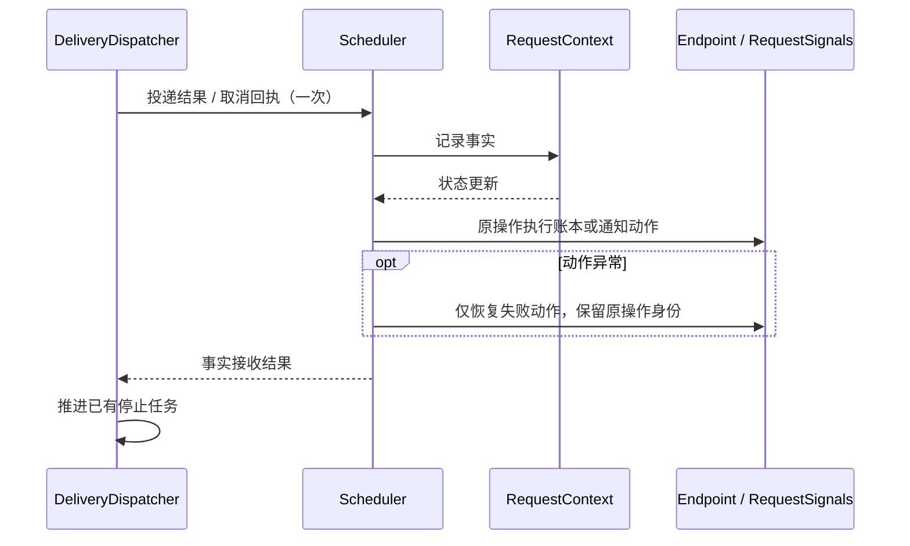

# Decode 队头有限绕行

只在 PRIORITY 队列的队头因 Decode 容量不足而阻塞时尝试绕行。沿用原有选择、资源准备、提交和发布流程。

## PrefillQueueRunner 与 NON_BATCH

PrefillQueueRunner（原 WorkerBatcher）是每个 Prefill 的本地队列执行器。三个配置轴独立：调度方式决定是否排队，决策方式决定一次选择几个请求，投递方式决定如何发布。

| 配置               | PrefillQueueRunner 的职责                          | 提交与发布                                                                     |
| ------------------ | -------------------------------------------------- | ------------------------------------------------------------------------------ |
| DIRECT + NON_BATCH | 不参与                                             | Scheduler 直接提交并发布单个路由                                               |
| QUEUE + NON_BATCH  | 排序、SINGLE/FIXED_WINDOW 决策、容量等待、有限绕行 | 按请求占用 Prefill 额度，逐个发布路由；无 batchId、批次许可或 EnqueueBatch RPC |
| QUEUE + BATCH      | 同一队列决策流程                                   | 占用批次额度和发送许可，交给 Dispatcher 发送 EnqueueBatch、处理 ACK            |

FIXED_WINDOW + NON_BATCH 仍会等待决策窗口；预算按各请求预测之和计算，提交时保留每项预测。先 claim 全组，再逐个发布；失去 claim 的请求不计入后续累计预测。SINGLE + BATCH 仍发送一个成员的真实批次。

普通选择和绕行共用 `decideGroup → processSelection`。`bypassCandidates` 只确定允许绕过队头的候选前缀；提交成功才消耗额度。完整 BATCH 组复用分组预测，实际提交前缀缩短时重算。随后按投递方式进入 `publishRoutes` 或 `Dispatcher.deliverBatch`。

## 事实与动作的负责人

Dispatcher 将每次投递结果或远端取消回执交给 Scheduler 一次。Scheduler 先记录 Context 事实，再由确认、抢占协调或关闭操作执行后续动作。后续动作失败不要求 Dispatcher 重放原回执。

恢复以失败的动作和原操作身份为单位：账本更新、容量通知、抢占结果通知分别恢复，不重新执行整个 `advanceRequest`。即时恢复有次数上限；耗尽后保留未结算状态，由已有期限或新的 Worker 事实收尾，并记录运行时错误，不能把失败当作资源已经释放。

`REQUEST_END` 只由关闭操作通知，包括普通取消之后抢占才完成的情况。Dispatcher 在发送完成时只唤醒已经接手的停止任务，不再次启动停止流程。远端清理完成与 Scheduler 本地资源结算仍是不同的完成条件。

关闭通知按 `beginClose → 执行动作 → completeClose` 独占领取和归还。部分完成时保存进度，后续事件重新领取剩余动作；`NOTIFICATION_REJECTED` 只归还本次操作，不把停止投递标成已接手。结算恢复也必须重新领取，不能拿快照中的旧令牌直接执行通知。Decode 终态到达后可以完成抢占结果通知，不要求 Prefill 已经释放；资源仍须各自的真实证明。

更名同步更新 Java 引用、测试和性能 profile；配置项与监控指标名称保持兼容。直接引用原 Java 类名的外部源码需要改用 `PrefillQueueRunner`。

## 接口与状态

- `PrefillQueueRunner.canBypass(head, candidate)`：检查同优先级、不同 Decode 账本、请求仍在队列且未过期、队头额度未用。此接口只判断资格，不预留容量。
- `PrefillState.RequestEntry.bypassUsed`：唯一新增的持久状态。成功提交绕行决策组时，在原有队列锁内重新校验并置位；失败不消耗额度。唤醒、重试、新请求到达和临时队头变化均不重置它，队列项移除时一起释放。
- `CommitPlan.bypassedHead`：可选的原队头，用于提交时复验并消费额度。普通提交保持为空。

## 执行顺序

1. 先按原顺序尝试队头。只有它因 Decode 容量不足而失败，才检查后续候选。
2. 只跳过这一个队头，收集紧邻其后的合格前缀；遇到第二个不合格或阻塞请求就停止，不继续向后找。
3. 候选使用原有分组规则，检查 Prefill KV/计算容量，按投递方式申请 Decode 与 Prefill 容量；仅 BATCH 申请发送许可。机会性绕行不额外等待一次收集窗口。
4. 提交前检查队头是否已可重试；已恢复则放弃本次绕行。队列锁内再次检查资格，成功提交后消费一次额度。
5. 复用原有发布、失败回滚和容量等待。额度按一次成功提交的决策组消耗；SINGLE 是一个请求，NON_BATCH 的决策组不是远端批次。

## 行为边界

同一个持续排队的队头最多被一个成功提交的决策组绕过；提交后的路由发布失败或批次 RPC 失败也不返还额度。候选不使用队头所等待的 Decode 账本，但仍共享 Prefill，因此可能使原队头多等这一组请求。

队头恢复检查是无锁容量快照，与 Decode 恢复并非跨账本原子操作；并发恢复时，已经进入提交的绕行批次仍可能完成。新请求到达可唤醒尚有额度的 Decode 等待；额度用完后不会因继续到达而反复重试。

这是机会性的绕行：只订阅原队头的 Decode 容量事件。候选所在 Decode 单独恢复不会额外唤醒此队列，须等待原有事件或新请求到达；没有新增候选监听器、线程或后台任务。路由预测保留原有保守等待边界。

NON_BATCH 单项预测失败按成员归因：预算分组阶段记录失败成员的索引，只移除该请求，正常前缀下轮继续；准备阶段将失败转成该成员的 CapacityBoundary，正常前缀可一起提交。异常不持有请求或输入对象，不增加正常路径分配。BATCH 的整体预测失败仍按原有组首处理。

## 当前验证（事实入口与动作恢复）

基线为 `d2166f5bd8`，只叠加本轮改动；在 `luoli_gpu` 中删除全部隔离构建产物后，用 JDK 21 完整编译和测试。

- 完整 UT：3332 项，0 失败、0 错误、1 跳过；Mock Engine 400 项全部执行。
- 两个 agent 复核事实入口、动作恢复、临时许可、锁顺序和模式边界。修复了通知快照与完成回填之间的竞态、晚到抢占完成等待 Prefill 清理、停止提交失败不归还通知操作，以及计时器关闭后结算无法完成的问题。
- 没有新增生产类或状态字段，生产代码净增加 5 行。显式方法数（含构造器）：PrefillQueueRunner 28、Scheduler 30、Context 30、Dispatcher 17；这些类的所有方法不超过 100 行。PrefillEndpoint 原有的 `reduceStatus` 115 行仅更名引用，不计作已完成的方法压缩。
- 冻结模块源码共 575 个 Java 文件，清单 SHA-256 为 `6aba0182927e80750014343a3fe5ea6e5bbddf68252b5a673566ea0ca17a2f44`。
- 完整性能 21/25 通过、4 项失败：API 14/16、Sync 5/5、750P/750D BATCH 0/2、NON_BATCH 2/2。性能尚未验收，不能宣称没有性能回退。

| 750P/750D 模式       | 目标 QPS | 客户端 QPS | 客户端 P99 | 服务端 P99 | 结论            |
| -------------------- | -------: | ---------: | ---------: | ---------: | --------------- |
| BATCH + FIXED_WINDOW |     3000 |     2996.8 |   58.262ms |       13ms | 客户端 P99 超限 |
| BATCH + FIXED_WINDOW |    10000 |     9989.0 |  330.595ms |      187ms | 两端 P99 超限   |
| NON_BATCH + SINGLE   |     3000 |     2998.5 |    6.245ms |        2ms | 通过            |
| NON_BATCH + SINGLE   |    10000 |     9994.6 |   31.207ms |        3ms | 通过            |

使用 64g 堆、ExitOnOutOfMemoryError、Netty advanced；矩阵预热与测量各 10 秒，保留 98% 吞吐和 50ms P99 门槛。另外两项失败为 API 突发测试（服务端 P99 612ms）及 4P/8D、10000 QPS（服务端 P99 79ms）。此前增量构建及旧基线结果单独归档，不能替代本节的干净构建结果。

另外串行进行了三组 750P/750D、BATCH、10000 QPS 的基线/改后对照。基线仅一轮完成（客户端 QPS 9989.2、P99 111.238ms、服务端 P99 28ms），其余两轮因 `RESOURCE_EXHAUSTED: receiving budget full` 中断。改后三轮客户端 P99 为 153.022/156.191/140.568ms，服务端 P99 为 35/154/76ms，其中一轮吞吐 9766.2 QPS 也未达到 98% 门槛。全部尝试保留，不能据此宣称性能提升或排除回退；补充对照也不替代上述 25 项性能门槛结果。

## 队列流程收敛验证（4e4dfb0bfe 历史结果）

基于 `d661bb360e` 的隔离副本，在 `luoli_gpu`、JDK 21 中验证；未混入其他工作区改动。

- 完整 UT：3305 项，0 失败、0 错误、1 跳过；Mock Engine 400 项全部执行。
- 新增覆盖：NON_BATCH 的窗口与逐项预算、BATCH + SINGLE 的真实批次、完整/截短绕行预测、失效 QUEUED 提交，以及单项预测失败的准确归因。NON_BATCH 绕行测试从初始化就使用对应运行时配置。
- 两个 agent 复核了模式边界、热点、许可回收、读写与锁顺序。发现的单项预测归属问题已修复。全量 UT 另发现校验移动改变 handoff 与异常契约，已修正：QUEUED 保留 Endpoint 提前拒绝，BATCH 只在 State 校验；修正后重跑全量 UT 通过。
- 无新增生产类，WorkerBatcher 为 28 个显式方法。方法预算勘误：当时的汇总检查遗漏了 `processSelection` 101 行，不能认定全部变更方法达标；另有 `stopAndDrain` 104 行、`PrefillEndpoint.reduceStatus` 115 行。
- 性能 21/25 通过、4 项失败，尚未验收。API 14/16、Sync 5/5；750P/750D 的 BATCH 0/2、NON_BATCH 2/2。使用 64g 堆、ExitOnOutOfMemoryError、Netty advanced；矩阵预热和测量各 10 秒，保留 98% 吞吐和 50ms P99 门槛。

| 750P/750D 模式       | 目标 QPS | 客户端 QPS | 客户端 P99 | 服务端 P99 | 结论            |
| -------------------- | -------: | ---------: | ---------: | ---------: | --------------- |
| BATCH + FIXED_WINDOW |     3000 |     2996.8 |   59.332ms |       13ms | 客户端 P99 超限 |
| BATCH + FIXED_WINDOW |    10000 |     9989.2 |  179.507ms |       28ms | 客户端 P99 超限 |
| NON_BATCH + SINGLE   |     3000 |     2999.4 |    3.144ms |        1ms | 通过            |
| NON_BATCH + SINGLE   |    10000 |     9994.8 |   18.018ms |        3ms | 通过            |

另外两项失败为 API 突发测试（服务端 P99 608ms）与 1P/2D、10000 QPS（服务端 P99 109ms）。本轮未重新压测基线，不据此宣称性能提升或没有回退。

## 初版绕行验证（历史结果）

基线为 `e2e129d4db3d2d1fd22a9509f721427511ca1983`。在只包含本轮 5 个 Java 文件改动的隔离副本中，进入 `luoli_gpu` 使用 JDK 21 验证；共享 proto 和 telemetry 测试数据来自同一基线。

- 完整 UT：3296 项，0 失败、0 错误、1 跳过，其中 Mock Engine 400 项全部执行。
- 回归覆盖：同优先级/不同 Decode、FIFO 禁止绕行、额度不可重置、SINGLE/NON_BATCH、Prefill KV 上限、预测失败归因、真实线程到达唤醒、队头恢复/变更，以及提交前取消队头或候选后的许可归还。
- 两个 agent 独立复核了许可回收、额度、等待唤醒和锁顺序。发现的预测异常归因和 Prefill 容量复验问题已修复并增加回归；复核未发现剩余确定问题，上述行为限制仍然保留。
- 外层显式方法（包含构造器）：WorkerBatcher 28 个，PrefillState 30 个。后续逐方法复核发现 `processSelection` 101 行，原“全部变更方法不超过 100 行”的判断不完整；`WorkerBatcher.stopAndDrain` 为 104 行。
- 完整性能门槛：20/25 通过、5 项失败，性能尚未验收。API 13/16，Sync 5/5；750P/750D、3000/10000 QPS 的 BATCH 为 0/2，NON_BATCH 为 2/2。使用 64g 堆、ExitOnOutOfMemoryError 和 Netty advanced 泄漏检测，未调整原有门槛。
