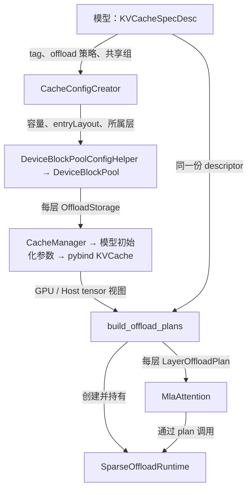
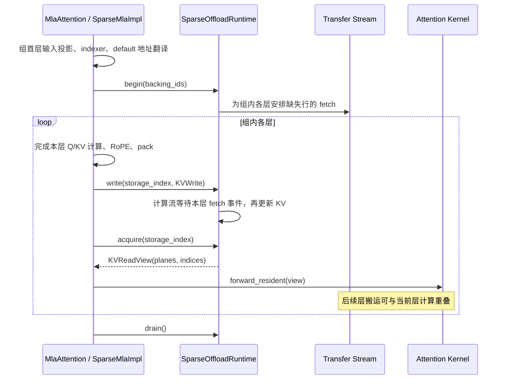

# Sparse KV Offload

基于 main `bcd02fdb05` 的本地实现，按 2026-10-27 当前代码整理。本文说明设计和调用关系；实验版本、性能及验证结果单独放在[验收记录](sparse_kv_offload_acceptance_20261025.md)。

**Cache group 描述 KV 怎么存，模型决定本步读写哪些 KV，offload runtime 负责把 attention 要读的数据准备到 GPU。**

## 1. 与 cache group 的结合

沿用 main 的按 tag 分组、block 分配、引用计数、P/D 传输和 MR 注册。对开启 offload 的 group，增加混合 GPU/Host 存储和 GPU 热缓存。

| GLM 的 group | 内容 | 存储方式 |
|---|---|---|
| `default` | attention 使用的 KV，各层数据独立 | 一部分 block 在 GPU，一部分在 pinned Host；GPU 热缓存保存从 Host 取回的行 |
| `indexer_kv` | indexer 用于选择 token 的数据 | 保持在 GPU；IndexShare 模型只在实际计算 indexer 的源层分配 |

同一个 offload group 内部包含 GPU 和 Host block，不额外拆成两组。请求仍使用原来的 block ID；热缓存槽位只供本地 attention 读取，不参与请求的 block 分配。

模型在每层的 [KVCacheSpecDesc](../rtp_llm/cpp/cache/KVCacheSpecDesc.h) 上声明：

```python
offload: Optional[CacheOffloadPolicy]  # enabled, max_selected_rows
offload_runtime_group: Optional[int] # 同一 tag 下，共享选择结果的层使用相同 ID
```

`cache group` 按存储类型分组；`offload_runtime_group` 按哪些层共享选择结果分组。属于同一个 `default` group，不等于所有层共用一个 runtime，更不等于共享 KV。

存储布局由 [KVCacheSpec.entryLayout()](../rtp_llm/cpp/cache/KVCacheSpecBase.h) 提供：每页 entry 数，以及各 plane 的 dtype、offset、shape、stride。Plane 是一份 tensor 视图，例如 packed KV、K、V 或 scale；entry 是一次可以选择、搬运的数据行。

| 布局 | 一行是什么 | planes |
|---|---|---|
| MLA | 一个 token 的压缩 KV | packed KV |
| sparse MHA | 一个 token 的各 head K/V | K、V，量化时另有 scales |
| CSA | 一个压缩后的 KV entry | packed KV，页 padding 不作为有效数据 |

当前要求 offload group 是可分页的 `FULL` group，使用默认 block 容量分配并提供有效 entry 布局；固定容量、SWA、state/ring group 不自动进入 offload。

## 2. 初始化：声明如何变成可用存储



| 连接点 | 交接什么 | 代码位置 |
|---|---|---|
| 模型 → 引擎 | `default` 开启 offload、选择上限、共享组；经 `EngineInitParams.model_config_` 进入 C++ | [DeepSeekV2._configure_sparse_kv_offload](../rtp_llm/models/deepseek_v2.py)、[RtpLLMOp::initModel](../rtp_llm/cpp/pybind/multi_gpu_gpt/RtpLLMOp.cc) |
| 引擎 → 分配器 | 每个 tag 的 HBM/Host block 数、布局和所属层 | [CacheConfigCreator](../rtp_llm/cpp/cache/CacheConfigCreator.cc)、[DeviceBlockPoolConfigHelper](../rtp_llm/cpp/cache/DeviceBlockPoolConfigHelper.h) |
| 分配器 → Python | `OffloadStorage`：Host/GPU planes、block/page 行数、选择上限、共享版本 tensor | [DeviceBlockPool](../rtp_llm/cpp/cache/block_tree_cache/block_pool/DeviceBlockPool.cc)、[BufferTypes.h](../rtp_llm/cpp/cache/BufferTypes.h) |
| Python 装配 → attention | `(layer, tag) → LayerOffloadPlan`，包含 runtime、本层 storage 编号、是否组首/组末 | [build_offload_plans](../rtp_llm/models_py/modules/offload/plan.py)、[GenericMoeModel.initialize](../rtp_llm/models_py/model_desc/generic_moe.py) |

存储到模型的具体桥接为：`CoordinatorCacheManager.allLayerCacheBase()` → `KVCacheManager.getMainModelGroupedCacheLayerLayout()` → `NormalExecutor` 初始化参数 → `PyWrappedModel` → `init_resource.kv_cache.get_offload_storage(layer, tag)`。

C++ 拥有正式 KV 和热缓存内存；Python 使用同一份内存的视图，另建行映射、热槽状态和 CUDA 事件。`build_offload_plans` 按 `(tag, offload_runtime_group)` 创建 runtime；未声明共享组时每层独立。模型装配通过 `MlaAttention.configure_offload()` 安装 plan。

### 容量与计费

正式存储的 block 数为 `N = H + P`：`[0, H)` 在 GPU，`[H, N)` 在 Host，block 0 保留不用。GPU 热缓存额外分配，不改变这套地址。

只保留一个容量参数 `max_selected_rows`，表示一次 `begin` 的索引总数上限；当前 MLA 模型设置为 `max_generate_batch_size * indexer_topk`。热缓存行数由它向上按 page 对齐计算，不单独配置。Scratch 使用未对齐的选择上限，因此多分配的页尾空间不会放宽调用限制。

| 内存 | 计费单位 |
|---|---|
| 行映射、去重状态、热槽状态、selection/miss scratch | 每个 runtime 一份 |
| block 版本 `generations` | 每个 tag 一份 |
| 正式 KV、热缓存 KV、新 KV 打包缓冲区 | 每个 storage，即各层对应的存储，一份 |

例如 GLM-5.3 的 78 层、21 个共享选择组，管理状态计 21 份，每层 KV 仍计 78 份。

## 3. 执行：五个接口与调用位置

接口实现在 [SparseOffloadRuntime](../rtp_llm/models_py/modules/offload/runtime.py)。行地址是连续 CUDA `int32` tensor，`-1` 表示无效项；`begin` 按整个 tensor 的元素数检查选择上限。

| 接口 | 调用点 | 行为 |
|---|---|---|
| `begin(backing_ids)` | [MlaAttention.forward](../rtp_llm/models_py/modules/hybrid/mla_attention.py)，组首层得到 top-K 后 | GPU 正式存储中的行直接使用；Host 行检查热缓存，去重并为缺失或过期的行安排搬运，生成 GPU 索引 |
| `write(storage_index, KVWrite)` | [SparseMlaImpl.forward](../rtp_llm/models_py/modules/factory/attention/cuda_mla_impl/flashmla_sparse_impl.py)，RoPE 和 [pack](../rtp_llm/models_py/modules/factory/attention/cuda_mla_impl/mla_kv_cache_write_op.py) 后 | 等待本层在途 fetch，再写入新 KV 的正式存储；已有有效热副本同步更新 |
| `acquire(storage_index) → KVReadView` | 同一 `forward`，attention 前 | 让调用 stream 等待本层数据就绪，返回 GPU planes 和重映射索引 |
| `drain()` | 共享组末层及异常退出路径 | 让调用 stream 等待组内剩余搬运完成 |
| `reset()` | [模型 reset](../rtp_llm/models_py/model_desc/module_base.py)，由 [CUDA Graph 初始化](../rtp_llm/cpp/cuda_graph/cuda_graph_runner.cc) 在 capture 外调用 | 等待搬运并清空热缓存管理状态，保留正式 KV 和 block 版本 |

`KVWrite(backing_ids, planes)` 传本步生成的新 KV；`KVReadView(planes, indices)` 交给原 sparse attention kernel。历史 KV 的 Host → GPU 搬运由 `begin` 发起。`acquire` 是数据就绪依赖，不是互斥锁。

**地址交接必须按 tag 对齐**：indexer 输出请求内的 token 位置，用 `default` 的 block table 转为 backing ID；新 KV 用 `default` 的 slot mapping 写入。`indexer_kv` 有自己的表，不能混用。



Runtime 决定搬哪些行，[PagedRowLayout](../rtp_llm/models_py/modules/offload/layout.py) 按 tensor 的 shape/stride 执行读写，保留原生 K/V/scale 布局和页 padding。模型仍调用原 attention kernel。

## 4. 模型适配：相同与不同

GLM 和不共享选择结果的 DSA MLA 使用同一组接口和相同参数类型。区别是哪些层共用 runtime、谁调用 `begin/drain`，以及传入的选择结果。

| 模型 | runtime 分组 | `begin` | `write / acquire` | `drain` |
|---|---|---|---|---|
| GLM-5.3 IndexShare | 共享选择结果的层共用一个 | 组首层调用，为整组安排预取 | 每层传自己的 storage 编号和新 KV | 组末层 |
| 不共享选择结果的 DSA MLA | 每层独立 | 每层产生自己的选择后调用 | 每层调用 | 每层结束 |

例如 GLM 的第 2～5 层（从 0 编号）共用一个 runtime：第 2 层 `begin`，各层分别 `write/acquire(0..3)`，第 5 层 `drain`。各层 KV 独立，只共享选择结果和映射。独立选择的模型可以重叠当前层后续计算，但不能利用上一层选择结果预取下一层。

更换 attention 布局时，存储和搬运模块复用 `entryLayout`；模型仍需接好以下三处：

| 接入点 | MLA | sparse MHA | CSA |
|---|---|---|---|
| 选择结果 → `begin` | token top-K 转本组行地址 | token/head 选择转本组行地址 | 压缩 entry ID 转本组行地址，不能直接用原 token ID |
| 新 KV → `write` | packed KV | K/V 和 scales | compressor 产生的压缩 KV，接管其正式存储写入 |
| `acquire` → attention | packed plane 和新索引 | K/V、scales 和新索引 | 压缩 plane 和新索引；SWA/state 仍走各自 group |

当前已完成 GLM/DSA MLA 和 DeepSeek V4 FP8 CSA 模型接入；MHA 只验证到通用存储和 runtime。Cache group 能描述布局，不会自动完成模型的读写调用适配。

V4 只 offload `csa_kv`，`indexer_kv`、HCA、SWA 和 compressor state 留在 HBM。CSA 用压缩行 ID 选择，不能用原 token ID；每个 native page 内先排全部 576B KV payload，再排全部 8B scale，因此 `entryLayout` 提供两个 plane。普通 compressor 和默认 CSA megakernel 都先写一个固定地址的 striped staging page，再由 runtime 写入正式 Host/HBM backing；FlashMLA 继续使用原融合双池算子，SWA 与重映射后的 resident CSA 合并 attention。每层独立选择、独立 runtime；DSpark draft 的 SWA 缓存不 offload。

## 5. 生命周期与支持边界

Block 重新分配、copy 或 P/D 覆盖后，C++ 记录 generation 变化。[DecodeRpcServer](../rtp_llm/cpp/model_rpc/DecodeRpcServer.cc) 标记成功加载的数据，[NormalExecutor](../rtp_llm/cpp/normal_engine/NormalExecutor.cc) 收集更新、随输入做 TP 广播，并在 forward 前发布到 `OffloadStorage.generations`。Runtime 持有同一份 GPU tensor，版本不一致就重新 fetch，防止复用旧请求的热副本。

P/D 和 MR 注册使用正式存储的原生 KV/scale buffer，包含页 padding、排除热缓存。当前一次 runtime 只有一份活动 selection，依赖引擎串行 forward 和 block 生命周期管理。已有 P/D load 取消后的在途回调问题未在本分支修复。

| 范围 | 当前状态 |
|---|---|
| 执行路径 | CUDA、P/D 的 decode 侧，eager / CUDA Graph；关闭 offload 走原路径 |
| 并行 | 引擎接入 TP 版本同步；模型能否运行仍受 attention kernel 限制。完整 GLM-5.3 历史对照为 TP1/DP4/EP4 |
| GLM-5.3 FP8 的 TP 限制 | 已测 FlashMLA `49e2000.cu132` 下，TP2/4/8 的每 rank 32/16/8 个 query heads 不支持；关闭 graph 也不能解决，不能据此承诺任意 TP 配置 |
| MTP / DSpark | GLM `glm_5` + `glm_5_mtp` 的 EAGLE/NextN，以及 V4 `deepseek_v4` + `deepseek_v4_dspark`；P/D 两端开启相同配置，offload 仅在 D 端开启 |
| V4 并行 | 已测 4 卡：P CP2/EP2，D TP1/DP2/EP2。TP1 D 可接收 CP2 P 的缓存，D 自身不运行 CP attention |
| 明确拒绝 | D 实际执行 CP>1、PP>1、其他 speculative 组合、layer micro-batch、memory/disk/remote prefix connector、drop-broadcast-sync |
| 其他传输边界 | MHA 非对称 TP 传输要求每个 physical block 只有一个 kernel page；同 TP 多 page 保持原生字节布局 |

MoE 前额外等待默认关闭；`RTP_LLM_DSA_MLA_DRAIN_BEFORE_MOE=1` 可用于对照，组末等待始终保留。FlashMLA 精度升级、融合优化和 DSV4.1 完整模型适配独立处理；历史验证所用依赖见验收记录。

## 6. 启用与验证

已有可正常运行的 P/D 部署中，仅在 D 侧开启；P 侧保持原配置。相关参数在 [kv_cache_group_args.py](../rtp_llm/server/server_args/kv_cache_group_args.py)：

| 参数 | 含义 |
|---|---|
| `--enable_sparse_kv_offload 1` | 开启模型声明的 offload groups；要求 `--role_type DECODE` |
| `--sparse_kv_offload_host_mb 65536` | 每 rank 最多 64 GiB pinned Host KV；默认 0，不增加 Host block |
| `--kv_cache_mem_mb 16384` | 每 rank 16 GiB GPU KV 预算，包含正式 GPU KV、热缓存、device-only groups 和管理开销；不含模型权重 |
| `--concurrency_limit` | 引擎据此设置最大 decode batch；MLA 用该上限乘 top-K 推导热缓存容量，MTP 还需乘 `gen_num_per_cycle + 1`，增大会占用更多预算 |
| `--sparse_kv_offload_test_hbm_blocks` | 仅测试使用，强制 HBM block 数；生产保持默认 0，按预算计算 |

最小 P/D 启动对照可直接使用已有 smoke，它自动启动 P/D、发送请求并停止服务，无需手写两套启动参数。需要 CUDA13 构建环境、测试 worker 可分配两张 SM103 GPU，以及本地模型目录 `/models/GLM-5.3-ms-4ed051d0`：

```bash
bazel test --config=cuda13 \
  --test_env=RTP_TEST_MODEL_ROOT=/models \
  //rtp_llm/test/smoke:glm53_sparse_kv_offload_model_test
```

该 smoke 只加载 7 层，使用稳定 top-K，覆盖 off/on 与 eager/graph；D 侧测试预算为 GPU 512 MiB、Host 32 MiB、HBM 2 个 block，确保使用 Host。它验证调用链，不代表完整模型部署或性能。

GLM MTP 在 P/D 两端添加相同参数：

```bash
--sp_type eagle --sp_model_type glm_5_mtp \
--sp_checkpoint_path /models/GLM-5.3-ms-4ed051d0 --gen_num_per_cycle 3
```

支持从完整 checkpoint 的第 `num_hidden_layers` 层读取 NextN 权重，也支持独立的单层 MTP checkpoint。target verify 和 draft extend 使用各 query 的因果前缀访问 paged indexer/MLA；分层缓存为 target 与 draft 分别保留存储及 runtime，并在每次 forward 前发布 block 版本。这里不启用参考分支的可选跨 MTP 迭代 index 复用。

新增对照入口 `//rtp_llm/test/smoke:glm5_mtp_offload_model_test` 默认使用 7 层 target 加真实 NextN 层，比较关闭 MTP、MTP eager、MTP offload、MTP graph、MTP graph + offload，包含长请求、并发和 block 复用。直接运行 [glm5_mtp_offload_test.py](../rtp_llm/test/smoke/glm5_mtp_offload_test.py) 时，可用 `RTP_GLM_MTP_LAYERS=78 RTP_GLM_MTP_ROLE_SIZE=4` 在 8 卡上运行完整模型的 4P/4D 对照；每端使用 TP1/DP4/EP4。`RTP_GLM_MTP_STABLE_TOPK=0` 使用原生 top-K；默认稳定 top-K 仅用于逐 token 精度对照。

默认要求全部输出 ID 严格相同。多卡 FP8 的 batch/rank 路由可能使近似计算的 argmax 改变；`RTP_GLM_MTP_COMPARE_IDS=record` 显式记录每个请求的首个差异位置，便于将数值变化与运行失败分开排查。该诊断模式仍验证 P/D、生成长度、MTP 实际执行及 graph 捕获/回放，但不宣称全部输出 ID 相等。

日常单测和真实 TCP P/D 传输测试：

```bash
bazel test --config=cuda13 \
  //rtp_llm/models_py/modules/offload/test:sparse_kv_offload_unit_tests \
  //rtp_llm/cpp/model_rpc/test:decode_rpc_server_test
```

单测入口覆盖配置、容量、存储、版本同步、模型路由和 GPU runtime；模型 smoke 独立运行。GLM BF16/FP8 和 DSv3.2 的四层模型对照入口为 `//rtp_llm/test/smoke:sparse_kv_offload_model_test`，所需 checkpoint 名称见 [sparse_kv_offload_test.py](../rtp_llm/test/smoke/sparse_kv_offload_test.py)。测试结果只在验收记录维护。

V4 原生 FP8 layout、Host 更新后的 graph replay、普通 compressor 写回及完整 CSA megakernel 多 token verify 的 GPU 对照：

```bash
bazel test --config=cuda13 //rtp_llm/models_py/modules/offload/test:dsv4_offload_gpu_test
```

完整 V4 Flash 模型的配置和性能见 [V4 Flash offload 验收记录](deepseek_v4_flash_offload_acceptance_20261029.md)。此接入不覆盖 V4.1 或 V4 BF16 KV。
