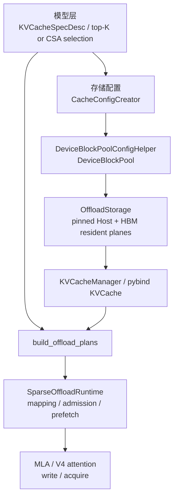
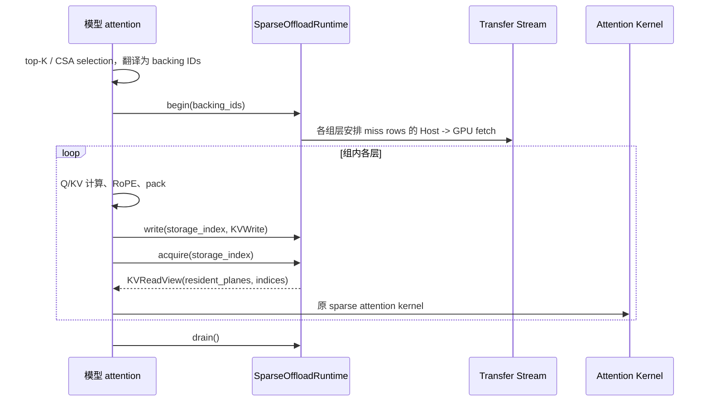

# Sparse KV Offload 设计

Sparse KV offload 的核心分工是：**cache group 描述 KV 怎么存，模型决定本步读写哪些 KV，offload runtime 负责把选中行准备到 GPU。**

请求继续使用原 block table 和 block ID。一个 offload group 的正式 KV 可以同时位于 HBM 和 pinned Host；GPU 热缓存只保存最近被稀疏 attention 访问到的 Host 行，不参与请求 block 分配或 P/D 传输。

## 1. 目标与范围

- 只对 decode 阶段稀疏访问的正式 KV 做 offload；prefill、prefix reuse 和 decode reuse 保持原路径。
- `indexer_kv`、HCA、SWA 和 compressor state 仍在 HBM，不进入本机制。
- 不引入第二套对外 KV 地址。Host 行在 attention 前被映射到热缓存槽，原 sparse attention kernel 继续消费 GPU tensor。
- 当前接入 GLM/DSA sparse MLA 和 DeepSeek V4 FP8 CSA。MHA 已覆盖存储和 runtime，但还没有完整模型 attention 适配。

生产 decode 使用 `--reuse_cache 0`。这里关闭的是 decode prefix reuse；P 侧仍可单独启用 prefill prefix reuse。

## 2. 分层与调用链



| 层 | 职责 | 主要代码入口 |
|---|---|---|
| 存储层 | 把模型声明转成每个 tag/layer 的 Host/HBM block、native planes、热缓存容量和 generation | [KVCacheSpecDesc.h](../rtp_llm/cpp/cache/KVCacheSpecDesc.h)、[CacheConfigCreator.cc](../rtp_llm/cpp/cache/CacheConfigCreator.cc)、[DeviceBlockPool.cc](../rtp_llm/cpp/cache/block_tree_cache/block_pool/DeviceBlockPool.cc)、[BufferTypes.h](../rtp_llm/cpp/cache/BufferTypes.h) |
| runtime 层 | 把 backing ID 转成 resident 索引，完成去重、热槽替换、异步 fetch、写回和版本检查 | [plan.py](../rtp_llm/models_py/modules/offload/plan.py)、[runtime.py](../rtp_llm/models_py/modules/offload/runtime.py)、[layout.py](../rtp_llm/models_py/modules/offload/layout.py) |
| 模型层 | 声明可 offload 的 group，产生选择结果，调用 `begin/write/acquire/drain` 后进入原 attention kernel | [deepseek_v2.py](../rtp_llm/models/deepseek_v2.py)、[deepseek_v4.py](../rtp_llm/models/deepseek_v4.py)、[mla_attention.py](../rtp_llm/models_py/modules/hybrid/mla_attention.py)、[V4 attention](../rtp_llm/models_py/modules/dsv4/fp8/attention.py) |
| 生命周期 | block 重新分配、P/D copy/load 或 speculative cache swap 后发布 generation，使旧热副本失效 | [DecodeRpcServer.cc](../rtp_llm/cpp/model_rpc/DecodeRpcServer.cc)、[NormalExecutor.cc](../rtp_llm/cpp/normal_engine/NormalExecutor.cc)、[MtpExecutor.cc](../rtp_llm/cpp/normal_engine/speculative/MtpExecutor.cc) |

层间交接有五个稳定接口：

| 接口 | 交接内容 |
|---|---|
| `KVCacheSpecDesc.offload` | 是否开启 offload，以及一次 selection 的行数上限 `max_selected_rows` |
| `KVCacheSpecDesc.offload_runtime_group` | 同一 tag 下哪些层共享选择结果和 runtime 元数据；未设置时每层独立 |
| `KVCacheSpec.entryLayout()` | 每个 native page 的 entry 数和各 plane 的 dtype、shape、offset、stride |
| `OffloadStorage` | Host/resident tensor views、block 几何、选择上限和所有层共享的 `generations` |
| `LayerOffloadPlan` | 某层对应哪个 runtime/storage，以及该层是否负责组首 `begin` 和组末 `drain` |

## 3. 存储层

### 3.1 block 与 plane 布局

一个 offload group 有 `N = H + P` 个正式 block：`[0, H)` 位于 HBM，`[H, N)` 位于 pinned Host。GPU 热缓存另外占用 resident plane 的尾部空间，不改变正式 block 编号。

`entryLayout()` 描述一次可选择的 entry，而不是假设所有模型都使用连续 MLA KV：

| 布局 | 一个 entry | plane |
|---|---|---|
| MLA | 一个 token 的压缩 KV | packed KV |
| sparse MHA | 一个 token 的 K/V | K、V，量化时另有 scales |
| V4 CSA | 一个压缩 KV entry | 576 B packed KV、8 B scale |

`PagedRowLayout` 直接使用 tensor 的 shape/stride 计算页内偏移，保留原生 K/V/scale 布局和页 padding。这样存储层无需把模型 tensor 重新打包成统一 dense 格式。

### 3.2 配置与分配

初始化链路为：

```text
模型 KVCacheSpecDesc
  -> CacheConfigCreator：按 tag 计算容量、布局、owner layer、runtime 数
  -> DeviceBlockPoolConfigHelper：生成 pool 配置和 native page geometry
  -> DeviceBlockPool::initializeOffloadStorage()：创建 pinned Host 和 resident CUDA planes
  -> OffloadStorage：暴露给 CacheManager、pybind 和 Python runtime
```

模型只声明策略，不直接分配 buffer。例如 sparse MLA 会把 `default` group 标记为 offload，并把同一 indexer 选择源的层设置为同一个 runtime group：

```python
policy = CacheOffloadPolicy()
policy.enabled = True
policy.max_selected_rows = concurrency * (gen_num_per_cycle + 1) * top_k
desc.offload = policy
desc.offload_runtime_group = runtime_groups[layer_id]
```

`max_selected_rows` 是一次 `begin` 的 flat selection 上限，不是热缓存行数。热缓存容量按 page 向上取整：

```text
resident_rows = ceil(max_selected_rows / rows_per_page) * rows_per_page
```

`OffloadStorage` 保存 `total_blocks`、`hbm_blocks`、`rows_per_block`、`rows_per_page`、`max_selected_rows`、`host_planes`、`resident_planes` 和 `generations`。C++ 持有正式 KV 和热缓存内存，Python 只持有同一块内存的 tensor view。

同一 tag 的层共享 `generations`，但每层仍有自己的 `OffloadStorage` 和正式 KV。共享的是 block 版本与 runtime 管理状态，不是 KV 数据。

### 3.3 数据版本

block 被重新分配或覆盖后，`DeviceBlockPool` 增加该 block 的 generation：

```text
block allocation / overwrite
  -> DeviceBlockPool::onAllocatedNoLock()
  -> takeOffloadVersionUpdates()
  -> NormalExecutor / MtpExecutor 做 TP broadcast
  -> publishOffloadVersions()
  -> OffloadStorage.generations
```

`DecodeRpcServer` 在 P/D load 覆盖目标 block 后调用 `markOffloadOverwrite()`。Runtime 的热槽保存 `(block, generation)`；下一次 `begin` 发现 generation 不一致时重新 fetch，避免 request block 复用后读到旧热副本。

## 4. Runtime 层

`SparseOffloadRuntime` 按 `(tag, offload_runtime_group)` 创建。构造时校验所有 storage 的 block 几何、plane 形状和 `generations` 地址完全一致，然后分配：

- `mapping`：正式 backing row 到 resident 槽的映射。
- `owners/tags/versions/protected`：去重、替换保护、槽归属和版本。
- `_slots/_misses/_write_slots`：selection、miss 和写回 scratch。
- transfer stream 与每层 ready event：异步搬运和计算流依赖。

一次 selection 的执行接口如下：

| 接口 | 调用位置 | 行为 |
|---|---|---|
| `begin(backing_ids)` | MLA top-K 转成 `default` backing ID 后；V4 把 CSA 压缩 ID 转成全局 slot 后 | 检查 flat 行数，去重 HBM/Host 行，保护当前热槽，安排 miss 行从 Host 搬到每层 resident plane |
| `write(storage_index, KVWrite)` | MLA RoPE/pack 后；V4 compressor 写完 striped staging 后 | 等待本层 fetch，写入正式 HBM/Host backing，并同步仍有效的热副本 |
| `acquire(storage_index)` | 进入原 sparse attention kernel 前 | 让当前计算流等待该层 fetch，返回 resident planes 和重映射后的索引 |
| `drain()` | 共享组末层、下一次 `begin` 前、graph 生命周期边界 | 等待组内剩余搬运完成 |
| `reset()` | `reset_sparse_kv_offload()`，graph capture 外 | 清空 mapping/热槽/事件状态，保留正式 KV 和 block generation |

`acquire` 是 CUDA stream 依赖，不是锁。`begin` 发起整组各层的 fetch，后续层搬运可与当前层 attention 重叠。



`begin` 本身会先调用 `drain()`，因此一个 runtime 同时只有一份活动 selection。这个约束依赖引擎串行执行 forward 并保证 backing block 的生命周期。

## 5. 模型层

模型层只负责“选择谁”和“何时调用 runtime”，不直接处理 Host 地址或热槽替换。

| 模型路径 | runtime 分组 | 调用方式 |
|---|---|---|
| GLM IndexShare / 共享选择结果的 sparse MLA | 同 tag、同 `offload_runtime_group` 的层共用一个 runtime | 组首层 `begin`，各层独立 `write/acquire`，组末层 `drain` |
| 不共享选择结果的 DSA MLA | 每层独立 runtime | 每层产生自己的 top-K，再执行 `begin/write/acquire/drain` |
| DeepSeek V4 FP8 CSA | 每层独立 runtime，只 offload `csa_kv` | 压缩 ID 经 block table 翻译后 `begin`，compressor staging 经 `write` 写入，attention 用 `acquire` 返回的新索引读取 |

GLM 的各层 KV 仍独立。共享 runtime 只共享“本步选择了哪些历史行”和 mapping/热槽元数据，避免组内每层重复做一次相同的 selection admission。

MLA 的桥接点是 `MlaAttention.configure_offload()` 和 `SparseMlaImpl.forward()`：前者把 `LayerOffloadPlan` 和 writer 装到模型层，后者在 RoPE 后调用 `write()`，在 attention 前调用 `acquire()`。

V4 的桥接点是 `DeepSeekV4Model._initialize_sparse_offload()`、`configure_sparse_offload()` 和 `compressor.write_offloaded_kv()`。CSA 不能直接使用 token ID，必须使用压缩 entry ID；SWA、HCA 和 compressor state 仍走各自的原生 group。

## 6. 生命周期与 SWA

正常 decode 的调用顺序是：

1. C++ 完成 block 分配、copy/load，并在必要时更新 generation。
2. Executor 将 generation update 通过 TP 同步后发布到 GPU tensor。
3. 模型产生 top-K/CSA selection，调用 `begin`。
4. runtime 完成 Host 行 admission 和 fetch，模型写新 KV 并读取 resident KV。
5. 组末 `drain`，backing block 保持由原 cache manager 管理。

SWA 清理还有一个独立的单位约束：`active_tail_blocks` 是 block 数，`reserve_step` 是 token 数。保留区必须换算成 block：

```text
reserve_blocks = ceil(reserve_step / seq_size_per_block)
```

`SWACacheManager::removeSkippedBlocks()` 只释放 active tail 和 reserve blocks 之前的历史 block。Coordinator 端到端测试
`CompleteTokenIdsReserveStepReclaimsSwaRollingWindow` 从 `CompleteTokenIds` 读取 `reserve_step`，经过真实 allocator 路径，检查最终有效 block 数，避免再次混用 token/block 单位。

## 7. 部署

最小 D 侧增量配置：

```bash
--role_type DECODE
--enable_sparse_kv_offload 1
--sparse_kv_offload_host_mb 53248
--kv_cache_mem_mb 0
--reuse_cache 0
```

`--kv_cache_mem_mb` 是所有 HBM cache 和热缓存的总预算；设为 0 时由部署脚本或固定 pool 参数控制容量。`--sparse_kv_offload_host_mb` 是每个 rank 可用的 pinned Host KV 上限。热缓存容量由 `--concurrency_limit`、模型 top-K 和 MTP/DSpark 的每轮 token 数共同决定。

P/D 两端必须使用一致的模型和 speculative 配置。offload 只在 D 打开，P 不打开。本次验证的 V4 四卡部署为：

- P：`CP2 / EP2`，GPU 0/1。
- D：`TP1 / DP2 / EP2`，GPU 2/3。
- DSpark `gen_num_per_cycle=3`，因此实验使用 `reserve_step=9`。
- DSpark 与 D 侧 CUDA Graph 开启。

## 8. 实验与结果

实验环境为 DeepSeek-V4-Flash-0731、4 张 L20D，并按 L20A 有效 HBM 预算 `189470 MiB/GPU` 校准。D 卡纯模型权重为 `82.105 GiB`，KV/state HBM pool 为 `66.38/66.17 GiB`，Host KV pool 分别为 `32/52 GiB`。

数据集是固定 synthetic 长文本：同一份重复技术文档经模型 tokenizer 编为恰好 `131072` tokens，所有请求复用该输入。采样设置为 `top_k=1`、`random_seed=42`、`ignore_eos=false`，输出到自然 EOS 或 1M context limit。测量口径为 D 侧 egress、P 转发前，排除 prefill 和 KV load。

两档均通过资源审计：

| 设置 | 并发/D | Host KV | 成功请求 | 聚合 decode TPS | TPOT P50 | TPOT P99 | CSA 读放大 |
|---|---:|---:|---:|---:|---:|---:|---:|
| Offload-150 | 150 | 32 GiB | 300/300 | 9789.4 | 27.995 ms | 30.841 ms | 51.91 KB/token |
| Offload-192 | 192 | 52 GiB | 384/384 | **10377.4** | 34.965 ms | 39.130 ms | 129.01 KB/token |

150 档是干净复现交叉验证。192 档没有漏测：干净环境下它是本次两档中的最高聚合吞吐点，但 TPOT 和 Host 读放大也更高。192 档早期的 `9281.3 TPS` 来自 GPU 污染窗口，不作为结果。

最终功能回归沿用同一模型、同一 `131072`-token 输入和上述 2P2D 部署（P：GPU 0/1，D：GPU 2/3），同时提交 4 个请求，Host KV 为 `32 GiB`，decode reuse 为 0。4/4 请求自然 EOS，输出长度分别为 1344、1510、1523、1765，每个 D rank 各接收 2 个请求；D 侧聚合 decode 为 `587.70 token/s`，TPOT P50/P99 为 `5.962/6.022 ms`。该点用于 128K 输入和 SWA rolling-window 修复的端到端功能验收，不与 150/192 容量吞吐点做性能排名。

## 9. 验证与边界

关键回归入口：

```bash
bazel test --config=cuda13 \
  //rtp_llm/cpp/cache/test:hybrid_pool_kv_cache_allocator_test \
  //rtp_llm/cpp/cache/test:tiered_cache_config_test \
  //rtp_llm/config/test:kv_cache_config_pickle_test \
  //rtp_llm/config/test:server_config_setup_test \
  //rtp_llm/cpp/cache/block_tree_cache/test:device_swa_cache_manager_test

bazel test --config=cuda13 \
  //rtp_llm/models_py/modules/offload/test:dsv4_offload_gpu_test \
  //rtp_llm/models_py/modules/offload/test:sparse_kv_offload_gpu_test
```

C++ 回归覆盖 SWA reserve 单位、pool sizing、storage/version 和 coordinator 路径；GPU 入口覆盖 Host 更新后的 graph replay、compressor 写回和多 token verify。

- 一个 runtime 当前只支持一份活动 selection，依赖引擎串行 forward 和 backing block 生命周期管理。
- 已观察到 P/D load 取消后的在途回调问题，本分支未修复。
- 性能数字来自 L20D 上的 V4 Flash FP8 KV，不外推到 V4.1、BF16 KV 或其他 attention layout。
- 本次只有 natural-EOS primary 批次，没有 profiler 批次的组件级 GPU 空闲拆分。
