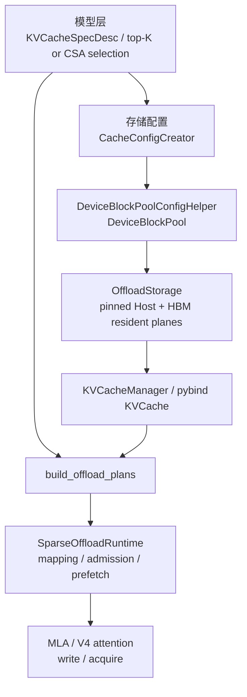
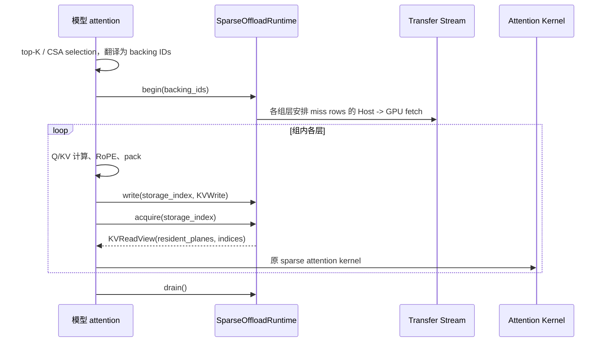

# Sparse KV Offload 使用指南

在已跑通的 CUDA P/D 服务上，为 D 侧增加 Host KV 容量。先看[部署步骤](#7-部署)和 [cache group 选择](#71-开启位置与-cache-group-选择)；新模型接入见[第 10 节](#10-其他模型如何接入)。

Sparse KV offload 的核心分工是：**cache group 描述 KV 怎么存，模型决定本步读写哪些 KV，offload runtime 负责把选中行准备到 GPU。**

请求继续使用原 block table 和 block ID。一个 offload group 的正式 KV 可以同时位于 HBM 和 pinned Host；GPU 热缓存只保存最近被稀疏 attention 访问到的 Host 行，不参与请求 block 分配或 P/D 传输。

## 1. 目标与范围

- 只对 decode 阶段稀疏访问的正式 KV 做 offload；prefill、prefix reuse 和 decode reuse 保持原路径。
- `indexer_kv`、HCA、SWA 和 compressor state 不由本机制迁移，保持各自原有的存放配置和读写路径。
- 不引入第二套对外 KV 地址。Host 行在 attention 前被映射到热缓存槽，原 sparse attention kernel 继续消费 GPU tensor。
- 当前接入 GLM/DSA sparse MLA 和 DeepSeek V4 FP8 CSA。MHA 已覆盖存储和 runtime，但还没有完整模型 attention 适配。

生产 decode 使用 `--reuse_cache 0`。这里关闭的是 decode prefix reuse；P 侧仍可单独启用 prefill prefix reuse。

开启 offload 的 D 侧不支持普通 context prefill，也不支持 `multi_task_prompt`；配置和运行时会提前拒绝这些路径。Target verify 和 MTP draft extend 使用独立的轮次标志，仍可运行。异步 prepare 在 hidden states 尚未生成时也使用同一标志。

真实请求只支持单序列：`num_return_sequences=1`、`num_beams=1`，且 `variable_num_beams` 为空。多返回序列和 beam search 会在调度、D 侧 KV 分配前返回请求级 `INVALID_PARAMS`（D 侧 RPC 为 `INVALID_ARGUMENT`），不会占用热缓存或进入 attention。此限制同时适用于 `static` 和 `dynamic` 热缓存模式；内部 batch warmup 不受影响。

支持默认的 `--warm_up 1`。预热使用最小的真实 tiered cache（2 个 HBM block 和 1 个 Host block），selection 上限和写入 staging 仍按部署配置分配，并执行 offload attention 路径。预热完成后释放临时 cache、plan 和 staging，再根据峰值显存建立生产 cache、重新绑定并捕获 graph。临时 KV backing 不计入运行期峰值；由容量公式单独预留的 offload buffer 也从测量值中扣除，避免重复计费。

P 侧 sparse MLA prefill warmup 使用最小的普通 GPU KV cache，使 indexer 和 sparse attention 都参与预热；预热完成后解除临时绑定，再创建生产 cache。P 侧不启用 offload。

## 2. 分层与调用链



| 层 | 职责 | 主要代码入口 |
|---|---|---|
| 存储层 | 把模型声明转成每个 tag/layer 的 Host/HBM block、native planes、热缓存容量和 generation | [KVCacheSpecDesc.h](../rtp_llm/cpp/cache/KVCacheSpecDesc.h)、[CacheConfigCreator.cc](../rtp_llm/cpp/cache/CacheConfigCreator.cc)、[DeviceBlockPool.cc](../rtp_llm/cpp/cache/block_tree_cache/block_pool/DeviceBlockPool.cc)、[BufferTypes.h](../rtp_llm/cpp/cache/BufferTypes.h) |
| runtime 层 | 把 backing ID 转成 resident 索引，完成去重、热槽替换、异步 fetch、写回和版本检查 | [plan.py](../rtp_llm/models_py/modules/offload/plan.py)、[runtime.py](../rtp_llm/models_py/modules/offload/runtime.py)、[layout.py](../rtp_llm/models_py/modules/offload/layout.py) |
| 模型层 | 声明可 offload 的 group，产生选择结果，调用 `begin/write/acquire/drain` 后进入原 attention kernel | [deepseek_v2.py](../rtp_llm/models/deepseek_v2.py)、[deepseek_v4.py](../rtp_llm/models/deepseek_v4.py)、[mla_attention.py](../rtp_llm/models_py/modules/hybrid/mla_attention.py)、[V4 attention](../rtp_llm/models_py/modules/dsv4/fp8/attention.py) |
| 生命周期 | block 重新分配、P/D copy/load 或 speculative cache swap 后发布 generation，使旧热副本失效 | [DecodeRpcServer.cc](../rtp_llm/cpp/model_rpc/DecodeRpcServer.cc)、[NormalExecutor.cc](../rtp_llm/cpp/normal_engine/NormalExecutor.cc)、[MtpExecutor.cc](../rtp_llm/cpp/normal_engine/speculative/MtpExecutor.cc) |

层间交接有五个稳定接口：

| 接口 | 交接内容 |
|---|---|
| `KVCacheSpecDesc.offload` | 是否开启 offload，以及一次 selection 的行数上限 `max_selected_rows` |
| `KVCacheSpecDesc.offload_runtime_group` | 同一 tag 下哪些层共享选择结果和 runtime 元数据；未设置时每层独立 |
| `KVCacheSpec.entryLayout()` | 每个 native page 的 entry 数和各 plane 的 dtype、shape、offset、stride |
| `OffloadStorage` | Host/resident tensor views、block 几何、选择上限和所有层共享的 `generations` |
| `LayerOffloadPlan` | 某层对应哪个 runtime/storage，以及该层是否负责组首 `begin` 和组末 `drain` |

## 3. 存储层

### 3.1 block 与 plane 布局

一个 offload group 有 `N = H + P` 个正式 block：`[0, H)` 位于 HBM，`[H, N)` 位于 pinned Host。GPU 热缓存另外占用 resident plane 的尾部空间，不改变正式 block 编号。

`entryLayout()` 描述一次可选择的 entry，而不是假设所有模型都使用连续 MLA KV：

| 布局 | 一个 entry | plane |
|---|---|---|
| MLA | 一个 token 的压缩 KV | packed KV |
| sparse MHA | 一个 token 的 K/V | K、V，量化时另有 scales |
| V4 CSA | 一个压缩 KV entry | 576 B packed KV、8 B scale |

`PagedRowLayout` 直接使用 tensor 的 shape/stride 计算页内偏移，保留原生 K/V/scale 布局和页 padding。这样存储层无需把模型 tensor 重新打包成统一 dense 格式。

### 3.2 配置与分配

初始化链路为：

```text
模型 KVCacheSpecDesc
  -> CacheConfigCreator：按 tag 计算容量、布局、owner layer、runtime 数
  -> DeviceBlockPoolConfigHelper：生成 pool 配置和 native page geometry
  -> DeviceBlockPool::initializeOffloadStorage()：创建 pinned Host 和 resident CUDA planes
  -> OffloadStorage：暴露给 CacheManager、pybind 和 Python runtime
```

模型只声明策略，不直接分配 buffer。例如 sparse MLA 会把 `default` group 标记为 offload，并把同一 indexer 选择源的层设置为同一个 runtime group：

```python
from rtp_llm.ops import CacheOffloadPolicy
from rtp_llm.utils.sparse_kv_offload import sparse_kv_offload_max_selected_rows

policy = CacheOffloadPolicy()
policy.enabled = True
policy.max_selected_rows = sparse_kv_offload_max_selected_rows(
    hot_rows, model_topk, concurrency, gen_num_per_cycle
)
policy.max_requests = concurrency
desc.offload = policy
desc.offload_runtime_group = runtime_groups[layer_id]
```

`hot_rows` 由 `--sparse_kv_offload_hot_rows` 配置，默认每请求、每个 query 2048 个 KV 位置；总量随并发和 speculative query 数扩展。该值必须为正且不小于模型 top-K，不改变模型自身的稀疏选择宽度。`max_selected_rows` 同时限定一次 `begin` 的 flat selection 上限；热缓存容量按 page 向上取整：

```text
resident_rows = ceil(max_selected_rows / rows_per_page) * rows_per_page
```

`OffloadStorage` 保存 `total_blocks`、`hbm_blocks`、`rows_per_block`、`rows_per_page`、`max_selected_rows`、`host_planes`、`resident_planes` 和 `generations`。C++ 持有正式 KV 和热缓存内存，Python 只持有同一块内存的 tensor view。

热缓存支持两种启动模式，使用 `--sparse_kv_offload_hot_cache_mode static|dynamic` 或环境变量 `SPARSE_KV_OFFLOAD_HOT_CACHE_MODE` 选择，默认 `static`。两种模式都将热槽池划分成请求配额，驱逐只在对应请求的分区内执行；GPU gather 直接读取 pinned Host 的路径相同。

| 模式 | HBM 分配 | 开销与适用条件 |
|---|---|---|
| `static`（默认） | 启动时预分配最大并发对应的全部热槽，空闲也保留 | 容量固定，无扩缩容同步和物理分配版本检查；适合显存预算充足、重视延迟稳定性的部署 |
| `dynamic` | 按实际执行的活跃请求数映射，空闲释放热缓存独占物理页 | 减少低并发时的物理占用；并发变化有同步和映射开销，查找还需检查槽位分配版本 |

静态容量为 `resident_rows`；动态模式每个请求的容量为 `hot_rows × max(1, gen_num_per_cycle + 1)`，按 native page 对齐。请求减少时缩小，物理映射以 2 MiB 为单位；与正式 HBM KV 共用物理页的尾部空间会保留。静态模式不创建动态容量标量或物理分配版本数组，Triton 编译时去掉相关检查。两种模式的 HBM 预算都保留最大并发上限，防止活跃请求增加时显存不足。

动态模式下，`OffloadDeviceBuffer` 通过 CUDA VMM 预留最大虚拟地址范围，仅为正式 HBM KV 和当前活跃热缓存前缀建立物理映射。因此 resident tensor 的最大 shape、stride 和地址不随扩缩容改变，同一张 CUDA Graph 可以继续重放。`active_hot_rows` 是 GPU 容量标量；`hot_cache_epoch` 为每个槽保存物理分配版本。释放的槽在重新映射后必须重新 fetch，保留槽的缓存命中继续有效。metadata 和 selection scratch 仍按配置上限分配；HBM 预算也保留最大并发的容量上限，防止活跃请求增加时没有显存可用。

动态模式的扩缩容只在引擎的 forward 边界执行，先等待此前计算及 offload 搬运完成。并发不变时不做映射操作或 CPU 同步。并发变化时的驱动分配/释放有额外延迟，随需映射的物理页数增加。TP 各 rank 使用同步后的实际请求数，graph padding 和空闲 fake stream 不增加配额。MTP 内部 draft 子调用只能增加容量，target 调用负责按完整请求批次缩减，避免 rejection 后的紧凑 draft batch 提前归还仍在使用的配额。普通 decode 和 MTP 的空闲分支都会释放热缓存物理页。

默认 warmup 仍开启。warmup 期间热缓存增长所占的 driver 显存从 runtime 峰值测量中扣除，由 offload 的峰值容量预算统一计费。

模型构造器会填写 `max_requests`。动态模式下，旧版序列化 policy 缺少此字段时保留 `max_requests=0`：有请求就使用旧版完整 batch 配额，空闲时释放，以兼容无法推导单请求配额的旧描述。

驱逐策略使用 `--sparse_kv_offload_policy rr|lru` 或 `SPARSE_KV_OFFLOAD_POLICY` 选择，默认 `rr`。`static|dynamic` 控制物理内存分配，`rr|lru` 控制请求分区内的驱逐，两个开关独立。

- `rr`：每个分区保留环形游标，跳过本轮受保护的行。
- `lru`：按最近一次 selection 轮次选择最久未使用的行，同轮访问视为并列、按槽位索引打破平局。需要新槽位时排序该请求的配额，维护成本随缓存行数和请求数增加。

请求身份为首个物理 cache page 与所属 block 的 generation。Batch 重排沿用身份，MTP 多个 query 通过 attention 的 query-to-request 映射使用同一配额；graph padding 不单独分配配额。动态缩容后落在未映射区域的分区重新绑定到当前已映射前缀，并使旧副本失效。旧版描述没有 `max_requests` 时保留单分区兼容行为。

分区只限制驱逐范围：全局 `mapping/owners/miss list` 仍以 backing row 为键，本轮重复选中的同一 Host 行只记录一次 fetch，多个 query 复用同一 resident 索引；共享 runtime 的各层仍分别搬运自己的 KV。D侧 `reuse_cache=0` 的限制不变，不能据此开启共享前缀。分区换给新身份时清理旧映射。新增分区元数据已纳入 HBM 预算。

同一 tag 的层共享 `generations`，但每层仍有自己的 `OffloadStorage` 和正式 KV。共享的是 block 版本与 runtime 管理状态，不是 KV 数据。

### 3.3 数据版本

block 被重新分配或覆盖后，`DeviceBlockPool` 增加该 block 的 generation：

```text
block allocation / overwrite
  -> DeviceBlockPool::onAllocatedNoLock()
  -> takeOffloadVersionUpdates()
  -> NormalExecutor / MtpExecutor 做 TP broadcast
  -> publishOffloadVersions()
  -> OffloadStorage.generations
```

`DecodeRpcServer` 在 P/D load 覆盖目标 block 后调用 `markOffloadOverwrite()`。Runtime 的热槽保存 `(block, generation)`；下一次 `begin` 发现 generation 不一致时重新 fetch，避免 request block 复用后读到旧热副本。

### 3.4 P/D 延迟 HBM 放置（defer HBM placement）

P/D 请求可能在 `ALLOCATE` 后等待 Prefill 完成。把 HBM 放置推迟到 `LOAD`，可以让已准备好传输的请求使用当时的空闲 HBM。

1. `ALLOCATE` 优先从 pinned Host 分配待加载的 offload KV 块。Host 不足时使用空闲 HBM。
2. `LOAD` 校验拓扑后，D 侧把可换址的 Host 块逐个替换为空闲 HBM 块，并归还原 Host 块。已复用的前缀块、其他请求共享的块和 BlockTree 持有的块保留原地址。空闲 HBM 不足时，其余块继续使用 Host。
3. D 侧先更新块表，再构造传输请求和广播给 TP worker 的块号。RDMA 直接把 P 侧 KV 写到最终地址，因此省去了 Host 到 HBM 的额外拷贝。

## 4. Runtime 层

`SparseOffloadRuntime` 按 `(tag, offload_runtime_group)` 创建。构造时校验所有 storage 的 block 几何、plane 形状和 `generations` 地址完全一致，然后分配：

- `mapping`：正式 backing row 到 resident 槽的映射。
- `owners/tags/versions/protected`：去重、替换保护、槽归属和版本。
- `_slots/_misses/_write_slots`：selection、miss 和写回 scratch。
- transfer stream 与每层 ready event：异步搬运和计算流依赖。

一次 selection 的执行接口如下：

| 接口 | 调用位置 | 行为 |
|---|---|---|
| `begin(backing_ids, request_keys=..., request_ids=...)` | MLA top-K 转成 `default` backing ID 后；V4 把 CSA 压缩 ID 转成全局 slot 后 | 检查 flat 行数，去重 HBM/Host 行，保护当前热槽，安排 miss 行从 Host 搬到每层 resident plane |
| `write(storage_index, KVWrite)` | MLA RoPE/pack 后；V4 compressor 写完 striped staging 后 | 等待本层 fetch，写入正式 HBM/Host backing，并同步仍有效的热副本 |
| `acquire(storage_index)` | 进入原 sparse attention kernel 前 | 让当前计算流等待该层 fetch，返回 resident planes 和重映射后的索引 |
| `drain()` | 共享组末层、下一次 `begin` 前、graph 生命周期边界 | 等待组内剩余搬运完成 |
| `reset()` | `reset_sparse_kv_offload()`，graph capture 外 | 清空 mapping/热槽/事件状态，保留正式 KV 和 block generation |

`acquire` 是 CUDA stream 依赖，不是锁。`begin` 发起整组各层的 fetch，后续层搬运可与当前层 attention 重叠。



`begin` 本身会先调用 `drain()`，因此一个 runtime 同时只有一份活动 selection。这个约束依赖引擎串行执行 forward 并保证 backing block 的生命周期。

## 5. 模型层

模型层只负责“选择谁”和“何时调用 runtime”，不直接处理 Host 地址或热槽替换。

| 模型路径 | runtime 分组 | 调用方式 |
|---|---|---|
| GLM IndexShare / 共享选择结果的 sparse MLA | 同 tag、同 `offload_runtime_group` 的层共用一个 runtime | 组首层 `begin`，各层独立 `write/acquire`，组末层 `drain` |
| 不共享选择结果的 DSA MLA | 每层独立 runtime | 每层产生自己的 top-K，再执行 `begin/write/acquire/drain` |
| DeepSeek V4 FP8 CSA | 每层独立 runtime，只 offload `csa_kv` | 压缩 ID 经 block table 翻译后 `begin`，compressor staging 经 `write` 写入，attention 用 `acquire` 返回的新索引读取 |

GLM 的各层 KV 仍独立。共享 runtime 只共享“本步选择了哪些历史行”和 mapping/热槽元数据，避免组内每层重复做一次相同的 selection admission。

MLA 的桥接点是 `MlaAttention.configure_offload()` 和 `SparseMlaImpl.forward()`：前者把 `LayerOffloadPlan` 和 writer 装到模型层，后者在 RoPE 后调用 `write()`，在 attention 前调用 `acquire()`。

V4 的桥接点是 `DeepSeekV4Model._initialize_sparse_offload()`、`configure_sparse_offload()` 和 `compressor.write_offloaded_kv()`。CSA 不能直接使用 token ID，必须使用压缩 entry ID；SWA、HCA 和 compressor state 仍走各自的原生 group。

## 6. 生命周期与 SWA

正常 decode 的调用顺序是：

1. C++ 完成 block 分配、copy/load，并在必要时更新 generation。
2. Executor 将 generation update 通过 TP 同步后发布到 GPU tensor。
3. 模型产生 top-K/CSA selection，调用 `begin`。
4. runtime 完成 Host 行 admission 和 fetch，模型写新 KV 并读取 resident KV。
5. 组末 `drain`，backing block 保持由原 cache manager 管理。

SWA 清理还有一个独立的单位约束：`active_tail_blocks` 是 block 数，`reserve_step` 是 token 数。保留区必须换算成 block：

```text
reserve_blocks = ceil(reserve_step / seq_size_per_block)
```

`SWACacheManager::removeSkippedBlocks()` 只释放 active tail 和 reserve blocks 之前的历史 block。Coordinator 端到端测试
`CompleteTokenIdsReserveStepReclaimsSwaRollingWindow` 从 `CompleteTokenIds` 读取 `reserve_step`，经过真实 allocator 路径，检查最终有效 block 数，避免再次混用 token/block 单位。

## 7. 部署

首次部署按以下顺序操作，先用默认的 **`static + rr`**，保留 **`warm_up=1`**：

1. 先关闭 offload，确认相同模型、量化和并行配置的 P/D 服务能正常返回结果。
2. 按[第 7.1 节](#71-开启位置与-cache-group-选择)确认模型和 cache group 已适配。
3. 只修改 D 侧配置：开启 offload、设置正的 Host 预算、关闭 decode reuse 和 prefix connectors；配置示例见[第 7.3 节](#73-d-侧配置示例)。
4. 重启 D 服务，等待默认 warmup 和生产 cache 初始化完成，核对实际 tag、HBM/Host 容量及策略。
5. 向 P/D 的 P 侧入口发请求，按[第 7.5 节](#75-启动后确认)检查返回结果，再做同配置精度和性能对照。

本节是在现有 P/D 部署上启用该功能，不替代模型安装、P/D 服务发现或机器配置。

### 7.1 开启位置与 cache group 选择

这是**引擎级启动配置**，只在 P/D 分离的 D 侧开启；同一 D 引擎上的请求使用相同配置，没有 request-level offload 或 policy 开关。修改这些参数后需要重启 D 服务。

模型路径、tokenizer、量化、端口、P/D 路由和 TP/DP/EP 拓扑沿用已经验证的配置；本节不改变这些参数。模型权重应在本地准备好，避免启动时从远端文件系统按需读取大模型。P/D 的背景和配置入口见 [PD Disaggregation](backend/pd_disaggregation.ipynb)。

- P 侧保持 `--enable_sparse_kv_offload 0`；D 侧设为 `1`，并使用 `--role_type DECODE`。请求走现有 P/D 入口，普通 prompt 先在 P 侧 prefill，不要直接向 D 提交普通 context 请求。
- 使用 CUDA；当前适配 GLM/DSA sparse MLA 和 DeepSeek V4 FP8 CSA。普通 MHA 模型尚没有完整 attention 适配。
- D 侧要求 `PP=1`，不执行 CP attention。V4 的 TP1 decoder 可以从 CP prefill workers 导入 KV；这不代表 D 侧开启了 CP attention。
- speculative 路径只支持 GLM-5＋GLM MTP、V4＋DSpark；P/D 两端保持一致的模型和 speculative 配置。不开 speculative 也可使用 offload。
- D 侧关闭 decode prefix reuse 和 memory/disk/remote prefix connectors；只支持单序列请求，不支持 beam search、`multi_task_prompt` 或 `RTP_LLM_DROP_BROAD_SYNC`。

**先确认 offload 哪个 cache group，再开启功能。** 当前 group 由模型适配代码选择，没有任意填写 group 列表的 CLI 或请求参数；`hot_rows`、`rr|lru`、`static|dynamic` 都不会改变选中的 group。

| 模型路径 | 开启后 offload 的 group | 不进入 sparse offload 的 group | 选择依据 |
|---|---|---|---|
| GLM/DSA sparse MLA | `default`：attention 的压缩 KV | `indexer_kv` | 正式 KV 随上下文增长，attention 每步按 top-K 选择；indexer KV 保持原路径 |
| DeepSeek V4 FP8 | `csa_kv`：4 倍压缩的 CSA KV，原生 584 B/entry | `indexer_kv`、`hca_kv`、`swa_kv`、`indexer_state`、`csa_state`、`hca_state` | CSA 按 top-K 访问；HCA 对其压缩历史做 dense 访问，SWA 和 compressor state 是有界窗口或状态池 |
| 普通 MHA 或其他未适配模型 | 尚未支持完整模型接入 | 保持原路径 | 需先完成[第 10 节](#10-其他模型如何接入)的适配 |

部署已有模型时无需修改 descriptor。GLM/DSA 应在日志看到 `tag=default`，V4 FP8 应看到 `tag=csa_kv`。其他 group 保持各自原有配置；例如 `dsv4_fixed_pool_use_memory` 是独立的存放设置，不代表对应固定池已接入 sparse offload。

新增 group 时，descriptor 声明、selection 翻译、KV 写入和 attention 读取必须一起适配。不要仅把一个 group 改成 `memory_placement=HOST`，也不要因为它占用显存就直接标记为 offload；选择原则见[第 10.2 节](#102-声明-group布局和容量)。

### 7.2 参数与默认值

| 参数 | 环境变量 | 默认值 | 用法 |
|---|---|---|---|
| `--enable_sparse_kv_offload` | `ENABLE_SPARSE_KV_OFFLOAD` | `0` | D 侧设为 `1` 开启 |
| `--sparse_kv_offload_host_mb` | `SPARSE_KV_OFFLOAD_HOST_MB` | `0` | 每 rank 的 Host cache 预算，单位 MiB；要使用 Host backing，需显式设置正预算 |
| `--sparse_kv_offload_hot_rows` | `SPARSE_KV_OFFLOAD_HOT_ROWS` | `2048` | 每请求、每 query 的热行数，必须不小于模型 `indexer_topk`；不会改变模型 top-K |
| `--sparse_kv_offload_hot_cache_mode` | `SPARSE_KV_OFFLOAD_HOT_CACHE_MODE` | `static` | `static` 按并发上限预分配；`dynamic` 按活跃请求映射物理页 |
| `--sparse_kv_offload_policy` | `SPARSE_KV_OFFLOAD_POLICY` | `rr` | 请求内驱逐策略，可选 `rr` 或 `lru` |

显式 CLI 参数优先于环境变量。`host_mb=0` 表示零 Host 预算，不会自动选择 Host 容量；offload 是否开启由 `enable_sparse_kv_offload` 决定。

有 Host backing 时，P/D 待加载块采用[延迟 HBM 放置](#34-pd-延迟-hbm-放置defer-hbm-placement)。

`RTP_LLM_SPARSE_KV_OFFLOAD_HBM_SHARE_DENOMINATOR` 默认为 `0`（HBM-first），`LOAD` 可使用当时全部空闲的 HBM。可设为大于等于 `2` 的整数，此时只有请求所需块数不超过空闲 HBM 块数除以该值，才会升级到 HBM。该设置不改变 P/D `ALLOCATE` 的 Host 暂存行为。

### 7.3 D 侧配置示例

以下示例使用并发 32、Host 预算 **52 GiB/rank**；这是示例值，不是通用推荐容量或默认值。同一主机启动 4 个 rank 时，Host 预算合计为 **208 GiB**，还需留出模型加载、进程和其他服务使用的内存。先按可用资源确定这两个值。

**方式一：CLI。** 保留现有 D 侧启动命令中的模型、并行和路由参数，将下面这些参数加入或替换为对应值。已有同名参数直接修改，不要留下相互矛盾的重复配置：

```text
--role_type DECODE
--concurrency_limit 32
--enable_sparse_kv_offload 1
--sparse_kv_offload_host_mb 53248
--sparse_kv_offload_hot_rows 2048
--sparse_kv_offload_hot_cache_mode static
--sparse_kv_offload_policy rr
--kv_cache_mem_mb 0
--reuse_cache 0
--enable_memory_cache 0
--enable_disk_cache 0
--enable_remote_cache 0
```

**方式二：环境变量。** 在 D 服务专用的 shell 或部署配置中设置下列变量，再执行原来的 D 启动命令。不要将这组配置同时应用到 P 侧；显式 CLI 参数优先，命令里有同名参数时也要同步修改：

```bash
# 仅用于 D 侧；沿用原来的模型、GPU、并行和 P/D 路由配置。
export ROLE_TYPE=DECODE
export CONCURRENCY_LIMIT=32
export ENABLE_SPARSE_KV_OFFLOAD=1
export SPARSE_KV_OFFLOAD_HOST_MB=53248
export SPARSE_KV_OFFLOAD_HOT_ROWS=2048
export SPARSE_KV_OFFLOAD_HOT_CACHE_MODE=static
export SPARSE_KV_OFFLOAD_POLICY=rr
export KV_CACHE_MEM_MB=0
export REUSE_CACHE=0
export ENABLE_MEMORY_CACHE=0
export ENABLE_DISK_CACHE=0
export ENABLE_REMOTE_CACHE=0
```

P 侧显式保持 `--enable_sparse_kv_offload 0`（或在没有 CLI 覆盖时设 `ENABLE_SPARSE_KV_OFFLOAD=0`），并保留它原来的 prefix reuse 配置。D 侧首次使用保留默认 `hot_rows=2048`；显存受限时，V4 top-K=512 的配置可调到 512，但需要重新验证 cache miss 和 TPOT。不要修改模型的 top-K 来降低热缓存占用。

`--kv_cache_mem_mb` 是每 rank 的 GPU cache 总预算，包含正式 HBM KV、热缓存及相关管理开销，也要为其他 GPU cache pool 留出空间。设为正数时使用指定 MiB；设为 `0` 或其他非正值时，根据可用显存和 warmup/runtime 预留自动估算，**不是关闭 GPU KV cache**。显式定容的 pool 仍计入容量求解。

`--sparse_kv_offload_host_mb` 是每 rank 的 Host cache 总预算，包含 offload backing 和其他放在 Host 上的 cache pool。开启 `--dsv4_fixed_pool_use_memory 1` 时，固定池的显式容量和随总 block 数增长的容量也计入该预算；预算连最小布局都无法容纳时，在分配前报错。

热行数上限按以下关系估算，完整显存还需计入实际层数、每行字节数、draft、metadata、scratch 和页对齐：

```text
每请求热行配额 = hot_rows × max(1, gen_num_per_cycle + 1)
总热行上限     = concurrency_limit × 每请求热行配额
```

例如并发 32、每轮 draft 3 token、`hot_rows=2048`，每个物理 KV storage 的热行上限为 `32 × 4 × 2048 = 262144`，不是整个模型只分配 2048 行。V4 top-K=512 时可以显式选 `hot_rows=512`；GLM/DSA top-K=2048 时不能降到 512。

保持默认 `--warm_up 1`，无需关闭 warmup。`--sparse_kv_offload_test_hbm_blocks`、`--test_block_num` 是测试定容参数，生产部署保留默认 `0`。

启用 `--use_batch_decode_scheduler` 时，`--batch_decode_scheduler_batch_size` 必须在 `1..concurrency_limit` 范围内；启动和运行时 `UpdateSchedulerInfo` 都检查这一限制。超限更新返回 `INVALID_ARGUMENT`，保留原调度配置。

### 7.4 切换策略和分配模式

| 选择 | D 侧参数 | 含义 |
|---|---|---|
| 默认 | `--sparse_kv_offload_hot_cache_mode static --sparse_kv_offload_policy rr` | 预分配、请求内 RR |
| 试用 LRU | `--sparse_kv_offload_hot_cache_mode static --sparse_kv_offload_policy lru` | 分配方式不变，改为请求内 LRU；有额外维护成本，需实测 TPOT |
| 动态分配 | `--sparse_kv_offload_hot_cache_mode dynamic --sparse_kv_offload_policy rr` | 按活跃请求映射物理热页，保留 RR |
| 动态＋LRU | `--sparse_kv_offload_hot_cache_mode dynamic --sparse_kv_offload_policy lru` | 两项独立组合 |

RR/LRU 都按请求配额驱逐，同时保留本轮 backing-row IO 去重，不需要另开去重开关。`dynamic` 减少低并发时实际占用的物理热页，但 metadata/scratch 和最大并发预算仍保留；并发变化有同步及 VMM 映射开销。目前没有 bucket 或延迟缩容，不能据此保证 TPOT 更低。

### 7.5 启动后确认

**先核对初始化日志。** 假设 D 侧日志保存在 `decode.log`，可以检索：

```bash
grep -E 'sparse KV offload tag=|offload backing pool=|sparse KV offload bytes:' decode.log
```

1. 检查 D 侧最终配置确实为 `enable_sparse_kv_offload=1`，mode/policy 与预期一致；P 侧 offload 为 `0`。
2. 在 **生产 cache 初始化**日志中确认 tag 与第 7.1 节一致：GLM/DSA 为 `default`，V4 FP8 为 `csa_kv`；使用 speculative 时分别核对 target/draft。`sparse KV offload tag=` 中的 `H` 是正式 HBM block 数，`P` 是 Host block 数，应看到 `P>0`。不要用 warmup 临时池的 `H=2,P=1` 代替生产容量。`offload backing pool=` 还打印 `hot_cache_mode`、`eviction_policy`。
3. 查看 `sparse KV offload bytes:` 的 GPU/Host 汇总，确认预算能容纳 target、draft 和其他 cache pool。`dynamic` 的最大容量预算不等于当前实际物理占用。
4. 需要精度验收时，运行[第 9 节](#9-验证与边界)的 offload 开关对照，保持模型、MTP 和 batch 配置一致；只看服务启动成功不能证明发生了 Host fetch 或精度对照通过。

**再发一个 P/D 请求。** 将 URL 改为现有 P 侧 HTTP 入口；不要把普通 prompt 直接发给 D：

```bash
PREFILL_URL="http://127.0.0.1:8090"
curl --fail-with-body --silent --show-error "${PREFILL_URL}/" \
  -H 'Content-Type: application/json' \
  --data-binary '{
    "prompt": "请用一句话解释什么是 KV cache。",
    "generate_config": {
      "max_new_tokens": 64,
      "top_k": 1,
      "num_return_sequences": 1,
      "num_beams": 1,
      "reuse_cache": false,
      "can_use_pd_separation": true,
      "return_output_ids": true,
      "aux_info": true
    }
  }'
```

非流式响应应正常结束，没有 `error_code`，`aux_info.pd_sep` 为 `true`。短请求用于检查 P/D 链路；`P>0` 只说明存在 Host 容量，两者都不能单独证明本请求发生了 Host fetch。验收真实 offload 时，再使用会让 KV 落入 Host 的长上下文/并发负载，或运行第 9 节中强制覆盖 Host 读写的 smoke。生产服务不要为了触发 offload 设置测试定容参数。

精度比较保持相同的模型、MTP、batch 和采样配置；性能先测同 batch 的 TPOT 开销，再在同显存预算和延迟要求下评估扩大并发后的 TPS。增加 Host 容量不保证同 batch 更快，cache miss 降低也不等于 TPOT 必然降低。

本次验证过的 V4 四卡拓扑为：

- P：`CP2 / EP2`，GPU 0/1。
- D：`TP1 / DP2 / EP2`，GPU 2/3。
- DSpark `gen_num_per_cycle=3`，因此实验使用 `reserve_step=9`。
- DSpark 与 D 侧 CUDA Graph 开启。

### 7.6 常见问题与关闭方式

| 现象 | 检查与处理 |
|---|---|
| 开启后没有 Host backing | 查看生产池的 `P`，确认 `host_mb>0`、最终配置未被 CLI 覆盖、模型 group 已适配；warmup 的临时 Host block 不代表生产容量 |
| 想指定其他 cache group | 当前没有 group 列表参数。先查第 7.1 节的模型映射；新增 tag 必须完成第 10 节的读写适配，不能仅改存放位置 |
| 容量求解失败或 OOM | 分别核算每 rank 的 GPU/Host 预算、target/draft、固定池和热行上限；多 rank 的 Host 预算要在主机上求和。降低并发或热行数时仍须满足 `hot_rows >= indexer_topk`；dynamic 也保留最大并发预算 |
| 请求报普通 context prefill 不支持 | 从 P/D 的 P 侧入口提交 prompt，检查 D 侧角色和路由；target verify / draft extend 需要正确的轮次标志 |
| 模型不支持 offload，或出现 declaration/storage mismatch | 检查模型是否有适配、选中的 tag 是否一致、warmup 切换生产池后是否重新绑定；见第 10 节 |
| CUDA Graph 初始化失败 | 先用相同模型、量化、页大小和 MoE 后端验证无 offload 配置；attention 和 MoE 后端都必须支持 graph |
| LRU 的 cache miss 降低，TPOT 却上升 | 比较策略维护耗时、Host fetch 与计算的重叠以及最终等待时间；cache miss 降低不保证关键路径缩短，保留默认 RR 作为对照 |

关闭时在 D 侧启动命令显式设置 `--enable_sparse_kv_offload 0` 并重启，检查最终配置为关闭；仅清除环境变量不会覆盖命令中已有的 `--enable_sparse_kv_offload 1`。同时恢复无 offload 部署的并发和长度容量配置，原先依赖 Host KV 才能容纳的请求量不能直接沿用。

## 8. 实验与结果

[第 8.1 节](#81-历史-v4-flash-性能对照)和第 8.2 节记录历史 V4 Flash P/D 测试，[第 8.3 节](#83-历史-v4-pro-128k-对照)记录独立 V4 Pro 原型，[第 8.4 节](#84-历史-glm-53-fp4-128k-rdma-4p2d)记录历史 GLM-5.3 FP4 RDMA 4P2D 实验。各节的拓扑、请求和统计口径以对应实验为准。

当前默认 `hot_rows=2048`；V4 Flash top-K 为 512 时，热缓存及相关 selection scratch 的容量上限是按 512 配置时的 4 倍，正式 Host KV 容量不因此改变。部署时必须重新核算 HBM 预算，再在相同请求长度、并发和采样设置下测量。

以每个 D rank 并发 192、gamma=3 为例，43 层 V4 Flash target 有 21 个 CSA 层，每 entry 为 584 B；仅 target 热缓存 plane 从 512 调到 2048 就增加约 `192 × 4 × (2048-512) × 584 × 21 = 13.47 GiB/rank`，尚不含 draft 和管理 scratch。V4 可显式配置 `--sparse_kv_offload_hot_rows 512` 来匹配此前的容量设置；这也减少跨步保留的热行，需同时复测 Host 读取量与吞吐。GLM/DSA top-K=2048 的模型仍要求至少 2048。

### 8.1 历史 V4 Flash 性能对照

实验环境为 DeepSeek-V4-Flash-0731、4 张 L20D，并按 L20A 有效 HBM 预算 `189470 MiB/GPU` 校准。P 使用 `CP2/EP2`，D 使用 `TP1/DP2/EP2`；DSpark `gen_num_per_cycle=3`，D 侧 CUDA Graph 开启、decode reuse 关闭。模型权重为 `82.105 GiB/D`，offload 热行配置为 512。这组历史压测使用 `warm_up=0`，不用于证明默认 warmup 可用；默认 warmup 的兼容性结果见第 9.1 节。

数据集是固定 synthetic 长文本：同一份重复技术文档经模型 tokenizer 编为恰好 `131072` tokens，所有请求复用该输入。采样设置为 `top_k=1`、`random_seed=42`、`ignore_eos=false`，输出到自然 EOS 或 1M context limit。测量口径为两个 D rank 的聚合 decode TPS、D 侧 egress、P 转发前，排除 prefill 和 KV load；它不是包含 prefill 的端到端吞吐。

以下保留不开 offload 的 baseline、同并发对照和扩容后的档位。每行是一个无 profiler 的自然 EOS 主批次，均通过计时窗口资源审计；不将不同批次合并成一次测量。

| 日期 | 设置 | 并发/D | Host KV/D | 成功请求 | 聚合 decode TPS | TPOT P50 | TPOT P99 | CSA 读放大 |
|---|---|---:|---:|---:|---:|---:|---:|---:|
| 11-02 | **不开 offload（baseline）** | 113 | 0 GiB | 226/226 | **8680.3** | **21.699 ms** | **23.410 ms** | 0 KB/token |
| 11-02 | Offload-113 | 113 | 12 GiB | 226/226 | 8801.4 | 22.221 ms | 24.125 ms | 12.67 KB/token |
| 11-02 | Offload-128 | 128 | 20 GiB | 256/256 | 9213.8 | 23.939 ms | 26.936 ms | 24.79 KB/token |
| 11-02 | Offload-150 | 150 | 32 GiB | 300/300 | 9968.4 | 26.506 ms | 29.215 ms | 52.26 KB/token |
| 11-03 | Offload-150 复测 | 150 | 32 GiB | 300/300 | 9789.4 | 27.995 ms | 30.841 ms | 51.91 KB/token |
| 11-03 | Offload-192 复测 | 192 | 52 GiB | 384/384 | **10377.4** | 34.965 ms | 39.130 ms | 129.01 KB/token |

同为 113 并发/D 时，开启 offload 后本批次 TPS 增加约 1.39%，TPOT P50 增加 `0.522 ms`（约 2.41%）；这组数据没有显示单请求延迟收益。192 并发/D 相对 baseline 的聚合 TPS 增加约 19.55%，同时并发增加约 69.91%、TPOT P50 增加到 `34.965 ms`，体现的是扩大容量后的吞吐与延迟权衡，不能作为同并发加速比。各档只测一个主批次，不据此承诺稳定百分比或全局最大并发。

内存口径也保留 baseline，以下均为每 D rank 的池容量，模型权重不重复计入：

| 设置 | KV/state HBM pool | Host KV pool |
|---|---:|---:|
| 不开 offload，113 并发 | 67.70 GiB | 0 GiB |
| Offload-113 | 66.69 GiB | 12 GiB |
| Offload-128 | 66.61 GiB | 20 GiB |
| Offload-150，首轮 / 复测 | 66.48 / 66.38 GiB | 32 GiB |
| Offload-192，复测 | 66.17 GiB | 52 GiB |

上述 pool 不等于整进程峰值显存，不包含模型、Graph、activation 和 workspace。baseline 的 CSA Host IO 为关闭该路径后的结构性零，不是总 PCIe IO 为零。150/192 复测来自 2026-11-03 的独立干净窗口；192 档早期的 `9281.3 TPS` 来自 GPU 污染窗口，不作为结果。

数据来源为 2026-11-02 的 `v4-flash-five-settings` 和 2026-11-03 的 `v4-offload-192-clean-repro`。当时产物记录为 `0faa425ff9` 加补丁；该源码补丁对应后续 `9d7f8587e6` 的 SWA 修复，保留原实验版本记录，不将其改写成当前 HEAD 的实测结果。

### 8.2 V4 Flash 128K 功能回归

最终功能回归沿用同一模型、同一 `131072`-token 输入和上述 2P2D 部署（P：GPU 0/1，D：GPU 2/3），同时提交 4 个请求，Host KV 为 `32 GiB`，decode reuse 为 0。4/4 请求自然 EOS，输出长度分别为 1344、1510、1523、1765，每个 D rank 各接收 2 个请求；D 侧聚合 decode 为 `587.70 token/s`，TPOT P50/P99 为 `5.962/6.022 ms`。该点用于 128K 输入和 SWA rolling-window 修复的端到端功能验收，不与 150/192 容量吞吐点做性能排名。

### 8.3 历史 V4 Pro 128K 对照

**以下是独立早期原型的结果，不是当前 PR 的 Pro P/D 验收。** 其私有热缓存实现与当前通用 runtime 不同，不能直接套用第 7 节的配置复现这些数字，也不据此认定当前分支的 Pro P/D、MTP 或精度已经验收。

测试使用完整 DeepSeek V4 Pro、4 张 L20D、`TP4/EP4/DP1/CP1`、MegaMoE SE、FP8 KV 和 CUDA Graph。每个请求使用不同的自然 trace，截断到恰好 `131072` 个输入 token，生成 145 个 token；排除首 token 和后续 16 个预热 token，测量 128 个输出 token。以下 batch 是**一个四卡 TP4 实例的总请求数**，TPS 是该实例的整体吞吐，不再乘 4；排除 prefill、排队和 TTFT。

两方案的 **KV 预算同为 12 GiB/GPU**。Offload 使用 6 GiB 存放 CSA 的 GPU 常驻数据、热缓存和管理状态，另 6 GiB 用于其他原生 cache/state 池；只 offload `csa_kv`，Indexer、HCA、SWA 和 compressor state 保留在 GPU。CSA 预算中包含每请求、每个 CSA 层的私有 2048-entry 热缓存，模型每步选择 1024 个压缩 entry；每个 entry 对应 4 个原始 token。Host CSA backing 约为 `68.6 GiB/rank`，四 rank 合计约 `274.4 GiB`。12 GiB 是 KV 预算，不是整进程显存；权重约占 `219 GiB/GPU`，采样峰值约为 `263.5 GiB/GPU`。

| 并发/TP4 实例 | 不 offload TPOT | Offload TPOT | 不 offload decode TPS | Offload decode TPS |
|---:|---:|---:|---:|---:|
| 1 | 18.48 ms | 18.74 ms | 54.10 | 53.35 |
| 8 | 24.05 ms | 24.38 ms | 331.86 | 325.92 |
| 16 | 29.32 ms | 30.57 ms | 545.18 | 522.92 |
| 24 | 固定批次容量不足 | 34.76 ms | — | 689.59 |
| 32 | 固定批次容量不足 | 38.53 ms | — | 829.36 |

原报告以每请求平均 TPOT 不超过 **45 ms** 计算 goodput；上表已完成的请求均达标，因此其 goodput 等于 decode TPS。同并发时，B1/B8 的 TPOT 增加约 1.4%，B16 增加约 4.3%。以不 offload 的 B16 为参考，offload B32 的 TPS 增加 **52.1%**，TPOT 同时增加 **31.4%**；这是扩容后的吞吐与延迟权衡，不是同 batch 加速。

不 offload 的 B24/B32 是压测要求整批同时进入 decode 时的容量拒绝，**不是 CUDA OOM**；普通服务可以排队或缩小 batch。该结果只说明给定 12 GiB KV 预算下测到的容量边界，不代表这台机器的绝对最大并发。

另一次容量划分将 CSA GPU 预算调为 8 GiB、其他原生池调为 4 GiB，总预算仍为 12 GiB/GPU；它测量 B18/B20，不以容纳 B32 为目标：

| 8/4 GiB 划分 | TPOT | Decode TPS | TPOT 相对不 offload B16 | TPS 相对不 offload B16 |
|---|---:|---:|---:|---:|
| B18 | 30.82 ms | 583.49 | +5.1% | +7.0% |
| B20 | 32.36 ms | 616.03 | +10.4% | +13.0% |

延迟要求改变时，结论也会变化：若要求每请求平均 TPOT 不超过 baseline B16 的 110%（约 `32.25 ms`），B18 全部达标，goodput 为 `583.49 token/s`；B20 只有 6/20 个请求达标，goodput 为 `184.81 token/s`，不能把其总 TPS 当作该门限下的有效吞吐。以上各档均为单轮记录，不承诺稳定百分比。

精度和适用范围保留以下限制：

- B1 的完整 145-token 输出一致；B8 为 3/8、B16 为 7/16 个请求完整输出一致。另一次不 offload B8 之间也只有 3/8 一致，但配置和请求入场顺序未完全控制，原因尚未隔离，不能据此宣称完整模型精度等价。
- 独立 B16 字节校验覆盖四个 GPU、30 个 CSA 层、40 步 decode，每 GPU 检查 `16 × 40 × 30 × 1024 = 19660800` 个被选 entry 的 576 B payload 和 8 B scales，全部通过。该诊断不计入性能结果，也不替代完整输出或任务精度验收。
- 当时 FlashMLA 不支持本地 32 heads，两方案都 pad 到 64 heads 后截回 32。未验证 P/D、MTP、CP、prefix reuse 或混合 prefill/decode 服务，不能将这些数字用作对应场景的性能承诺。

历史来源为 `dsa-kv-offload-20260921/rtp-a60fc9ed/dsv4_migration` 归档中的 `RESULTS.md`、`results/comparison/TABLE.md` 和 `results/comparison-sweet/TABLE.md`。保留原型和口径标识，不将其改写成当前 HEAD 的实测结果。

### 8.4 历史 GLM-5.3 FP4 128K RDMA 4P2D

以下为使用独立 GLM-5.3 FP4/UE8M0 权重加载适配的历史实验。开启组包含当时的 Decode kernel 优化，显式使用 `RTP_LLM_SPARSE_KV_OFFLOAD_HBM_SHARE_DENOMINATOR=3`，并沿用在 `ALLOCATE` 阶段决定 HBM/Host 放置的策略。

实验使用完整的 `GLM-5.3-FP4Moe-FP8ue8m0` 模型及 FP4 权重加载适配，单机 6 张 L20D。P 使用 TP1/DP4/EP4，D 使用 TP1/DP2/EP2，P/D 间通过 RDMA 传输。每条请求输入 `131072` tokens，固定输出 128 tokens。D 开启 CUDA Graph，关闭 MTP 和前缀 KV 复用。

D 侧两组的 GPU KV 预算均为 `40 GiB/rank`。开启时仅 offload 稀疏 MLA 的 `default` cache group，`indexer_kv` 保留在 GPU。Host KV 预算为 `192 GiB/rank`，RR 策略每请求分配 4096 个热缓存行。关闭时 Host KV 预算为 0。

Batch 是每个 D rank 同时进入 decode 的请求数。TPOT 取各请求第 2 到第 128 个输出 token 的平均间隔，再对请求求均值。Decode TPS 聚合两个 D rank，计时从最早的第 2 个 token 到最晚的第 128 个 token。两项指标均排除 prefill、KV 传输和 TTFT。

| Batch / D rank | 关闭 offload TPOT（ms） | 开启 offload TPOT（ms） | 关闭 offload Decode TPS（token/s） | 开启 offload Decode TPS（token/s） |
|---:|---:|---:|---:|---:|
| 1 | 20.22 | 20.09 | 98.46 | 99.46 |
| 2 | 23.17 | — | 172.15 | — |
| 4 | 25.98 | 27.81 | 307.28 | 287.38 |
| 5 | 26.38 | — | 378.67 | — |
| 8 | — | 29.35 | — | 544.29 |
| 16 | — | 35.29 | — | 903.74 |
| 32 | — | 52.24 | — | 1216.65 |

关闭组在该 KV 预算和调度预留下最多可接纳 5 条请求/rank，B5 已实测通过。B8、B16 和 B32 超出关闭组的固定批次容量。开启组的 B32 已实测通过；B2 和 B5 没有本轮开启组记录。

关闭组采自 11 月 19 日，P 用 GPU 0–3、D 用 GPU 4–5，Prefill 请求交接间隔为 2 秒。开启组采自 11 月 20–21 日，P 用 GPU 4–7、D 用 GPU 2–3，交接间隔为 8 秒；B16 采用 11 月 21 日复测。每档各统计一个批次，表格用于查看容量和实测吞吐，开关之间的性能差值还包含部署和运行负载差异。

## 9. 验证与边界

### 9.1 默认关闭 offload 的实测结果

2026-11-16 对 PR `c3cf56a0cc4c` 和其已合入的 main 基线 `a007ff21dae9` 做了兼容性检查。两边各自从源码编译并加载自己的动态库；该 main 基线不是后来更新到的 `7cd03be5f78a`，后者尚未合入和验证。这里的 baseline 指关闭 offload 时的跨版本对照。第 8 节按模型记录 offload 开关的性能。

| 检查 | PR 结果 | main 基线结果 |
|---|---|---|
| CUDA 13 编译四个运行库 target | 4/4 通过 | 4/4 通过 |
| Python 配置/元数据回归 | 79 项通过 | 未运行这组回归 |
| C++ 引擎/MTP/输入/DeviceBlockPool 回归 | 189 项通过 | 未运行这组回归 |
| Qwen2.5-0.5B-Instruct，CUDA Graph | 18/18 请求通过 | 18/18 请求通过 |
| Qwen 两版本完整输出 token 对照 | **18/18 请求、1152/1152 token 完全一致** | 对照参考 |
| GLM-5 FP8 四层，eager | 18/18 请求通过 | 默认 prefill warmup 失败，未完成推理 |
| GLM-5 FP8 四层，CUDA Graph | 18/18 请求通过 | 未完成该对照 |

四个运行库 target 为 `//:th_transformer`、`//:rtp_compute_ops`、`//:th_transformer_config`、`//:th_grammar_tokenizer_info`。PR 的 268 项实际执行回归包括：配置解析 37、pickle 15、Qwen cache descriptor 18、DSA 索引共享元数据 9、引擎 51、MTP executor 84、ModelData 24、DeviceBlockPool 30。ModelData 另有一个禁用的子进程入口，不计入通过数；DSA 元数据测试不代表 CUDA attention 已覆盖。

每个模型 case 都清除 sparse offload 环境变量、不传 offload 开关，确认使用默认关闭值，保留默认 warmup。其他测试设置固定为：TP/DP/EP=1、MTP 关闭、最大长度 4096、KV 预算 2048 MiB；输入长度分别为 5/2524 token，输出固定 64 token。先运行两个串行请求，再运行两个并发度 8 的批次，共 18 个请求。Qwen 两版本均使用 64-token KV/kernel 页；GLM 使用 256-token KV block、128-token kernel 页和 FP8 KV。GLM eager 使用 auto MoE，Graph 显式使用 `fp8_per_block_no_dp_masked`，二者不互作严格输出参考。

main 的 GLM 在默认 `prefillWarmUp()` 中报 `topk_indices is required for sparse MLA`，没有关闭 warmup 或修改 baseline 绕过。因此，本轮 GLM 结果只证明 PR 上 smoke 通过，**尚未建立 GLM/DSA 的跨版本逐 token baseline**。本轮也未运行真实模型 MTP、V4 或 P/D 对照；84 项 MTP executor 回归不替代这些模型测试。固定 KV 预算的 smoke 不覆盖全部自动显存容量边界。

测试期间设备有其他任务，短批次的 TPOT 和整卡显存读数不用于性能验收；本轮不能据此得出“默认关闭时无性能回退”的结论。当前版本仍需在独占设备上补测同负载的 offload 关闭/开启性能，不能直接沿用第 8 节历史数字。

### 9.2 回归入口与精度口径

以下是可复跑的覆盖入口，不表示它们全部在第 9.1 节这轮执行过。

关键回归入口：

```bash
bazel test --config=cuda13 \
  //rtp_llm/cpp/cache/test:hybrid_pool_kv_cache_allocator_test \
  //rtp_llm/cpp/cache/test:tiered_cache_config_test \
  //rtp_llm/config/test:kv_cache_config_pickle_test \
  //rtp_llm/config/test:server_config_setup_test \
  //rtp_llm/cpp/cache/block_tree_cache/test:device_swa_cache_manager_test

bazel test --config=cuda13 \
  //rtp_llm/models_py/modules/offload/test:dsv4_offload_gpu_test \
  //rtp_llm/models_py/modules/offload/test:dsv4_offload_mega_gpu_test_x86 \
  //rtp_llm/models_py/modules/offload/test:sparse_kv_offload_gpu_test
```

C++ 回归覆盖 SWA reserve 单位、pool sizing、storage/version 和 coordinator 路径；GPU 入口覆盖 Host 更新后的 graph replay、compressor 写回和多 token verify。

真实模型 P/D smoke 使用默认 warmup，覆盖 offload 开关、eager/CUDA graph、长输入及 block 复用；MTP smoke 还覆盖真实 NextN draft 轮次。offload 启动日志必须包含 warmup 峰值记录：

```bash
bazel test --config=cuda13 \
  //rtp_llm/test/smoke:sparse_kv_offload_model_test \
  //rtp_llm/test/smoke:glm5_mtp_offload_model_test
```

普通 smoke 使用 GLM-5 和 DeepSeek V3.2 四层 checkpoint。MTP smoke 默认使用 `GLM-5-FP8-4layer` 作 target、`GLM-5-BF16-4layer` 中的真实 NextN 权重作 draft，通过正常加载器按 `FP8_PER_BLOCK` 量化 draft，使单卡 graph 的 FP8 MoE backend 同时适用于 target 和 draft。可通过 `RTP_GLM_MTP_CHECKPOINT` 和 `RTP_GLM_MTP_DRAFT_CHECKPOINT` 指定本地路径。裁剪 checkpoint 保留原始 NextN 层号时，测试生成独立的 draft 配置来匹配权重偏移。上述默认命令不加载 GLM-5.3。

GLM/DSA 独立精度 smoke 同时比较完整 greedy token 序列和最后一步全词表 logits（`rtol=atol=1e-5`），覆盖超过 2048 token 的输入、重复请求导致的 block 复用、2 个 HBM block 之外的 Host KV、eager/graph 和 offload 开关。比较前先检查无 offload 基线自身可重复，避免把基线波动当成 offload 误差。该入口使用默认的 MoE drain 策略，不注入稳定 top-k 测试 hook。V4 DSpark API 返回接受后的 token IDs，V4 smoke 严格比较这些 IDs；attention tensor 的数值对照由 V4 GPU 测试覆盖。

这三个精度入口默认验证 `static`；使用 `--test_env=RTP_TEST_SPARSE_KV_OFFLOAD_HOT_CACHE_MODE=dynamic` 可对动态模式运行相同用例和精度断言。动态模式的 GLM/DSA 和 MTP 用例还检查低于最大并发的配额以及空闲释放事件。

```bash
bazel test --config=cuda13 \
  //rtp_llm/test/smoke:sparse_kv_offload_accuracy_model_test

# V4 入口要求提前准备本地 checkpoint；CP overlap 和真实 DSpark 轮次开启。
bazel test --config=cuda13 \
  --test_env=RTP_DSV4_TEST_CHECKPOINT=/local/models/DeepSeek-V4-Flash-0731 \
  //rtp_llm/test/smoke:dsv4_sparse_kv_offload_accuracy_model_test
```

原生 fast top-k 的边界同分候选按较小索引优先选择，输出按索引排列，保证 attention 的输入集合和归约顺序可重复。正常长行路径继续使用原 radix 筛选，仅排序选出的 K 个索引；短行或边界同分需要截断时使用稳定 compaction。粗筛候选超过 shared-memory 缓冲容量时，对完整行执行 radix refinement，避免截断候选后选错 top-K。各路径复用原有 shared memory，不增加持久 GPU buffer。GPU 回归覆盖同分、正负零、64K 近似分数导致的候选溢出、paged/ragged 转换，以及修改输入后的 CUDA Graph replay。

本次在 L20D 上以同一进程、同一随机输入交替运行修复前后 kernel，两个版本均以 NVCC `-O3`、SM103 独立扩展编译；当前 Bazel 产物另行复测，耗时相近。CUDA Graph 内每次包含 10 次调用，取 5 组计时的中位数。以下是 top-k 本身的耗时，不是整模型吞吐：

| 行数 | 候选数 | K | 修复前 | 修复后 |
|---:|---:|---:|---:|---:|
| 1 | 526 | 512 | 5.34 µs | 6.36 µs |
| 1 | 4096 | 2048 | 3.30 µs | 9.43 µs |
| 1 | 131072 | 2048 | 51.82 µs | 61.76 µs |
| 128 | 131072 | 2048 | 55.36 µs | 65.58 µs |
| 1052 | 4096 | 2048 | 32.68 µs | 71.24 µs |

稳定选择和输出顺序增加了计算成本，尤其是大量短行的 prefill。该开销不能用历史 offload TPS 抵消或推算；当前修订的部署吞吐需要在空闲设备、相同模型和请求分布下重新测量。runtime 的 decode 热路径继续使用 GPU admission 和逐层 CUDA event 依赖，没有加入逐步 `.cpu()`/`.item()` 或 CPU synchronize；默认不在每层 MoE 前 drain，仍保留跨层 prefetch overlap。

另测 65536 个近似分数（`1.001 + (index % 128) * 1e-6`）触发候选溢出回退：单行 43.15 → 118.31 µs，128 行 44.55 → 121.57 µs。修复前该分布的结果不是真正 top-K，旧耗时只能用于说明修复成本。回退通过范围检查跳过共同高位字节；全同分输入直接走快捷路径，单行 46.21 → 32.95 µs。溢出分布使用每 graph 3 次调用、3 组各 10 次 replay 的中位数。

MTP 的 host 状态路径在 rejection 后压缩 draft extend 行数，异步 prepare 必须使用压缩后的输入。DSpARK 和保留 device 行数的异步路径仍可提前 prepare；没有为修复精度而关闭整个异步执行。

MTP smoke 使用同一 MTP 配置的无 offload 结果作为严格参考，比较完整串行/并发 token 序列及 graph 结果；串行请求还严格比较非 MTP 控制组。并发的 MTP/非 MTP 差异单独写入 `non_mtp_mismatches`，不作为 offload 的精度基线。已通过独立 attention 回放确认：当前 FlashMLA 会按 query batch 形状改变 split-K；同一 query 和逐字节一致的所选 KV，在 32/11 splits 下输出最多相差 `6.1035e-5`，四层 checkpoint 的后续生成可因此产生不同 token。本次不承诺跨 batch 逐 token 一致。

- 一个 runtime 当前只支持一份活动 selection，依赖引擎串行 forward 和 backing block 生命周期管理。
- 已观察到 P/D load 取消后的在途回调问题，本分支未修复。
- 性能数字来自 L20D 上的 V4 Flash FP8 KV，不外推到 V4.1、BF16 KV 或其他 attention layout。
- 本次只有 natural-EOS primary 批次，没有 profiler 批次的组件级 GPU 空闲拆分。

## 10. 其他模型如何接入

### 10.1 先确定复用范围

| 新模型的情况 | 接入方式 | 参考实现 |
|---|---|---|
| 复用现有 sparse MLA KV 布局、indexer 和 attention | 复用 `DeepSeekV2._configure_sparse_kv_offload()` 与 `GenericMoeModel` 的 plan 绑定；校验模型配置、indexer 层映射和能力限制 | [deepseek_v2.py](../rtp_llm/models/deepseek_v2.py)、[generic_moe.py](../rtp_llm/models_py/model_desc/generic_moe.py) |
| 有自己的稀疏 selection、压缩 entry 或 attention kernel | 声明可 offload 的 group，接入原生 layout、selection 翻译、writer 和 resident attention，再绑定生命周期 | [V4 model](../rtp_llm/models_py/model_desc/deepseek_v4_model.py)、[V4 attention](../rtp_llm/models_py/modules/dsv4/fp8/attention.py) |
| 稀疏 MHA | 可复用现有 K/V/scale 存储与 runtime，但仍需补齐模型 attention 适配；不能仅开启参数就视为支持 | [KVCacheSpecBase.h](../rtp_llm/cpp/cache/KVCacheSpecBase.h)、[layout.py](../rtp_llm/models_py/modules/offload/layout.py) |

先确认该模型能在关闭 offload 时完成正常 P/D 推理，再进行下列步骤。普通 dense attention、HCA 和环形状态池不在当前模型适配范围内；本框架的现有接入依赖稀疏 selection。

### 10.2 声明 group、布局和容量

选择 group 时，先看访问方式和可回收容量，再看 tag 名称：

| group 的特征 | 处理方式 |
|---|---|
| 随上下文增长，每步只读取 top-K 行的正式历史 KV | 优先评估 offload；现有例子是 MLA `default` 和 V4 `csa_kv` |
| 每步扫描完整历史或压缩历史的 KV | 当前不接入；不能沿用稀疏搬运的 IO 预期，例如 V4 `hca_kv` |
| 滑动窗口、环形 buffer、compressor state 或其他固定容量状态 | 保持原有路径；这些 group 不满足当前分页 `FULL` 的接入约束 |
| 用于生成 selection 的 indexer KV | 当前保持原路径；只为 attention KV 加上 offload 声明不会自动适配 indexer 读写 |

group 的历史容量应足以覆盖新增的热缓存、metadata 和 staging 成本，才能产生实际显存收益。即使一个 group 是 `FULL`，也必须具备可翻译到 backing row 的稀疏 selection，以及完整的原生 KV/scale 写入和 resident attention 读取路径。不能仅凭 tag 叫 `default` 或 KV 占用较大判断可以开启。

1. 在模型的 KV descriptor 构建逻辑中保留原有 tag、layer 和 page 几何，再实现模型类的 `_configure_sparse_kv_offload()`。`BaseModel` 只在全局开关开启时调用它，未适配的模型默认会报不支持。先校验 attention、量化和布局，再给选中的 `KVCacheSpecDesc` 设置 `offload`；示例见[第 3.2 节](#32-配置与分配)。
2. 当前可 offload 的 group 必须是分页 `FULL` group、原始 `memory_placement=DEVICE`、没有 `explicit_block_num` 固定容量。由容量分配器将它拆成 HBM/Host backing；不要把 group 直接改为 `HOST` 来代替 offload 声明。
3. 使用 `sparse_kv_offload_max_selected_rows()` 计算 selection 上限，并填写 `max_requests=self.max_generate_batch_size`。这两个字段分别决定总容量和请求配额，不能只按本步实际 batch 填写。只在同一 tag 的各层确实复用同一份 selection、query 顺序及请求映射时设置相同 `offload_runtime_group`；否则保持每层独立。
4. 复用已有 `KVCacheSpec.entryLayout()`；有新格式时，补齐每个 entry 的 payload/scale plane、dtype、shape、offset 和 stride，验证页 padding 与原始 KV 完全一致。若还需要新的 spec 类型或 descriptor 字段，同步补齐 descriptor 构造、pybind 和序列化。Host/resident planes 是同一原生格式的 pinned CPU/CUDA views；模型不另外分配第二份正式 KV。新 layout 或额外 staging/metadata 还须同步更新容量核算。

`max_selected_rows` 和 backing row 地址空间受 int32 上限约束；helper 与 runtime 会校验。选择热行配额时保留模型原有 top-K，不通过降低选择宽度来掩盖容量不足。

### 10.3 接上 selection、写入与 attention

模型产生的是逻辑 token 或压缩 entry ID，runtime 接收的是**正式 KV 的物理 backing row ID**。经 attention 的物理 kernel-page block table 翻译后：

```text
backing row ID = physical kernel page ID × rows_per_page + 页内 entry 偏移
```

不要把请求内 token ID、原始 KV block ID 或上一步的 resident slot 直接传入。MLA 可参考 `SparseMlaOp.translate_selection()`；压缩模型使用压缩 entry 的单位，例如 V4 CSA 的 entry 不是原始 token。

| 输入 | 约定 |
|---|---|
| `backing_ids` | 连续 CUDA int32，形如 `[Q, ...]`，首维是 query；`-1` 表示 padding，其他 ID 必须落在正式 backing 范围内 |
| `request_keys` | CUDA int32 一维向量，每个请求的首个物理 kernel page ID；runtime 结合该 block 的 generation 区分请求身份 |
| `request_ids` | 连续 CUDA int32 `[Q]`，将每个 query 映射到 `request_keys` 中的请求；MTP 的多个 query 指向同一请求，不能把 query 数当请求数 |
| `KVWrite` | `backing_ids` 为一维 CUDA int32 `[W]`；各 plane 为 `[W, *native_plane.shape[2:]]` 的 CUDA tensor，dtype 与正式 KV 一致，包含模型原有的量化 scales |

以下是调用顺序示意；selection 翻译、Q/KV 计算和 `attention_kernel` 由具体模型实现，runtime 接口可直接复用：

```python
if plan.begin:
    plan.runtime.begin(
        backing_ids, request_keys=request_keys, request_ids=request_ids
    )

# 在计算流上生成 Q 和完成 RoPE/量化/压缩的原生 KV 行。
# KVWrite 来自 rtp_llm.models_py.modules.offload.runtime；native_planes 是 tuple。
plan.runtime.write(plan.storage_index, KVWrite(write_ids, native_planes))
view = plan.runtime.acquire(plan.storage_index)
output = attention_kernel(q, view.planes, view.indices)  # 模型自己的 kernel
if plan.drain:
    plan.runtime.drain()
```

`write()` 更新正式 HBM/Host backing 和有效热副本；`acquire()` 返回 GPU planes 及重映射后的索引，attention 必须同时使用这两者。只 fetch 历史 KV、继续向旧 GPU cache 写新 KV，会漏掉 Host backing 或热副本更新。MLA writer 与 V4 compressor writer 展示了如何保留原生格式和数值。

使用 runtime 的请求映射和 RR/LRU 实现即可保留请求内驱逐与全局 IO 去重。同一轮、同一 storage 的同一 Host row 只 fetch 一次；共享 runtime 的不同层仍分别读取自己的 KV。不要另外按 query 创建缓存池，也不要为共享 selection 重复调用 `begin()`。

### 10.4 绑定初始化和生命周期

在模型 `initialize()` 收到实际 `kv_cache` 后调用 `build_offload_plans(kv_cache, layer_descs)`，将 `(layer, tag)` 对应的 `LayerOffloadPlan` 装到该层 attention/writer。`GenericMoeModel` 当前只接受 sparse MLA 的 `default` tag；新 attention 或新 tag 需要自己的绑定逻辑。

需要处理以下时机，参考 [GptModelBase](../rtp_llm/models_py/model_desc/module_base.py) 和现有模型的 `initialize()`：

- **重复初始化与 warmup 切换**：用 `offload_plan_signature()` 和 writer 容量判断能否复用；生产 storage 替换临时 warmup storage 时，解除旧 plan、writer、staging 引用后重建。不要在每次 forward 中创建 runtime 或分配 staging。
- **释放与失败清理**：实现 `release_model_offload_resources()` 清理模型持有的 adapter/staging；有其他 KV 引用时也实现 `release_model_kv_cache_resources()`。基类 `release_sparse_kv_offload()` / `release_kv_cache()` 等待搬运和计算写入完成后解除引用。forward 异常路径参考 `GenericMoeModel.forward()`：reset 后等待计算流，再允许引擎释放 backing；不能仅清空 Python 引用。
- **graph 与 dynamic**：捕获前完成 plan/staging 初始化，reset 在 graph capture 外执行；保留 graph replay 后的 offload 错误检查。dynamic 容量由引擎的 forward 边界管理，模型不要在 kernel 或逐层 Python 路径自行扩缩容。
- **block 版本与 MTP**：复用现有 allocator、P/D load 和 speculative cache swap 的 generation 发布链路；新加的覆盖/copy 路径也必须使旧热副本失效。保留普通 context、target verify、draft extend 的区分，以及 rejection 后 query-to-request 映射。

共享 runtime 的 storage 必须保持兼容的几何、tag、plane 布局和 generation tensor；共享的是选择与管理状态，各层 KV 数据仍独立。默认关闭 offload 时不标记 descriptor、不创建 plan/staging，原 attention 分支仍需独立验证。

### 10.5 接入完成的验收

先为新模型补布局/runtime 测试，再增加它自己的真实模型 P/D smoke。第 9 节的 GLM/V4 命令只能验证这些已有模型，不能代替新模型验收。

| 验收项 | 必须检查的行为 |
|---|---|
| 默认关闭 | 与接入前相同模型、MTP、batch 和 backend 配置比较输出及资源；服务能启动不代表公共路径没有回归 |
| Host 真实读写 | 强制定容到少量正式 HBM block，输入超出 HBM 范围；确认生产 `P>0`、Host 行被读取，新 KV 和 scales 写回正确 |
| 精度 | 相同 MTP/batch 配置下对照 offload 开关，严格比较 greedy token IDs，并比较 logits 或 attention tensor；先验证参考基线自身可重复，不要求跨 batch 逐 token 一致 |
| 请求隔离与 IO 去重 | 重复 selection、MTP 多 query、batch 重排、请求完成后分区换主；保留本轮去重，不能驱逐其他请求的分区 |
| 生命周期 | block 复用、P/D 覆盖、speculative cache swap、失败清理、默认 warmup 到生产池切换和 graph replay；支持 dynamic 时再验证扩缩容与空闲释放 |
| 容量与性能 | 覆盖 target/draft、请求配额、layout padding 和 staging；在空闲 GPU、相同请求分布和 token 窗口下测 cache miss、实际 IO 等待和 TPOT，不能只用 miss 下降判定收益 |

只有接入该模型的真实路径并完成上述验收后，才把它加入第 7.1 节的支持列表，同时列出选中的 group、保留原路径的 group，以及量化、MTP 和并行限制。
