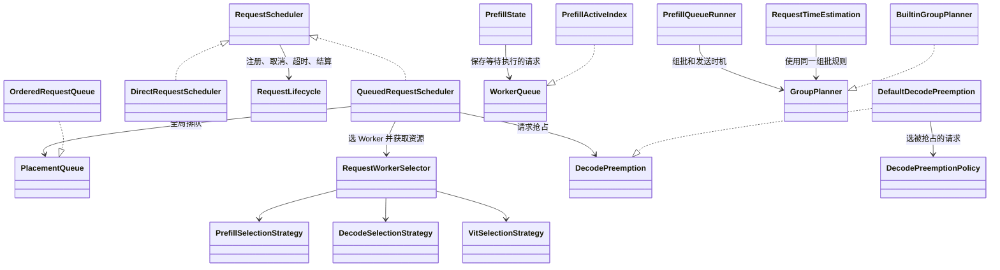
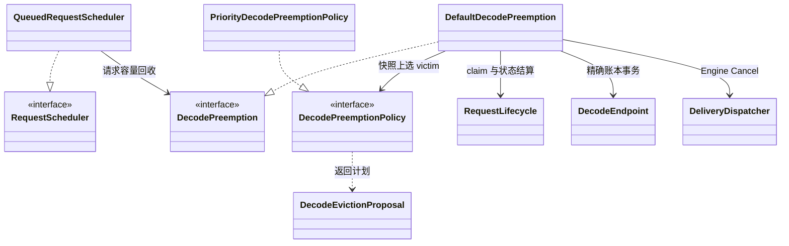
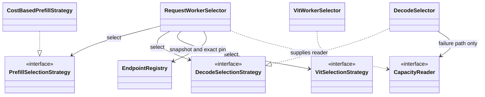
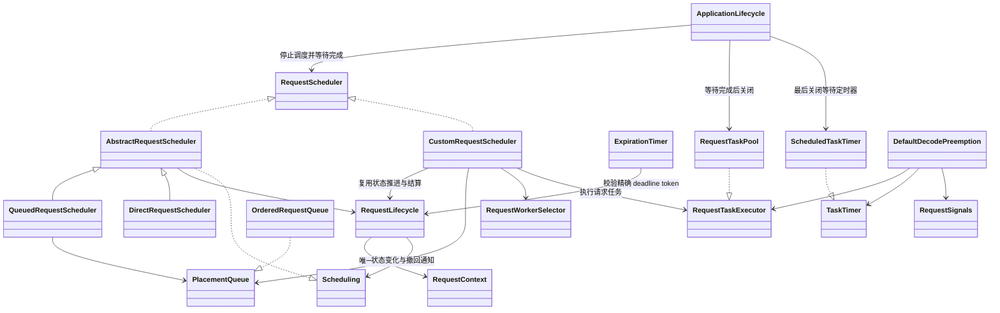
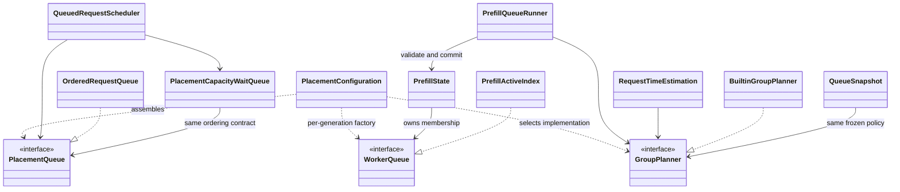
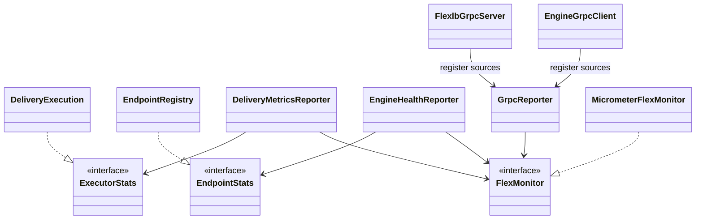

# 组件边界修复设计（分步实施）

原设计基于生产 Java 哈希 `5b06242b83946f586d7bcfef0cc273561c38ffecd663f0754ffdedae31006a2d`。当前代码已经拆开调度、全局队列、Worker 队列、组批、选 Worker 和抢占接口，也已将指标后端绑定收回 `FlexMonitor`。本轮修改已同步 B300。完整 UT 通过，批量性能与 25,000 行上限未通过，整体尚未完成验收。

## 本轮验证（2026-10-31，尚未全部通过）

- 在指定远端目录重新编译：完整 UT 3,499 项，0 failure/error，1 skipped；Sync 性能回归 8/8。
- API 性能回归使用 8g 堆，14/16 通过。突发流量出现 `receiving budget full`；一档节点规模用例服务端 p99 为 53ms，超过原来的 50ms 门槛。
- 750 Prefill / 750 Decode、64g、3k/10k QPS：NON_BATCH 两档通过，客户端 p99 为 10.318/9.869ms；BATCH 的 10k 客户端 p99 为 65.034ms，服务端 p99 为 17ms，客户端门槛未通过。
- 保持突发负载与断言不变的诊断对照：64g 堆下，默认调度线程数量的服务端 p99 为 368ms，单线程为 454ms。未保留这些诊断参数，也未放宽门槛。
- `flexlb-sync/src/main` Java 全部物理行由 28,461 降至 28,319，减少 142 行，距 25,000 行还差 3,319 行；含注释和空行，不含测试及 mock。
- 日志与报告在 B300 的 `/tmp/flexlb-cleanup-20261030/results-final`。接口契约与功能通过不代表性能或代码规模已达标。

FlexLB 是 LLM 的负载均衡调度系统。各部分用直接的职责区分：策略选 Worker，队列维护顺序，组批决定一次取哪些请求，调度器决定什么时候尝试，抢占负责让出容量。已有请求状态和资源账本继续负责取消、超时与释放。



自定义 `RequestScheduler` 实现 `submit` 和状态变化通知，自行安排调度时机；不要求继承默认调度器或使用它的调度线程。可以组合不同的 `PlacementQueue` 和选 Worker 策略。`PlacementConfiguration` 只在没有对应 Bean 时创建默认实现。

取消和超时都更新同一份请求状态。调度器据此删除队列里的准确请求，并使旧调度结果不能提交。已经发送给 Engine 的请求，仍须按原流程确认是否可以释放资源；仅仅取消 Future 或移出队列不代表资源已释放。

## 目标和范围

选点实现、队列实现和指标后端可以在明确契约内独立替换。现有实现直接实现接口，装配集中在已有 PlacementConfiguration 和各资源的初始化位置。没有新的 Manager、Coordinator、事件总线、线程池或配置开关。

本次保持 FIFO/固定优先级、SINGLE/FIXED_WINDOW、现有取消/超时和容量规则。允许替换符合冻结排序和有序前缀契约的实现，不承诺自动支持租户公平、随时间变化的比较器、非前缀组批或无唤醒来源的策略冷却。此类新语义需要另行定义状态和预测协议。

## 抢占扩展边界（已实施）



- `DecodePreemption` 是 Scheduler 使用的抢占服务接口。`tryReclaim` 返回 null 表示未发起；异步结果携带成功获取的精确 reservation 或失败原因。调用者必须接收 reservation，或在调度计划失效后释放它。`freezeAdmission` 阻止新抢占和在途抢占提交。
- `DecodePreemptionPolicy` 只在给定 Decode 快照中选 victim，不接触 Context、Dispatcher 或资源操作。输入借用且只读，diagnostics map 是唯一可写输出；决策返回容量缺口和可选计划。默认 `PriorityDecodePreemptionPolicy` 承接原静态 `EvictionPlanner` 的算法，没有第二份算法。
- `DecodeEvictionProposal` 是不可变的计划，不是资源句柄。一个计划只含本地撤回或 Engine Cancel 一种 ownership。默认执行器检查 endpoint、快照身份、优先级、阶段和重复 victim，最终账本继续检查 generation、token 及容量。
- `DefaultDecodePreemption` 承接原抢占事务。本地 withdrawal/requeue、Engine Cancel 确认与资源释放证明、超时回滚继续走原生命周期。取消 future 不等于释放资源；Engine Cancel ACK 也不等于资源释放证明。
- 两个接口均可通过 Spring Bean 替换，默认装配位于 `PlacementConfiguration`。只改 victim 算法时替换 Policy；替换整个服务时必须同时履行上述资源所有权和关闭契约。
- 清理旧静态 planner、无调用的优先级辅助入口、只验证 Mockito 自身的 handoff 测试，并将生命周期事件类型引用归回 `RequestLifecycle`。不新增线程池、锁、配置开关或每请求包装对象。性能仍需单独验收。

前一轮验证（2026-10-30，B300，独立目录 `/tmp/flexlb-preemption-20261030`）：

- 完整 UT 3,485 项，0 failure/error，1 skipped；补充有效优先级校验后的最终版本定向测试 113 项全部通过。新增替代实现契约覆盖 Bean 替换、原样执行策略选择、策略拒绝、不合法 endpoint/token/priority/重复 victim/禁用阶段，以及关闭后不再启动抢占。
- Sync 性能回归 8/8。API 性能回归修改前后均为 14/16，另 2 项出现 `receiving budget full`。
- Selection ABBA 相对本轮修改前，750 Worker 的 CPU 中位数 BATCH -2.10%、NON_BATCH -2.84%；分配均为 1,880 bytes/op。这只是本轮选择路径的测量，不证明抢占接口调用零成本，也不代替原始基线验收。
- 750P/750D、64g、3k/10k QPS：新版本 NON_BATCH 的客户端 p99 为 0.636/15.330ms，两档通过；BATCH 为 29.252/319.801ms，10k 未通过 50ms 阈值。修改前 BATCH 的 3k p99 为 32.573ms，10k 在预热阶段出现 `receiving budget full`，没有可比较的完成样本。
- 结论：功能测试通过，性能验收仍未通过。不将既有失败或一次测量的变化解释为接口化没有成本。

## 1. 策略与资源获取分开



- PrefillSelectionStrategy 保留现有推荐协议；返回原候选身份、对应 ownershipVersion 和所需耗时数据，不取得资源或保留借用 view。
- DecodeSelectionStrategy 只保留一个 select 业务入口，返回现有 PlacementResult；删除公开 classifyCapacityFailure 及调用方对 BLOCKED 的通用重解释。
- 默认 DecodeSelector 自己完成评分和容量失败归因。原先 RequestWorkerSelector 中的多节点错误汇总收回该实现；其他策略可以直接返回自己的失败、精确 blocker 和 diagnostics。
- 精确账本读取由 RequestWorkerSelector 的同步 CapacityReader 完成：按候选 generation 取得 pin，读取 AdmissionSummary，finally 关闭 pin。generation 已退役返回 null，保留现有保守错误归因，不按地址读取新 generation。
- reader 是初始化时建立并复用的具名方法引用，不为每个候选分配闭包、不复制完整账本，也不把 Registry 塞进 ThreadLocal 缓冲。只有默认策略的容量失败路径需要读取它。
- metadata 作为新 select 中实际用于优先级归因的输入，不恢复未使用参数。
- VIT 默认算法仍是随机选择。VitSelectionStrategy 从借用地址列表选一个地址；RequestWorkerSelector 负责 group/generation 校验和 route.add。首个地址失败后才准备剩余候选集合；拒绝的地址移除，最多访问每个地址一次，默认实现保持无放回随机选择。不会为所有 VIT Worker 预先建立包装对象。

关键接口草案：

```java
interface DecodeSelectionStrategy {
    PlacementResult<DecodeRoutingView, PlacementKey> select(
        Request request, SchedulingMetadata metadata, String group,
        List<DecodeRoutingView> candidates, CapacityReader capacityReader);

    interface CapacityReader {
        AdmissionSummary read(DecodeRoutingView expected); // 已退役时返回 null
    }
}

interface VitSelectionStrategy {
    int selectIndex(List<String> candidates); // 非空、只读输入，返回其中一个位置
}
```

返回规范统一沿用 PlacementResult：SUCCESS 交给调用方验证/取得资源；REJECTED 原样失败；BLOCKED 原样保留 blocker、failure、diagnostics。BLOCKED 的 PlacementKey 必须关联现有容量/拓扑唤醒来源；定时冷却等新等待原因不在本轮支持范围。
读取快照不等于获得资源。最终 pin、reservation、账本提交和失败回滚仍由原执行负责人处理。

## 2. 队列实现与队列使用者分开

### Scheduler 与请求生命周期（2026-10-30 补充）

Scheduler 本身也是扩展点。`RequestScheduler` 实现可以组合 `PlacementQueue`、
装配好选点策略的 `RequestWorkerSelector`，自己决定推进时机。
`RequestLifecycle` 从原 `AbstractRequestScheduler` 移出公共注册、取消、deadline、
提交校验及资源结算；默认实现通过 `AbstractRequestScheduler` 统一持有和装配生命周期，
基类提供公共字段和 `lifecycle()`，不继承 RequestLifecycle 的流程方法。
自定义实现可复用基类，也可直接实现 RequestScheduler。生命周期对象按 Scheduler 创建，
不按请求创建。



`RequestTaskExecutor.execute(request, task)` 只执行任务；`TaskTimer.schedule(task, delayMs)`
只安排一次回调，返回的句柄只能取消这次回调。`RequestSignals` 独立提供完成通知。
这些依赖按服务创建，复用原有线程池；已有 `ApplicationLifecycle` 负责停服顺序，各执行组件负责等待任务完成并关闭自己的线程池。准入句柄、取消、超时和请求结算由 `RequestLifecycle` 负责。
请求本身的 REQUEST / VISIBILITY / INACTIVITY deadline 仍由 `ExpirationTimer` 管理。
抢占等待超时只结束等待，不能据此认定请求已结束或释放资源。

- `cancel` 默认委托同一 RequestLifecycle。取消和 deadline 先记录 Context 状态，
  再通知调度器精确删除/恢复队列成员，并进入共同的 `advanceRequest`；不能把请求
  的终止处理推迟到自定义调度器下一次正常选点。
- REQUEST、INACTIVITY、VISIBILITY 的原有含义不变；VISIBILITY 到期不是取消。
  定时回调保留 token 身份校验，提交边界保留状态、有效期和资源归属校验。
- `RequestLifecycle.Scheduling` 是实现者接入生命周期的内部通知：`remove` 清理失效调度记录，
  `reschedule` 重新安排被抢占的请求，`describeWait` 提供只读等待原因；不承担资源释放。
  调用方只通过 `submit`、`cancel` 操作请求，取消不创建第二份
  Queue 状态机，也不新增取消管理器、事件总线或线程池。
- 自定义 Spring `RequestScheduler` bean 替换默认装配时，使用
  `runtime.registerScheduler(scheduler)` 绑定关闭顺序，再调用 `start()`；
  每个实现的 `lifecycle()` 必须始终返回同一个生命周期对象。维护排队或在途工作的
  实现必须明确实现 `awaitSchedulingCompletion` 和 `close`；排队调度器在关闭时停止抢占。
  `start`、等待和关闭没有默认空实现。抢占操作权由 `AdmissionHandle.tryBeginPreemption`
  校验和取得，不经 RequestScheduler 转发。
- `PlacementQueue` 保留外部同步契约，替代实现维护同一个 GlobalQueueEntry 身份，
  恢复原序号并从该位置重开扫描。容量等待索引使用注入队列提供的比较器。
- 先验证独立手动推进 Scheduler、独立 List 队列和默认队列的组合，再运行既有
  取消/超时/资源竞争测试以及同机 UT、Sync/API perf；本文其他待实施项目不因此
  被视为完成。

本次验证（B300，2026-10-30）：UT 共 3,479 项，0 失败、0 错误、1 跳过；
Sync perf 8/8，API perf 15/16，剩余突发用例报 `receiving budget full`。
750P/750D、64 GiB、3k/10k QPS、原 50ms/98% 门限：NON_BATCH 两档通过；
BATCH 3k 通过，10k 客户端 P99 168.267ms，失败。
同机 ABBA、2 GiB 堆、每窗口 100k 次的选点 CPU 中位数：相对原基线 BATCH
+6.04%、NON_BATCH +3.92%；相对本次改动前 +3.59%/+0.63%。零回退门禁均未通过，
不能把分配下降或基线自身的端到端失败当作豁免，也尚未确定 CPU 差异的因果来源。
原始证据和源码哈希保存在远端 `/tmp/flexlb-scheduler-boundary-20261030/results/`。



PlacementCapacityWaitQueue 实际只接收 PlacementQueue 提供的 Comparator，不持有整个队列或调用其生命周期。图中的关系表示共享排序契约。

| 契约 | 最终能力 | 明确不负责 |
| --- | --- | --- |
| PlacementQueue | add、restore、remove、markReadyForRetry、scan、hasUnscannedRequests、size、priorityCounts、drain、order | Context 终态、用户响应、资源释放 |
| WorkerQueue | add、remove、contains、peek、size、isEmpty、clear、version、capture、iterator、mayBypass | RPC、取消响应、容量账本 |
| GroupPlanner | select、dispatchReason、nextCheckAtMs、validateConstraints | 队列修改、资源预留、线程唤醒执行 |
| QueueExecutionSettings | 不可变限额及全局/Worker/投影排序规则 | 按枚举在业务路径里构造实现 |

落地方式：

1. OrderedRequestQueue、PrefillActiveIndex 直接实现两个接口；不增加委托包装。保留现有数据结构和锁，首轮不更换算法。
2. 全局队列由 PlacementConfiguration 构造后注入。WorkerQueue.Factory 通过 EndpointRegistry 传给 PrefillEndpoint，每个 Worker 单独创建队列；不共享可变队列实例。
3. PlacementQueue 的顺序由自己提供，容量等待队列使用同一 Comparator，删除两处各自按 boolean 选择顺序。GlobalQueueEntry 的精确身份与撤回恢复序号保持；默认实现的链表链接只能由索引访问，不为接口拆分额外 Node 对象。
4. GroupPlanner 从 enum 改为 interface。现有两种算法整体成为 BuiltinGroupPlanner 默认实现；配置枚举只在装配时解析。算法不复制成 Runner/Projection 两份。
5. GroupPlanner 的 Input、Item、Constraints、Selection 和 PrefixPrediction 保留为其嵌套协议类型，调用方不依赖 BuiltinGroupPlanner。静态纯工具按真实使用保留，不为旧枚举名称增加兼容入口。
6. QueueSnapshot 保存与实际 Runner 一致的不可变组批策略、排序和限额；RequestTimeEstimation 直接调用同一 GroupPlanner。明确保持有序前缀契约，不能把不支持的非前缀结果当作普通 Selection 接收。
7. WorkerQueue.capture 的冻结类型归接口，沿用当前 Capture 缓存，不新复制一份请求集合。Worker 顺序与投影顺序由同一 QueueExecutionSettings 定义，保留当前各阶段必要的序号/tie 规则。
8. 同优先级绕过等队列选择规则归 WorkerQueue.mayBypass。PrefillState 保留精确队头、有效成员、未过期、不同 Decode endpoint、绕过预算等提交校验，并在提交时重新询问同一队列规则。不能只在 Runner 预检查后就放行。

取消和超时路径不分叉：Scheduler 记录取消/超时事实，原入口使队列中的精确条目失效；队列只移除或报告过期，停止投递仍交 Dispatcher。已在执行的 Plan 继续通过原身份/版本检查失去提交资格。资源释放仍取决于 Context/Endpoint 的证据，不取决于“已出队”。

## 3. 观测不持有业务控制对象



- 复用已有 GrpcReporter，承接 gRPC executor/Netty 采样和服务端指标注册。EngineHealthReporter 删除 EngineGrpcClient、LoopResources 和具体线程池转换，只消费 EndpointStats 及业务值。传输库相关采样集中在观测模块；不要求第三方 Netty 类实现自定义接口。
- EndpointStats 嵌套在现有 EngineHealthReporter 中，暴露 Registry 已有的 discoveredCount/counts 读能力，Counts 值协议随接口归属调整；Registry 直接实现，不增一组重复 getter。
- 现有 ExecutorStats 移至 common.metric 共享位置。DeliveryExecution、FlexlbGrpcServer 直接实现；初始化时绑定统计源，不增加每请求适配对象。EngineHealthReporter 只接收 EndpointStats 或线程池统计数值，传输资源采样归 GrpcReporter。
- FlexlbGrpcServer 删除 MeterRegistry/Gauge/FunctionCounter 业务类依赖，初始化时通过 GrpcReporter 绑定既有统计源。
- FlexMonitor.observe 绑定实时 gauge 或累计 counter；Micrometer 细节归 MicrometerFlexMonitor，仍使用原指标名和类型。SafeFlexMonitor 做失败隔离，NoOpFlexMonitor 忽略绑定。装配层在 MeterRegistry 可用时独立绑定这些统计源，不受 KMonitor 业务后端选择影响，不能把累计 counter 改成每次定时 report 的增量值。
- shortcut: 每服务生命周期内每个名称只绑定一次；不支持同名源替换或精确注销，需要服务内重建 owner 时再补绑定身份与注销契约。复用现有调度设施及采样周期，不加池或新配置。

## 类的增删与修改

| 项目 | 处理 |
| --- | --- |
| PlacementQueue、WorkerQueue、VitSelectionStrategy | 新增 3 个顶层接口 |
| GroupPlanner | 原类型改为接口，值协议保留；不新增并行的旧入口 |
| BuiltinGroupPlanner | 新增 1 个默认实现类型，接收原 enum 算法 |
| ExecutorStats | 从 DeliveryMetricsReporter 的嵌套接口移到 common.metric；移除旧声明 |
| CapacityReader、EndpointStats | 窄接口嵌套在所属现有组件；不新增顶层管理类 |
| OrderedRequestQueue、PrefillActiveIndex、VitWorkerSelector | 保留实现，直接实现对应接口 |
| RequestWorkerSelector | 删除 BLOCKED 容量重解释与多节点容量错误汇总；保留读快照、精确 pin、路由交接 |
| DecodeSelector | 返回完整选择/容量拒绝结果；classifyCapacityFailure 变为内部实现 |
| PlacementConfiguration、QueueExecutionSettings、PrefillState、PrefillQueueRunner、QueueSnapshot、RequestTimeEstimation | 接入统一装配/队列/组批契约，移除具体实现选择分支 |
| EngineHealthReporter、DeliveryMetricsReporter、GrpcReporter、FlexMonitor 及其实现、FlexlbGrpcServer | 收拢统计源采集与后端绑定，移除业务类直接注册后端的代码 |

新增文件主要是接口及原算法的默认实现；不能把搬移算成减量。实际净代码量在实现后统计，核心类显式方法不超过 30，变更方法不超过 100 行。

## 顺序、性能和验收

先补契约测试，再按策略、队列、观测分步实施；每一步保持可独立回退。

- 策略：自定义 BLOCKED 的精确 key/原因/diagnostics 原样保留；默认容量归因输出与原来一致；旧 generation 的诊断不能读取新账本；非失败路径不读 AdmissionSummary；VIT 随机/拒绝/重试和 pin 交接不泄漏。
- 队列：同一套添加、扫描、精确删除、撤回恢复、容量重试测试验证接口；用独立的测试 GroupPlanner 同时接入真实 Runner 与投影，不修改它们；取消/超时与选择、提交竞争时不得提交失效条目。保留稳定顺序、扫描预算、单份账本和锁顺序。
- 观测：更换测试后端不改策略/队列/Server；验证业务后端与 Registry 并存时的实时 gauge、累计 counter、弱引用、缺省后端及失败隔离。observe 按每服务一次绑定验收；已有 report/removeGauge 的身份校验与精确删除保持。Reporter 不再调用完整 Scheduler、Client、Registry 控制 API。
- 性能：不引入线程切换或新锁；不为接口创建每请求 wrapper，不在成功路径增加账本扫描；比较器、策略及 reader 在装配时确定；冻结快照只按既有版本变化更新。
- 最终运行完整 UT、Sync/API perf 和 750P/750D 对照，核对 allocation、CPU、吞吐与 P99。接口调用是否影响内联必须实测，不能事先保证零成本。

当前旧结果仍为未验收：API 14/16，选点 750/BATCH CPU 对原基线 +0.54%。实施后必须在相同口径下通过零回退门禁，不能把失败的当前版本当作放宽后的唯一基线。
