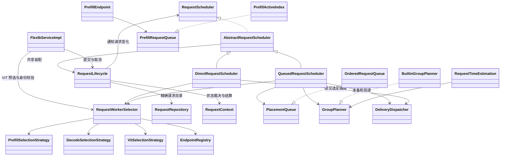
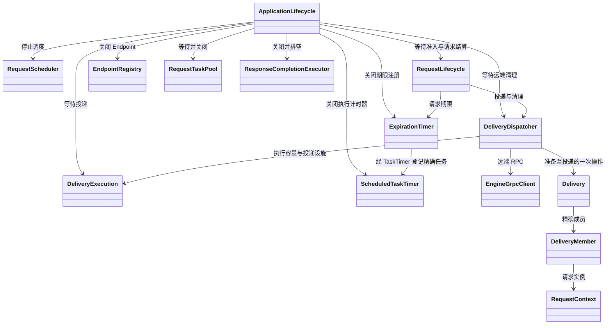

# FlexLB 当前核心类图

2026-11-03 按工作区源码核对。本文描述当前职责和主要依赖，不是固定提交快照。历史改造记录位于 [scheduler-design](scheduler-design/README.md)，本轮目标与验收约束见[目标类图](scheduler-design/proposed-component-classes.html)，当前仍在改造中，本文不表示目标已经全部完成；历史稿中的类名不能作为当前实现依据。

## 调度、队列和策略

- `RequestScheduler` 定义调度时机、请求/Endpoint 变化通知与停止调度。DIRECT 和 QUEUE 实现决定何时选路及推进；策略、队列和组批规则可替换。
- `AbstractRequestScheduler` 只绑定 `RequestLifecycle`、共享请求目录并校验默认调度模式，不执行请求生命周期流程。
- `RequestLifecycle` 负责准入句柄、取消、超时、资源交接与请求结算；`RequestContext` 维护原子请求事实和结果优先级。取消和超时不是队列的资源释放职责。
- `CostBasedPrefillStrategy` 经 CandidateInput 的只读容量入口完成默认 Prefill 容量归因。`RequestWorkerSelector` 不再读取容量并改判策略结果；资源竞争仍由提交时的 Endpoint 原子校验决定。
- `RequestRepository` 管理注册、活动/终态身份与归档。队列维护成员和顺序，策略决定选择结果，Endpoint 持有精确资源账本。
- `PlacementConfiguration` 完成调度组件装配。抢占策略由 `DecodePreemptionPolicy` 决定，`DecodePreemption` 定义执行入口，默认执行实现为 `DefaultDecodePreemption`。

`RequestSchedulerEntry` 已删除。API 直接调用 `RequestLifecycle.submit/cancel`；VIT-only 路由和预选身份校验在 API 路由入口调用 Selector，不注册生成请求。Lifecycle 不依赖选择器，不解释队列规则。`ApplicationLifecycle` 连接自定义 Scheduler 并启动调度；默认和自定义实现均使用同一个请求入口。

`DeliveryDispatcher` 持有启动时绑定的 Decode 准入容量，队列发布与直接投递均由执行组件读取；Lifecycle 和默认 Scheduler 基类不再保存或传递这份配置。

### 调度触发与请求状态

Worker 队列通过 `PrefillRequestQueue.Snapshot` 同时提供有序成员和只读 `QueueItem` 比较规则。执行和预测使用队列实际规则；Endpoint 不再从配置重建另一套预测排序。默认优先级/FIFO 只提供一套比较器，自定义队列可以替换它。

`RequestScheduler` 暴露 `start()`、`schedule()`、`stop()`、`awaitStopped(deadlineNanos)` 和请求/Endpoint 事件入口。调度函数归实现本身；自定义实现自行选择触发方式。默认 QUEUE 将原有后台调度线程直接归入自身：该线程调用 `schedule()`，按下一调度期限等待，并由请求/资源事件唤醒；planner 池继续执行选择和组批工作；DIRECT 在到达时将请求提交给请求执行池。没有独立 `SchedulerLoop`，`RequestLifecycle` 不再保存或控制调度循环。

`stop()` 停止产生新调度工作，`awaitStopped` 等待已接受的调度执行；`close()` 进一步完成 Scheduler 所有的清理。服务停服顺序仍归 `ApplicationLifecycle`，共享任务/计时设施由各自组件关闭。

`ContextResult.End` 直接持有终态、错误与说明，已删除重复的 `TerminalOutcome` 包装。选定终态与资源结算完成仍是两个不同事实。Context 的准入、投递准备、抢占返回实际句柄或空；绑定路由、选择响应和抢占检查返回布尔值。已删除通用 `Claim/Granted/Blocked/Rejected/Stale`、`GrantValue` 和 `RoutePermit`。发送开始用 `SendResult` 区分成功、取消和身份不可用，避免错误触发清理。

Context 的 OPEN / ENDING / CLOSED 由已选终态和归档记录推导，不再维护另一份 phase 字段。发送资源可释放、投递可准备也从快照事实派生，不再保存重复布尔值。Deadline token 复用由已有 `ExpirationTimer.Plan` 完成，Context 仍决定到期条件。预测、清理和回调共用精确的 `Delivery.Member` 对象身份，已删除仅用于重复预测校验的投递序号。

外部包中的自定义 Scheduler 可调用 `DeliveryDispatcher.submitRoute(route, admission)` 完成即时提交；Dispatcher 释放选机引用、结束准入后通知 Lifecycle，调用方不再接收中间 RouteDelivery 并补发成功结果；`ExternalRequestSchedulerTest` 使用真实 Endpoint 验证手动触发与提前取消。外部实现也可用公开的 `Delivery` 和 `DeliveryDispatcher.submit` 提交已有 Worker 队列中的成员，`ALL_SELECTED` / `ORDERED_PREFIX` 明确限定整组或有序前缀；集成测试覆盖真实 PDFUSION 和独立 Decode 组批。全局排队的资源准备已移入 `DeliveryDispatcher.enqueueRoute`；Direct、自定义和排队 Scheduler 都由 `finishPlacement(route, admission)` 完成未发布准备回滚、选机引用关闭和准入结束，调度器保留重试与抢占时机。这些契约测试不替代全量 UT 与性能验收。

### Prefill 提交与队列等待

`PrefillEndpoint.commitDirect(pin, route, reservation)` 在自身锁内校验并提交立即调度的精确预留，复用选机阶段持有的 generation 引用，返回此前工作量快照。已删除 `commitDirectLocked` 内层接口和额外的提交引用、Direct Delivery 包装；调用方无需另行加锁。该入口不接受队列计划、预测数组或批次参数。排队提交直接校验已有 `Delivery` 的成员、预测、批次预留和失败成员；`QueuedCommit` 与 `CommittedHandoff` 已删除。generation 使用权和提交快照记录在同一个 Delivery，清理只归还临时资源。批次特征在锁外构建一次，预测与账本共用。两种入口由 Endpoint 的同一份资源记录在原锁内校验身份与资源归属，整组验证完成前不改变成员占用。

队列等待是否仍然成立由 `QueuedRequestScheduler.EndpointWork` 根据同一份 Decision 判断；Endpoint 提供锁内队首与版本事实。已删除仅转发 lock/unlock 的 `QueueGuard` 包装，队列成员更新与资源提交共用已有 `resourceLock()`。`EndpointWork` 只持有 Endpoint，不再单独传入其资源账本。调度启停归 Scheduler，成员增删直接归 Endpoint；测试专用驱动留在测试代码中。取消、超时和资源结算职责不变。

## 投递、执行与停服

`AdmissionHandle` 标识一次准入操作。`Delivery.Member` 从准备资源到投递使用同一份精确成员身份，原顶层 `DeliveryClaim` 和 `RequestSignals` 已删除；发送结果、取消和资源释放事实仍保存在 `RequestContext`。响应设施内保留 `ResponseCompletionExecutor.RequestFuture`。

`RequestRoute` 在发布前附加精确 Decode 预留，选择与资源准备共用同一个对象。`RequestLifecycle.beginRoute` 绑定精确请求身份，Dispatcher 在资源操作后直接记录 Context 的发布事实；Lifecycle 不再提供 publishRoute 转发协议；重复发布由 Context 的已发布状态拒绝。

Prefill 的请求预留和批次预留分别与其资源记录合并，准备、提交、回滚使用同一对象身份。请求资源状态区分 WAITING、RESERVED、COMMITTED；队列删除仍不释放资源。Direct 只提交单个精确预留，不再经过多请求提交接口。`PrefillState`、`PrefillObservation` 已删除，其资源记录和状态归并直接归 `PrefillEndpoint`。释放不再经过 State 的 Release 报告：Endpoint 删除精确资源，解锁后归还 generation 使用权并发布一次容量变化。合并后的类仍超预算，继续收敛中。

Decode 投递许可直接引用精确账本行，不再使用内部 DispatchLease 加外层 permit 的双对象。`Delivery` 负责校验并保留 protobuf 输入，已删除 GenerateInputPayload 包装对象和测试专用生产构造器。`ResponseCompletionExecutor` 只负责任务提交、执行和排空，响应裁决及 ACK 统计由 RequestLifecycle 驱动。

`DecodeState` 已删除，原有资源记录、资源锁和原子操作直接归 `DecodeEndpoint`，不再经单独账本对象转发。合并后的类仍超代码和方法预算，尚未完成收敛。排队路由用 `RequestRoute` 的精确 Prefill/Decode 资源句柄记录交接，已删除 `PlacementPlan.pendingDecodeRollback` 与重复的 `published` 标志；Prefill 句柄在实际入队后、通知之前记录。

`PrefillEndpoint` 不再持有 Dispatcher；Registry 在装配时传入已确定的投递模式值，预测仍使用实际投递模式。Dispatcher 的 Direct 与排队入口共用 Decode 预留和释放实现：预留已成功但路由拒绝接收时，立即释放该精确句柄，清理异常作为原异常的 suppressed cause。Direct 已删除重复的临时 Decode 句柄和 acquired route 引用。

`ApplicationLifecycle.closeScheduling()` 负责服务停服顺序：停止准入与调度，取消并结算未完成请求，等待投递清理，关闭 Endpoint，再排空和关闭各执行组件。等待任务和关闭线程池由各执行组件实现，不再存在统一承接这些职责的 Runtime 类。

准备期间的精确路由只保存在 `RequestContext.route`；`PlacementFacts` 不再重复保存 acquired route 或 pending terminal。准备期间的结束原因写入 Context 的 `pendingEnd`，准备失败仍可先于准备结束结算；其他原因等待精确准备操作完成。等待期间仍安装请求的期限重检，不能因已有待结束原因而遗漏定时任务。

观测通过 Reporter 读取统计并上报，不参与策略决策、队列顺序或请求结算。Endpoint 的负载采样只保留 `tryGetLoadMetric`；锁忙时跳过采样，精确账本验证使用资源快照。Registry 的路由别名可以与 Endpoint 的通信地址不同，两者必须保留区分。

## Worker 同步与主节点状态

`EndpointRegistry` 管理发现的 Worker 代际与路由快照；`WorkerStatusSynchronizer` 管理原有轮询执行设施和退休重试，`GrpcWorkerStatusRunner` 获取 Worker 状态。WorkerEndpoint 持有 generation 使用权与退休进度，不再经过独立 EndpointGenerationLifecycle。主节点状态由 `MasterStatusView` / `MasterStatusService` 提供，ZooKeeper 选主实现为 `ZookeeperMasterElectService`。

本地排队抢占的撤回是同步流程；`DefaultDecodePreemption` 完成所有受影响请求的撤回后，在失败时精确回滚 incoming reservation。`AdmissionHandle` 不再保存失败回调，Lifecycle 不再回调抢占组件释放该资源；多个失败会合并异常，所有已领取准入都会完成。

投递/抢占 RPC 的一次性超时由注入 Dispatcher 的 `TaskTimer` 处理，不再经请求借用 Lifecycle 的设施。`RequestLifecycle` 只保留管理请求期限的 `ExpirationTimer`，两者复用原有线程设施。

`ExpirationTimer` 借用 `TaskTimer`，只维护期限 token 与定时任务的对应关系。`ScheduledTaskTimer` 分别承接原有单线程期限池和双线程清理计时池，池数和隔离保持不变。关闭期限登记时等待已接受的回调并取消本组件任务；`ApplicationLifecycle` 随后关闭期限池，清理计时池仍在请求结算完成后关闭。任务取消直接使用 JDK `Future.cancel(false)`，不额外创建取消包装。

默认 Scheduler 工厂仅装配，不启动后台调度。生产统一由 `ApplicationLifecycle` 完成绑定并调用 `start()`；测试夹具需要后台推进时显式启动，支持先登记、先取消、后启动的场景。

`QueuedRequestScheduler` 和 `Delivery` 均不再持有 `DeliveryExecution`。Scheduler 构造只含已选成员及组批输入的投递对象，执行容量的读取、订阅和申请统一由 `DeliveryDispatcher` 承接；Scheduler 仍决定候选、有序前缀是否可接受，以及何时重试。路由提交延迟在 Dispatcher 的实际发布边界上报，删除 Scheduler 中只为指标包一层的 `enqueueRoute`。

请求观察只保留一个不可变 `ContextResult.Snapshot`，删除 `SnapshotFacts` 和委托层。重复观察保留原快照身份；时间或事实变化时创建新快照，历史快照保持不变。

`awaitStopped` 等待的是已经接受的调度工作。Direct 对提交给现有请求执行池的选择任务计数，任务完成或提交失败后归还；Queue 识别自己的 planner 线程并拒绝自我等待。两者均不新增线程池、锁或每请求包装，也不把请求结算搬入 Scheduler。

投递确认直接调用 `RequestContext.confirmDelivery`，不再伪装成 `ResponseKind.CONFIRMATION` 的响应候选；确认本身不选择前端响应，随后 ACK 仍与取消竞争。响应候选也不再重复保存请求终态，外部异常完成使用已有终态候选，原异常仍由 Future 的异常完成路径交付。

Prefill 状态归并直接产生 `WorkerEndpoint.StatusChange.Prefill`，删除只承载相同字段的 `StatusReconciliation` 包装；状态事实仍在锁内提交，容量和请求通知在锁外发布。

队列拒绝直接调用 `RequestLifecycle.rejectRoute`；排队超时走已有 `cancel(..., DEADLINE_EXCEEDED)`，不再经过 `QueueKind` 事件分发。`RequestData.getLifecycle()` 明确返回请求生命周期负责人，调度器与生命周期不再共用 `getScheduler` 名称。

`RequestRoute` 用明确的 Prefill/Decode/VIT pin 字段保存代际使用权，不再维护 pin 数组和角色下标；响应与逆序释放仍遵守原选择顺序。只供测试转发 Future 的入口已删除，payload 大小估算归 `BatchEnqueueHelper`。Endpoint 退休统一通过原有完成 Future 等待和读取异常，删除重复异常字段及手工 wait/notify 协议；中断恢复与有界等待保持不变。

Prefill 预测输入直接在原锁内捕获队列、已提交工作和版本，去掉 `ProjectionSource` 外围重复的 `Snapshot` 包装；预测仍在锁外执行，缓存发布后释放请求引用。

Dispatcher 负责从请求校验到 Decode permit 提交、Context 发布的完整投递提交；Lifecycle 只提供身份与超时校验，并消费提交结果。保留提交前的临时 DeliveryFacts：Decode 提交失败时 Context 不发布投递，原请求仍能重试。删除 Lifecycle 的资源提交入口，Member 的便捷调用直接进入 Dispatcher。

请求执行池直接将已有 WorkRegistration 放入执行队列，删除 Task 包装及重复 submitted/running 标志；请求锁外执行、同一结算串行、通知合并和拒绝后的计数归还不变。Prefill 的 WorkCapture 合入已有 WorkSnapshot，Endpoint 只冻结叶子事实，汇总和身份排序由快照在锁外计算并缓存，不再先构造捕获对象再构造快照。

### 抢占停服与替代队列契约

`DecodePreemption` 的默认和自定义实现均提供 `stopAdmission`、`awaitIdle`、`close`。
`ApplicationLifecycle` 先停止抢占和调度，再等待已接受的抢占操作结束，随后结算请求并关闭执行设施。
默认实现复用每次操作已有的 `Attempt` 统计资源交接；调用方取消结果 Future 不代表这些资源已经清理。

Worker 队列的 `add` 返回 false 时，Endpoint 不发布 Prefill 预留，也不保留新建的资源记录。
替代队列契约测试覆盖拒绝后的同 requestId 重试。默认组批实现仍由实际执行和预测共用，
容量判断和预测值校验分别收敛为纯函数，保持有序前缀、饱和算术和预测预算的既有语义。

### 队列操作与 deadline 登记

Worker 入队和精确删除不再通过 `QueueChange/updateQueue` 分发。
`PrefillEndpoint` 在原资源锁内完成成员变更；`QueuedRequestScheduler` 判断超时，
并在释放该锁后调用请求 Lifecycle。队列本身不会因成员到期而隐式删除或结算资源。

`ExpirationTimer` 以已返回的定时任务 Future 表示安装成功，删除了第二次 publish 交接及其标记。
三个固定 deadline 的句柄直接存储，不再为每次登记创建 EnumMap。
旧 token、提前触发、安装失败重试、取消和停服的行为保持各自的契约测试。

队列停止后的请求终结由 Scheduler 执行。`PrefillEndpoint.closeQueue()` 只关闭入队并返回精确成员，不再调用 `RequestLifecycle.rejectRoute`，也不再保存排空 Future 和等待线程。Endpoint 退休只发布一次精确退休事实；原先先拒绝队列成员、再发布退休事实的重复路径已删除。

WorkerEndpoint 的 generation 使用权已经覆盖未提交批次。真实 Endpoint 测试确认：批次预留未回滚时，退休清理不能开始；回滚后才进行一次清理，清理异常仍由退休等待方收到。因此删除资源层重复接管“孤儿批次使用权”的兜底协议，原子清理入口收窄到包内，并在清理前校验不存在未提交批次。

Prefill/Decode 默认选择策略分开表达候选筛选、成本或缓存亲和排名与失败归因，仍保留原轮转、未知工作量、溢出和日志语义。未增加请求包装对象或状态缓存。Direct/Queued 的 close 都必须证明已排空；从自身已接收的任务中关闭会明确失败，不能把自等待失败当成关闭成功。

本轮提交边界：Prefill 的队列提交仅保留 `commitLocked(plan)`，代际引用由 Endpoint 获取及交接；调用方不能传入提交引用。Decode 的 permit 结果与账本变更由 `dispatch` 在同一把现有资源锁下处理，删除 `transferDispatch` 和 permit 自身的同步块。Direct 与全局队列的未发布路由共用 `rollbackRoute`，两份本地资源均尝试释放，全部成功后才记录 ROLLBACK_COMPLETED。预留占用、发送不确定性、远端释放证据仍保留；五个核心类尚未达到设计代码预算。

本轮将释放证据直接写回 RequestContext.CloseFacts，删除 RequestLifecycle.Settlement 回执；Direct 与排队路径都在 Route 上保存精确 Prefill 预留引用，以同一规则判断物理发布。投递失败经 Lifecycle 的统一状态推进入口处理。上述交接协议收敛不代表五类预算已达标。

执行器接收任务或拒绝回调后负责清理；Dispatcher 从已有 DeliveryPermit 状态判断是否完成移交，删除 Delivery.transferred。进入执行器前抛错仍由提交方释放临时资源；该边界有故障注入回归测试。

请求状态的确认条件由 `Snapshot.canConfirmDelivery()` 统一提供，Lifecycle 只负责响应执行资源与后续动作。抢占入口把状态有效性交给 `RequestContext.beginPlacement()`，只保留精确资源身份、优先级、有效期和资源可撤回检查。请求任务注册失败直接返回原失败，不对已关闭的任务设施重复注册；任务尚未被接受时的提交恢复、响应注册恢复、资源释放与定时器结算恢复仍保留。Prefill 状态更新每次加锁都重新读取当前账本，只在批次成员完全相同时复用锁外预测，提交失败仍在解锁前退休。

Worker queue order includes blocked-head alternatives: `PrefillRequestQueue.candidatesAfterBlockedHead` defaults to no bypass, and `recordDispatch` receives only successful commits under the endpoint lock. `PrefillActiveIndex` owns the bounded bypass rule and allowance. `GroupPlanner` decides readiness for ordinary and bypass groups; the Scheduler preserves its deadline while watching head capacity.

`PlacementResult.ENDPOINT_CHANGED` retains the successful strategy result when its exact Prefill/Decode generation cannot be captured. It is distinct from strategy `BLOCKED`; retry timing remains with RequestScheduler. Class and module budgets remain unfinished.
