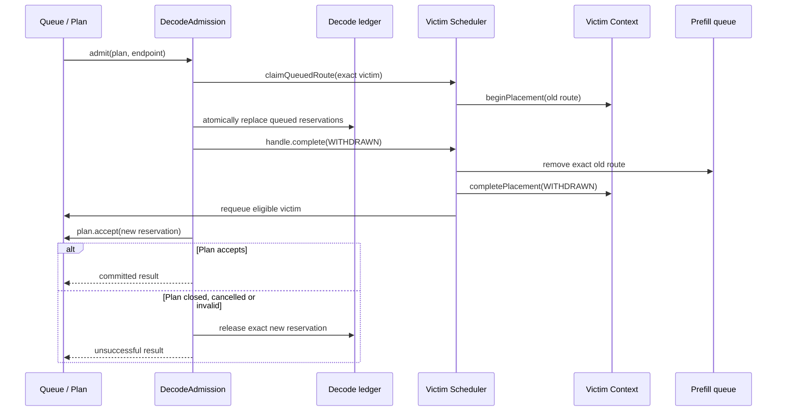

# Admission and delivery stop

This document describes the implementation, including its completion boundaries.
The Decode ledger remains the authority for capacity. An ACK or a completed
request future cannot grant capacity to another request.

## Owners and API

| Owner                       | Entry / result                                                          | Completion boundary                                                                                                                                                                                                                                                       |
| --------------------------- | ----------------------------------------------------------------------- | ------------------------------------------------------------------------------------------------------------------------------------------------------------------------------------------------------------------------------------------------------------------------- |
| `DecodeAdmission`           | `admit(Plan, WorkerEndpoint) -> CompletableFuture<PreemptionResult>`    | Normal completion means acquired capacity was accepted by the Plan or released. Release failure completes exceptionally and is reported, not counted as release proof. `null` means no eligible attempt. Cancelling the observer future cannot cancel ownership transfer. |
| `Plan`                      | `accept(DecodeEndpoint, ReservationHandle) -> boolean`                  | `true` transfers ownership; `false` leaves it with Admission. `close()` owns the uncommitted-capacity rollback attempt; repeated close calls are idempotent. A thrown rollback failure is not successful release.                                                         |
| `AdmissionHandle`           | `complete(PublicationResult)`, `terminate(Response)`                    | Exactly one call enters Scheduler placement completion. Success kinds are `PUBLISHED`, `RESTORED`, `WITHDRAWN`; failure uses `FAILED`.                                                                                                                                    |
| Scheduler                   | `completePlacement(...)`                                                | Removes the old Prefill route on withdrawal, records state, resolves pending cancellation/end, then asks Queue to requeue if still eligible.                                                                                                                              |
| Scheduler                   | `applyCancelReply(...) -> PreemptionRegistration.Reply`                 | Interprets the ACK for the original request and initiates its reconciliation. `WAITING` is not capacity release.                                                                                                                                                          |
| Dispatcher                  | `preempt(...) -> CompletableFuture<Reply>`                              | Publishes the normalized first response within the remaining attempt budget; retains late callback processing.                                                                                                                                                            |
| Dispatcher                  | `stop(DeliveryClaim)`                                                   | Accepts ownership of stopping that exact delivery, including late send results and bounded remote retries.                                                                                                                                                                |
| Context                     | Existing placement, cancellation, preemption and close state operations | Atomically validates identities and records facts. It owns no RPC, timer, retry task or queue execution.                                                                                                                                                                  |
| `ContextResult.EngineFacts` | `predict`, `observe`, `expireVisibility`                                | Pure immutable fact updates. Prediction and Worker observation share the visibility calculation while retaining their different handoff conditions. An unchanged observation returns the same object.                                                                     |

`Reply` is `WAITING`, `NOT_FOUND` or `UNKNOWN`. Only canonical victim facts plus
Decode ledger validation can commit preemption. `PreemptionResult.reservation`
is informational after public `admit` completes: the Plan already owns it.

`DeliveryCleanup` is removed. Dispatcher has a private `StopTask`; it is execution
state, not a second service exposed to Scheduler. Its remote result and the
runtime's physical delivery settlement signal have different meanings.

`EndEvidence` factories give ordinary failure, publication failure, withdrawal
failure and delivery failure explicit construction rules. Scheduler and Context
share delivery failure interpretation. These factories perform no execution.

## Local withdrawal



Failure to remove Prefill after Decode replacement ends that victim through
Scheduler. Other claimed victims still finish; the incoming reservation is
released. A failed replacement restores claims through the same completion
path. Queue does not own a second withdrawal cleanup implementation.

## Remote preemption

```mermaid
sequenceDiagram
    participant Q as Queue / Plan
    participant A as DecodeAdmission
    participant D as Decode ledger
    participant S as Victim Scheduler
    participant X as Dispatcher / StopTask
    participant E as Engine
    Q->>A: admit(plan, endpoint)
    A->>S: claim exact victims
    A->>D: beginPreemption(exact reservations)
    A->>A: observe victims; start remaining attempt deadline
    A->>X: preempt(exact claim, remaining ACK budget)
    X->>E: cancel when queued work starts before deadline
    E-->>X: ACK
    X->>S: applyCancelReply
    S->>D: reconcile exact victim facts
    X-->>A: normalized Reply
    S-->>A: canonical victim resolution
    A->>D: commitPreemption after ledger validation
    A->>Q: accept new reservation or release it
    A-->>Q: result after ownership handoff
```

The attempt deadline starts before outbound work. Queue wait and ACK wait consume
the same budget. Expiration rejects the incoming attempt and detaches its
observers. A later ACK still reaches the old request's Scheduler; it cannot reopen
the expired attempt or fabricate a reservation.

## Cancellation and terminal settlement

```mermaid
sequenceDiagram
    participant S as Scheduler
    participant C as Context
    participant X as Dispatcher / StopTask
    participant E as Engine
    S->>C: record cancellation; fence future send
    S->>X: stop(exact delivery)
    S->>S: publish selected client result
    alt definitely not sent
        X-->>S: NOT_SENT evidence
    else sent or uncertain
        X->>E: remote cancel with bounded retries
        E-->>X: ACK, including late ACK
        X->>S: publish cleanup facts
    end
    S->>C: record facts; claim local settlement
    S->>S: settle Prefill and Decode resources
    S->>C: record completion
    S->>S: remove request when all conditions hold
```

The accepted close task owns failure recovery and response-publication cleanup.
Cancelling a victim does not wait for the incoming request's preemption attempt.
Cancellation during the request's own placement waits for that placement to
relinquish ownership. Shutdown drains accepted stop events and late replies while
request evidence can still be applied; its bounded cutoff reports failure without
manufacturing release proof.

## Concurrency and allocation

- Plan serializes `accept` and `close`. It checks Context state briefly, then
  calls `markQueued` outside the Context monitor because that call publishes
  capacity notifications.
- StopTask uses an ordered event stream for RPC, retry and receipt state. An
  executor rejection retains ownership in the stop path instead of dropping the
  callback. Fact application is idempotent and retries transient local failures.
- Exact claim identity, endpoint generation and reservation token fence stale
  work. Physical settlement and remote cleanup completion are separate signals.
- Attempt and StopTask objects are allocated only for recovery/control paths.
  Normal placement does not create a preemption task. CloseTask replaces the
  previous captured close lambda without adding an executor or another task hop.

## Acceptance

Regression coverage includes Decode replacement followed by Prefill removal
failure, cancellation/withdrawal races, queued ACK timeout, late receipts,
invalidated Plan release, cancelled result observers, executor rejection, fact
application failure, and observer retention after attempt completion.

Validation results are recorded separately after running the final source in
`luoli_gpu`. Passing source budgets or unit tests alone is not performance
acceptance.
