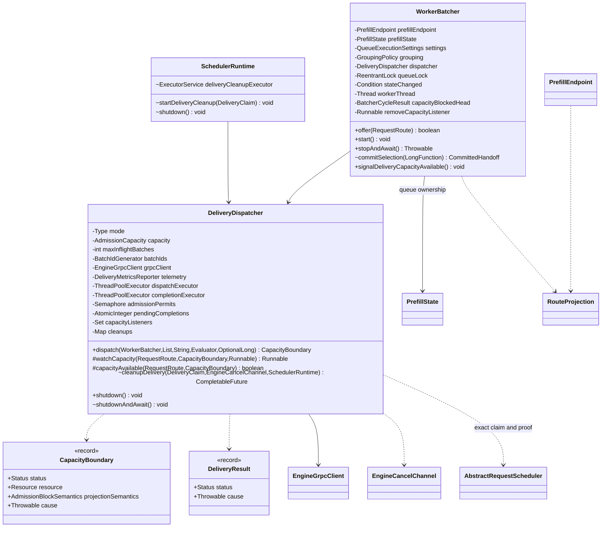

# 投递与执行收敛：实现与 Review 入口

首次收敛基线：`a3c443787403a3b4c1643df6d69a7f3406bd609c`。按用户要求，改动整合到当前分支 `feature/flexlb_ref`，并同步远端最新提交 `53728cecebc8f5c7c091504ea20de6c0835f3807`。本次提交只涉及投递、容量等待、远端取消及其装配和测试；工作区已有的 RequestContext 重构继续保留为未提交修改。

## 类与职责变化

| 收敛后的类 | 职责 | 原实现的去向 |
| --- | --- | --- |
| `WorkerBatcher` | 每个 Prefill generation 的队列、成组、等待、唤醒、停止与排空 | 调用一次 `dispatcher.dispatch(...)`，不再驱动 prepare / commit / deliver 事务 |
| `DeliveryDispatcher` | 资源准备、原子提交、路由发布、批量 RPC、结果回传、容量监听绑定、异步取消 | 合并 `DefaultBatchDispatcher`、两个 DeliveryStrategy 实现和 DeliveryTransaction；删除 DeliveryStrategy 接口 |
| `CapacityBoundary` | 不可变的准入结果：容量不足、所有权丢失或失败 | 删除 Availability；保留资源类型、预测阻塞语义和失败原因 |
| `DeliveryResult` | 不可变的单次投递结果 | 原有结果与证据含义保持一致 |
| `RouteProjection` | BATCH / NON_BATCH 的纯预测策略与增量预测 | 从两个 Strategy 迁入，Endpoint 直接获取预测策略 |
| `SchedulerRuntime` | 共享执行设施及关闭顺序 | 增加共享虚拟线程 executor；调用 Dispatcher 的清理函数 |

`DeliveryCleanupTask` 已删除。取消流程全部写在 `DeliveryDispatcher.cleanupDelivery(...)` 中：局部截止时间、循环尝试、等待 ACK、退避、结束。迟到 ACK 的处理通过同一函数中注册的回调保留。



## 投递 API

| API | 功能与约束 |
| --- | --- |
| `dispatch(queue, candidates, reason, evaluator, prediction)` | 准备可投递的有序前缀，调用队列的受锁提交入口，再发布路由或提交批量执行。返回 `null` 表示本轮已处理或选择失效；返回 Boundary 时对应候选队首，队列负责等待或移除失败成员。部分前缀成功时，本轮直接投递，剩余成员下一轮重新判断。 |
| `prepare(candidates, evaluator, prediction)` | Dispatcher 内部方法。在各请求 monitor 下校验身份并获取资源，复用同一份 evaluator。异常时释放已经获得的资源。 |
| `deliver(group, reason, depth, precedingWork, evaluator)` | Dispatcher 内部分支入口：NON_BATCH 发布单请求路由；BATCH 将已提交资源交给执行线程。 |
| `tryPrepareSubmission()` | 获取一份有界执行容量；提交后由执行器释放，未提交可关闭回滚。原有 RPC 适配用的嵌套 `PreparedSubmission` / `Delivery` / `BatchSender` 保留在 Dispatcher 内。 |
| `watchCapacity(item, boundary, wake)` | 将纯结果绑定到请求所属的实际资源；返回取消订阅函数。执行池和 Decode 使用各自的监听集合，Prefill 使用 generation 队列已有信号。 |
| `capacityAvailable(item, boundary)` | 非阻塞地判断原拒绝条件是否变化。Decode 校验 generation、requestId、reservationToken；旧身份丢失同样要求结束等待、重新判定。 |
| `cleanupDelivery(claim, channel, runtime)` | 幂等地启动一个虚拟线程清理流程，返回驱动流程结束的 Future。最多 8 次尝试，单次 RPC ACK 等待 500ms；已收到 ACK 后的本地事实应用只受总截止时间 5s 约束，避免执行池拥塞引发重复 Cancel。退避上限 400ms。这个 Future 与请求资源 settlement 是两个不同的完成条件。 |
| `shutdown()` | 关闭批量提交准入并唤醒容量等待者。 |
| `shutdownAndAwait()` | 等待已接受的提交及 RPC 回调完成，再关闭批量执行设施。取消 executor 继续由 Runtime 管理。 |

`PreparedGroup` 是 Dispatcher 内部的一次调用资源持有者，成员为：`batch`、`batchId`、`predictedMs`、`submission`、`reservation`、`routePredictions`、`members`、只读 `items` 视图、`prefill`、`committed`、`blockedItem`、`blockedResult`、`phase`。它保留释放与执行器交接所需的阶段，WorkerBatcher 和 Endpoint 不依赖此类型。BATCH 专用的额外 `BatchResources` 嵌套对象也已合并。

`Member` 只关联 exact RequestRoute 与 Decode permit。DIRECT 复用 `prepareMember(item, capacity)` 和 `closeCommitted(members, handoff)`，保持自己的直接选路流程。

## 队列 API

队列保留 `key`、控制事件队列 `controlInbox`、`runtimeState`、`drainClaimed`、`normalStopFailure`、容量信号和最近等待快照等运行状态。

| API | 功能 |
| --- | --- |
| `offer(item)` | 在队列所有权锁下加入精确请求身份。 |
| `start()` / `stopAndAwait()` | 启动队列线程；停止、排空并等待线程退出，返回收集到的失败。 |
| `removeQueued(item, reason)` | 撤销仍属于此队列的精确请求。 |
| `signalControl(item)` | 提交取消或过期等请求控制通知，并唤醒队列线程。 |
| `commitSelection(commit)` | 包内协作入口。在队列锁下检查 drain 状态，使用当前时间执行提交。传入的函数只做资源所有权提交。 |
| `notifyTerminalAdmissionFailure(item, boundary)` | 已移除的失败成员向请求所有者报告失败，并发布容量变化。 |
| `signalDeliveryCapacityAvailable()` / `signalSchedulingInputsChanged()` | 容量变化或预测/状态输入变化时，更新等待条件和预测版本并唤醒线程。 |
| `admissionBlockLocked()` | 返回仍然成立的队首容量阻塞，用于路由预测。 |
| `projectionConstraintsLocked()` / `groupingPolicy()` | 提供本队列的成组限制和策略。 |
| `queueSizeByPriority()` / `getLatestQueueWaitSnapshot()` | 提供队列统计与等待原因。 |

## 结果对象

`CapacityBoundary` 的 `Status` 为 `UNAVAILABLE / OWNERSHIP_LOST / FAILED`，`Resource` 为 `DISPATCH_EXECUTOR / PREFILL_BATCH / DECODE_ENGINE`。`unavailable(...)` 创建带预测阻塞语义的容量结果，`deliveryUnavailable(...)` 只阻塞投递，`failed(...)` 携带异常。嵌套 `Attempt<T>` 表示值或边界二选一。对象不含 Endpoint、监听器、Future 或执行逻辑；精确身份由绑定时的 `RequestRoute` 提供。

`DeliveryResult` 保留 `delivered()`、`notSent(cause)`、`prefillRejected(cause)`、`uncertain(cause)` 及 `failed()`。其中 UNCERTAIN 继续等待请求所有者依据 Worker 事实或取消证明判定释放。

## 并发与释放约束

1. 准备资源在队列锁外；提交在队列锁内；RPC、响应发布及回调在锁外。
2. 容量监听先订阅，再检查条件并等待；换队首和退出等待时移除原订阅。
3. 清理按 exact DeliveryClaim 去重。重试结束但资源未结算时，保留去重项；settlement 后移除。
4. ACK 超时和重试耗尽不证明资源已释放。迟到 ACK 仍交给原请求所有者；UNSUPPORTED 停止主动重试，继续等待 Worker 完成或退休证据。
5. Runtime 先停止准入并等待批量发送，等待清理证据、退休 Endpoint、排空请求工作，再关闭取消和请求执行设施。

## 验证

同步到远端 `53728ceceb` 并整合当前工作区的未提交 RequestContext 重构后，同步模块全量回归 1,893 项全部通过；API 与 mock engine 的生产 / 测试代码均编译通过。整合验证日志为 `/tmp/flexlb-current-sync-tests.log` 与 `/tmp/flexlb-current-sync-compile.log`。下面的差分与性能数字来自首次收敛基线，不包含其它人的未提交重构。

- `flexlb-sync` 完整测试运行：1,862 项，失败 0。
- `flexlb-api`：177 项中 176 项通过；原有 `benchmarkFollowerCapacityAgainstDelayedMaster` 跳过。
- `flexlb-mock-engine`：400 项通过，包含抢占、取消、并发与长运行泄漏检查。
- 最后单独复查 `TransientCapacityQueueContractTest`、`PlacementConfigurationTest`、`SchedulerArchitectureTest`：28 项通过。
- 三个受影响的预测工具使用当前测试 classpath 经 `javac` 编译通过。

Maven 使用 `-P 'opensource,!internal'`，分别运行完整同步模块、API / mock engine 回归及最后的装配复查。下面补充实现后的独立审查、差分与性能验证。

### 三个 Agent 独立审查

首次实现与审查在隔离分支 `codex/flexlb-delivery-convergence-20261013` 完成，首次提交 `0492a61536`；审查期间三个 agent 均只读。随后把通过审查的改动整合到当前分支 `feature/flexlb_ref`，未将其它人的未提交重构纳入本次提交。

| 审查范围 | 结果 |
| --- | --- |
| 行为等效、prepare / rollback、exact claim、远端清理证据 | 发现 ACK 等待预算偏差，已修复并复审通过；其余未发现确认的回归 |
| 锁顺序、容量唤醒、ABA、执行器关闭与 drain | subscribe → recheck → await 与锁外通知保留；精确 generation / reservation 校验保留；未发现新增锁反转、丢失唤醒或提前释放 |
| 投递热路径、预测、传输协议、测试迁移 | 12 段传输 / 回调 / payload / Gate 实现及两个纯预测策略去除注释、空白、类名后与基线相同；未新增共享锁或二次复杂度 |

确认的问题是：原收敛实现在 500ms 内等待 ACK 的事实处理完成，导致本地 request-work 拥塞时重复 Cancel。两个 agent 分别提取真实新方法与基线类运行探针，在本地执行队列阻塞 650ms / 900ms、远端即时返回 ACK 时观察到基线 1 次、新实现 2 次。修复后，500ms 只等待原始 RPC reply，收到 ACK 后等待事实应用使用整体剩余预算；独立探针重新运行，两者均为 1 次。

新增 `receivedAckDoesNotRetryWhileRequestWorkIsQueued`，分别覆盖 `REQUEST_CLEANED` 和 `UNSUPPORTED`。真实 Runtime 登记事实工作，受控 executor 暂存 ACK 应用超过 500ms，检查不重发、不提前结算；恢复事实工作后检查精确资源只释放一次。两个用例通过。

修复后重新运行 267 项，全部通过：同步模块 248 项（包含 74 项 DeliveryClaim、50 项 settlement、45 项 Decode admission、关闭死锁与过期 / 完成竞态），mock engine 19 项（HTTP Cancel、各阶段抢占及 60 秒持续故障流量泄漏检查）。完整日志为 `/tmp/flexlb-convergence-final-races.log`。命令如下：

```sh
./mvnw -B -P 'opensource,!internal' -pl flexlb-mock-engine -am \
  -Dtest=DeliveryClaimTest,DeliverySettlementTest,RequestTerminalSettlementTest,RequestConfirmationTimeoutTest,SubmissionShutdownDeadlockTest,WorkerBatcherSchedulingTest,DecodeEndpointAdmissionTest,RequestAdmissionExpirationRaceTest,RequestCompletionPublicationRaceTest,LeakCanaryLongRunE2ETest,HttpMockCancelIntegrationTest,PreemptionPhasesE2ETest \
  -Dsurefire.failIfNoSpecifiedTests=false test
```

异步测试同时覆盖 ACK 超时后迟到证明、重试耗尽后的证明、UNSUPPORTED、并发 sender / Decode 终态及关闭。它们使用实际线程和时间，没有穷举所有调度排列；原受控 timer 测试的 25ms 退避窗口不再通过独立阶段入口操纵。

### 基线差分与性能

基线和当前版本分别在独立 worktree 构建，使用同一 Corretto JDK 21；性能进程串行运行。`ProjectionDifferential` 对比 2,000 次选批 / readiness 和 4,000 个候选预测，涵盖优先级、过期、超大 token 溢出、探针位置及两种投递策略，完整结果一致：

```text
states={BLOCKED=40, MODELED=3638, UNAVAILABLE=322}
sha256=0185aa476a170f7c19cbb8671f8a75ccfeb44c200d14e7a5cfe69be9d7fb1175
```

`sync-performance-regression` 两版各 3 项通过：队列深度 0 / 1 / 32 / 128 / 512 的缓存快照读取均为 0 B/op；等待快照在深度 128 / 512 / 4096 下均为 504 B/op。

`api-performance-regression` 使用真实 loopback gRPC、16 Prefill / 32 Decode、8GB 固定堆、预热 5s、测量 5s。BATCH 使用 FIXED_WINDOW，NON_BATCH 使用 SINGLE。3,000 和 10,000 目标 QPS 均通过原有吞吐、服务端延迟、队列等待与资源排空断言。10,000 QPS 结果如下：

| 指标 | 基线 | 收敛后 |
| --- | ---: | ---: |
| BATCH 客户端吞吐，3 个独立 JVM 中位数 | 9,978.6 QPS | 9,979.1 QPS |
| BATCH 服务端 P99，逐轮 | 23 / 24 / 42ms | 15 / 27 / 42ms |
| BATCH 客户端 P99，逐轮 | 32.486 / 80.661 / 101.339ms | 39.445 / 81.881 / 111.427ms |
| NON_BATCH 客户端吞吐，1 个 JVM | 9,996.3 QPS | 9,995.6 QPS |
| NON_BATCH 服务端 P99 | <1ms | <1ms |

BATCH 三轮按基线→当前、当前→基线、基线→当前交错运行。客户端长尾随轮次明显波动，因此不能据此断言 P99 完全不变；上述结果表明在这些负载下吞吐与既有 SLO 门槛保持。测试固定了输入速率，未测饱和吞吐上限，也不能替代线上规模验证。第一次基线运行在默认 2GB 测试堆下 OOM，该次作废；两版随后统一使用仓库压测脚本建议的 8GB，未放宽性能断言。

复跑入口：

```sh
./mvnw -B -P 'opensource,!internal,sync-performance-regression' -pl flexlb-sync -am test
./mvnw -B -P 'opensource,!internal,api-performance-regression' -pl flexlb-api -am \
  '-Dtest=MasterBatchEndToEndPerformanceTest#masterMeetsRateSloAcrossEngineScaleMatrix' \
  -Dsurefire.failIfNoSpecifiedTests=false -Dflexlb.perf.heap=8g \
  -Dflexlb.perf.delivery-mode=BATCH -Dflexlb.perf.decision-mode=FIXED_WINDOW \
  -Dflexlb.perf.engine-matrix-topologies=16x32 \
  -Dflexlb.perf.engine-matrix-target-qps=3000,10000 \
  -Dflexlb.perf.engine-matrix-warmup-ms=5000 -Dflexlb.perf.engine-matrix-duration-ms=5000 test
```

NON_BATCH 将上面的 delivery-mode / decision-mode 改为 `NON_BATCH` / `SINGLE`。本轮原始日志位于 `/tmp/flexlb-convergence-*-perf-*.log`，差分结果在 `/tmp/flexlb-convergence-projection-compare/{before,after}/verification.txt`。两个预测 benchmark runner 已适配类收敛前后的 API，均验证两版编译通过；本轮只执行了预测结果差分，未运行完整的 snapshot / planning 微基准矩阵。
