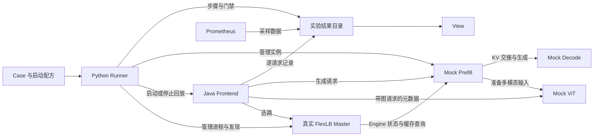
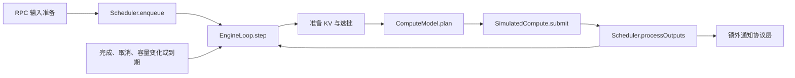

# 架构与设计边界

[返回使用说明](../README.md)

一次本地实验由 Python Runner 管理。Runner 按 Case 启动独立的 JVM、执行步骤和门禁、保存结果。Frontend 按计划直接发压，真实 FlexLB Master 负责选路，Mock Engine 用生产 RPC 接入并模拟 ViT、Prefill、Decode 和缓存行为。View 读取实验留下的记录。

## 系统全貌



图中展示 Frontend 按路由直接向 P 提交请求的路径。Master 也可以先向 P 批量入队，Frontend 再直连 P 调用 Fetch。每个 Master、P、D、V、Frontend 和 ZooKeeper 实例各有自己的 JVM。Master 使用生产调度与 ZooKeeper 选举。Whale 上的 Mock Engine 由平台管理实例和发现。[Mock 配置参考](configuration.md) · [Whale 镜像与启动](whale-engine.md)

## Case 如何执行

### 配置、Step 与运行时

Case YAML 描述角色、流量、步骤和断言。启动配方提供本机可执行文件、命令和 JVM 参数。编译器按 Case → Phase → Step 校验配置、组件文件和引用，把每个 Step 绑定到 `StepRegistry` 中的 `StepDefinition`。定义来自带类型注解的动作函数，包含参数与返回契约、读写属性和单位。每次调用的配置由 `Step` 持有。

Runner 按 Phase 推进。Step 解析前置结果或全局发现引用，校验实参，在预算内执行动作，校验返回值，再判断可选的 `expect`，最后执行 `wait_after`。例如，HA Case 查询实际的主备 Master，把地址留给后续的停止与重启步骤使用。后台 Step 属于当前 Phase，结束前须等待或回收，其结果不可供其他 Step 引用。

动作负责选目标、扩缩容、回放控制和跨实例查询。Frontend-0 收到回放控制请求后负责协调这一轮的所有 Frontend，其他 Frontend 各自执行分到的请求。新增 Case 操作时，在 `execution/step/` 定义参数和异步函数，用 `@register_step` 声明，再加入 `standard_actions()`。字段、引用和断言示例见 [Case 指南](case-guide.md)。

### 进程、发现与收尾

`RunEnvironment` 先启动 Prometheus 和 ZooKeeper，再启动 Engine、Master、Frontend 并完成采集基线。`ProcessSupervisor` 监视子进程并负责回收。每个实例发布有效配置和端点，`EndpointRegistry` 维护活动拓扑，供 Master 发现文件和 Prometheus 采集目标使用。Master 的主备身份以实际选举结果为准。

Python 的 `*Role` 管理 Case 中对应角色的子进程、就绪检查和收尾。Java 的 `*Main` 读取启动配置，启动本 JVM 的服务并发布就绪信息。JVM 内的组件实例负责关闭自己持有的服务和资源。Frontend 的 HTTP 监听和路由由 `ControlHttpServer` 提供，`FrontendNode` 同时管理控制端点和回放会话。

| 组件             | Python 编排      | Java 进程入口         | JVM 内服务                                      |
| ---------------- | ---------------- | --------------------- | ----------------------------------------------- |
| Frontend         | `FrontendRole`   | `FrontendMain`        | `FrontendNode` 管理控制端点和回放会话           |
| Prefill / Decode | `EngineRole`     | `EngineMain`          | `LLMMockEngine` 按 P/D 角色装配 RPC、调度和缓存 |
| ViT              | `EngineRole`     | `EngineMain`          | `VitNode` 管理 ViT 服务和本地资源               |
| Master           | `MasterRole`     | `MasterMain`          | Spring 应用上下文和本地控制端点                 |
| ZooKeeper        | `ZooKeeperRole`  | `ZooKeeperMain`       | 原生 `ZooKeeperServer` 和连接工厂               |
| Prometheus       | `PrometheusRole` | Prometheus 可执行文件 | Prometheus 自身管理                             |

缩容时，角色先保存末次采样，再从拓扑和 Master 发现文件撤销端点，然后停止目标 JVM。Master 异步刷新发现，缩容步骤只等待进程退出。显式引用旧地址仍指向原实例。一次运行内分配 Engine 端口时避开已选定的 Master 端口及本次已用过的 Engine 端口。

收尾先停止回放、收齐 Frontend 结果并完成最后一次抓取，再依次关闭 Frontend、Master、Engine、ZooKeeper 和 Prometheus。某一步失败时仍继续回收，并把清理错误写入结果。Master 逐个关闭，每个进程有独立的退出预算，其他组件在此期间继续提供服务。

## Frontend 如何回放

### 一份计划，各自发送

Case 的 `frontend/start/playback` 通过 Python 调用 Java frontend0 的 `frontend/start` 控制端点。`FrontendNode` 管理当前轮次和跨轮请求 ID。`ReplayCoordinator` 负责本轮分片、并发槽分配、统一开始时刻、失败收尾和结果收集。frontend0 也发送自己的请求。每个 JVM 的 `ReplayWorker` 独立读取数据、计算发送时刻并处理 drain，再由 `BackendRpcTransport` 调用真实 Master 和原生 Engine RPC。

| 回放方式       | 全局序号为 `k` 的请求计划发送时刻                |
| -------------- | ------------------------------------------------ |
| 固定 QPS       | 从共同起点偏移 `k / 总 QPS`。                    |
| 按采集时间回放 | 从共同起点偏移 `源到达时间偏移 / replay_speed`。 |

第 `i` 个 Frontend 负责 `i, i+N, i+2N, …`，其中 `N` 为 Frontend 数。各 Frontend 共享同一份数据文件。可选的 `warmup` 在开始阶段降低速率，之后恢复正式速率，每条请求发送一次。性能门禁使用预热后的时间范围。

本地播放器将到点的请求放入有界队列，调用占用并发槽直至终态。队列满会结束整轮并记录错误。自然结束会发完队列中的请求，主动停止后，已发请求在收尾预算内排空。`unissued` 等于该 Frontend 的计划请求数减去 `issued`，涵盖队列中和还未入队的请求。`frontend/stop/playback` 汇总本轮结果，单请求业务失败由 Case 门禁判断。TTFT 和请求耗时从实际发起 RPC 时计量。

### 共享索引回放输入

`frontend/start/playback.args.requests_file` 指向二进制 `.mckidx`。文件头以 `MCKINDEX` 开头，记录请求数、各表偏移、最后到达时间、缺少两种输出长度的请求数和数据摘要。每 1,024 条请求独立做成一个 Zstd 页，Frontend 按索引只解压所需的页。文本前缀链每页最多 256 条，独立压缩并有界缓存。链记录起始节点、父节点和长度，请求引用叶节点。媒体表和输出上限表由请求共享。Frontend 读取时校验访问到的页和记录，损坏会终止回放。

[Basic 数据集](../data/traffic/basic.mckidx) 有 20 条请求。下面摘录前两条及其引用的表。节点 4 接在节点 2 后，所以两条请求共享前两个文本 token。

```json
{
  "format": "MCKINDEX",
  "prefix_chains": [
    { "first": 1, "parent": 0, "length": 3 },
    { "first": 4, "parent": 2, "length": 1 }
  ],
  "media": [],
  "output_caps": [3],
  "requests": [
    {
      "arrival_ms": 0,
      "leaf": 3,
      "observed_output_tokens": -1,
      "priority": 50,
      "output_cap_id": 1,
      "images": []
    },
    {
      "arrival_ms": 0,
      "leaf": 4,
      "observed_output_tokens": -1,
      "priority": 50,
      "output_cap_id": 1,
      "images": []
    }
  ]
}
```

带图记录保存媒体 ID、插入位置及参考展开长度。插入位置按图片前的纯文本 token 数表示。Frontend 插入占位 token，先向 Master 选 V 并读取 ViT 元数据，再用实际展开长度和行 hash 生成路由键。参考长度不一致时记告警，继续使用 ViT 的结果。基础块和 CP 由回放时的 Frontend 与 Prefill 配置共同决定。[Prefill CP 配置](configuration.md#prefill)

请求可以分别记录实际输出量和上限。实际量为正时用作本次生成上限并设置 `ignore_eos`。缺少实际量时使用记录的请求上限，Decode 可在该上限内按高斯分布采样输出长度。两项都缺省时使用 `fallback_max_output_tokens`，未提供该参数则启动失败。

## Mock Engine 如何处理请求

### 接入、调度与计算

`LLMMockEngine` 装配每个 P/D 实例的 RPC、`EngineLoop`、`EngineScheduler` 和 `KvCacheManager`。协议层拥有会话、校验报文、准备输入并处理取消。图片展开和 prompt cache key 计算在调度锁外完成，入队前再校验请求身份与 deadline。准备中的 P 请求可按 PENDING 查询，成功入队后由 Scheduler 提供执行状态。

| 组件                                                   | 拥有的状态与行为                                            |
| ------------------------------------------------------ | ----------------------------------------------------------- |
| `RtpRpcService`、`PrefillRpcServer`、`DecodeRpcServer` | 原生报文、会话、P/D 阶段校验、异步响应。                    |
| `EngineLoop`                                           | 等待唤醒和最近 deadline，维护在途 Forward，协调计算与回调。 |
| `EngineScheduler`                                      | 准入、队列、组批、生成进度、KV 申请和请求终态。             |
| `ComputeModel`                                         | 根据本轮 `ForwardBatch` 估算耗时和结果。                    |
| `SimulatedCompute`                                     | 接收 `EngineLoop` 提交的计算计划，模拟执行并返回结果。      |
| `KvCacheManager`                                       | 前缀匹配、LRU、容量、资源引用和有效块元数据。               |



每个实例同时至多执行一个 Forward。调度在短锁内提交状态，计算等待和网络发送在锁外。D 请求可连续参加多轮，输出发送进度不参与选批。请求取消或超时后不再提交该请求的结果。即使整批请求都已终止，已开始的 Forward 仍按原定时长执行并持有资源引用，结束后才开始下一批。实例关闭时会终止在途模拟计算。迟到回调按执行对象和请求句柄核验。

RTP P 默认使用 `RtpFifoScheduler`，由 Scheduler 从单请求自主合批。显式 `group` 模式使用 `RtpPrefillGroupScheduler`，一次提交完整组，保留成员级结果、超时和取消。组在当前轮放不下的成员留待后续调度，D 始终按单请求准入。内部按请求统计 waiting、loading、running、ready。原生状态把 waiting、loading、ready 合并为 waiting，running 包含两轮计算之间仍留在执行集合的 D 请求。[Prefill 配置](configuration.md#prefill)

ViT 使用自己的图片准备与合批循环。`VitPreparation` 管在途任务和发布，`VitScheduler` 执行合批，`VitCache` 管同键共享和驻留淘汰。Mock 内部使用模拟形状、每张图的 seed 和 split size。真实 Frontend 通过原生 RPC 获取逐行 hash。几何和下载参数见 [ViT 配置](configuration.md#vit)。

### KV 准备、容量与回收

每个 P/D 实例使用一份前缀索引和 LRU，另记两项容量。`mock.cache.total.blocks` 约束统一池保留量，`test_block_num - 1` 是 device 驻留额度。活动引用占驻留额度，共享块只计一次，命中块也要能驻留才可用于计算。释放引用归还驻留额度，仍有效的 key 可以留在索引中。WorkerStatus 的容量字段描述 device，索引可能保留更多 key。

初始 `KvCacheManager.prepare()` 同步匹配并分配。本地成功返回 `Ready` 和 lease。临时容量不足返回可重试的 `Failed`，由失败对象在容量或索引变化后重试。超过单请求容量则终止，已经进入生成的 D 请求在 KV 增长失败时也终止。D 的 P/D LOAD 是另一项协议依赖，完成前不会进入生成。

成功结束时只发布 prompt 的完整块。缓存保留与驻留使用逻辑额度，Host 到 Device 的恢复按瞬时处理。KVCM Reporter 消费有效块变更、快照和心跳，处理的是元数据。P → D 通过原生 RPC 交接输入长度和完整 prompt block keys，D → P 返回生成进度。[Prefill 容量配置](configuration.md#prefill) · [Decode 容量配置](configuration.md#decode)

### P/D 交接和输出

下面是走原生 P/D 协议的请求。普通单 token 调用可在 P 本地完成。

1. P 发起 D 的 `ALLOCATE`，P 调度并计算 Prefill。
2. P 计算完成后退出计算集合，保留源 KV；传输期间额外持有资源引用。P 发 `LOAD`，D 通过 `SimulatedKvLoad` 异步提交模拟加载结果并返回 ACK。
3. P 收到有效 ACK 后结束本地阶段并释放引用，再发 `GENERATE` 或 `PREFILL_COMPLETE`。D 在加载和生成许可均满足时才进入 Decode。未确认、失败或超时按请求期限和失败路径清理。
4. D 每轮提交累计生成进度。P 继续把 D 的输出转发给 Frontend，即使 P 自己的计算阶段已经结束。

`GenerateResponseStream` 每请求保存累计长度、发送游标和固定大小的元信息。可写时按游标差值生成内容，单帧最多 4,096 token。晚接入的 Fetch 可补读已保留的进度。合并后的帧反映实际交付节奏，计算侧指标仍按原始 Forward 统计。

输出交付和计算各自收尾。Fetch 断开或 GENERATE 已接受后 P 失去输出连接，D 可以继续计算；显式取消、请求 deadline 和实例关闭仍按计算状态处理。Fetch 接入超时与计算完成后的交付超时各自清理输出注册。模拟的 P/D LOAD 与输出链路适合验证协议推进和生命周期，实际带宽及传输拥塞由真实链路实验衡量。

## 实验如何留下证据

### 状态、健康和指标

WorkerStatus 从接入会话与 Scheduler 采集任务快照，`TaskHistory` 提供按版本查询的 finished 增量。任务转换与快照复制使用同一调度锁，缓存单独采样。CacheStatus 按版本复制有效 key，随后在缓存锁外构建响应。两类状态 RPC 的服务端 RT 都截止到状态采集完成，包含必要的锁等待。健康检查直接读取关闭与致命失败状态。

原始指标样本在对应业务事件记录。Prometheus 保存可查询的时间序列；使用 Reporter 时由独立发送线程提交样本，保留原始权重。采集快照在短锁内取值，编码和发送在锁外。指标队列溢出或上报失败会标记采集不完整，业务计算继续推进。[指标口径](../views/coverage.md#指标口径)

### Frontend 逐请求记录

每个 Frontend 将请求事件写入 `components/<frontend>/playback/<轮次>/requests.jsonl`。Java Frontend 测试验证请求事件和日志封口。显式停止和 Runner 自动收尾都校验 Java 返回的最终汇总。

### Step 记录、门禁与 View

`StepTrace` 保存运行配置、步骤事件、门禁和终态。事件与门禁可按 `run_id`、Phase 和 Step 关联，指标门禁记录实际查询的时间窗。View 读取已完成的结果目录和 Prometheus 数据，按已记录的门禁定位曲线。[View 指南](view-guide.md)

## 从源码进入

| 要改的行为                | 源码入口                                                                                  |
| ------------------------- | ----------------------------------------------------------------------------------------- |
| YAML、类型校验与引用      | `python/mock_framework/config/`、`python/mock_framework/execution/step/`                  |
| Case 编排、发现、进程管理 | `python/mock_framework/execution/runner.py`、`environment.py`、`processes.py` 与 `roles/` |
| 流量读取、节奏和原生请求  | `java/frontend/` 中的 `IndexedTrafficReader`、`FrontendNode` 和 `BackendRpcTransport`     |
| RTP/ViT、计算与缓存       | `java/engine/` 的 `service`、`execution`、`scheduler`、`cache` 和 `vit`                   |
| 协议、指标导出及实例入口  | `java/protocol/`、`java/metrics/`、`java/master/` 和 `java/zookeeper/`                    |

调度器管理队列和状态转换，`EngineLoop` 驱动 Forward。每个 `LLMMockEngine` 持有并采集自己的 `RtpMetrics`，RTP Scheduler 在组批、Forward 完成和请求结束等时点记录数据。采集时直接读取调度队列和 KV 状态，再合并 RPC 指标。独立验证调度策略时可从 `LLMMockEngine.start(..., EngineScheduler.Factory)` 注入调度器。

### Java 与 Python 的改动边界

- **Java** 管回放、原生 RPC、调度、计算模拟和 KV。模型默认值和状态转换在所属组件内维护。改取消、超时或关闭时，验证请求只有一次终态、资源能回收、迟到回调不会恢复已结束的请求。改 proto、业务错误码、P/D 交接或 cache key 时，核对生产调用方和协议兼容测试。
- **Python** 管 Case 编译、动作、进程编排、发现、采集和 View。动作复用 `StepContext` 的查询和剩余预算，按角色管理实例。改 Runner 公共流程时，验证超时、后台失败、写操作回执未知和进程回收。改已有 Case 接口或 `result.json`、`gates.jsonl` 等记录格式时，核对现有 Case 和 View 的读取路径。
- **跨语言接线** 涉及启动配置、就绪端点或回放结果时，同时核对 Java 产出和 Python 消费，并用实际启动组件的测试覆盖。

完整实验通过 `mock-case run` 执行。[构建及检查命令](../README.md#开发检查与详细文档)
