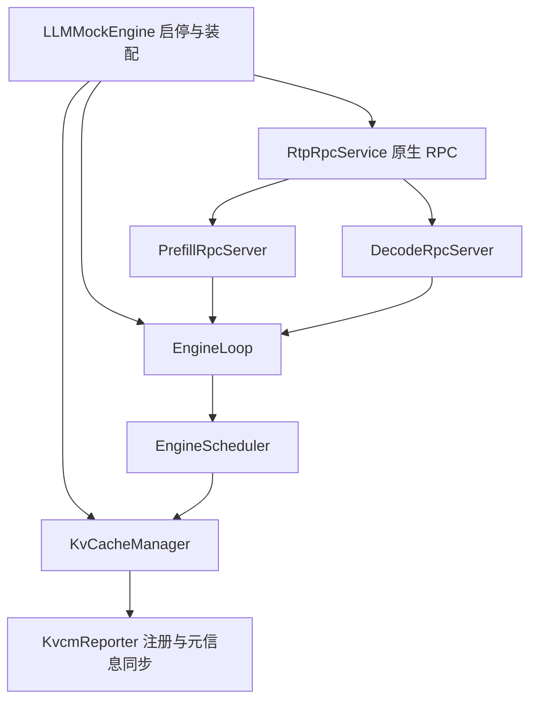
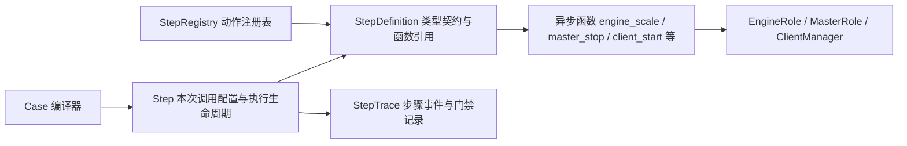

# 架构与设计边界

[返回使用说明](../README.md)

Python/Java 模块、主要类与调用关系的逐项说明见[钉钉架构文档](https://alidocs.dingtalk.com/i/nodes/6LeBq413JA9BOdm2iqd79zQ4JDOnGvpb)。Client 请求查询位于 `execution/step/client_requests.py`，运行管理位于 `execution/roles/client.py` 的 ClientManager；输入生成代码只供测试使用，不提供独立请求查询 CLI。

本文说明组件职责、调度与协议边界，以及接口扩展方式。运行步骤见 README，Case 与启动配方用法见 [Case 指南](case-guide.md)。设计目标中尚未实现的能力仍按原文标明。文中路径和命令均以框架目录为基准。

## EngineScheduler 输入、执行完成、传输完成与状态查询

EngineScheduler 是每个后端的请求状态与调度策略所有者，不只是选择 batch 的函数。公共接入代码解析协议、检查格式并发送回执；`enqueue` 决定初始状态、队列与资源准入，成功登记不等于资源已就绪。计算结果、传输结果和协议许可分别进入明确入口，外部组件不直接修改请求阶段或队列。

- `enqueue(input, listener)`：登记请求并执行后端准入策略。
- `schedule()`：返回本次 Forward 的执行计划，不暴露或取走内部 running 容器。
- `processOutputs(work, result)`：提交本次计算进度，决定继续计算、等待交接或终结。Compute 不修改后端状态。
- `transferCompleted(request, result)`：接收异步 KV 传输结果，由后端决定下一步；传输结束不自动等于整个请求结束。
- `control(request, event)`：处理后端协议许可等少量控制输入；GENERATE、LOAD ACK 等类型属于原生接入与 RTP 后端的约定，不是共享状态机。
- `tasks()`：按需返回当前执行任务的不可变观测快照，不推进状态机；内部状态机和队列仍由后端自行定义。

PD 的初始通知/初始化和 KV 传输分开。当前接入协议共用，KV 传输使用公共异步组件，第一版只建模零耗时完成；保留完成、失败、取消和资源使用权接口，不加入带宽、分块或争用模型。P 计算完成后可以退出计算集合，但仍持有 KV；本地传输结束和 D 的 LOAD ACK 是不同事实，确认前不能释放源 KV。网络协议仍由 RTP 适配器执行，状态决策及转移归 EngineScheduler。

EngineLoop 负责唤醒、执行和结果交接，不判断后端队列和协议阶段。新输入、Compute/Transfer 完成、取消、资源释放和关闭触发唤醒；同时按最近请求 deadline 定时唤醒。无事件、无期限时阻塞等待，不固定周期轮询。Forward 在途时仍处理状态维护和 I/O 事件，但不提交第二个 Forward。资源可用变化必须有明确通知，不能在移除轮询后遗漏容量唤醒。

主流程沿用 real 的普通执行术语：`enqueue()` 登记请求；`loop()` 等待事件并调用 `step()`；`step()` 检查请求超时和 KV 就绪、调用 Scheduler.schedule() 选批，再进入 `forward()`；模拟 Forward 完成后调用 `processOutputs()`，由 Scheduler 提交 token、KV 和请求终态，再锁外派发回调。Forward 在途时 step 仍可检查超时与 KV，不会重复提交计算，也不等待 RPC 消费输出。real 对照为 `cpp/normal_engine/NormalEngine.{h,cc}` 的 enqueue/loop/step，以及 executor 和 BatchStreamProcessor 的处理输出路径。

| EngineLoop 入口 | 实际用途 |
| --- | --- |
| enqueue(input, listener) / enqueue(batch) | 单请求或显式 batch 入队。 |
| updateRequest(request, event) | 把原生 GENERATE、PREFILL_COMPLETE、LOAD ACK 等请求更新交给后端 Scheduler.control；不是通用工作流。 |
| beginKvTransfer(request) | 持有 KV 传输期间的资源引用。 |
| onKvTransferCompleted(request, result) | 提交异步 KV 传输结果。 |
| abortRequest(request, failure) | 取消或失败，failure 必填；成功由调度内部决定。 |
| step() → forward() → processOutputs() | 私有执行主链；调度、模拟计算、提交计算结果。 |



KvCacheManager 管理 KvcmReporter 的配置、启动、状态查询与关闭。关闭时先停止报告并解绑缓存订阅，再清理 KV；等待网络线程退出和发送 HOST_DOWN 时不持有缓存锁。LLMMockEngine 不再持有或关闭 Reporter，只通过 cacheManager() 访问缓存管理器。

状态转换与任务快照复制使用同一调度锁。查询可读到转换前或转换后的已提交状态，不能读到队列移动一半的状态；不等完整调度轮、Forward 或 PD 完成，不维护影子状态。活动记录移除与完成增量发布在同次状态提交完成，网络通知在锁外执行。Cache 单独采样一次，再由既有 GetWorkerStatus 编码组装；不承诺任务与 Cache 来自同一全局时刻。这与 real RTP 分开读取运行记录、Stream 阶段和 Cache 的边界一致，不复制其类之间的分工。

## 设计边界

Python 负责 Case 编译、执行和进程管理。每个 Engine 独立启动，Client 由 client0 协调索引回放。

### Python Case 操作与 Java 实例能力

Python 提供面向 Case 的业务接口，Java Engine 提供实例原子能力。Client 的多 JVM 发压由 Java client0 协调，Python 转交活动级命令，不逐个调度请求。

| 层次 | 职责 |
| --- | --- |
| Python Runner | 顺序执行 step、解析引用、固定时间范围、预算和失败处理、记录结果。 |
| Python Case 接口实现 | 选择 Engine、扩缩容、向 client0 提交流量任务、跨实例查询与聚合；使用进程管理和发现文件能力。 |
| Java 实例协议 | Engine 提供原生 RPC、健康检查和指标。Master 提供状态查询，Client 接收回放控制和参与者命令。 |
| Java client0 协调者 | 固定参与者、分配总流量与输入、协调准备/启动/停止、汇总活动状态；与本地请求执行分开。 |
| Java 公共 Mock Engine | 请求接入、调度循环、资源机制、Forward 执行、输出和指标；组合 RTP 或 vLLM EngineScheduler。 |

缩容一个 Decode 时，Python 选定一个实例，采集末次指标，停止其 JVM，再从拓扑、Master 发现文件和 Prometheus 中移除地址。Client 总 QPS、请求数和并发预算由 client0 分配。

Case 操作放在独立的 Python 实现中，不在 Runner 主循环按接口名堆分支。简单实例调用复用公共传输；Engine 扩缩容、client0 流量协调、Python 查询聚合保留各自的业务逻辑，不用一个通用广播器代替。

参数引用只表达取值：前置 step 的返回结果，或已定义的全局配置/发现信息。不增加专用的 leader/group/instance 选择器语言；查询主 Master 后直接引用查询结果。目标省略时默认对应操作域的全部实例，显式空集合或失效地址报错，不能退回全部，也不能自动缩成当前可达集合。需要唯一目标的操作校验数量。引用统一写成 `{ref: steps.<id>}`、`{ref: steps.<id>.<field>}` 或 `{ref: globals.<field>}`。当前全局字段为 masters/prefill/decode/vit 的服务地址列表，目标参数统一为 `targets`。不新增 YAML 流程宏。

### Python 接口定义和 Step 模型

Case 动作是带类型注解的异步函数，不为单操作建立类或继承树。`@register_step` 从函数签名构造 `StepDefinition`，保存稳定动作名、读写属性、单位、参数/返回 schema 和函数引用；`StepRegistry` 负责动作登记与查找。编译后的 `Step` 只保存本次 Case 的步骤配置和定义引用，统一处理执行生命周期；运行状态由当次 Case 的上下文持有。



动作函数没有继承 Step；StepDefinition 是共享的注册定义，Step 是每次调用独立的数据对象。保存 Case 配置时不序列化函数引用或注册元数据。

配置编译按 Case → Phase → Step 推进，环境编译分别处理部署参数、组件配置文件和 Master 原生 JSON。普通值与 ref 共用 validation 的 schema 遍历；编译器只为 ref 叶子提供类型检查和转换，不再复制对象/列表/union 的校验规则。值解析、schema 校验和类型兼容检查统一在 config/validation.py；不再保留 values.py。编译器通过 StepDefinition.arguments 检查无引用参数，dataclass 构造与结果转换作为 step_registry 内部实现，不直接从编译器调用。Runner 在 ref 展开后只校验并构造一次参数，由 Step.run 调用 StepDefinition.call；StepDefinition.invoke 供独立调用时从原始参数完成同样的准备。参数失败发生在调用前，结果校验失败发生在调用后，保留各自的错误阶段和写操作 outcome_unknown 语义。

Step 统一为一次接口调用，包含 id、describe、interface、args、within 和可选 expect。删除 YAML 的 call/check 外壳及两套重复 Step 类：无 expect 时执行并保存结果，有 expect 时在同一次返回后判断。读取也可以只取值供后续引用；写操作的回执可以断言，但不因断言失败重放。接口读写属性与是否断言相互独立，不把普通检查隐式变成轮询。

执行链统一为解析引用、校验实参、固定查询时刻和预算、调用注册的动作函数、校验返回值、保存结果、执行可选断言。编译阶段检查引用必须来自前置 step 或允许的全局信息，检查字段路径与类型；运行时解析后再次校验。Python 类型注解本身不等于运行时校验。

普通数值查询直接返回数值，单位声明在接口上；地址集合返回列表，动作返回明确回执，逐 Master 状态保留映射。断言按结构和运算符判断，不按 MetricValue、PerMasterEngines 等业务类型名称偷偷聚合。接口文档和清单可以由 Python 定义导出，用于保存实验现场，不再依赖 Java 构建才能编译 Case。

Runner 管理声明了 background 的 Step 任务。任务属于当前 Phase，Phase 结束前会等待或回收这些任务。后台 Step 的结果不能作为 Case 引用。client/start 返回表示 Java 已确认开始回放，回放仍由 ClientManager 和 Java client0 管理，使用 client/stop 停止并收齐结果。

本轮重构按职责变化整体重写 StepRegistry、Step 模型、编译和执行主链，联动 CLI、启动配方、夹具和构建入口；复用严格 YAML 解析、进程回收、采集与记录等仍成立的机制。Java 内部端点保留明确的请求/响应协议，但不再声明整套 Case API；配置类型留在所属组件，不能随旧接口目录误删。保留引用重校验、固定时间窗口、错误结果和取消清理的验收，不保留另一套旧 Case 执行入口作为兼容分支。

### KV 容量的明确简化边界

每个 Engine 使用统一的逻辑 KV block 记账，同时约束缓存保留总量和 device 驻留量。不同模型网络层的 KV 成本合并在这些预算中；不实现按模型层分池、Full/SWA/Linear 多资源组、各组独立配额及它们之间的联合分配。这是有意的 Mock 模型边界，不是后续必须补齐的 real 能力。不记录每个缓存 key 的 Device/Host 存放位置，不扩展成每层或每种注意力各自的资源池。涉及真实混合池瓶颈和逐层容量的实验不由此模型给出结论。

EngineScheduler 决定申请、增长和提交时机；KvCacheManager 管匹配、分配、索引及引用。正常结束且 Compute/PD 使用结束后，P 提交已计算 prompt；D 提交 prompt 加实际已计算的输出前缀，排除最后一个仅采样、尚未计算 KV 的 token。共享 CacheSequence 保存语义输入和 cache-only 多模态区间，并统一生成完整 block key；生成 token 值由接入层从原生 GENERATE 传入，不能猜测为 prompt 最后一个 token。失败或取消不发布新缓存。

当前仅模拟 device 驻留额度的取得与归还，Host↔Device 恢复视为瞬时，不实现真实数据迁移。对齐的 feature 源码中，Host→Device 加载使用异步任务和完成上下文，Device→Host 转存也由后台任务执行；调用方在源/目标资源尚未就绪时保留引用。因而瞬时模型不覆盖搬运延迟、传输重叠和在途额外占用，不能表述成 real 使用同步瞬时迁移。

### 公共 Engine 与独立调度域

RTP 和 vLLM 的设计目标是复用请求事实、资源机制、EngineLoop、Forward、输出和生命周期工具；各自的 EngineScheduler 拥有队列模型、准入、组批、抢占恢复和结果后的状态转换。替换调度策略不应修改 Compute 或 EngineLoop。原生协议和计算模型参数仍在各自接入/配置边界适配，不宣称两个真实后端只有调度差异。

当前已打通 Java 装配入口 `LLMMockEngine.start(config, EngineScheduler.Factory)`，指定监听端口时使用 `start(config, rpcPort, controlPort, factory)`。工厂的 `create(lock, cache, finished)` 为每个实例创建一个新 EngineScheduler，收到协议接入层与 EngineLoop 共用的调度锁，以及本实例独占的 RTP Full-KV 管理器 KvCacheManager 和统一的 finished 增量记录。工厂不关闭缓存；节点在关闭或调度器创建失败时回收它。默认入口只在 LLMMockEngine 选择 RTP 工厂，PrefillAdmission/DecodeAdmission 不再创建或引用 RtpFifoScheduler，公共执行层不识别 RTP 配置。

P 接入层保留原生报文、模型上下文及生成参数校验，单批 token 预算等调度策略由 EngineScheduler 判定。RTP 默认策略仍拒绝超出单批预算的 Prefill，并返回原有 INVALID_ARGUMENT/605；替换 EngineScheduler 不会被接入层的重复策略校验拦截。请求数量保护上限统一来自 RtpConfig，不再由接入层读取具体调度器的常量。

本批仅完成装配与公共组件边界；vLLM EngineScheduler 尚未实现，Python 后端选择和对应 Case 接线留到后续。没有自动插件扫描、空后端占位或静默回退到 RTP。

```text
网络/控制线程 → input / control / transferCompleted / finish
                           ↓
EngineLoop：维护到期与依赖 → EngineScheduler.schedule → Compute.forward
                           ↑                         ↓
                      下一轮调度 ← EngineScheduler.computeCompleted
                                      ↓
                         锁外发送输出/就绪/终态通知
```

每个 Engine 同时至多一个 Forward。初次和空闲后先调度；每轮计算结束后，结果交回 EngineScheduler 提交进度、检查有效性并决定继续或结束。公共 RequestState 保证终态与资源清理只发生一次，但不定义后端阶段或替调度器决定队列迁移。EngineScheduler 不持有执行器、计时线程或 EngineLoop，也不发送网络响应。

| 边界 | 职责 |
| --- | --- |
| `input(Input, Listener)` | 校验身份、接纳并登记请求，返回只读请求句柄。外部不能取得可变队列或修改请求进度。 |
| `schedule()` | 检查预算与资源，调整内部队列，返回本轮 Work/ForwardBatch；没有可执行工作时返回空。 |
| `computeCompleted(work, outcome)` / `failed(work, error)` | 提交本轮有效结果，决定后续队列和阶段完成，清理本轮资源引用。 |
| `transferCompleted(request, result)` / `control(request, event)` | 分别接收传输完成结果和后端协议许可，不把传输成功当作自动获准生成。 |
| `finish` / `beginTransfer` | 终止请求，或为已经就绪的数据取得短期读取引用；读取结束不等于收到远端传输确认。 |
| `tasks()` / `queues()` | 同一调度锁内读取已提交任务的观测事实及真实队列计数；不推进状态，不返回可变请求。 |

ForwardBatch 是本轮执行输入，不是 running 容器本身。它固定请求成员、本轮 token 数和执行身份；请求的持续状态由 EngineScheduler 保留。P 通常只执行一轮，D 在 running 中跨轮保留，不每轮回到 waiting。外部线程可在 Forward 期间经公共入口提交请求或依赖事实，但不能修改已经提交的 batch。

EngineScheduler 调用在同一短锁下串行化；锁不覆盖计算等待或网络发送。公共 EngineLoop 使用一个虚拟线程等待事件和最近 deadline，入队、控制/执行完成、容量释放和关闭都会唤醒；没有固定周期轮询，容量版本未变化时不反复尝试初始分配。没有可执行 batch 也必须处理取消、期限和传输结果，不能依赖下一次 Forward 才收尾。

生命周期通知按请求顺序、锁外执行。生成进度仅保留累计长度、迭代数和完成标记；待处理进度通知合并为最新状态，不保存逐轮输出。计算资格不检查网络可写、输出发送进度或回调是否结束；正常终态在计算完成时提交，KV 释放不等待交付。通知串行化只保护协议回调顺序，不改变 running 成员参与下一轮 Forward 的资格。

批次取消按成员处理：取消成员不再提交结果，但资源引用保留到该 Forward 结束。只有全部成员终止或 Engine 关闭时才取消整个模拟执行。旧回调按执行对象和请求句柄核验，不能用复用的请求 ID 找到新请求继续推进。一次完成的 Forward 只记录一次耗时，计算量包含这轮实际执行的全部成员，输出量只计有效提交。

KV 使用一个统一索引/LRU和两项容量约束：`test_block_num - 1` 限制 device 驻留，`mock.cache.total.blocks` 限制统一池保留（默认等于 device）。现有物理 block 引用计数同时承担驻留记账：活动请求、Loading 和 PD-held 引用必须共同满足 device 上限，共享块只计一次；缓存命中不绕过容量检查。临时 device 不足不驱逐统一池缓存。引用释放后归还 device 额度，缓存 key 保留；恢复视为瞬时，不引入 mem/device 搬运队列。Scheduler 仍只面对 `Ready / Loading / Failed`，容量代次及失败重试继续由 KV 层管理。WorkerStatus 和 DEVICE 指标报告 device 容量，统一索引 key 数允许超过 device 容量。

### 队列模型、观察与注入

队列模型属于 EngineScheduler，不另建强制共享的 QueueModel 层。一个实现可以有独立 loading 队列，另一个可以把 loading 作为 waiting 成员的状态；抢占也可能回到 waiting 重新计算，而不是进入 swap。外部只通过操作和快照契约交互。公共请求事实需要逐步覆盖输入、缓存命中、已完成 Prefill、生成进度和本轮工作量；尚未实现分块 Prefill，不能把重复执行当作分块支持。

当前 RTP 保留普通 FIFO waiting、显式 batch 队列、持续 running 和请求上的容量/加载/传输就绪状态。`concurrency_limit` 控制 P/D 每批请求数，默认 32。P 按完整输入长度和 `最长序列长度×序列数` 检查 `max_batch_tokens_size`，生成模式额外保留一个 token；合法 singleton 可超过该 batch token 预算。输入预算为 0 或缺省时，启动前解析为 `max_context_batch_size × max_seq_len`，context batch 默认 1；它不直接限制请求数。D 按请求数上限接纳，不复用 P 的 token/矩形限制。Compute 使用扣除命中后的实际计算长度。P/D 初始分配遇到临时容量不足等待容量变化；已进入生成的 D 增长 KV 失败则终止，对齐当前 real RTP，不实现 vLLM 抢占/重算策略。

`max_inited_kv_cache_streams` 为正时限制 P 已取得 KV 的请求数，包含仍持有数据等待 PD 的来源；0 不限制。普通 P 准入达到 `max_batch_tokens_without_cache` 后停止继续接纳，本轮最后一个成员可跨过阈值，不把它实现成严格总和上限。该配额不额外套到 real 的显式组路径。CP padding 和多序列宽度仍不展开模拟。

按请求计数，不能直接使用 group/batch 容器的 size：

- `waiting`：等待计算准入或初始 KV 容量的请求。
- `running`：已进入持续计算集合的请求，包含 Forward 轮次之间的 D；输出交付不影响其计算资格，不等于此刻 Forward 的成员数。
- `loading`：资源已预留，等待 KV 加载或生成许可的请求。
- `ready`：P 计算阶段已完成，仍持有传输数据的请求。

上述四类互斥，由 EngineScheduler 统计；终止但仍被执行引用的成员不计入四类，KV 占用继续保留。EngineScheduler.QueueSnapshot 不再根据“不是 FORWARD 就是 waiting”推导。Mock 指标保留四类；原生状态接口只有 waiting/running，因此将 waiting、loading、ready 合并为原生 waiting，与任务列表的 is_waiting 一致，避免 Master 漏算已预留资源的请求。

EngineScheduler 的 `input(Input, Listener)` 提交普通 single；`input(List<InputItem>)` 一次提交一个完整显式 batch，每项返回独立的 Request 或失败，登记在同一 EngineLoop 锁内完成后才唤醒调度。组来自调用边界，不按相同 groupId 拼接，也不等待缺失成员。每个成员仍各自管理 Listener、deadline、取消和 KV 租约。

P 默认保留 Master batch 边界。正常组只从本组选择实际 Forward 成员，不与其他组或普通 single 混合；组内按输入顺序扫描，暂时放不下的成员保留，后续较小成员仍可准入，剩余成员留在原组。成员失败、超时或取消不默认结束整组。有效组成员数超过 concurrency_limit，或超过已开启的 max_inited_kv_cache_streams，按 real 退回普通 single。普通工作与组在空 Forward 边界切换；组完全无法推进时允许普通请求推进，不因组屏障造成容量依赖死锁。无需等待一组在 D 全部生成完成才开始下一组 P Forward。

EnqueueBatch/EnqueueGroup 先并行准备各成员 D 资源，收齐准备结果后，将成功且未取消的成员一次提交到 P 的组入口；准备失败逐项返回错误，不回滚其他成功成员。ACK 表示正式入队，不保证已经完成 KV 准入或 Forward，后续执行失败通过 Fetch/输出返回。D ALLOCATE 清除 P 的组字段，继续按独立 Decode 请求调度。注入只能走正式提交与依赖入口，不能跳过资源和传输前置条件。本地搬运同步完成，不新增异步组装队列；暂停、换出和重算仍不实现。

### 请求观测与接入交接

对外只有一次 GetWorkerStatus。PrefillAdmission 在同一执行锁内合并接入阶段与执行阶段：准备中的 Session 以 PENDING 上报；提交成功后持有 EngineScheduler.Request，由 EngineScheduler.tasks() 按需返回执行事实。Loop 不持有接入登记表，不过滤 Batch 成员，也不映射逐项结果。状态查询不驱动执行，EngineScheduler 不向 EngineLoop 逐次回报阶段变化，也不需要使用共享状态机。RTP 将自己的内部状态映射为 RECEIVED/KV_ALLOCATED/RUNNING；其他后端负责自己的映射。

接入层在接受有效请求时固定 started 和绝对 deadline，单请求、多模态准备和显式组提交沿用同一预算。取消与提交使用同一执行锁，旧句柄不能删除或结束同身份的新请求。显式组中已取消的成员不再提交，其他合法成员继续准入。

TaskHistory 位于共享 engine 模块，每个 Engine 只有一份 finished 版本序列，由接入层创建，经 EngineLoop 传给 EngineScheduler.Factory。提交前失败由接入 Session 发布，提交后由 EngineScheduler 在本地终态和资源清理条件满足时发布；不另外维护一份活动执行状态。错误保留 RequestFailure，到 RpcMessages 编码时才转换原生协议错误。准备中的任务不计入 EngineScheduler waiting/running，不占 KV；协议输出容器和 Fetch 保留结果同样不计入执行负载。P 交接完成后的本地 finished 与其继续代理 D 输出的会话结束是两个边界，后续网络结束不重复发布 P 的本地终态。

### PD 数据就绪与资源生命周期

PD 通过“数据就绪”和“传输完成”衔接。EngineScheduler 判断阶段是否完成、发布就绪通知并管理依赖；协议/传输组件负责 ALLOCATE、LOAD、GENERATE、网络读写和 ACK；公共引用机制保证资源不会提前释放。Compute 不在每轮完成后自动传输，分块 Prefill、加载命中和提前发起 LOAD 都不能依赖这一假设。

P 完成 Forward 后退出计算集合，保留 KV 和请求期限。交接期间额外持有资源引用；P 收到 D 的 LOAD ACK 后才提交传输完成并释放阶段资源。没有确认、传输失败或超时仍走失败清理，不发布成功缓存。释放 P KV 后，端到端 P RPC 仍可继续转发 D 输出。

D 只有 KV 加载成功和生成许可均满足后才进入 Decode；Prefill-only 完成走独立通知，不伪造 D Forward。加载或输出失败通过同一请求句柄返回调度域。所有通知在没有计算工作的情况下也能推进；过期请求的晚到通知不能复活请求。

不设公共 finished 调度队列。需要通知执行端清理状态的后端可维护完成 ID 集合；这不等于所有完成请求都进入一个额外流水线。

对齐参考：本仓 `NormalEngine::step`、`FIFOScheduler`、`GenerateStateMachine`、P/D RPC；vLLM 设计参考固定的 [v0.10.1 V1 SchedulerInterface](https://github.com/vllm-project/vllm/blob/v0.10.1/vllm/v1/core/sched/interface.py) 和 [KVConnector](https://github.com/vllm-project/vllm/blob/v0.10.1/vllm/distributed/kv_transfer/kv_connector/v1/base.py)。vLLM 实际对齐版本、KV connector 和能力范围尚未选定，不能把接口边界验证当作 vLLM 行为验收。首版不模拟多批异步流水或逐层 KV 传输。

### JVM 放置、配置和生命周期

P、D、ViT、Master、Client 和 ZooKeeper 各实例分别运行在自己的 JVM。Case 通过服务地址引用实例，Python 保存进程与端点的归属。两个本地 Master 使用不同的回环地址，HTTP 和 gRPC 分别绑定到各自地址，端口可以相同。

Engine 业务参数来自实例配置。缩容时 Runner 登记预期停止，确认 JVM 退出后清理就绪文件并撤销端点。意外退出会使实验失败并回收其余进程。

### 发现文件和产物

每个实例在 `components/<角色>-<序号>/` 保存启动配置、生效配置、端点和进程日志。Engine 的就绪文件在端点写入后原子发布。部分启动失败时，Runner 仍回收已登记的进程。Python 发布活跃端点和 Master 发现文件。

Python 维护一份权威的当前发现信息，增加、移除和重启换地址均更新该信息。Master 等消费者能否动态加载发现变更由其自身实现负责，Case 可检查传播结果，框架不替消费者伪造路由更新。显式引用旧地址不能偷偷改指向新实例；一次运行内，Engine 的业务 RPC、控制/metrics 端口均不复用，跨用途也不能复用，例如不能把旧 metrics 端口分给新 RPC。该约束只覆盖本次 Runner 管理的 Engine，不是操作系统级端口预留。

### Client：播放器控速，Client 发送与管理生命周期

所有 Client 同时只有一份相同的 start 计划。Python 只操作 client0，Java 负责拆分计划和自行发压；Python 不轮询播放进度、不实时检查 QPS。先调用 client/stop 收集上一轮结果，再启动下一轮。

| 组件 | 职责 |
| --- | --- |
| Python | 启动和监视各 JVM，调用 start/stop，最后通过已有指标查询路径执行 QPS 等 Case 检查。 |
| client0 协调者 | 固定全部参与者，分配总请求数、QPS 和并发额度，协调准备/开始/停止，汇总执行异常与最终结果。 |
| LoadClient 的播放线程 | 读取分片并按计划将请求放入本地发送队列。 |
| Client（LoadClient + NativeClient） | 管理小队列和在途并发，发送请求，消费完整响应，处理超时、取消和终态，产生实际调用指标。 |

client0 同时参与本地发压，不增加协调进程或选主。单 Client 与多 Client 使用同一流程，client0 到本地和其他 Client 的控制都走 TCP。准备完成后，各 JVM 独立产出和发送，请求与响应不经 client0 中转。client0 意外退出使整体失败，不做接管。

#### 产出、队列与并发

```text
播放器按速率产出 → 非阻塞 offer → 有界小队列 → Client 有并发容量时取出 → 原生调用
```

Client 取快了就在队列为空时等待；取慢了允许小队列暂时积压。队列满时报告执行异常并停止整组，不让播放器阻塞降速，不丢弃后继续，也不自动扩成无限队列。Client 不再把取出的请求移到第二条待执行队列，并发槽位覆盖调用至终态。

请求不携带 planned_at，不增加逐请求发送偏差验收。播放器内部使用单调时钟控制节奏；Client 只从实际调用开始计 TTFT 和请求耗时。开始调用不等于 Master 已接收，客户端终态也不证明远端 KV 已释放。

队列满说明当前配置无法继续执行计划，不能单凭它归责服务端或发压端。播放器慢但队列未满时，留给最终 QPS check 判断。队列会改变短时间发送节奏，本版不承诺严格复现 trace 到达时间。

总流量只分配一次。均匀播放的全局序号 k 对应相对时间 k/Q，再按 k % Client 数分片，各 Client 不从同一个相位重复完整速率。总并发均分，余数按固定参与者顺序分配；不运行时借用配额或重分片。首版每个 Client 至少分到一个请求和一个并发槽位，否则拒绝启动。

#### 只暴露 start/stop

- `client/start`：接收全局计划，所有 Client 准备后下发同一个未来开始时间，成功返回 true。返回只代表开始命令已被接收，不代表播放成功。启动中或尚未收集上一轮结果时再次 start 报错。
- `client/stop`：参数为空，停止全部播放器及新增调用，等待有界收尾，返回按 Client 服务地址保存的结果。已经自然结束则直接收集原结果；重复 stop 不重放或重新开始。

没有独立的 status/wait/drain Case 接口，没有任务选择参数。Java 内部保留轮次序号以拒绝旧控制命令，Case 不需要知道它。当前 stop 固定整组；部分 Client 停止尚未接通，不能暗中把指定目标扩成全部。

自然结束时，Client 发送完队列剩余项并等待在途请求；主动或异常停止时，未发出的请求不再发送，计入 unsent。单请求业务错误留给 Case 指标门禁，不默认中断整组。队列满、准备失败、参与者失联、收尾超时和产物写失败属于执行异常，client0 停止其余参与者并保留首个原因；故障传播并非多个 JVM 同时发生。

Python 在 stop 或最终清理时收集异常，不增加实时发压监控。开始响应丢失也必须尝试最终 stop，不能据此重发 start。Runner 原有进程退出监视保留。收尾先停 Client、获取结果，再做 Prometheus 最后采样和进程清理；不能遗漏 stop 后仍给出虚假的成功。收尾超时取消剩余调用，记录执行错误，不补造远端释放事实。

#### 共享索引回放输入

新数据集用一份 `.mckidx` 文件。运行时 `client/start.requests_file` 直接指向它。client0 读取文件头，分配 Client 编号和共同起点。第 `i` 个 Client 按 `i, i+N, i+2N, …` 读取全局请求序号，独立按原始时间偏移除以倍速，或按全局序号除以总 QPS，计算相对共同起点的发送时刻。各 Client 使用相同的总 QPS，序号步长自然均摊流量。修改 Client 数只改变步长。预热继续在 Case 中等待指标稳定。

`MCKIDX01` 按大端编码。96 字节文件头包含格式标记、请求数、前缀页索引位置与页数、媒体表位置与条数、载荷位置、最后一个到达时间和表内容的 SHA-256。请求索引、媒体表按定长记录直接定位。每条请求保存原始到达偏移、纯文本树叶节点、回放输出长度、优先级和图片插入表。图片记录按匿名 ID 保存宽高。前缀节点按连续链保存起始 ID、父节点和长度，每页最多 256 条链并单独用 Zstd 压缩。各 Client 在本地有界缓存索引页和已解压前缀页，只还原自己要发的模板。请求索引、请求、媒体记录和页索引有 CRC，压缩页有 Zstd 校验和。数据集发布后按不可变文件使用。

图片位置用「前面有几个纯文本 token」表示。Client 在发送前插入一个图片占位，保留原有的 ViT 选路、元数据查询和 P/D 调度。图片引用来自数据集的匿名 ID，使用 `mock.vit.skip.download: true` 配置从记录的宽高模拟图片。参考展开长度与 Mock ViT 输出不一致时，Client 输出告警，继续用实际长度生成路由块键。

用以下命令离线构建共享文件：

```sh
uv run --locked python scripts/build-indexed-traffic.py anonymous.jsonl traffic.mckidx
```

源文件是已脱敏的 JSONL，按到达顺序写请求，媒体 ID 从 1 连续编号并在引用前定义。示例：

```jsonl
["media",1,1024,768]
["tokens",[10,20,30,40],0,3,50,[[1,2,924]]]
["tokens",[10,20,31,41],20,3,50,[]]
["end",2]
```

`tokens` 行依次为匿名文本符号、到达偏移毫秒、回放目标输出长度、优先级、图片列表。图片三元组是媒体 ID、前置文本 token 数、参考展开长度（0 表示缺省）。匿名符号在一轮中用同一映射，保存逐 token 相等关系。输入必须在采集端完成脱敏。构建器在磁盘维护临时前缀索引，逐条匹配并封装结果。末行 `end` 包含请求总数。

#### 回放与收尾

`requests_file` 以 `data/` 开头时从共享根解析，其他相对路径从 Case YAML 所在目录解析，也接受绝对路径。各 Client 在本机共享同一份文件。

`qps` 和 `replay_speed` 二选一。QPS 模式按全局序号均匀发送，倍速模式保留源到达时间与突发。并发是全局预算，每个 Client 至少有一个并发槽和一条请求。计划时长最多 24 小时。Client 各自维护有界播放队列，单请求超时从原生 RPC 发送开始。主动停止时，未发请求计入 `unsent`，正在执行的请求按 `drain_timeout` 收尾。下次启动从新的请求 ID 起点开始。

`client0` 的 `input.json` 记录共享文件路径、请求总数与数据集摘要。各 Client 的计划另记录首个全局序号、步长和本地请求数。运行时校验被访问的记录和页，读失败会中止这一轮回放。控制接口只传计划和结果元数据。

## 当前代码职责

Python 接口与 Java 内部协议已分开；Engine 以单实例 JVM 扩缩容；Master 与 Client 保持逐实例进程。

| 目录 | 负责内容 |
| --- | --- |
| `python/mock_framework/config/` | YAML 解析、检查、点分配置展开、引用和可执行步骤编译。 |
| `python/mock_framework/execution/` | 运行环境装配、统一 Step 执行、角色生命周期、拓扑、采集、HTTP 传输、断言与记录；各模块边界见下表。 |
| `python/mock_framework/execution/step/` | 已接通的 Case Step：逐 Master 状态、Client start/stop、公共指标与原始 PromQL。 |
| `java/protocol/` | 控制 HTTP、媒体 RPC 和跨组件 Cache Key 编码。 |
| `java/engine/` | P/D/V 单实例入口、RTP 接入、调度、Forward、KV 和 ViT。 |
| `java/metrics/` | 指标标签、窗口统计和 Prometheus / KMonitor 导出。 |
| `java/client/` | 分片、回放、原生请求和逐请求证据。 |
| `java/master/` | 本地真实 Master 启动和状态查询。 |
| `java/zookeeper/` | 独立 ZooKeeper JVM。 |
| Python 各模块的 `test/`、Java 各模块的 `src/test/` | 源码旁的单元测试与集成探针。 |
| `scripts/` | 构建和检查入口。 |

Python 运行时按以下边界组织。`RunEnvironment` 装配实例并安排启动和收尾顺序，不分发 Case 业务操作；各服务显式接收所需依赖，不接收整个运行环境再修改它的内部状态。

| 模块 | 唯一负责的状态与行为 |
| --- | --- |
| `execution/runner.py` | Phase 顺序、时间预算、后台任务及整场回收。 |
| `execution/step/` | 统一 Step 数据对象、StepRegistry、StepDefinition、比较器及每个动作函数的参数和返回契约。 |
| `execution/environment.py` | RunEnvironment 组装角色并安排启停顺序。EndpointRegistry 持有活跃端点并发布 topology.json。 |
| `execution/processes.py` | ProcessSupervisor 管子进程、监看和回收。角色决定何时启停及哪些退出是预期的。 |
| `execution/roles/master.py` | MasterRole 管独立 JVM、选举配置、发现发布和原地址重启。 |
| `execution/roles/engine.py` | EngineRole 管理每个 P/D/V 实例的 JVM。 |
| `execution/roles/zookeeper.py` | ZooKeeperRole 管选举服务的启停和就绪。 |
| `execution/roles/client.py` | ClientManager 管 Client JVM 和回放收尾。Java client0 负责分片、控速与汇总。 |
| `execution/roles/prometheus.py` | Prometheus 进程、目标、采集基线和末次抓取。 |
| `execution/launch.py` | 启动配方的结构校验与规范化。 |
| `execution/transport.py` | Master 与 Client 的 HTTP /invoke 传输。请求包含 interface、args 和 timeout_ms。 |
| `execution/step_trace.py` | 运行快照、事件、门禁和终态。 |

EndpointRegistry 发布当前端点快照。MasterRole 消费快照，更新活跃 Master 的 discovery。主备状态来自各 Master 的实际观测。发布失败使实验报错，已登记状态和进程所有权留给回收路径处理。

Trace 的两个 JSONL 流共用 `run_id` 和 `seq`。Step 事件、关联动作事件和门禁带有 `phase_id`、`step_id`、`action`。实例就绪或退出时可通过 `instance_id` 和 `generation` 关联。View 优先按 Step 身份匹配指标窗口，旧产物按原有查询时间关联。

启动顺序固定为 Prometheus、ZK、Engine、Master、Client、采集基线。收尾先收集 Client、完成最后采样，依次清理 Client、Master、Engine、ZK、Prometheus，最后由进程监督器回收剩余进程。某一步失败仍继续后续清理，错误进入最终结果；进程未回收时保留其所有权，不能仅删除内部记录。最终没有存活的受管进程后清空活动拓扑。

新增 Case 操作在 `execution/step/` 定义带类型注解的异步函数并注册；新增角色生命周期行为进入对应服务；只有新的跨服务启动/收尾顺序才修改 `RunEnvironment`。不为接口名、角色名或 Case 名向 Runner 主循环增加分支，也不引入通用插件框架或事件总线。配置入口和业务 Case 的下一批接线以这些边界为基础，本批保持现有 YAML 参数、返回值与产物格式。

这里的 EngineLoop 是 P/D 文本生成执行内核，不是 JVM 宿主循环，也不是 ViT 调度循环。runtime 仅提供访问和实例管理设施；EngineLoop 驱动 EngineScheduler 选批及 Forward 执行，EngineScheduler 提交生成进度、队列和资源变化。ViT 保留自己的图片合批循环。RequestState 负责进度、终态及资源使用计数；EngineScheduler.QueueSnapshot 只是队列计数值，不统一各调度器的队列容器。

protocol 供 Client、P 接入层和 ViT 共用媒体输入与 RPC；图片几何、模拟输出 hash 生成和缓存大小计算归 ViT 的 VitGeometry。它们不反向依赖 ViT 服务实现。java/metrics 提供公共指标标签、窗口统计与导出；RTP 指标名称、单位及 TPS/容量统计放在后端 RtpMetrics，ViT 仍使用 VitMetrics。指标记录不参与模拟计算；窗口统计在 scrape 时推进，因此同一目标应由一个采集者抓取，额外 scrape 会改变窗口划分。

ViT 的终态分三步：VitScheduler 只完成已准备图片的计算阶段 Future，不依赖 VitCache；VitPreparation.Task 等待阶段结果，统一调用 VitCache.publish 发布成功/失败，随后移除任务、释放准入额度。VitCache 保留同 key 的共享结果条目、等待者和驻留淘汰，不再从 pending 数量推导执行额度。mm_inflight_inputs 来源于 Preparation 的在途任务数，包含发布尚未返回的任务。排队取消通过阶段 Future 返回给任务所有者；已经选入 Forward 的工作保留到实际完成。关闭同样由 Preparation 收口任务终态，Cache.close 仅关闭缓存驻留。


SimulatedKvLoad 位于 service 包，负责 Decode 端零耗时的异步 KV 加载。Decode 通过 EngineLoop 提交加载结果后回复 LOAD ACK。Prefill 收到 ACK 后通过一次调度操作结束源请求，再释放源 KV 引用。 KvCacheManager/BlockTree 目前固定为 RTP Full-KV，保留已有模块，不声明仅替换 EngineScheduler 就能兼容任意后端，也不增加缓存抽象或新模块。

共享指代码复用，不是不同实例共享资源。RtpRpcService 负责协议路由和查询结果编码。PrefillRpcServer 管理 P 的本地单 token、P/D 和显式组接入，DecodeRpcServer 管理 D 的协议会话。两者保留原生校验、输入准备、协议顺序和响应投递，通过 EngineScheduler.Request 句柄与 EngineLoop 交互。RpcMessages 转换完整输入和观测快照，RpcErrors 转换原生错误码；KV、队列、计算和本地完成条件由后端 EngineScheduler 管理。`AbstractRtpScheduler` 中的 RTP 控制事件定义生成许可和交接结果；共享 EngineScheduler 只提供扩展点，不定义所有后端必须经历的状态推进序列。RtpFifoScheduler 负责普通 FIFO 准入，RtpPrefillGroupScheduler 单独负责显式组调度；两者共用基类，无 gRPC/protobuf/执行器依赖。

RequestState 是共享的请求进度、终态和资源清理机制。调度器决定何时申请和成功发布缓存；公共机制确保终态只通知一次、发布失败也尝试释放、取消请求不能再提交进度。Forward 持有资源使用权，终止请求不会提前释放仍被使用的块；EngineLoop 对执行对象做身份校验，晚到回调不能影响下一次执行。当前模拟 Forward 使用可取消计时；单成员取消保留整批执行，全部成员终止或关闭 Engine 时才取消计时并释放使用权。

P 的 retained 请求计算完成后变成 READY，释放 Forward 槽位但保留 KV，直到 LOAD ACK、取消或期限到达；读取期间另持资源引用。D 的接入/传输与计算进度分开保存，完成后的 token/迭代数只由调度域推进。请求终态先清理资源；EngineScheduler 在同次状态提交中记录指标、发布原生完成增量并移除活动请求。随后由协议适配器异步完成 RPC 响应，不影响状态查询的可见性。

当前生产路径支持多个独立请求合批，P/D 使用相同调度循环。测试覆盖持续 Decode、批内独立取消、临时容量等待、输出阻塞和 PD 确认边界；完整 group、分块 Prefill 和 vLLM 未实现。

## 当前接口扩展方式

在 `execution/step/` 添加动作文件。在同一个文件定义参数 dataclass 和异步动作函数，用 `@register_step` 声明动作名、读写属性和单位。再将函数加入 `standard_actions()`；不能为单操作创建 Step 子类。例如：

```python
@dataclass(frozen=True)
class RestartArgs:
    targets: list[str] | None = None

@register_step("master/restart", effect="write")
async def master_restart(ctx: StepContext, args: RestartArgs) -> list[str]:
    return await ctx.runtime.masters.restart(args.targets)
```

编译器把 StepDefinition 绑定到普通 Step 数据对象。Runner 调用 Step.run()，统一解析引用、调用定义中的函数并校验结果和门禁。ClientManager、MasterRole、EngineRole 等运行时管理对象负责业务状态和资源回收，不是动作的父类。类型约束可用 Annotated、Bounds、duration 和 range，跨字段约束写在参数的 __post_init__。接口目录写入 interfaces.json。

Java 内部端点仍可使用 ApiServer 和 Endpoint 的序列化/校验机制；它只约束实例请求与响应，不承担 Case 目标选择、扩缩容计数、指标聚合或 Python ref 语法。当前 MasterStateApi 使用这条内部协议；未接通的 Java Case 声明及 PrometheusQueries 已删除。

### Fetch 与计算解耦

RTP 的 Enqueue ACK 后持续推进 LOAD、Prefill 和 Decode，不等待 Fetch。EngineScheduler 仍统一管理
RECEIVED、KV_ALLOCATED、RUNNING、KV 资源和按版本查询的 finished 记录；P 在 LOAD ACK 后结束
本地阶段，D 在最终输出交给协议容器后结束计算阶段。Fetch 接入、网络可写和输出消费不参与这些状态转换。

协议层缓冲输出并异步发送，Fetch 断开只丢弃该连接的待发输出，不取消计算；显式 Cancel 和请求 deadline
仍终止计算。输出注册表不叠加固定请求数上限，未接入结果按 fetch_attach_timeout_ms（默认十分钟）
过期并回收已完成项，不另设会拒绝活跃请求的容量上限。正常性能 Case 应在 Prefill 完成前接入 Fetch；晚接入可读取
保留累计输出长度，Fetch 附着后按发送游标即时生成内容，补发帧可合并多轮进度；补发间隔不代表计算侧 TPOT。不模拟输出消费者对计算的背压。

公共 EngineLoop 使用 Condition 等待事件，避免 Java 21 Object.wait 占用共享虚拟线程承载线程。

Master HA Case 在 environment 中声明两个独立 Master JVM，启动后通过 `master/get` 加 `is_leader: true` 记录唯一主节点 A，再以 `is_leader: false` 记录备用节点 B；后续按保存的地址执行故障与恢复，不依赖启动编号，也不通过动态新增节点获得备用身份。

原生 Master 的正常停止和最终清理使用每进程 60 秒退出预算，覆盖选举交接、gRPC 静默期和资源回收。最终清理按启动尝试的逆序逐个等待退出，期间保持其他 Master、Engine 和 ZooKeeper 存活；超时仍强杀并记录清理错误，不把退出失败当作成功。

接入层只处理原生 RPC 的解析、响应关联和异步输出；EngineScheduler 是队列、计算进度、容量和终态的唯一来源。D 的网络不可写只影响发送游标，不阻塞 Decode Forward 或 KV 释放；积压输出仅保留固定大小进度，输出会话仍按保留策略清理。PD 交接只保留 ALLOCATE→Prefill 完成→LOAD/ACK→GENERATE 或 PREFILL_COMPLETE，不实现额外来源注册表、Reader 所有权及自定义 proto。Wire 阶段仅用于拒绝乱序帧，不代替 EngineScheduler 的调度状态。

RTP 接入位于 `java/engine` 的 `service` 包。RtpRpcService 路由原生 RPC，PrefillRpcServer 和 DecodeRpcServer 管理各自的协议会话。EngineLoop 连接 RPC 与 EngineScheduler。P 默认使用 FIFO，显式组模式使用 RtpPrefillGroupScheduler，D 使用普通调度。

## 构建与检查

在框架目录使用 Java 21、仓库 Maven Wrapper 和 uv：

```sh
export JAVA_HOME=<Java21目录>
./scripts/build-java.sh
PROMETHEUS_BIN=/path/to/prometheus ./scripts/test-framework.sh
```

`build-java.sh` 编译 Java 模块并运行测试；`test-framework.sh` 继续运行 Python 测试。缺少 `PROMETHEUS_BIN` 时跳过真实采集集成测试。多 Master 测试需要操作系统支持对应的 127/8 地址；macOS 未配置回环别名时跳过双 Master 测试，不自动改系统网络。生成目录不入库，Python 依赖由 `uv.lock` 锁定。

测试按能力归属：Java 验证组件行为和配置边界，Python 验证编译、协调、指标与跨语言接线。非法参数的组合在负责校验的组件内覆盖，不为每组参数启动 JVM；已有接线测试能覆盖的行为直接补进原测试。集成测试使用最小输入，不依赖正式 Case 的部署规模、倍率或等待时间。所有随仓 Case 统一检查可编译及输入文件存在；完整场景通过 `mock-case run` 执行，判定条件由 YAML 管理，不另写 Python 配置快照或逐个 Case 的 pytest 包装。进程回收、部分失败、取消、数据完整性和协议兼容的行为覆盖保留。

构建复用生产 `flexlb-common`、`flexlb-grpc` 的公式与协议。Master 还使用生产 cache/sync/api，Spring 只进入 Master 运行时。框架构建跳过 Boot 重打包和 Whale 分发归档，不改变生产模块独立构建的默认行为。

### 独立 Engine 服务与本地实验的边界

EngineMain 本地启动时原子发布 effective-config、endpoints 和 ready。Whale 启动时在日志记录有效配置和端点，平台管理发现和重拉。

Engine 的 HTTP 与原生健康检查读取现有 Loop/EngineScheduler 失败状态，不采集指标。独立进程每秒调用同一检查，不可恢复失败退出。不开新的健康管理模块，不把普通请求失败当作 Engine 故障。

RTP 在同步本地缓存上执行。KVCM Reporter 消费有效块发布和淘汰，保留注册、事件、快照和恢复。

### 本地 KV 容量与元信息

KvCacheManager 同步取得本地容量和复用前缀。资源释放或新前缀发布可唤醒 EngineLoop。KVCM Reporter 只在网络线程处理元信息。

### 状态与观测边界

WorkerStatus 按 real 输出 phase/is_waiting。活动任务的 execution_time_ms 为 -1，终态使用总耗时减等待时间。D 的 P/D 协议等待可在实时调度状态中查看。


### 合成输出与 P/D 链路假设

RPC GeneratedOutput 每请求只保存生成长度、发送游标、合成 token ID、固定大小的 AuxInfo、握手和终态标记。没有响应列表或逐轮 token 数组。可写时按两游标的差值即时构造增量 protobuf，单帧最多 4096 token，最后一份数据交付后再 onCompleted。未附着 Fetch、慢消费者和阻塞的 onNext 均不反向暂停计算；RPC 自身和网络栈的在途帧不计入这份固定大小状态。合并后的帧不保留原 Forward 边界，Client TTFT/TPOT 反映实际交付，计算侧指标仍按每轮原始事件统计。

P/D 输出链路假定健康，不用链路拥塞或发送失败模拟 D 性能。ALLOCATE/LOAD 未完成时仍必须满足协议与 KV 就绪；GENERATE 接受后，P 断连或取消该输出流不撤销 D 的计算，D 继续到 EOS、长度上限、自身 deadline 或节点关闭。输出不可达可能丢响应；不新增重传、落盘或故障恢复流程。Scheduler 的显式 finish/cancel 仍可终止请求。

计算结束后，RPC 为剩余输出保留固定十分钟交付期限（独立于 Fetch 接入期限）。到期移除输出注册记录，并通过串行发送路径以 DEADLINE_EXCEEDED 结束连接；不调用计算取消。正常交付或连接取消时撤销计时器。若底层 onNext 尚未返回，注册清理仍执行，错误通知等该调用返回后发送，不并发调用 observer。

### 健康检查、指标与计时边界

P/D/V 健康检查只读取已安全发布的关闭/致命失败状态与 RPC 服务状态，不获取调度或缓存锁。健康检查不以 Reporter 响应或当前请求的推进速度为条件。

业务路径记录原始指标样本；安装 SDK 后，MetricsOutput 的单个发送线程按入队顺序调用 Reporter，事件与周期快照共用这个发送方。队列上限 65536 项，不在业务线程调用 SDK，也不把事件求均值后发送。发送失败或队列溢出会锁定“指标流不完整”错误，周期采集明确报错，关闭时排空并检查错误；不能把这种运行当作指标验收通过。此错误不反向暂停计算或把业务 health 标为失败。异步发送可能推迟 SDK 接收样本的时刻，原始值和样本权重不变。未安装 SDK 时，Prometheus 仍直接使用原始 Summary 的 sum/count。

周期采集只在取得 Scheduler/KV 数值时使用各自短锁，指标对象和 exposition 在锁外生成。WorkerStatus RT 截止状态读取完成，不包含 protobuf 构造；CacheStatus RT 包含响应构造。两者均不包含 onNext/onCompleted 或指标上报。模拟 Forward elapsed 在定时完成/取消时固定，不包含后续通知执行器排队；端到端请求时间仍包含实际等待。

输入 token 转换、多模态 span 验证和 prompt cache key 计算在协议准备阶段完成，不持有 Engine 执行锁。进入单请求或组准入前，在执行锁内重新核验 Session 身份、取消状态和 deadline，由 Scheduler 执行最终准入。CacheSequence 保存不可变 prompt keys；成功发布 Decode 缓存时，从最后一个完整 prompt block 的 hash 追加已计算输出，保留 partial block、多模态 span 和 seed 的原始 hash 规则，不重新扫描整个 prompt，也不发布尚未计算 KV 的最后一个采样 token。

Prefill 初始化 KV 配额每轮准入只扫描一次活动集合，随后按本轮申请、Loading、超时和释放更新局部计数。LRU 一次回收多个块时临时跳过被引用叶子并在结束时恢复，避免为每个回收块重复扫描同一批被引用节点；新出现的父叶子仍按原 LRU 顺序参与，选择策略不变。finished-history gap 只在状态快照中登记，RPC 释放业务锁后打印，最多每秒一次。

本地 Runner 在启动 Engine 前把已选定的 Master HTTP/gRPC 端口加入 Engine 端口避让集合。Master 在 Engine 发现就绪后启动，不能因尚未绑定而让动态 Engine 分配复用这些端口；这不改变 Case 端口配置或 Master 重启地址。

步骤记录统一命名为 `StepTrace`（`execution/step_trace.py`）：管理 events/gates 写入、步骤身份上下文和结果封口，同时保存 Case/启动配置及版本信息。`StepRegistry` 和 `StepDefinition` 位于 `execution/step/step_registry.py`，不保留旧通用名称或旧模块入口。Case YAML 的 interface 名称、参数、引用语法和产物格式保持不变。
