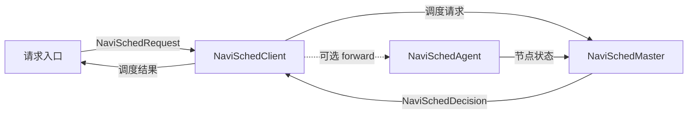

# NaviSched API

## API 构成

NaviSched 为两类使用方提供接口：请求入口、部署控制脚本等 Python 使用方通过
`navi_sched` 包调用；嵌入模型服务的 C++ 使用方通过公开头文件调用 Agent。两者使用相同的
Client、Master、Agent 概念和数据语义。

| 使用方式 | 入口 | 适用位置 |
| --- | --- | --- |
| Python API | `import navi_sched` | Python 请求入口、服务启动脚本和模型框架适配层。 |
| C++ Agent API | `navi_sched/NaviSchedAgent.h` | C++ 模型服务中的请求、cache、批执行插桩点。 |

Python 顶层模块提供两类可直接使用的对象：

| 部分 | 可导入对象 | 在系统中的作用 |
| --- | --- | --- |
| 角色 API | `NaviSchedClient`、`NaviSchedMaster`、`NaviSchedAgent` | 分别接入请求、运行调度中心和连接一个 prefill 节点。 |
| 请求与结果 API | `NaviSchedRequest`、`NaviSchedDecision`、`NaviSchedTarget` | 在请求入口、Client 和调用方之间传递调度输入与结果。 |

```python
from navi_sched import (
    NaviSchedAgent,
    NaviSchedClient,
    NaviSchedDecision,
    NaviSchedMaster,
    NaviSchedRequest,
    NaviSchedTarget,
)
```

三个角色的协作关系如下：



请求入口使用 `NaviSchedClient` 提交 `NaviSchedRequest`；Master 根据 Agent 持续报告的
节点状态生成 `NaviSchedDecision`。Agent 由模型服务在请求、cache 和执行事件发生时调用。
后续“Python API”介绍包的直接使用方式，“C++ Agent API”介绍模型服务直接嵌入时的同类接口。

## Python API

## 生命周期

`NaviSchedClient`、`NaviSchedMaster` 和 `NaviSchedAgent` 都遵循同一生命周期：

```text
构造角色对象 -> init() -> 调用该角色的业务 API -> stop()
```

- 构造函数只保存配置，不启动服务。
- `init()` 启动角色；初始化失败时抛出 `RuntimeError`。
- `stop()` 停止角色并释放资源，可以重复调用。
- 角色对象可作为上下文管理器使用，离开 `with` 代码块时自动停止。
- `grpc_port` 属性返回角色实际监听的 gRPC 端口，适合端口由系统自动分配时读取。

典型部署顺序是先创建并初始化 Agent，再初始化 Master，最后初始化 Client 和请求入口。一个
进程只需为每个实际角色创建一个对象。

## 请求与结果 API

这些对象由请求入口和 Client 使用。它们描述一次请求的调度输入，以及 Master 为该请求作出
的决策；Agent 不需要构造 `NaviSchedDecision`。

### NaviSchedRequest

`NaviSchedRequest` 是一次 prefill 请求进入 Client 时的输入。调用 `NaviSchedClient.schedule()`
前构造它。

```python
request = NaviSchedRequest(
    prompt_token_count=1024,
    block_hashes=input_block_hashes,
    request_id=42,
    block_size=16,
)
```

| 参数 | 作用 |
| --- | --- |
| `prompt_token_count` | 输入 prompt 的 token 总数。Master 用它估计剩余 prefill 量。 |
| `block_hashes` | 按输入顺序排列的 `uint64` 完整 block hash 数组；不足一个完整 block 的 prompt 尾部不生成 hash。 |
| `request_id` | 调用方提供的非零 `uint64` 请求标识；同一请求后续传给 Agent 的事件必须使用同一个值。 |
| `block_size` | 生成 `block_hashes` 时使用的 token block 大小。必须与目标模型框架的 KV cache block size 一致；未指定时为 256。 |

### NaviSchedDecision

`NaviSchedDecision` 是 `NaviSchedClient.schedule()` 的返回值。它连接 Master 的选点结果和
调用方的后续请求发送逻辑。

| 字段 | 作用 |
| --- | --- |
| `request_id` | 与输入 `NaviSchedRequest` 对应的请求标识。 |
| `schedule_id` | Master 为一次调度生成的严格递增标识；同一轮一起调度的请求共享该值。 |
| `schedule_loss` | 本轮策略的目标函数值。CostScheduler 返回最终投影后的 loss，其他策略返回 `0`。 |
| `schedule_latency_us` | Master 执行本轮 scheduler graph 的耗时，不包含请求凑批等待、RPC 和模型执行。 |
| `target` | 可执行目标。普通调度时调用方使用其 `address` 发送模型请求；为 `None` 表示当前没有可用节点。 |
| `batch_id` | 该请求所属的非零正 `int64` 调度 batch 标识；未参与凑批时为 `0`。 |
| `expected_batch_size` | 该 batch 的期望请求数；未参与凑批时为 `0`。 |
| `reason` | 调度说明，例如策略限流或没有可用节点。 |

`target` 为 `None` 表示当前没有可发送的节点。调用方应结合 `reason` 决定重试、限流或返回失败。

### NaviSchedTarget

`NaviSchedTarget` 描述 `NaviSchedDecision.target`。它由 Master 生成，调用方
只读取它，不需要自行构造。

| 字段 | 作用 |
| --- | --- |
| `biz_name` | 目标节点所属业务。 |
| `address` | 普通调度模式下调用方应连接的模型服务地址。 |

## Client API

`NaviSchedClient` 位于请求入口侧。它与 Master 协作获得调度决策，调用方再按自己的模型协议
将请求发送到目标节点。

### 构造 NaviSchedClient

```python
client = NaviSchedClient(
    biz_name="frontend_client",
    master_biz_name="prefill_master",
    enable_agent_forward=False,
)
```

| 参数 | 作用 |
| --- | --- |
| `biz_name` | Client 自身的 Navi biz。 |
| `master_biz_name` | 默认连接的 Master biz；可省略，后续由 `schedule()` 的同名参数指定。 |
| `enable_agent_forward` | 模拟与 forward 模式开关，详细行为见文档末尾。 |

构造后调用 `client.init()`，成功后才可以调用 `schedule()`。

### NaviSchedClient.schedule

`schedule()` 在请求已经完成 tokenization、但尚未发送到 prefill 节点时调用。它把请求交给
Master，并返回本次请求的 `NaviSchedDecision`。

```python
decision = client.schedule(
    request,
    target_biz_name="prefill_biz",
    timeout_ms=1000,
)
```

| 参数 | 作用 |
| --- | --- |
| `request` | `NaviSchedRequest`，推荐使用此形式；也可直接传 `prompt_token_count` 整数。 |
| `target_biz_name` | 本次请求期望调度到的 Agent biz。 |
| `master_biz_name` | 本次连接的 Master biz。非空时覆盖 Client 构造时的默认值；两处都为空时抛出 `ValueError`。 |
| `block_hashes` | 仅当 `request` 是整数时使用，传入该请求的输入 block hash 数组。 |
| `timeout_ms` | 等待本次调度结果的最长时间，单位毫秒。超时会抛出 `RuntimeError`。 |
| `request_id` | 仅当 `request` 是整数时使用，用作请求标识。 |
| `block_size` | 仅当 `request` 是整数时使用，说明 `block_hashes` 对应的 token block 大小；默认 256。 |
| `collect_replay` | 调试开关；详细行为见文档末尾。 |

普通模式只返回目标节点信息，调用方继续走自己的模型请求路径。

## Master API

`NaviSchedMaster` 是集群中的调度中心。它接收 Client 请求和 Agent 状态；应用只在部署
启动和停止时直接调用它，不需要为每个请求调用 Master API。

### 构造 NaviSchedMaster

```python
master = NaviSchedMaster(
    biz_name="prefill_master",
    max_wait_schedule_count=30,
    max_wait_schedule_time_ms=30,
    scheduler_name="random",
)
```

| 参数 | 作用 |
| --- | --- |
| `biz_name` | Master 自己的 Navi biz。Client 用它发现并请求该 Master；它不是 prefill 业务名，一个 Master 可服务多个由 `schedule(..., target_biz_name=...)` 指定的 Agent biz。 |
| `max_wait_schedule_count` | 单轮调度的请求上限；等待请求达到该数量后立即开始本轮调度。 |
| `max_wait_schedule_time_ms` | 最早进入等待队列的请求最多等待多久，单位毫秒；`0` 表示请求到达后立即调度。 |
| `scheduler_name` | 本 Master 使用的调度策略名称。内置策略包括 `random`、`max_cache_hit` 和 `cost`；自定义策略的名称与其 Kernel 注册名对应。默认使用 `random`。 |
| `scheduler_config` | 所选调度策略的 JSON 配置字符串；字段由具体策略定义。 |

构造后调用 `master.init()`。成功后 Master 开始接收 Client 请求和 Agent 状态。一个 Master
对全部请求使用同一个 `scheduler_name` 和 `scheduler_config`，请求入口不能覆盖该选择。

## Agent API

`NaviSchedAgent` 负责启动和停止 prefill 节点侧的 Navi 角色。Python API 只管理角色生命周期，不提供请求、cache、凑批或执行负载更新接口；模型框架应通过下文的 C++ Agent API 在其原生执行路径中报告这些状态。

### 构造 NaviSchedAgent

```python
agent = NaviSchedAgent(
    biz_name="prefill_biz",
    server_ip="10.0.0.8",
    server_port=18000,
    total_blocks=120000,
)
```

| 参数 | 作用 |
| --- | --- |
| `biz_name` | 当前 prefill 节点对外提供的业务名，必须与 Client `schedule()` 的 `target_biz_name` 对应。 |
| `server_ip` | 本节点模型服务的 IP 地址。 |
| `server_port` | 本节点模型服务的端口，范围为 `0` 到 `65535`。 |
| `total_blocks` | 本节点 KV cache 可容纳的完整 block 总数，初始化时上报给 Master。 |

构造后在模型服务开始接收请求前调用 `agent.init()`；服务停止接收新请求后调用 `agent.stop()`。Python 创建的 `NaviSchedAgent` 可直接作为 Agent 参数传给接受 C++ Agent 对象的 pybind 扩展，扩展与 Python 侧操作同一个 Agent 实例。

## C++ Agent API

C++ 模型服务在与 Python 无关的嵌入式场景中，直接包含以下公开头文件使用 Agent：

```cpp
#include <navi_sched/NaviSchedAgent.h>
```

这套接口与 Python `NaviSchedAgent` 的职责相同：模型服务在本地请求、cache 和 batch 事件发生时
调用 Agent，Agent 将状态同步给 Master。C++ 调用方只需要面对 `NaviSchedAgent` 和本节列出的
公开数据类型。

### 创建与生命周期

```cpp
navi_sched::NaviSchedAgentConfig agentConfig;
agentConfig.service.name = "prefill_agent";
agentConfig.service.enableKmon = false;
agentConfig.runtime.bizName = "prefill_biz";

navi_sched::NaviSchedAgent agent(
    agentConfig, 18000, "10.0.0.8", 120000);
if (!agent.init()) {
    // 初始化失败，不能继续接收模型请求。
}
// ... 调用事件接口 ...
agent.stop();
```

| 构造参数或方法 | 作用 |
| --- | --- |
| `NaviSchedAgentConfig agentConfig` | Agent 的唯一配置对象。`service` 设置服务名、监听、日志、监控、snapshot、凑批和延迟模型参数；`runtime` 设置业务名、线程、队列和服务发现参数。 |
| `serverPort` | 当前模型服务的端口。Master 选中该 Agent 后，Client 使用该地址发送请求。 |
| `serverIp` | 当前模型服务的 IP 地址。 |
| `totalBlocks` | 当前 KV cache 的完整 block 容量；Agent 初始化时向 Master 上报。 |
| `init()` | 启动 Agent 并开始发布节点状态；返回 `false` 时初始化失败。 |
| `stop()` | 停止 Agent。在模型服务停止接收新请求后调用。 |

### 请求与 batch 生命周期

#### addBatchRequest

```cpp
bool addBatchRequest(
    const NaviSchedBatchRequest &request,
    int64_t batchId,
    int64_t expectedBatchSize,
    const NaviSchedReadyBatchCallback &callback);
```

请求到达 Agent 后调用。Agent 自动记录请求接收事件；同一 `batchId` 的请求达到期望数量或
等待超时时调用 `callback`，并自动更新凑批等待、已就绪队列和 inflight 计数。

| 参数 | 作用 |
| --- | --- |
| `request` | 当前请求的 `NaviSchedBatchRequest`。`requestId` 是非零 `uint64`；`totalTokenCount` 是输入 token 总数；`blockSize` 是这些 hash 对应的 token block 大小；`blockHashes` 是按输入顺序排列的完整 block hash 共享数组。Agent 使用本机当前 Cache 自动计算命中 block 数，不复制数组。 |
| `batchId` | 参加共享凑批时传入调度结果给出的非零正 `int64` 标识；不参加共享凑批时传 `0`。 |
| `expectedBatchSize` | 参加共享凑批时传入调度结果给出的正整数；不参加共享凑批时传 `0`。两项必须与 `batchId` 同时为正或同时为 `0`。 |
| `callback` | batch 可执行时的回调，参数为 `NaviSchedBatchPtr`。回调应只把该 batch 放入模型执行器的串行队列，不能在回调内停止 Agent。 |

返回 `true` 表示请求已加入 batch，`false` 表示加入失败。

当 `batchId` 和 `expectedBatchSize` 都为 `0` 时，Agent 为该请求生成唯一的内部 batch id，
并将它作为只含一个请求的独立 batch 立即交给 callback。调用方仍通过返回 batch 中的
`finishReporter` 报告开始和完成。

`stop()` 会等待已经开始的请求接收和 batch 就绪回调返回，因此模型服务应先停止接收新请求，
再从回调之外的关闭流程调用 `stop()`。

callback 收到的 `NaviSchedBatch` 包含 `batchId`、`requestIds`、`expectedBatchSize`、`timedOut`
以及 `finishReporter`。模型执行器必须通过 reporter 完成后续生命周期：

```cpp
void execute(const navi_sched::NaviSchedBatchPtr &batch) {
    auto reporter = batch->finishReporter;
    if (!reporter->startBatch(batch->requestIds)) {
        return;
    }

    std::vector<navi_sched::NaviSchedRequestStats> finished = runPrefill(batch);
    if (!reporter->finishBatch(finished)) {
        // 本次完成没有被 Agent 接受。
    }
}
```

| reporter 方法 | 调用时机与效果 |
| --- | --- |
| `startBatch(requestIds)` | batch 真正进入模型执行器时调用。Agent 将它从已就绪队列移到 running；同一 Agent 同时只允许一个 running batch。 |
| `finishBatch(requests)` | 整个 batch 执行结束后调用一次。`NaviSchedRequestStats` 数组必须覆盖该 batch 的全部请求；每项包含 `requestId`、输入 token 总数和执行器实际生效的 Cache 命中 token 数。Agent 自动计算 batch 执行时延、更新队列状态、生成一个拟合样本并向 Master 汇报一次完成事件。 |

`finishReporter` 是 `shared_ptr`。如果执行分支在正常 `finishBatch()` 前丢弃最后一个引用，其析构函数
会自动终止该 batch、释放 inflight，并累计一次异常结束；这只用于兜底，正常路径仍必须显式完成。

### Cache 事件

KV cache 插入或淘汰完整 block 后，分别调用：

```cpp
void reportCacheInserted(
    const NaviSchedBlockHashesConstPtr &blockHashes) const;
void reportCacheRemoved(
    const NaviSchedBlockHashesConstPtr &blockHashes) const;
```

参数是本次增量变化的 `uint64` block hash 数组。Agent 初始化时已经通过构造参数 `totalBlocks`
汇报固定容量，运行期间只报告新增和删除，不重复报告总容量。传入 shared pointer 后不复制数组。

## 模拟与 Forward 模式

模拟 build 复用正式的 Client、Master 和 Agent 调度链路，只在 Agent 侧替换实际 prefill 执行器。
它用于本地集群回放和线上导流验证，不是普通请求入口的必经路径。

Client 设置 `enable_agent_forward=True` 后，会在得到唯一目标节点后将请求转发给该节点的 Agent，
并等待其完成回调。开启 replay 时，Client 仍在调度完成后立即开始转发，不等待调试快照生成。
最终返回结果可能附带以下可选字段：

| 字段 | 作用 |
| --- | --- |
| `request_timing` | `NaviSchedRequestTiming`，仅在 Agent 回传执行完成信息时存在；普通选点为空。 |
| `replay` | `collect_replay=True` 时附带的调度现场，包含当轮请求 block hash、节点状态、每个请求在每个节点上的前缀命中数和决策，仅用于调试与离线策略复现。 |

`NaviSchedRequestTiming` 的单位均为毫秒：`batch_wait_ms` 是等待凑批的时长，`queue_wait_ms`
是已凑齐 batch 等待前序执行的时长，`execution_latency_ms` 是本次执行时长，
`client_total_latency_ms` 是 Client 从提交到拿到完成结果的总时长。
