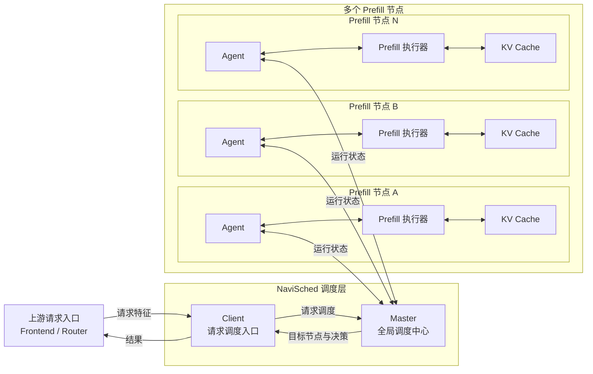
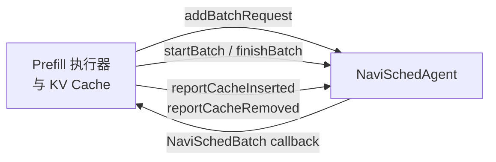
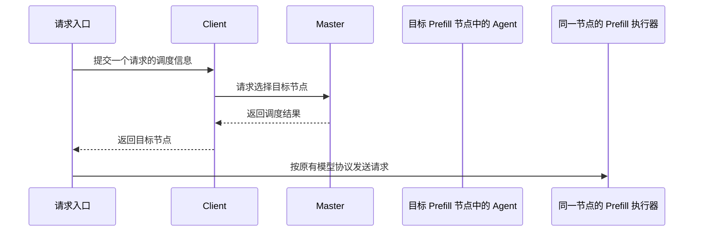
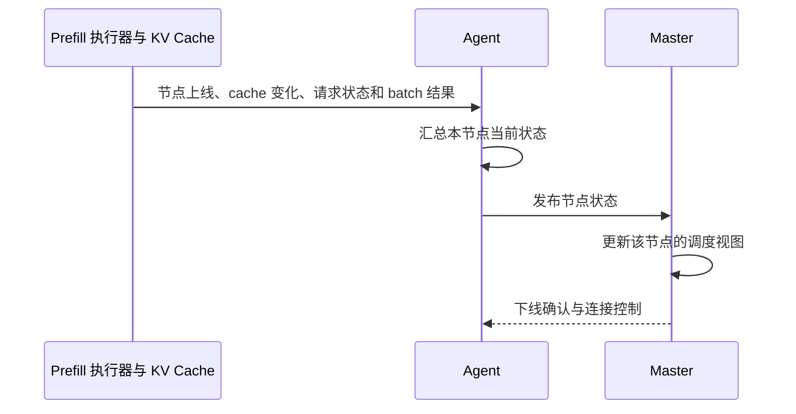

# NaviSched 整体架构

## 系统是什么

NaviSched 是面向大模型 prefill 节点的分布式调度系统。它位于请求入口和
prefill 节点之间：请求入口负责理解用户请求，prefill 节点负责实际模型计算，
NaviSched 负责根据节点当前状态选择合适的执行节点。

系统的目标是让请求尽量复用已有 KV cache，同时避免把请求持续发送到已经繁忙的节点。
它不替代模型框架的 tokenizer、模型执行、KV cache 管理或结果生成，只为这些已有能力
提供统一的调度和状态协作层。

## 总体结构



一套 NaviSched 集群由一个或多个 Client、一个 Master 和多个 Prefill 节点构成：

- Client 面向请求入口，是每个请求进入调度系统的入口。
- Master 面向全局，是所有请求和所有节点状态汇聚后作出调度决策的中心。
- 每个 Prefill 节点内部都包含模型执行器、KV Cache 和 Agent。Agent 随节点一起启动，
  代表该节点向 Master 持续报告可用于调度的状态。
- Agent 不替代模型执行器；它是贴在执行器旁的调度适配与状态协作组件。

## 模块分工

### 请求入口

请求入口通常是 Frontend、Router 或已有的模型服务网关。它负责接收用户请求，完成
tokenization，并根据模型自己的 KV cache 切分方式生成输入特征。随后把这些特征交给
Client 请求调度。

请求入口不需要维护集群节点列表，也不需要了解节点的 cache 或排队状态。

### Client

Client 是请求入口使用的调度客户端。它将单个请求交给 Master，等待调度结果，并把结果
交回请求入口。

Client 负责以下事情：

- 将请求的业务归属和输入特征提交给 Master；
- 接收 Master 选择的目标节点及相关决策信息；
- 将调度结果交给上游继续执行；

Client 不保存完整节点状态，也不参与选择算法。它的职责是让请求入口只需要面向一次请求，
而不必直接面对分布式节点管理和调度通信。

### Master

Master 是调度中心。它同时看到等待调度的请求和每个 Agent 上报的节点状态，因此负责为
每个请求选择目标节点。

Master 负责以下事情：

- 接收多个 Client 发来的请求；
- 维护各个 Agent 的可用状态视图；
- 在合适的时机组织一轮调度；
- 调用调度策略，为请求选择目标节点；
- 向 Client 返回调度结果；
- 对外提供当前集群调度状态，供观测和问题定位使用。

Master 发现 Agent 后先保留其建连状态，只有 Agent 完成握手并提供有效服务地址后，才把它加入
所属 biz 的可调度节点集合。停止中的节点立即退出调度集合，但在连接结束前仍保留在状态快照中；
collector 图结束后再彻底删除。这样调度只看到可用节点，同时运维快照仍能展示建连和下线过程。
Gig 拓扑变化会立即更新连接；建连失败或连接异常结束则进入低频重试，不影响其他 Agent 的
collector，也不会周期重建健康连接。

Master 不执行模型请求，也不保存 KV 数据本体、用户 prompt 或模型输出。它维护每个 Agent
上报的完整 block-hash 索引镜像，以及负载和延迟状态，用这些信息比较不同节点的复用收益
和预计等待成本。

### Agent

Agent 与 prefill 执行器、KV Cache 同进程或同服务实例部署，随每个 prefill 节点一起运行。
它是该节点在 NaviSched 中的代表：从同节点模型服务获得运行变化，将这些变化转换成调度状态
报告给 Master。

Agent 负责以下事情：

- 发布节点身份和服务地址，使 Master 能把请求路由到该节点；
- 报告 cache 可复用情况，使 Master 能判断请求在各节点的复用收益；
- 报告请求接收、等待、执行和完成等负载变化；
- 根据本节点的实际执行情况估计后续请求的等待和执行成本；
- 接收被选中的请求，并交给本地模型服务执行；
- 在需要统一凑批时，把形成的 batch 交给模型框架执行。

Agent 不上传用户 prompt、模型输出或 KV 数据本体；它向 Master 同步用于前缀匹配的完整
block-hash 索引和调度所需的负载、延迟状态。

### Prefill 节点内的 C++ 交互

模型框架在同一个 prefill 节点内包含公开头文件，并在自己的事件点调用 Agent：

```cpp
#include <navi_sched/NaviSchedAgent.h>
```



Prefill 执行器把请求加入 Agent 的凑批入口；Agent 在 batch 就绪后回调同一节点的执行器。
执行器通过 batch reporter 标记开始和完成，并在 KV Cache 增删完整 block 时报告对应 hash。
Agent 据此自动维护请求、队列、执行延迟和 Cache 状态；跨节点同步和调度通信由 Agent 与
Master 完成。

### 模型框架适配层

适配层把 NaviSched 接到具体模型框架中。请求入口侧适配层调用 Client；每个 prefill 节点内的
适配层调用与该节点同部署的 Agent。它们保留框架原本的请求协议、执行器、流式输出和 cache
管理，只在合适的生命周期位置接入 NaviSched。

适配层承担两类转换：一边把框架已有的请求、cache 和执行事件交给 NaviSched；另一边把
NaviSched 的调度结果交回框架原有执行路径。这样，同一套 NaviSched 可以适配不同模型
框架，而不要求模型框架重写自己的核心执行逻辑。

当前 vLLM 生产适配中，DashServing 位于请求入口侧，只负责把上游已经生成的 token id 转成
与 vLLM 一致的 KV block hash，并按 Client 返回的地址发送原模型请求；NaviSched Agent 与
vLLM Prefill 进程部署在一起，从真实执行 batch 和 KV cache event 获得节点状态。该适配不会
把 DashServing 当作 Prefill，也不会让 NaviSched 替代 DashServing 到 vLLM 的原有请求协议。
vLLM 形成执行 batch 之前的内部 waiting queue 不属于当前 observer 的可见范围，适配文档会
单独说明这一状态边界。

## 两条协作链路

系统围绕“请求调度”和“节点状态”两条链路协作。

### 请求调度链路



调度决策由 Client 向 Master 请求得到；请求入口拿到目标节点后继续调用模型服务。

### 节点状态链路



Agent 持续更新 Master 的节点视图。下一轮调度会使用最新可见的 cache、负载和延迟信息，
因此请求调度和节点执行形成闭环：请求改变节点状态，节点状态又影响之后的请求分配。

## 调度判断依据

每次调度时，Master 为请求比较候选节点的以下信息：

| 信息类别 | 由谁提供 | 用途 |
| --- | --- | --- |
| 输入特征 | 请求入口经 Client 提交 | 判断请求在不同节点上可复用的前缀。 |
| Cache 状态 | Agent | 估计各节点的 cache 命中与剩余计算量。 |
| 队列与执行状态 | Agent | 判断请求到达后需要等待多久。 |
| 延迟估计 | Agent | 估计节点处理本次请求所需的执行时间。 |
| 调度策略 | Master 配置 | 定义如何平衡 cache 复用、排队和其他成本。 |

调度策略是可替换的。Master 提供同一份请求和节点视图，具体策略决定如何从候选节点中
选出目标；Client 和 Agent 的职责不随策略变化。

NaviSched 当前提供三个可直接运行的内置策略：

| 策略名 | 行为 |
| --- | --- |
| `random` | 从当前合法候选节点中随机选择，不读取 Cache、队列或延迟状态；作为默认策略。 |
| `max_cache_hit` | 比较请求在各候选节点上的连续前缀 Cache 命中 block 数，选择命中最多的节点；命中相同时用请求与节点的稳定 hash 均衡。 |
| `cost` | 联合考虑 Cache 命中、节点排队和 batch 执行延迟，为一轮请求整体选择节点。 |

这三个策略都属于正式 Master 运行能力。新增策略使用相同的请求、节点和结果接口，具体扩展方式见
Scheduler 开发指南。

## 运行边界

NaviSched 管理的是 prefill 请求的节点选择、节点状态协作以及可选的请求转发。以下能力
仍由模型框架负责：

- 用户请求接入与鉴权；
- tokenizer、模型输入构造和输出解析；
- 模型实际计算、流式返回和 decode；
- 真实 KV 内容的存储、淘汰和生命周期管理。

这种边界使 NaviSched 可以复用在不同模型框架和不同部署形态中：框架继续负责“如何执行”，
NaviSched 负责“由哪个 prefill 节点执行”。

## 模拟与 Forward 测试

模拟执行不属于正式部署链路。测试 build 复用上述 Client、Master、Agent 和状态上报机制，
仅将 Prefill 执行器替换为模拟执行器，并允许 Client 在选点后转发请求给目标 Agent。

模拟 Agent 按真实节点的凑批、顺序执行和 Cache 淘汰规则产生完成事件；Client 收到完成事件后，
可在调度结果中得到可选的阶段时延。调度 replay 也只在显式打开收集开关时生成，记录当轮请求
block hash、节点快照、每个请求在每个节点上的实际前缀命中数和决策。离线运行时根据这些记录
构造假节点和假 Cache，再通过正式 Scheduler 接口复现，不参与正常在线请求处理。
模拟 Agent 停止接收新请求后仍会顺序排空已经接收的 batch，最后一批完成事件和拟合样本送入
正式上报链路后才结束常驻图。
