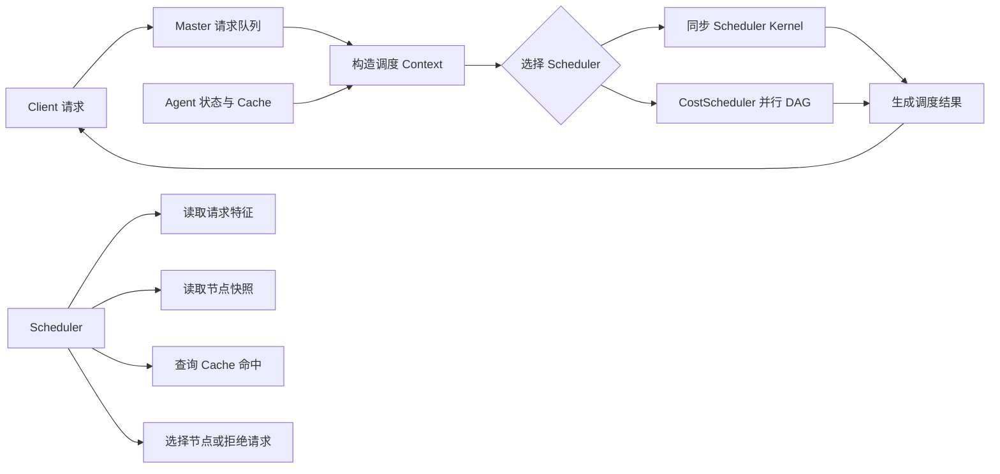
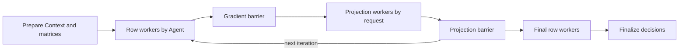

# NaviSched Scheduler 开发指南

## 整体逻辑

Scheduler 在 Master 上运行。每轮调度接收一组等待请求和一份候选 Agent 快照，为每个请求选择一个
Agent，或者给出拒绝原因。选择结果随后由 Master 统一转换成 Client 响应；分配到同一个 Agent 的
请求会自动获得对应的 batch 信息。



一轮调度按以下顺序执行：

1. Master 将同一目标 biz 的一批请求和该 biz 的候选 Agent 状态组成一个
   `NaviSchedScheduleContext`。
2. 配置选中的同步 Scheduler Kernel 或并行 Scheduler DAG 收到 Context，完成匹配。
3. Scheduler 为每个请求调用 `selectNode()` 或 `reject()`。
4. Master 根据选择结果生成目标地址、`batchId` 和 `expectedBatchSize`。
5. Client 先收到每个请求独立的调度结果并开始 forward；开启 replay 的请求随后从独立输出获得
   本轮调度快照。

普通策略使用 `SchedulerBaseKernel` 和 `NaviSchedScheduleContext`，在 `schedule()` 中完成
整轮计算。需要多个并行阶段的策略可以像 CostScheduler 一样构建 Navi DAG，各阶段仍传递同一个
Context，并由 required 依赖形成同步屏障。

## 开发一个 Scheduler

### CostScheduler 快速开发入口

`CostScheduler` 已实现基于解析梯度和 simplex 投影的完整优化流程。自动微分实现保留为
梯度正确性测试的参考。调度入口位于
`scheduler/CostSchedulerKernelInternal.cpp`，并行执行图位于
`scheduler/CostSchedulerGraph.cpp`。调整目标函数时修改 `forwardNodeRange()`；调整行阶段、列阶段
或 barrier 时修改并行图，不需要改 Master 的请求收集和结果输出逻辑。

每次修改后，在仓库根目录执行：

```bash
./aios/navi_sched/scripts/run_cost_scheduler.sh
```

通过环境变量覆盖本轮优化参数：

```bash
NAVI_SCHED_COST_LAMBDA=0 \
NAVI_SCHED_COST_ALPHA=128.0 \
NAVI_SCHED_COST_ALPHA_DECAY=0.5 \
NAVI_SCHED_COST_MIN_ALPHA=8.0 \
NAVI_SCHED_COST_MAX_LOOP_COUNT=10 \
  ./aios/navi_sched/scripts/run_cost_scheduler.sh
```

脚本会使用 Clang 编译 replay runner，并让 CostScheduler 分别加载 MaxCacheHit 和 Random 调度
运行时采集的两份固定真实现场。完成一轮开发后执行完整回归：

```bash
./aios/navi_sched/scripts/run_cost_scheduler.sh --test
```

`--test` 会先运行 NaviSched data 和 role UT，再编译并执行两份 replay。每份 replay 都包含真实
流量中点附近的 10 个请求、10 个 Agent、Cache 命中、排队状态和已拟合的延迟模型参数。策略实现后
应先确认每份结果都是 `scheduled=10`、`rejected=0`、`invalid_targets=0`，再检查 Cache 命中、预计
排队时间和预计 batch 执行时间。两份样本都是非 compact JSON，可以直接阅读：

```text
aios/navi_sched/test/data/cost_scheduler/max_cache_hit_10_agents_midpoint.json
aios/navi_sched/test/data/cost_scheduler/random_10_agents_midpoint.json
```

脚本默认分别输出两份现场中 Scheduler 实际收到的 Context summary，包括请求概要、Agent 负载和
延迟模型，以及每个 request 在每个 node 上连续命中的 Cache block 数。请求只输出
`block_hash_count`，不会输出 block hash 原值。

脚本生成的 replay 还包含每轮优化的 loss、梯度、更新前权重、投影前权重、投影后权重和各阶段
耗时。执行 `scripts/run_replay_viewer.sh` 后访问 `http://127.0.0.1:18780`：

- `Comparison Report` 展示多次 simulate 的策略对比报告。
- `Optimization Sample` 展示单个 replay 的 Context、SchedInfo 和逐轮优化过程。

### 1. 确定策略输入和选择规则

先确定策略需要读取哪些信息，以及如何产生每个请求的结果。Context 提供以下几类输入：

- 请求的 token 数、block hash、已等待时间和剩余超时。
- Agent 的 Cache 容量、运行负载、排队状态和延迟模型。
- 请求在指定 Agent 上连续命中的 Cache block 数。

策略输出有两种：调用 `selectNode()` 选择一个候选节点，或者调用 `reject()` 拒绝该请求。一次
Context 可以混合产生成功和拒绝结果。

### 2. 创建 Scheduler Kernel

在 `scheduler/` 目录新增 `XxxSchedulerKernel.h/.cpp`，继承 `SchedulerBaseKernel`。下面是一个
根据预计排队时间选择节点的同步策略骨架：

```cpp
#pragma once

#include "aios/navi_sched/scheduler/SchedulerBaseKernel.h"

namespace navi_sched {

class MinQueueSchedulerKernel final : public SchedulerBaseKernel {
public:
    static const std::string KERNEL_ID;
    void def(navi::KernelDefBuilder &builder) const override;

protected:
    bool schedule(NaviSchedScheduleContext &context) const override;

private:
    KERNEL_DEPEND_DECLARE_BASE(SchedulerBaseKernel);
};

} // namespace navi_sched
```

`KERNEL_DEPEND_DECLARE_BASE(SchedulerBaseKernel)` 会继承基类声明的依赖关系，并为当前 Kernel
保留继续声明 Resource 依赖的能力。

### 3. 定义并注册 Kernel

注册名遵循 `navi_sched.<scheduler_name>_scheduler_k`。Master 配置中的 `scheduler_name` 会按该
规则转换为 Kernel ID。

```cpp
#include "aios/navi_sched/scheduler/MinQueueSchedulerKernel.h"

namespace navi_sched {

const std::string MinQueueSchedulerKernel::KERNEL_ID =
    "navi_sched.min_queue_scheduler_k";

void MinQueueSchedulerKernel::def(
        navi::KernelDefBuilder &builder) const
{
    SchedulerBaseKernel::def(builder, KERNEL_ID);
}

REGISTER_KERNEL(MinQueueSchedulerKernel);

} // namespace navi_sched
```

调用基类 `def()` 后，Kernel 会获得标准的 `context` 输入端口和 `result` 输出端口，从而可以直接
接入 Master 调度图。

### 4. 实现匹配逻辑

同步策略覆写 `schedule()`。每个请求都应产生一个选择或拒绝结果：

```cpp
bool MinQueueSchedulerKernel::schedule(
        NaviSchedScheduleContext &context) const
{
    const auto requestCount = context.requestCount();
    const auto nodeCount = context.nodeCount();
    for (size_t requestIndex = 0;
         requestIndex < requestCount; ++requestIndex) {
        size_t selectedNode = 0;
        double minQueueMs = context.getNode(0).getEstimatedQueueWaitMs();
        for (size_t nodeIndex = 1;
             nodeIndex < nodeCount; ++nodeIndex) {
            const auto queueMs =
                context.getNode(nodeIndex).getEstimatedQueueWaitMs();
            if (queueMs < minQueueMs) {
                selectedNode = nodeIndex;
                minQueueMs = queueMs;
            }
        }
        if (!context.selectNode(
                requestIndex, selectedNode, "min_queue_selected")) {
            return false;
        }
    }
    return true;
}
```

基类只会为非空请求集合和非空候选节点集合调用 `schedule()`；无候选节点时，框架直接为本轮请求
返回 `no_available_node`。`schedule()` 返回 `true` 表示本轮策略执行完成，返回 `false` 表示整轮
策略无法继续，框架会把该 Context 标记为 `scheduler_error`。策略限流等单请求结果使用
`reject()` 表达。

### 5. 按需增加策略 Resource

策略需要配置或跨轮保存状态时，可以增加一个 `RS_KERNEL` Resource，并让 Scheduler Kernel
直接依赖它。例如给排队时间增加权重：

```cpp
class MinQueueSchedulerR : public navi::Resource {
public:
    static const std::string RESOURCE_ID;

    void def(navi::ResourceDefBuilder &builder) const override {
        builder.name(RESOURCE_ID, navi::RS_KERNEL);
    }

    bool config(navi::ResourceConfigContext &ctx) override {
        NAVI_JSONIZE(ctx, "queue_weight", _queueWeight, _queueWeight);
        return _queueWeight >= 0.0;
    }

    double getQueueWeight() const {
        return _queueWeight;
    }

private:
    double _queueWeight = 1.0;
};
```

在 Kernel 中声明依赖：

```cpp
private:
    KERNEL_DEPEND_DECLARE_BASE(SchedulerBaseKernel);
    KERNEL_DEPEND_ON(MinQueueSchedulerR, _schedulerR);
```

`RS_KERNEL` Resource 与对应 Kernel 实例一起创建，适合保存该策略的配置和运行状态。配置通过
Master 的 `scheduler_config` 传入。

### 6. 在 Master 中选择策略

将 `scheduler_name` 设置为注册名中间的策略名称，将策略配置以 JSON 字符串传入：

```python
from navi_sched import NaviSchedMaster

master = NaviSchedMaster(
    biz_name="prefill_master",
    scheduler_name="min_queue",
    scheduler_config='{"queue_weight": 0.7}',
)
```

这里的 `min_queue` 对应 `navi_sched.min_queue_scheduler_k`。Master 启动时会把该 Kernel 放入常驻
调度图，后续每轮 Context 都由它处理。

### 7. 验证策略

新增策略至少覆盖以下场景：

- 没有候选 Agent 时，每个请求得到明确的拒绝原因。
- 单请求和多请求都能产生完整结果。
- 多 Agent 下的选择结果符合策略公式。
- 同一轮内可以分别选择、拒绝不同请求。
- 分配到同一 Agent 的请求获得相同 `batchId` 和正确的 `expectedBatchSize`。
- Replay 加载后能够用记录的节点状态和 Cache 命中结果再次执行策略。
- Master 连续处理多轮 Context 时，Scheduler Kernel 持续正常工作。
- 带配置的策略覆盖默认配置、合法配置和非法配置。

## SchedulerBaseKernel API

### `def(builder, name)`

为 Scheduler Kernel 定义标准输入输出端口。

- `builder`：当前 Kernel 的 `navi::KernelDefBuilder`。
- `name`：完整 Kernel 注册名，例如 `navi_sched.min_queue_scheduler_k`。
- 效果：定义名为 `context` 的输入端口和名为 `result` 的输出端口。
- 调用时机：子类覆写 `def()` 时调用一次。

### `schedule(context)`

执行一轮同步调度。

- `context`：本轮请求、候选 Agent 快照和决策写入接口。
- 返回 `true`：本轮策略计算完成，Context 继续进入结果 Kernel。
- 返回 `false`：本轮发生无法继续的策略错误，Context 统一返回 `scheduler_error`。
- 调用时机：每个有效 Context 到达同步 Scheduler Kernel 时由基类调用一次。
- 输入保证：调用时 `requestCount()` 和 `nodeCount()` 均大于零；空输入由基类直接处理。

## NaviSchedScheduleContext API

### 请求和节点数量

| API | 功能 | 返回值 |
| --- | --- | --- |
| `requestCount()` | 获取本轮待调度请求数。 | 请求数量。 |
| `nodeCount()` | 获取本轮合法候选 Agent 数。 | 节点数量。 |

这两个接口用于确定后续索引范围，时间复杂度均为 `O(1)`。

### `getRequest(requestIndex)`

读取指定请求的调度信息。

- `requestIndex`：请求索引，范围为 `[0, requestCount())`。
- 返回值：`const NaviSchedScheduleItem &`，有效期为当前 Context 生命周期。
- 时间复杂度：`O(1)`。

`NaviSchedScheduleItem` 包含：

| 字段 | 含义 |
| --- | --- |
| `request.requestId` | 请求的 `uint64_t` 标识。 |
| `request.bizName` | 请求要访问的目标 Agent biz。 |
| `request.promptTokenCount` | 输入 token 总数。 |
| `request.blockHashes` | 完整输入 block 的 hash 序列。 |
| `request.timeoutMs` | 请求提交时设置的调度超时。 |
| `waitTimeMs` | 请求进入本轮调度前已经等待的时间。 |
| `remainingTimeoutMs` | 进入本轮调度时剩余的超时时间。 |
| `timeoutTriggered` | 请求是否已经达到调度超时。 |

### `getNode(nodeIndex)`

读取指定候选 Agent 在本轮调度中的状态快照。

- `nodeIndex`：节点索引，范围为 `[0, nodeCount())`。
- 返回值：`const NaviSchedScheduleNode &`，有效期为当前 Context 生命周期。
- 时间复杂度：`O(1)`。

Context 创建时已经采集节点状态，因此同一轮中多次读取同一个节点会得到一致的数据。
Context 只包含当前目标 biz 的候选 Agent；构造时间和节点存储量均为 `O(N)`，其中 `N` 是该 biz
的候选 Agent 数。

### `getCacheHitBlockCount(requestIndex, nodeIndex)`

查询指定请求在指定 Agent 上从输入开头连续命中的完整 Cache block 数。

- `requestIndex`：请求索引。
- `nodeIndex`：候选节点索引。
- 返回值：连续命中的 block 数；索引无效时返回 `0`。
- 读取 Context 中对应节点的 Cache，遇到第一个未命中 block 时停止。

查询最坏需要遍历该请求的全部 block hash，复杂度为 `O(B)`，其中 `B` 是请求的完整 block
数量。在线节点会在查询期间获取 Agent Cache 的读锁。离线 replay runner 先根据记录的
`matchedBlockCount` 构造假节点和假 Cache，并校验所有前缀命中都能同时成立；Scheduler 仍调用
同一个接口，不存在 replay 专用分支。

### `getCacheHitBlockCounts(nodeIndex, matchedBlockCounts)`

批量查询本轮全部请求在一个 Agent 上的连续 Cache 命中 block 数。

- `nodeIndex`：候选节点索引。
- `matchedBlockCounts`：输出数组；成功时大小等于 `requestCount()`，元素按请求索引排列。
- 返回值：节点索引有效时返回 `true`，否则返回 `false`。
- 在线节点只获取一次 Agent Cache 读锁，在锁内完成全部请求的匹配。

复杂度为 `O(R * B)`，其中 `R` 是请求数，`B` 是单请求完整 block 数。需要遍历多个节点
时，应以节点为外层循环并复用同一个输出数组，避免逐 request-node 获取 Cache 锁。

### `estimateBatchExecutionLatencyMs(nodeIndex, requestIndexes)`

使用指定 Agent 当前的 Cache 匹配结果和延迟模型，估计一组请求作为一个 batch 执行时的整体延迟。

- `nodeIndex`：候选 Agent 索引。
- `requestIndexes`：计划分配给该 Agent 的全部请求索引。
- 返回值：预计 batch 执行时间，单位为毫秒；节点、请求索引或模型无效时返回 `0`。

该接口会逐请求计算 Cache 命中 token，再聚合 batch size、复用 token、计算 token、计算 token
平方和及复用/计算交叉项，最后使用节点当前完整模型参数预测。复杂度为这些请求 Cache 前缀长度
之和。策略比较一组分配方案时，每个 Agent 应调用一次；单请求预测相加不等于 batch 预测。

### `selectNode(requestIndex, nodeIndex, reason)`

把一个请求分配给指定候选 Agent。

- `requestIndex`：请求索引。
- `nodeIndex`：选中的候选节点索引。
- `reason`：非空策略原因，例如 `min_queue_selected`，会进入调度结果和 Replay。
- 返回 `true`：选择已写入 Context。
- 返回 `false`：Context 尚未准备完成、索引无效或 `reason` 为空。

同一请求再次调用时会覆盖上一次选择。结果阶段会根据节点索引填充目标地址，并为同节点请求生成
batch 信息。

### `reject(requestIndex, reason)`

拒绝单个请求。

- `requestIndex`：请求索引。
- `reason`：非空拒绝原因，例如 `rate_limited` 或 `no_available_node`。
- 返回 `true`：拒绝结果已写入 Context。
- 返回 `false`：Context 尚未准备完成、索引无效或 `reason` 为空。

同一请求之前已有的节点选择会被清除，其他请求的决策不受影响。

## NaviSchedScheduleNode API

`getNode()` 返回 `NaviSchedScheduleNode`，它提供以下只读接口：

| API | 功能 |
| --- | --- |
| `getAgentIdHash()` | 返回 Agent ID 的 64 位 hash，可用于稳定分流或 tie-break。 |
| `getAgentId()` | 返回 Agent 的字符串标识。 |
| `getTotalBlocks()` | 返回 Agent Cache 的总 block 容量。 |
| `getInflightRequests()` | 返回 Agent 入口尚未完成的请求总数。 |
| `getBatchWaitingRequests()` | 返回正在等待凑批的请求数。 |
| `getQueuedBatchRequests()` | 返回已经成批、等待顺序执行的请求数。 |
| `getRunningRequests()` | 返回当前正在执行的 batch 所包含的请求数。 |
| `getBatchTimeoutCount()` | 返回 Agent 启动以来累计的凑批超时次数。 |
| `getAbnormalBatchFinishCount()` | 返回 Agent 启动以来累计的异常 batch 结束次数。 |
| `getEstimatedQueueWaitMs()` | 返回当前预计还需等待的队列时间，单位为毫秒。 |
| `hasLatencyModel()` | 返回该 Agent 是否有完整可用的延迟模型。 |
| `getLatencyFormula()` | 返回延迟公式类型。 |
| `getLatencyBinaryVersion()` | 返回生成该模型的 Agent 二进制版本。 |
| `getLatencyModelRevision()` | 返回模型参数 revision。 |
| `getLatencyParameters()` | 返回当前完整生效的模型参数 const 引用。 |

这些 getter 均读取本轮节点快照，时间复杂度为 `O(1)`。`getLatencyParameters()` 返回引用，不会
复制参数数组。

## 内置策略参考

### `random`

实现位于 `scheduler/RandomSchedulerKernel.*`。它为每个请求随机选择一个候选 Agent，整体复杂度
为 `O(R)`。该实现展示了最小同步 Scheduler 的类定义、注册和 `schedule()` 用法。

### `max_cache_hit`

实现位于 `scheduler/MaxCacheHitSchedulerKernel.*`。它遍历每个请求和每个候选 Agent，选择连续
Cache 命中 block 数最多的节点；命中数相同时，通过 `requestId` 和 Agent ID hash 计算稳定排名。

其最坏复杂度为 `O(R * N * B)`：`R` 是请求数，`N` 是候选 Agent 数，`B` 是单请求完整 block
数。实现以节点为外层循环，通过 `getCacheHitBlockCounts()` 对每个节点批量匹配，并使用
`O(R)` 临时空间保存每个请求当前的最优节点。

### `cost`

CostScheduler 使用解析梯度和 projected gradient descent，在 Cache 复用、执行代价和节点排队
之间优化每个 request-node 权重。Master 配置 `scheduler_name="cost"` 后会把一轮 Context 送入
专用的 Navi 并行图，而不是调用同步 Kernel。

#### 配置

CostScheduler 读取六个配置参数：

| 参数 | 默认值 | 约束 | 作用 |
| --- | ---: | --- | --- |
| `lambda` | `0.5` | `[0, 1]` | 加权 `forward()` 中的两个目标项。 |
| `alpha` | `512.0` | `(0, +inf)` | projected gradient descent 的更新步长。 |
| `alpha_decay` | `1.0` | `(0, 1]` | 每轮步长衰减率；`1.0` 表示不衰减。 |
| `min_alpha` | `0.0` | `[0, alpha]` | 衰减后的最小步长。 |
| `max_loop_count` | `10` | `[1, 1000]` | 单次调度允许的最大优化轮数。 |
| `parallelism` | `0` | `[0, 1024]` | `0` 按在线 CPU 数自动选择并最多使用 10 路；正数固定 worker 数。 |

非有限值或越界值会使 Kernel 配置失败：

```python
master = NaviSchedMaster(
    biz_name="prefill_master",
    scheduler_name="cost",
    scheduler_config=(
        '{"lambda":0.5,"alpha":512.0,'
        '"alpha_decay":1.0,"min_alpha":0.0,'
        '"max_loop_count":10,'
        '"parallelism":0}'
    ),
)
```

#### 并行图

`CostSchedulerGraphBuilder` 在 Master 常驻调度图中构建以下循环 DAG。每条阶段边都设置
`require(true)`，两个 barrier 的输入组也都是 required；因此下一阶段只能在本阶段全部 worker
完成后执行。



图中只有一组 row、projection 和 barrier Kernel，每轮通过 feedback edge 复用这些节点；
`max_loop_count` 只限制实际迭代次数，不改变图规模。Loop Kernel 同一时间只推进一个调度
Context，后续 Context 在入口排队，避免不同轮次的反馈数据交叉。每轮先按 Agent 行分片计算
forward、backward 和梯度更新，再按 request 列分片执行 simplex 投影。每次 forward 都会比较
当前 feasible loss 与历史最优值；投影阶段在同一遍扫描中生成对应的 `uint32_t` node index。
最后一轮投影完成后，Final row workers 重新计算目标值，Finalize 使用历史最优 loss 及其严格
对应的 node index 生成决策。在线优化预算由 Master 的 `max_wait_schedule_time_ms` 决定。优化
至少执行 2 轮，之后仅在当前耗时加上最近一轮预计耗时不超过调度 window 时继续，最多执行
`max_loop_count` 轮。因此步长振荡时不会错误采用较差的最后一轮结果，也不需要再次扫描
weight 矩阵。

第 `i` 轮实际步长为
`max(min_alpha, alpha * alpha_decay^i)`。默认 `alpha_decay=1.0`，所以现有配置行为不变；只有显式
设置较小的衰减率才启用 anneal。

`CostSchedulerGraphState` 为每个 Context 一次性分配 node-major 的 cost、weight 和 gradient
连续数组。每个 row worker 写入不重叠的 Agent 行；每个 projection worker 写入不重叠的
request 列。热路径不使用锁，barrier 只通过 Navi 数据依赖同步。归并目标值时固定按 Agent
顺序求和，使串行与并行结果保持相同的运算顺序。

设某个 Agent 上第 `i` 个请求的 weight、线性 cost 和 token 数分别为 `w_i`、`c_i` 和 `t_i`：

```text
A = sum(w_i * c_i)
B = sum(w_i)
C = sum(w_i / t_i)
G = log1p(128 * C) / 128
L = lambda / T * f(A) * B
  + (1 - lambda) / R * (f(A) + queue_wait) * G
```

`G` 是递增凹函数，导数为 `1 / (1 + 128 * C)`。它使连续优化中的 request weight 分散到更多
Agent 时产生更高的总延迟项，减少连续 weight 看起来更优、最终离散选点却形成大量小 batch 的
偏差。`128` 是当前 CostScheduler 目标函数内部的固定形状参数，不属于部署配置。

生产热路径只用 `AutoGrad<1>` 计算非线性函数 `f(A)` 的值和导数。`A/B/C` 的聚合以及每个
weight 的 VJP 使用等价的解析公式计算，不再为 `R * N` 个 weight 构造反向 Tape。测试会把
解析梯度与原 Tape 实现逐项比较，确保目标值和梯度一致。

非 replay 路径把梯度更新合并进 simplex 投影的首次矩阵扫描，避免单独遍历一次完整 weight
矩阵。投影以 16 个 request 为一个 tile；每个 worker 的 workspace 上限为
`N * 16 * sizeof(double)`，4000 个 Agent 时为 512 KiB。replay 路径仍保留更新前后数据，便于
逐步检查优化过程。

`CostSchedulerPrepareKernel` 初始化时一次生成 `2^22` 个独立随机值，常驻 32 MiB。每轮调度
直接按 node-major 矩阵下标读取并按 request 归一化，不创建随机数引擎。`400 * 4000` 只使用
前 160 万个值，不发生回绕复用；随机池还可覆盖 1024 requests 与 4096 Agents 的完整矩阵。

#### 计算成本与验证

设请求数为 `R`、候选 Agent 数为 `N`、优化轮数为 `L`，Cache 前缀匹配实际检查的
block hash 总数为 `H`。Context 初始化阶段为每个 request-node 组合计算一次 Cache 命中
和线性 cost，时间为 `O(R * N + H)`，状态空间为 `O(R * N)`。每轮 forward、backward、
梯度更新和 simplex 投影都扫描该矩阵，常见总复杂度为 `O(L * R * N)`；simplex
active-set 在最坏情况下可能重复扫描 Agent 维度。

生产路径按 Agent 行并行计算 cost、forward 和 gradient，再按 request 列并行投影。
worker 只写自己负责的连续区间，阶段之间由 Navi barrier 同步，不使用热路径锁。
`max_loop_count` 仅限制反馈环中的实际轮数，不扩大常驻图。关闭 Replay 时不会分配
逐步 trace 数组，也不会读取调试时钟。

使用固定 Clang opt 配置运行单次调度规模基准：

```bash
./aios/navi_sched/scripts/run_cost_scheduler_benchmark.sh
```

脚本分别测量纯 Cost DAG、真实 Master 常驻图和单独的 vis 样本。比较结果时必须区分
纯调度计算、Master 内部 schedule 和包含请求提交及 response 完成的 batch wall，
三者的计时边界不同。

策略质量使用完整动态回放验证：

```bash
./aios/navi_sched/scripts/run_cost_scheduler_simulation_suite.sh
./aios/navi_sched/scripts/run_replay_viewer.sh
```

正式矩阵固定使用 `TIME_COMPRESSION=1`，覆盖 Scheduler 基线、调度窗口、loop 上限、
lambda、独立池与共享池，以及共享池容量。具体结果由每个 case 的
`traffic_replay_summary.json` 保存，Web 结构化报告是跨 case 对比入口。压缩回放只用于
快速检查，不能据此判断排队、反馈时效和端到端延迟。

普通调度结果携带 `schedule_id`、`schedule_loss` 和 `schedule_latency_us`。
同一 Context 的请求共享这些值，Simulator 按 `schedule_id` 去重后统计每轮请求数、
Scheduler 耗时和 loss。CostScheduler 返回实际采用的历史最优 feasible loss，其他
策略返回 `0`。不同 lambda 对应不同目标函数，loss 只能用于比较相同配置的收敛和
稳定性，不能脱离端到端延迟、排队、命中率和利用率横向判优。

Replay 开启时记录完整迭代的 loss、gradient、投影前后 weight 和阶段耗时。
`scheduler_info.parallelism` 是实际 worker 数；`final_forward_value` 和
`final_weights` 表示最后一轮状态；`best_forward_value` 和
`best_node_indexes` 表示真正用于调度的历史最优状态。Replay runner 恢复记录的
配置、并行度和初始权重，再驱动正式并行图，因此复现路径不会改变生产数据结构或
调度算法。

## 对比验证 Scheduler

先用同一份线上采集 replay 做快速、确定性的静态比较：

```bash
bazelisk build --config=clang //aios/navi_sched:schedule_replay_runner
LD_LIBRARY_PATH=/opt/conda310/lib \
  bazel-bin/aios/navi_sched/schedule_replay_runner \
  navi_sched.cost_scheduler_k \
  path/to/traffic_schedule_replay.jsonl \
  --cost-lambda 0.5 \
  --cost-alpha 512.0 \
  --cost-max-loop-count 2
```

命令一次只运行指定的 schedule kernel。Cost replay 自带优化信息时，以其中记录的配置为准；
命令行 Cost 参数只用于没有 Cost 优化信息的其他策略现场。每个样本完全使用 replay 中记录的
请求、节点负载、排队状态和模型参数，并根据记录的前缀命中数构造假 Cache。每个样本都会重新
创建 kernel；相同 kernel 和相同样本得到固定结果。输出比较记录决策匹配数、请求成功/拒绝数、
平均 Cache 命中、所选节点预计排队时间，以及按最终 Agent 分组后的整批预计执行时间。
Replay 不会根据新决策继续演化 Agent 队列和 Cache。
需要把 replay 当作严格回归基线时，增加 `--require-recorded-match`；任何重新计算的
decision 与记录值不一致都会使命令返回失败。

完成静态检查后，使用同一份流量、Agent 数、Cache 容量和随机种子分别运行三个策略，观察完整
动态反馈：

```bash
for scheduler in random max_cache_hit cost; do
  NAVI_SCHED_TRAFFIC_SCHEDULER="${scheduler}" \
  NAVI_SCHED_TRAFFIC_TIME_COMPRESSION=1 \
  NAVI_SCHED_TRAFFIC_TEST_DIR="aios/navi_sched/tmp/compare_${scheduler}" \
    ./aios/navi_sched/test/simulator/run_traffic_replay.sh
done
```

CostScheduler 的 simulate 参数通过 Master 的正式 `scheduler_config` 链路传入：

```bash
NAVI_SCHED_TRAFFIC_SCHEDULER=cost \
NAVI_SCHED_TRAFFIC_SCHEDULER_CONFIG=\
'{"lambda":0.5,"alpha":512.0,"max_loop_count":2,'\
'"parallelism":0}' \
  ./aios/navi_sched/test/simulator/run_traffic_replay.sh
```

多组运行完成后，可从正式 summary 生成 Web 对比报告：

```bash
python3 aios/navi_sched/tools/replay_viewer/make_comparison_report.py \
  --output aios/navi_sched/tmp/cost_scheduler_debug/comparison_report.json \
  --title "Scheduler comparison" \
  --client-count 10 --time-compression 1 \
  --optimization-replay path/to/cost_optimization_replay.json \
  --scalability path/to/cost_scalability_report.json \
  --run "Cost" cost 0.5 10 path/to/cost_summary.json \
  --run "Random" random - - path/to/random_summary.json
./aios/navi_sched/scripts/run_replay_viewer.sh
```

每个 `--run` 依次传入显示名、策略名、lambda、轮数和 summary 路径。非 CostScheduler 的
lambda 和轮数使用 `-`。`--optimization-replay` 从一份带优化 trace 的 replay 提取
1/5/10/20/50/100 轮 checkpoint；`--scalability` 加载单次调度规模扫描结果。两者都是可选参数。
页面从结构化报告读取数据，不解析终端输出。
`--base-report` 可在保留既有运行的基础上追加新分组；当同一分组同时包含独立池和混合池时，
页面会额外按 prompt 长度来源展示排队、执行和 E2E 明细。

项目维护的完整基准矩阵可一键重跑：

```bash
./aios/navi_sched/scripts/run_cost_scheduler_simulation_suite.sh
```

中断后使用 `--resume`；脚本只复用 NaviSched 调度、状态和模拟器源码指纹一致，并且请求数、
Agent 数、策略配置、时间口径和 loss 记录都通过校验的结果。每个 case 完成后原子刷新临时
Web 报告；全部场景通过后再更新仓库中的基准报告。

以各目录的 `traffic_replay_summary.json` 为准，比较 Cache 命中率、每节点请求分布、平均
batch、排队延迟、执行延迟、端到端延迟和排空时间。策略效果必须以该动态回放为最终结论；
时间压缩会放大队列状态老化误差，也会放大毫秒定时器和 batch 切换的固定墙钟开销。正式 Cost
对比必须使用 `TIME_COMPRESSION=1`；压缩倍率只适合开发阶段的快速回归。

### CostScheduler 状态时效实验

CostScheduler 实现完成后，需要单独评估 Agent 状态时效对调度效果的影响。实验以当前 batch
ready、start 和 finish 事件触发即时汇报为基线；实验组关闭这些事件的即时负载汇报，仅由 Agent
按固定周期汇报最新队列状态，并逐步增大汇报周期。

各组必须使用相同的查询文件、Agent 数量、Cache 容量、模型参数和随机种子，并首先设置
`TIME_COMPRESSION=1`。记录 Master 接收状态的时刻，比较调度时状态年龄、预计排队时间相对实际
排队时间的 Bias、MAE 和 RMSE，以及请求端到端延迟分布、排空时间、节点负载分布和超时数量。
据此确定状态时效下降到什么程度后会明显影响 CostScheduler 的节点选择和整体服务质量。该周期
汇报模式只用于实验，不改变正式 Agent 的事件触发汇报行为。
