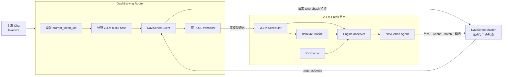
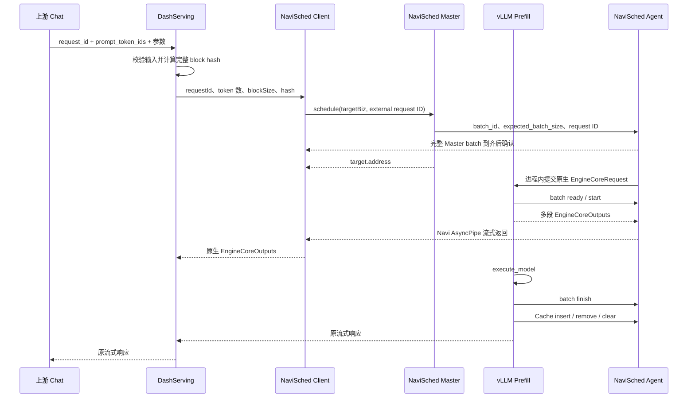

# DashServing 与 vLLM 适配说明

## 1. 适配范围

这套适配用于把 DashServing、NaviSched 和 vLLM Prefill 串成一条可上线验证的请求链路：

- 上游 Chat 完成 tokenization，并把 `prompt_token_ids` 交给 DashServing；
- DashServing 仍是 Router，使用 NaviSched Client 请求 Master 选择 Prefill；
- NaviSched Master 根据各 Prefill 节点的 Cache、负载和延迟状态完成选点；
- Router 使用原有 HTTP transport 把原请求发送到选中的 vLLM 地址；
- 每个 vLLM Prefill 进程内运行一个 NaviSched Agent，报告真实执行 batch 和 KV Cache 变化。

NaviSched 不接管 tokenizer、模型 RPC、流式响应、模型执行器或 vLLM KV Cache。适配增加
选点、Master batch admission 和状态观测，不替换 Router 与 vLLM 已有的 HTTP 请求协议。

DashServing 原有 `real`、`mock` Master backend 和 vLLM 未启用插件时的执行路径继续保留。
NaviSched 是显式选择的第三种 backend，默认关闭。

同一 adapter 还支持 vLLM frontend 内嵌 Client 的直发模式。该模式保留原 OpenAI API 入口，
frontend 完成 render、tokenize 和 `EngineCoreRequest` 构造后调用 Master；Client 把 vLLM 自己编码
的请求直接交给目标 Agent，目标 vLLM 解码后进入原生 EngineCore input queue，不再经过第二次
HTTP frontend 或 tokenize。Master 仍只做调度，不转发模型请求。

## 2. 总体架构



### 2.1 组件职责

| 组件 | 职责 | 不负责的内容 |
| --- | --- | --- |
| 上游 Chat | 生成与目标模型一致的 `prompt_token_ids`。 | 不选择 Prefill 节点。 |
| DashServing | 接收 token，调用 Client 选点，使用原 transport 发送请求。 | 不重新 tokenize，不执行模型。 |
| NaviSched Client | 把 token 数、block hash、目标 biz 和 external request ID 元数据发送给 Master。 | 不执行模型请求。 |
| NaviSched Master | 根据 Agent 状态运行 Scheduler，返回一个目标地址。 | 不代理模型流量，不管理 vLLM Cache 本体。 |
| vLLM | 形成真实 batch，顺序执行 Prefill，维护 KV Cache。 | 不执行 NaviSched 的调度策略。 |
| NaviSched Agent | 把 vLLM 的执行和 Cache 事实转换为 Master 节点状态。 | 不替代 vLLM Scheduler 或执行器。 |

`VLLM_NAVI_SCHED_SERVER_PORT` 是 DashServing 最终访问的模型服务端口；
`VLLM_NAVI_SCHED_AGENT_GIG_PORT` 是 Agent 向 Master 发布状态使用的端口。两者不能混用。

### 2.2 vLLM 内嵌 Client 直发

```text
OpenAI API -> vLLM render/tokenize -> EngineCoreRequest
           -> NaviSched Client -> Master 选点 -> 目标 Agent
           -> 目标 vLLM EngineCore -> EngineCoreOutputs -> 来源 frontend
```

请求与结果都由 vLLM 的 `MsgpackEncoder` / `MsgpackDecoder` 处理。请求 payload 只包含 vLLM
原生 frames；Client 到 Master、Agent，再从 Agent 返回 Client 的全过程使用同一张 Navi 图。
Agent 为每个请求创建独立 `AsyncPipe`，依次返回 ACK、多段 `EngineCoreOutputs` 和 terminal；
来源 frontend 收到结果后仍交给原生 `OutputProcessor`，因此流式状态、usage 和外部 request
ID 保持原接口语义。Client 取消请求时 abort 该请求图，Agent 随图销毁注销对应 pipe，并通知
目标 vLLM 执行原生 abort。返回协议不包含来源地址、额外端口或进程级路由标识。

## 3. 完整请求流程



具体步骤如下：

1. DashServing 从请求的 `prompt.prompt_token_ids` 读取 token，不接受文本 prompt 代替 token。
2. Router 校验当前请求是否能复现 vLLM 的 hash 输入，然后只为完整 block 计算链式 hash。
3. Router 把外部字符串 request id 转成稳定、非零的 `uint64`，调用 NaviSched Client。
4. Master 只从目标 Agent biz 的可用节点中选择一个地址。
5. Router 校验返回地址和端口，创建或复用该 endpoint 的原生 DashServing client。
6. Agent 用 Master 的 `batch_id` 和 `expected_batch_size` 等齐完整 batch，随后各 Client 调用返回。
7. Router 把未经 NaviSched 改写的 prompt、生成参数和 request id 发送给 vLLM。
8. adapter 等齐同组 HTTP 请求后一次性提交给原 Scheduler，并校验真实 Prefill request-id set
   与 Master batch 完全一致；不同 Master batch 不动态合并。
9. vLLM observer 在执行和 Cache 事件点更新同进程 Agent，供后续调度使用。

NaviSched 调度失败、没有目标或返回非法目标时，本请求直接失败。该路径不会绕过 Master 回退到
调用方最初配置的 endpoint，否则一次调度失败会变成未受 Master 控制的流量。

## 4. Request ID 一致性

DashServing HTTP 模式由 Router 和 Prefill 使用同一个外部 request id 计算 NaviSched
`requestId`。vLLM 直发模式则使用 tokenize 后的内部 `EngineCoreRequest.request_id`；该值随
vLLM Msgpack payload 原样到达目标 EngineCore，因此无需修改 vLLM `Request` 数据结构。

```text
requestId = little_endian_uint64(blake2b(external_request_id, digest_size=8))
requestId == 0 时改为 1
```

接入方必须保证活动请求的外部 request id 唯一。当前 DashServing 路径只支持单候选生成，
`n` 必须为 `1`；并行候选会产生多个共享同一外部 id 的 vLLM 子请求，因此 Router 会在调度前
拒绝。64-bit 摘要存在理论碰撞概率；Agent 同时转发原始 external request ID，adapter 在
admission 时校验原字符串和摘要，碰撞或串批会直接失败。

## 5. Block Hash 一致性

### 5.1 算法

Router 必须生成与目标 vLLM `sha256_cbor` 完全一致的 hash：

```text
none_hash = sha256(canonical_cbor("0"))
full_hash[0] = sha256(canonical_cbor(
    (none_hash, tuple(block_tokens[0]), None)
))
full_hash[n] = sha256(canonical_cbor(
    (full_hash[n - 1], tuple(block_tokens[n]), None)
))
wire_hash[n] = full_hash[n] 的低 64 位 uint64
```

父 hash 始终使用完整 256-bit digest。不能把已经截断的 `wire_hash` 作为下一 block 的父 hash。
Client、Master 和 Agent 的 wire 字段统一使用 `uint64`。

### 5.2 完整 block 与 block size

只有完整 block 参与 hash：

```text
full_block_count = len(prompt_token_ids) // block_size
```

尾部不足一个 block 的 token 直接丢弃。NaviSched 仍使用完整的输入 token 数计算未命中 token，
不要求 `block_hash_count * block_size` 与输入长度只差不到一个 block；唯一必要关系是 hash 来自
这些完整 token block。

Router 的 `DS_NAVI_SCHED_BLOCK_SIZE` 必须等于 vLLM observer 最终使用的 block size：

```text
effective_block_size = cache_config.block_size
                     * decode_context_parallel_size
                     * prefill_context_parallel_size
```

不一致时 Prefill Agent 拒绝启动，避免 Master 使用错误的 Cache 命中结果。

### 5.3 当前支持范围

当前只支持 `extra_keys=None` 的纯文本 hash。以下信息会改变 vLLM block hash，但 Router 还不能
完整复现，因此必须在调度前拒绝：

- 多模态数据、`modalities` 和多模态 processor 参数；
- LoRA 请求、LoRA 名称或 LoRA id；
- `cache_salt`；
- 多候选生成 `n != 1`。

校验会同时检查 prompt、DashServing params、params 的扩展字典和 `extra_params`，不能因为参数
放置位置不同而绕过。Router 计算结果由单元测试直接与 vLLM
`hash_block_tokens(sha256_cbor, ...)` 比较。

## 6. vLLM Agent 插桩

NaviSched wheel 通过 `vllm.general_plugins` 注册 Engine observer。vLLM 核心只提供 observer
创建入口、`execute_model` 包装点和 KV event 回调，不 import NaviSched；请求解析、执行 future
生命周期、Agent、hash 转换、错误隔离和状态上报都在 NaviSched adapter 中。

### 6.1 启动与进程边界

vLLM 在 EngineCore 和 worker 进程中都会扫描 general plugin。只有 EngineCore 创建 observer 和
Agent；worker 进程加载注册函数，但不创建第二个 Agent。

启用时，observer 在 vLLM Scheduler 创建前执行以下检查：

1. prefix caching 必须开启；
2. hash 算法固定为 `sha256_cbor`；
3. `PYTHONHASHSEED` 缺省时设置为 `0`，显式非 `0` 时拒绝启动；
4. Router 与 vLLM 的 effective block size 必须相同；
5. 同节点必须顺序执行 batch，`max_concurrent_batches > 1` 时拒绝启动；
6. Agent biz、模型服务端口和 Gig 端口必须有效。

Agent 初始化失败会让 EngineCore 启动失败，避免模型服务已接流量但 Master 看不到节点状态。

### 6.2 Batch 事件

| vLLM 事件 | Adapter/Agent 行为 |
| --- | --- |
| Agent 收齐 Master batch | 保存 request-id set 并放行对应 Router HTTP 请求。 |
| HTTP 请求进入 Scheduler wrapper | 等齐同组请求后一次性加入原 Scheduler。 |
| `Scheduler.schedule()` 形成 batch | 校验本轮 Prefill request-id set、完整 prompt token 和 block hash。 |
| `execute_model` 调用前 | 使用 Master batch reporter 调用 `startBatch`。 |
| `execute_model` future 成功结束 | 用本轮真实 token 统计调用 `finishBatch`。 |
| `execute_model` future 抛异常 | 释放 reporter，由 RAII 记录异常 batch 完成。 |
| decode-only step | 不生成 Prefill 样本。 |
| EngineCore shutdown | 调用 Agent `stop()`，完成 stopping/ack 下线流程。 |

每个物理执行 batch 只产生一个延迟样本。批内 request id 会在写入 Agent 状态前检查唯一性；
异常分支不会把运行 batch 永久留在 inflight 中。

### 6.3 Chunked Prefill 与真实 token

`Scheduler.schedule()` 返回时，vLLM 已经把本轮 scheduled token 加到
`request.num_computed_tokens`。observer 先恢复调度前进度：

```text
computed_before = num_computed_tokens - num_scheduled_tokens
prefill_tokens = min(
    num_scheduled_tokens,
    num_prompt_tokens - computed_before
)
total_tokens = min(num_prompt_tokens, computed_before + prefill_tokens)
cache_hit_tokens = total_tokens - prefill_tokens
```

严格 Master batch 要求每条 prompt 在同一个 Prefill iteration 完成。batch request 数不能超过
`max_num_seqs`，prompt token 总数不能超过 `max_num_batched_tokens`；否则 adapter 在执行前
拒绝，不能把 chunked Prefill 当成指定 batch 已执行。Agent 用完成时的真实统计拟合 batch 延迟，
不使用 Router 的预测命中替代执行事实。

`Request.block_hashes` 可能已经包含整条 prompt 的 hash，但当前 chunk 的 `total_tokens` 只覆盖
已经计算的前缀。observer 只上报前 `total_tokens // block_size` 个 hash，避免把未来 chunk 的
Cache 特征提前写入本批，同时保证 Agent 接口中的 hash 数量与累计 token 数一致。

### 6.4 当前队列可见范围

Master decision 到达 Agent 后，Agent batch barrier 就开始记录该组请求。因此 Agent 能准确看到：

- 已形成但尚未开始的 NaviSched batch；
- 当前 running batch；
- batch 的真实执行时间和异常结束；
- observer 接入后产生的 Cache 变化。

Agent 放行到 HTTP 请求进入 EngineCore 之间的 frontend/transport 时间不是 GPU queue latency；
adapter 内已就绪 batch 因 vLLM 临时容量不足产生的等待也应单独核对。不能把 Master snapshot
中的 Agent 队列值解释为 HTTP frontend 的完整端到端等待。

## 7. KV Cache 上报

vLLM Scheduler 在处理模型输出后从真实 KV cache manager 取得事件。observer 只消费 GPU
可复用 Cache 的事件：

| vLLM 事件 | Agent 上报 |
| --- | --- |
| `BlockStored` | hash 从不可用变为可用时上报 insert。 |
| `BlockRemoved` | hash 的最后一个物理 block 被删除时上报 remove。 |
| `AllBlocksCleared` | 对所有仍可用 hash 上报 remove。 |

同一个 hash 可能对应多个物理 block。adapter 对每个 `uint64` hash 维护引用计数，只有
`0 -> >0` 和 `>0 -> 0` 才改变 Master 可见状态。同一批 KV 事件内如果一个 hash 先删除后插入，
最终仍可用，则不会发送相互抵消的更新，也不会因为统一重排事件而颠倒最终状态。

Agent 内部维护完整 Cache 集合。Master 首次连接或重连时由 Agent 发送全量快照，之后只发送
增删量；上层不需要调用单独的 Cache 初始化接口。Cache 容量由 vLLM 的 `total_gpu_blocks`
在 Agent 创建时初始化。

## 8. 开关与原功能隔离

### 8.1 DashServing

同时满足以下条件才进入 NaviSched Router：

```bash
export DS_ENABLE_MASTER_ROUTING=1
export DS_MASTER_SCHEDULER_BACKEND=navi_sched
```

没有选择 `navi_sched` 时，DashServing 不 import NaviSched adapter，继续使用原来的 `real` 或
`mock` backend。原 FlexLB/RTP 发现、heartbeat、健康检查、失败回退和 mock 测试逻辑不由本适配
修改。

### 8.2 vLLM

NaviSched wheel 的 entry point 默认启用 observer、Client 和 Agent。仅显式设置
`VLLM_NAVI_SCHED_ENABLE=0` 时直接返回，不 import `navi_sched`、不加载
`_navi_sched_core.so`、不注册 observer、不修改 hash 配置，也不创建 Agent。

如果部署环境设置了 vLLM plugin allowlist，则必须包含 wheel 中的 entry point 名称：

```bash
export VLLM_PLUGINS=navi_sched
```

`VLLM_NAVI_SCHED_ENABLE` 只接受 `0` 或 `1`，错误值会在插件加载阶段直接报错。

## 9. 配置

### 9.1 DashServing Router

| 环境变量 | 必填 | 作用 |
| --- | --- | --- |
| `DS_ENABLE_MASTER_ROUTING` | 是 | 设为 `1`，打开 DashServing Master 路由入口。 |
| `DS_MASTER_SCHEDULER_BACKEND` | 是 | 设为 `navi_sched`。 |
| `DS_LLM_DISAGGREGATED_TRANSFER_MODE` | 是 | 当前适配要求 `pull`。 |
| `DS_NAVI_SCHED_CLIENT_BIZ_NAME` | 否 | Router 内 Client 的 biz，默认 `dashserving_router`。 |
| `DS_NAVI_SCHED_MASTER_BIZ_NAME` | 是 | 要发现的 NaviSched Master biz。 |
| `DS_NAVI_SCHED_TARGET_BIZ_NAME` | 是 | 要调度的 vLLM Agent biz。 |
| `DS_NAVI_SCHED_MASTER_ADDRESSES` | 二选一 | 静态 Master `ip:gig_port`，多个地址用逗号分隔。 |
| `DS_NAVI_SCHED_MASTER_VIP_DOMAIN` | 二选一 | 通过 VIP 发现 Master。 |
| `DS_NAVI_SCHED_MASTER_VIP_JMENV` | 否 | VIP jmenv，默认 `jmenv.tbsite.net`。 |
| `DS_NAVI_SCHED_TIMEOUT_MS` | 否 | 单次调度总超时，默认 `1000` ms。 |
| `DS_NAVI_SCHED_BLOCK_SIZE` | 否 | vLLM effective block size，默认 `16`。 |

静态地址与 VIP 必须且只能配置一种。静态地址中的端口是 Master Gig gRPC 端口，不是额外的
HTTP 或 Suez healthcheck 端口。

### 9.2 vLLM Prefill

| 环境变量 | 必填 | 作用 |
| --- | --- | --- |
| `VLLM_NAVI_SCHED_ENABLE` | 否 | 默认 `1`；显式设为 `0` 时关闭 observer、Client 和 Agent。 |
| `VLLM_NAVI_SCHED_BIZ_NAME` | 是 | 当前 Prefill Agent biz，必须等于 Router target biz。 |
| `VLLM_NAVI_SCHED_SERVER_IP` | 否 | 发布给 Router 的模型服务 IP；空时使用 collector host。 |
| `VLLM_NAVI_SCHED_SERVER_PORT` | 是 | DashServing PULL transport 访问的模型服务端口。 |
| `VLLM_NAVI_SCHED_AGENT_GIG_PORT` | 否 | Agent Gig gRPC 端口，`0` 表示自动分配。 |
| `VLLM_NAVI_SCHED_MASTER_BIZ_NAME` | 直发必填 | vLLM 内嵌 Client 访问的 Master biz。 |
| `VLLM_NAVI_SCHED_TARGET_BIZ_NAME` | 直发必填 | vLLM 内嵌 Client 调度的 Prefill biz。 |
| `VLLM_NAVI_SCHED_MASTER_ADDRESSES` | 直发二选一 | 静态 Master gRPC 地址列表。 |
| `VLLM_NAVI_SCHED_MASTER_VIP_DOMAIN` | 直发二选一 | 通过 VIP 发现 Master。 |
| `VLLM_NAVI_SCHED_BLOCK_SIZE` | 否 | effective block size，默认 `16`。 |
| `VLLM_NAVI_SCHED_BATCH_TIMEOUT_MS` | 否 | Agent 完整 batch 等待超时，默认 `50`。完整 batch 到齐后立即执行，不会固定等待 50ms。 |
| `VLLM_NAVI_SCHED_LATENCY_FIT_BATCH_SIZE` | 否 | 每次拟合使用的样本数，默认 `4`。设为 `1` 可逐样本更新。 |
| `VLLM_NAVI_SCHED_LATENCY_FIT_INTERVAL` | 否 | 拟合触发间隔，默认 `0`。 |
| `VLLM_NAVI_SCHED_LATENCY_LEARNING_RATE` | 否 | 在线拟合学习率，默认 `0.011`。 |
| `VLLM_NAVI_SCHED_LATENCY_COLD_START_FIT_EPOCHS` | 否 | 冷启动拟合 epoch 数，默认 `100`。 |
| `VLLM_NAVI_SCHED_LATENCY_HISTORY_LIMIT` | 否 | 拟合历史样本上限，默认 `2000`。 |
| `VLLM_NAVI_SCHED_LATENCY_PERSIST_INTERVAL` | 否 | 参数持久化间隔，默认 `256`。 |
| `VLLM_NAVI_SCHED_LATENCY_WARMUP_SAMPLE_COUNT` | 否 | 跳过更新的启动样本数，默认 `10`。 |
| `VLLM_NAVI_SCHED_LATENCY_VALIDATION` | 否 | 输出更新前 prediction 与 actual 校验统计，默认 `false`。 |
| `VLLM_NAVI_SCHED_LATENCY_MODEL_STATE_FILE` | 否 | 可选的拟合参数加载和持久化文件。 |

vLLM 自身必须启用 prefix caching。当前地址解析只支持单个 host/IPv4 加端口的形式，不使用
IPv6 字面量。

### 9.3 NaviSched Master

Master 使用正式 Python 入口启动，不需要 DashServing 或 vLLM 内嵌启动：

| 环境变量 | 必填 | 作用 |
| --- | --- | --- |
| `NAVI_SCHED_MASTER_BIZ_NAME` | 是 | Client 用于发现 Master 的 biz。 |
| `NAVI_SCHED_MASTER_CONFIG_FILE` | 是 | Master JSON 配置文件。 |
| `NAVI_SCHED_MASTER_GRPC_PORT` | 否 | Master Gig gRPC 端口，`0` 表示自动分配。 |
| `NAVI_SCHED_MASTER_NAME` | 否 | 运行实例名。 |
| `NAVI_SCHED_MASTER_LOG_FILE` | 否 | 日志文件，默认 `navi_sched.log`。 |
| `NAVI_SCHED_MASTER_SNAPSHOT_DIR` | 否 | snapshot 根目录，默认当前目录；Master snapshot 写入 `./master_snapshot`。 |

最小配置示例：

```json
{
  "max_wait_schedule_count": 30,
  "max_wait_schedule_time_ms": 30,
  "scheduler_name": "random"
}
```

一个 Master 可以服务多个 Agent biz。Master 自身只有一个用于 Client 发现的 biz；每次 Client
请求中的 target biz 决定本轮使用哪一组 Prefill 节点。

## 10. 部署步骤

本节面向 DashServing `LLMClientV1` PULL 部署，不是 day0 镜像中的 OpenAI HTTP
本机代理。后者的 `dashservingd` 直接请求 `vllm serve` 的
`/v1/chat/completions`，不会创建 NaviSched Client，也不能把 KServe PULL 请求
直接发到 OpenAI HTTP 端口。

### 10.1 安装产物

DashServing、vLLM 和 Master 环境安装同一次发布生成、且匹配 Python 3.10 ABI 的 NaviSched
wheel。wheel 同时包含 Client、Master、Agent、native extension、两侧 adapter 和 vLLM plugin
entry point。运行时动态库通过部署环境的 `LD_LIBRARY_PATH` 提供。

### 10.2 启动 Master

```bash
export NAVI_SCHED_MASTER_BIZ_NAME=prefill_master
export NAVI_SCHED_MASTER_CONFIG_FILE=/path/to/master.json
export NAVI_SCHED_MASTER_GRPC_PORT=19000
python3 -m navi_sched.master_process
```

先确认 Master Gig 端口可发现，再启动 Agent。

### 10.3 启动 vLLM Prefill

```bash
export VLLM_NAVI_SCHED_ENABLE=1
export VLLM_NAVI_SCHED_BIZ_NAME=prefill
export VLLM_NAVI_SCHED_SERVER_IP=10.0.0.8
export VLLM_NAVI_SCHED_SERVER_PORT=8001
export VLLM_NAVI_SCHED_AGENT_GIG_PORT=19001
export VLLM_NAVI_SCHED_BLOCK_SIZE=16

# 其余参数沿用部署中的 vLLM 启动命令，并启用 prefix caching。
```

每个独立模型服务 endpoint 对应一个 Agent。Agent 完成握手和全量 Cache 同步后才会进入 Master
可调度节点集合。

### 10.4 启动 DashServing

```bash
export DS_ENABLE_MASTER_ROUTING=1
export DS_MASTER_SCHEDULER_BACKEND=navi_sched
export DS_LLM_DISAGGREGATED_TRANSFER_MODE=pull
export DS_NAVI_SCHED_CLIENT_BIZ_NAME=dashserving_router
export DS_NAVI_SCHED_MASTER_BIZ_NAME=prefill_master
export DS_NAVI_SCHED_TARGET_BIZ_NAME=prefill
export DS_NAVI_SCHED_MASTER_ADDRESSES=10.0.0.1:19000
export DS_NAVI_SCHED_TIMEOUT_MS=1000
export DS_NAVI_SCHED_BLOCK_SIZE=16

# 其余参数沿用部署中的 DashServing 启动命令。
```

Client 在进程第一次请求时创建。DashServing 进程 fork 后，子进程会重新创建自己的 Client，
不会复用父进程中的通信对象；正常退出时 shutdown hook 停止 Client。

## 11. 健康检查、上下线与错误语义

适配不新增 Suez healthcheck 或 heartbeat HTTP。DashServing 和 vLLM 的存活检查继续使用各自
线上已有接口；NaviSched 节点合法性由 Agent Gig meta、握手和状态流维护。

- Agent 启动后发布每次进程启动都会变化的 meta，Master 完成握手后才把节点加入 biz node map；
- 网络错误可以重连，Master 重建连接时接收 Agent 全量 Cache；
- Agent 正常停止先发送 stopping，Master 标记 inactive 并确认，Agent 最多等待 20 秒；
- Agent 从 Gig 拓扑消失或连接图结束后，Master 从对应节点集合删除；
- Router 只接受 Master 返回且端口位于 `1..65535` 的 Prefill 地址；
- observer 回调运行时异常由 NaviSched adapter 记录并隔离，模型执行继续，但对应观测可能缺失；
- Agent 初始化配置错误属于启动错误，不允许节点带着失效观测继续上线。

## 12. 验证清单

上线前至少完成以下验证：

1. **关闭隔离**：两个开关关闭时，DashServing 不 import adapter，vLLM 不加载 NaviSched native
   runtime，原 `real`、`mock` 和原 vLLM 路径测试全部通过。
2. **节点发现**：启动一个 Prefill 后，Master snapshot 中出现正确 biz、collector 地址和模型
   `server_address`；停止后先变为 inactive，再从拓扑删除。
3. **Hash 对齐**：使用同一组 token 比较 Router hash 与 vLLM `Request.block_hashes` 的低 64 位，
   每个完整 block 必须逐项一致。
4. **请求选点**：确认 DashServing 实际连接地址等于 `decision.target.address`，且没有回退原地址。
5. **Batch 生命周期**：每个含 Prefill token 的真实 batch 恰好一次 start 和 finish；执行异常后
   inflight、running 和异常完成计数正确。
6. **严格 batch**：使用 `expected_batch_size > 1`，确认 Client decision 的 batch id 相同、真实
   Prefill iteration 的 request-id set 完全一致；超出 token budget 时必须拒绝而不是拆批。
7. **Cache 生命周期**：重复前缀产生 insert，单个重复物理 block 删除不产生 remove，最后一个
   引用删除或 clear 后 Master Cache 中对应 hash 消失。
8. **重连全量**：Master 重启或连接重建后，不依赖新请求即可恢复 Agent 当前完整 Cache 集合。
9. **顺序执行**：vLLM executor 不并发执行多个 batch；错误配置必须在启动时拒绝。
10. **容量与性能**：Master snapshot 中 Cache 数量、Agent 执行 batch 和 vLLM 现场一致，并单独
    评估当前不可见的 vLLM Scheduler waiting queue。

仓库回归中的 `VLLMAdapterEndToEndTest.py` 使用两个真实 Agent、一个真实 Master 和
DashServing Router adapter 验证 Cache 迁移选点、Master 重启全量恢复、request id 一致性及
batch start/finish。`VLLMBlockHashTest.py` 在安装 vLLM 的环境中还会逐 block 对照其
`hash_block_tokens(sha256_cbor, ...)`。

## 13. 代码边界

适配代码按职责分布：

| 仓库 | 代码职责 |
| --- | --- |
| DashServing | 只增加 backend 枚举、惰性分发和 endpoint 复用，原 transport 不改协议。 |
| vLLM | 只增加通用 Engine observer seam、request id 透传和真实 KV event 回调。 |
| NaviSched | 实现 DashServing Router adapter、vLLM plugin、hash、Agent bridge 和状态转换。 |

需要扩展多模态、LoRA、salt 或并行候选时，必须先让 Router 能构造与 vLLM 完全一致的 hash 和
request identity，再解除 fail-closed 校验。不能只在 Router 或 Prefill 单侧放宽。
