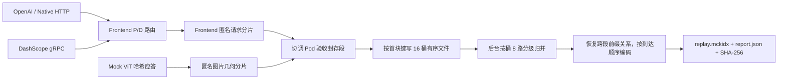

# Frontend 流量采集架构

## 请求与媒体

`configure.py` 为 HTTP 和 gRPC 生成各自的启动配置。HTTP 在 FrontendServer 的 chat、batch chat 和原生推理方法记录到达时间，DashScope 在 gRPC handler 的到达事件记录。两路分别在单请求或批量 enqueue 建立记录，沿同一条 FlexLB P/D 路由采集实际使用的滚动块键和优先级。只有成功且形成完整键序列的路由进入成品，缺失计入段统计。

当前源码沿 FrontendWorker、Pipeline 将模型配置传到 visitor。现有镜像的适配层在 FrontendWorker 构造结束后按真实模型配置设置 seed。DashScope 用带模型配置的 visitor 工厂。接流量前用同一请求核对 Frontend 路由键与 Engine 上报键，包括启用 Page-RR 时的采样粒度。

远端媒体以 ViT 哈希应答中的展开行数为准，ViT 归档提供实际输入宽高。V4.1 在 Frontend 预处理的图片在请求内携带传入模型的像素网格和展开行数。ViT 在有重叠的窗口内记录几何，补齐迟到请求。缺失或冲突的几何使引用它的段验收失败。

| 匿名分片                              | 回放记录                                 |
| ------------------------------------- | ---------------------------------------- |
| 到达 Unix 毫秒、入口名称              | 相对批次首段起点的偏移。入口计入报告     |
| 展开长度、基础滚动块键、路由块粒度    | 文本前缀链及其叶节点、媒体展开长度       |
| 调度优先级                            | 每条请求的 priority                      |
| 可用输出上限、可信实际输出量          | 每条请求引用共享上限表，实际输出单独存储 |
| 匿名图片 ID、文本位置、展开行数、宽高 | 请求引用共享媒体表                       |

只有真实单序列、非 beam 模式下可信的终态输出才写入实际量。缺省时回放按请求上限运行，Decode 的输出模型决定停止。可信正数实际量用作上限并启用 `ignore_eos`。两项缺省时使用 Case 的 `fallback_max_output_tokens`。

分片由有界队列异步 gzip 落盘。写入字段限于上述数据及封口计数。匿名键采用部署密钥下的 HMAC，分片与结果均沿私网传输。协调器检查 Pod 进程代际、窗口、分片完整性、分块粒度、分片 SHA-256 与拒绝计数。

## 分段、排序与归并

默认每段 120 秒，下一段提前 30 秒装载，旧段排空 60 秒。协调器并行拉取封存归档，按到达窗口顺序验收。每段用有界字节缓冲排序，按首个匿名基础块键分 16 桶。共享完整块前缀的请求一定在同一桶。

每个有序文件只记录与上一条相比的新增块键。段验收后原子更新清单，原始暂存才可清理。后台单 worker 按桶做 8 路分级归并。先提交新文件及清单，再删除被替代文件。同一桶的连续排序键精确恢复最长公共前缀，保留跨窗口和长时间未出现的共享关系。`--sort-mib` 控制单批缓冲，TTL 关闭。

封装阶段按桶完成流式归并，再把请求记录按原到达时间写为 Zstd 分页的 `MCKINDEX`。封装用 SQLite 按到达时间遍历输出记录并解析媒体别名。在线入库阶段的持久化对象是有序文件，封装库不维护全历史的块键查询索引。

工作盘需同时容纳有序文件、正在重写的桶、正在拉取的段、封装表和结果。采集端尚未提交的段最多两段，超过此值终止批次并保留已提交段。长期采集看分段提交速度、归并总耗时、归档堆积与整盘最低余量。
