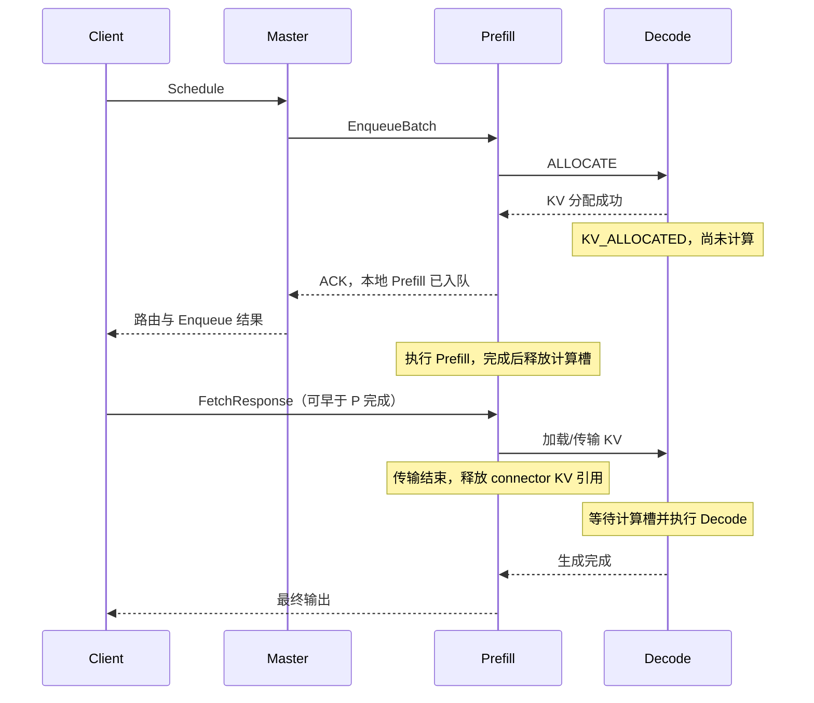

# Mock Engine 的 P/D 与 Fetch 生命周期

## 真实引擎的顺序

`PrefillRpcServer::prepareAllocateResource()` 在本地 `enqueueRequest()` 之前调用 `remoteAllocateResource()`。P 通过 `RemoteGenerate(stage=ALLOCATE)` 通知选中的 D，并等待分配结果。D 此时已经持有 KV，可以上报已分配状态，但还没有进入 Decode 计算。

D 的 KV 临时不足会等待容量变化，受请求绝对超时和取消约束，不使用阶段重试窗口作为容量等待上限；永久容量不足立即失败。P 的准备阶段失败后不能继续把请求作为正常 Prefill 接受。有效的下游 `ErrorDetailsPB` 保留领域错误码，内存分配失败为 `602`、请求超时为 `603`；只有缺少有效 details 的裸 `RESOURCE_EXHAUSTED` 才兜底为 `8211`。**Decode 计算槽满与 KV 不够是两个条件**：KV 能分配时，可以先预留资源，再等待计算槽。

BATCH 模式的 `EnqueueBatch` 只完成准备和本地入队。`FetchResponse` 从 deferred context map 中取出上下文，调用 `finishStream()`，推进远端加载 KV 和 Decode 生成。Fetch 可以在 P 算完之前到达；这时它等待 P 的计算结果。它也可以稍后到达。

## 资源不是同一个计数

| 资源/状态 | 获取时机 | 没有 Fetch 时 | 释放时机 |
|---|---|---|---|
| P 本地计算槽 | Prefill 入队/执行 | P 仍会执行并完成 | P 本地计算结束 |
| P deferred RPC 上下文 | 准备与入队 | 保留，不能当作计算槽 | Fetch 接续、取消、超时或关停 |
| P connector 的 KV 引用 | P/D 请求持有的 KV | P 算完后仍需保留 | KV 传输结束或上下文清理 |
| D KV | ALLOCATE | 已占用并上报，不能运行 Decode | 取消/超时，或正常 Decode 终态 |
| D 计算槽 | KV 就绪后获准执行 | 不占用 | Decode 终态 |
| Master 调度记账 | 调度/ACK | 按上报和 master 自己的规则更新 | 与引擎上下文 TTL 分属不同机制 |

真实 BATCH 的 Fetch 附着 TTL 从成功入队、准备发布 ACK 时开始，默认 600 秒；请求里的 `fetch_attach_timeout_ms` 或剩余请求超时可缩短它。Master 的 `dispatcher.fetchAttachTimeoutMs` 默认传入 3000 ms，因此由 Master 发起的 batch 通常采用 3 秒附着期限。TTL 到期由 P 取消下游 RPC，D 释放预留；不依赖故障 Master 存活。不能把“没有 Fetch”理解成“P 计算槽一直不释放”。

Frontend 遇到连接失败会使用同一请求 ID 尝试备用 Master；deadline 或客户端取消时发送 best-effort Cancel，无法保证已退出的 Master 收到它。P 的 active context 注册必须拒绝仍存活的重复 ID，不能让重试覆盖已有 D 预留和清理关系。

## Mock 的对应实现

`MockPrefillSession` 保存一次请求的附着、P 完成、继续执行、关闭状态。只有“P 已完成，并且 Fetch 已附着或明确启用 auto-fetch”才能取得一次继续执行权。提前和延迟 Fetch 进入同一条状态流转。注入 Fetch 错误时也先取得上下文所有权并清理 P/D，不能把已报错的请求留到缺失 Fetch TTL。

D 在准备阶段就创建 `KV_ALLOCATED` 状态、记录 KV 和请求所有权；继续执行时把这份预留交给 Decode，不能再扣一次 KV。准备状态不占计算槽，取消它也不能减掉其他请求的计算槽。

P 的计算完成事件继续按原来的时间发布。`retainComputed()` 将已计算的缓存块原子地转成仍有引用的缓存键，避免先释放再重新获取造成驱逐窗口。正常传输、取消、缺失 Fetch 超时和关停都要释放相应的 P/D 资源。

Mock 用一次状态转换模拟 KV 传输，不模拟网络搬运耗时、分块传输和真实 GPU；状态观察可以验证协议顺序，不能拿它测真实 KV 网络带宽。`prefill_contexts` 统计尚未接续的 deferred context；D 开始后，取消传播由 P/D ownership 关系继续维护，不能把这个计数当作 C++ 的全部 RPC onflight。

请求期限有一个未模拟到逐点一致的边界：若准备阶段已耗尽请求期限，真实引擎在发布 ACK 时同步拒绝；当前 Mock 将剩余期限下限设为 1 ms，再异步清理。Fetch 附着期限和请求剩余期限需要分别验证。

## 两种启动模式

| 配置 | 默认 | 含义 |
|---|---:|---|
| Java `--auto-fetch` / YAML `environment.mock_auto_fetch` | `false` | BATCH 必须收到客户端 Fetch 才继续 P→D |
| Java `--fetch-attach-timeout-ms` / YAML `environment.mock_fetch_attach_timeout_ms` | `600000` | 测试侧缺失 Fetch 的默认上下文期限；单个 Enqueue 的显式期限优先 |

直接运行 JavaLoadClient 时，也必须同步配置 Mock。只让客户端跳过 Fetch，却仍让 Mock 保持严格模式，就应该观察到 D 等待 KV，而不是悄悄完成。

NON_BATCH 的 `GenerateStreamCall` 本身已经建立客户端输出流，不存在独立的 Fetch 附着过程。它自然推进 P/D，不需要打开 BATCH 的省网络开关。

`no_respond` 只表示服务端 RPC 黑洞，不再承担“客户端没有 Fetch”的含义。

## 状态取证

Decode 计算门禁以 `active_decode_requests` 为准。`running` 和 worker running-task 集合包含
`KV_ALLOCATED`，其中的请求可能只持有 KV 而未开始计算，不能用它证明计算槽已经占满。
测试应分别记录 P 计算槽、deferred context、connector KV 引用、D KV 与 D 计算状态。

D 提前分配后，P 入队拒绝会清理 D 的准备状态。Master 可能先收到 D 的取消终态，
再收到 P 的拒绝 ACK；应分别核对客户端错误、引擎终态和调度记账。

## 缓存容量与所有权

可驱逐的空闲缓存与在途请求引用的 KV 是两种占用。缓存中有键不表示它不可回收；
引用尚未释放的块不能计入可驱逐空间。容量测试先确认单请求能够准入，再以跨请求的
工作集超过容量构造驱逐，避免把超大请求的准入拒绝误当缓存淘汰。

多 Master 共用引擎时，引擎上报的负载可能来自其他 Master。Scheduler 请求数、
Prefill ownership、Decode reservation/dispatch permit 和引擎负载应分别核账；
单个 Master 无客户端流量不意味着共享引擎空闲。完整流量排空后再验证全局收尾。

缓存同步协议测试可使用 Mock 的 `POST /cache_fixture`，按引擎名或端口定位。
`seed` 接收 `worker/workers/unique/shared`，构造相邻 Worker 共享部分键的环形集合；
`churn` 接收 `delta/every`，按实际完整缓存响应次数触发等量增删，传入两个零值冻结变化；
`inspect` 返回当前版本、键数和累计响应条目、变更键数、protobuf 键载荷字节数。
字节数包括 fixture 的 map 与 version，不能当成完整 RPC 响应或连接层流量。
控制面不接收整批 key 列表，不在观测时重新序列化整个集合。

fixture 显式替换该引擎的缓存状态响应键集合，独立于推理请求的 KV 容量、LRU 和驱逐。
它只在单次隔离测试环境中使用，不能用于验收真实 KV 容量与请求缓存命中。
版本变化时返回新集合；版本不变仍返回完整集合，供 Master 按真实协议解析和同步。
每引擎的集合有上限，非法规模、非整数参数和重复初始化直接拒绝。
使用 `inflight_status` 中的 `generation/reported_alive/status_age_ms` 观测 Master 已提交的
状态；年龄采用单调时钟，负值表示尚未成功提交，不能当作零延迟。
这些字段不扫描缓存 key，不获取 Worker 的状态写锁。

## 引擎成员与代际

瞬时失联、永久故障、有序缩容是不同操作。有序缩容需要先撤销发现入口，确认 Master
不再向旧地址/旧代引擎投递，再排空已接纳请求并关进程。Mock 本地 `drained=true`
只能证明采样时本地没有在途请求，不能证明 Master 已退出路由。

收敛预算根据实际状态保留时间、清理周期及在途状态 RPC 推导，保存配置与观测时间。
不能只靠固定睡眠或总引擎数判断某个地址/代际已经退出。故障后的恢复请求须独立发送，
不能用故障前晚完成的请求填充恢复样本；同地址重用必须区分代际。

源码入口：真实协议在 `rtp_llm/cpp/model_rpc/`；Mock 状态机在
`flexlb-mock-engine/src/main/java/org/flexlb/mockengine/` 的 `MockPrefillSession`、
`JavaMockEngineCluster` 和 `MockLruBlockCache`。

## Mock 支持范围与行为验证

下表按功能说明实现参照、验证内容和模拟边界，UT 列提供代表入口。具体行为由 Maven 执行的测试断言维护；表中内容不表示完整测试覆盖或已经完成真实 GPU 差分。

| 功能 | Mock / real 参照 | 已验证行为 | 模拟边界与缺口 | 代表 UT |
|---|---|---|---|---|
| FIFO 准入 | `MockPrefillBatchPolicy`；[FIFOScheduler.cc](../../../../../cpp/engine_base/schedulers/FIFOScheduler.cc) | token、矩形预算、CP 对齐及候选选择边界 | 形状与准入规则，不验证真实模型执行 | [MockPrefillBatchPolicyTest](../../../../flexlb-mock-engine/src/test/java/org/flexlb/mockengine/MockPrefillBatchPolicyTest.java) |
| PD 生命周期与取消 | `MockPrefillSession`、`JavaMockEngineCluster`；[PrefillBatchRpcServer.cc](../../../../../cpp/model_rpc/PrefillBatchRpcServer.cc)、[DecodeRpcServer.cc](../../../../../cpp/model_rpc/DecodeRpcServer.cc) | 预留、绝对请求超时、临时容量等待、Fetch 交接、PREFILL_COMPLETE、取消释放、终态唯一性及跨进程断链 | 公开输出链路限单返回序列；协议回归不验证实际推理 | [PrefillFetchLifecycleTest](../../../../flexlb-mock-engine/src/test/java/org/flexlb/mockengine/PrefillFetchLifecycleTest.java)、[WhaleIndependentProcessTest](../../../../flexlb-mock-engine/src/test/java/org/flexlb/mockengine/WhaleIndependentProcessTest.java) |
| KV 缓存 | `MockLruBlockCache`、`MockMemoryBlockCache`；[DeviceBlockPool.cc](../../../../../cpp/cache/block_tree_cache/block_pool/DeviceBlockPool.cc) | 容量、native-token 复用边界与缓存策略、引用释放、host 命中和树驱逐的模型不变量 | 不验证真实 KV tensor、DMA、hybrid/SWA 多池或磁盘数据正确性 | [CacheReferenceAccountingTest](../../../../flexlb-mock-engine/src/test/java/org/flexlb/mockengine/CacheReferenceAccountingTest.java)、[MockMemoryBlockCacheTest](../../../../flexlb-mock-engine/src/test/java/org/flexlb/mockengine/MockMemoryBlockCacheTest.java)、[TreeEvictionTest](../../../../flexlb-mock-engine/src/test/java/org/flexlb/mockengine/TreeEvictionTest.java) |
| 性能、EOS 与 MTP | `MockPerformanceModel`、`MockEosModel`、`MockDecodeStepMetrics` | 配置公式、吞吐锚点、输出长度规则及接受 token 记账 | 校准后的近似模型，不模拟实际采样、stop words 或 draft/verify 推理 | [ProductionCaliberDecodeTest](../../../../flexlb-mock-engine/src/test/java/org/flexlb/mockengine/ProductionCaliberDecodeTest.java)、[WhaleEosModelTest](../../../../flexlb-mock-engine/src/test/java/org/flexlb/mockengine/WhaleEosModelTest.java)、[MockDecodeStepMetricsTest](../../../../flexlb-mock-engine/src/test/java/org/flexlb/mockengine/MockDecodeStepMetricsTest.java) |
| 指标 | `WhaleMockMonitor` 及记账器；[RtpLLMMetrics.cc](../../../../../cpp/metrics/RtpLLMMetrics.cc)、[PrefillCacheHitMetricsReporter.cc](../../../../../cpp/cache/PrefillCacheHitMetricsReporter.cc) | 指标名、分母、执行 token 记账与采样锁序 | 只覆盖明确上报并测试的指标，不代表 real 全部指标 | [MetricAlignmentTest](../../../../flexlb-mock-engine/src/test/java/org/flexlb/mockengine/MetricAlignmentTest.java)、[TpsMetricsAccountingTest](../../../../flexlb-mock-engine/src/test/java/org/flexlb/mockengine/TpsMetricsAccountingTest.java)、[WhaleMonitorLockOrderTest](../../../../flexlb-mock-engine/src/test/java/org/flexlb/mockengine/WhaleMonitorLockOrderTest.java) |
| 故障与成员变化 | `DynamicEngineManager`、`ExpiringRequestIds`、`ShutdownTasks` | 优雅排空、强制关闭、代际隔离和 fence 保留 | 测试环境生命周期，不代表生产部署或容器回收保证 | [DynamicEngineScaleTest](../../../../flexlb-mock-engine/src/test/java/org/flexlb/mockengine/DynamicEngineScaleTest.java)、[ExpiringRequestIdsTest](../../../../flexlb-mock-engine/src/test/java/org/flexlb/mockengine/ExpiringRequestIdsTest.java)、[ShutdownTasksTest](../../../../flexlb-mock-engine/src/test/java/org/flexlb/mockengine/ShutdownTasksTest.java) |
| 回放与客户端路由 | `PlaybackPlan`、`MasterTargetRouter`、`ClientEventJournal` | 确定性播放计划、路由切换与请求事件完整性 | 负载和证据生成工具，不验证 real 引擎内部行为 | [PlaybackPlanTest](../../../../flexlb-mock-engine/src/test/java/org/flexlb/mockengine/PlaybackPlanTest.java)、[MasterTargetRouterTest](../../../../flexlb-mock-engine/src/test/java/org/flexlb/mockengine/MasterTargetRouterTest.java)、[ClientEventJournalTest](../../../../flexlb-mock-engine/src/test/java/org/flexlb/mockengine/ClientEventJournalTest.java) |
| RPC 执行与收尾 | `MockRpcExecutors`、`JavaMockEngineCluster`；real 协议入口为 `rtp_llm/cpp/model_rpc/` | 每引擎独立额度、同引擎方法竞争、超额调用显式拒绝、排队取消与过期、流取消释放资源、积压排空、逐引擎回调退出确认及关闭失败后重试 | 验证 gRPC 协议与资源生命周期；额度属于 mock harness，不等价于 real 的线程池、Pod CPU 配额或过载时延 | [MockRpcExecutorsTest](../../../../flexlb-mock-engine/src/test/java/org/flexlb/mockengine/MockRpcExecutorsTest.java) |
| 合成缓存状态 | `CacheSyncFixture` | 合成缓存状态与可控变化 | fixture 独立于推理 KV 容量，不验证真实缓存内容 | [CacheSyncFixtureTest](../../../../flexlb-mock-engine/src/test/java/org/flexlb/mockengine/CacheSyncFixtureTest.java) |

`RealBehaviorParityTest` 覆盖请求超时、容量等待、领域错误透传、native-token 缓存边界与策略、批次校验和单 token 结算；远程协议及关闭异常另由 `MockRemoteDecodeProtocolTest`、`MockRpcExecutorsTest` 覆盖。

新增功能或改变支持范围时更新对应行及行为测试；拆分、重命名内部辅助类不要求额外登记。real 实现变化时，按相关函数的语义核对上述行为及回归用例，不通过整文件哈希判断是否对齐。

取消 fence、已接受取消和已完成请求历史按单调时钟保留十分钟，与仅供诊断的限条数历史独立；诊断淘汰不能使有效 fence 提前消失。进程崩溃世代清空这些内存历史。

公开入场路径仅支持单返回序列，不支持 beam 和多返回序列。相关输入在创建请求状态和 KV 租约前返回 UNIMPLEMENTED；Prefill 的形状计费工具可用于核对 real 的宽度公式，但不代表输出链路支持这些宽度。

测试应明确验证的是模型内部不变量、协议路径还是跨进程行为，用具体断言表达预期及错误分支。
