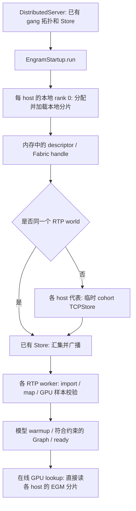

# 分布式 Engram：启用、拓扑与启动交换

更新时间：2026-11-09。每个存储 host 的 RTP worker 持有一片 Engram，GPU 在线直接读映射后的内存。没有独立 sidecar/holder，没有在线查表 RPC，也不分发 bundle 文件。

## 最小配置

只用一个入口选择存储方式，存储模式在冷启动时确定：

| `RTP_ENGRAM_STORAGE` | 存储方式 | 数据分配 |
|---|---|---|
| `host` | 本机 CPU 内存 | 复用本机共享表、NUMA interleave 与 reader lease |
| `host_shared` | 多 host CPU 内存共享 | 每 host 一份行分片，可在本机 NUMA 节点间继续切分 |
| `gpu_shared` / `cuda_fabric` | GPU HBM Fabric 共享 | 每 host 行分片继续切分到本机 GPU；也支持单 host |
| `cuda_local` | 单 host GPU HBM 共享 | 每个 rank 在本 GPU 分配一片，通过 POSIX FD 导入，不要求 Fabric / IMEX |

```bash
# 同一 RTP world 或平台 gang 已提供完整 host 拓扑时，仅需选择模式。
RTP_ENGRAM_STORAGE=host_shared
# 手动容器没有平台拓扑时，另外提供成员列表（它是拓扑参数）。
# RTP_ENGRAM_COHORT=10.0.0.1,10.0.0.2
```

切到 `host` 时可保留 `ENGRAM_SHARD_COUNT` / cohort
拓扑，不会执行共享交换。切到共享模式时不必另设 enable 开关；
P 从拓扑推导，若仍设置 `ENGRAM_SHARD_COUNT`，则作为一致性校验。
无效模式、缺少共享拓扑或交换失败均报错，不静默回退。单机 GPU 共享使用 `cuda_local`，不接受 `gpu` 这个值。

完全未配置时保持本机 host 路径。旧 `RTP_ENGRAM_MEMORY` 入口已移除；
只配置 `ENGRAM_SHARD_COUNT` / cohort 而未指定存储模式时明确报错，避免静默加载本机表。

NUMA、容量和 gang 参数不决定新模式。`host_shared` / `gpu_shared` 需要同一 NVLink Fabric / IMEX 域。
`cuda_fabric` 在配置入口归一为 `gpu_shared`；`cuda_local` 仅接受同 host 的完整 world，
不设置跨 host cohort。Store 只交换元数据和屏障，FD 通过本机 Unix socket 的 SCM_RIGHTS 传递。
共享模式默认持有 process-lifetime Graph pin，兼容已启用的 decode CUDA Graph，
不再要求额外设置 `RTP_ENGRAM_GRAPH_MODE=process_lifetime`。
DSpARK、prefetch、Graph 开关本身仍使用原业务配置。所有 worker 必须一致，切换需整组冷启动。

**列表可以省略。** 共享已启用但没有 `RTP_ENGRAM_COHORT` 时，从平台注解
`GANG_ANNOCATION_PATH`（默认 `/etc/podinfo/annotations`）里的
`app.c2.io/biz-detail-ganginfo` 取成员地址，端口统一用 `RTP_ENGRAM_COHORT_PORT`。
注解里没有 port 字段，也不要指望它带 port。手动容器可使用上面的显式列表，或提供下述同格式测试文件。

### P/D 分离使用不同存储模式

Prefill 和 decode 使用各自的存储共享组，分别设置同一个入口即可，例如 prefill 设置
`RTP_ENGRAM_STORAGE=gpu_shared`，decode 设置 `RTP_ENGRAM_STORAGE=host_shared`；
也可以互换，两侧不必选择同一种介质。CP/TP/DP/EP 计算拓扑、DSpARK、Graph 和 prefetch
沿用各自原有配置。每个存储共享组内的所有 worker 必须选择一致模式；不能在同一组中
混用 CPU 与 GPU backing。显式提供 cohort 时，应使用本角色的完整成员列表。

### 同一平台 gang 中的两个 CP4 prefill 实例

两台 host 的启动配置相同，每台各运行一个独立计算 world：

```bash
WORLD_SIZE=4
WORLD_RANK=0
LOCAL_WORLD_SIZE=4
TP_SIZE=4
DP_SIZE=1
EP_SIZE=4
PREFILL_CP_SIZE=4
RTP_ENGRAM_STORAGE=host_shared
```

平台在两台挂载相同的 gang 注解，包含 `prefill_part0`、`prefill_part1` 及各自 IP。
省略 `RTP_ENGRAM_COHORT`、`RTP_ENGRAM_INSTANCE_INDEX` 和 `RTP_ENGRAM_RANKS_PER_INSTANCE`，
Engram 按本机地址自动匹配成员。正常部署读取 `/etc/podinfo/annotations`；手动开发容器可通过
`GANG_ANNOCATION_PATH` 指向同格式的测试文件。两台使用相同的 `RTP_ENGRAM_COHORT_PORT`，
未设置则均使用默认端口。

每台启动 `WORLD_RANK=0`，其四个 worker 使用本实例内的 rank 0–3 和独立 TCPStore。
平台 gang 注解提供共享组成员；Engram 的两个 host 代表在启动阶段建立 TCPStore 交换连接，
每台发布一片，八个 worker 最终导入同一份 P=2 generation。连接在启动完成后关闭。
日志应出现 `source=annotation`、`reuse_world_store=False`，两台的共享组下标分别为 0、1。
这里 `reuse_world_store` 是自动推导的内部状态，无需配置。Store 获取函数在现有
`DistributedServer.store` 覆盖全部存储 host 时直接复用，否则建立临时 TCPStore；
日志分别记录 `event=exchange_store source=world` 或 `source=cohort`。
两种情况都由各 host 代表执行同一套分片交换、校验和确认流程，再向本机 worker 分发结果。

| 配置 | 用途 |
|---|---|
| `CHECKPOINT_PATH` | 沿用业务模型目录；`RTP_ENGRAM_CHECKPOINT` 可单独覆盖 |
| `RTP_ENGRAM_LOCAL_DEVICE` | host backing 可选覆盖，缺省复用 publisher 已绑定的 local rank |
| `RTP_ENGRAM_LOCAL_NUMA` | `0` 等单节点值保持原分配；`auto` 按可见 GPU 的 HOST_NUMA 亲和发现节点，`0,1` / `0-1` 显式选择节点。缺省仍为 0 |
| `RTP_ENGRAM_COHORT_PORT` | 跨实例交换的监听端口，平台指定或默认 29483；同一个 RTP world 不使用此端口 |
| `RTP_ENGRAM_COHORT_TIMEOUT` | 启动交换超时，默认 1800 秒 |

**不需要配置 UUID、generation、本机分片下标或 ranks-per-part。**
`RTP_ENGRAM_GENERATION` 不再读取；原有 manifest 内部标识仍保留，不是部署配置。
旧 `RTP_ENGRAM_LOCAL_DESCRIPTORS` 文件启动模式已移除，显式报错防止误用。

保留的高级诊断选项：`RTP_ENGRAM_INSTANCE_INDEX`、`RTP_ENGRAM_RANKS_PER_INSTANCE` 只作覆盖/一致性校验，正常部署不用。
`RTP_ENGRAM_MAX_ALLOCATION_BYTES`（默认及硬上限 128 GiB）与
`RTP_ENGRAM_MAX_TOTAL_ALLOCATION_BYTES`（默认及硬上限 256 GiB）只限制 publisher 本机 backing，均可下调。
consumer 导入各 host 的映射不重复使用本机预算；初始解析保留全组 16 TiB 绝对上限，
验证拓扑后收紧为 256 GiB × 实际 host 数 P，并独立校验每 owner backing 不超过 256 GiB、
每 allocation 不超过 128 GiB，同时检查 allocation 数量和分片几何。
这些上限不代表机器有足够可分配 NUMA 内存，也不能代替容器资源检查。

## GPU HBM backing（实验选项）

同一 NVLink Fabric / IMEX 域内，可复用现有启动交换与 VMM 映射，把 backing 放到 GPU HBM：

```bash
RTP_ENGRAM_STORAGE=gpu_shared
# 每张 GPU 完成本机 backing 分配后至少保留的当前空闲显存，默认 32 GiB。
RTP_ENGRAM_GPU_RESERVE_BYTES=34359738368
```

GPU 模式需要提供 `device_granularity` 和 `check_fabric_devices` 的 native 扩展。
同组所有 worker 必须选择相同介质。GPU 模式使用每 host 的参与 rank 对应的本地 CUDA ordinals
`0..local_world_size-1`，遵循 `CUDA_VISIBLE_DEVICES`，不使用 host NUMA 放置参数。
两台、每台四个 worker 时，P 仍是 2；每 host 每层的行分片再切成四段，分别存放在四张卡上。
权重与 scale 使用相同的行边界，整个共享组仅保留一份 backing，只有 CUDA 分配粒度要求的尾部 padding。
GPU 模式直接使用分布式 scale 映射，不再创建每 host 的额外 scale 副本。

consumer 仍导入完整连续虚拟地址，使用现有 lookup / prefetch kernel 和 CUDA Graph 生命周期管理。
Fabric handle 只在启动时交换，在线没有额外查表 RPC。每台存储 host 发布一条 v4
descriptor，每段共用 weight/scale 的行区间和本机位置，分别记录两份 allocation 的大小和
handle。接收后直接构造进程内映射布局。同组 worker 应使用相同版本。

启动前检查所有参与 GPU 的当前 free memory 与 backing+reserve 预算；任何一张不足都不分配。
这不是对后续模型权重、CUDA Graph 和 KV cache 的容量预测，仍须保留正常的模型/KV预算。
VMM backing 不属于 PyTorch caching allocator，观察 `nvidia-smi` 或 `cudaMemGetInfo`，不能只看
`torch.cuda.memory_allocated()`。日志 `event=gpu_capacity`、`event=backing_allocation memory=gpu`
及 storage 生命周期日志给出介质、设备、行区间、字节数与耗时，不打印 Fabric capability。

GPU 模式目前是显式启用的实验路径；速度需在固定路由、batch、KV预算、Graph / DSpARK / prefetch
配置下测量 decode 延迟及尾延迟，不能从带宽或单 kernel 测量直接推断端到端收益。

## 单份 backing 的 NUMA 放置

不开分布式存储时，标准 `rtp_llm.start_server` 入口会复用 `rtp_llm.utils.numa`：
未配置 `NUMA_INTERLEAVE_NODES` 且 cpuset 允许恰好两个有内存的节点时，自动启用 Linux
页级 interleave；显式空字符串不更改已有策略。Engram 的 `/dev/shm` 完整表由首次创建者
写入，再由本机进程共享、分别 CUDA-register。绕过入口、自动策略失败或复用已存在的表时，
不能保证页分布；修改内存策略不会重排已驻留的共享页。

Fabric backing 使用 `cuMemCreate(HOST_NUMA)` 指定物理节点，不受上述普通内存策略替代。
本模块复用同一个 NUMA 解析及可用内存节点检查；`auto` 额外查询可见 GPU 的 CUDA
`HOST_NUMA_ID`，不假定 GPU ordinal 与 NUMA 编号相等。选定节点必须属于 cpuset，且有 CPU
和主机内存。只使用部分可见 GPU 的任务，应显式指定节点或先正确设置 `CUDA_VISIBLE_DEVICES`。

多节点配置在**每层、每台 host 原有行分片内部**切分连续行段，weight/scale 使用相同行边界。
它不是复制表，也不把两个存储 host 变成四个：每个逻辑行仍只有一份 backing，四个 GPU 进程
均映射完整逻辑表。切点同时对齐 weight/scale 的 VMM 粒度，总 padded bytes 与单 NUMA
模式完全相同。分片过小、没有合法切点或节点不可用时，在分配前报错；不静默回退或补副本。
不修改进程绑核、lookup kernel、prefetch、CUDA Graph 或设备 scale 分片策略。

标量和多 NUMA 配置共用 v4 descriptor，记录每段的 NUMA、行范围及 allocation。
共享组整组冷启动，使用同一版本的协议和同一种存储模式。各 host 的节点编号及分段数可以不同。
`event=numa_placement` / `event=backing_allocation` 记录放置和容量，
日志不输出 Fabric capability。按容量对半不等于访问流量对半，性能必须按实际 decode 负载验证。

## 拓扑直接复用 RTP

`BackendManager` 在 `DistributedServer.start()` 完成后传入按 world rank 排序的 `WorldInfo.members`。
不再用 hostname 重新猜网卡，不再通过另一个 `engram/topology` Store 协议汇集地址。

- 单 gang：直接从已有成员信息得到 host 和每 host rank 数。
- 跨 gang：完整共享组按 `RTP_ENGRAM_COHORT` → `RTP_ENGRAM_GANGINFO_DIR` → 平台注解的优先级取；
  每个 gang 的局部 rank 编号和 host 归属仍使用自身 `WorldInfo`。
- 注解按 `_partN` 后缀排序，并按本机地址匹配到的名字前缀过滤掉别的角色。
  本实例只有一个 host 时，每个成员各算一个存储 host（多实例共享）；
  本实例跨多个 host 时保持原有推导（gang 自身就是共享组），因为注解无法说明多个多 host 实例
  如何分组，猜错会静默改变现有布局——这种拓扑仍需显式 `RTP_ENGRAM_COHORT`。
- 显式 `RTP_ENGRAM_GANGINFO_DIR` 仍可提供列表，但必须先用上述 env 启用共享；不会自动读取 `/etc/ganginfo`。
- 地址列表必须使用 RTP 注册的可达地址。不要仅凭平台“虚/实 IP”的列名猜选哪一个。

当前支持均匀的每 host rank 数、连续的 host rank 区间。多实例各跨多个 host 时，也使用各实例自己的 rank 空间；共享列表下标不再冒充该实例的 world rank 偏移。
P 支持 2–64，一项对应一个不同存储 host；不支持动态扩缩容、重复 host 或运行时重分片。

## 存储接口边界

- `config.StoragePolicy` 是唯一模式解析点。
- `Engram.from_checkpoint()` 选择本地 pinned table 或已校验的 Fabric 视图；
  两种共享介质共用 `HostEngramEmbedding.from_storage()`。
- `placement.FabricBacking` 封装 host/GPU native 分配、位置与粒度、GPU reserve 检查。
- `placement.PlacementPlan` 保存实际物理分片；同一份计划用于容量检查、分配、行加载和 descriptor。
  单 allocation 限额按物理块检查，总预算按整台 host 的实际 padded bytes 检查。
- `storage.FabricEngramStorage` 管理 CUDA 映射、只读连续视图及 use/event/Graph 生命周期。
  lookup 和 prefetch 依据实际持有的 lease 做 capture 授权，和 host scale 缓存开关解耦。
- `checkpoint.ShardPublisher` 持有本机发布的分片及清理失败的资源。
- `exchange.EngramStartup` 持有一次启动的 Store、deadline、阶段和确认状态。
- `runtime.EngramRuntime` 持有启动 package、解析后的选项和进程生命周期内的映射。
  模型用 `EngramModelAttachment` 管理层绑定、回滚和 Graph 准入。
  启动入口显式接入 publisher 和 runtime，rank 安装 package 后才发 ACK。

上述决定都在启动期完成；在线 kernel 不增加策略分支或 RPC。host/GPU 共用同一套
Fabric handle 交换和映射协议。native bridge 通过 BUILD 编译到 `rtp_llm/libs` 并随 wheel 打包。

## 模块交互



同一个 RTP world 的多个 host 复用已有 TCPStore，不新增监听端口。
多个独立 RTP world 组成 cohort 时，各 host 的本地 rank 0 连接首成员的临时 TCPStore；各 host 复用已有 world Store 向本地 rank 分发结果。

各代表通过 TCPStore 发布 descriptor、读取 package 并确认摘要；所有代表完成校验后放行，读取结束关闭监听。
TCPStore 使用可信计算网络，不提供 TLS；显式设置已移除的 `RTP_ENGRAM_TLS_DIR` 会报错。
传输的是元数据和 handle，不是权重。模型 ready 前仍要完成 GPU 读回校验及 warmup。

## 生命周期与重启

每个 rank 在现有 gang Store 中维护一个内部启动计数，只在启动时递增。
本轮 package 使用对应计数的独立 key 空间；重启 rank 不能读取上轮遗留的 package。
计数不由平台配置；成功轮次清理 package/descriptor/ACK，保留 O(world_size) 个小计数键。
失败轮次的遗留数据在重建 Store 时清理，不支持无限次复用失败的 Store。

部分 rank 重启会等待其他 rank 而有界失败，不是自动恢复。恢复时重建整个 gang/共享组及其 Store；先排空并停止旧消费者，再释放持片进程。
cohort Store 关闭不释放分片；映射和 backing 保持到 worker 退出。该机制不代替运行时故障检测或高可用。

## 校验边界

默认 checkpoint 索引哈希只标识元数据，**不能证明所有权重字节相同**。各 host 必须使用同一份不可变模型。
发布时记录本片内容摘要，导入时读 GPU 样本；样本校验不是全表逐字节校验。
NVLink/IMEX 域、设备权限、实际可分配内存必须在目标节点验证，IP 可达本身不足以证明可导入。

SM100/SM103 上，外部存储支持 decode 的 attention-bounded prefetch；
启用 `DSV41_DECODE_ENGRAM_PREFETCH=1` 时沿用本地表的 L1/L14 调度。
`DSV41_ENGRAM_DEVICE_SCALES` 与 `DSV41_ENGRAM_SHARD_SCALES` 独立于跨 host
Engram 分片：scale 仍按物理节点分组，在线查询不增加跨节点 collective。
Graph 和 prefetch 持有对应的表、scale generation 与完成事件，释放映射前必须排空读取。
外部表在普通 prefill 中默认使用 GPU 侧流预取，支持 `host_shared`、`gpu_shared`
及外部映射的 `cuda_local`。prefill warmup 会为可预取的层建好侧流。超过每 rank
32K 行时，外部表按原有的 32K 行边界分块。侧流提前读取第一块，并在主流投影
当前块时读取下一块，最多保留两个块的 lookup 结果。设
`DSV41_ASYNC_ENGRAM_LOOKUP=0` 可改用同步 GPU lookup。外部表使用 CUDA 地址，
`DSV41_CPU_ENGRAM_LOOKUP` 只适用于本机 CPU 表。
未更改 GPU lookup kernel，也没有宣称完成 <100µs decode 增量验收。

测试目标集中在 [test/BUILD](test/BUILD)。普通回归使用该目录的 CPU 测试目标；
`test_native` 校验预编译库导入，`test_fabric_integration` 在显式指定的空闲 GPU 上验证
Host/GPU Fabric、跨卡读取、Graph replay 和资源回收。跨 host 全模型验证使用独立 P/D 开发环境。

共享组由平台保证使用相同的不可变权重；启动不再计算全量权重内容哈希。
保留模型配置、布局、分片边界和 GPU 抽样读回校验。`generation` 是模型/拓扑的共享组标识，
重复启动的隔离由 Store 内的 `attempt` 计数完成，二者均不进入逐 token 计算。
