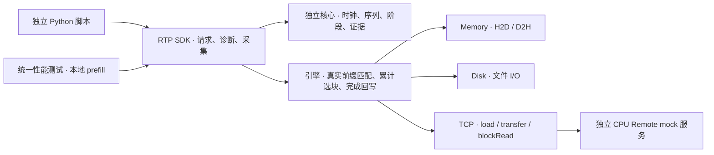
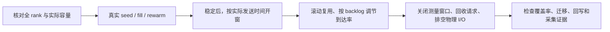

# RTP-LLM 连续缓存压力测试

连续压力测试先用真实请求建立缓存，再以持续到达的请求验证前缀复用、缓存迁移和完成回写。可以从 Python 连接已启动的 RTP 引擎，也可以通过统一性能测试的本地 prefill 入口运行。

## 架构与提交依赖



移植提交按依赖顺序应用。独立核心只依赖标准库。引擎诊断与采集提供 rank 级观测接口，Memory/Disk 提供真实匹配、缓存源和完成回写，Remote 在此基础上接入 TCP 与独立 CPU 服务。Python RTP 适配器依赖核心和引擎 RPC，统一性能测试封装配置、已有引擎 session 与结果。测试包的 Bazel 入口为 `:continuous_pressure`、`:rtp_adapter` 和 `:rtp_sdk`。

## 工作流与配置



- RTP 入口支持 `tiered_rolling` 和 `adaptive_backlog`，使用未分组的 `batch_size=1`、`output_length=1`，且 `0 < cache_len < input_len`。case 数必须整除半个 cohort。统一框架的压力模式仅支持本地 FIFO prefill、DP1/PP1 和 DashSC token ID 输入。请用 `CP_FORCE_SINGLE_PREFILL=0`（`--cp_force_single_prefill 0`）。
- 默认策略 `tree_pressure` 使用自然缓存路径，mock 开关默认关闭。诊断策略为 `tree_then_mock_memory`、`tree_then_mock_disk`、`tree_then_mock_remote`。相应引擎开关和请求 opt-in 都须生效。Memory 用真实匹配模式，Disk 需要配置磁盘缓存。Mock 数据仅用于诊断。
- RTP 默认到达率范围为 50–400 请求/秒，backlog 低/高水位为 64/192，最多 256 个 outstanding，cohort 为 32，滚动序列的 Memory 复用目标为 0.5。Host fill 上限默认为 0.80，须高于测量 Host 目标（默认 0.25）。默认 fill 输入目标为 102400 tokens，实际请求受模型长度、batch/admission 限制及各 owner/pool 可用块约束。示例采集 6 个原生步骤。
- Seed 必须实际成功并给出可用的连续 family 范围。输入使用引擎同词表的确定性 tokenizer。marker 编解码必须精确往返，`0` 和 `1` 的末 token ID 必须不同。转义后的完整 marker、终止符和正式请求的首个分叉 token 必须放进各相关池的首个受影响缓存块，空间不足时请求构造失败。使用与实际块尺寸匹配的缓存对齐及 commit tail，确保复用前缀能够发布。
- 读比例是累计规划的目标。比较真实匹配的 eligible blocks、计划选块、成功迁移块与实际 payload 字节，实际比例受驻留和可行边界影响。Remote 读比例为零时仍可有完成回写。回写以物理传输、ACK 和最终 drain 为准，不能用请求完成数推算字节。

## 独立 Python 调用

使用与引擎同版本的已安装或已构建 RTP DashSC SDK、DashSC 和 Model RPC v1 生成的 Python stubs，以及 gRPC/protobuf 运行库。Bazel 调用方依赖 `//rtp_llm/test/continuous_pressure:rtp_sdk`。仅做规划或注入 transport 时可用 `:rtp_adapter`，连接时才加载 SDK。示例额外使用 `transformers` 加载 `MODEL_TOKENIZER`，并使用一个新的 `NEW_EPOCH_DIR`。

下例连接调用方已启动的 FIFO prefill 引擎（DP1/PP1）。`settings={}` 采用客户端默认值，使用自然缓存策略 `tree_pressure`。引擎的配置和启停由调用方负责。沿用自然缓存示例的引擎选项，设置 `--reuse_cache 1`、`--enable_device_cache 1`、`--enable_memory_cache 1` 和 `--cp_force_single_prefill 0`，并用 `--memory_cache_size_mb` 为每 rank 分配正容量。保持 `--mock_memory_cache 0`、`--mock_disk_cache 0` 和 `--mock_remote_cache 0`。启动时各 FULL 组须有活跃的 Device 池和正容量的 Host 池，Host 占用（扣除待释放块）须低于默认 fill 上限 0.80。

下例的 rank、tokenizer 词表、长度和 admission 参数应与引擎匹配。默认 base port 的 Model RPC 与 DashSC 端口分别为 base +1、+8。

```python
import os
from pathlib import Path

from transformers import AutoTokenizer

from rtp_llm.test.continuous_pressure.adapters.rtp_llm_rpc import run_rtp_pressure

tokenizer = AutoTokenizer.from_pretrained(
    os.environ["MODEL_TOKENIZER"], local_files_only=True
)


def encode_marker(text):
    return tokenizer.encode(text, add_special_tokens=False)


def decode_marker(ids):
    return tokenizer.decode(
        ids, skip_special_tokens=False, clean_up_tokenization_spaces=False
    )


filler = encode_marker(" hello")[-1]


def make_ids(length, prefix):
    head = encode_marker(prefix)
    if len(head) > length:
        raise ValueError("marker exceeds requested length")
    return head + [filler] * (length - len(head))


base = int(os.environ.get("ENGINE_BASE_PORT", "20000"))
run_rtp_pressure(
    dash_endpoint=f"127.0.0.1:{base + 8}",
    pressure_endpoint=f"127.0.0.1:{base + 1}",
    ranks=(0,),
    settings={},
    cases=[{"input_len": 36864, "cache_len": 32768}],
    make_ids=make_ids,
    encode_marker=encode_marker,
    decode_marker=decode_marker,
    directory=Path(os.environ["NEW_EPOCH_DIR"]),
    model_tokens=131072,
    admission_requests=16,
    batch_tokens=262144,
    cache_alignment=64,
    commit_tail_tokens=64,
)
```

多 rank 部署应传入全部 TP rank。SDK 只关闭自身建立的通道，调用方负责引擎的启停。每次运行生成新 session 和 `pressure/` 证据目录，兼容启动前已存在缓存的引擎，并重新检查容量。

## 统一性能测试（可选框架集成）

此节的配置文件、命令和示例链接需要同时应用统一性能测试集成补丁。仅安装独立库和引擎补丁时，请使用上节的独立入口。

示例为[自然缓存](../perf_test/examples/prefill_pressure_real_local.json)和 [Remote 诊断与采集](../perf_test/examples/prefill_pressure_remote_profile_local.json)。先替换模型、tokenizer、设备和输出路径。可用 `--dry-run` 校验配置与计划。运行后将 `PERF_RUN_DIR` 设为 `output.result_root` 下新建的 `prefill-*` 结果目录。

```bash
python -m rtp_llm.test.perf_test.main --mode prefill --action run \
  --config rtp_llm/test/perf_test/examples/prefill_pressure_real_local.json
python -m rtp_llm.test.perf_test.main --mode prefill --action profile --run-dir "$PERF_RUN_DIR"
python -m rtp_llm.test.perf_test.main --mode prefill --action report --run-dir "$PERF_RUN_DIR"
```

框架管理本地引擎。resume 和独立 profile 都为完整网格重新准备新 epoch，旧证据保留。profile 写入独立目录。查看 `pressure/manifest.json`、`summary.json` 和各 JSONL。JSONL 记录实际发送、阶段、rank 样本和步骤元数据。原生时间线来自引擎声明的 Kineto 导出文件，含原生操作 spans 和采集窗口。Nsight 分析另需配置好的采集 session、正时长、CLI 和可验证的 SQLite 导出。

## Remote 服务证明

1. 服务所有者为每次运行预留新目录与独占 event 文件路径，启动 CPU 目标 `//rtp_llm/cpp/disaggregate/cache_store/remote_mock:remote_mock_server`。例如运行 `remote_mock_server --address=127.0.0.1 --port=18080 --event-path=/path/to/epoch/events.jsonl --max-event-bytes=8388608`。使用仅可信客户端可访问的地址。待 `REMOTE_MOCK_READY` 后发布 launch JSON，包含唯一 `launch_id`、监听 `address`（例如 `127.0.0.1:18080`）和绝对 `event_path`。
2. 将 `remote_launch_manifest` 指向该文件，为引擎设置匹配的 `mock_remote_cache_address`、reverse callback 端口和源块、staging、并发与超时预算。示例使用默认地址、0.5 读目标和 5 ms 读/写延迟。事件文件须可从客户端的本地或共享文件系统观察。框架先进行真实填充，再开启测量阶段的 mock opt-in。即使原生 drain 成功，服务证明仍待签发。
3. 运行结束后由服务所有者发送 SIGTERM 或 SIGINT 并等待进程退出、footer 写完。随后显式签发所测 epoch 的服务证明并重跑 report。

```python
import json
import os
from pathlib import Path

from rtp_llm.test.continuous_pressure.analysis.remote_artifacts import (
    certify_remote_epoch,
)

root = Path(os.environ["PERF_RUN_DIR"])
pointer = json.loads((root / "results/pressure_epoch.json").read_text())
certify_remote_epoch(root / pointer["epoch"])
```

独立调用传 `Path(os.environ["NEW_EPOCH_DIR"]) / "pressure"`，独立 profile 使用其自身的 `profiles/<id>/pressure`。签发校验 launch 与 native session、epoch、generation，校验事件窗口、footer、记录和字节，持久化 `remote_events.jsonl` 与范围为 `remote_service` 的 `remote_certificate.json`。离线校验读取归档。签发默认 8 MiB，离线读取默认 64 MiB，两者都可用 `max_bytes` 调整至 1 字节–64 MiB，证书上限为 64 KiB。服务的 `--max-event-bytes` 独立配置，须覆盖完整运行时长和事件量。超限、文件更换或 footer 不完整会使证明保持未验证。

完整 epoch 还须满足引擎执行、压力覆盖、双向迁移、物理排空、所请求采集及各 case 的实际成功参与。服务证明只完成 Remote 服务这一项。

## 验证

从仓库根目录通过当前工作树的 CUDA 13 测试 wrapper 运行。令 `RTP_TEST_WRAPPER` 指向已配置的 wrapper，使用默认 GPU 锁和远端测试输出下载。

```bash
bash "$RTP_TEST_WRAPPER" test \
  //rtp_llm/cpp/engine_base/stream/test:remote_pressure_acceptance_test \
  //rtp_llm/cpp/cache/test:kv_cache_manager_with_tier_cache_test \
  --nocache_test_results
bash "$RTP_TEST_WRAPPER" test \
  //rtp_llm/test/continuous_pressure/tests:adapter_test \
  //rtp_llm/test/continuous_pressure/tests:capture_test \
  --nocache_test_results
python -m unittest discover -s rtp_llm/test/continuous_pressure/tests -p '*_test.py' -v
```

安装可选统一性能测试集成补丁后，还可运行框架闭包与测试套件。

```bash
bash "$RTP_TEST_WRAPPER" test //rtp_llm/test/perf_test/tests:core_build_closure_test --nocache_test_results
python -m unittest discover -s rtp_llm/test/perf_test/tests -t . -p '*_test.py' -v
```

原生矩阵用小型真实 GPU 缓存和独立 CPU 服务，覆盖 Remote 读目标 0/0.5/1 与同值读写延迟 0/5/20 ms 的组合。其原生采集为缓存操作时间线。验证范围限于缓存数据路径、受控采集与客户端测试。
