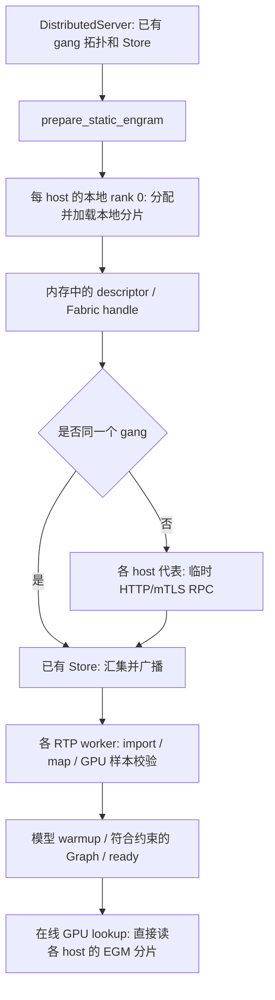

# 分布式 Engram：启用、拓扑与启动交换

更新时间：2026-11-03。每个存储 host 的 RTP worker 持有一片 Engram，GPU 在线直接读映射后的内存。没有独立 sidecar/holder，没有在线查表 RPC，也不分发 bundle 文件。

## 最小配置

只保留现有两种启用入口，不新增开关：

```bash
# 单实例、多 host（例如 decode）：P 是存储 host 数。
ENGRAM_SHARD_COUNT=4

# 多实例共享（例如独立 prefill gangs）：所有实例收到同一份有序 IP 列表。
RTP_ENGRAM_COHORT=10.0.0.1,10.0.0.2,10.0.0.3,10.0.0.4
```

两项都没配，跳过共享启动，使用原有本地加载路径。二者同时配置时 P 必须等于列表长度。
目录、证书、NUMA 等辅助配置不会启用共享。配置了共享但交换失败时启动失败，不静默加载另一份本地表。

| 配置 | 用途 |
|---|---|
| `CHECKPOINT_PATH` | 沿用业务模型目录；`RTP_ENGRAM_CHECKPOINT` 可单独覆盖 |
| `RTP_ENGRAM_LOCAL_DEVICE` / `RTP_ENGRAM_LOCAL_NUMA` | 本 host 分片的分配位置，缺省 0 并告警；按实际可用容量选择，不要求各 host 的 NUMA 编号相同 |
| `RTP_ENGRAM_COHORT_PORT` | 跨实例交换的监听端口，平台指定或默认 29483；单 gang 不使用此端口 |
| `RTP_ENGRAM_COHORT_TIMEOUT` | 启动交换超时，默认 1800 秒 |
| `RTP_ENGRAM_TLS_DIR` | 跨 gang mTLS 证书目录；单 gang 不读取。未设置时为可信网络上的明文 HTTP |

**不需要配置 UUID、generation、本机分片下标或 ranks-per-part。**
`RTP_ENGRAM_GENERATION` 不再读取；原有 manifest 内部标识仍保留，不是部署配置。
旧 `RTP_ENGRAM_LOCAL_DESCRIPTORS` 文件启动模式已移除，显式报错防止误用。

保留的高级诊断选项：`RTP_ENGRAM_INSTANCE_INDEX`、`RTP_ENGRAM_RANKS_PER_INSTANCE` 只作覆盖/一致性校验，正常部署不用。
内存上限默认单 allocation 128 GiB、总预算 256 GiB；可以下调，不必每次重复填写。
这些上限不代表机器有足够可分配 NUMA 内存，也不能代替容器资源检查。

## 拓扑直接复用 RTP

`BackendManager` 在 `DistributedServer.start()` 完成后传入按 world rank 排序的 `WorldInfo.members`。
不再用 hostname 重新猜网卡，不再通过另一个 `engram/topology` Store 协议汇集地址。

- 单 gang：直接从已有成员信息得到 host 和每 host rank 数。
- 跨 gang：完整共享组由 `RTP_ENGRAM_COHORT` 提供；每个 gang 的局部 rank 编号和 host 归属仍使用自身 `WorldInfo`。
- 显式 `RTP_ENGRAM_GANGINFO_DIR` 仍可提供列表，但必须先用上述 env 启用共享；不会自动读取 `/etc/ganginfo`。
- 地址列表必须使用 RTP 注册的可达地址。不要仅凭平台“虚/实 IP”的列名猜选哪一个。

当前支持均匀的每 host rank 数、连续的 host rank 区间。多实例各跨多个 host 时，也使用各实例自己的 rank 空间；共享列表下标不再冒充该实例的 world rank 偏移。
P 支持 2–64，一项对应一个不同存储 host；不支持动态扩缩容、重复 host 或运行时重分片。

## 模块交互



单实例多 host **不新增 RPC 连接，也不需要额外端口/证书**。
跨 gang 当前每个 host 的代表向列表首 host 连接一次，P 个 host 最多 P−1 条正常启动连接；不是全互联。
常见“每实例一个 host”时即 N−1 条。多 host 实例暂未进一步合并成每 gang 一条连接。

RPC 使用同一 HTTP/1.1 连接发送 `POST /v1/exchange`（descriptor）和 `/v1/ack`（响应摘要），启动结束关闭监听。
传输的是元数据和 handle，不是权重。模型 ready 前仍要完成 GPU 读回校验及 warmup。

## 生命周期与重启

每个 rank 在现有 gang Store 中维护一个内部启动计数，只在启动时递增。
本轮 package 使用对应计数的独立 key 空间；重启 rank 不能读取上轮遗留的 package。
计数不由平台配置；成功轮次清理 package/descriptor/ACK，保留 O(world_size) 个小计数键。
失败轮次的遗留数据在重建 Store 时清理，不支持无限次复用失败的 Store。

部分 rank 重启会等待其他 rank 而有界失败，不是自动恢复。恢复时重建整个 gang/共享组及其 Store；先排空并停止旧消费者，再释放持片进程。
RPC 关闭不释放分片；映射和 backing 保持到 worker 退出。该机制不代替运行时故障检测或高可用。

内部 manifest 中的 generation 是拓扑命名空间，不是权重版本证明，也不是启动轮次；启动计数负责 Store 重试隔离，allocation ID / owner incarnation 描述真实分配。

## 校验边界

默认 checkpoint 索引哈希只标识元数据，**不能证明所有权重字节相同**。各 host 必须使用同一份不可变模型。
发布时记录本片内容摘要，导入时读 GPU 样本；样本校验不是全表逐字节校验。
NVLink/IMEX 域、设备权限、实际可分配内存必须在目标节点验证，IP 可达本身不足以证明可导入。

外部存储的异步 prefetch 当前仍未启用；CUDA Graph 保留现有 decode/process-lifetime 限制。
本次清理没有更改 GPU lookup kernel，也没有宣称完成 <100µs decode 增量验收。

测试和本轮结果见 [REVIEW.md](../REVIEW.md)。旧实验结果按原版本保留，不作为当前版本的全模型验收证据。
