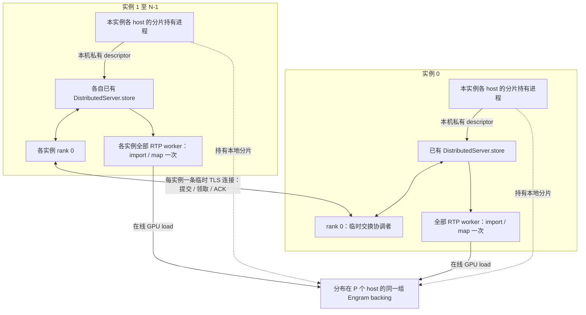

# 静态 N 实例、P host：一次交换，在线直接读内存

本轮实现采用最少新增连接的方式：**实例内复用已有 TCPStore；实例间只有 rank 0 建立临时 RPC；在线查表不调用 RPC，也不读取 Store。** 没有新增 sidecar 容器或集中存放完整表的 Owner。



## 开销与边界

| 项目 | 行为 |
|---|---|
| 单实例、多 host | 只复用实例内 Store；不启动跨实例 RPC |
| N 个实例 | 正常一次启动新增 N−1 条 TLS/TCP 连接，不构建全互联 |
| 每条连接 | HTTP/1.1 keep-alive，复用提交元数据和 ACK；不是每条请求重新建联 |
| 协调者 | 固定为成员列表第一个实例的 rank 0；只合并元数据，本实例仍只持有分配给自己的分片 |
| 启动完成 | 全部代表确认同一 payload 后关闭交换监听；worker 从本地缓存建立映射 |
| 在线推理 | 0 次新增 RPC、0 次新增 Store 读取；原有 GPU lookup/prefetch 路径不变 |
| 权重数据 | 不经过 RPC；GPU 经已验证可用的 Fabric/EGM 映射访问各 host 分片 |
| 内存生命周期 | 持有进程继续保留 backing，不能因 RPC 关闭而释放 |

这是消除**控制通道的逐请求开销**，不是承诺跨 host DRAM 读取等于本机 pinned 延迟。实际 lookup、prefetch 隐藏比例和完整 decode 增量仍须另测。控制路径使用 Python 标准库，不增加 gRPC/protobuf 依赖；TCP/TLS 是启动成本。

## 配置与自动接入

> **状态（2026-11-01）**：`distributed_plan.py` 与 `sharded_checkpoint_owner.py` 已删除，不再有独立的持片进程和启动计划生成器；持片现由每个实例在 `prepare_static_engram()` 内完成
> （`rtp_llm/models_py/modules/dsv41/engram_publish.publish_shard`）。下文的环境变量契约、组成员推导和校验语义仍然有效；凡是提到"生成计划 / 启动 holder"的步骤，一律替换为"直接把环境变量设到实例的每个 host 上"。

```json
{
  "instance_count": 2,
  "storage_host_count": 4,
  "generation": "本次组启动统一生成的 UUID（用于 holder 发布目录命名）",
  "checkpoint": "/models/DeepSeek",
  "model_revision": "不可变模型版本",
  "publication_root": "/run/engram",
  "storage_hosts": [
    {"host_id":"host-A","device":0,"numa":0},
    {"host_id":"host-B","device":0,"numa":0},
    {"host_id":"host-C","device":0,"numa":0},
    {"host_id":"host-D","device":0,"numa":0}
  ],
  "instances": [
    {"instance_id":"i0","ip":"10.0.0.1","hosts":["host-A","host-B"]},
    {"instance_id":"i1","ip":"10.0.0.2","hosts":["host-C","host-D"]}
  ],
  "exchange": {
    "coordinator": {"host": "10.0.0.1", "port": 29483},
    "timeout_seconds": 1800,
    "tls_dir": "/run/engram/pki"
  }
}
```

启动器不再生成任何 JSON 启动配置；它把契约直接写进每个实例的环境变量：

```
RTP_ENGRAM_COHORT=10.0.0.1,10.0.0.2             # 共享一份 Engram 的 host 列表，顺序=part 序号
RTP_ENGRAM_COHORT_PORT=29483                       # 可选；列表项不带端口时用，缺省 29483
RTP_ENGRAM_INSTANCE_INDEX=0                       # 可选；缺省=本机 IP 在列表中的位置
RTP_ENGRAM_MODEL_REVISION=<rev>                   # 同一 cohort 内一致
RTP_ENGRAM_CHECKPOINT=/models/DeepSeek            # 本机完整 checkpoint
RTP_ENGRAM_LOCAL_DEVICE=0                         # 建议显式给出；缺省回落 0 并告警
RTP_ENGRAM_LOCAL_NUMA=0                           # 建议显式给出；该 NUMA node 需有足够空闲内存
RTP_ENGRAM_MAX_ALLOCATION_BYTES=137438953472      # 必填；默认仅 1GiB
RTP_ENGRAM_MAX_TOTAL_ALLOCATION_BYTES=274877906944 # 必填；默认仅 8GiB
RTP_ENGRAM_RANKS_PER_INSTANCE=4                   # 可选；torch gang 跨多个 cohort 成员时需要
RTP_ENGRAM_GENERATION=<uuid>                      # 可选；缺省由 cohort+revision 推导
RTP_ENGRAM_LOCAL_DESCRIPTORS=<a.json>,<b.json>    # 可选；仅离线诊断模式需要
RTP_ENGRAM_COHORT_TIMEOUT=1800                    # 可选
RTP_ENGRAM_TLS_DIR=/run/engram/pki                # 可选；不设则走 plain HTTP
```

平台只需要给出 **host 列表**：列表里有几台 host，就是几个 part 在共享这份 Engram，顺序即 part 序号；
分片数、成员表、shard 归属、store 命名空间全部由它推导。

交换端口也不必指定：**整组只有列表里第 0 台需要监听**，而且只在启动窗口内（发布+握手，通常几十秒到几分钟），
握手结束即关闭；其余成员只有出站连接。缺省端口 29483，平台若希望落在自己的保留端口段内可用
`RTP_ENGRAM_COHORT_PORT` 覆盖。单机部署（列表只有一个元素）连这个端口都不需要。

本条中的 `RTP_ENGRAM_INSTANCE_INDEX`（“本机是第几片”）也不是必填的：程序会把本机 IPv4 与列表比对，
命中恰好一项就用它的位置。只有当容器不在 host 网络、本机 IP 与列表项对不上时，才需要显式给出，否则会报
`INSTANCE_INDEX_REQUIRED`；命中多项则报 `AMBIGUOUS_LOCAL_ADDRESS`。

`ENGRAM_SHARD_COUNT` 同样可以不给；给了只做一致性校验。`RTP_ENGRAM_GENERATION` 是可选的诊断用覆盖值，
缺省由 host 列表+revision 推导（`ip,ip` + 端口 与 `ip:port,ip:port` 推导结果相同）。

**重启约束**：只能整组（整个 cohort / 整个 gang）一起重启，并且要等旧进程退出、fabric 分配释放之后再起新的。
单独重启某个成员是未支持的行为——它会按同一个命名空间读到上一轮发布的 handle，而那些 handle 指向的分配
已经不存在。

`instance_id`、shard 分配和 `publisher_rank` 由这些输入确定性推导，不需要分发成员表，也不需要分发 UUID。

`RTP_ENGRAM_COHORT` 的顺序必须与实际 WORLD_RANK 分配一致：host index × local_world_size 对应本 host 的发布者 rank。每个实例允许不同的 local_world_size，但同一实例内部必须一致。

P 可配置为 2–64，N 为 1–64。每个实例至少持有一个分片；当前一物理 host 一 holder，因此 P≥N。物理 host 重叠时必须显式指定 storage_host.instance_id，不能重复加载一片。运行期间固定 N/P/成员/generation，不支持加入新实例、自动补片、缩组或选主。

单实例使用 `"exchange": {}` 即可，不需要 coordinator/TLS；仍须配置真实 worker 拓扑。

### 启动器做什么

1. 为本次组启动生成一个 UUID；确定 N/P、完整成员表、host 身份及 rank 顺序。所有节点必须处于可共享的 NVLink/IMEX 域，并具有相应权限。IP 可达不代表 Fabric 可导入。
2. 给每个实例的 rank 0 提供它自己的证书、私钥、CA 和相同的完整证书指纹表；使用平台 PKI。证书 SAN 必须覆盖 coordinator IP/域名。不要把 CA 私钥分发到业务节点。
3. 按上节契约确定每个实例的 `RTP_ENGRAM_*` 取值；成员表、分片归属和 store 命名空间全部由 `RTP_ENGRAM_COHORT`/`RTP_ENGRAM_INSTANCE_INDEX` 推导，其余变量都是本机参数。
4. 把 `RTP_ENGRAM_*` 设到对应实例的所有 host 环境里，并显式给出 `RTP_ENGRAM_LOCAL_DEVICE`/`RTP_ENGRAM_LOCAL_NUMA`（缺省回落 device 0/NUMA 0 并打印警告）。
   没有额外的持片进程需要启动：**无需人工收集/复制 Fabric handle，也不需要分发任何启动配置文件**。
6. 对每个实例设置 `consumers[].env` 后启动原有 RTP 命令。`BackendManager.start()` 在 DistributedServer 就绪后、NCCL/模型创建前调用 `prepare_static_engram()`。
7. 每个 host 在该 rank 内为自己持有的分片分配、加载并导出 descriptor，经现有 Store 汇集到 rank 0；跨实例自动交换完整元数据；所有 worker 自动生成私有本地缓存并沿现有 bootstrap 导入、GPU 样本校验，再进行模型 warmup/Graph。
8. 模型自身 ready 后才接流量。交换完成仅表示元数据齐备，不等于所有 GPU/模型已 ready。

测试证书可由下列工具生成（两天有效，仅开发实验）：

```bash
python3 -m tools.engram_sidecar.framework.make_exchange_test_certs \
  --output /private/test-pki --member i0 --member i1 --server-ip COORDINATOR_IP
```

输出的 `tls-config.json` 可以直接填入 `exchange.tls`；部署到容器时同步调整文件路径。只分发各实例自己的 key/cert 和 CA 公钥，不共享其他实例的私钥。

## RPC 与校验

| 接口 | 请求 | 作用 |
|---|---|---|
| POST /v1/exchange | instance_id、group_digest、该实例全部 descriptor | 等待 N 个实例齐备；返回同一 manifest、capabilities、samples |
| POST /v1/ack | instance_id、完整响应的 payload_digest | 所有代表确认相同结果后返回，连接关闭 |

- mTLS 验证 CA，并把客户端证书指纹绑定到 instance_id；客户端另外固定 coordinator 的证书指纹。不能只改 instance_id 冒充其他实例。
- 组摘要绑定 generation、模型版本、成员和 rank/host/shard 分配；检查每个 descriptor 的归属、完整 P、shape、布局、hash ABI、allocation ID、句柄集合。
- 同一实例相同提交可幂等；不同内容重报拒绝。缺成员、慢成员、缺 ACK、组不一致、TLS 失败均有超时/拒绝路径，不自动降低 N/P。
- 协调者从本地 checkpoint 计算每片边界和全局中间行的样本摘要；GPU import 后真实读取并比对。此样本校验不等于每个消费者重算完整权重 hash。
- JSON 有大小上限，不用 pickle，不记录 capability/私钥。Store 复用现有实例信任边界，前缀隔离不是新增认证机制。
- 交换结果以内存 package 形式交给模型 attach（`engram_bootstrap.stage_package`），**服务路径不写任何 bundle 文件**，因此没有临时目录、没有 capability 落盘、也没有清理责任。
- ACK 完成后清理本次 Store 元数据。任何失败都不能据此释放 backing：必须先停同组全部模型 worker、排空 GPU/Graph，再停止 holder。

## 代码入口

- `rtp_llm/models_py/modules/dsv41/engram_exchange.py`：有界 mTLS RPC、固定成员 barrier、身份绑定。
- `engram_startup.py`：已有 Store 汇集/广播、rank 0 交换、本地缓存。
- `engram_descriptors.py`：RPC 和离线工具共用同一分片校验。
- `rtp_llm/server/backend_manager.py`：模型创建前的启动钩子；未设置环境变量时立即跳过。
- `engram_publish.py`：进程内持片（分配/加载/导出 descriptor）；`release(generation)` 供进程退出或探针释放。
- `engram_capacity.py`：单次分配与整机预算的硬上限。
- `native/probe_static_exchange_cuda.py`：双 host、双实例、每实例两个 worker 的真实 CUDA 集成探针。

## 测试与已知限制

结果见 [本轮验证记录](rpc_20261030/RESULTS.md)。本轮将 startup 适配器、真实 TCPStore、跨容器 mTLS、跨 host Fabric 映射、样本校验和 Graph 串联测试；没有重启已有完整 P/D 服务，也没有把小表读取冒称为完整模型 chat 或 decode 性能结果。

BackendManager 已接入钩子，但该新 RPC 路径的完整模型 chat、完整 checkpoint 启动时间及 <100 μs decode 增量尚需单独验收。持片已并入模型进程，不再需要单独的 holder 进程；但仍不包括 C2 调度、运行时健康探测和高可用。一个 host 失效需整组停止/重建，不能通过重连 RPC 修复已经失效的映射。
